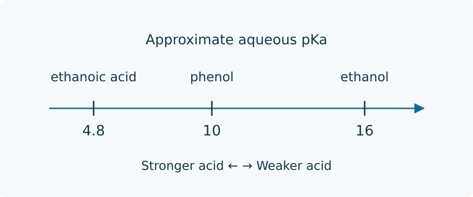
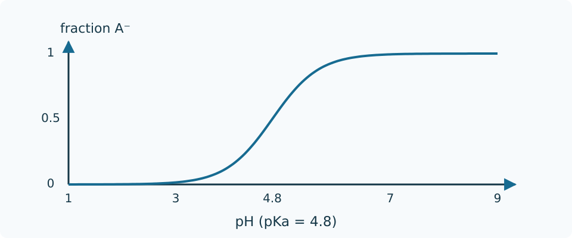
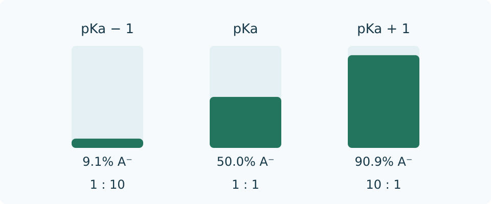

## What will you be able to explain?

- Identify an acid, base and their conjugates.
- Use structure and pKa to predict a proton transfer.
- Explain a predicted ionisation curve using the molecular species.

::: notes
Prerequisites: functional groups, lone pairs, formal charge. Have students draw
an oxygen with two bonds/two lone pairs and an oxygen with one bond/three lone
pairs. This is the bridge from representations to mechanisms.
:::

## A base uses an electron pair

{width=85% fig-alt="Hydroxide accepts an acidic proton; the O–H bond electrons stay on the acid oxygen."}

Draw **both** arrows. The proton moves; its original bonding pair stays behind.

::: notes
Point to the electron pair at the start of each arrow. The arrow is not the
path of the proton. Products must conserve total charge: minus one here.
:::

## Name both conjugate pairs

{width=85% fig-alt="Ethanoic acid/ethanoate and methylammonium/methylamine each differ by H plus."}

Removing H⁺ decreases the charge by one. It does not remove an electron pair.

## Why is ethanoic acid more acidic than ethanol?

{width=85% fig-alt="Equivalent resonance contributors distribute negative charge over the two ethanoate oxygens."}

Compare the **conjugate bases**. Ethoxide lacks this equivalent delocalisation.

::: notes
The resonance arrow is not an equilibrium arrow. Both contributors describe
one ion; nuclei remain fixed. Ask students to identify which bonds and lone
pairs differ and which atoms do not move.
:::

## pKa is an equilibrium measure

{width=85% fig-alt="Approximate aqueous pKa values: ethanoic acid 4.8, phenol 10, ethanol 16."}

$pK_a=-\log_{10}K_a$. Lower pKa means greater acid dissociation under comparable conditions.

## Predict direction before calculating

{width=85% fig-alt="Ethanoic acid protonates methylamine; the product acid has a larger pKa."}

For $HA+B\rightleftharpoons A^-+BH^+$,
$K\approx10^{pK_a(BH^+)-pK_a(HA)}$ with compatible pKa data.

## Stabilisation can also act through sigma bonds

{width=85% fig-alt="Chloro substitution lowers the acid pKa relative to ethanoic acid through electron withdrawal."}

Keep the comparison controlled: same solvent and related structures.

## A solution contains a distribution

{width=85% fig-alt="A smooth predicted ionisation curve for a monoprotic acid of pKa 4.8."}

Increasing pH shifts the balance toward A⁻. This model assumes dilute aqueous solution.

## At pH = pKa

{width=85% fig-alt="Equal concentrations of HA and A minus give a one-to-one ratio and 50 percent ionisation."}

$[A^-]/[HA]=10^{pH-pK_a}=1$. Individual molecules are HA or A⁻.

## One unit changes the ratio tenfold

{width=85% fig-alt="Ionised fractions are about 9.1, 50 and 90.9 percent at pKa minus one, pKa and pKa plus one."}

Distinguish the **ratio** $[A^-]/[HA]$ from the **fraction** $[A^-]/([HA]+[A^-])$.

## What this curve does not predict

{width=85% fig-alt="A two-phase diagram separates aqueous acid–base speciation from organic/aqueous partitioning."}

Extraction recovery also needs partition information and phase volumes.

## Use R to inspect the chemical model

```r
pKa <- 4.8
pH <- seq(1, 9, by = 0.1)
fraction_A_minus <- 1 / (1 + 10^(pKa - pH))
```

Predict the values at pH 3.8, 4.8 and 5.8 **before running** the calculation.

::: notes
The computing task reuses objects, vectors and plots. Teach the relationship
between the formula and the chemical ratio; do not turn this into a coding
syntax lecture. A vector holds model predictions, not replicate measurements.
:::

## Three checks on a calculated fraction

1. It stays between zero and one.
2. At pH = pKa, it is 0.5.
3. Raising pH increases the fraction of this acid present as A⁻.

If the trend is reversed, inspect the sign in the exponent.

## Explain, rather than name, the stronger acid

Compare ethanol and ethanoic acid. Draw each conjugate base, mark the charge,
and explain the relevant stabilisation. A pKa value checks your reasoning;
it is not the explanation by itself.

## Take the reasoning to the next unit

Electron source → electron-poor site; conserve atoms and charge.

Complete the [practice](exercise.qmd) and [self-check](quiz.qmd).
Optional reading: Solomons, selected chapter 3 sections; see the
[reading guide](../reference/reading.qmd).
