## About this lecture

You swallow an aspirin tablet. In your stomach (pH ≈ 2) about **97 %** of it is the neutral acid. A few minutes later, in your blood (pH 7.4), more than **99.9 %** of it is the negatively charged ion. **Same molecule, different form**, and only the pH changed.

Today we learn to predict that kind of switch:

- **Proton transfer:** curved arrows, and what happens to charges
- **Conjugate pairs:** acid and base differ by exactly one H⁺
- **Acid strength:** pKa, and why the conjugate base decides it
- **Equilibrium:** which side of an acid–base reaction wins
- **Ionisation:** how much is HA and how much is A⁻ at a given pH

Yesterday we used structure to predict boiling points; today the same reading skills predict acidity.

::: notes
Open with the aspirin tablet, and keep the numbers on the board; we come back to them at the end and actually calculate them. Aspirin's carboxylic acid has a pKa of about 3.5. The point of the hook: whether a drug carries a charge depends on the pH it's sitting in, and that changes how it crosses membranes, dissolves and gets excreted. Ask the room which form they'd guess crosses a fatty cell membrane more easily, charged or neutral. Most will say neutral, which is right, and it sets up the extraction slide at the end. Remind them that Day 1's formal-charge rules are exactly what we need today: every acid–base step changes one atom's charge.
:::

## An acid gives H⁺; a base gives an electron pair

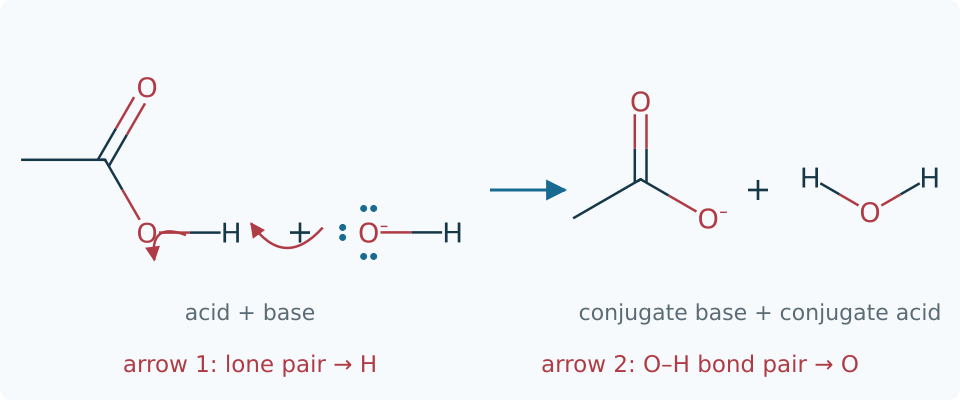{width=82% fig-alt="Ethanoic acid plus hydroxide gives ethanoate plus water; one red curved arrow runs from a hydroxide lone pair to the acidic H, a second from the O–H bond onto the acid oxygen"}

A **Brønsted acid** donates H⁺; a **base** accepts it using a lone pair. Two arrows: the base's **lone pair → H**, and the **O–H bonding pair → O**.

::: {.try}
**Try it:** can a curved arrow start at the H⁺ and point to the base?

::: {.fragment}
**No.** Curved arrows show where *electrons* go, and a bare proton has none. Start at a lone pair or a bond; H can only be where an arrow ends.
:::
:::

::: notes
Draw this one slowly on the board alongside the slide. The hydroxide oxygen has three lone pairs; one of them reaches for the acidic hydrogen. At the same time the O–H bond of the acid breaks, and both electrons of that bond stay on the acid oxygen. That's why ethanoate ends up with a negative charge: the oxygen keeps an extra lone pair. Students often draw a single arrow from H to OH⁻, which is backwards. The arrow notation tracks electrons, and this is the same notation we'll use for every mechanism from Week 2 onward, so it's worth getting right on the simplest possible reaction.
:::

## A nitrogen base: methylamine

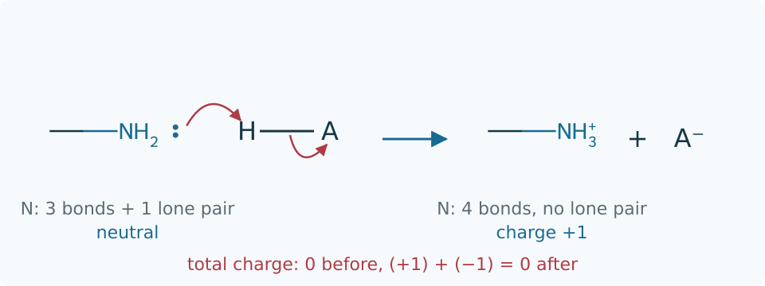{width=80% fig-alt="Methylamine lone pair arrow to H of H–A, H–A bond arrow to A; products methylammonium with N plus one and A minus"}

Same two arrows. N goes from **3 bonds + 1 lone pair** (neutral) to **4 bonds, no lone pair** (+1). A keeps the bonding pair and becomes A⁻.

**Total charge is conserved**: 0 on the left, (+1) + (−1) = 0 on the right.

::: notes
This is the nitrogen version of the previous slide. Use H–A as a placeholder for any acid, which is how the exercises write it. Ask: where did nitrogen's lone pair go? It became the new N–H bond, so N now has four bonds and, by Day 1's table, a +1 charge. Make students check total charge every time: if both products come out neutral, they've lost a charge somewhere. Amines as bases come back in a big way in Week 4 (amines and aromatics), and the ammonium ion is how most amine drugs are sold, as hydrochloride salts.
:::

## Conjugate pairs differ by one H⁺

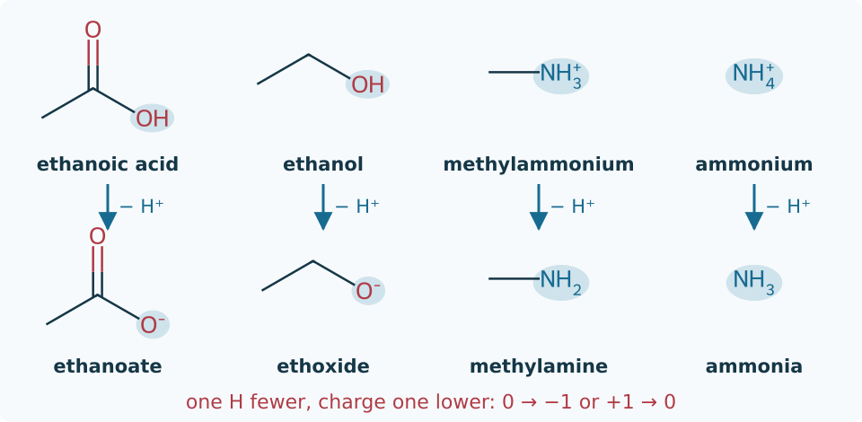{width=78% fig-alt="Ethanoic acid to ethanoate, ethanol to ethoxide, methylammonium to methylamine and ammonium to ammonia, each by loss of H plus"}

Removing H⁺ takes away **one H** and lowers the charge by **one**. The bonding pair stays behind as a new lone pair.

::: {.try}
**Try it:** what is the conjugate base of CH₃NH₃⁺?

::: {.fragment}
**CH₃NH₂ (methylamine), neutral.** N goes from four bonds to three bonds plus a lone pair, and +1 drops to 0.
:::
:::

::: notes
One rule covers neutral and charged acids alike. Ethanoic acid (neutral) gives ethanoate (−1); methylammonium (+1) gives methylamine (0). A conjugate base is not necessarily negative, which surprises people. Point out the shaded atom in each pair: that's where the lone pair appears. Common slip: students remove a hydrogen atom (H·) rather than a proton (H⁺) and end up with a neutral radical. The charge bookkeeping catches it.
:::

## Water can be either

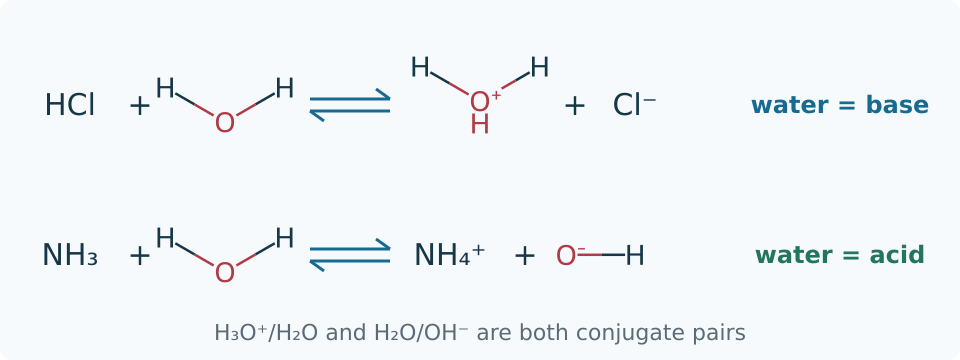{width=82% fig-alt="HCl plus water gives hydronium plus chloride; ammonia plus water gives ammonium plus hydroxide"}

With a stronger acid, water is the **base** (→ H₃O⁺). With a stronger base, water is the **acid** (→ OH⁻). Being an acid or base is a *role*, not a fixed label.

::: {.try}
**Try it:** a student draws neutral HA + neutral B → A⁻ + BH. What's wrong?

::: {.fragment}
**BH must be BH⁺.** Charge is 0 on the left, so A⁻ needs a +1 partner. A neutral BH would make a unit of charge disappear.
:::
:::

::: notes
Water's double role is why aqueous acid–base chemistry works at all: hydronium and hydroxide are the conjugates of water. Write the two pairs on the board: H₃O⁺/H₂O and H₂O/OH⁻. Water appears in both, once as the base and once as the acid. The try-it is a charge check written in generic letters; this is exactly the kind of error that shows up in exam mechanisms. Mention that HCl transfers its proton to water essentially completely, while ammonia in water is only slightly protonated, which is our cue for needing numbers: pKa.
:::

## pKa: a logarithmic scale of acid strength

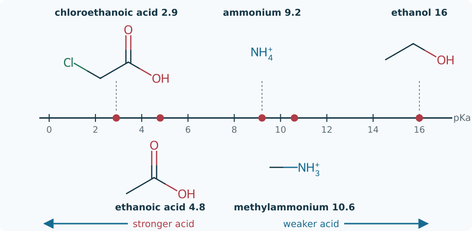{width=80% fig-alt="A pKa axis from 0 to 16 with chloroethanoic acid 2.9, ethanoic acid 4.8, ammonium 9.2, methylammonium 10.6 and ethanol 16"}

$$\text{p}K_\text{a} = -\log_{10} K_\text{a}$$

**Lower pKa = stronger acid.** One pKa unit is a factor of **10** in Ka, so ethanoic acid (4.8) is about 10¹¹ times more acidic than ethanol (16).

::: notes
Make sure everyone reads the scale in the right direction: small pKa, strong acid. Because it's a log scale, the gap between 4.8 and 16 is not "a bit more than three times"; it's eleven powers of ten. All the values here are approximate aqueous values and that's the only kind we'll compare; pKa values in DMSO or the gas phase are different and not interchangeable. Note that charged acids (ammonium, methylammonium) sit on the same scale as neutral ones. The pKa of methylammonium (10.6) is how we describe the basicity of methylamine. Ask: why is ethanoic acid so much more acidic than ethanol, when both lose H from an O–H? That's the next slide.
:::

## Acid strength lives in the conjugate base

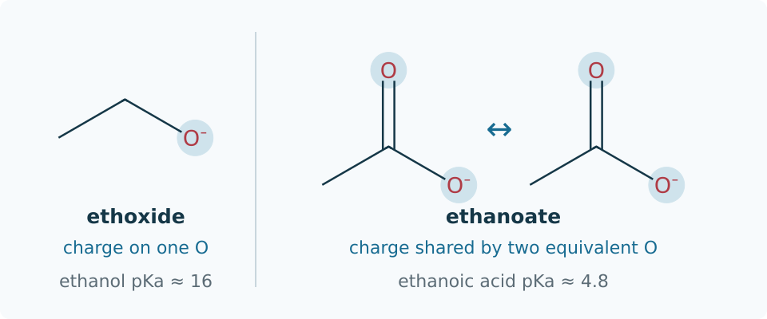{width=80% fig-alt="Ethoxide with its single charged oxygen shaded; two equivalent drawings of ethanoate with both oxygens shaded"}

Both acids lose H⁺ from O–H. The difference is what's left: in ethoxide the charge sits on **one** O, in ethanoate it's **spread over two equivalent O**. A more stable conjugate base means a stronger acid.

::: notes
This is the central idea of the lecture: to compare two acids, compare their conjugate bases. A base that holds its negative charge comfortably has little drive to take the proton back, so the acid gives it up more readily. Ethanoate spreads its charge over two oxygens, ethoxide can't. Students often try to explain acidity by looking at the acid itself ("the O–H bond is weaker"), which is a dead end here. Train them to draw the conjugate base first and ask where the charge goes. The two drawings of ethanoate need explaining, and that's the next slide.
:::

## Resonance: one ion, two drawings

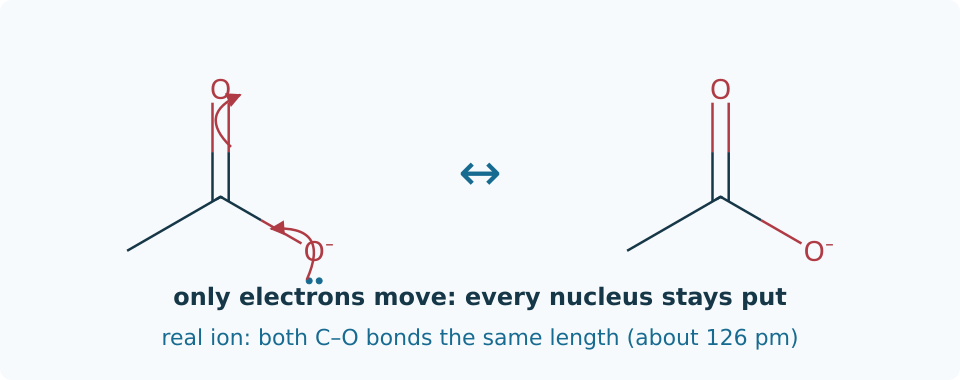{width=74% fig-alt="Ethanoate contributor with a lone pair arrow forming C=O and the C=O pi bond moving onto the other oxygen, a double-headed arrow, and the second contributor"}

The **↔** means "two drawings of the same thing", not an equilibrium (⇌). The real ion is a blend: each O carries about −½ and the two C–O bonds are identical.

::: {.try}
**Try it:** a classmate proposes a "second contributor" in which the H moves from one oxygen to the other. Is that resonance?

::: {.fragment}
**No.** Moving an H moves a nucleus, which makes a different species (a proton transfer). Resonance contributors differ only in where the electrons are drawn.
:::
:::

::: notes
Two classic misconceptions here. First, that ethanoate flips back and forth between the two forms. It doesn't: there's one ion, and neither drawing is the whole truth, a bit like describing a rhinoceros as part dragon, part unicorn. The evidence is that both C–O bonds have the same length, about 126 pm, between a normal C=O and C–O. Second, the equilibrium arrow and the resonance arrow get mixed up. Equilibrium (⇌) connects different species; resonance (↔) connects drawings of one species. Resonance comes back constantly: in amides in Week 4 and in aromatic rings in Week 4 too.
:::

## Induction: electronegative neighbours help

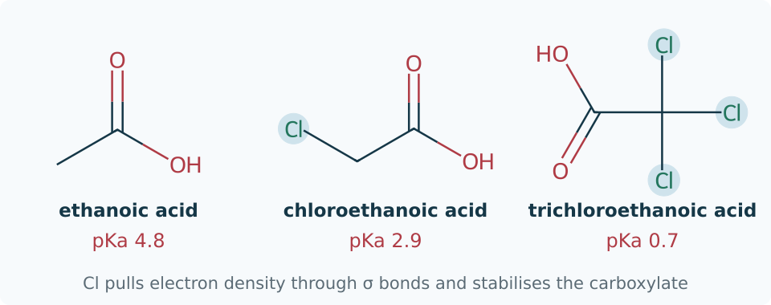{width=80% fig-alt="Ethanoic acid pKa 4.8, chloroethanoic acid pKa 2.9 and trichloroethanoic acid pKa 0.7 with chlorine atoms shaded"}

Cl pulls electron density through the **σ bonds**, which stabilises the carboxylate. More Cl, stronger acid. The effect fades quickly with distance.

::: notes
Induction is a second, separate way to stabilise a conjugate base. Keep it distinct from resonance: chlorine does not get a share of the negative charge in any contributor; it just pulls on the bonding electrons along the chain. That's why the effect drops off with distance: 3-chloropropanoic acid (pKa about 4.0) is only slightly stronger than propanoic acid (4.9), while 2-chloropropanoic is about 2.8. Quick check to ask aloud: which is the stronger acid, ClCH₂COOH or CH₃COOH, and why? Insist on a reason, not just the number. Then insist on fair comparisons: same functional group, same solvent, one change at a time. Comparing a carboxylic acid with an alcohol and calling it "induction" mixes up two effects.
:::

## Which way does an acid–base equilibrium lie?

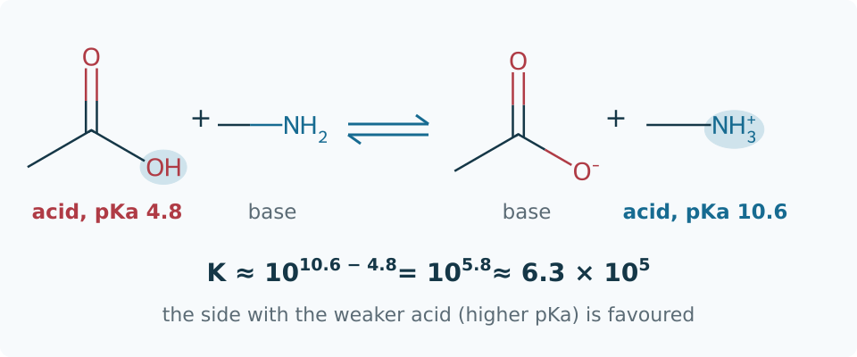{width=82% fig-alt="Ethanoic acid pKa 4.8 plus methylamine in equilibrium with ethanoate plus methylammonium pKa 10.6; K about 6.3 times ten to the fifth"}

Find **the acid on each side** and compare their pKa values. Equilibrium favours the side with the **weaker acid** (higher pKa):

$$K \approx 10^{\,\text{p}K_\text{a}(\text{product acid}) - \text{p}K_\text{a}(\text{reactant acid})}$$

::: notes
Walk through it: on the left the acid is ethanoic acid, 4.8. On the right the acid is methylammonium, 10.6. The proton prefers to sit on the weaker acid's base, i.e. methylamine holds it more tightly than ethanoate does. Subtract in the right order: product acid minus reactant acid gives +5.8, so K is about 6.3 × 10⁵ and the products win heavily. The most common mistake is comparing the wrong two numbers, for example the pKa of ethanoic acid with the pKa of methylamine's N–H (which is about 40 and irrelevant here). Always compare HA on the left with BH⁺ on the right.
:::

## Reversing the equation, and what K doesn't tell you

| direction | equation | K |
|---|---|---|
| forward | CH₃COOH + CH₃NH₂ ⇌ CH₃COO⁻ + CH₃NH₃⁺ | 10^5.8^ ≈ 6.3 × 10⁵ |
| reverse | CH₃COO⁻ + CH₃NH₃⁺ ⇌ CH₃COOH + CH₃NH₂ | 10^−5.8^ ≈ 1.6 × 10⁻⁶ |

The reverse constant is the **reciprocal**. And K says **where** the equilibrium lies, never **how fast** it gets there.

::: {.try}
**Try it:** a proton transfer has K = 10⁶. How many seconds does it take to reach equilibrium?

::: {.fragment}
**K can't tell you.** It compares the two states; speed depends on the pathway and its barrier. (Proton transfers between O and N happen to be very fast, but that's extra information.)
:::
:::

::: notes
Two short points that show up in the exercises. The reverse reaction uses 1/K, not the same big number; writing the same K for both directions would mean both sides are favoured, which is impossible. And K is a thermodynamic statement. Students conflate "favourable" with "fast" all the time, and it will matter a lot in Week 3 when we compare substitution and elimination, where a reaction can be favourable and still slow. Note for the curious: favourable O–H and N–H proton transfers really are near diffusion-limited, which is why we can treat acid–base steps as instant in mechanisms.
:::

## From pKa and pH to a ratio

$$r = \frac{[\text{A}^-]}{[\text{HA}]} = 10^{\,\text{pH} - \text{p}K_\text{a}} \qquad \text{fraction A}^- = \frac{r}{1 + r}$$

| pH − pKa | −2 | −1 | 0 | +1 | +2 |
|---|---|---|---|---|---|
| ratio A⁻ : HA | 0.01 | 0.1 | 1 | 10 | 100 |
| fraction A⁻ | 0.99 % | 9.1 % | 50 % | 90.9 % | 99.0 % |

::: {.try}
**Try it:** pKa 4.8, pH 3.8. Is the acid 10 % ionised?

::: {.fragment}
**No, about 9.1 %.** r = 0.1, and the fraction is 0.1/(1 + 0.1) = 0.091. A ratio and a fraction have different denominators.
:::
:::

::: notes
This is the Henderson–Hasselbalch relation rearranged, for a single acid in dilute water. Emphasise the two different quantities. The ratio compares A⁻ to HA and can be any positive number. The fraction compares A⁻ to the total and must lie between 0 and 1. If an R calculation gives a "fraction" of 10, the student has calculated the ratio. Learn the middle three columns by heart: one unit below pKa, about 9 %; at pKa, 50 %; one unit above, about 91 %. Two units either side, you're at 99 % one way or the other, but never exactly 100 %.
:::

## A fraction describes a population

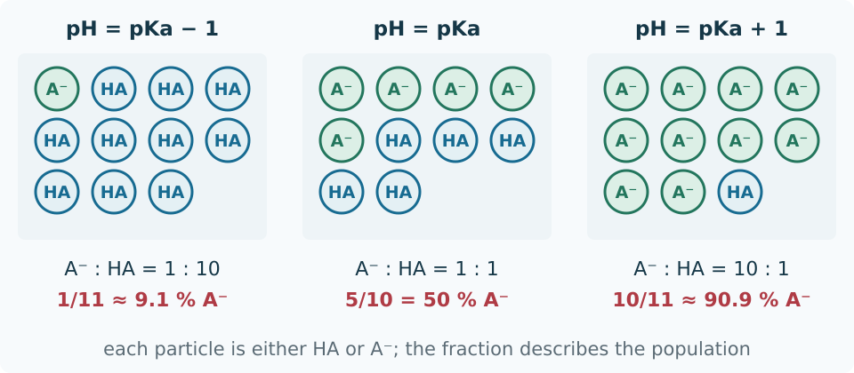{width=82% fig-alt="Three boxes of particles: one A minus and ten HA, five of each, and ten A minus with one HA, with their ratios and fractions"}

At pH = pKa, half the molecules are HA and half are A⁻. **No molecule is "half deprotonated"**: each one is either HA or A⁻ at any instant.

::: notes
The pictures are illustrative, not ten real molecules, but they make the ratio-to-fraction step concrete. In the left box, one A⁻ to ten HA is a ratio of 0.1, and one out of eleven is 9.1 %. Students who say "at the midpoint each molecule has lost half a proton" are mixing up a population average with a single molecule. Protons hop on and off constantly, so a given molecule spends part of its time in each form, but at any moment it is one or the other.
:::

## The ionisation curve

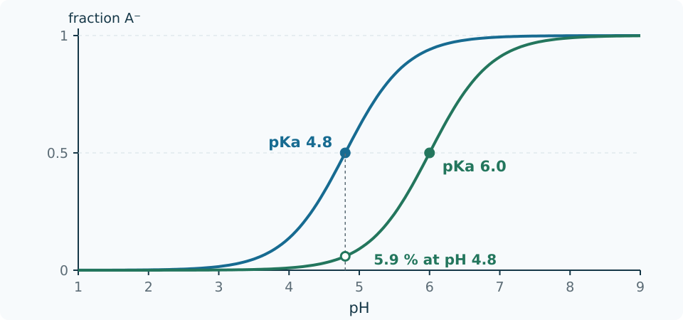{width=74% fig-alt="Two S-shaped curves rising from 0 to 1, crossing 0.5 at pH 4.8 and at pH 6.0; at pH 4.8 the pKa 6.0 acid is 5.9 percent ionised"}

The fraction A⁻ rises with pH and crosses **0.5 exactly at pH = pKa**. A higher pKa shifts the whole curve to the right.

::: {.try}
**Try it:** at pH 4.8, how much of each acid is ionised?

::: {.fragment}
**pKa 4.8: 50 %. pKa 6.0: about 5.9 %**, from 1/(1 + 10^1.2^). At the same pH, the lower-pKa acid is more ionised.
:::
:::

::: notes
This is the plot students build in today's R task: `1 / (1 + 10^(4.8 - pH))` over a pH grid. If their curve goes *down* with pH, the exponent sign is flipped and they've plotted the HA fraction instead. The curve is the same shape for every monoprotic acid; only the midpoint moves. Make sure nobody calls this a titration curve. Here pH is the input we choose; in a titration, pH is the result of adding a measured volume of base, which needs a different model.
:::

## Back to aspirin

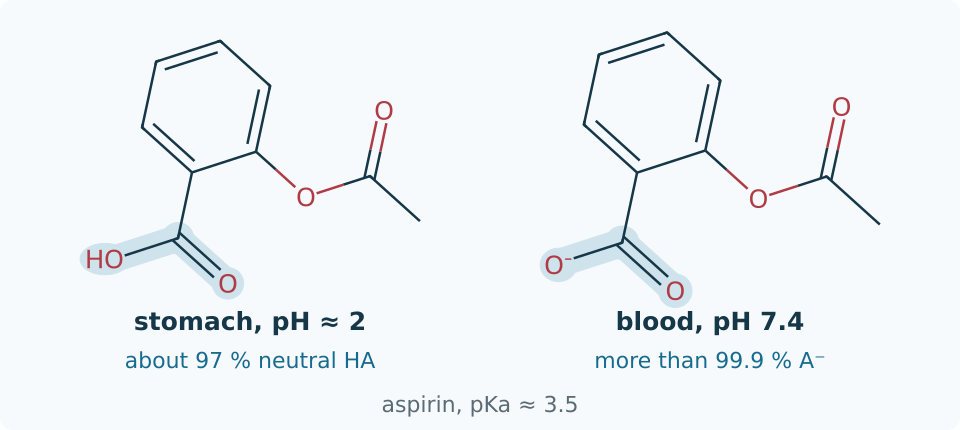{width=72% fig-alt="Aspirin with COOH shaded at stomach pH about 2, mostly neutral; aspirin with COO minus shaded at blood pH 7.4, almost entirely ionised"}

| | pH − pKa | ratio A⁻ : HA | fraction A⁻ |
|---|---|---|---|
| stomach, pH 2 | 2 − 3.5 = −1.5 | 0.032 | ≈ 3 % |
| blood, pH 7.4 | 7.4 − 3.5 = +3.9 | ≈ 8000 | > 99.9 % |

::: notes
Now we can do the opening calculation properly. Aspirin's carboxylic acid has pKa about 3.5. In the stomach, pH minus pKa is −1.5, so the ratio is 10^−1.5 ≈ 0.032 and only about 3 % is ionised. In blood, the ratio is 10^3.9 ≈ 8000, so essentially all of it is the carboxylate. The neutral form crosses membranes more easily, which is part of why aspirin can irritate the stomach lining. Honest caveat: most aspirin is actually absorbed in the small intestine, despite being ionised there, because the surface area is enormous. pKa reasoning tells you which form dominates, not the whole pharmacology.
:::

## Two groups, two pKa values: glycine

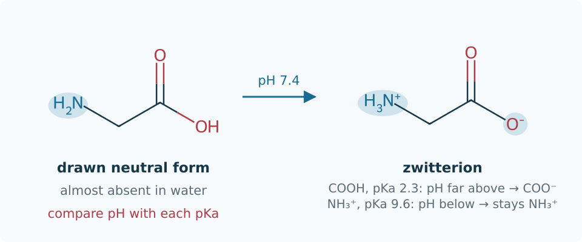{width=78% fig-alt="Neutral glycine with NH2 and COOH converting at pH 7.4 to the zwitterion with NH3 plus and COO minus"}

Treat each group separately. COOH (pKa 2.3) at pH 7.4 is far above its pKa, so it's **COO⁻**. NH₃⁺ (pKa 9.6) is below its pKa, so it **stays NH₃⁺**.

::: {.try}
**Try it:** at pH 7.4, about what fraction of glycine's amino groups are NH₂ rather than NH₃⁺?

::: {.fragment}
**About 0.6 %.** pH − pKa = 7.4 − 9.6 = −2.2, so the ratio NH₂ : NH₃⁺ is 10^−2.2^ ≈ 0.006.
:::
:::

::: notes
This links back to Day 1's zwitterion try-it: we can now explain *why* amino acids exist as H₃N⁺–CH–COO⁻ in cells. For each ionisable group, compare pH with that group's pKa. The neutral "textbook" form with NH₂ and COOH is almost absent in water at any pH, which surprises students. Remind them that the pKa of the ammonium group (9.6) describes the conjugate acid, so the amine is the base here. Proteins carry these charged groups on their side chains as well, which is why protein charge depends on pH.
:::

## Where this model stops

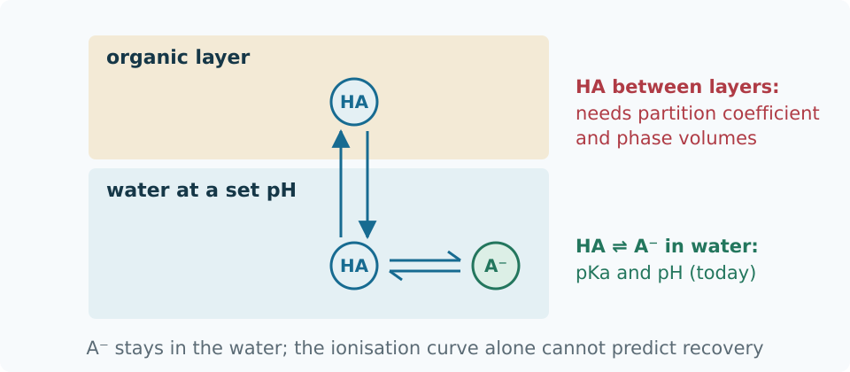{width=78% fig-alt="Organic layer above water; HA moves between the layers, while HA and A minus interconvert in the water; labels say pKa and pH describe the aqueous step, partition coefficient and phase volumes the transfer"}

Our equation describes **one acid in dilute water at a chosen pH**. It doesn't give the pH during a titration, and it doesn't tell you how much ends up in an organic layer.

::: {.try}
**Try it:** at high pH an acid is mostly A⁻. What else would you need to predict how much you recover from an organic extract?

::: {.fragment}
**Partition coefficients and the phase volumes**, plus the starting amount and any losses. Aqueous ionisation is only one piece.
:::
:::

::: notes
This is the lab connection. In a work-up you shake an organic solvent with aqueous acid or base, and the charged form stays in the water. So raising the pH pulls a carboxylic acid out of the organic layer, and lowering it pushes it back. That's the principle, but the numbers need more: how strongly the neutral HA prefers the organic phase (the partition coefficient), how much of each solvent you use, and how much you started with. Being clear about what a model can and can't predict is part of doing chemistry with R: the curve you plot today is a model consequence of an assumed pKa, not measured data.
:::

## Mistakes we see every year

| mistake | fix |
|---|---|
| curved arrow starting at H⁺ | start at a **lone pair or a bond** |
| conjugate base with the same charge as the acid | removing H⁺ lowers the charge **by one** |
| "lower pKa = weaker acid" | lower pKa = **stronger** acid |
| comparing pKa values of unrelated sites | compare **HA on the left** with **BH⁺ on the right** |
| resonance forms "switching back and forth" | one ion; **↔** is not **⇌** |
| ratio 0.1 read as 10 % ionised | fraction = r/(1 + r) = **9.1 %** |
| "half the molecule is deprotonated" | half the **molecules** are A⁻ |
| a large K means a fast reaction | K gives **position**, not rate |

::: notes
Read each mistake aloud and ask the room why it's wrong before revealing the fix. Every row maps to an exercise: arrows to 1 and 3, charges to 4 and 18, pKa direction and comparison to 5, 7 and 9, resonance to 6, ratio and fraction to 10 to 14, populations to 11, and K versus rate to 16.
:::

## Summary

| concept | key fact |
|---|---|
| proton transfer | two arrows: lone pair → H, bond pair → atom |
| conjugate pair | differ by one H⁺; charge changes by one |
| pKa | lower = stronger; 1 unit = factor of 10 |
| acid strength | judged by conjugate-base stability |
| stabilisation | resonance (↔) and induction (σ bonds) |
| equilibrium | weaker acid side wins; K ≈ 10^ΔpKa^ |
| ratio and fraction | r = 10^pH\ −\ pKa^, fraction = r/(1 + r) |
| midpoint | pH = pKa gives 50 % A⁻ |

**Next:** conformations, how molecules twist about single bonds (Day 6). **Practice:** [exercises](exercise.qmd) · [self-check](quiz.qmd)

::: notes
Recite the procedure once: draw the conjugate base, find where the charge goes, compare pKa values on the same scale, and use pH minus pKa to get the ratio. Days 4 and 5 are consolidation days, and Day 5 puts structure, properties and acidity together, so today's material comes straight back. Today's R task plots the ionisation curve; encourage students to predict the fractions at pH 3.8, 4.8 and 5.8 before running the code. After the consolidation days we start Week 2 with conformations, where the question shifts from which atoms are bonded to how the molecule is shaped in 3D.
:::
