## What should you be able to explain?

Draw proton transfers; identify conjugates; compare acid strength and interpret an aqueous speciation model.

::: notes
45-minute budget: two-arrow proton transfer6 min including a60-second drawing; conjugate/charge audits4 min; resonance and stabilisation7 min; pKa interpretation5 min; equilibrium direction5 min with a60-second calculation; curve and midpoint6 min; ratio-to-fraction checks7 min including two60-second attempts; model/extraction boundary3 min; exit2 min. Total45 min including the pauses.

Use the slide pace flexibly: concrete worked operations deserve more time than brief resolved checks. The intended outcome is an explainable chemical argument,not a slide count.
:::

## Bring these tools into the room

Locate lone pairs and calculate formal charge. A curved arrow starts at an electron pair, not at an isolated proton.

::: notes
Use a quick spoken diagnostic; do not spend an additional unscheduled revision block. Revisit a missing convention at its worked example.
:::

## Find the electron source before the proton moves

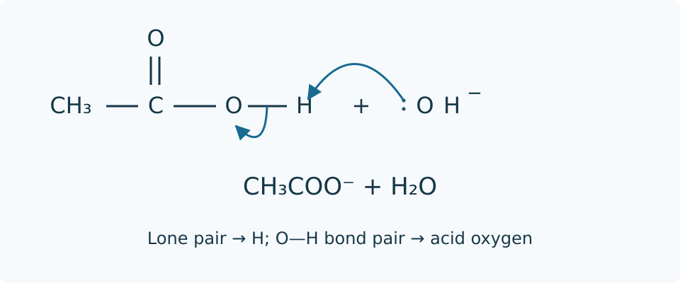{width=82% fig-alt="Find the electron source before the proton moves"}

Point to a hydroxide lone pair, the acidic H and the O–H bonding pair.

::: notes
Begin this chemical argument with the displayed structure. Ask for a concrete atom, bond, label or observation rather than the topic name. Keep the first prediction brief.
:::

## Protonate a nitrogen using two arrows

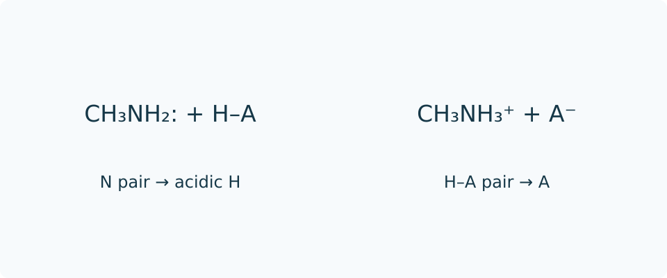{width=82% fig-alt="Protonate a nitrogen using two arrows"}

N pair goes to H; H–A bond pair goes to A. The products are ammonium and A⁻.

## Follow both pairs in the oxygen example

{width=82% fig-alt="Follow both pairs in the oxygen example"}

The base makes a new bond to H while the acid oxygen keeps its original bonding pair.

## Let water play either role

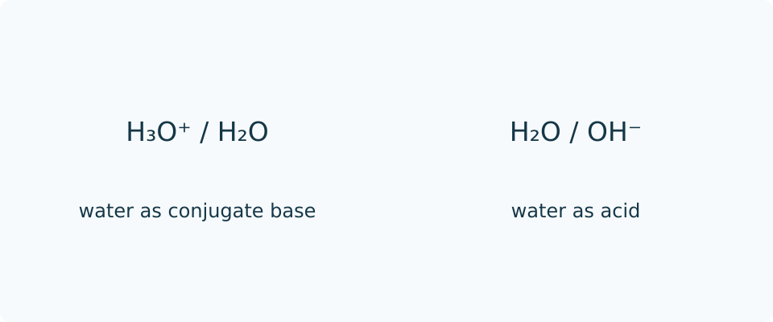{width=82% fig-alt="Let water play either role"}

Water is the conjugate base of hydronium and the acid corresponding to hydroxide.

## Predict: can the arrow start at H⁺?

An electron-pair-flow arrow shows where an electron pair comes from. Does an isolated proton supply that pair?

::: notes
Give 15–20 seconds for an individual prediction or a small drawing. Ask one student to state the rule they used; resolve on the next slide within this same timed block.
:::

## Resolve: begin at the electron source

Begin at a lone pair or bond. H⁺ can be the destination but is not a source of an electron pair.

::: notes
Use the explicit answer to diagnose the named misconception. Move on once students can state the rule; the practice page provides further worked attempts.
:::

## Compare each acid with its conjugate base

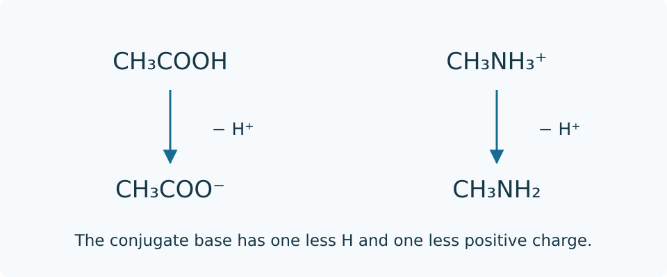{width=82% fig-alt="Compare each acid with its conjugate base"}

What single particle differs, and by how much does formal charge change?

::: notes
Begin this chemical argument with the displayed structure. Ask for a concrete atom, bond, label or observation rather than the topic name. Keep the first prediction brief.
:::

## Use one rule for neutral and charged acids

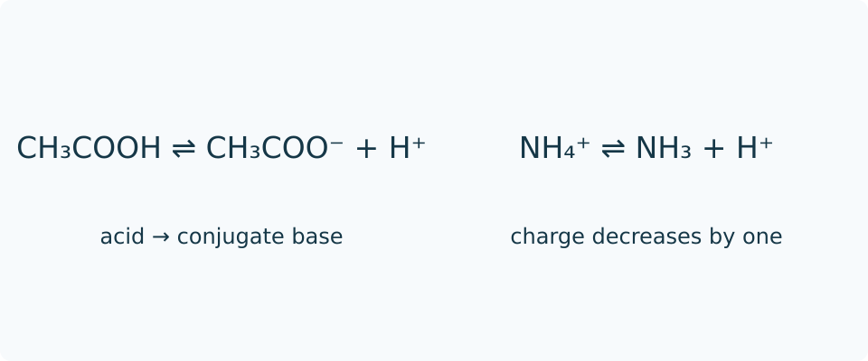{width=82% fig-alt="Use one rule for neutral and charged acids"}

Ethanoic acid gives ethanoate; ammonium gives ammonia. Each loses H⁺.

## Apply the rule to an alcohol

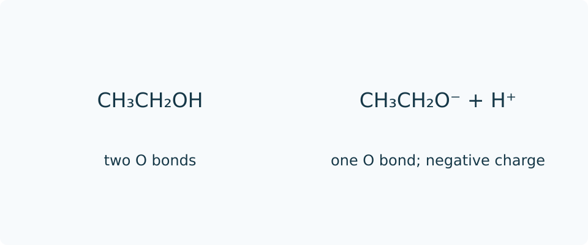{width=82% fig-alt="Apply the rule to an alcohol"}

Ethanol gives ethoxide on deprotonation. Its oxygen changes from two bonds to one and gains a lone pair.

## Predict: remove H⁺ from CH₃NH₃⁺

Write the neutral/charged formula and count N bonds before naming the result.

::: notes
Give 15–20 seconds for an individual prediction or a small drawing. Ask one student to state the rule they used; resolve on the next slide within this same timed block.
:::

## Resolve: methylamine is neutral

CH₃NH₂ has three N bonds and one lone pair. The initial +1 charge becomes zero.

::: notes
Use the explicit answer to diagnose the named misconception. Move on once students can state the rule; the practice page provides further worked attempts.
:::

## Explain why the two C–O bonds are equivalent

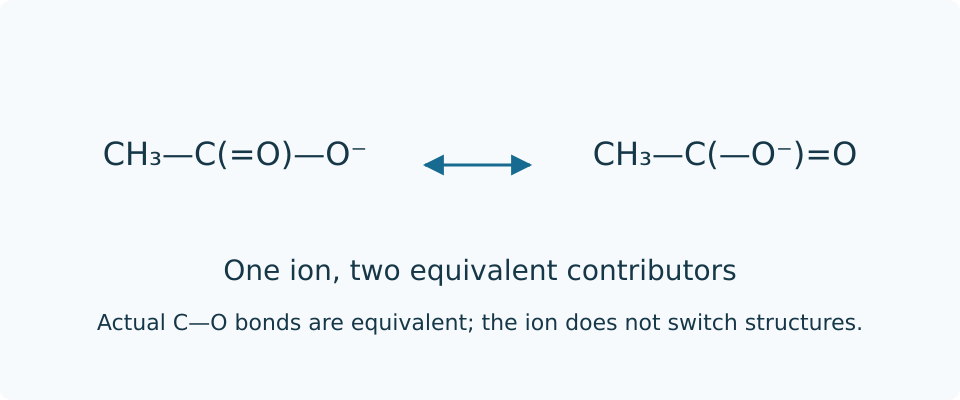{width=82% fig-alt="Explain why the two C–O bonds are equivalent"}

Which electrons differ between the two ethanoate contributors, and which nuclei stay fixed?

::: notes
Begin this chemical argument with the displayed structure. Ask for a concrete atom, bond, label or observation rather than the topic name. Keep the first prediction brief.
:::

## Distinguish contributor arrows from equilibrium arrows

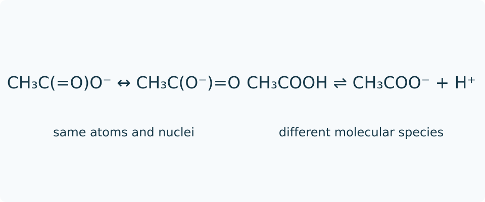{width=82% fig-alt="Distinguish contributor arrows from equilibrium arrows"}

Resonance describes one delocalised species. Proton transfer changes which molecular species are present.

## Compare ethoxide with ethanoate

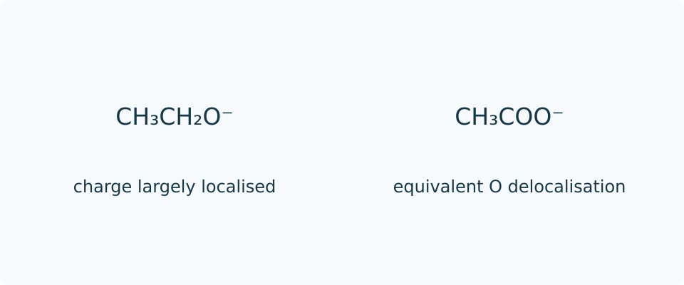{width=82% fig-alt="Compare ethoxide with ethanoate"}

Equivalent delocalisation over two oxygens stabilises ethanoate relative to a localised alkoxide description.

## Predict: can a hydrogen shift be resonance?

If a proposed second drawing moves H from one atom to another, is only electron placement changing?

::: notes
Give 15–20 seconds for an individual prediction or a small drawing. Ask one student to state the rule they used; resolve on the next slide within this same timed block.
:::

## Resolve: moving a nucleus changes the species

A proton shift is a chemical transformation. Resonance contributors preserve nuclear positions and connectivity.

::: notes
Use the explicit answer to diagnose the named misconception. Move on once students can state the rule; the practice page provides further worked attempts.
:::

## Read the acid scale in the right direction

{width=82% fig-alt="Read the acid scale in the right direction"}

Lower pKa corresponds to greater acid dissociation under comparable conditions.

::: notes
Begin this chemical argument with the displayed structure. Ask for a concrete atom, bond, label or observation rather than the topic name. Keep the first prediction brief.
:::

## Choose the two relevant acid pKa values

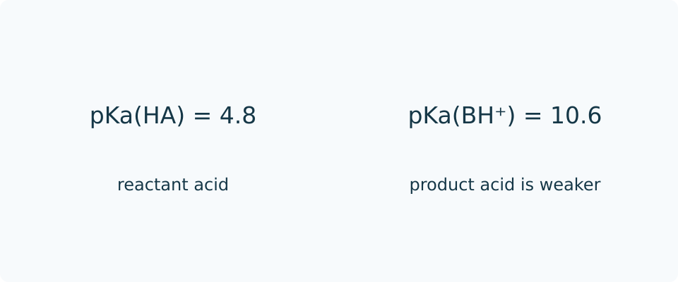{width=82% fig-alt="Choose the two relevant acid pKa values"}

For HA + B ⇌ A⁻ + BH⁺, compare HA with BH⁺, rather than comparing unrelated acidic sites.

## A logarithmic change represents a ratio

{width=82% fig-alt="A logarithmic change represents a ratio"}

A decrease of one pKa unit corresponds to a tenfold increase in Ka, with compatible conventions.

## Estimate the product-favoured equilibrium

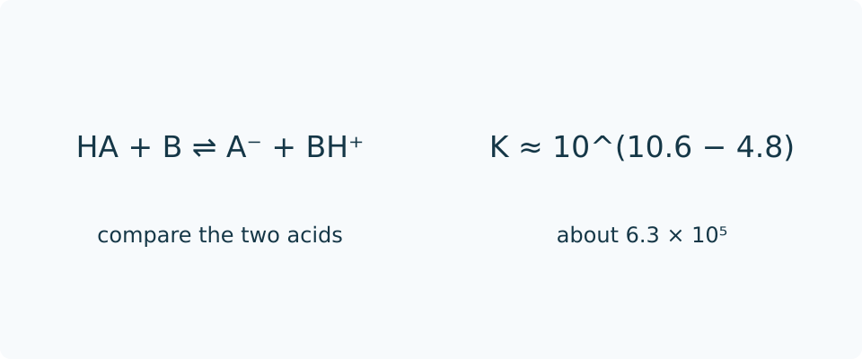{width=82% fig-alt="Estimate the product-favoured equilibrium"}

10^(10.6 − 4.8) is about 6.3 × 10⁵. The product acid is much weaker.

## Predict: use the sign of the difference

If the product acid instead has lower pKa than HA, is the forward equilibrium strongly favoured?

::: notes
Give 15–20 seconds for an individual prediction or a small drawing. Ask one student to state the rule they used; resolve on the next slide within this same timed block.
:::

## Resolve: the exponent becomes negative

K becomes less than one. Equilibrium favours the side containing the weaker acid/base pair, all else comparable.

::: notes
Use the explicit answer to diagnose the named misconception. Move on once students can state the rule; the practice page provides further worked attempts.
:::

## Reverse the constant when reversing the equation

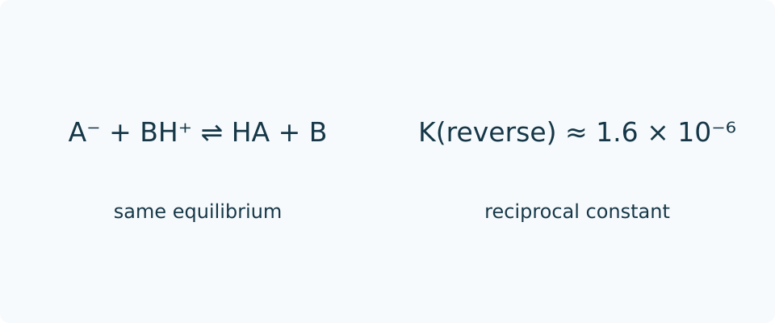{width=82% fig-alt="Reverse the constant when reversing the equation"}

The reverse reaction uses the reciprocal equilibrium constant, not the same large number.

## Do not infer reaction speed from K

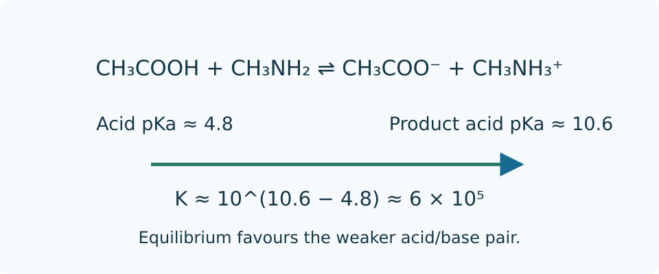{width=82% fig-alt="Do not infer reaction speed from K"}

An equilibrium ratio compares states. It does not specify how fast the reaction reaches equilibrium.

## Compare a controlled substituent change

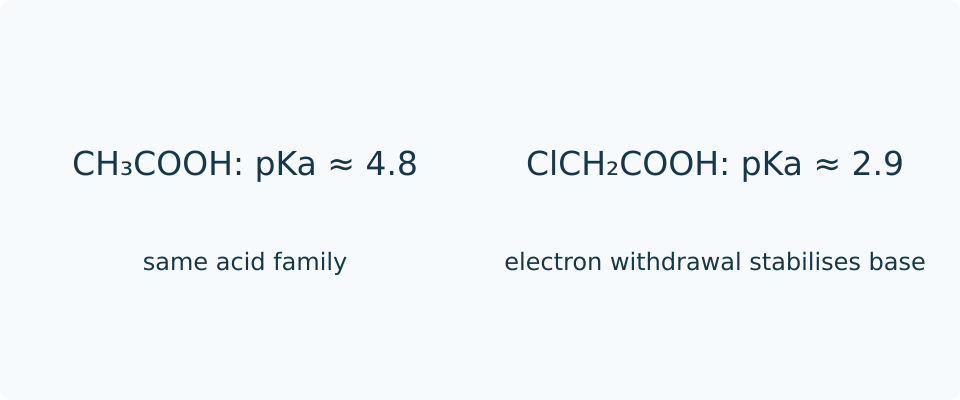{width=82% fig-alt="Compare a controlled substituent change"}

A nearby electron-withdrawing Cl group lowers this related carboxylic-acid pKa by stabilising its conjugate base.

## Plot a defined acid rather than an unspecified curve

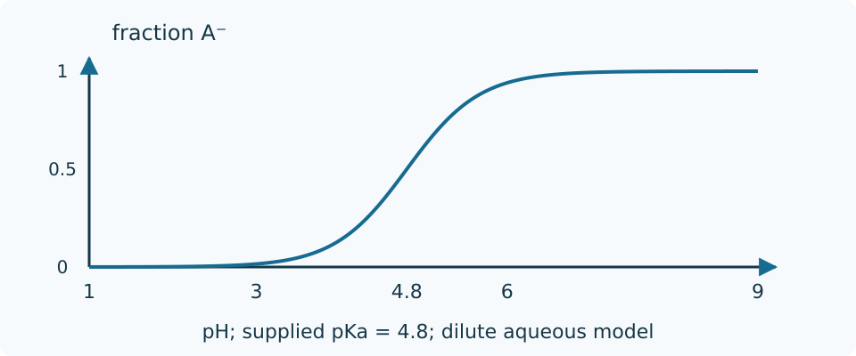{width=82% fig-alt="Plot a defined acid rather than an unspecified curve"}

At supplied pKa 4.8, the predicted A⁻ fraction rises continuously as aqueous pH increases.

## Keep induction distinct from resonance

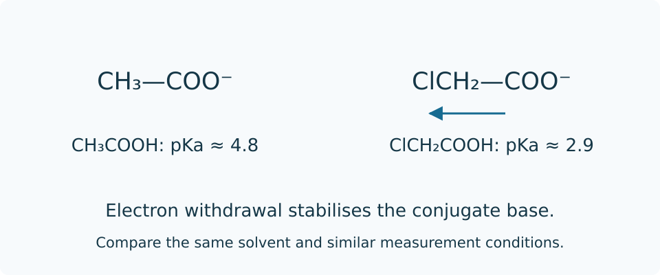{width=82% fig-alt="Keep induction distinct from resonance"}

Inductive effects act through sigma bonds; ethanoate resonance redistributes electrons within its conjugated group.

## Change the acid while keeping the pH range

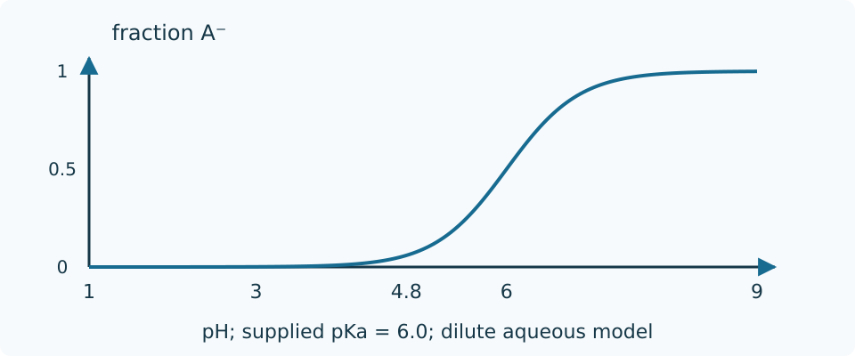{width=82% fig-alt="Change the acid while keeping the pH range"}

Raising pKa to 6.0 shifts the same-shaped ideal speciation curve toward higher pH.

## Predict: at pH 4.8, which acid is more ionised?

Compare supplied pKa values 4.8 and 6.0 before calculating.

::: notes
Give 15–20 seconds for an individual prediction or a small drawing. Ask one student to state the rule they used; resolve on the next slide within this same timed block.
:::

## Resolve: the lower-pKa acid is more ionised

The pKa 4.8 acid is 50% A⁻. The pKa 6.0 acid is only about 5.9% A⁻ at the same pH.

::: notes
Use the explicit answer to diagnose the named misconception. Move on once students can state the rule; the practice page provides further worked attempts.
:::

## Read a curve as a population statement

{width=82% fig-alt="Read a curve as a population statement"}

The ordinate is [A⁻]/([HA]+[A⁻]), not the number of protons on an individual molecule.

::: notes
Begin this chemical argument with the displayed structure. Ask for a concrete atom, bond, label or observation rather than the topic name. Keep the first prediction brief.
:::

## Start below the midpoint

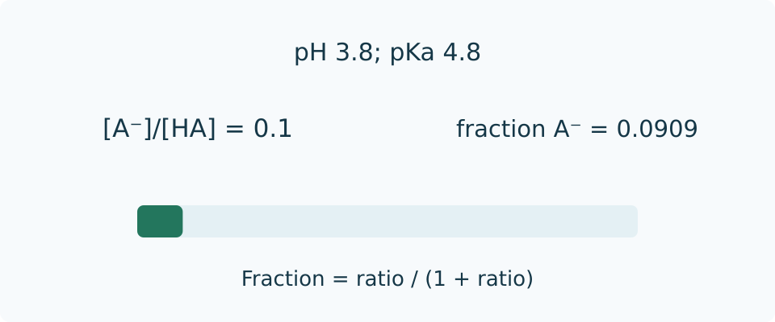{width=82% fig-alt="Start below the midpoint"}

At pH 3.8 and pKa 4.8, A⁻/HA = 0.1. Convert that ratio into a fraction.

## Check the two limiting directions

{width=82% fig-alt="Check the two limiting directions"}

Low pH favours HA; high pH favours A⁻ in this monoprotic dilute aqueous model.

## Evaluate the midpoint exactly

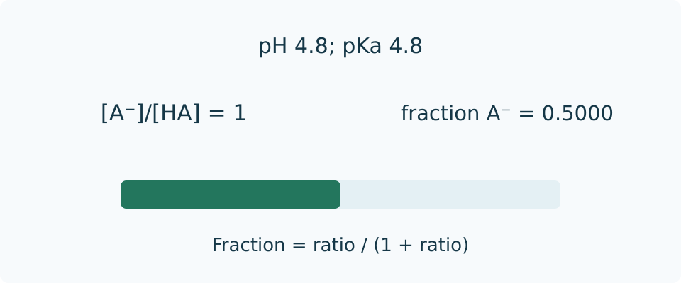{width=82% fig-alt="Evaluate the midpoint exactly"}

At pH = pKa the ratio is one, so fraction A⁻ = 1/(1+1) = 0.5.

## Predict: ratio 0.1 means 10% ionised?

Convert A⁻/HA to A⁻/(A⁻+HA). Are the denominators identical?

::: notes
Give 15–20 seconds for an individual prediction or a small drawing. Ask one student to state the rule they used; resolve on the next slide within this same timed block.
:::

## Resolve: about 9.1%, not exactly 10%

Use 0.1/(1+0.1) = 0.0909. Ratio and fraction are different quantities.

::: notes
Use the explicit answer to diagnose the named misconception. Move on once students can state the rule; the practice page provides further worked attempts.
:::

## Interpret 50/50 without half-molecules

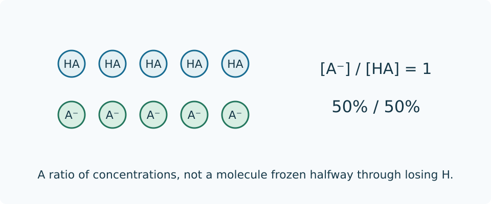{width=82% fig-alt="Interpret 50/50 without half-molecules"}

At the midpoint, equal concentrations of the two molecular species coexist.

::: notes
Begin this chemical argument with the displayed structure. Ask for a concrete atom, bond, label or observation rather than the topic name. Keep the first prediction brief.
:::

## Read a low-ionisation particle sketch

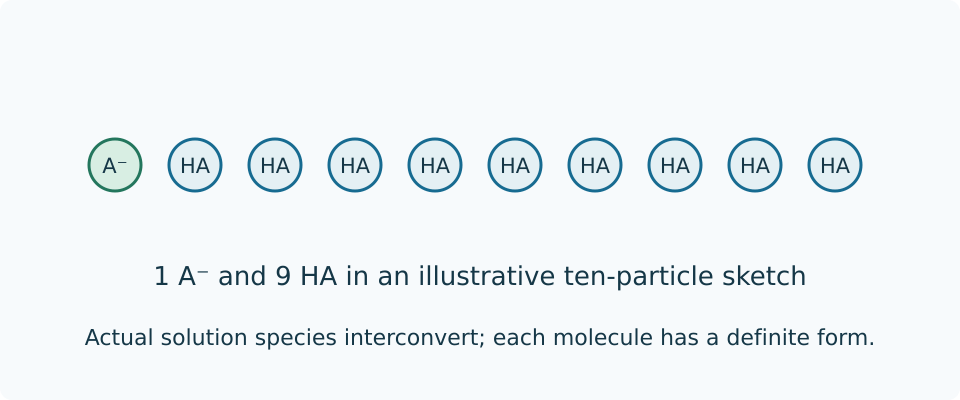{width=82% fig-alt="Read a low-ionisation particle sketch"}

One A⁻ among ten illustrative particles corresponds to about 10%, not an atom carrying one-tenth of a charge.

## Read an equal-species sketch

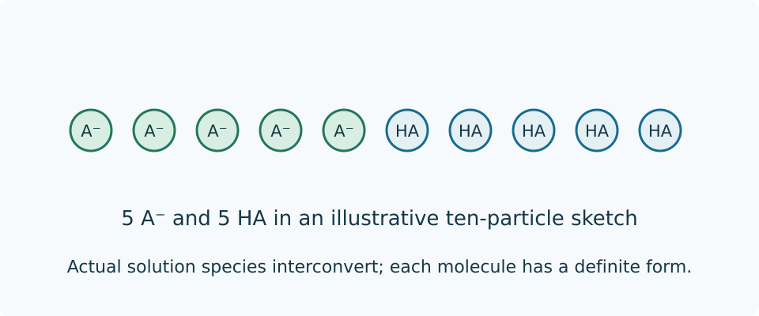{width=82% fig-alt="Read an equal-species sketch"}

Five HA and five A⁻ represent equal populations. The sketch is illustrative, not a measurement of ten actual molecules.

## Predict: are all molecules halfway deprotonated?

Describe what a 50% fraction means in terms of definite molecular species.

::: notes
Give 15–20 seconds for an individual prediction or a small drawing. Ask one student to state the rule they used; resolve on the next slide within this same timed block.
:::

## Resolve: two types coexist

A particular species is HA or A⁻. The fraction describes how much of the population belongs to each form.

::: notes
Use the explicit answer to diagnose the named misconception. Move on once students can state the rule; the practice page provides further worked attempts.
:::

## Convert the tenfold ratio explicitly

{width=82% fig-alt="Convert the tenfold ratio explicitly"}

At pKa + 1, A⁻/HA = 10. The fraction is 10/11.

::: notes
Begin this chemical argument with the displayed structure. Ask for a concrete atom, bond, label or observation rather than the topic name. Keep the first prediction brief.
:::

## Read the near-upper part of the curve

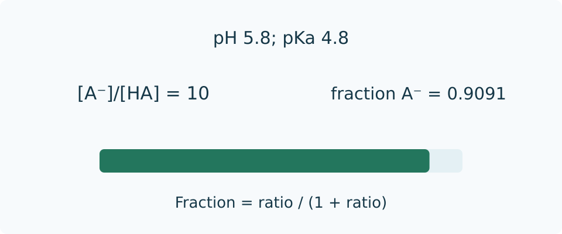{width=82% fig-alt="Read the near-upper part of the curve"}

At pH 5.8, pKa 4.8, the ionised fraction is about 0.9091.

## Check two units above pKa

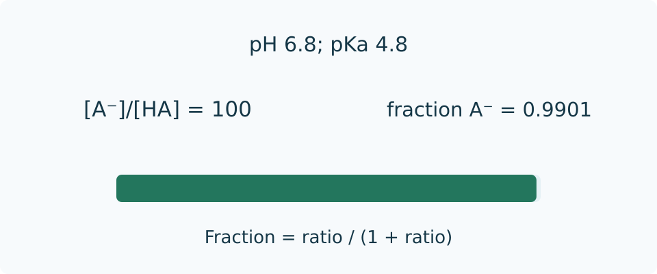{width=82% fig-alt="Check two units above pKa"}

At pH 6.8 the ratio is 100 and the fraction is 100/101, about 0.9901.

## Predict: may a valid fraction exceed one?

An R calculation returns 10. What quantity may the student have calculated instead?

::: notes
Give 15–20 seconds for an individual prediction or a small drawing. Ask one student to state the rule they used; resolve on the next slide within this same timed block.
:::

## Resolve: likely the ratio, not the fraction

A⁻/HA may exceed one. A⁻/(HA+A⁻) must stay between zero and one.

::: notes
Use the explicit answer to diagnose the named misconception. Move on once students can state the rule; the practice page provides further worked attempts.
:::

## Separate aqueous chemistry from phase transfer

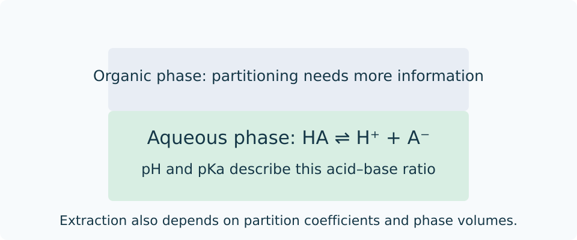{width=82% fig-alt="Separate aqueous chemistry from phase transfer"}

Which part of the diagram is described by the supplied acid–base equation?

::: notes
Begin this chemical argument with the displayed structure. Ask for a concrete atom, bond, label or observation rather than the topic name. Keep the first prediction brief.
:::

## Read a mostly ionised population

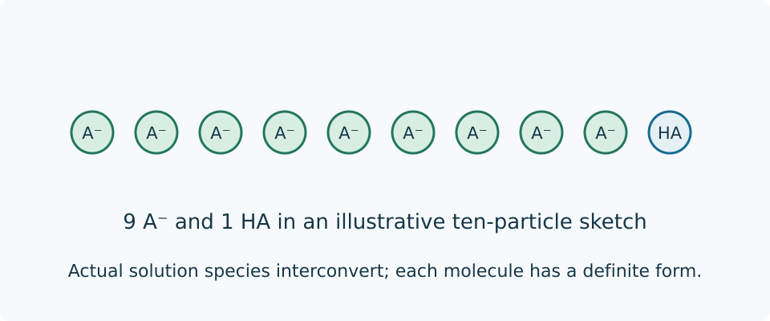{width=82% fig-alt="Read a mostly ionised population"}

Nine A⁻ among ten illustrative species means predominantly the conjugate base, without implying complete ionisation.

## List the extra extraction inputs

{width=82% fig-alt="List the extra extraction inputs"}

Partition behaviour and the two phase volumes affect recovery beyond aqueous species ratios.

## Do not mislabel the horizontal axis

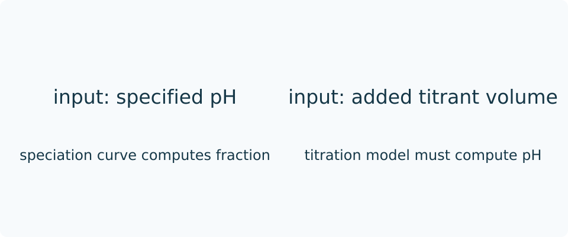{width=82% fig-alt="Do not mislabel the horizontal axis"}

This speciation plot takes pH as input. A titration curve instead needs a model connecting titrant addition to pH.

## Predict: what did changing pKa in R test?

Was it an experimental measurement, a proof of solvent recovery, or a sensitivity check of the supplied model?

::: notes
Give 15–20 seconds for an individual prediction or a small drawing. Ask one student to state the rule they used; resolve on the next slide within this same timed block.
:::

## Resolve: a model comparison

The plot visualises consequences of an assumed pKa and dilute aqueous relationship. It is neither new measured data nor an extraction calculation.

::: notes
Use the explicit answer to diagnose the named misconception. Move on once students can state the rule; the practice page provides further worked attempts.
:::

## Combine the tools in one explanation

Use CH₃COOH + CH₃NH₂ as the common example linking electron flow, conjugates, pKa and population.

::: notes
Take a 30-second sketch or explanation, then ask for one observation and the reason linking it to the conclusion. This is included in the 45-minute session.
:::

## Your next independent work

Use the [standalone practice and worked checks](exercise.qmd), then the [self-check](quiz.qmd). Required core problems and optional transfer work are labelled separately.

## One-sentence exit explanation

Write one chemical claim, the feature that supports it and one limit of the inference.

The [reading guide](../reference/reading.qmd) provides optional textbook support; no textbook is needed to attempt the local practice.

::: notes
Collect one sentence or hear one example. Stop at 45 minutes; do not append another tutorial to the lecture.
:::
