## About this lecture

Open an old bottle of aspirin and it often smells of **vinegar**. Aspirin is an **ester**. Moisture slowly splits it into salicylic acid and **acetic acid**, the acid in vinegar. Your body does the same kind of reaction thousands of times a second, and the proteins in your cells survive because **amides** do it very slowly.

Today we learn the reaction that links them:

- **The acyl family:** acids, esters and amides share one carbonyl carbon
- **Addition, then elimination:** a tetrahedral intermediate that can throw out a group
- **Ester hydrolysis in base:** soap-making, step by step
- **Fischer esterification:** how acid catalysis makes an ester, and why it's an equilibrium
- **Amides:** resonance, flat bonds, and why acid + amine gives a salt

Yesterday (Day 16) a nucleophile added to an aldehyde or ketone. Today the same first step has a second act.

::: notes
Open with the smell. If you can, bring an old aspirin bottle (or just ask who has noticed it). The vinegar smell is acetic acid released by hydrolysis of the ester, and it's a real quality-control issue: pharmacopoeias set a limit on free salicylic acid in aspirin tablets. We come back to aspirin as the last worked example. Then frame the lecture: on Day 16 a nucleophile added to C=O and stopped. Today the carbonyl carbon has a group attached that can leave, so after addition the carbonyl can reform and kick that group out. One extra step turns addition into substitution. Everything today is that pattern, plus careful proton bookkeeping.
:::

## The acyl family

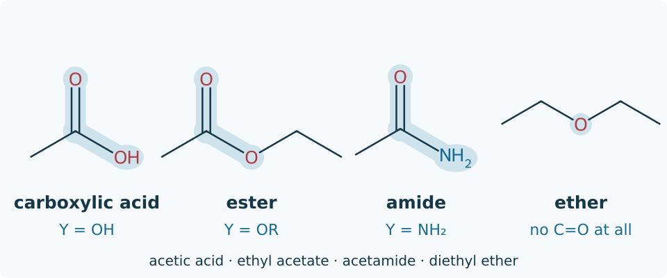{width=82% fig-alt="Skeletal structures of acetic acid, ethyl acetate and acetamide with the C=O and its neighbour Y shaded, next to diethyl ether which has no C=O"}

An **acyl carbon** is a C=O carbon that also carries a heteroatom group **Y**. The Y on the carbonyl carbon names the family. An ether has O but **no C=O**, so no acyl carbon.

::: {.try}
**Try it:** is HCOOCH₃ an aldehyde, an ether or an ester?

::: {.fragment}
**An ester** (methyl methanoate), H–C(=O)–O–CH₃. The H on the acyl carbon doesn't make it an aldehyde, because its other neighbour is OCH₃.
:::
:::

::: notes
This is the Day 1 skill of reading the neighbours of C=O, applied to the three families we need today. Point at each Y. The ether is there on purpose: students see "O between two carbons" and call it an ester. Make them find the C=O first. Expanding condensed formulas is the other trap: HCOOCH3 is not H–C–O–O–CH3 (a peroxide); the first O after C in "COO" is the carbonyl oxygen. Also check CH3CONHCH3 orally: amide, because N sits on the carbonyl carbon.
:::

## Step 1: the nucleophile adds

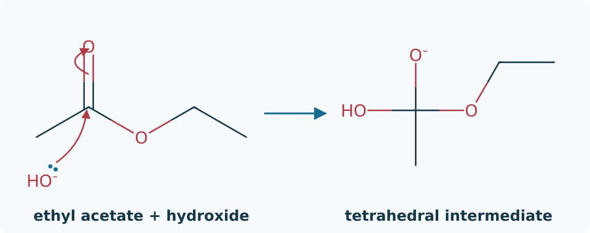{width=82% fig-alt="Ethyl acetate and hydroxide with two curved arrows: hydroxide lone pair to the carbonyl carbon and the C=O pi bond to oxygen, giving a tetrahedral intermediate with O minus"}

Exactly as on Day 16: the hydroxide lone pair attacks the carbonyl carbon, and the **C=O π pair moves onto oxygen**. Carbon goes from planar to **tetrahedral**.

::: {.try}
**Try it:** a student draws CH₃C(=O)(OH)OCH₃ as the intermediate. What's wrong?

::: {.fragment}
**Five bonds to carbon** (C–CH₃, C=O counts 2, C–OH, C–OCH₃). The π bond must open: the correct structure is CH₃C(O⁻)(OH)(OCH₃).
:::
:::

::: notes
Insist on both arrows. The first arrow starts at a lone pair, not at the minus sign, and ends at the carbon. The second starts in the middle of the pi bond and ends on oxygen. Without that second arrow the carbon would have five bonds, which is the single most common error in this unit. Ask students to count bond orders at carbon in their own drawing before they move on. Ethyl acetate is a real solvent (nail-polish remover smell), so it's a friendly example.
:::

## Track every oxygen

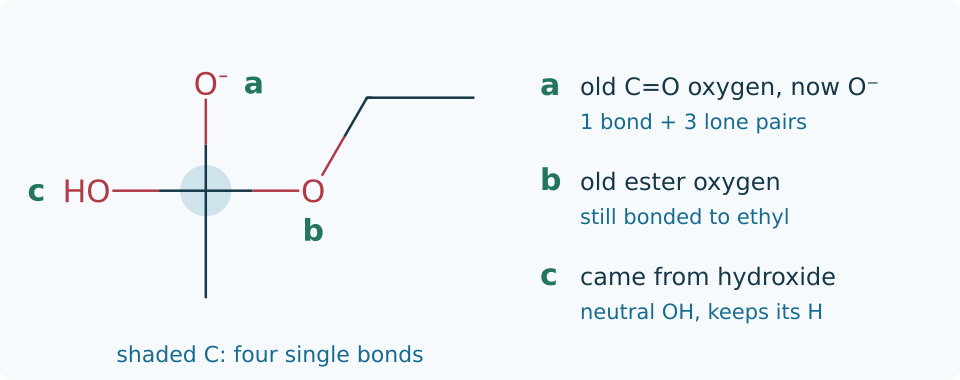{width=80% fig-alt="Tetrahedral intermediate CH3C(O minus)(OH)(OEt) drawn as a cross with the three oxygens labelled a, b and c and a key explaining each one"}

Label atoms and follow them, not positions on the page. The negative charge now sits on the **old carbonyl oxygen**, and the incoming OH is neutral. Oxygen **b** still carries the ethyl group: no bond to it has broken yet. Total charge: still **−1**.

::: notes
Atom labels are a habit worth building now, because the acid mechanism later has three oxygens changing protonation state. The formal charges follow from the Day 1 patterns: a is one bond plus three lone pairs, so minus one; c has two bonds, so neutral. A quick conservation check catches many errors: the charge on the left of an arrow must equal the charge on the right. Point out that hydroxide gave its charge away when it donated its pair; the charge has moved to a, not disappeared.
:::

## Step 2: the carbonyl comes back and a group leaves

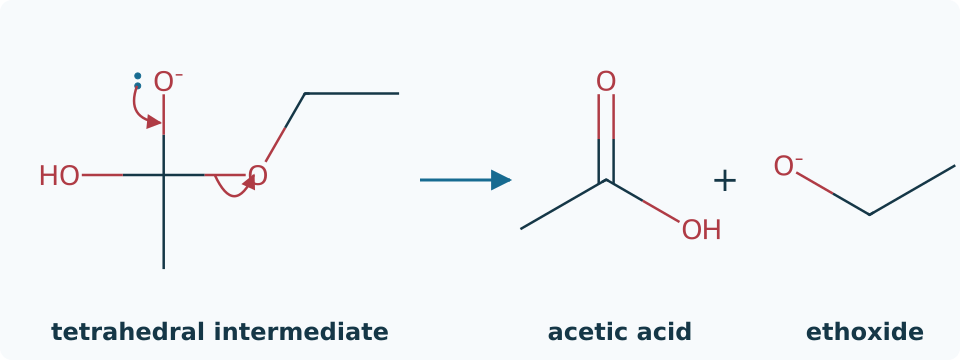{width=82% fig-alt="Curved arrows on the tetrahedral intermediate: the O minus lone pair reforms C=O and the C–OEt bond pair leaves onto oxygen, giving acetic acid and ethoxide"}

The O⁻ lone pair pushes back down to reform C=O, and the **C–OEt bond pair leaves with its oxygen** as ethoxide. Addition followed by elimination gives net **substitution**: OEt has been swapped for OH.

The intermediate could also throw out the OH it just gained. That simply reverses step 1. What pushes the reaction forward comes in step 3.

::: notes
The two arrows mirror the two arrows of step 1. Carbon never has five bonds and there is never a free acyl cation. Stress that a tetrahedral intermediate has a choice: any group that can leave as a reasonably stable anion is a candidate. Here OH- and EtO- are comparable leaving groups, so this step alone is not strongly downhill. That sets up the question of what drives the reaction, which is the proton transfer two slides on.
:::

## What can leave decides what happens

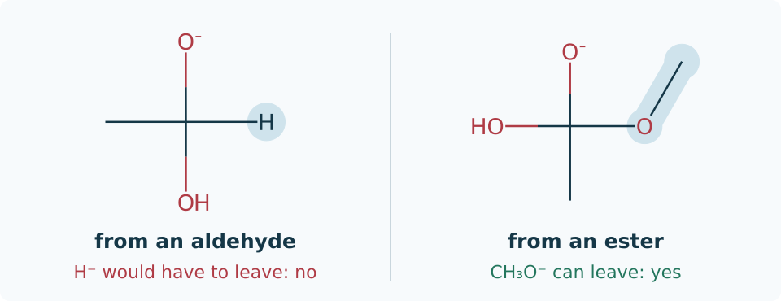{width=74% fig-alt="Two tetrahedral intermediates: from acetaldehyde with an H that would have to leave as hydride, and from methyl acetate with a methoxy group that can leave"}

| group that leaves | its conjugate acid | pKa | leaves? |
|---|---|---|---|
| Cl⁻ | HCl | −7 | very easily |
| CH₃COO⁻ | CH₃COOH | 4.8 | easily |
| CH₃O⁻, HO⁻ | CH₃OH, H₂O | 15.5, 15.7 | yes, in an addition–elimination |
| H⁻, CH₃⁻ | H₂, CH₄ | 35, 50 | no |

::: notes
This is the reason the Day 16 and Day 17 reactions differ. An aldehyde or ketone forms the same tetrahedral intermediate, but its only candidates for leaving are hydride or a carbanion, which are far too basic. So aldehydes and ketones stop at addition; acid derivatives go on to substitution. The rule of thumb: a weaker base (lower pKa of the conjugate acid) is a better leaving group. The same order explains why acid chlorides and anhydrides are the most reactive acyl compounds and amides the least, since NH2- (pKa of NH3 about 38) is a poor leaving group. We only need esters and amides today, but the table lets students predict the rest.
:::

## Step 3: a proton transfer drives it

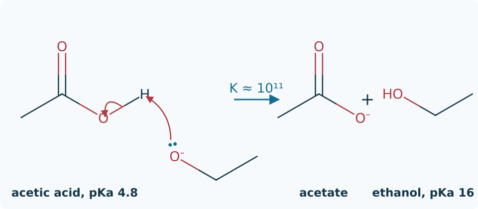{width=82% fig-alt="Curved arrows: ethoxide lone pair takes the acid proton and the O–H bond pair stays on oxygen, giving acetate and ethanol with K about 10 to the 11"}

Acid and ethoxide can't coexist in base. K ≈ 10^(pKa product acid − pKa reactant acid) = 10^(16 − 4.8) ≈ **10¹¹**.

::: {.try}
**Try it:** for methyl acetate the base is CH₃O⁻ (methanol pKa 15.5). Estimate K.

::: {.fragment}
**K ≈ 10^(15.5 − 4.8) = 10^10.7 ≈ 5 × 10¹⁰.** Still hugely favourable, so carboxylate + alcohol is what you actually have.
:::
:::

::: notes
This is the Day 3 acid-base rule at work: the equilibrium favours the side with the weaker acid, and the size of K comes from the pKa difference. Here ethanol (pKa about 16) is a much weaker acid than acetic acid (4.8), so K is around 10^11. Because this step is effectively irreversible, it pulls the whole sequence forward. That's why base hydrolysis of esters goes to completion while acid hydrolysis does not. Students who stop at "acid + ethoxide" have drawn a mixture that cannot exist in base.
:::

## Saponification: the net reaction and work-up

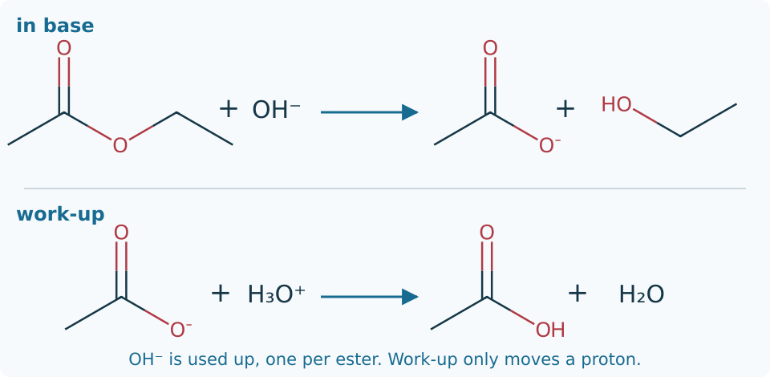{width=76% fig-alt="Ethyl acetate plus hydroxide gives acetate plus ethanol; later, acetate plus hydronium gives acetic acid plus water"}

Hydroxide is **used up**, one per ester, so it's base-*promoted*, not base-catalysed. Boil a fat with NaOH and you get glycerol plus fatty-acid carboxylates: **soap**. To isolate the acid, add acid at the end (**work-up**).

::: notes
Two separate events: the reaction in base, which ends at the carboxylate, and the work-up, which is just a proton transfer from H3O+ to the carboxylate. Work-up does not change the carbon skeleton. Contrast with Day 16 hydration, where hydroxide was regenerated; here it ends up in the carboxylate, so you need a full equivalent. "Saponification" literally means soap-making: a triglyceride and three NaOH give glycerol and three sodium carboxylates. If time allows, ask why soap stays dissolved in basic water but greasy fatty acids separate when you acidify: the charged carboxylate is water-soluble, the neutral acid much less so.
:::

## Fischer esterification: acid activates the carbonyl

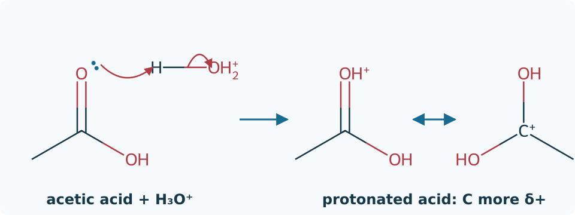{width=82% fig-alt="Acetic acid carbonyl oxygen lone pair takes a proton from hydronium, giving the protonated acid, shown with a resonance form that places the positive charge on carbon"}

Ethanol is a **neutral, weak nucleophile**, and a base would just deprotonate the acid. So we make the carbonyl a **better electrophile** instead: protonate its oxygen.

The protonated O has three bonds and one lone pair, so it's **+1**. The resonance form shows that charge shared onto carbon.

::: notes
This is the same acid activation as acetal formation on Day 16. Explain why we can't run esterification in base: a carboxylic acid plus a base just gives a carboxylate, and a carboxylate is a terrible electrophile (it's negatively charged). In acid, the carbonyl oxygen picks up a proton and the resonance form with C+ shows why the carbon now pulls harder on a nucleophile. Make students draw the proton coming from a real donor (H3O+), not a bare H+ appearing from nowhere.
:::

## Ethanol adds

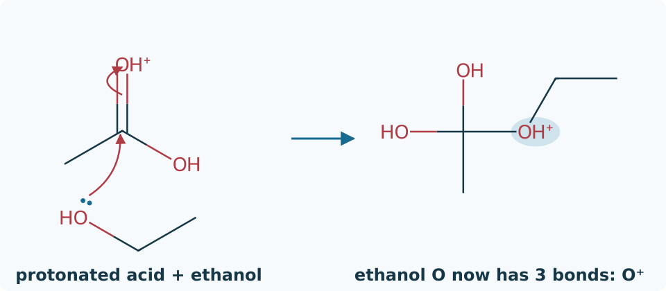{width=80% fig-alt="Ethanol oxygen lone pair attacks the protonated carbonyl carbon while the C=O pi pair moves onto the OH plus oxygen, giving a tetrahedral cation with a positively charged ethanol oxygen"}

Two arrows, as always. The incoming ethanol oxygen now has **three bonds**, so it carries the **+** charge. The old carbonyl oxygen has become a neutral OH.

::: {.try}
**Try it:** give the charge on each oxygen in CH₃C(OH)(OH)(O⁺HEt) and the total charge.

::: {.fragment}
**Old C=O oxygen: 0. Original acid OH: 0. Ethanol O: +1.** Total **+1**, the same as the protonated acid plus neutral ethanol.
:::
:::

::: notes
Compare directly with hydroxide addition: same two arrows, but because the nucleophile is neutral, the charge ends up on the nucleophile's oxygen rather than on the old carbonyl oxygen. Charge bookkeeping again: +1 in, +1 out. Many students put the plus charge on the wrong oxygen; ask them to count bonds at each O.
:::

## A proton shuffle makes a leaving group

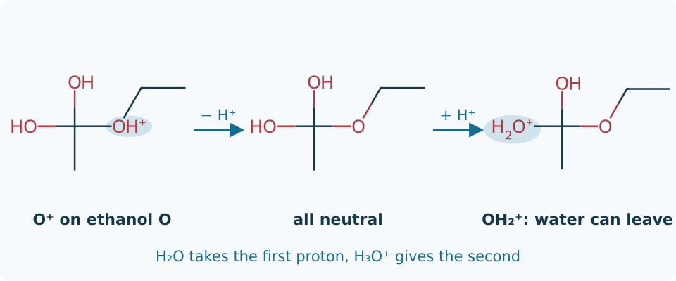{width=84% fig-alt="Three tetrahedral species: with O plus on the ethyl oxygen, after water removes that proton all neutral, and after hydronium protonates one OH to give OH2 plus"}

Water removes the extra proton from the ethyl oxygen. Then H₃O⁺ protonates **one of the OH groups** to give OH₂⁺, which can leave as **neutral water**.

::: {.try}
**Try it:** why not just let OH⁻ leave directly, as in base?

::: {.fragment}
**In acid there's essentially no OH⁻ around**, and it's a poor leaving group compared with H₂O. Protonating first turns a bad leaving group into a good one.
:::
:::

::: notes
The rule for acid-catalysed mechanisms: every species should be neutral or positive; never draw OH- or alkoxide in strong acid. Proton transfers between oxygens go through water and hydronium, so draw those explicitly. Point out the leaving-group table again: water's conjugate acid is H3O+ (pKa about −1.7), so water is a far better leaving group than hydroxide. Which OH gets protonated is a matter of statistics; protonating the OEt instead just leads back to starting materials, which is fine because the whole thing is an equilibrium.
:::

## Water leaves and the ester forms

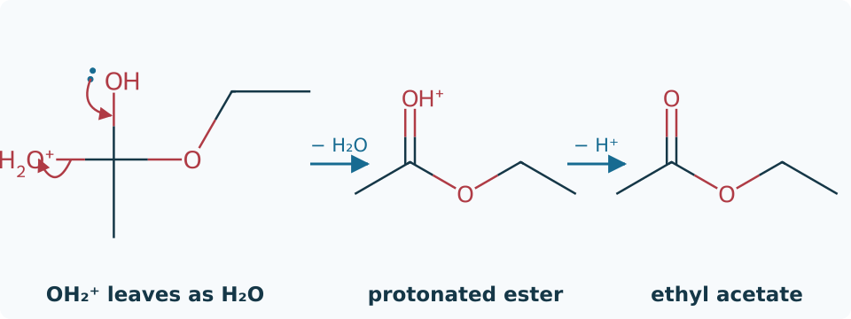{width=84% fig-alt="An OH lone pair reforms C=O and pushes out water from the OH2 plus group, giving the protonated ester, which loses a proton to give ethyl acetate"}

An OH lone pair reforms C=O and pushes out water, giving the **protonated ester**. Water takes that last proton, which **regenerates H₃O⁺**. The acid is a true catalyst.

::: notes
This is the mirror image of the addition: lone pair down, leaving group out. The last deprotonation regenerates hydronium, which is the bookkeeping that makes acid catalytic, unlike hydroxide in saponification. A useful summary for students: protonate, add, deprotonate, protonate, eliminate, deprotonate. Six steps, every one of them either a proton transfer or one of the two arrow patterns they already know. Ask the room to count how many times H3O+ is consumed and regenerated.
:::

## An equilibrium, and an isotope check

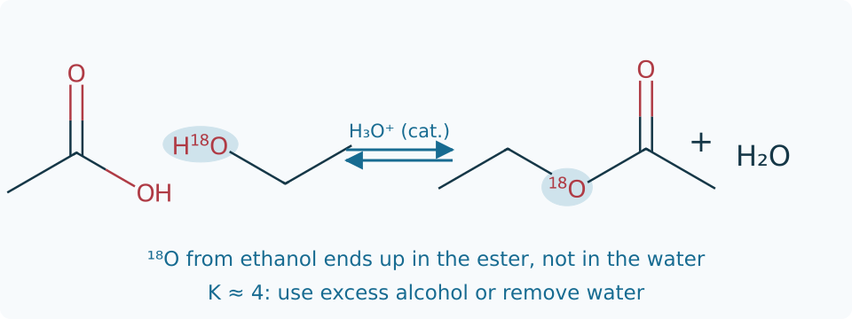{width=80% fig-alt="Acetic acid plus 18O-labelled ethanol in equilibrium with ethyl acetate carrying the 18O label plus water, with K about 4"}

K is only about **4**: start with 1:1 acid and alcohol and you get about two-thirds ester. **Excess alcohol** or **removing water** pushes it further. The catalyst only gets you there faster.

::: {.try}
**Try it:** you add more H₃O⁺ at the same temperature. Does K change?

::: {.fragment}
**No.** A catalyst speeds up the forward and reverse reactions equally, so equilibrium is reached sooner but the composition is the same.
:::
:::

::: notes
Two separate ideas. Equilibrium: with K = 4 and a 1:1 start, x²/(1 − x)² = 4 gives x = 2/3. Le Chatelier tells you to use the alcohol as solvent or to remove water (with a Dean–Stark trap or a drying agent). Catalysis: changes the rate, not K. The isotope experiment is the evidence for the mechanism: with 18O-labelled alcohol, the label ends up in the ester's single-bonded oxygen, not in the water. So the C–O bond of the acid breaks, not the O–alkyl bond of the alcohol, exactly as the mechanism predicts. This is a nice example of how mechanisms are tested, which comes back in Week 5.
:::

## Amides are different: resonance

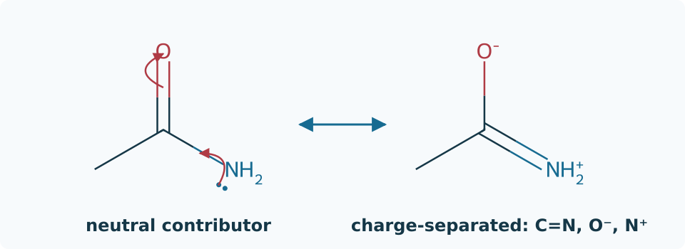{width=74% fig-alt="Acetamide with curved arrows from the nitrogen lone pair to the C–N bond and from the C=O pi bond to oxygen, double-headed resonance arrow, and the contributor with C=N, O minus and N plus"}

The nitrogen lone pair is **shared with the carbonyl**. The real amide is a blend: the C–N bond has **partial double-bond character** and the carbonyl is less electrophilic.

::: {.try}
**Try it:** in the right-hand contributor, what are the charges on O and N, and the total?

::: {.fragment}
**O is −1, N is +1, total 0.** N has four bonds and no lone pair. The double-headed arrow means one molecule, not an equilibrium.
:::
:::

::: notes
Resonance contributors are two drawings of one molecule; nothing flips back and forth. Use the double-headed arrow, never equilibrium arrows. The consequences are big: the amide C=O is less electrophilic because nitrogen is already feeding electrons into it, and the leaving group would be NH2- (or an amine anion), which is terrible. Together that makes amides the least reactive acyl compounds. Ask why an ester has a similar but weaker resonance: oxygen is more electronegative than nitrogen, so it shares its lone pair less willingly.
:::

## Amide nitrogen is not an amine

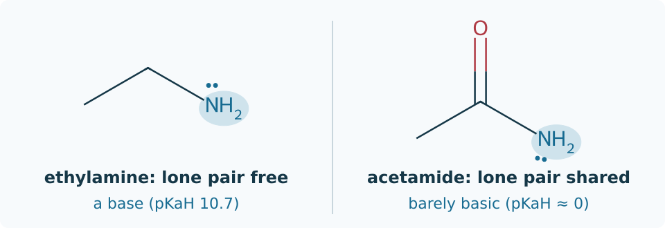{width=74% fig-alt="Ethylamine with a free nitrogen lone pair, pKaH 10.7, next to acetamide whose nitrogen lone pair is shared with the carbonyl, pKaH about 0"}

| property | ethylamine | acetamide |
|---|---|---|
| N lone pair | free | shared with C=O |
| basic? | yes, pKaH 10.7 | barely (pKaH ≈ 0, on O) |
| C–N rotation | free | restricted, the amide group is flat |

::: notes
This is a preview of tomorrow (Day 18), where amine basicity is the main topic. Amides are protonated (weakly) on oxygen, not nitrogen, because protonating N would destroy the resonance. The restricted rotation is measurable: in N,N-dimethylformamide the two N-methyl groups are in different environments and give separate NMR signals at room temperature, which you'll see in spectroscopy week. In proteins, the flat peptide bond is what makes the backbone stiff enough to form helices and sheets.
:::

## Acid plus amine gives a salt, not an amide

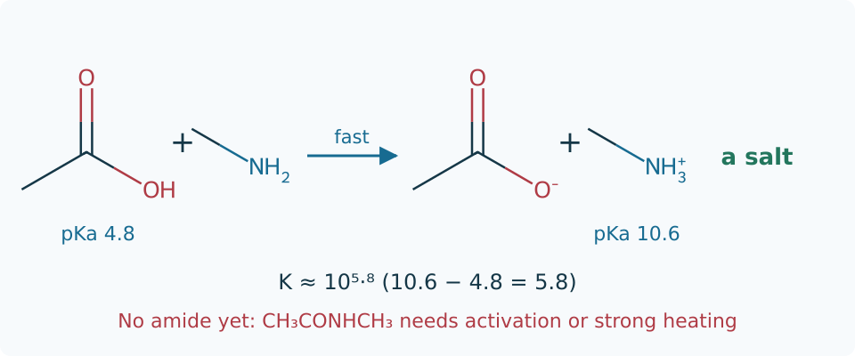{width=80% fig-alt="Acetic acid plus methylamine gives acetate plus methylammonium, K about 10 to the 5.8, with a note that the amide needs activation or strong heating"}

Mix an acid and an amine and the **fastest thing** is proton transfer. The carboxylate that forms is a poor electrophile, so no amide forms at room temperature.

::: {.try}
**Try it:** use pKa 4.8 (CH₃COOH) and 10.6 (CH₃NH₃⁺) to estimate K.

::: {.fragment}
**K ≈ 10^(10.6 − 4.8) = 10^5.8 ≈ 6 × 10⁵.** The salt is strongly favoured.
:::
:::

::: notes
Students expect "acid + amine → amide + water" because that's the net equation on paper. Show them it's wrong as a first step. Industry gets round it by strong heating: nylon-6,6 is made by heating the salt of hexamethylenediamine and adipic acid to drive off water. Labs and cells use activation instead: convert the acid into something with a better leaving group (an acid chloride, an activated ester or, in biology, an acyl phosphate or thioester). The next slide shows the biological version.
:::

## Esters and amides in biology

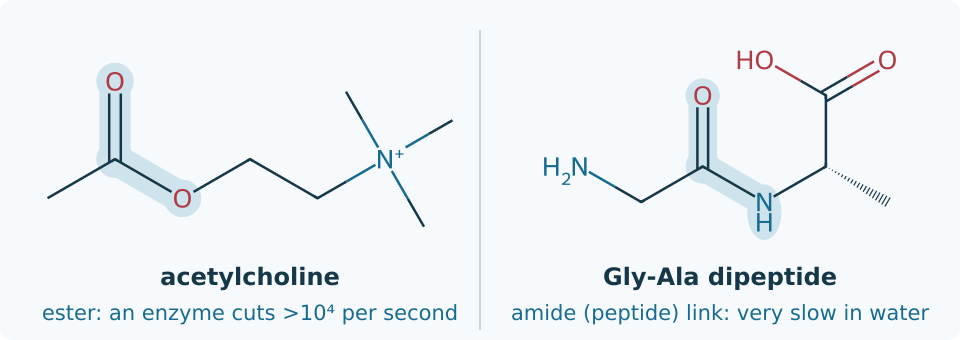{width=80% fig-alt="Acetylcholine with its ester group shaded and the dipeptide glycylalanine with its amide (peptide) link shaded"}

- **Esters are built to be cut:** acetylcholinesterase splits >10⁴ per second. Fats are glycerol esters.
- **Amides are built to last:** a peptide bond survives for centuries in neutral water without a protease.
- The **ribosome** makes amides from **esters** (aminoacyl-tRNA): downhill.

::: notes
This is where the leaving-group logic pays off in biology. Esters are reactive enough to be used as on/off switches (acetylcholine) and as stores that can be mobilised (fats). Amides are stable enough to hold proteins together, but that same stability means the cell has to spend energy activating amino acids before linking them. The ribosome attaches each amino acid to its tRNA as an ester, then the amine of the growing chain attacks that ester: an acyl substitution where an alkoxide-type leaving group is replaced by nitrogen. Nerve agents and many insecticides work by blocking acetylcholinesterase, which shows how important fast ester hydrolysis is.
:::

## Back to aspirin

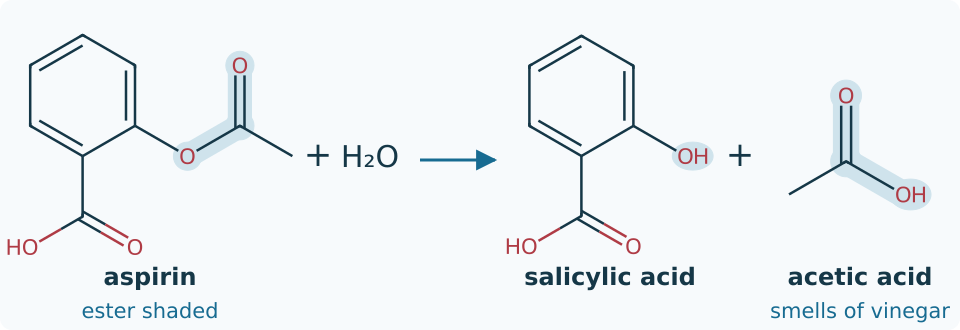{width=82% fig-alt="Aspirin plus water gives salicylic acid and acetic acid, with the ester group of aspirin shaded"}

Aspirin's acetyl ester is the reactive part. Water slowly hydrolyses it, which is why damp, old tablets smell of **vinegar**. The same acetyl group is what aspirin transfers to a serine in the COX enzyme, blocking it for good.

::: {.try}
**Try it:** what would aspirin give with excess NaOH, before any work-up?

::: {.fragment}
**Acetate and the salicylate dianion.** Saponification cuts the ester, then excess base removes the protons from both COOH groups and from the phenol OH.
:::
:::

::: notes
Pull the whole lecture together on one real molecule. Ask students to point at the acyl carbon, say which oxygen leaves (the one bonded to the ring), and predict the products in acid and in base. In base, both carboxylic acids end up as carboxylates; the phenol of salicylic acid (pKa about 13) is also deprotonated by excess NaOH, so the product is the dianion. That's why the answer says "excess". Aspirin's drug action is itself an acyl transfer: a serine OH in cyclooxygenase attacks the ester and gets acetylated, which permanently blocks the enzyme. Same mechanism, new nucleophile.
:::

## Mistakes we see every year

| mistake | fix |
|---|---|
| C=O kept while the nucleophile adds (five bonds to C) | move the **π pair to O** in the same step |
| calling an ether an ester because it has C–O–C | an ester needs the O **on a C=O** |
| "acid + ethoxide" as the final products in base | add the **proton transfer**: carboxylate + alcohol |
| OH⁻ drawn as catalyst in saponification | it's **used up**, one per ester |
| OH⁻ or alkoxide drawn in an acid mechanism | protonate first, let **water** leave |
| a catalyst said to shift the equilibrium | it changes the **rate**, not K |
| resonance drawn with equilibrium arrows | use **↔**: one molecule |
| acid + amine → amide in one step | first comes **proton transfer** to a salt |

::: notes
Read out each mistake and ask the room why it's wrong before showing the fix. Every row maps onto a numbered exercise: five-bonded carbon is exercise 9, the missing proton transfer is 6 and 20, catalysis versus equilibrium is 14, resonance is 16, acid plus amine is 18.
:::

## Summary

| concept | key fact |
|---|---|
| acyl carbon | C=O carbon carrying Y = OH, OR, NR₂ |
| addition–elimination | tetrahedral intermediate, then C=O reforms and Y leaves |
| leaving group | weaker base leaves better; H⁻ never leaves |
| saponification | ester + OH⁻ → carboxylate + alcohol; OH⁻ used up |
| work-up | H₃O⁺ turns carboxylate into acid; skeleton unchanged |
| Fischer esterification | acid-catalysed, K ≈ 4; water leaves as H₂O |
| amide resonance | partial C=N, flat, N not basic, least reactive |
| acid + amine | proton transfer to a salt first |

**Next:** amines and aromatic rings, and why amine N is basic when amide N isn't (Day 18). **Practice:** [exercises](exercise.qmd) · [self-check](quiz.qmd)

::: notes
Recite the core pattern once more: add, then eliminate, with proton transfers wherever a charge needs to be fixed. Base hydrolysis is driven by the final proton transfer; acid esterification is an equilibrium pushed by excess alcohol or water removal. Amides resist all of this because of resonance. Tomorrow we look at the nitrogen from the other side: amines, where the lone pair is free, and aromatic rings, where resonance makes a whole ring unusually stable. Exercises 1 to 10 are core; 11 to 16 build the acid mechanism; 17 to 20 are deeper.
:::
