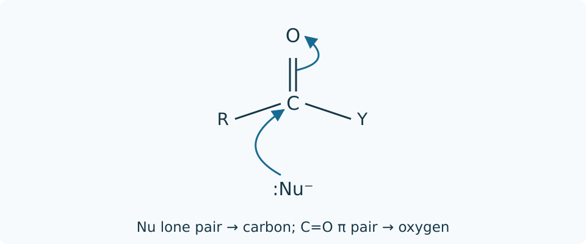
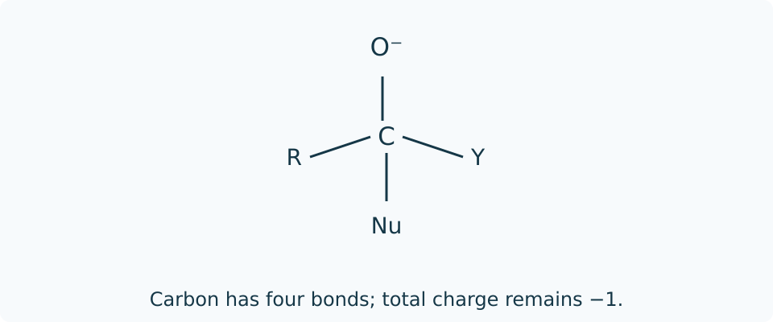
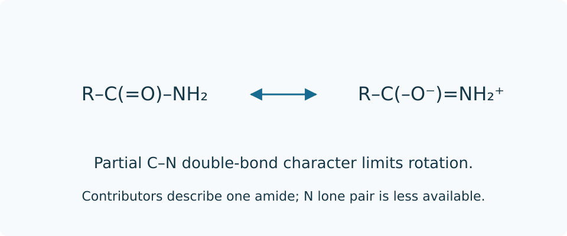
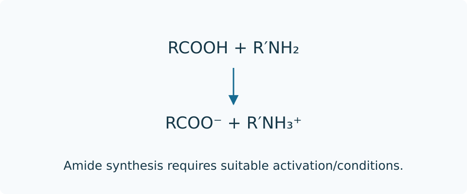
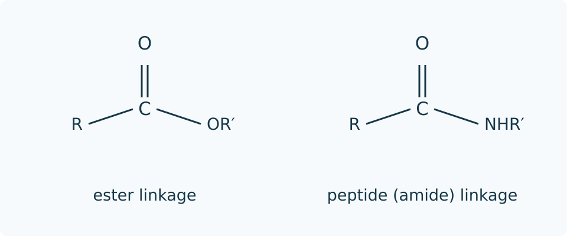

## What will you be able to explain?

- Recognise the common acyl motif in acids, esters and amides.
- Draw addition–elimination with valid electron flow and proton transfers.
- Distinguish ester hydrolysis, esterification and amide formation.

::: notes
Start with a drawn molecule and an explanation from the preceding unit. Ask students to predict before revealing an answer. Use the practice page for complete worked checks rather than putting dense paragraphs on slides.
:::

## One carbonyl motif, several families

{width=85% fig-alt="Acids, esters and amides differ in the group attached to the acyl carbon."}

Circle the carbonyl carbon, then name its two directly attached groups.

::: notes
R denotes an organic group; OR′ distinguishes an ester from an ether. An ester has a carbonyl adjacent to the single-bond oxygen. Avoid calling every carbonyl a ketone.
:::

## The first step resembles carbonyl addition

{width=85% fig-alt="A nucleophile donates a pair to the carbonyl carbon while the pi pair moves to oxygen."}

Use two arrows in the same elementary addition step.

::: notes
Here Nu− is a generic anionic nucleophile and Y is the potential leaving group. This drawing illustrates unprotonated addition; acid-catalysed variants require carbonyl protonation before attack by a neutral nucleophile.
:::

## Check the tetrahedral intermediate

{width=85% fig-alt="The former carbonyl carbon has four single bonds; oxygen carries the negative charge."}

The carbonyl pi bond has opened. Nu and Y are both still attached.

::: notes
Ask students to count carbon bonds before calculating charge. Nu− forms a bond and becomes neutral in this generic example; negative charge is now on O. Total charge remains minus one.
:::

## Collapse needs a viable leaving group

{width=85% fig-alt="An oxygen lone pair reforms C=O and the C–Y bond pair moves onto Y."}

These arrows describe one elimination step.

::: notes
Y must be able to leave under the reaction conditions. Hydroxide or alkoxide may need protonation in acidic mechanisms. Do not expel H− or an ordinary alkyl carbanion from an aldehyde/ketone simply to make a substitution.
:::

## Identify the net substitution

{width=85% fig-alt="The carbonyl is retained while Y is replaced by Nu."}

Addition and elimination are separate mechanistic events; the net equation hides the intermediate.

::: notes
Compare with the previous carbonyl-addition lesson: ordinary aldehydes and ketones typically give addition products because they lack a suitable leaving group. No free acyl carbocation is required here.
:::

## Esterification is an equilibrium

{width=85% fig-alt="Ethanoic acid and ethanol can form ethyl ethanoate and water under acid catalysis."}

The catalyst is regenerated; water removal or excess reactant can shift the equilibrium.

::: notes
Have students trace the alcohol oxygen into the ester using a label. At this level show the required proton transfers without implying that an unprotonated OH group simply leaves as OH− in an acidic mechanism.
:::

## Base-promoted hydrolysis gives carboxylate

{width=85% fig-alt="Hydroxide hydrolysis ultimately gives carboxylate and alcohol."}

An acid work-up is needed if the intended isolated form is the neutral carboxylic acid.

::: notes
Addition then collapse initially gives acid and alkoxide in the simplest model. The subsequent acid–base reaction strongly favours carboxylate and alcohol. Hydroxide is consumed overall, so base is not merely a regenerated catalyst in saponification.
:::

## Why an amide is different

{width=85% fig-alt="Amide nitrogen donates into the carbonyl, giving partial C–N double-bond character."}

Use resonance to explain restricted rotation and reduced nitrogen basicity.

::: notes
These are contributors to one molecule, not two isomers. The charge-separated contributor has O− and N+, preserving net neutrality. Under comparable conditions ordinary amides are less reactive toward acyl substitution than esters.
:::

## Mixing acid and amine does not suffice

{width=85% fig-alt="Acid and amine initially undergo proton transfer to give an ammonium carboxylate."}

Making an amide requires suitable activation or conditions.

::: notes
This corrects a frequent biologically motivated misconception: peptide bonds do not form rapidly just because two amino acids encounter each other in water. Later biochemistry explains how activation and enzymes enable coupling.
:::

## Recognise the motif in biology

{width=85% fig-alt="Lipid esters and peptide amides contain the same acyl-carbon framework."}

The leaving group, activation and environment change the chemistry; the electron bookkeeping remains useful.

::: notes
No metabolic pathways are prerequisites here. Ask only which bond is ester-like or amide-like and where a nucleophile would initially attack.
:::

## Work one example on paper

For CH₃COOCH₂CH₃ + OH⁻, draw the tetrahedral intermediate, its collapse, and the final acid–base step. Label the alcohol product and distinguish the reaction mixture from its acid-worked-up form.

::: notes
Allow independent thinking, then compare in pairs. Ask students to defend each atom, charge or assignment. Show the worked check only after a first attempt.
:::

## A common mistake to repair

A mechanism that expels OH⁻ from an acid-protonated intermediate without checking protonation state usually skips an essential proton transfer. Check every oxygen charge after each step.

Explain the correction using a drawing or a specific observation.

## Test your explanation

1. Which atoms, bonds or observations support the claim?
2. What alternative would make a different prediction?
3. What assumption limits the conclusion?

Give a partner your explanation without the answer label. Can they follow it?

## Take the reasoning forward

Complete the [practice and worked examples](exercise.qmd) and [self-check](quiz.qmd).

Selected Solomons chapter 17 sections; see the [reading guide](../reference/reading.qmd) for the provisional textbook map and open references.
