## A chemical route through this session

Use carbonyl addition as the starting pattern. Today we ask what makes a tetrahedral species collapse, how proton transfers enable leaving groups, and why amides differ.

::: notes
45-minute budget: retrieval and motif reading 4 min; worked basic hydrolysis with drawing checks 13 min; acid-catalysed esterification 11 min; amide/salt comparison 7 min; paired integrated case and correction 8 min; exit explanation 2 min. Total 45 min, including drawing and discussion.

Suggested 30 seconds; adjust to the explanation and class response. Plan 45 minutes including short drawing and discussion intervals. Routine visual frames take roughly 40 seconds; worked checks need longer and some resolutions can be quicker. Treat timings as guidance, with room for questions.
:::

## Retrieve the starting idea

Draw CH₃CHO and CH₃COOCH₃. Which one has an oxygen-based substituent directly attached to acyl carbon?

::: notes
Suggested 30 seconds; adjust to the explanation and class response. Give students a short individual attempt. Worked answer: The ester has OCH₃ where the aldehyde has H. Both carbonyl carbons accept nucleophiles, but their leaving-group options differ.
:::

## Locate the shared carbonyl

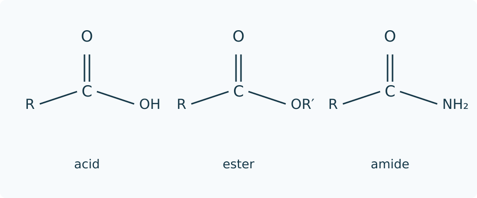{width=85% fig-alt="Carboxylic acid derivatives share an acyl carbon"}

Which directly bonded group distinguishes acid, ester and amide?

::: notes
Suggested 40 seconds; adjust to the explanation and class response. Ask students to inspect the indicated molecular feature rather than read the answer caption. Worked answer: The acyl carbon is C=O carbon. Its OH, OR or NR₂ substituent identifies the family.
:::

## Apply: locate the shared carbonyl

Classify CH₃CONHCH₃ and CH₃COOCH₃.

::: notes
Suggested 60 seconds; adjust to the explanation and class response. Allow a brief paper or pair check within this slide. Worked answer: The first is an amide; the second is an ester. Both contain an acyl carbon.
:::

## Distinguish ester from ether

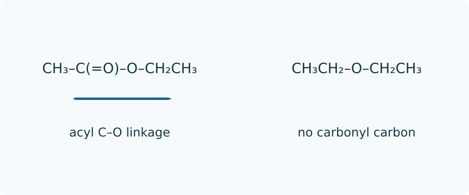{width=85% fig-alt="An ester contains an adjacent carbonyl; an ether does not"}

Which carbon can accept a nucleophile by carbonyl addition?

::: notes
Suggested 40 seconds; adjust to the explanation and class response. Ask students to inspect the indicated molecular feature rather than read the answer caption. Worked answer: The ester has an electron-poor carbonyl carbon; the ether has no C=O at that site.
:::

## Resolve: distinguish ester from ether

{width=85% fig-alt="An ester contains an adjacent carbonyl; an ether does not"}

The ester has an electron-poor carbonyl carbon; the ether has no C=O at that site.

::: notes
Suggested 30 seconds; adjust to the explanation and class response. Use a second inspection focus: justify the result by the atom, charge, ratio or observation involved. Next application answer: H–C(=O)–O–CH₂CH₃ is an ester; H on acyl carbon does not make it an aldehyde because OEt is the other substituent.
:::

## Apply: distinguish ester from ether

Circle the ester linkage in HCOOCH₂CH₃.

::: notes
Suggested 60 seconds; adjust to the explanation and class response. Allow a brief paper or pair check within this slide. Worked answer: H–C(=O)–O–CH₂CH₃ is an ester; H on acyl carbon does not make it an aldehyde because OEt is the other substituent.
:::

## Give the oxygens identities

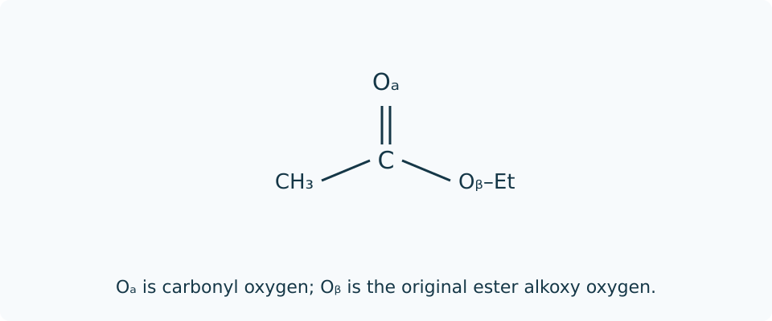{width=85% fig-alt="Atom labels preserve oxygen identity during hydrolysis"}

If hydroxide attacks, which oxygen initially becomes O⁻?

::: notes
Suggested 40 seconds; adjust to the explanation and class response. Ask students to inspect the indicated molecular feature rather than read the answer caption. Worked answer: The original carbonyl oxygen Oₐ gains the carbonyl pi pair. The original alkoxy oxygen Oᵦ remains bonded to ethyl.
:::

## Resolve: give the oxygens identities

{width=85% fig-alt="Atom labels preserve oxygen identity during hydrolysis"}

The original carbonyl oxygen Oₐ gains the carbonyl pi pair. The original alkoxy oxygen Oᵦ remains bonded to ethyl.

::: notes
Suggested 30 seconds; adjust to the explanation and class response. Use a second inspection focus: justify the result by the atom, charge, ratio or observation involved. Next application answer: It remains attached to O꜀ in the tetrahedral OH group; addition alone does not remove that H.
:::

## Apply: give the oxygens identities

Label incoming hydroxide oxygen O꜀. Where is its H after addition?

::: notes
Suggested 60 seconds; adjust to the explanation and class response. Allow a brief paper or pair check within this slide. Worked answer: It remains attached to O꜀ in the tetrahedral OH group; addition alone does not remove that H.
:::

## Find both electron sources

{width=85% fig-alt="Addition starts by moving the carbonyl pi pair to oxygen"}

Identify the tail of each curved arrow before naming products.

::: notes
Suggested 40 seconds; adjust to the explanation and class response. Ask students to inspect the indicated molecular feature rather than read the answer caption. Worked answer: One arrow starts at the nucleophile pair and one at C=O π. Their coordinated movement avoids five bonds at carbon.
:::

## Resolve: find both electron sources

{width=85% fig-alt="Addition starts by moving the carbonyl pi pair to oxygen"}

One arrow starts at the nucleophile pair and one at C=O π. Their coordinated movement avoids five bonds at carbon.

::: notes
Suggested 30 seconds; adjust to the explanation and class response. Use a second inspection focus: justify the result by the atom, charge, ratio or observation involved. Next application answer: Move the carbonyl pi pair to oxygen as the new C–Nu bond forms; retain only a single C–O bond.
:::

## Apply: find both electron sources

Repair an ester-addition drawing that retains C=O.

::: notes
Suggested 60 seconds; adjust to the explanation and class response. Allow a brief paper or pair check within this slide. Worked answer: Move the carbonyl pi pair to oxygen as the new C–Nu bond forms; retain only a single C–O bond.
:::

## Audit the intermediate

{width=85% fig-alt="The tetrahedral intermediate has four single bonds"}

Count carbon bond orders and locate the net charge.

::: notes
Suggested 40 seconds; adjust to the explanation and class response. Ask students to inspect the indicated molecular feature rather than read the answer caption. Worked answer: Carbon has four single bonds. For an anionic incoming nucleophile, charge moves to original carbonyl oxygen.
:::

## Resolve: audit the intermediate

{width=85% fig-alt="The tetrahedral intermediate has four single bonds"}

Carbon has four single bonds. For an anionic incoming nucleophile, charge moves to original carbonyl oxygen.

::: notes
Suggested 30 seconds; adjust to the explanation and class response. Use a second inspection focus: justify the result by the atom, charge, ratio or observation involved. Next application answer: No. Nu becomes neutral in this model, but O becomes negative. Net charge remains −1.
:::

## Apply: audit the intermediate

Does the negative charge disappear when Nu⁻ bonds?

::: notes
Suggested 60 seconds; adjust to the explanation and class response. Allow a brief paper or pair check within this slide. Worked answer: No. Nu becomes neutral in this model, but O becomes negative. Net charge remains −1.
:::

## Apply the pattern to ethyl ethanoate

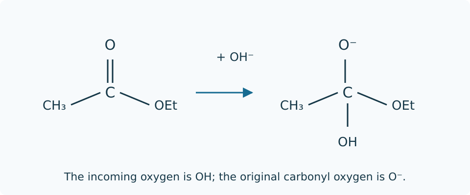{width=85% fig-alt="Hydroxide addition opens the ester carbonyl"}

Write the intermediate after OH⁻ addition, keeping the ethoxy group intact.

::: notes
Suggested 40 seconds; adjust to the explanation and class response. Ask students to inspect the indicated molecular feature rather than read the answer caption. Worked answer: The intermediate is CH₃C(O⁻)(OH)(OEt). Incoming OH is neutral after bonding; the original carbonyl O is O⁻.
:::

## Resolve: apply the pattern to ethyl ethanoate

{width=85% fig-alt="Hydroxide addition opens the ester carbonyl"}

The intermediate is CH₃C(O⁻)(OH)(OEt). Incoming OH is neutral after bonding; the original carbonyl O is O⁻.

::: notes
Suggested 30 seconds; adjust to the explanation and class response. Use a second inspection focus: justify the result by the atom, charge, ratio or observation involved. Next application answer: Et is CH₂CH₃. The original carbonyl O⁻ has one bond and three lone pairs.
:::

## Apply: apply the pattern to ethyl ethanoate

Expand Et and identify which oxygen has three lone pairs.

::: notes
Suggested 60 seconds; adjust to the explanation and class response. Allow a brief paper or pair check within this slide. Worked answer: Et is CH₂CH₃. The original carbonyl O⁻ has one bond and three lone pairs.
:::

## Choose a collapse pathway

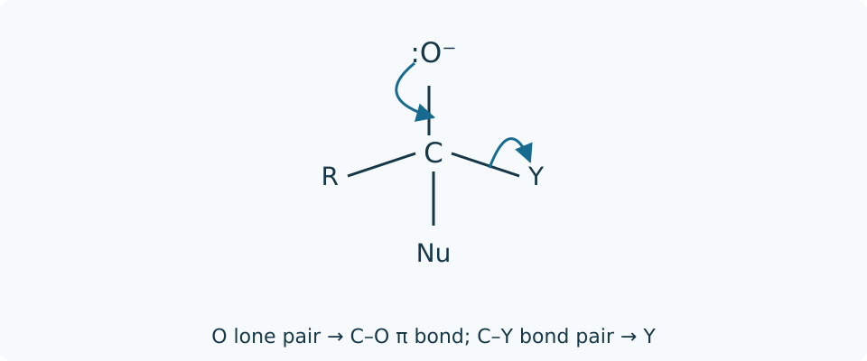{width=85% fig-alt="Collapse reforms the carbonyl and releases a leaving group"}

Which pair reforms the carbonyl, and which bond pair leaves?

::: notes
Suggested 40 seconds; adjust to the explanation and class response. Ask students to inspect the indicated molecular feature rather than read the answer caption. Worked answer: O⁻ donates a pair into C–O π; the C–Y bonding pair moves to Y. The carbonyl reforms without a free acyl cation.
:::

## Resolve: choose a collapse pathway

{width=85% fig-alt="Collapse reforms the carbonyl and releases a leaving group"}

O⁻ donates a pair into C–O π; the C–Y bonding pair moves to Y. The carbonyl reforms without a free acyl cation.

::: notes
Suggested 30 seconds; adjust to the explanation and class response. Use a second inspection focus: justify the result by the atom, charge, ratio or observation involved. Next application answer: No. Leaving-group viability matters; hydride is a very poor leaving group in these simple reactions.
:::

## Apply: choose a collapse pathway

Would the same drawing justify loss of H⁻ from an aldehyde?

::: notes
Suggested 60 seconds; adjust to the explanation and class response. Allow a brief paper or pair check within this slide. Worked answer: No. Leaving-group viability matters; hydride is a very poor leaving group in these simple reactions.
:::

## Pause before calling products final

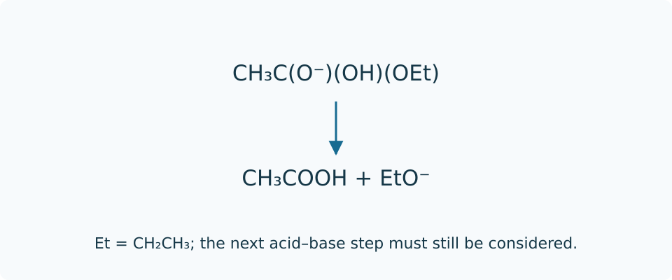{width=85% fig-alt="Collapse first gives acid and alkoxide"}

What acid and base coexist immediately after this collapse?

::: notes
Suggested 40 seconds; adjust to the explanation and class response. Ask students to inspect the indicated molecular feature rather than read the answer caption. Worked answer: The elementary collapse gives CH₃COOH and EtO⁻ in this simple scheme. They can undergo a strongly favoured proton transfer.
:::

## Resolve: pause before calling products final

{width=85% fig-alt="Collapse first gives acid and alkoxide"}

The elementary collapse gives CH₃COOH and EtO⁻ in this simple scheme. They can undergo a strongly favoured proton transfer.

::: notes
Suggested 30 seconds; adjust to the explanation and class response. Use a second inspection focus: justify the result by the atom, charge, ratio or observation involved. Next application answer: Carboxylate plus EtOH: the product acid EtOH is much weaker, so the proton transfer favours that side.
:::

## Apply: pause before calling products final

Compare pKa 4.8 for acid and 16 for EtOH. Which pair is favoured?

::: notes
Suggested 60 seconds; adjust to the explanation and class response. Allow a brief paper or pair check within this slide. Worked answer: Carboxylate plus EtOH: the product acid EtOH is much weaker, so the proton transfer favours that side.
:::

## Track the last proton transfer

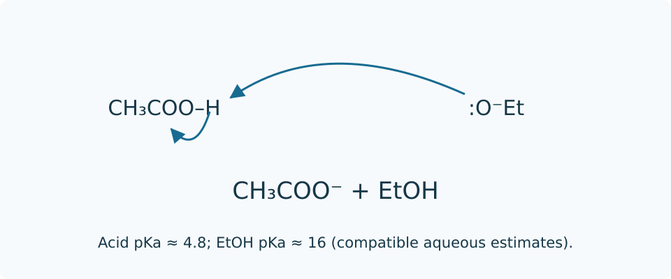{width=85% fig-alt="The alkoxide accepts the carboxylic acid proton"}

Follow the acid H and the pair formerly in its O–H bond.

::: notes
Suggested 40 seconds; adjust to the explanation and class response. Ask students to inspect the indicated molecular feature rather than read the answer caption. Worked answer: EtO⁻ accepts H. The acid O–H pair stays on carboxylate O. Products are CH₃COO⁻ and EtOH.
:::

## Resolve: track the last proton transfer

{width=85% fig-alt="The alkoxide accepts the carboxylic acid proton"}

EtO⁻ accepts H. The acid O–H pair stays on carboxylate O. Products are CH₃COO⁻ and EtOH.

::: notes
Suggested 30 seconds; adjust to the explanation and class response. Use a second inspection focus: justify the result by the atom, charge, ratio or observation involved. Next application answer: K is about 1.6×10¹¹ for this compatible-pKa estimate. Hydroxide is consumed overall in base-promoted ester hydrolysis.
:::

## Apply: track the last proton transfer

Estimate K using 10^(16 − 4.8). Is base regenerated overall?

::: notes
Suggested 60 seconds; adjust to the explanation and class response. Allow a brief paper or pair check within this slide. Worked answer: K is about 1.6×10¹¹ for this compatible-pKa estimate. Hydroxide is consumed overall in base-promoted ester hydrolysis.
:::

## Write the base-promoted net equation

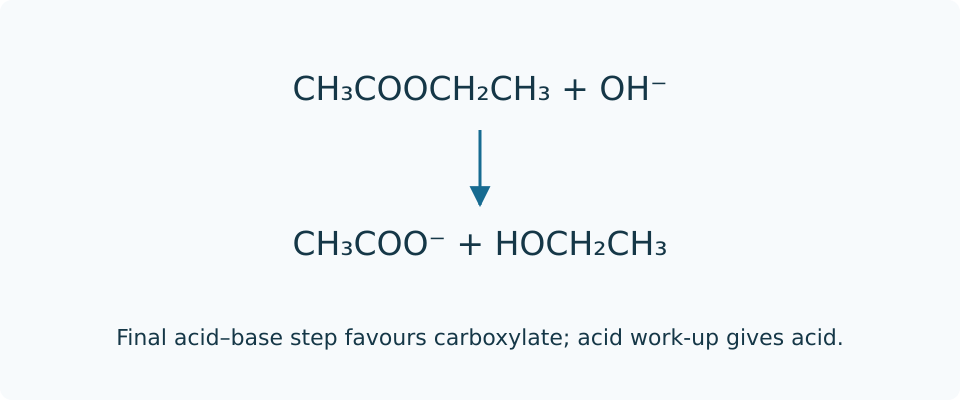{width=85% fig-alt="Base-promoted ester hydrolysis traps the carboxylate"}

Which species should appear in a basic mixture: carboxylic acid or carboxylate?

::: notes
Suggested 40 seconds; adjust to the explanation and class response. Ask students to inspect the indicated molecular feature rather than read the answer caption. Worked answer: Ester + OH⁻ → carboxylate + alcohol. Do not write neutral acid as the predominant basic-mixture product.
:::

## Apply: write the base-promoted net equation

Balance CH₃COOCH₃ + OH⁻ products.

::: notes
Suggested 60 seconds; adjust to the explanation and class response. Allow a brief paper or pair check within this slide. Worked answer: CH₃COO⁻ + CH₃OH. Total charge −1 and all atoms are conserved.
:::

## Separate reaction from work-up

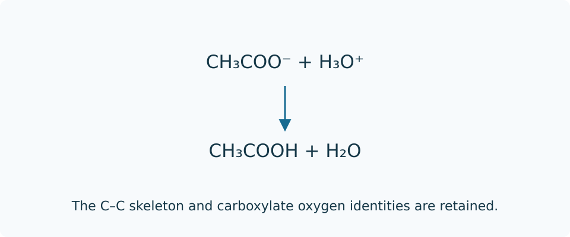{width=85% fig-alt="Work-up changes protonation state"}

What changes when hydronium is added to the carboxylate?

::: notes
Suggested 40 seconds; adjust to the explanation and class response. Ask students to inspect the indicated molecular feature rather than read the answer caption. Worked answer: Protonation gives the neutral acid and water. Work-up changes protonation state, not the carbon skeleton.
:::

## Apply: separate reaction from work-up

Write CH₃COO⁻ + H₃O⁺ with products and charges.

::: notes
Suggested 60 seconds; adjust to the explanation and class response. Allow a brief paper or pair check within this slide. Worked answer: CH₃COOH + H₂O, net zero charge on both sides.
:::

## Compare net and elementary descriptions

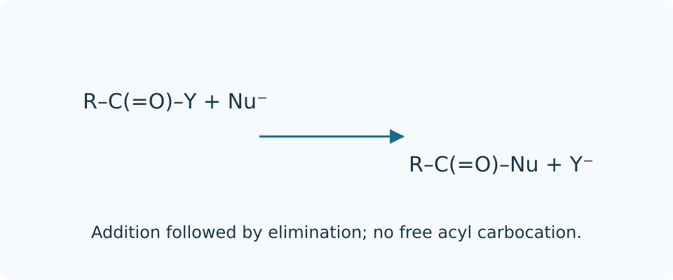{width=85% fig-alt="Acyl substitution replaces Y while retaining a carbonyl"}

Which bond is replaced overall, and which temporary intermediate is hidden?

::: notes
Suggested 40 seconds; adjust to the explanation and class response. Ask students to inspect the indicated molecular feature rather than read the answer caption. Worked answer: Y is replaced by Nu while C=O is retained overall. Addition temporarily opens C=O before elimination restores it.
:::

## Apply: compare net and elementary descriptions

Is one net reaction arrow evidence for one elementary step?

::: notes
Suggested 60 seconds; adjust to the explanation and class response. Allow a brief paper or pair check within this slide. Worked answer: No. The net equation suppresses intermediates and proton transfers; elementary steps require mechanistic evidence and bookkeeping.
:::

## Activate the acid carbonyl

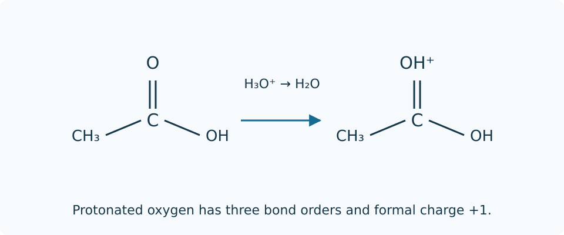{width=85% fig-alt="Acid activation protonates carbonyl oxygen"}

Which atom is protonated first in the representative acid-catalysed pathway?

::: notes
Suggested 40 seconds; adjust to the explanation and class response. Ask students to inspect the indicated molecular feature rather than read the answer caption. Worked answer: Carbonyl oxygen accepts H⁺ from a donor such as hydronium, increasing carbon electrophilicity. The protonated oxygen has +1 charge.
:::

## Resolve: activate the acid carbonyl

{width=85% fig-alt="Acid activation protonates carbonyl oxygen"}

Carbonyl oxygen accepts H⁺ from a donor such as hydronium, increasing carbon electrophilicity. The protonated oxygen has +1 charge.

::: notes
Suggested 30 seconds; adjust to the explanation and class response. Use a second inspection focus: justify the result by the atom, charge, ratio or observation involved. Next application answer: O has a double bond to C and a single bond to H, three bond orders in total, and formal charge +1.
:::

## Apply: activate the acid carbonyl

Count oxygen bond orders in C=OH⁺.

::: notes
Suggested 60 seconds; adjust to the explanation and class response. Allow a brief paper or pair check within this slide. Worked answer: O has a double bond to C and a single bond to H, three bond orders in total, and formal charge +1.
:::

## Let a neutral alcohol attack

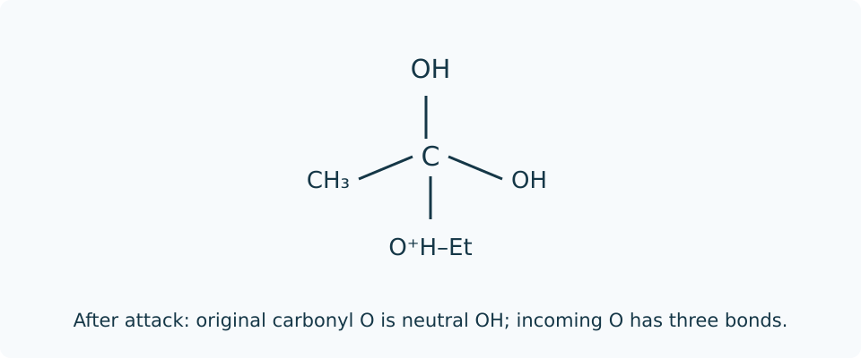{width=85% fig-alt="Neutral ethanol adds to the activated acyl carbon"}

After ethanol attacks activated carbonyl, where is the positive charge?

::: notes
Suggested 40 seconds; adjust to the explanation and class response. Ask students to inspect the indicated molecular feature rather than read the answer caption. Worked answer: The incoming ethanol oxygen has three single bonds and is positive. Original carbonyl O becomes neutral OH.
:::

## Resolve: let a neutral alcohol attack

{width=85% fig-alt="Neutral ethanol adds to the activated acyl carbon"}

The incoming ethanol oxygen has three single bonds and is positive. Original carbonyl O becomes neutral OH.

::: notes
Suggested 30 seconds; adjust to the explanation and class response. Use a second inspection focus: justify the result by the atom, charge, ratio or observation involved. Next application answer: CH₃C(OH)(OH)(O⁺HEt); the total charge is +1.
:::

## Apply: let a neutral alcohol attack

Write the tetrahedral species from protonated ethanoic acid and ethanol.

::: notes
Suggested 60 seconds; adjust to the explanation and class response. Allow a brief paper or pair check within this slide. Worked answer: CH₃C(OH)(OH)(O⁺HEt); the total charge is +1.
:::

## Make the incoming oxygen neutral

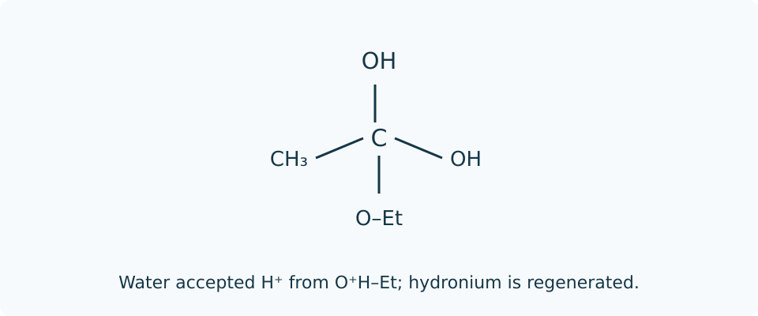{width=85% fig-alt="Deprotonating the incoming oxygen gives a neutral tetrahedral species"}

What proton transfer makes OEt a neutral substituent?

::: notes
Suggested 40 seconds; adjust to the explanation and class response. Ask students to inspect the indicated molecular feature rather than read the answer caption. Worked answer: Water removes H from O⁺HEt, leaving OEt with two bonds. This step regenerates hydronium.
:::

## Resolve: make the incoming oxygen neutral

{width=85% fig-alt="Deprotonating the incoming oxygen gives a neutral tetrahedral species"}

Water removes H from O⁺HEt, leaving OEt with two bonds. This step regenerates hydronium.

::: notes
Suggested 30 seconds; adjust to the explanation and class response. Use a second inspection focus: justify the result by the atom, charge, ratio or observation involved. Next application answer: An unprotonated OH is poor as a departing group in this acid mechanism. A further proton transfer can make OH₂⁺.
:::

## Apply: make the incoming oxygen neutral

Does this neutral tetrahedral drawing already contain a good leaving group?

::: notes
Suggested 60 seconds; adjust to the explanation and class response. Allow a brief paper or pair check within this slide. Worked answer: An unprotonated OH is poor as a departing group in this acid mechanism. A further proton transfer can make OH₂⁺.
:::

## Create a viable leaving group

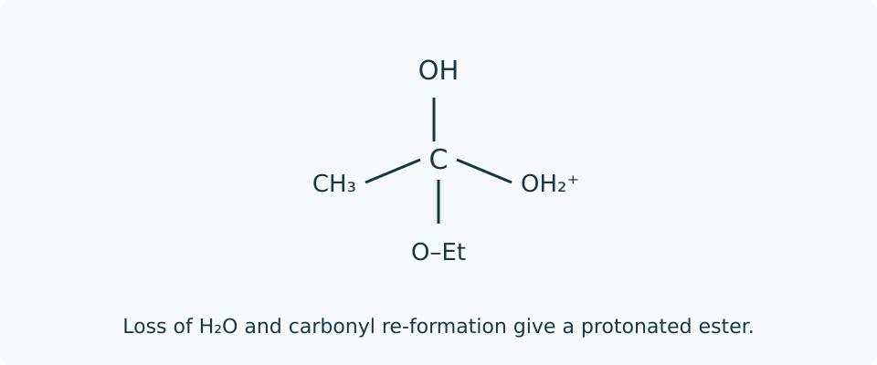{width=85% fig-alt="Protonating an OH creates a water leaving group"}

Which attached group can now leave as a neutral molecule?

::: notes
Suggested 40 seconds; adjust to the explanation and class response. Ask students to inspect the indicated molecular feature rather than read the answer caption. Worked answer: The protonated OH₂⁺ group can leave as water while another oxygen pair reforms C=O. The first carbonyl product is protonated.
:::

## Resolve: create a viable leaving group

{width=85% fig-alt="Protonating an OH creates a water leaving group"}

The protonated OH₂⁺ group can leave as water while another oxygen pair reforms C=O. The first carbonyl product is protonated.

::: notes
Suggested 30 seconds; adjust to the explanation and class response. Use a second inspection focus: justify the result by the atom, charge, ratio or observation involved. Next application answer: A base such as water removes the remaining carbonyl-oxygen proton, giving ester and regenerating hydronium.
:::

## Apply: create a viable leaving group

Name the final step restoring neutral ester and catalyst.

::: notes
Suggested 60 seconds; adjust to the explanation and class response. Allow a brief paper or pair check within this slide. Worked answer: A base such as water removes the remaining carbonyl-oxygen proton, giving ester and regenerating hydronium.
:::

## Interpret the equilibrium separately from catalysis

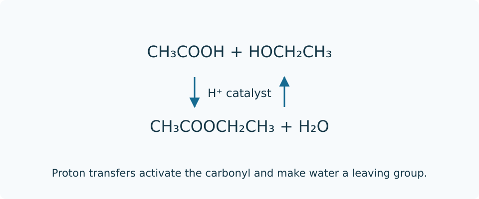{width=85% fig-alt="Acid-catalysed esterification is an equilibrium"}

How could the ester proportion change without changing the catalyst?

::: notes
Suggested 40 seconds; adjust to the explanation and class response. Ask students to inspect the indicated molecular feature rather than read the answer caption. Worked answer: Changing reactant/product amounts, such as removing water, can favour ester formation. Acid accelerates approach in both directions.
:::

## Apply: interpret the equilibrium separately from catalysis

Does adding a catalyst alone change equilibrium K at fixed conditions?

::: notes
Suggested 60 seconds; adjust to the explanation and class response. Allow a brief paper or pair check within this slide. Worked answer: No. It offers a faster pathway but does not change the net reaction equilibrium constant at the same temperature.
:::

## Explain amide rotation and reactivity

{width=85% fig-alt="Amide nitrogen donates into the carbonyl"}

What does the contributor with C=N imply about the real C–N bond?

::: notes
Suggested 40 seconds; adjust to the explanation and class response. Ask students to inspect the indicated molecular feature rather than read the answer caption. Worked answer: It has partial double-bond character. Nitrogen donation stabilises the amide and reduces its pair availability. Contributors describe one molecule.
:::

## Apply: explain amide rotation and reactivity

Audit charges in CH₃C(O⁻)=NH₂⁺.

::: notes
Suggested 60 seconds; adjust to the explanation and class response. Allow a brief paper or pair check within this slide. Worked answer: O is −1 and N is +1, so the contributor remains neutral. N has four bond orders.
:::

## Distinguish proton transfer from coupling

{width=85% fig-alt="Acid plus amine first gives an ammonium carboxylate salt"}

What immediate product should be expected from acid plus amine in water?

::: notes
Suggested 40 seconds; adjust to the explanation and class response. Ask students to inspect the indicated molecular feature rather than read the answer caption. Worked answer: An ammonium carboxylate pair is a reasonable initial acid–base result. Amide formation requires suitable activation or conditions.
:::

## Apply: distinguish proton transfer from coupling

Explain why two amino acids meeting in water is insufficient for rapid peptide formation.

::: notes
Suggested 60 seconds; adjust to the explanation and class response. Allow a brief paper or pair check within this slide. Worked answer: The acid and amine can proton-transfer; a productive acyl-substitution pathway needs activation and appropriate conditions, later supplied biologically.
:::

## Transfer the acyl motif to biological structures

{width=85% fig-alt="Biological ester and amide links share an acyl motif"}

Which bond is ester-like in a lipid and amide-like in a peptide?

::: notes
Suggested 40 seconds; adjust to the explanation and class response. Ask students to inspect the indicated molecular feature rather than read the answer caption. Worked answer: An acyl carbon bonded to O–R gives an ester linkage; an acyl carbon bonded to N gives an amide linkage.
:::

## Apply: transfer the acyl motif to biological structures

Where would initial nucleophilic acyl attack occur in either motif?

::: notes
Suggested 60 seconds; adjust to the explanation and class response. Allow a brief paper or pair check within this slide. Worked answer: At the carbonyl carbon. Whether reaction proceeds depends on activation, leaving group and environment, not merely the presence of C=O.
:::

## Integrate one short case

A student stops base-promoted ethyl-ethanoate hydrolysis at CH₃COOH + EtO⁻. Write the missing step and the form obtained after acid work-up.

::: notes
Suggested 120 seconds; adjust to the explanation and class response. Give time to formulate the claim and compare a partner explanation. Worked answer: EtO⁻ deprotonates the acid to give CH₃COO⁻ + EtOH. Acid work-up later protonates carboxylate to CH₃COOH.
:::

## Compare the worked reasoning

EtO⁻ deprotonates the acid to give CH₃COO⁻ + EtOH. Acid work-up later protonates carboxylate to CH₃COOH.

::: notes
Suggested 60 seconds; adjust to the explanation and class response. Ask students to identify the exact step or observation their own reasoning omitted. This is a correction interval within the session, not a new topic.
:::

## Exit explanation

Why does a carbonyl alone not guarantee acyl substitution?

::: notes
Suggested 40 seconds; adjust to the explanation and class response. Worked answer: The substrate also needs a viable leaving-group pathway; aldehydes and ketones ordinarily undergo addition instead. Ask for a causal explanation, not a single vocabulary label.
:::

## Continue with independent practice

Use the [exercises](exercise.qmd), then the [self-check](quiz.qmd).

The [reading guide](../reference/reading.qmd) offers optional background reading.

::: notes
Suggested 20 seconds; adjust to the explanation and class response. Preview the local exercise route. No book purchase or external problem set is needed to complete it. Leave time to note one corrected misconception.
:::
