## About this lecture

After a drink, your liver turns ethanol into **acetaldehyde** and then into **acetate**. If the second step is slow, acetaldehyde piles up and you get the red face, racing heart and nausea of an "alcohol flush". The drug disulfiram treats alcoholism by blocking that second step on purpose. Both steps are **oxidations of one carbon**.

Today we learn to follow that carbon:

- **Classify alcohols** as primary, secondary or tertiary, and predict what each oxidises to
- **Oxidation states** of carbon, as a quick bookkeeping check
- **Reduction** of aldehydes and ketones with NaBH₄, drawn as two steps
- **Activating OH** so it can leave, and IR evidence for a redox change
- **Amounts and yield:** limiting reagent, theoretical mass, what yield can't tell you

Yesterday we made alcohols by adding water to alkenes. Today we change how oxidised the alcohol carbon is.

::: notes
Open with the flush. Many students have seen it or felt it; the ALDH2 variant that slows acetaldehyde removal is common in East Asian populations. Disulfiram (Antabuse) blocks aldehyde dehydrogenase so that drinking makes people feel ill immediately. Methanol poisoning is the dark twin: the same enzymes turn methanol into formaldehyde and formic acid, which damages the optic nerve, and the antidote fomepizole blocks the first step. The point for today: these are ordinary organic oxidations, and the rules we learn for the lab apply in the liver. Link back to Day 12: hydration of an alkene gave an alcohol, but the carbon oxidation level didn't change much there; today it does.
:::

## Your liver runs two oxidations in a row

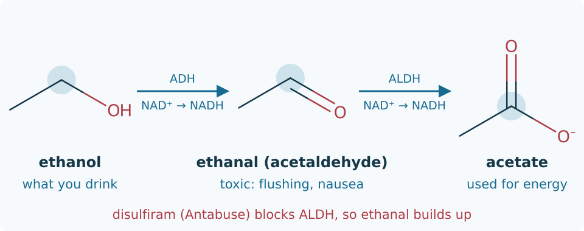{width=82% fig-alt="Ethanol is oxidised by alcohol dehydrogenase to ethanal, then by aldehyde dehydrogenase to acetate; disulfiram blocks the second enzyme"}

Look at the shaded carbon. Each step **removes a C–H bond and adds a C–O bond**. The H leaves as a hydride, picked up by **NAD⁺**, which becomes NADH.

::: notes
Point at the shaded carbon through all three structures: the carbon skeleton never changes, only what's attached to that one carbon. Ethanol's carbon has two H and one O; ethanal's has one H and a double bond to O; acetate's has no H and three bonds to oxygen. NAD+ is nature's oxidising agent: it accepts a hydride (H with two electrons). Keep that in mind, because later today NaBH4 does the reverse and gives a hydride to a carbonyl carbon. Biology and the lab run the same chemistry in opposite directions. Students often say "oxidation means adding oxygen"; ask whether going from ethanol to ethanal adds any oxygen atom. It doesn't, and that's why we need a better definition on the next slides.
:::

## Primary, secondary, tertiary

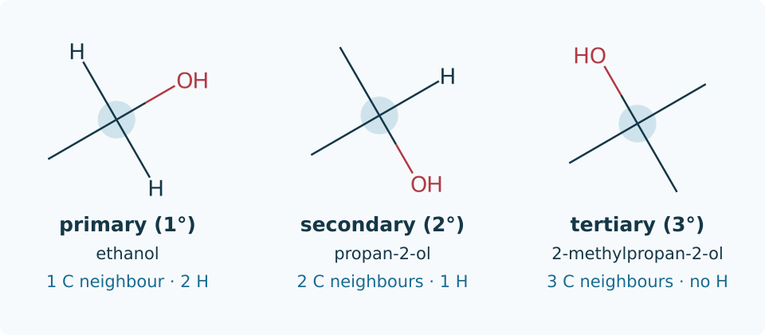{width=82% fig-alt="Ethanol, propan-2-ol and 2-methylpropan-2-ol with the OH-bearing carbon shaded and its hydrogens drawn: two, one and none"}

Classify by the **OH-bearing carbon** (the carbinol carbon): count its carbon neighbours. That also tells you how many **H** it carries, which decides how far it can be oxidised.

::: notes
This classification is the key to everything on oxidation. Primary means one carbon neighbour, so two H on the carbinol carbon; secondary, two carbon neighbours and one H; tertiary, three carbon neighbours and no H. The H are drawn explicitly here only on the carbinol carbon because those are the ones that matter today. A common slip: students classify by counting OH groups or by counting all the carbons in the molecule. Butan-1-ol and butan-2-ol have the same number of carbons, but one is primary and one secondary. Same words as for carbocations on Day 11, same counting rule.
:::

## Oxidation state: a bookkeeping check for carbon

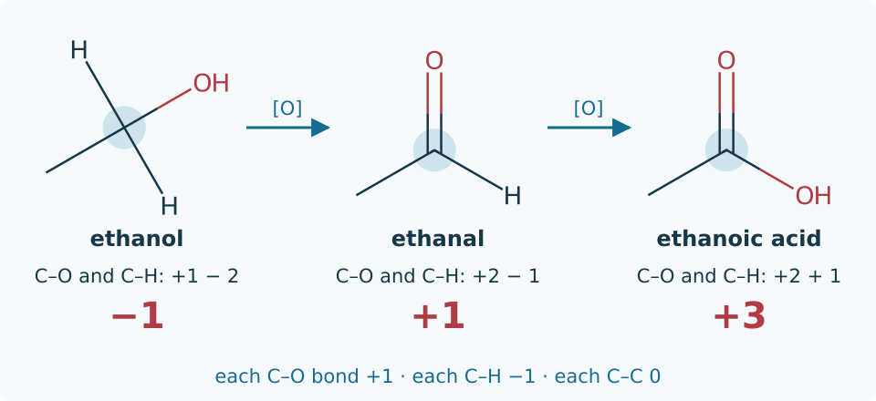{width=78% fig-alt="Ethanol, ethanal and ethanoic acid with the changing carbon shaded and assigned oxidation states minus one, plus one and plus three"}

Count only bonds to the carbon you care about: **C–O +1** per bond (C=O counts +2), **C–H −1**, **C–C 0**. Oxidation **raises** the number; reduction lowers it.

::: {.try}
**Try it:** what's the carbinol carbon in propan-2-ol, and the carbonyl carbon in propanone?

::: {.fragment}
**0 and +2.** Propan-2-ol: +1 (C–O) − 1 (C–H) = 0. Propanone: +2 (C=O), no C–H. Up by two, so it's an oxidation.
:::
:::

::: notes
This is a bookkeeping tool, not a real charge. The rule comes from electronegativity: O pulls electrons from C, so each C–O bond counts as +1 for carbon; H is less electronegative than C, so each C–H counts as −1; a C–C bond is shared evenly. Walk through ethanol: one C–O (+1), two C–H (−2), one C–C (0), total −1. Ethanal: C=O is +2, one C–H −1, total +1. Ethanoic acid: C=O +2, C–OH +1, total +3. Each step is a change of two, which matches two electrons leaving with the hydride. Give 30 seconds for the try-it. Students who get +1 for propanone usually forgot that a double bond counts twice.
:::

## Primary alcohols: stop at the aldehyde, or go on to the acid

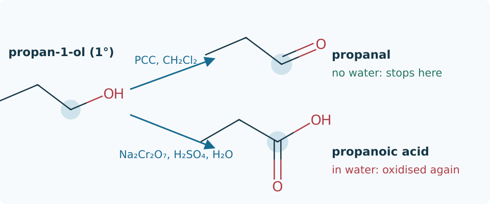{width=80% fig-alt="Propan-1-ol gives propanal with PCC in dichloromethane, but propanoic acid with sodium dichromate in aqueous sulfuric acid"}

A primary alcohol has **two** C–H to give up, so it has two oxidation targets. To **stop at the aldehyde**, use a reagent without water, such as **PCC** in CH₂Cl₂. In water, the aldehyde is oxidised again to the **carboxylic acid**.

::: notes
Why does water matter? In water an aldehyde partly adds water to give a hydrate, which has a new C–H next to an OH and gets oxidised again; that's a preview of carbonyl addition in Week 4, Day 16. PCC (pyridinium chlorochromate) in dichloromethane avoids that. The orange-to-green colour change of dichromate, Cr(VI) to Cr(III), is the chemistry of the old roadside breathalyser: ethanol in breath reduced the dichromate. Stress that "[O]" over an arrow is shorthand for some oxidant, not a free oxygen atom, and an arrow on a slide is not a lab protocol. The reagents here are examples to reason with; you won't be examined on chromium mechanisms.
:::

## Secondary alcohols give ketones

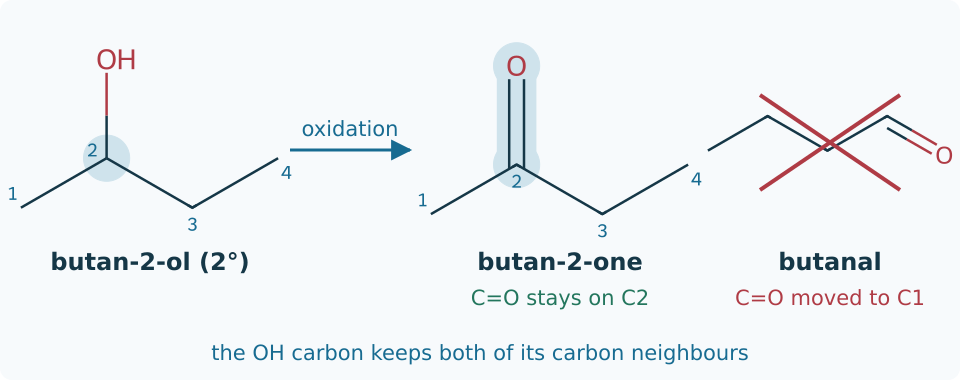{width=82% fig-alt="Butan-2-ol with numbered carbons oxidises to butan-2-one with the C=O on C2; butanal is crossed out because its C=O is on C1"}

The C=O forms **exactly where the OH was**. Both carbon neighbours stay attached, so the product is a ketone. With no further C–H on that carbon, oxidation stops there.

::: {.try}
**Try it:** a student writes butanal as the product. What went wrong?

::: {.fragment}
**The C=O moved.** Butanal has its carbonyl on C1, but oxidation only changes the carbon that carried the OH, which is C2.
:::
:::

::: notes
Numbering makes the point concrete: C2 carries the OH before, and C2 carries the O after. Oxidation doesn't move functional groups along a chain and doesn't break C–C bonds under these conditions. Ask why oxidation stops at the ketone: the carbonyl carbon has no H left, and making an acid would mean breaking a C–C bond. Everyday example: propan-2-ol (rubbing alcohol) oxidises to propanone (acetone, nail-polish remover). The exercises use butan-2-ol and butan-2-one, so make sure everyone can draw both.
:::

## Tertiary alcohols resist simple oxidation

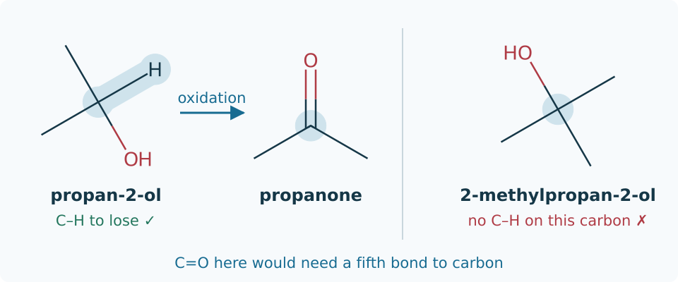{width=80% fig-alt="Propan-2-ol has one H on its OH carbon and oxidises to propanone; 2-methylpropan-2-ol has no H on its OH carbon"}

Oxidation to C=O needs a **C–H on the carbinol carbon**. A tertiary carbon has three C–C bonds and a C–O; drawing (CH₃)₃C=O would give it **five bonds**.

Harsh oxidants can break C–C bonds instead, but that's a different reaction and outside our toolkit.

::: notes
Run the valence check from Day 1 on the board: three C–C bonds plus a C=O is 3 + 2 = 5 bonds to carbon, which is impossible. So the simple alcohol-to-carbonyl pattern has nowhere to go. Be careful with the wording: don't say "tertiary alcohols can never be oxidised". Under forcing conditions C–C bonds break. What we can say is that the selected oxidations in this course leave tertiary alcohols alone. This is a useful test in practice: a mild oxidant distinguishes primary and secondary from tertiary alcohols.
:::

## Reduction runs the map backwards

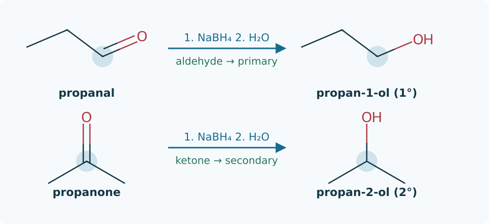{width=74% fig-alt="Propanal is reduced to propan-1-ol and propanone to propan-2-ol by NaBH4 followed by water"}

Sodium borohydride, **NaBH₄**, adds **H to the carbonyl carbon**; a proton source then puts **H on oxygen**. Aldehydes give **primary** alcohols, ketones give **secondary** alcohols. The carbon skeleton is unchanged.

::: notes
This is the mirror image of the oxidation slides: one new C–H and one new O–H, oxidation state of the carbonyl carbon drops by two. The "1. 2." numbering means two separate operations: first the reagent, then the water or acid work-up. NaBH4 is a mild, convenient reagent, often used in methanol or ethanol, and it's selective, which we'll come back to. In the body, NADH plays the same role as NaBH4: it delivers a hydride to a carbonyl carbon. Ask the room what a ketone reduction can never give: a primary alcohol, because the carbonyl carbon already has two carbon neighbours.
:::

## Step 1: a hydride adds to the carbonyl carbon

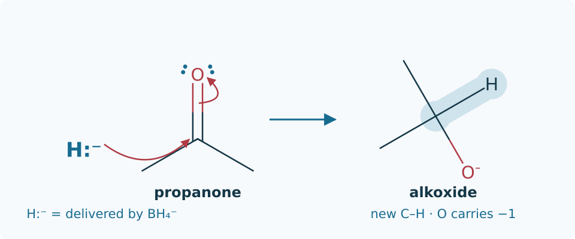{width=76% fig-alt="Curved arrows: the hydride pair attacks the carbonyl carbon of propanone and the C=O pi pair moves onto oxygen, giving an alkoxide"}

Two arrows: the **H:⁻ pair forms the new C–H**, and the **C=O π pair moves onto O**. The product is an **alkoxide**, with O⁻. "H:⁻" is shorthand for a hydride delivered by BH₄⁻; there's no free hydride in solution.

::: {.try}
**Try it:** why must the π bond break when the H adds?

::: {.fragment}
**Valence.** The carbonyl carbon already has four bonds. A fifth is impossible, so the π pair has to leave, onto the more electronegative oxygen.
:::
:::

::: notes
Draw this one on the board with the students. The first arrow starts at the electron pair (the H with its two electrons) and ends at the carbonyl carbon, which is electrophilic because O pulls electron density away from it. The second arrow starts at the middle of the C=O double bond and ends on O. Count charges: hydride −1 going in, alkoxide oxygen −1 coming out, so charge is conserved. This is the first example of nucleophilic addition to a carbonyl, which is the whole of Day 16. Probe the misconception that BH4- releases free H- ions into water; it doesn't, and free hydride would react with water instantly to give H2.
:::

## Step 2: water protonates the alkoxide

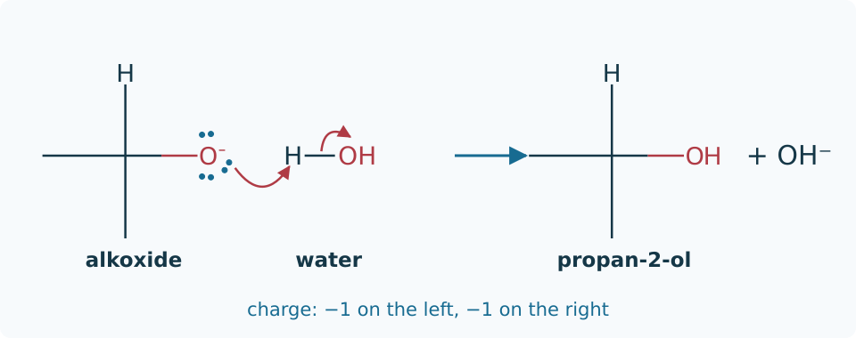{width=80% fig-alt="The alkoxide oxygen lone pair takes a proton from water and the O–H bonding pair stays on the water oxygen, giving propan-2-ol and hydroxide"}

The alkoxide is a strong base, so it takes **H⁺ from water**. Name the donor and write its conjugate base: charge is **−1 on both sides**, and every H is accounted for.

::: notes
This is an acid-base step straight out of Day 3: an alkoxide (conjugate base of an alcohol, pKa about 16) and water (pKa about 15.7) are close, and with plenty of water the equilibrium gives the alcohol. The two arrows mirror each other: the O⁻ lone pair grabs the H, and the old O–H bond pair stays on the water oxygen, which becomes hydroxide. Students often write "+ H+" over the arrow and lose track of charge; insist on a named proton donor. The order matters: addition first, then proton transfer. The net product is the alcohol, but the steps don't happen at once.
:::

## A new stereocentre, both hands

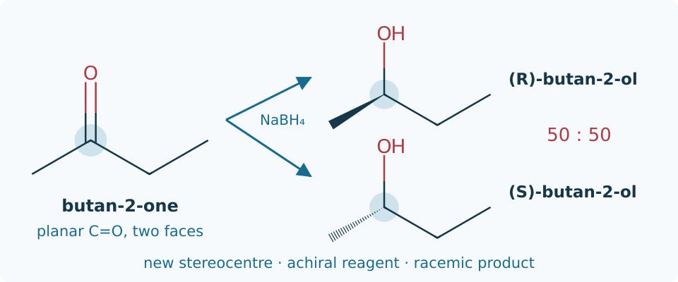{width=76% fig-alt="Hydride adds to either face of planar butan-2-one, giving (R)- and (S)-butan-2-ol in a 50:50 mixture"}

The carbonyl is **planar**, so hydride can arrive from **either face** with equal ease. Butan-2-ol has a stereocentre, and an achiral reagent makes a **racemic** 50 : 50 mixture.

::: {.try}
**Try it:** does the product solution rotate plane-polarised light?

::: {.fragment}
**No.** Equal amounts of R and S cancel. A racemate is optically inactive even though each molecule is chiral.
:::
:::

::: notes
Bridge to Week 2: the new carbon carries OH, H, CH3 and CH2CH3, four different groups, so it's a stereocentre. NaBH4 is achiral and the two faces of butan-2-one are mirror images, so the rates are identical. Enzymes are different: the reductases in your cells and in baker's yeast deliver NADH's hydride to one face only, and give a single enantiomer. That's why biocatalysis is used to make chiral drugs. Students sometimes assign the drawn wedge to R without checking; ask one of them to verify the R label with CIP priorities: OH > ethyl > methyl > H.
:::

## NaBH₄ has a scope

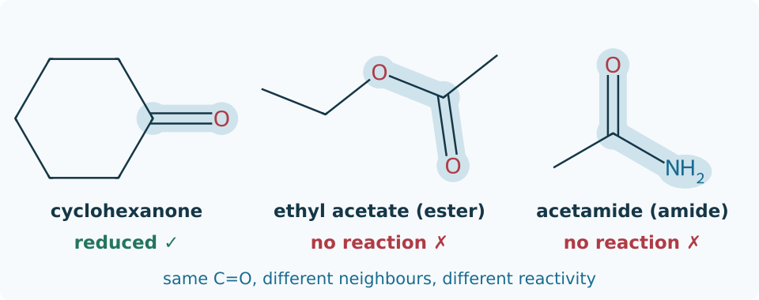{width=78% fig-alt="NaBH4 reduces cyclohexanone, but not ethyl acetate or acetamide under ordinary conditions"}

Esters and amides have a C=O too, but the **O or N next to it** donates electrons and makes the carbonyl less reactive. NaBH₄ reduces **aldehydes and ketones**; don't stretch that rule to other carbonyl groups.

::: notes
Same skill as Day 1: read the neighbours of the carbonyl, not just the C=O. In esters and amides, the lone pair on O or N is shared with the carbonyl by resonance, which makes the carbonyl carbon less electrophilic. Under ordinary conditions NaBH4 leaves them alone. A stronger reagent, LiAlH4, does reduce esters and amides; we meet that, and the reasons behind the reactivity order, in acyl chemistry on Day 17. The practical lesson for exam answers: state the reagent and the functional group it acts on, and don't assume one reagent does everything.
:::

## Choose the direction from the target

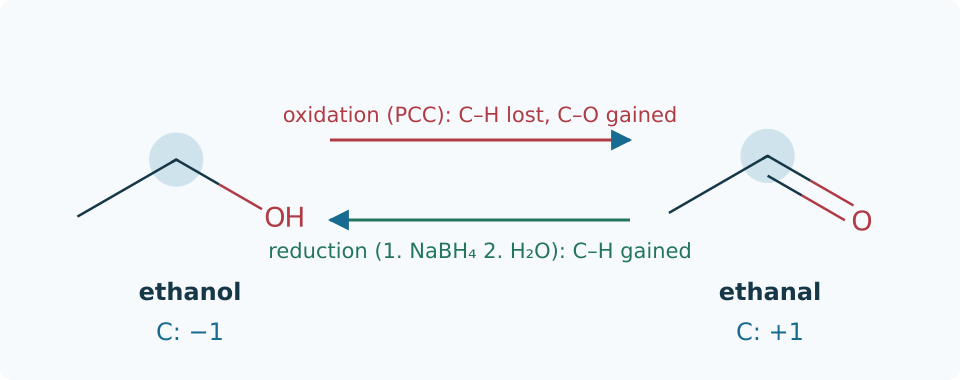{width=74% fig-alt="Oxidation with PCC takes ethanol to ethanal; NaBH4 then water takes ethanal back to ethanol"}

Before naming a reagent, compare start and target: **more C–O or fewer C–H** means oxidation; **more C–H** means reduction. Then pick a reagent that does that and nothing else.

::: notes
This is the planning habit that synthesis questions in Week 5 rely on. Give a quick oral drill: ethanal to ethanol? Reduction, NaBH4 then water. Ethanol to ethanal? Oxidation, and it has to be controlled, like PCC, or you overshoot to the acid. Ethanal to ethanoic acid? Oxidation. The oxidation-state numbers under each structure are the check: going up is oxidation, going down is reduction. A frequent wrong answer is "oxidise ethanal to get ethanol" because students pattern-match "ethanol and oxidation" from earlier slides; make them say which bonds change.
:::

## Activating OH: make it leave as water

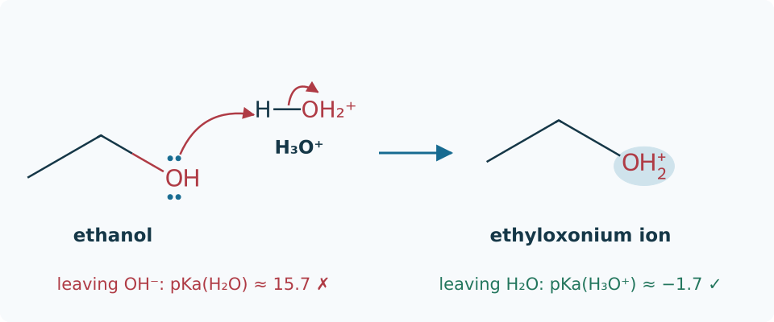{width=78% fig-alt="Ethanol's oxygen lone pair takes a proton from hydronium, giving an ethyloxonium ion; water is a much better leaving group than hydroxide"}

OH⁻ is a **strong base**, so it's a poor leaving group. **Protonate** the OH first, and the group that leaves is **neutral water**, a weak base.

::: notes
This connects the last three days. On Day 3 we learned that the weaker the base, the better the leaving group: compare the conjugate acids, water at pKa about 15.7 versus hydronium at about −1.7. On Days 11 and 12 this protonated alcohol was the starting point for SN1 with HBr and for E1 dehydration with sulfuric acid. Which one happens depends on the substrate and the conditions, so don't assume SN1 for every alcohol. Ask why we can't just do SN2 on ethanol with bromide: the hydroxide would have to leave, and it won't. The curved arrow starts at the oxygen lone pair, not at the H, a mistake we see every year.
:::

## Evidence: did the alcohol really oxidise?

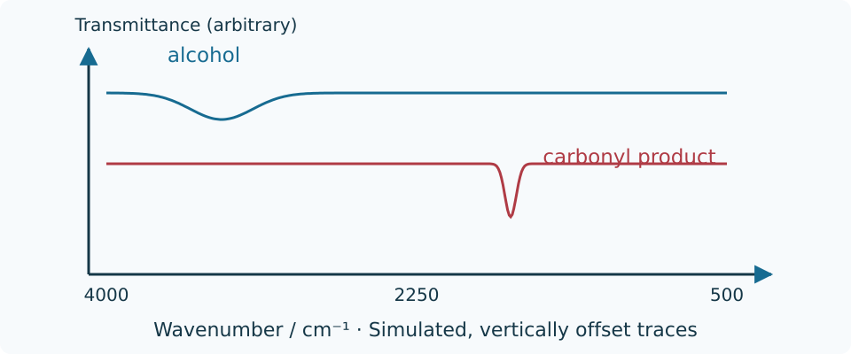{width=66% fig-alt="Simulated offset IR traces: the alcohol shows a broad O–H band around 3200 to 3600 inverse centimetres, the carbonyl product a strong band near 1715"}

A **broad O–H band (3200–3600 cm⁻¹)** that disappears and a **strong C=O band (about 1715 cm⁻¹)** that appears both support oxidation to a ketone.

::: {.try}
**Try it:** after oxidising propan-2-ol, the IR shows C=O and no O–H. What's still unproved?

::: {.fragment}
**Identity and purity.** IR shows which groups are present, not which ketone, and not whether the sample is pure.
:::
:::

::: notes
These are schematic traces, not real spectra. The logic is what counts: the IR tells you which functional groups are present. Losing the O–H and gaining the C=O is consistent with oxidation, but many ketones absorb near 1715, and a mixture with a little leftover alcohol might show only a weak O–H. Water in the sample also gives an O–H band, so a wet product can look as if the alcohol is still there. Full identification combines IR with NMR and other evidence, which is the topic of Week 5 (Days 21 and 22).
:::

## From grams to the limiting reagent

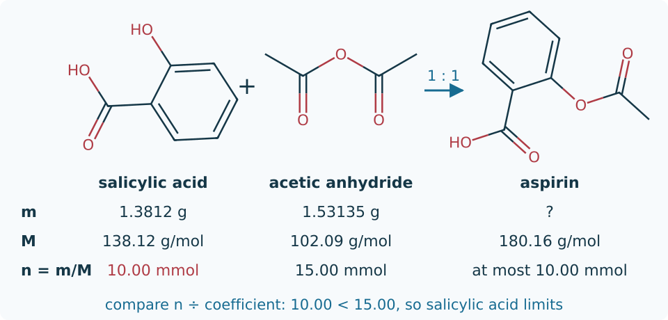{width=74% fig-alt="Salicylic acid plus acetic anhydride gives aspirin; 1.3812 g salicylic acid is 10.00 mmol and 1.53135 g acetic anhydride is 15.00 mmol, so salicylic acid limits"}

Convert each mass to moles, $n = m/M$, then compare **n ÷ coefficient**. The smallest value limits the product. Never compare grams directly.

::: {.try}
**Try it:** for 2 A + B → P with 12 mmol A and 8 mmol B, which limits, and how much P?

::: {.fragment}
**A limits: 6 mmol P.** A allows 12 ÷ 2 = 6, B allows 8 ÷ 1 = 8. The larger amount can still limit.
:::
:::

::: notes
We switch from redox to the lab report for your synthesis practical. The reaction is aspirin from salicylic acid and acetic anhydride (acetic acid is the by-product); all coefficients are one. Work the numbers aloud: 1.3812 / 138.12 = 0.01000 mol = 10.00 mmol; 1.53135 / 102.09 = 0.01500 mol = 15.00 mmol. In the R task you'll do the same with mutate() on the amounts CSV and then take min() of the extents. The 2A + B example is there because students who only ever see 1:1 reactions compare raw amounts and get the wrong answer once a coefficient isn't one.
:::

## Theoretical mass and yield

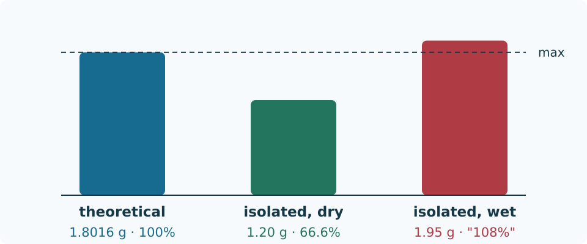{width=68% fig-alt="Bar chart: theoretical maximum 1.8016 g, isolated dry product 1.20 g which is 66.6 percent, and a wet sample of 1.95 g which would be an impossible 108 percent"}

Theoretical mass = 10.00 mmol × 180.16 g/mol = **1.8016 g**. Isolated yield = 1.20 g ÷ 1.8016 g = **66.6%**.

::: {.try}
**Try it:** a wet sample weighs 1.95 g. Is the yield 108%?

::: {.fragment}
**No.** You can't make more pure product than the stoichiometry allows. The extra mass is water, solvent or impurity, so dry the sample and check your inputs.
:::
:::

::: notes
Insist on unit conversion: 10.00 mmol is 0.01000 mol, and multiplying 10 by 180.16 gives a thousandfold error, which happens every year. The balance weighs everything in the vial, so a mass above the maximum is a measurement of your drying, not of your chemistry. The right response is to dry to constant mass, check for leftover solvent, and recheck the input masses and molar masses. A yield above 100% in a report should always trigger an explanation, never a celebration.
:::

## Conversion, yield and purity answer different questions

| quantity | question it answers | measured by |
|---|---|---|
| **conversion** | how much starting material reacted? | starting material left (e.g. TLC, NMR) |
| **isolated yield** | how much product did I recover? | product mass ÷ theoretical mass |
| **purity** | how much of my solid is the product? | melting point, NMR, chromatography |

::: {.try}
**Try it:** all the starting material is gone, but the isolated yield is only 40%. Give two reasons.

::: {.fragment}
**Side reactions** made other products, and **losses** during work-up, filtering or recrystallisation. Full conversion doesn't mean full yield.
:::
:::

::: notes
These three numbers are often confused in lab reports. One spot on a TLC plate under one set of conditions is consistent with a pure sample but doesn't prove it; one IR band doesn't identify a compound; one mass doesn't establish purity. A good evidence statement separates what's supported from what's still open: "IR shows a carbonyl; TLC shows one spot; identity needs NMR; purity needs a melting point." That sentence structure is exactly what exercise 20 asks for, and it comes back in the synthesis-evidence day in Week 5.
:::

## Mistakes we see every year

| mistake | fix |
|---|---|
| classifying an alcohol by its number of carbons | count **C neighbours of the OH carbon** |
| secondary alcohol oxidised to an aldehyde | the C=O stays **where the OH was** |
| (CH₃)₃C=O drawn from a tertiary alcohol | no C–H means **no simple oxidation** |
| "oxidation means adding O" | look for **lost C–H, gained C–O** |
| C=O counted +1 in oxidation states | a double bond counts **twice** |
| "+ H⁺" written with no donor | draw **water and its OH⁻** |
| NaBH₄ used on an ester | it reduces **aldehydes and ketones** |
| comparing grams to find the limit | compare **n ÷ coefficient** |
| yield over 100% reported | **dry and recheck**, it's not product |

::: notes
Read out each mistake and ask the room why it's wrong before revealing the fix. Every row matches one or more exercises: classification is exercise 1, the secondary and tertiary cases are 4 and 5, oxidation states are 6 and 7, the mechanism is 10 and 11, scope is 12, amounts and yield are 14 to 18.
:::

## Summary

| concept | key fact |
|---|---|
| alcohol class | count C neighbours of the OH carbon |
| oxidation | 1° → aldehyde → acid; 2° → ketone; 3° no |
| stop at aldehyde | PCC, no water |
| oxidation state | C–O +1, C–H −1, C–C 0 |
| NaBH₄ reduction | H⁻ to C, alkoxide, then H⁺ from water |
| new stereocentre | achiral reagent gives a racemate |
| activating OH | protonate, so water leaves |
| amounts | n = m/M, compare n ÷ coefficient |
| yield | isolated ÷ theoretical; not purity |

**Next:** nucleophiles adding to C=O, the general version of today's hydride step (Day 16). **Practice:** [exercises](exercise.qmd) · [self-check](quiz.qmd)

::: notes
Close the loop with the opening: ADH and ALDH are oxidations of a primary alcohol, first to the aldehyde and then to the acid (as acetate), and disulfiram stops the second one. You can now draw every step and assign the oxidation states. Recite the procedure once: find the carbinol carbon, classify it, decide the direction from the target, and check with oxidation states. Day 14 is a mechanism review and Day 15 practises redox, amounts and evidence. Then Day 16 generalises today's hydride addition to other nucleophiles. The core exercises 1 to 12 are required; 13 to 20 and the R task are for the lab report.
:::
