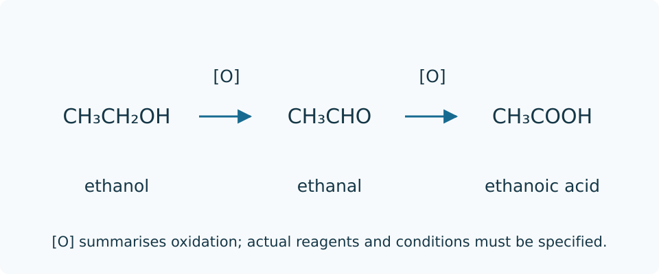
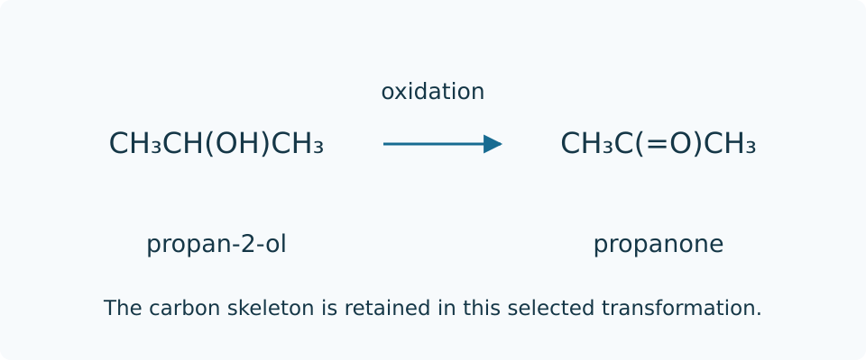
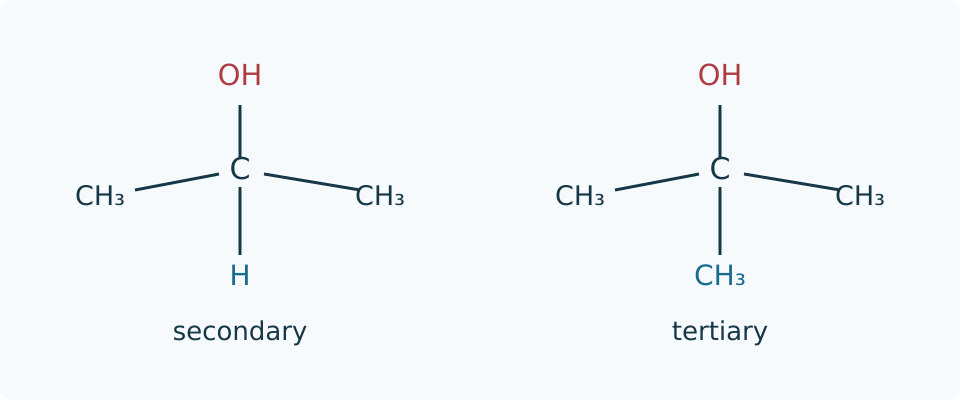
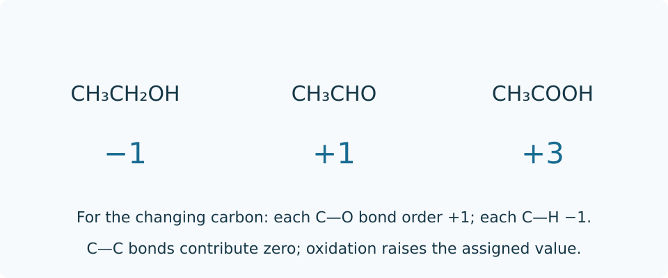
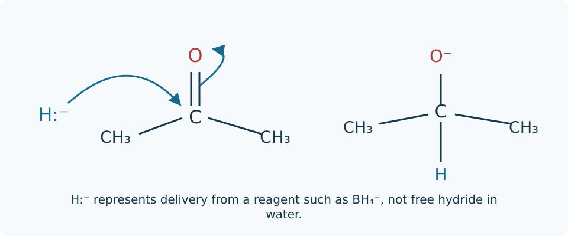
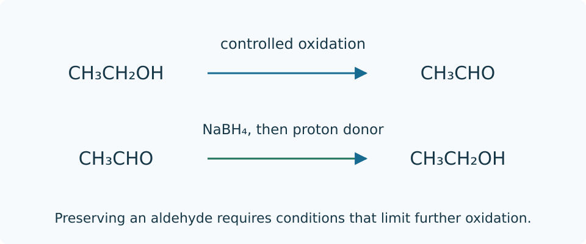

## What will you be able to explain?

- Connect alcohols with aldehydes, ketones and acids.
- Draw carbonyl reduction as addition then proton transfer.
- Calculate a limiting amount with explicit units.

::: notes
Begin with the previous unit’s electron-pair and charge audit. Ask students to predict a product or bond change before displaying the worked drawing. These slides support discussion and paper drawing; the practice page supplies further explanations.
:::

## A primary alcohol has two oxidation targets

{width=85% fig-alt="Ethanol can be oxidised to ethanal and then ethanoic acid."}

Controlling conditions matters when the intended product is the aldehyde. A transformation arrow is not a complete protocol.

::: notes
Use ethanol as the recurring carbon skeleton. The [O] notation summarises net oxidation and must not be treated as an elementary mechanistic atom.
:::

## A secondary alcohol gives a ketone

{width=85% fig-alt="Propan-2-ol oxidation gives propanone with the carbon skeleton retained."}

Identify the carbon bearing OH. Its C–H bond and O–H bond are replaced overall as the carbonyl forms.

::: notes
This is a net transformation, not a universal one-step alcohol-oxidation mechanism. Different oxidants have different elementary steps.
:::

## Why is the tertiary case different?

{width=85% fig-alt="A secondary alcohol has a hydrogen on its OH-bearing carbon; a tertiary one has three carbon substituents instead."}

A tertiary alcohol lacks the required carbinol C–H bond for the simple alcohol → carbonyl transformation without C–C cleavage.

::: notes
Do not state that tertiary alcohols can never oxidise. Harsh oxidative conditions may cleave carbon bonds; that chemistry is beyond this selected toolkit.
:::

## Use bond accounting as a check

{width=85% fig-alt="The changing carbon is assigned oxidation states minus one in ethanol, plus one in ethanal and plus three in ethanoic acid."}

Assign C–O bond order +1 and C–H bond −1 to the carbon; C–C contributes zero. Oxidation raises the value.

::: notes
For an aldehyde carbon, C=O contributes plus two and C–H minus one, giving plus one. For a carboxylic acid the three C–O bond orders give plus three.
:::

## Reduction starts with delivery of a hydride equivalent

{width=85% fig-alt="A hydride-equivalent pair forms a C–H bond at a ketone while its carbonyl pi pair moves onto oxygen."}

A reagent such as NaBH₄ can reduce selected aldehydes and ketones. First draw the alkoxide.

::: notes
H: minus is a mechanistic shorthand for reagent delivery, not a bottle of free hydride in water. Full borate chemistry is outside the introductory scheme.
:::

## An alkoxide still needs a proton

{width=85% fig-alt="A separate water proton-transfer step converts the alkoxide into a neutral alcohol."}

Specify the proton donor. Add the conjugate base to conserve charge and H atoms.

::: notes
Discuss the order: carbonyl attack, alkoxide, proton transfer. The net alcohol product does not mean all events occur at once.
:::

## Alcohol chemistry often begins with activation

{width=85% fig-alt="An alcohol can be protonated to an oxonium species from which water is a better leaving group than hydroxide."}

OH⁻ is generally a poor leaving group. Protonation changes what can depart.

::: notes
Which reaction follows activation depends on substrate and conditions. Do not infer SN1 for every alcohol or ignore an elimination pathway.
:::

## Use evidence to test the transformation

{width=85% fig-alt="Simulated offset IR traces contrast a broad alcohol O–H region with a carbonyl absorption near 1720 inverse centimetres."}

A new carbonyl band supports a functional-group change. A missing broad O–H band is useful but not a complete identification.

::: notes
These are synthetic schematic traces, not real spectra or a universal frequency reference. Water, concentration and overlapping bands can affect actual observations.
:::

## Choose the desired functional group first

{width=85% fig-alt="Ethanol to ethanal is an oxidation, while ethanal to ethanol can use NaBH4 followed by proton donation."}

Say which bonds change, then justify a suitable transformation. Conditions must match the target and other functional groups.

::: notes
Reagent names are examples for reasoning, not laboratory instructions. Actual lab protocols require the approved departmental directions.
:::

## Calculate a maximum before an isolated yield

{width=85% fig-alt="A supplied one-to-one synthesis with 10 mmol acid and 15 mmol anhydride has a 10 mmol product maximum."}

Compare n/stoichiometric coefficient, not reagent masses. Use the balanced equation supplied for the actual experiment.

::: notes
This task prepares the synthesis report, using aspirin data rather than an alcohol-redox reaction. Make that context switch explicit; the calculation method transfers.
:::

## A reagent has a scope

This course uses selected transformations. Predict aldehyde/ketone reduction by NaBH₄ under suitable conditions; do not silently extend that claim to ordinary esters or amides.

Other functional groups and conditions can change the outcome.

## Yield, conversion and purity differ

**Isolated yield:** isolated product amount / theoretical maximum.

**Conversion:** fraction of a starting material consumed.

**Purity:** fraction of the isolated material that is the desired substance.

One number cannot establish all three.

## Chemical explanation before calculation

For a secondary alcohol, predict the oxidation product and explain the local bond changes.

For a balanced 1:1 synthesis with 10 and 15 mmol reagents, predict the limiting reagent before opening R.

## Use the same reasoning in practice

Complete the [practice and worked examples](exercise.qmd), then the [self-check](quiz.qmd).

Optional textbook support: selected Solomons chapter 11–12 sections. The [reading guide](../reference/reading.qmd) explains the provisional book mapping.
