## What will you be able to explain?

- Connect alcohols with aldehydes, ketones and acids.
- Draw carbonyl reduction as addition then proton transfer.
- Calculate a limiting amount with explicit units.

::: notes
**45-minute block budget (all pauses included):** 0–5 min: alcohol/carbonyl transformation map; 5–13 min: local oxidation-state comparisons and tertiary boundary; 13–23 min: reduction plus proton-transfer drawing; 23–29 min: OH activation and IR evidence; 29–39 min: paper amount, yield and purity comparisons; 39–43 min: target-based route choice; 43–45 min: recap. The brief predictions, individual drawing and board discussion occur inside these blocks, not in extra time. The 40-second metadata is a rough planning reference; spend longer on the identified drawings and merge explanations already understood.

Begin with the previous unit’s electron-pair and charge audit. Ask students to predict a product or bond change before displaying the worked drawing. These slides support discussion and paper drawing; the practice page supplies further explanations.
:::

## Predict before the worked drawing

Draw ethanol and predict two successive oxidation targets with the same carbon skeleton. Why might an aldehyde target require controlled conditions?

::: notes
Allow about 25 seconds of individual drawing/thinking, then ask for one reason. Do not display the worked product yet. Use the following illustration to resolve the atom, charge or geometry issue.
:::

## A primary alcohol has two oxidation targets

{width=85% fig-alt="Ethanol can be oxidised to ethanal and then ethanoic acid."}

Controlling conditions matters when the intended product is the aldehyde. A transformation arrow is not a complete protocol.

::: notes
Use ethanol as the recurring carbon skeleton. The [O] notation summarises net oxidation and must not be treated as an elementary mechanistic atom.
:::

## Extend the same local transformation

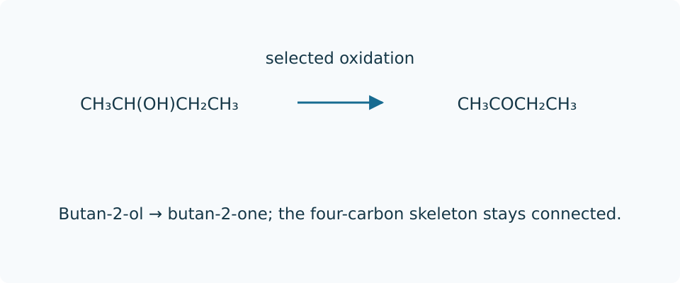{width=85% fig-alt="Extend the same local transformation"}

Find the original OH-bearing carbon in butan-2-ol and keep its methyl/ethyl neighbours attached.

::: notes
Butan-2-one retains the original reacting carbon and both carbon substituents. Butanal would move the carbonyl to the chain end.
:::

## Reject an unintended aldehyde

{width=85% fig-alt="Extend the same local transformation"}

Why would butanal be the wrong product for this simple secondary-alcohol oxidation?

::: notes
Butan-2-one retains the original reacting carbon and both carbon substituents. Butanal would move the carbonyl to the chain end.
:::

## A secondary alcohol gives a ketone

{width=85% fig-alt="Propan-2-ol oxidation gives propanone with the carbon skeleton retained."}

Identify the carbon bearing OH. Its C–H bond and O–H bond are replaced overall as the carbonyl forms.

::: notes
This is a net transformation, not a universal one-step alcohol-oxidation mechanism. Different oxidants have different elementary steps.
:::

## Use the aldehyde reduction pattern

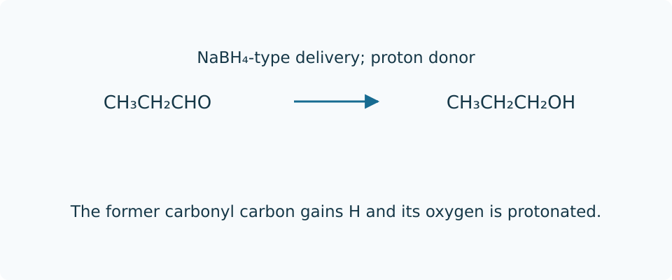{width=85% fig-alt="Use the aldehyde reduction pattern"}

Show hydride-equivalent addition first, then write the protonated neutral product.

::: notes
Delivery forms a new C–H bond and an alkoxide. A donor later supplies O–H, yielding propan-1-ol with its carbon skeleton retained.
:::

## Audit the extra hydrogens

{width=85% fig-alt="Use the aldehyde reduction pattern"}

Which new H bonds to carbon and which comes from the proton donor to oxygen?

::: notes
Delivery forms a new C–H bond and an alkoxide. A donor later supplies O–H, yielding propan-1-ol with its carbon skeleton retained.
:::

## Predict before the worked drawing

Compare the OH-bearing carbon in a secondary and tertiary alcohol. What H is missing in the tertiary case?

::: notes
Allow about 25 seconds of individual drawing/thinking, then ask for one reason. Do not display the worked product yet. Use the following illustration to resolve the atom, charge or geometry issue.
:::

## Why is the tertiary case different?

{width=85% fig-alt="A secondary alcohol has a hydrogen on its OH-bearing carbon; a tertiary one has three carbon substituents instead."}

A tertiary alcohol lacks the required carbinol C–H bond for the simple alcohol → carbonyl transformation without C–C cleavage.

::: notes
Do not state that tertiary alcohols can never oxidise. Harsh oxidative conditions may cleave carbon bonds; that chemistry is beyond this selected toolkit.
:::

## Compare a secondary carbon before and after

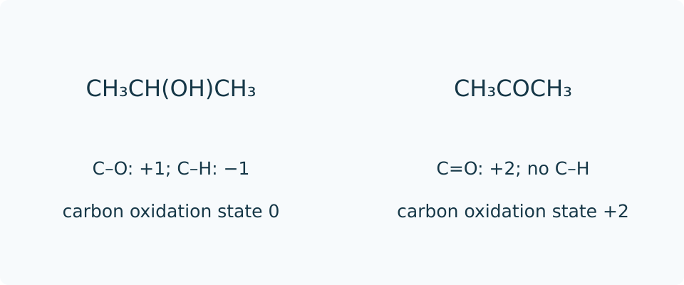{width=85% fig-alt="Compare a secondary carbon before and after"}

Calculate the OH-carbon assignment in propan-2-ol using C–O+1, C–H−1, C–C0.

::: notes
The alcohol carbon is 0; ketone carbon +2. Increasing C–O bond order and losing C–H raises its oxidation state without adding an oxygen atom.
:::

## Explain the two-unit change

{width=85% fig-alt="Compare a secondary carbon before and after"}

Calculate the ketone carbon value and identify why oxidation is not just “adding an O atom”.

::: notes
The alcohol carbon is 0; ketone carbon +2. Increasing C–O bond order and losing C–H raises its oxidation state without adding an oxygen atom.
:::

## Predict before the worked drawing

For the changing carbon, use C–O bond order +1, C–H −1 and C–C 0. Predict the values for ethanol, ethanal and ethanoic acid.

::: notes
Allow about 25 seconds of individual drawing/thinking, then ask for one reason. Do not display the worked product yet. Use the following illustration to resolve the atom, charge or geometry issue.
:::

## Use bond accounting as a check

{width=85% fig-alt="The changing carbon is assigned oxidation states minus one in ethanol, plus one in ethanal and plus three in ethanoic acid."}

Assign C–O bond order +1 and C–H bond −1 to the carbon; C–C contributes zero. Oxidation raises the value.

::: notes
For an aldehyde carbon, C=O contributes plus two and C–H minus one, giving plus one. For a carboxylic acid the three C–O bond orders give plus three.
:::

## Do not compare raw amounts only

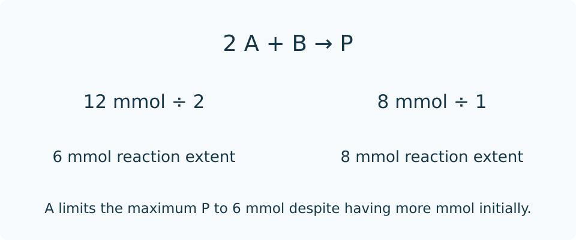{width=85% fig-alt="Do not compare raw amounts only"}

For2A+B→P with 12 mmol A and8 mmol B, compare each allowable reaction extent.

::: notes
At 2:1, A permits 6 mmol P and limits. At 1:1, B permits 8 mmol and limits. The balanced demand changes the denominator.
:::

## Change the coefficient mentally

{width=85% fig-alt="Do not compare raw amounts only"}

If the balanced equation instead were A+B→P with the same amounts, which reagent would limit and why?

::: notes
At 2:1, A permits 6 mmol P and limits. At 1:1, B permits 8 mmol and limits. The balanced demand changes the denominator.
:::

## Predict before the worked drawing

Draw simplified hydride-equivalent addition to propanone. What is the immediate oxygen charge before work-up?

::: notes
Allow about 25 seconds of individual drawing/thinking, then ask for one reason. Do not display the worked product yet. Use the following illustration to resolve the atom, charge or geometry issue.
:::

## Reduction starts with delivery of a hydride equivalent

{width=85% fig-alt="A hydride-equivalent pair forms a C–H bond at a ketone while its carbonyl pi pair moves onto oxygen."}

A reagent such as NaBH₄ can reduce selected aldehydes and ketones. First draw the alkoxide.

::: notes
H: minus is a mechanistic shorthand for reagent delivery, not a bottle of free hydride in water. Full borate chemistry is outside the introductory scheme.
:::

## Use a theoretical pure-product maximum

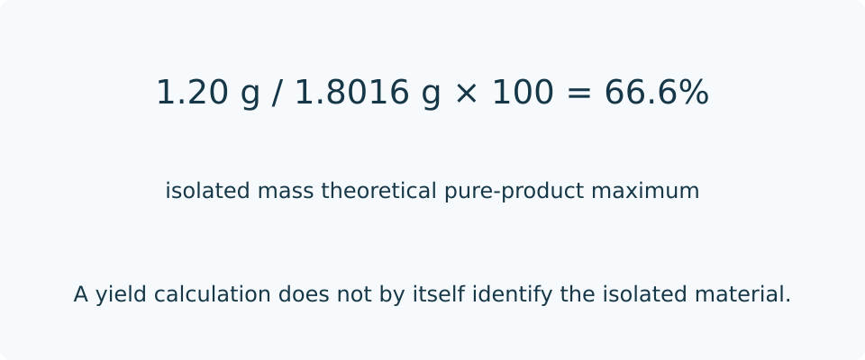{width=85% fig-alt="Use a theoretical pure-product maximum"}

Compute the isolated mass percentage for 1.20 g relative to 1.8016 g. What assumptions enter the numerator?

::: notes
The apparent isolated mass yield is 66.6%. Identity and purity require additional evidence; the balance reading alone does not establish all of its mass is intended product.
:::

## Separate yield from identity

{width=85% fig-alt="Use a theoretical pure-product maximum"}

Could the same mass include solvent or impurity? What independent evidence would you request?

::: notes
The apparent isolated mass yield is 66.6%. Identity and purity require additional evidence; the balance reading alone does not establish all of its mass is intended product.
:::

## Predict before the worked drawing

Use H₂O to protonate the alkoxide. Write the product made from the water instead of erasing its original O–H bond.

::: notes
Allow about 25 seconds of individual drawing/thinking, then ask for one reason. Do not display the worked product yet. Use the following illustration to resolve the atom, charge or geometry issue.
:::

## An alkoxide still needs a proton

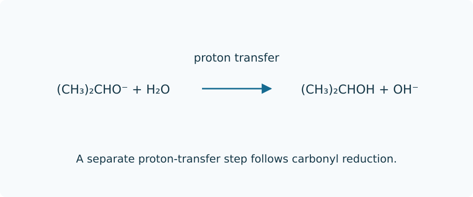{width=85% fig-alt="A separate water proton-transfer step converts the alkoxide into a neutral alcohol."}

Specify the proton donor. Add the conjugate base to conserve charge and H atoms.

::: notes
Discuss the order: carbonyl attack, alkoxide, proton transfer. The net alcohol product does not mean all events occur at once.
:::

## Investigate a mass above the maximum

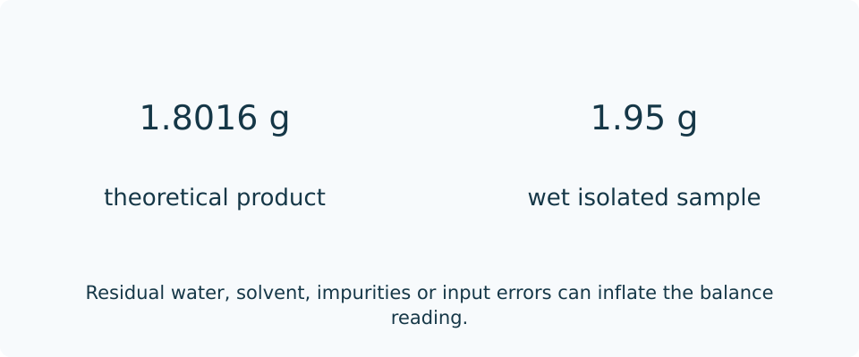{width=85% fig-alt="Investigate a mass above the maximum"}

Compare a1.95 g wet sample with the 1.8016 g stoichiometric maximum. What assumption has failed?

::: notes
Residual solvent/water, contaminants or input errors can inflate mass. An apparent result over 100% is not evidence of making more pure product than stoichiometry permits.
:::

## Propose a concrete corrective check

{width=85% fig-alt="Investigate a mass above the maximum"}

Name checks on drying/sample composition and original input measurements before reporting yield.

::: notes
Residual solvent/water, contaminants or input errors can inflate mass. An apparent result over 100% is not evidence of making more pure product than stoichiometry permits.
:::

## Predict before the worked drawing

Compare OH⁻ with water as a leaving group. What acid–base change can activate an alcohol?

::: notes
Allow about 25 seconds of individual drawing/thinking, then ask for one reason. Do not display the worked product yet. Use the following illustration to resolve the atom, charge or geometry issue.
:::

## Alcohol chemistry often begins with activation

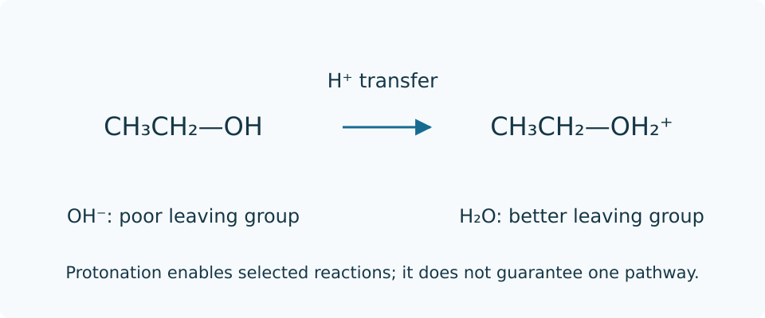{width=85% fig-alt="An alcohol can be protonated to an oxonium species from which water is a better leaving group than hydroxide."}

OH⁻ is generally a poor leaving group. Protonation changes what can depart.

::: notes
Which reaction follows activation depends on substrate and conditions. Do not infer SN1 for every alcohol or ignore an elimination pathway.
:::

## Ask which denominator belongs to each claim

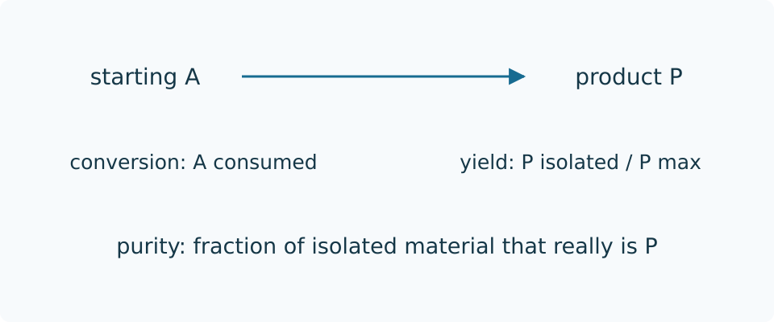{width=85% fig-alt="Ask which denominator belongs to each claim"}

Define conversion, isolated yield and purity using the quantities shown.

::: notes
Side reactions and isolation loss can reduce desired isolated product despite starting-material consumption. Purity concerns what fraction of the isolate is actually product.
:::

## Explain one realistic mismatch

{width=85% fig-alt="Ask which denominator belongs to each claim"}

How could starting material disappear while isolated yield remains low?

::: notes
Side reactions and isolation loss can reduce desired isolated product despite starting-material consumption. Purity concerns what fraction of the isolate is actually product.
:::

## Predict before the worked drawing

A proposed oxidation sample loses broad alcohol O–H absorption and gains a strong carbonyl band. What is supported, and what is still unproved?

::: notes
Allow about 25 seconds of individual drawing/thinking, then ask for one reason. Do not display the worked product yet. Use the following illustration to resolve the atom, charge or geometry issue.
:::

## Use evidence to test the transformation

{width=85% fig-alt="Simulated offset IR traces contrast a broad alcohol O–H region with a carbonyl absorption near 1720 inverse centimetres."}

A new carbonyl band supports a functional-group change. A missing broad O–H band is useful but not a complete identification.

::: notes
These are synthetic schematic traces, not real spectra or a universal frequency reference. Water, concentration and overlapping bands can affect actual observations.
:::

## Choose direction from the desired structure

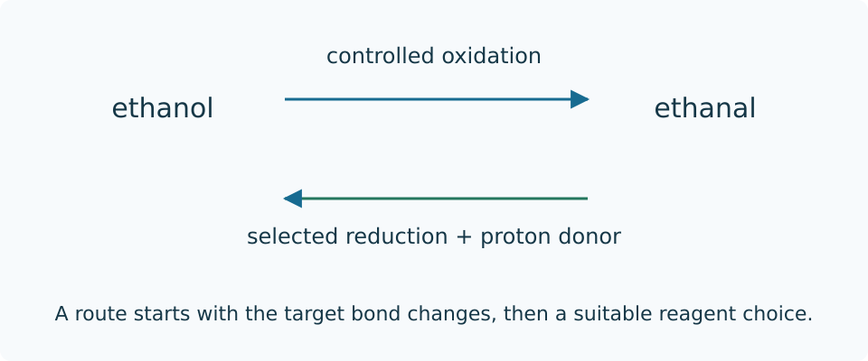{width=85% fig-alt="Choose direction from the desired structure"}

Read the ethanol/ethanal map and choose the supplied reduction route when the target is ethanol.

::: notes
Different carbonyl classes differ in reactivity. Use only the stated selected reagent scope unless extra evidence and conditions are supplied.
:::

## Keep the scope explicit

{width=85% fig-alt="Choose direction from the desired structure"}

Why does the aldehyde/ketone rule not automatically justify reducing every ester or amide with the same reagent?

::: notes
Different carbonyl classes differ in reactivity. Use only the stated selected reagent scope unless extra evidence and conditions are supplied.
:::

## Choose the desired functional group first

{width=85% fig-alt="Ethanol to ethanal is an oxidation, while ethanal to ethanol can use NaBH4 followed by proton donation."}

Say which bonds change, then justify a suitable transformation. Conditions must match the target and other functional groups.

::: notes
Reagent names are examples for reasoning, not laboratory instructions. Actual lab protocols require the approved departmental directions.
:::

## Predict before the worked drawing

A balanced 1:1 teaching reaction has10.0 mmol of one reagent and15.0 mmol of the other. Predict the limiting amount before using a balance or R.

::: notes
Allow about 25 seconds of individual drawing/thinking, then ask for one reason. Do not display the worked product yet. Use the following illustration to resolve the atom, charge or geometry issue.
:::

## Calculate a maximum before an isolated yield

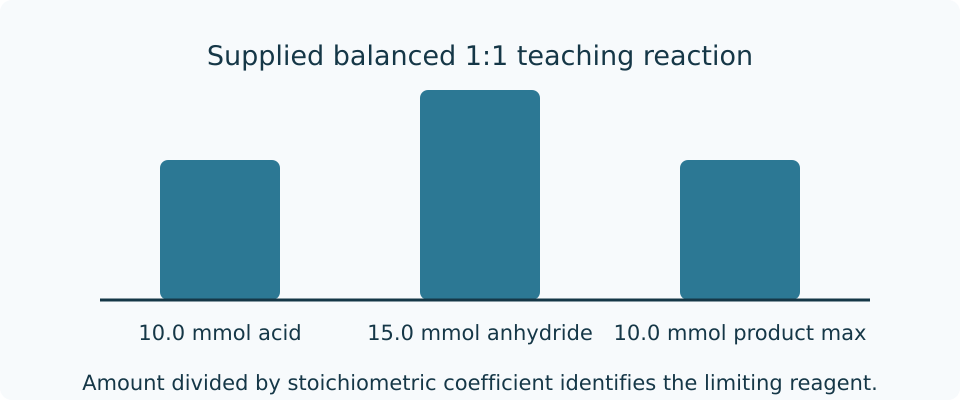{width=85% fig-alt="A supplied one-to-one synthesis with 10 mmol acid and 15 mmol anhydride has a 10 mmol product maximum."}

Compare n/stoichiometric coefficient, not reagent masses. Use the balanced equation supplied for the actual experiment.

::: notes
This task prepares the synthesis report, using aspirin data rather than an alcohol-redox reaction. Make that context switch explicit; the calculation method transfers.
:::

## A reagent has a scope

This course uses selected transformations. Predict aldehyde/ketone reduction by NaBH₄ under suitable conditions; do not silently extend that claim to ordinary esters or amides.

Other functional groups and conditions can change the outcome.

## Yield, conversion and purity differ

**Isolated yield:** isolated product amount / theoretical maximum.

**Conversion:** fraction of a starting material consumed.

**Purity:** fraction of the isolated material that is the desired substance.

One number cannot establish all three.

## Chemical explanation before calculation

For a secondary alcohol, predict the oxidation product and explain the local bond changes.

For a balanced 1:1 synthesis with 10 and 15 mmol reagents, predict the limiting reagent before opening R.

## Use the same reasoning in practice

Complete the [practice and worked examples](exercise.qmd), then the [self-check](quiz.qmd).

Optional textbook support: selected Solomons chapter 11–12 sections. The [reading guide](../reference/reading.qmd) explains the provisional book mapping.

::: notes
Session budget45 minutes:roughly27–29 minutes of concise explanations/visual inspection, about 11–13 minutes of individual drawing and predictions distributed through the sequence, and4–6 minutes of discussion/closing checks. Adjust to observed errors; the 40 second metadata is a planning guide, not a quota. Required paper practice and optional transfer are available in the exercise bank.
:::
