## About this lecture

Old fish smells because bacteria turn a nitrogen compound into **trimethylamine**, a volatile amine. Squeeze lemon on it and the smell fades: citric acid hands a proton to the nitrogen, and the resulting **ammonium salt** can't evaporate. That's one lone pair taking one proton.

Today we follow the nitrogen lone pair:

- **Amines:** classify them, and draw their protonation with curved arrows
- **Basicity:** compare bases with conjugate-acid pKa values
- **Amides and aniline:** when the pair is shared, the base gets weaker
- **Aromaticity:** what makes benzene, pyridine and pyrrole special
- **Amino acids:** glycine's charge at different pH

Yesterday's acyl chemistry made amides; today explains why their nitrogen hardly behaves like an amine.

::: notes
Open with the fish. Fresh fish contains trimethylamine N-oxide, which bacteria reduce to trimethylamine as the fish ages; that's the "fishy" smell. Lemon juice or vinegar protonates it to trimethylammonium, an ion that stays in the water instead of reaching your nose. The same trick explains why many drugs are sold as hydrochloride salts: the protonated amine is a stable, water-soluble solid. The thread through the whole lecture is one question: where is the nitrogen lone pair, and is it free to grab a proton? Amines, amides, aniline, pyridine and pyrrole are all answers to that one question.
:::

## Amines: count the carbons on nitrogen

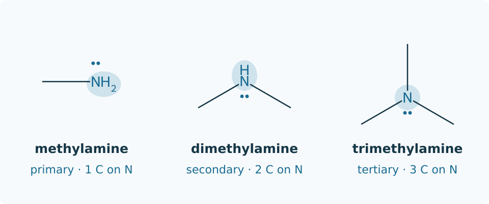{width=80% fig-alt="Methylamine, dimethylamine and trimethylamine with nitrogen shaded and its lone pair drawn; one, two and three carbons on N"}

A neutral amine N has **three bonds and one lone pair**, just like ammonia. Primary, secondary and tertiary count the **carbons bonded to N**, not the carbons in the molecule.

::: {.try}
**Try it:** classify CH₃NHCH₂CH₃.

::: {.fragment}
**Secondary.** Two carbon groups (methyl and ethyl) sit on N, plus one N–H. The total of three carbons doesn't matter.
:::
:::

::: notes
Amines are ammonia with carbon groups in place of hydrogens. Stress that the classification looks only at nitrogen's neighbours. Students who learned "primary, secondary, tertiary" for alcohols on Day 13 often transfer the alcohol rule, which counts carbons on the carbinol carbon, not on oxygen. Here we count directly on N. Point at the lone pair in each drawing: all three are neutral, all three have one pair, and that pair is what makes them bases. Trimethylamine, on the right, is our fish molecule.
:::

## Protonation: the lone pair makes the new N–H bond

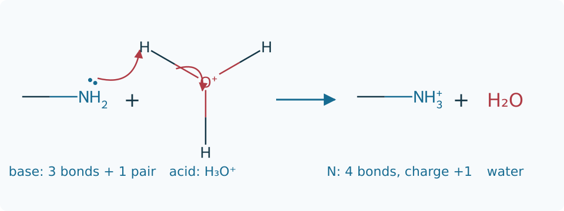{width=82% fig-alt="Curved arrows from the nitrogen lone pair to an H of hydronium and from the O-H bond to oxygen, giving methylammonium and water"}

Two arrows: **N pair → H**, and **H–O bond → O**. Nitrogen goes from 3 bonds + 1 pair (neutral) to **4 bonds, no pair, +1**. Net charge is +1 on both sides.

::: {.try}
**Try it:** draw the reverse, CH₃NH₃⁺ + OH⁻. What forms?

::: {.fragment}
**CH₃NH₂ + H₂O.** Hydroxide's pair takes the H, and the N–H bond pair goes back to N as its lone pair. Net charge is zero on both sides.
:::
:::

::: notes
This is the Day 3 acid-base arrow pattern with nitrogen as the base. Insist on both arrows: one starts at the lone pair and ends at the H, the other starts at the H–O bond and ends on oxygen. A common error is drawing the arrow from H+ to nitrogen, which shows the proton carrying electrons; the arrow always follows the electrons. Also note that N doesn't "lose an electron" to become positive. It shares its pair in a new bond, so it now owns one electron fewer by formal-charge bookkeeping. Ask: what happened to the positive charge of hydronium? It moved to nitrogen.
:::

## Charge and classification are separate questions

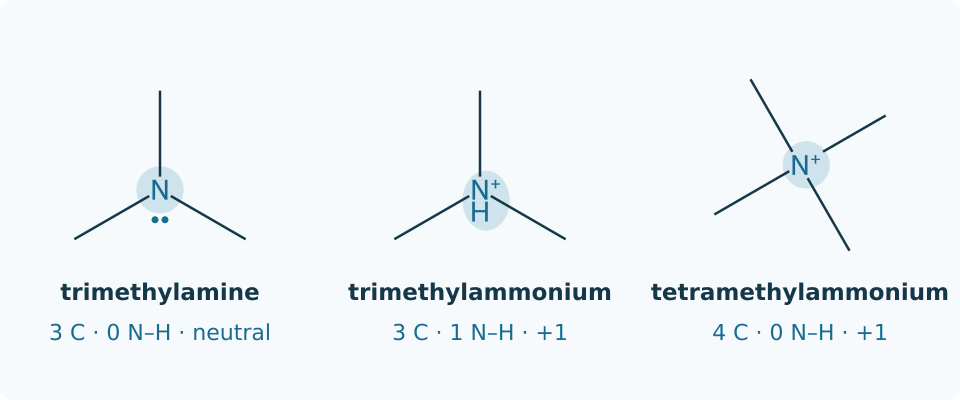{width=80% fig-alt="Trimethylamine (3 C, neutral), trimethylammonium (3 C, one N-H, +1) and tetramethylammonium (4 C, +1)"}

Protonating a tertiary amine gives a **tertiary ammonium ion**, not a quaternary one: it still has three carbons and now one N–H. **Quaternary** means four carbons on N. With no N–H to lose, it stays +1 at any pH.

::: notes
Read across the three: carbons on N, N–H count, charge. 3/0/0, 3/1/+1, 4/0/+1. The middle one is what lemon juice makes from trimethylamine. Students often call it quaternary because N now has four bonds. Ask them what defines "quaternary": four carbon groups. The practical difference matters: (CH3)3NH+ can give its proton back to a base and become volatile again, but (CH3)4N+ can't, which is why quaternary ammonium ions show up in disinfectants and fabric softeners as permanently charged species.
:::

## Basicity: read the pKa of the conjugate acid

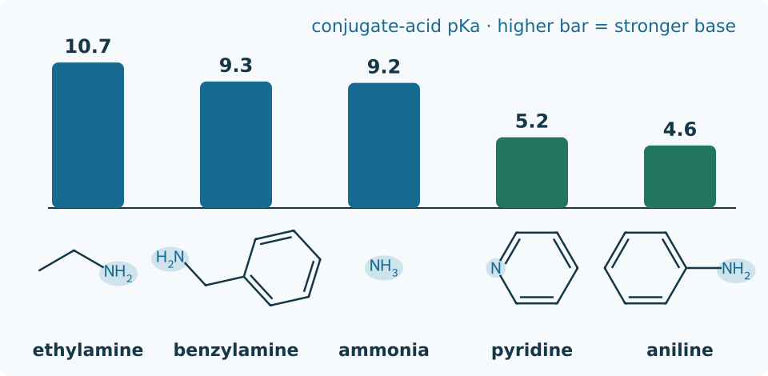{width=86% fig-alt="Bar chart of conjugate-acid pKa: ethylammonium 10.7, benzylammonium 9.3, ammonium 9.2, pyridinium 5.2, anilinium 4.6, each base drawn below its bar"}

We rank bases by the **pKa of BH⁺**. A **higher** pKa means BH⁺ holds its proton tightly, so B is the **stronger base**. Ethylamine beats aniline by about six pKa units.

::: notes
The single most important convention of the lecture: amine basicity is reported as the pKa of the protonated form. Students meet "the pKa of ethylamine" in sloppy sources and look up 35-ish, which is the N–H acidity of the neutral amine, a completely different equilibrium. Always ask "pKa of what?". The chart sets up the rest of the lecture: alkyl amines and ammonia sit around 9–11, and the two green bars, pyridine and aniline, are about a hundred thousand times weaker as bases. By the end of today each bar should have a structural explanation.
:::

## Which way does a proton transfer go?

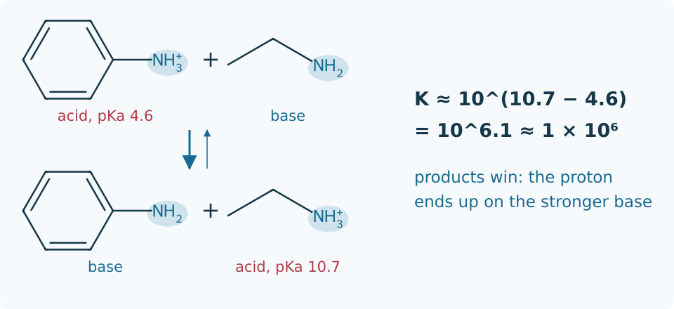{width=76% fig-alt="Anilinium plus ethylamine in equilibrium with aniline plus ethylammonium; K is about 10 to the 6.1"}

$$K \approx 10^{\,\text{pKa(product acid)} \;-\; \text{pKa(reactant acid)}}$$

The equilibrium favours the side with the **weaker acid** (higher pKa).

::: {.try}
**Try it:** estimate K for anilinium + NH₃ ⇌ aniline + NH₄⁺ (pKa 4.6 and 9.2).

::: {.fragment}
**K ≈ 10^(9.2 − 4.6) = 10^4.6 ≈ 4 × 10⁴.** Ammonia takes the proton, so the products win.
:::
:::

::: notes
Walk through the formula with the figure: the product acid is ethylammonium, 10.7; the reactant acid is anilinium, 4.6; the exponent is 6.1, so K is about a million. Remind students that this works only when both pKa values come from the same solvent and conventions, here water. The rule in words: protons flow downhill to the stronger base, ending up on the weaker acid. This is the same tool students used on Day 3 for O–H acids; nitrogen changes nothing about the arithmetic.
:::

## Basicity is about equilibrium, not speed

| a pKa comparison tells you… | it doesn't tell you… |
|---|---|
| which side of a proton transfer is favoured | how **fast** the proton transfer happens |
| which base holds a proton more tightly | which N attacks a **carbon** electrophile fastest |
| roughly how much of each form at a given pH | effects of **solvent**, **sterics** or the **leaving group** |

A strong base is often a good nucleophile, but **nucleophilicity is a rate**, and pKa alone can't rank rates.

::: notes
Students tend to collapse "basic" and "nucleophilic" into one word. Basicity is thermodynamic: where the proton ends up at equilibrium. Nucleophilicity is kinetic: how fast a lone pair attacks carbon. They often trend together for similar nitrogens, which is why the shortcut is tempting, but a bulky tertiary amine can be a good base and a poor nucleophile because it can't reach a crowded carbon. Connect back to substitution on Day 11, where solvent and sterics changed SN2 rates. If a question asks for a rate, pKa is at most one piece of evidence.
:::

## Amides: the pair is shared with C=O

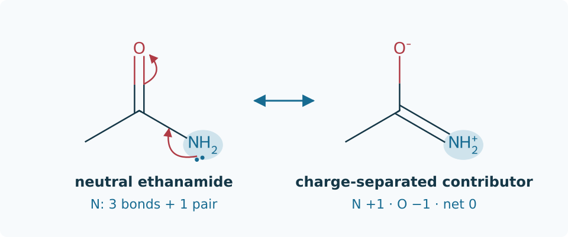{width=80% fig-alt="Ethanamide drawn neutral and as the charge-separated contributor CH3C(O-)=NH2+, with curved arrows from the N lone pair and the C=O pi bond"}

The N pair delocalises into the carbonyl, giving the C–N bond **partial double-bond character**. Protonating N would cost that stabilisation, so amides are **not** basic like amines.

::: {.try}
**Try it:** in CH₃C(O⁻)=NH₂⁺, check each charge. Is this a second molecule in equilibrium with ethanamide?

::: {.fragment}
**N** has four bonds and no pair, so +1; **O** has one bond and three pairs, so −1; net 0. **No:** it's a resonance contributor of the *same* molecule, with the same atoms in the same places.
:::
:::

::: notes
This ties straight back to yesterday: amides are the least reactive acyl derivatives for exactly this reason, the nitrogen pair is feeding the carbonyl. Draw the two arrows slowly: the lone pair becomes the C=N pi bond, and the C=O pi bond becomes an oxygen lone pair. The double-headed resonance arrow is not an equilibrium arrow; nothing moves except our bookkeeping of electrons. The real molecule is a blend, and the evidence is that the amide C–N bond is shorter than a normal C–N single bond and doesn't rotate freely, which is why peptide backbones are flat.
:::

## Two nitrogens, two behaviours

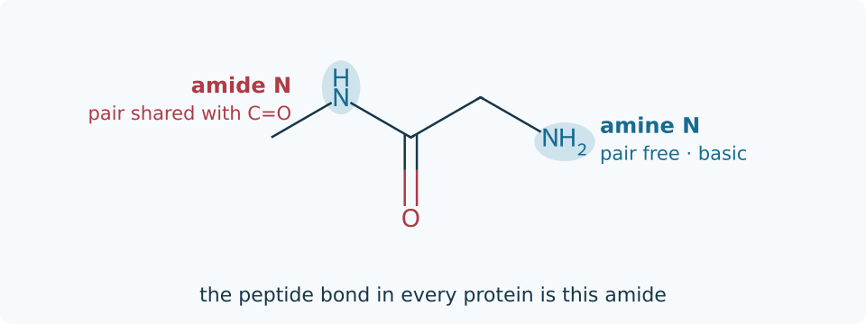{width=80% fig-alt="H2N-CH2-C(=O)-NH-CH3 with the amine nitrogen labelled pair free and basic, and the amide nitrogen labelled pair shared with C=O"}

Before predicting protonation, look at **what each N is bonded to**. Is the next atom a **carbonyl carbon**? Here only the NH₂ end is a real amine, so acid protonates **that** nitrogen.

::: notes
This is a dipeptide-like fragment: glycine's amine end (drawn on the right) and a methyl amide (on the left). Both nitrogens are "an N with H on it", and students who look only at the letter N will treat them identically. Make the habit explicit: follow each nitrogen's bonds one atom out. The amide NH stays neutral in water at any ordinary pH, while the amine end is protonated near pH 7. That's why the N-terminus of a protein is charged and the backbone NH groups are not.
:::

## Aniline: a ring can share the pair too

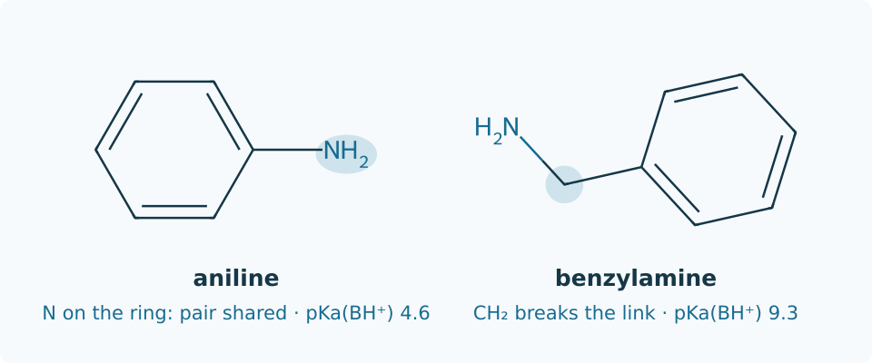{width=78% fig-alt="Aniline with N directly on the benzene ring, conjugate-acid pKa 4.6, and benzylamine with a CH2 between N and the ring, pKa 9.3"}

In **aniline** the N sits directly on the ring, so its pair overlaps the ring's π system and is less available. In **benzylamine** an sp³ CH₂ breaks that link, and the basicity is back near an ordinary amine.

::: notes
Same atoms in the ring, same NH2 group, five pKa units apart, which is a factor of about a hundred thousand in basicity. The only difference is whether the nitrogen is attached directly to the pi system. The CH2 has no p orbital, so it's an insulator. Be honest that other factors (solvation, inductive effects) also play a part; the structural argument explains the big gap, not every decimal. This is the same logic as the amide: a neighbouring pi system that can accept the pair makes a weaker base.
:::

## What makes a ring aromatic

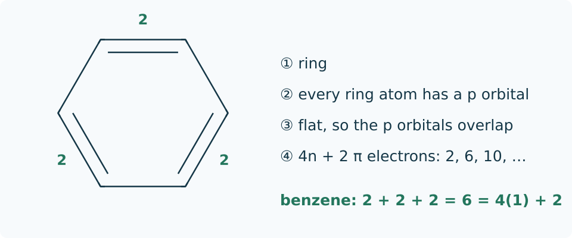{width=78% fig-alt="Benzene in Kekule form with 2 pi electrons counted at each double bond, next to the four aromaticity checks"}

Aromatic rings are unusually stable: benzene resists the addition reactions that alkenes undergo easily. Check **structure first**, then **count**. We draw benzene with alternating double bonds, but the real π electrons are spread evenly around the ring.

::: notes
Work through the checklist in order. It's a ring; every carbon is sp2, so each has a p orbital; it's flat, so the p orbitals overlap continuously all the way round; and 2+2+2 = 6, which fits 4n+2 with n = 1. The Kekulé drawing is one resonance contributor; all six C–C bonds are actually the same length. Mention the payoff from Day 12: bromine adds across cyclohexene instantly but leaves benzene alone without a catalyst. And a preview for spectroscopy next week: aromatic H atoms show up around 7 ppm in proton NMR, a fingerprint you'll use constantly.
:::

## A ring alone is not enough

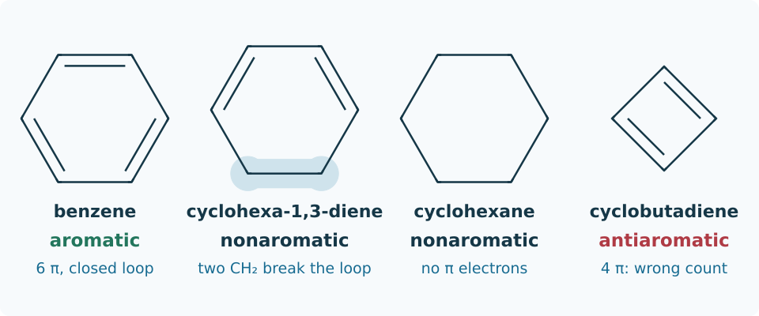{width=84% fig-alt="Benzene aromatic with 6 pi electrons; cyclohexa-1,3-diene nonaromatic because two CH2 break the loop; cyclohexane nonaromatic with no pi electrons; cyclobutadiene antiaromatic with 4 pi electrons"}

**Nonaromatic:** the loop of p orbitals is broken or absent. **Antiaromatic:** a complete loop with **4n** π electrons, which is destabilising.

::: {.try}
**Try it:** cyclohexane fails the aromatic test. Is it antiaromatic?

::: {.fragment}
**No, it's nonaromatic.** It has no π system at all. Antiaromatic needs a closed loop of p orbitals with the wrong count.
:::
:::

::: notes
The diene in the middle is the useful trap: it has two double bonds in a ring, but the two CH2 carbons are sp3 with no p orbital, so the loop is broken. Students see "ring plus double bonds" and say aromatic. Cyclobutadiene is the antiaromatic example: closed loop, 4 pi electrons, so unstable that it only exists at very low temperature. Keep antiaromaticity light today; the important distinction for the exam is that "not aromatic" usually means nonaromatic, not antiaromatic.
:::

## Pyridine: an extra pair, outside the ring

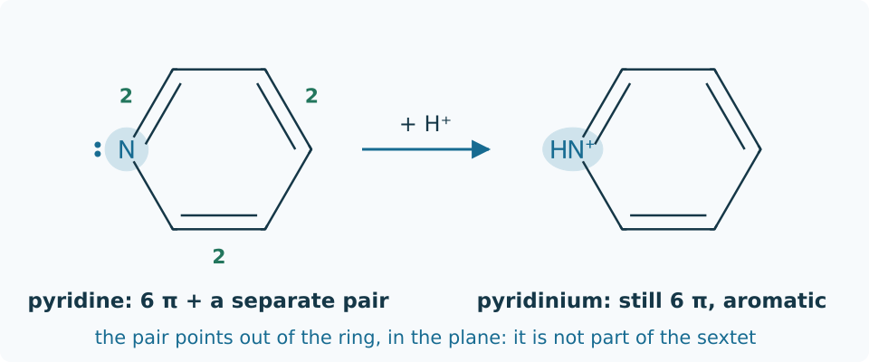{width=80% fig-alt="Pyridine with 2 pi electrons per double bond and an in-plane N lone pair taking a proton to give aromatic pyridinium"}

Pyridine's N gives **one** electron to the π system, through its double bond. Its lone pair points **out of the ring, in the plane**. Protonating that pair leaves the sextet intact, so pyridine is a real base (pKa 5.2).

::: {.try}
**Try it:** a student counts pyridine's lone pair in the π system. What total would they get, and why is that a red flag?

::: {.fragment}
**Eight**, which is 4n, not 4n + 2. The pair sits in an sp² orbital at right angles to the p orbitals, so it never joins the ring count.
:::
:::

::: notes
Pyridine looks like benzene with one CH replaced by N, and that's exactly the right picture. The three double bonds give 6 pi electrons. The nitrogen still has a lone pair, but it lives in the plane of the ring, pointing outward like a C–H bond would. Protonation uses that pair, so the aromatic system is untouched and pyridinium is still aromatic. Why is pyridine weaker than an alkyl amine (5.2 vs about 10.7)? The pair is in an sp2 orbital, with more s character, held closer to N. Mention that pyridine is a common lab base, used to mop up HCl in acylations like yesterday's.
:::

## Pyrrole: the pair is part of the sextet

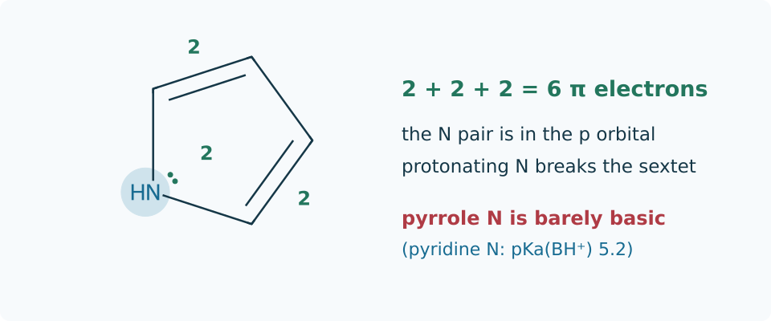{width=80% fig-alt="Pyrrole with 2 pi electrons from each C=C and 2 from the N lone pair, total 6"}

Pyrrole has only two C=C bonds, which supply four π electrons. The **N lone pair supplies the other two**. If N took a proton, that pair would leave the ring and the aromaticity would be lost.

::: notes
Contrast with pyridine as sharply as you can. Both rings contain one nitrogen; in pyridine the pair is spare, in pyrrole it's load-bearing. Count with the class: 2 + 2 from the double bonds, plus 2 from nitrogen, gives 6. Pyrrole's conjugate acid has a pKa around −4, and when it is forced to protonate it does so on carbon, not nitrogen. Pyrrole rings appear in haem and chlorophyll, where the nitrogens bind metal ions rather than protons.
:::

## Imidazole: one nitrogen of each kind

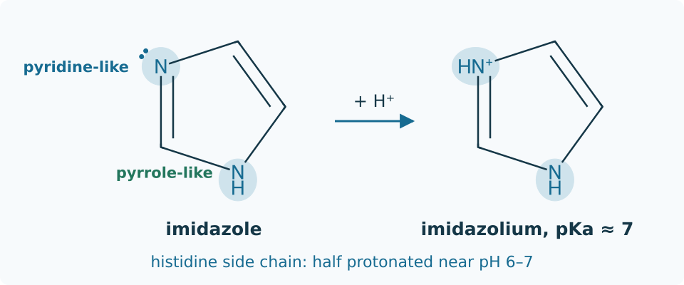{width=80% fig-alt="Imidazole with a labelled pyridine-like N with a lone pair and a pyrrole-like NH, protonated at the pyridine-like N to give imidazolium, pKa about 7"}

Imidazole is the side chain of **histidine**. Its pKa near 7 makes it the proton shuttle in many enzyme active sites.

::: {.try}
**Try it:** which nitrogen takes the proton, and why?

::: {.fragment}
**The pyridine-like N** (top left). Its pair is outside the sextet; the NH's pair is part of the six π electrons.
:::
:::

::: notes
This is the worked example that combines the two previous slides. Count the pi electrons: two double bonds give 4, the NH nitrogen gives its pair, 2 more: 6, aromatic. The other nitrogen is pyridine-like: it contributes one electron through its double bond and keeps a spare pair in the plane. In imidazolium the two N–H nitrogens become equivalent by resonance, which is part of why it's a better base than pyridine. Its pKa sits close to physiological pH, so histidine can be protonated or not with only a small pH change, ideal for passing protons around in enzymes.
:::

## Glycine: two sites, three charge states

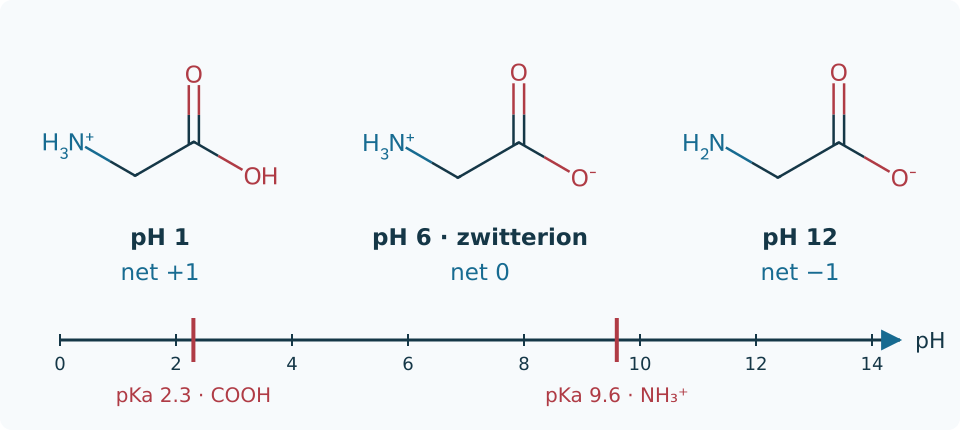{width=80% fig-alt="Glycine on a pH axis: H3N+CH2COOH net +1 at pH 1, zwitterion H3N+CH2COO- net 0 at pH 6, H2NCH2COO- net -1 at pH 12, with pKa marks at 2.3 and 9.6"}

Treat each site separately: **below its pKa** a site is mostly protonated, **above it** mostly deprotonated. Between 2.3 and 9.6 glycine is a **zwitterion**: net zero, but with +1 on N and −1 on O.

::: {.try}
**Try it:** draw what happens when the pH 6 form meets OH⁻.

::: {.fragment}
**H₃N⁺CH₂COO⁻ + OH⁻ → H₂NCH₂COO⁻ + H₂O.** The ammonium loses its proton; net charge is −1 on both sides.
:::
:::

::: notes
We met the glycine zwitterion on Day 1 as a formal-charge exercise; now we can explain when it exists. Go left to right along the pH axis. At pH 1, below both pKa values, both sites hold their protons: +1. Pass 2.3 and the carboxylic acid loses its H first: net 0. Pass 9.6 and the ammonium gives its proton up: −1. Emphasise that "net zero" doesn't mean "uncharged". The zwitterion has two full formal charges, which is why amino acids are high-melting solids that dissolve in water and not in hexane.
:::

## How much is protonated? Use the ratio

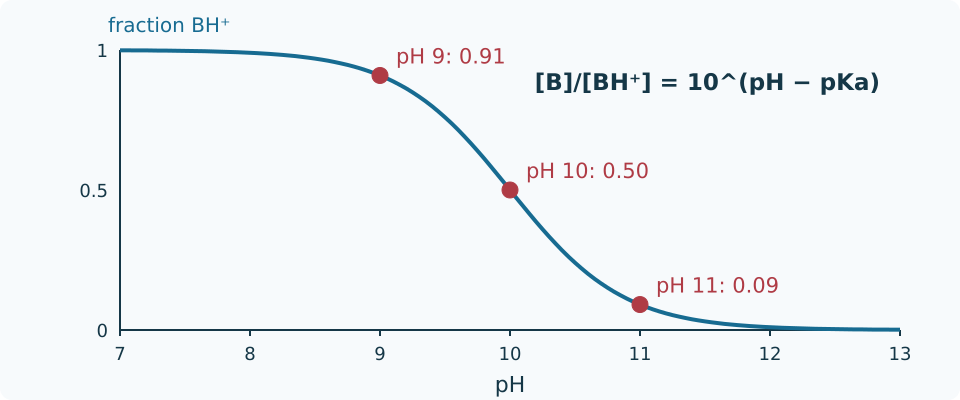{width=74% fig-alt="Curve of fraction BH+ against pH for pKa 10: 0.91 at pH 9, 0.50 at pH 10, 0.09 at pH 11"}

At pH 9, [B]/[BH⁺] = 10⁻¹ = 0.1, so the protonated fraction is 1/(1 + 0.1) ≈ **0.91**. Each pH unit changes the ratio **tenfold**.

::: {.try}
**Try it:** at pH = pKa, half is BH⁺. Does every molecule carry a charge of +½?

::: {.fragment}
**No.** Each molecule is either B or BH⁺; half the *population* is in each form. Charges on single molecules come in whole units.
:::
:::

::: notes
The equation is Henderson–Hasselbalch rearranged: ratio = 10 to the (pH − pKa). Watch for the common slip of reporting the ratio as the fraction; 0.1 is the ratio of B to BH+, and the fraction protonated is 1/(1 + 0.1). Exercises 17 and 18 do exactly this calculation at pH 9, 10 and 11. The half-charge misconception is worth taking seriously, because it reappears in biochemistry when people talk about a residue being "half protonated".
:::

## Mistakes we see every year

| mistake | fix |
|---|---|
| counting all the carbons to classify an amine | count carbons **on N** |
| calling (CH₃)₃NH⁺ quaternary | quaternary means **four carbons** on N |
| quoting the amine's N–H pKa for basicity | use the **pKa of BH⁺** |
| ranking reaction rates from pKa | pKa compares **equilibria** |
| treating an amide N like an amine N | check for a **C=O next to N** |
| counting pyridine's lone pair in the sextet | its pair is **in the plane**, outside the π system |
| "a ring, so aromatic" | check the **unbroken p-orbital loop** first |
| "net zero, so no charges" | a zwitterion has **+1 and −1** |

::: notes
Read each mistake aloud and ask for the reason before revealing the fix. The amide and pyridine rows are the ones that cost the most marks. Point out that almost every row comes down to the same question as the title of the lecture: where is the nitrogen pair, and is it free?
:::

## Summary

| concept | key fact |
|---|---|
| amine N | 3 bonds + 1 pair; protonated: 4 bonds, +1 |
| classification | count **carbons on N** |
| base strength | higher **pKa of BH⁺** = stronger base |
| proton transfer | K ≈ 10^(pKa product acid − pKa reactant acid) |
| amide, aniline | pair shared with π system: **weak base** |
| aromatic | flat, unbroken p-orbital loop, **4n + 2** π electrons |
| pyridine vs pyrrole | spare pair (basic) vs pair in sextet (barely basic) |
| amino acids | each site: protonated below its pKa |

**Next:** reading structures from IR and NMR spectra (Day 21). **Practice:** [exercises](exercise.qmd) · [self-check](quiz.qmd)

::: notes
Close with the fish: trimethylamine's free pair grabs a proton from citric acid, and the ammonium salt stays in the water. Every row of this table is a variation on that one event. Tomorrow and Day 20 are consolidation days, and Day 20 is specifically about nitrogen, resonance and charge, so the exercises from today feed straight into it. Spectroscopy on Day 21 will bring back aromatic rings, which give characteristic signals near 7 ppm in proton NMR.
:::
