## A chemical route through this session

Locate each nitrogen pair before predicting proton transfer. Distinguish simple amines, amides and aromatic nitrogens, then combine acid and base sites in an amino acid.

::: notes
45-minute budget: retrieval 4 min; N bond/charge examples and paired checks 8 min; basicity comparison 6 min; aromatic nitrogen reasoning 12 min; amino-acid charge cases 10 min; integrated check and exit 5 min. Total 45 min, including drawing and discussion.

Suggested 30 seconds; adjust to the explanation and class response. Plan 45 minutes including short drawing and discussion intervals. Routine visual frames take roughly 40 seconds; worked checks need longer and some resolutions can be quicker. Treat timings as guidance, with room for questions.
:::

## Retrieve the starting idea

Draw NH₃ with three bonds and a lone pair. What changes when it accepts H⁺?

::: notes
Suggested 30 seconds; adjust to the explanation and class response. Give students a short individual attempt. Worked answer: The pair becomes an N–H bond; NH₄⁺ has four bonds and positive charge.
:::

## Count carbon substituents at nitrogen

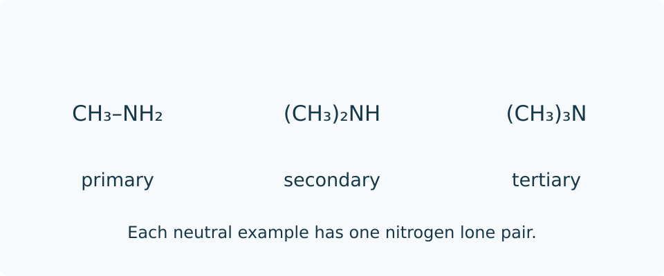{width=85% fig-alt="Count carbon substituents on nitrogen, not total N bonds"}

Which number distinguishes primary, secondary and tertiary amines?

::: notes
Suggested 40 seconds; adjust to the explanation and class response. Ask students to inspect the indicated molecular feature rather than read the answer caption. Worked answer: Count directly attached carbon groups: one, two or three. The neutral ordinary amines shown still have a lone pair.
:::

## Apply: count carbon substituents at nitrogen

Classify CH₃NHCH₂CH₃.

::: notes
Suggested 60 seconds; adjust to the explanation and class response. Allow a brief paper or pair check within this slide. Worked answer: Secondary: two carbon substituents are attached to N, plus one H.
:::

## Audit nitrogen before protonation

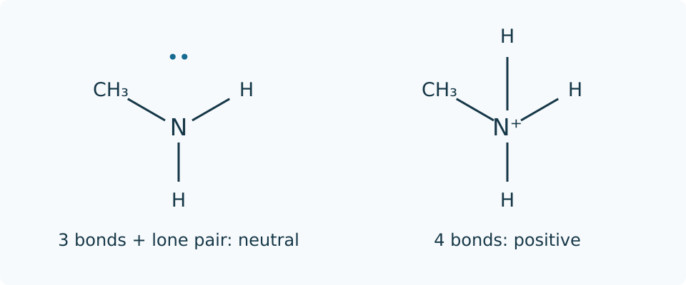{width=85% fig-alt="Count nitrogen bonds and its nonbonding pair"}

How many bonds and nonbonding electrons belong to neutral methylamine N?

::: notes
Suggested 40 seconds; adjust to the explanation and class response. Ask students to inspect the indicated molecular feature rather than read the answer caption. Worked answer: It has three single bonds and one nonbonding pair. That pair can form the new N–H bond.
:::

## Resolve: audit nitrogen before protonation

{width=85% fig-alt="Count nitrogen bonds and its nonbonding pair"}

It has three single bonds and one nonbonding pair. That pair can form the new N–H bond.

::: notes
Suggested 30 seconds; adjust to the explanation and class response. Use a second inspection focus: justify the result by the atom, charge, ratio or observation involved. Next application answer: +1. Ordinary ammonium N has four bonds and no nonbonding pair.
:::

## Apply: audit nitrogen before protonation

Give the N formal charge after forming a fourth single bond.

::: notes
Suggested 60 seconds; adjust to the explanation and class response. Allow a brief paper or pair check within this slide. Worked answer: +1. Ordinary ammonium N has four bonds and no nonbonding pair.
:::

## Use a real proton donor

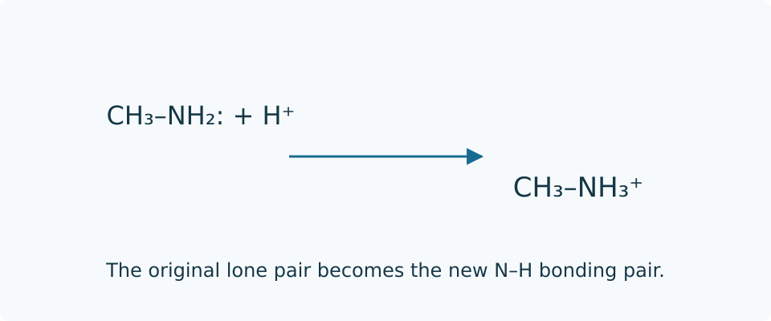{width=85% fig-alt="Amine protonation creates four bonds and positive charge"}

What must accompany the new N–H bond if H–A supplies H?

::: notes
Suggested 40 seconds; adjust to the explanation and class response. Ask students to inspect the indicated molecular feature rather than read the answer caption. Worked answer: The N pair forms N–H while the H–A bonding pair moves to A. Products are ammonium and A⁻.
:::

## Resolve: use a real proton donor

{width=85% fig-alt="Amine protonation creates four bonds and positive charge"}

The N pair forms N–H while the H–A bonding pair moves to A. Products are ammonium and A⁻.

::: notes
Suggested 30 seconds; adjust to the explanation and class response. Use a second inspection focus: justify the result by the atom, charge, ratio or observation involved. Next application answer: CH₃NH₃⁺ + H₂O. Net charge stays +1.
:::

## Apply: use a real proton donor

Balance CH₃NH₂ + H₃O⁺.

::: notes
Suggested 60 seconds; adjust to the explanation and class response. Allow a brief paper or pair check within this slide. Worked answer: CH₃NH₃⁺ + H₂O. Net charge stays +1.
:::

## Keep classification separate from charge

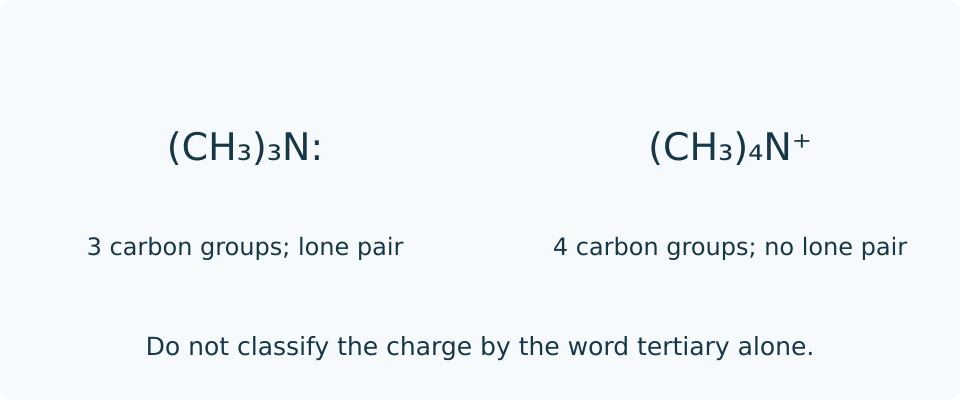{width=85% fig-alt="Tertiary amine and quaternary ammonium differ"}

Why is neutral trimethylamine not quaternary ammonium?

::: notes
Suggested 40 seconds; adjust to the explanation and class response. Ask students to inspect the indicated molecular feature rather than read the answer caption. Worked answer: Trimethylamine has three carbon groups and a lone pair. Quaternary ammonium has four carbon substituents and positive charge.
:::

## Apply: keep classification separate from charge

Is (CH₃)₃NH⁺ a quaternary ammonium ion?

::: notes
Suggested 60 seconds; adjust to the explanation and class response. Allow a brief paper or pair check within this slide. Worked answer: It is the conjugate acid of a tertiary amine, with three carbon groups and one H. Quaternary ammonium has four carbon groups.
:::

## Inspect the group beside nitrogen

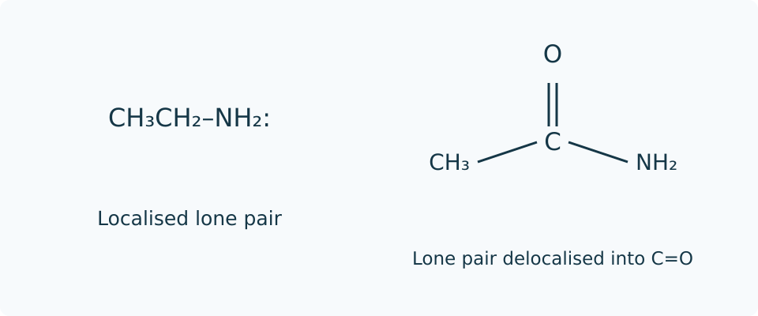{width=85% fig-alt="Amine and amide nitrogen have different electron availability"}

Which local structural feature makes peptide N different from an alkylamine?

::: notes
Suggested 40 seconds; adjust to the explanation and class response. Ask students to inspect the indicated molecular feature rather than read the answer caption. Worked answer: An amide nitrogen is directly bonded to carbonyl carbon. Its pair can delocalise into C=O.
:::

## Resolve: inspect the group beside nitrogen

{width=85% fig-alt="Amine and amide nitrogen have different electron availability"}

An amide nitrogen is directly bonded to carbonyl carbon. Its pair can delocalise into C=O.

::: notes
Suggested 30 seconds; adjust to the explanation and class response. Use a second inspection focus: justify the result by the atom, charge, ratio or observation involved. Next application answer: Amide N, not a simple secondary alkylamine. Its carbonyl connection changes electron availability.
:::

## Apply: inspect the group beside nitrogen

Classify nitrogen in CH₃C(=O)NHCH₃.

::: notes
Suggested 60 seconds; adjust to the explanation and class response. Allow a brief paper or pair check within this slide. Worked answer: Amide N, not a simple secondary alkylamine. Its carbonyl connection changes electron availability.
:::

## Conserve charge across resonance contributors

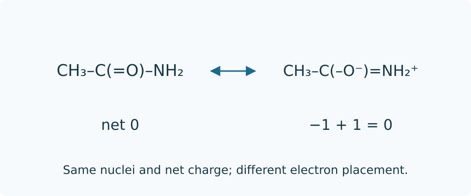{width=85% fig-alt="Charges in an amide resonance contributor balance"}

What charges appear when the N pair forms a C=N pi bond?

::: notes
Suggested 40 seconds; adjust to the explanation and class response. Ask students to inspect the indicated molecular feature rather than read the answer caption. Worked answer: Nitrogen becomes positive and oxygen negative as the original C=O pi pair moves to O. Net charge remains zero.
:::

## Resolve: conserve charge across resonance contributors

{width=85% fig-alt="Charges in an amide resonance contributor balance"}

Nitrogen becomes positive and oxygen negative as the original C=O pi pair moves to O. Net charge remains zero.

::: notes
Suggested 30 seconds; adjust to the explanation and class response. Use a second inspection focus: justify the result by the atom, charge, ratio or observation involved. Next application answer: No. Resonance contributors describe electron placement in one delocalised molecule; nuclear connectivity stays fixed.
:::

## Apply: conserve charge across resonance contributors

Do the nuclei move or switch between two molecular structures?

::: notes
Suggested 60 seconds; adjust to the explanation and class response. Allow a brief paper or pair check within this slide. Worked answer: No. Resonance contributors describe electron placement in one delocalised molecule; nuclear connectivity stays fixed.
:::

## Inspect conjugation at aniline nitrogen

{width=85% fig-alt="Aniline nitrogen can donate into the aromatic ring"}

How can the benzene ring affect availability of the N pair?

::: notes
Suggested 40 seconds; adjust to the explanation and class response. Ask students to inspect the indicated molecular feature rather than read the answer caption. Worked answer: The N pair can overlap with the ring pi system, stabilising the neutral base and lowering its proton affinity relative to a simple alkylamine comparison.
:::

## Apply: inspect conjugation at aniline nitrogen

Would a saturated carbon between N and the ring preserve the same direct conjugation?

::: notes
Suggested 60 seconds; adjust to the explanation and class response. Allow a brief paper or pair check within this slide. Worked answer: No. An sp³ carbon interrupts that direct N-to-ring pi overlap. Other electronic effects can still exist.
:::

## Read the correct pKa for a base

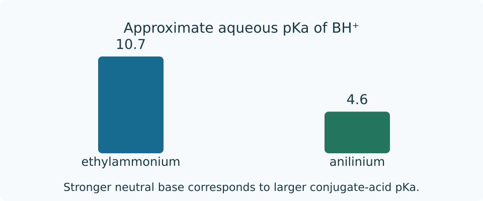{width=85% fig-alt="Conjugate-acid pKa compares protonation equilibria"}

Why compare BH⁺ pKa rather than call neutral B an acid?

::: notes
Suggested 40 seconds; adjust to the explanation and class response. Ask students to inspect the indicated molecular feature rather than read the answer caption. Worked answer: The conjugate-acid dissociation equilibrium relates BH⁺ to B. Larger BH⁺ pKa corresponds to stronger B under comparable conditions.
:::

## Resolve: read the correct pKa for a base

{width=85% fig-alt="Conjugate-acid pKa compares protonation equilibria"}

The conjugate-acid dissociation equilibrium relates BH⁺ to B. Larger BH⁺ pKa corresponds to stronger B under comparable conditions.

::: notes
Suggested 30 seconds; adjust to the explanation and class response. Use a second inspection focus: justify the result by the atom, charge, ratio or observation involved. Next application answer: Ethylamine is the stronger base in this aqueous comparison; ethylammonium is the weaker acid.
:::

## Apply: read the correct pKa for a base

Compare ethylammonium 10.7 with anilinium 4.6.

::: notes
Suggested 60 seconds; adjust to the explanation and class response. Allow a brief paper or pair check within this slide. Worked answer: Ethylamine is the stronger base in this aqueous comparison; ethylammonium is the weaker acid.
:::

## Predict a proton-transfer direction

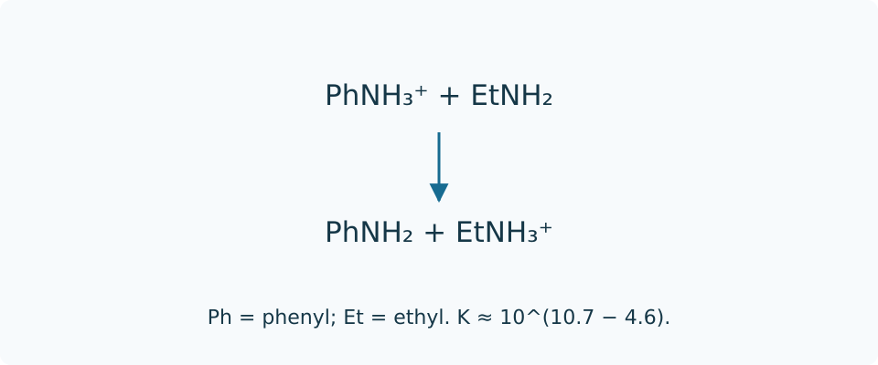{width=85% fig-alt="A proton can transfer between two nitrogen bases"}

Which side contains the weaker acid in the supplied competition?

::: notes
Suggested 40 seconds; adjust to the explanation and class response. Ask students to inspect the indicated molecular feature rather than read the answer caption. Worked answer: Ethylammonium has larger pKa, so products aniline + ethylammonium are favoured.
:::

## Resolve: predict a proton-transfer direction

{width=85% fig-alt="A proton can transfer between two nitrogen bases"}

Ethylammonium has larger pKa, so products aniline + ethylammonium are favoured.

::: notes
Suggested 30 seconds; adjust to the explanation and class response. Use a second inspection focus: justify the result by the atom, charge, ratio or observation involved. Next application answer: About 1.26×10⁶ toward products using compatible approximate aqueous pKa values.
:::

## Apply: predict a proton-transfer direction

Estimate 10^(10.7 − 4.6).

::: notes
Suggested 60 seconds; adjust to the explanation and class response. Allow a brief paper or pair check within this slide. Worked answer: About 1.26×10⁶ toward products using compatible approximate aqueous pKa values.
:::

## Separate equilibrium from reaction rate

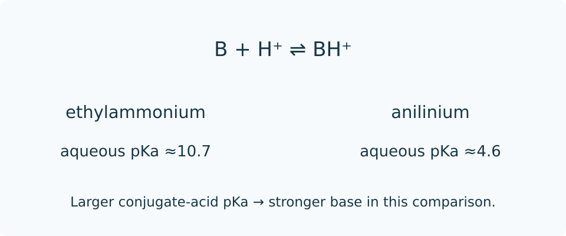{width=85% fig-alt="Basicity is an equilibrium comparison, not a reaction-speed ranking"}

What does this pKa comparison establish, and what does it not establish?

::: notes
Suggested 40 seconds; adjust to the explanation and class response. Ask students to inspect the indicated molecular feature rather than read the answer caption. Worked answer: It compares proton-transfer equilibria. It does not by itself rank every nucleophilic reaction rate or specify an isolated yield.
:::

## Apply: separate equilibrium from reaction rate

Name one other factor needed for a nucleophilic-rate prediction.

::: notes
Suggested 60 seconds; adjust to the explanation and class response. Allow a brief paper or pair check within this slide. Worked answer: Substrate identity, solvent, steric access or leaving group can matter; a pKa table alone is insufficient.
:::

## Check the structural requirements first

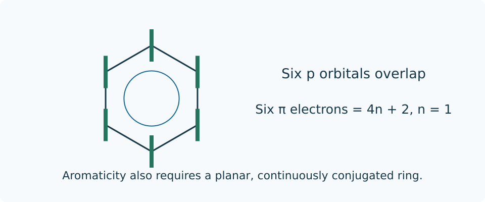{width=85% fig-alt="Benzene has six pi electrons in a cyclic conjugated system"}

Before counting 4n + 2, what must the ring permit?

::: notes
Suggested 40 seconds; adjust to the explanation and class response. Ask students to inspect the indicated molecular feature rather than read the answer caption. Worked answer: A planar cyclic network with continuous p-orbital overlap is needed for these simple aromatic examples.
:::

## Apply: check the structural requirements first

For benzene, what n gives six pi electrons?

::: notes
Suggested 60 seconds; adjust to the explanation and class response. Allow a brief paper or pair check within this slide. Worked answer: n = 1 in 4n + 2 = 6. These are six electrons, not six pairs.
:::

## Trace a path around the ring

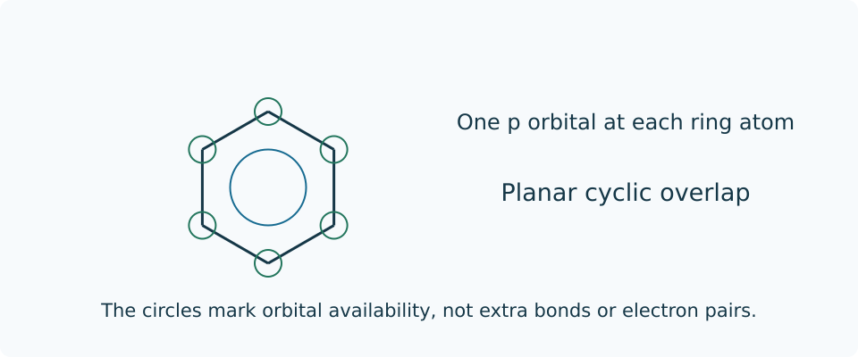{width=85% fig-alt="Continuous overlap is required around an aromatic ring"}

Can the pi network stop at one saturated sp³ ring atom?

::: notes
Suggested 40 seconds; adjust to the explanation and class response. Ask students to inspect the indicated molecular feature rather than read the answer caption. Worked answer: An ordinary sp³ atom interrupts continuous overlap. Electron counting cannot repair a missing conjugated path.
:::

## Resolve: trace a path around the ring

{width=85% fig-alt="Continuous overlap is required around an aromatic ring"}

An ordinary sp³ atom interrupts continuous overlap. Electron counting cannot repair a missing conjugated path.

::: notes
Suggested 30 seconds; adjust to the explanation and class response. Use a second inspection focus: justify the result by the atom, charge, ratio or observation involved. Next application answer: A cyclic sigma skeleton alone does not establish the planar, conjugated pi system required by the simple rule.
:::

## Apply: trace a path around the ring

Why is the aromatic rule not a rule for every cyclic molecule?

::: notes
Suggested 60 seconds; adjust to the explanation and class response. Allow a brief paper or pair check within this slide. Worked answer: A cyclic sigma skeleton alone does not establish the planar, conjugated pi system required by the simple rule.
:::

## Distinguish nonaromatic from antiaromatic

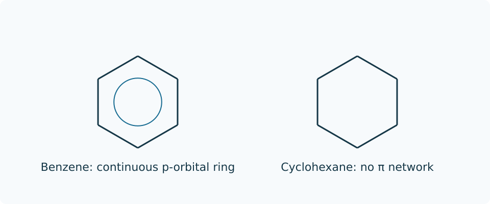{width=85% fig-alt="A ring alone does not make a compound aromatic"}

Why is cyclohexane nonaromatic rather than antiaromatic?

::: notes
Suggested 40 seconds; adjust to the explanation and class response. Ask students to inspect the indicated molecular feature rather than read the answer caption. Worked answer: It lacks a continuously conjugated pi ring. Antiaromaticity is a different situation, not a synonym for any nonaromatic ring.
:::

## Apply: distinguish nonaromatic from antiaromatic

Does rotating a cyclohexane chair create the missing pi bonds?

::: notes
Suggested 60 seconds; adjust to the explanation and class response. Allow a brief paper or pair check within this slide. Worked answer: No. Conformational motion does not change its sigma-bond connectivity into a benzene pi system.
:::

## Locate the separate pyridine pair

{width=85% fig-alt="Pyridine has a lone pair outside its aromatic pi system"}

Which nitrogen electrons are outside the aromatic sextet?

::: notes
Suggested 40 seconds; adjust to the explanation and class response. Ask students to inspect the indicated molecular feature rather than read the answer caption. Worked answer: The displayed lone pair lies outside the pi system. N supplies one different electron to the aromatic network.
:::

## Resolve: locate the separate pyridine pair

{width=85% fig-alt="Pyridine has a lone pair outside its aromatic pi system"}

The displayed lone pair lies outside the pi system. N supplies one different electron to the aromatic network.

::: notes
Suggested 30 seconds; adjust to the explanation and class response. Use a second inspection focus: justify the result by the atom, charge, ratio or observation involved. Next application answer: No. Adding it would double-count electrons from distinct orbitals and give an incorrect aromatic count.
:::

## Apply: locate the separate pyridine pair

Should that lone pair be added to the six-electron count?

::: notes
Suggested 60 seconds; adjust to the explanation and class response. Allow a brief paper or pair check within this slide. Worked answer: No. Adding it would double-count electrons from distinct orbitals and give an incorrect aromatic count.
:::

## Predict protonation without breaking aromaticity

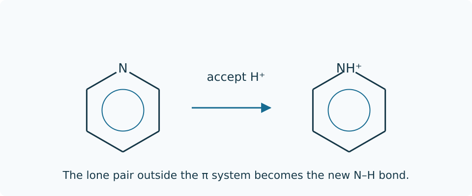{width=85% fig-alt="Pyridine protonation can retain the aromatic sextet"}

Which pair forms the N–H bond in pyridinium?

::: notes
Suggested 40 seconds; adjust to the explanation and class response. Ask students to inspect the indicated molecular feature rather than read the answer caption. Worked answer: The non-pi lone pair binds H⁺. The aromatic sextet can remain, while N carries positive charge.
:::

## Apply: predict protonation without breaking aromaticity

What changes in N charge after accepting H⁺?

::: notes
Suggested 60 seconds; adjust to the explanation and class response. Allow a brief paper or pair check within this slide. Worked answer: It changes from neutral pyridine N to positive pyridinium N; the carbon skeleton remains fixed.
:::

## Count pyrrole electrons once

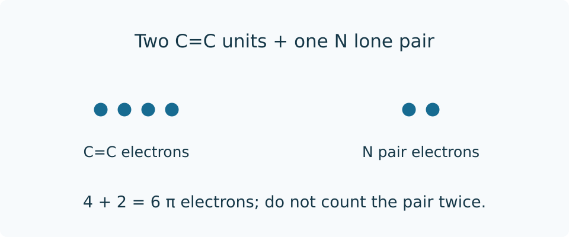{width=85% fig-alt="Pyrrole contributes two electrons from nitrogen"}

How many electrons come from the nitrogen lone pair?

::: notes
Suggested 40 seconds; adjust to the explanation and class response. Ask students to inspect the indicated molecular feature rather than read the answer caption. Worked answer: Two electrons from N plus four from the two carbon pi bonds give six in the aromatic system.
:::

## Resolve: count pyrrole electrons once

{width=85% fig-alt="Pyrrole contributes two electrons from nitrogen"}

Two electrons from N plus four from the two carbon pi bonds give six in the aromatic system.

::: notes
Suggested 30 seconds; adjust to the explanation and class response. Use a second inspection focus: justify the result by the atom, charge, ratio or observation involved. Next application answer: The same pair cannot be treated as both outside and inside the pi system; ordinary N protonation would disrupt its stabilising role.
:::

## Apply: count pyrrole electrons once

What goes wrong if the N pair is also counted as freely available?

::: notes
Suggested 60 seconds; adjust to the explanation and class response. Allow a brief paper or pair check within this slide. Worked answer: The same pair cannot be treated as both outside and inside the pi system; ordinary N protonation would disrupt its stabilising role.
:::

## Compare the two aromatic nitrogen sites

{width=85% fig-alt="Pyrrole uses its nitrogen lone pair in the aromatic sextet"}

Why is pyrrole N much less basic than pyridine N?

::: notes
Suggested 40 seconds; adjust to the explanation and class response. Ask students to inspect the indicated molecular feature rather than read the answer caption. Worked answer: Pyrrole uses its pair in the aromatic sextet; pyridine keeps a separate pair available.
:::

## Apply: compare the two aromatic nitrogen sites

Which molecule more readily gives ordinary N protonation in comparable conditions?

::: notes
Suggested 60 seconds; adjust to the explanation and class response. Allow a brief paper or pair check within this slide. Worked answer: Pyridine. This conclusion follows from the different orbital roles, not from nitrogen atom count.
:::

## Combine acid and base sites in one molecule

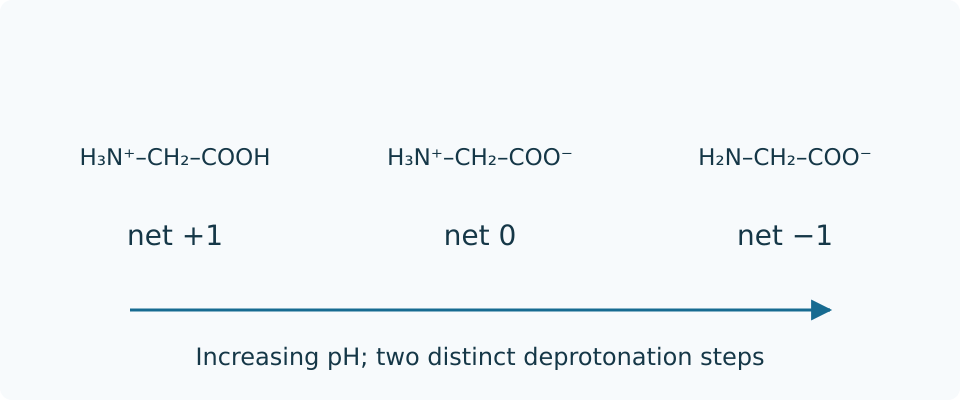{width=85% fig-alt="Glycine charge depends on pH"}

What formal charges can coexist in a net-neutral glycine form?

::: notes
Suggested 40 seconds; adjust to the explanation and class response. Ask students to inspect the indicated molecular feature rather than read the answer caption. Worked answer: A protonated ammonium site has +1 and carboxylate has −1. Their sum is zero: a zwitterion.
:::

## Apply: combine acid and base sites in one molecule

Does net zero imply that all sites are nonpolar?

::: notes
Suggested 60 seconds; adjust to the explanation and class response. Allow a brief paper or pair check within this slide. Worked answer: No. Opposite formal charges remain and can interact strongly with polar surroundings.
:::

## Use two supplied pKa values

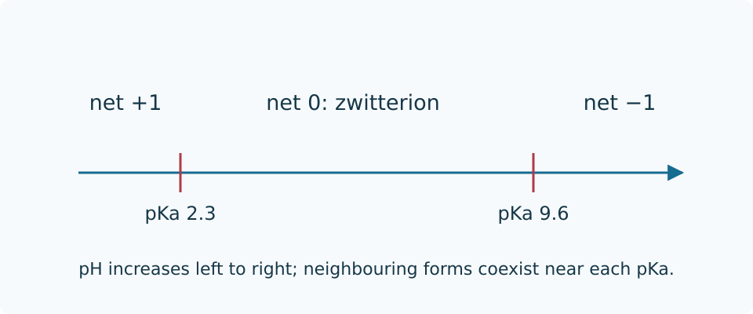{width=85% fig-alt="Two pKa values produce three glycine charge regions"}

At pH 6, which form predominates for pKa 2.3 and 9.6?

::: notes
Suggested 40 seconds; adjust to the explanation and class response. Ask students to inspect the indicated molecular feature rather than read the answer caption. Worked answer: COOH is mainly deprotonated while ammonium remains mainly protonated: H₃N⁺CH₂COO⁻.
:::

## Resolve: use two supplied pKa values

{width=85% fig-alt="Two pKa values produce three glycine charge regions"}

COOH is mainly deprotonated while ammonium remains mainly protonated: H₃N⁺CH₂COO⁻.

::: notes
Suggested 30 seconds; adjust to the explanation and class response. Use a second inspection focus: justify the result by the atom, charge, ratio or observation involved. Next application answer: No. Neighbouring protonation forms coexist; dominant-form drawings are approximations away from transition regions.
:::

## Apply: use two supplied pKa values

At pH close to either pKa, is only one drawn form present?

::: notes
Suggested 60 seconds; adjust to the explanation and class response. Allow a brief paper or pair check within this slide. Worked answer: No. Neighbouring protonation forms coexist; dominant-form drawings are approximations away from transition regions.
:::

## Finish the high-pH charge audit

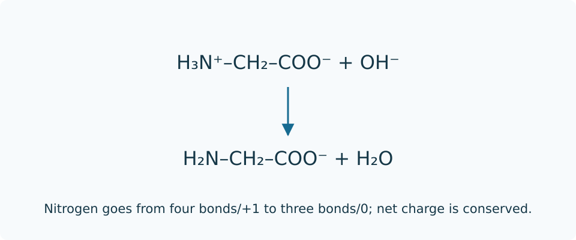{width=85% fig-alt="High pH removes the ammonium proton"}

Which site loses H⁺ to make the net −1 amino-acid form?

::: notes
Suggested 40 seconds; adjust to the explanation and class response. Ask students to inspect the indicated molecular feature rather than read the answer caption. Worked answer: The ammonium site loses a proton, leaving neutral NH₂ plus carboxylate. Nitrogen returns to three bonds.
:::

## Apply: finish the high-pH charge audit

Write the net charge on each side of zwitterion + OH⁻ → anion + water.

::: notes
Suggested 60 seconds; adjust to the explanation and class response. Allow a brief paper or pair check within this slide. Worked answer: Left: 0 −1 = −1. Right: −1 + 0 = −1; charge is conserved.
:::

## Integrate one short case

At pH 6, use glycine pKa values 2.3 and 9.6 to draw the dominant form and assign every charge.

::: notes
Suggested 120 seconds; adjust to the explanation and class response. Give time to formulate the claim and compare a partner explanation. Worked answer: H₃N⁺CH₂COO⁻ predominates; opposite formal charges sum to zero. Nearby protonation forms coexist, especially near each pKa.
:::

## Compare the worked reasoning

H₃N⁺CH₂COO⁻ predominates; opposite formal charges sum to zero. Nearby protonation forms coexist, especially near each pKa.

::: notes
Suggested 60 seconds; adjust to the explanation and class response. Ask students to identify the exact step or observation their own reasoning omitted. This is a correction interval within the session, not a new topic.
:::

## Exit explanation

Why can two aromatic nitrogen atoms have very different basicity?

::: notes
Suggested 40 seconds; adjust to the explanation and class response. Worked answer: Their lone pairs can occupy different orbital roles: pyridine keeps a separate pair while pyrrole uses its pair in the aromatic sextet. Ask for a causal explanation, not a single vocabulary label.
:::

## Continue with independent practice

Use the [exercises](exercise.qmd), then the [self-check](quiz.qmd).

The [reading guide](../reference/reading.qmd) offers optional background reading.

::: notes
Suggested 20 seconds; adjust to the explanation and class response. Preview the local exercise route. No book purchase or external problem set is needed to complete it. Leave time to note one corrected misconception.
:::
