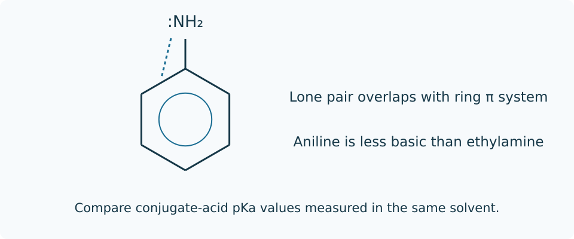
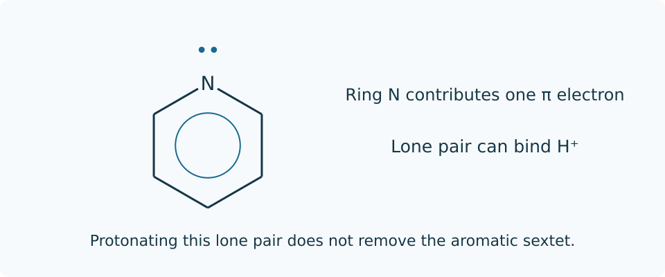
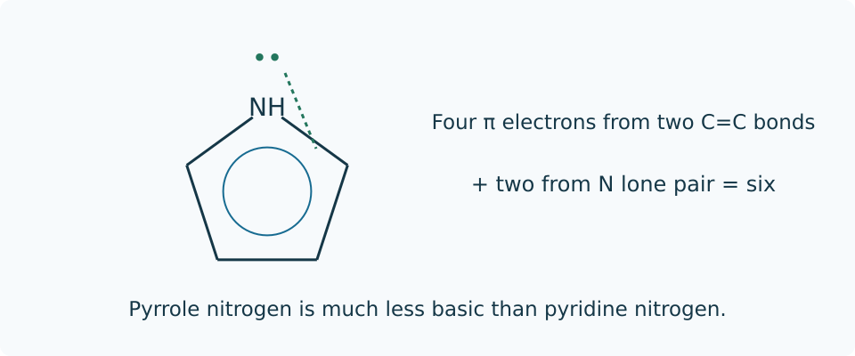

## What will you be able to explain?

- Locate nitrogen lone pairs and predict simple protonation states.
- Recognise a simple aromatic pi system and explain contrasting nitrogen sites.
- Draw the main charge forms of a simple amino acid at supplied pH values.

::: notes
Start with a drawn molecule and an explanation from the preceding unit. Ask students to predict before revealing an answer. Use the practice page for complete worked checks rather than putting dense paragraphs on slides.
:::

## Name the nitrogen environment

{width=85% fig-alt="Primary, secondary and tertiary amines have one, two and three carbon substituents on nitrogen."}

A neutral ordinary amine has three bonds and one lone pair.

::: notes
The classification counts carbon substituents, not how many hydrogen bonds the molecule can form. Tertiary amines are not automatically positively charged; four-bonded ordinary ammonium nitrogens are.
:::

## Protonation uses the lone pair

{width=85% fig-alt="Methylamine forms methylammonium by donating its nitrogen pair to H+."}

Four single bonds on nitrogen give a positive formal charge.

::: notes
Separate H+ as shorthand from the actual proton donor in solution. Students should be able to redraw water or an acid as donor and include the accompanying bond-cleavage arrow.
:::

## Amine is not amide

{width=85% fig-alt="An amide nitrogen lone pair interacts with a neighbouring carbonyl."}

Do not assign the basicity of a simple alkylamine to peptide nitrogen.

::: notes
The diagram deliberately compares local structure rather than making an absolute basicity rule for all substituted molecules. Solvent and other substituents matter. Ordinary amide protonation is often preferred at oxygen under strong acid.
:::

## An aromatic ring can change basicity

{width=85% fig-alt="Aniline can delocalise its nitrogen lone pair into its benzene ring."}

Under comparable aqueous conditions aniline is less basic than a simple alkylamine.

::: notes
The dashed connector indicates orbital participation, not a reaction arrow. If asking for a complete resonance contributor, require the accompanying ring pi-bond shifts and resulting charges. The free base is stabilised by conjugation, affecting its protonation equilibrium.
:::

## Aromaticity requires a continuous pi system

{width=85% fig-alt="Benzene has six pi electrons in a planar, cyclic, conjugated system."}

For these simple rings use the 4n + 2 rule only after checking the structural requirements.

::: notes
The vertical strokes illustrate p-orbital availability schematically, not extra sigma bonds or actual orbital shapes. Six pi electrons occupy the delocalised network; there are not six localised electron pairs.
:::

## A ring is not enough

{width=85% fig-alt="Benzene is aromatic; cyclohexane lacks the required continuous pi network."}

Identify the orbitals before counting electrons.

::: notes
Cyclohexane is not antiaromatic: it is nonaromatic because it lacks continuous conjugation. Detailed antiaromatic cases are outside this lesson.
:::

## Pyridine nitrogen keeps a separate lone pair

{width=85% fig-alt="Pyridine nitrogen supplies one electron to the pi system; its lone pair lies outside that system."}

Protonation of this lone pair can retain the aromatic sextet.

::: notes
The aromatic circle represents six delocalised pi electrons. Do not count the displayed lone pair again as part of that six.
:::

## Pyrrole nitrogen supplies a pair to the ring

{width=85% fig-alt="Pyrrole has four pi electrons from carbon double bonds plus two from the nitrogen pair."}

That pair is much less available for ordinary N protonation than the pyridine pair.

::: notes
Keep pyrrole and pyridine chemically distinct. The dashed connector indicates participation in the delocalised system; it is not a reaction arrow. Pyrrole is a much weaker base at N.
:::

## An amino acid can carry two formal charges

{width=85% fig-alt="Glycine changes from net +1 through a zwitterion to net −1 as pH rises."}

Net neutrality does not mean every atom is uncharged.

::: notes
Use supplied pKa values near 2.3 for COOH and 9.6 for ammonium if a numerical example is needed. Species coexist around each pKa; the three drawings show dominant forms in well-separated pH regions.
:::

## Use conjugate-acid pKa consistently

{width=85% fig-alt="Ethylammonium has approximate aqueous pKa 10.7; anilinium about 4.6."}

The larger conjugate-acid pKa corresponds to the stronger base in this comparison.

::: notes
These are approximate teaching values, not universal solvent-independent constants. Basicity is an equilibrium property; nucleophilicity concerns reaction rate at an electrophile and cannot be ranked solely from this table.
:::

## Work one example on paper

Draw glycine at pH 1, 6 and 12 using supplied pKa values 2.3 and 9.6. Mark every formal charge and give the net charge. Explain why the pH 6 drawing is a zwitterion.

::: notes
Allow independent thinking, then compare in pairs. Ask students to defend each atom, charge or assignment. Show the worked check only after a first attempt.
:::

## A common mistake to repair

“Contains nitrogen” is insufficient to predict basicity. Identify the available pair and whether it participates in conjugation or aromaticity.

Explain the correction using a drawing or a specific observation.

## Test your explanation

1. Which atoms, bonds or observations support the claim?
2. What alternative would make a different prediction?
3. What assumption limits the conclusion?

Give a partner your explanation without the answer label. Can they follow it?

## Take the reasoning forward

Complete the [practice and worked examples](exercise.qmd) and [self-check](quiz.qmd).

Selected Solomons chapters 14 and 20 sections; see the [reading guide](../reference/reading.qmd) for the provisional textbook map and open references.
