## What will you be able to explain?

- Explain why carbonyl carbon is electrophilic.
- Follow addition and proton-transfer steps.
- Recognise a hydrate, hemiacetal and acetal.

::: notes
**45-minute block budget (all pauses included):** 0–5 min: polarity and geometry; 5–15 min: labelled hydration and catalyst accounting; 15–27 min: acid activation, alcohol attack and deprotonation; 27–34 min: hydrate/hemiacetal/acetal comparisons and water equilibrium; 34–40 min: ring closure, formula and stereocentre checks; 40–43 min: independent labelled mechanism; 43–45 min: recap. The brief predictions, individual drawing and board discussion occur inside these blocks, not in extra time. The 40-second metadata is a rough planning reference; spend longer on the identified drawings and merge explanations already understood.

Begin with the previous unit’s electron-pair and charge audit. Ask students to predict a product or bond change before displaying the worked drawing. These slides support discussion and paper drawing; the practice page supplies further explanations.
:::

## Predict before the worked drawing

Draw ethanal and distinguish its partial charges from formal charges. What is its carbonyl-carbon geometry?

::: notes
Allow about 25 seconds of individual drawing/thinking, then ask for one reason. Do not display the worked product yet. Use the following illustration to resolve the atom, charge or geometry issue.
:::

## The carbonyl is polar and planar

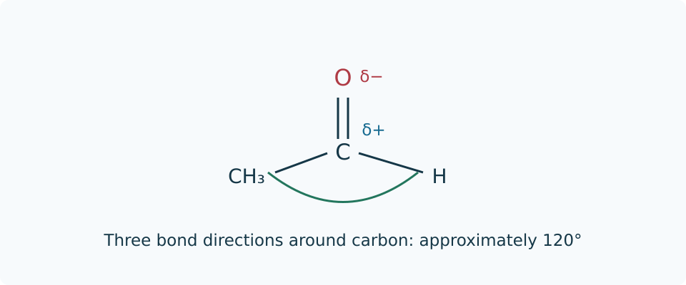{width=85% fig-alt="Ethanal has an oxygen-polarised carbonyl and approximately trigonal planar geometry at its carbonyl carbon."}

C=O polarity makes carbon electron-poor. Its π pair can move to oxygen when a nucleophile adds.

::: notes
Partial charges are not formal charges. The neutral starting carbonyl has no formal positive carbon even though the carbon is electrophilic.
:::

## Label the original and incoming oxygen

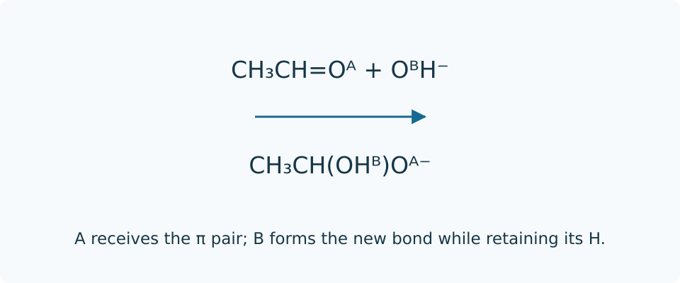{width=85% fig-alt="Label the original and incoming oxygen"}

Identify which O receives the pi pair and which brings its H into the tetrahedral intermediate.

::: notes
A was carbonyl O and becomes O⁻ first, then OH. B was incoming hydroxide O and already carries H. Hydroxide is regenerated by water proton loss.
:::

## Follow the proton-transfer product

{width=85% fig-alt="Label the original and incoming oxygen"}

After water protonates A, draw both labelled OH groups and the regenerated base.

::: notes
A was carbonyl O and becomes O⁻ first, then OH. B was incoming hydroxide O and already carries H. Hydroxide is regenerated by water proton loss.
:::

## Predict before the worked drawing

Add OH⁻ to CH₃CHO on paper. If C–O forms, which existing pair must move so carbon keeps four bond orders?

::: notes
Allow about 25 seconds of individual drawing/thinking, then ask for one reason. Do not display the worked product yet. Use the following illustration to resolve the atom, charge or geometry issue.
:::

## Addition changes carbon geometry

{width=85% fig-alt="Hydroxide adds to ethanal, giving a tetrahedral intermediate with alkoxide oxygen and a newly attached OH."}

Two coupled arrows form C–O and move the C=O π pair to oxygen. The total charge remains −1.

::: notes
The carbon has four single bonds after addition. The original carbonyl oxygen bears the negative charge. Check atom identity rather than treating both oxygens as interchangeable.
:::

## Compare acid and base entry steps

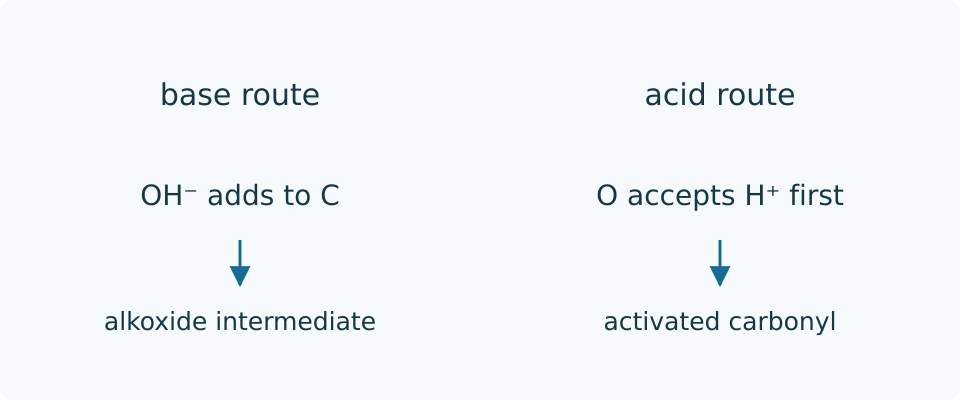{width=85% fig-alt="Compare acid and base entry steps"}

Name the first operation in base-catalysed versus acid-catalysed hydration.

::: notes
Base route attacks carbon first; acid route protonates oxygen first. Strong basic anions are protonated in excess acid, so the route must respect acid–base chemistry.
:::

## Choose a compatible attacking species

{width=85% fig-alt="Compare acid and base entry steps"}

Under proton-rich conditions, why use a neutral water/alcohol nucleophile rather than assuming freely persistent OH⁻/RO⁻?

::: notes
Base route attacks carbon first; acid route protonates oxygen first. Strong basic anions are protonated in excess acid, so the route must respect acid–base chemistry.
:::

## Predict before the worked drawing

Label the original carbonyl oxygen A and incoming hydroxide oxygen B. After addition, which one needs a proton?

::: notes
Allow about 25 seconds of individual drawing/thinking, then ask for one reason. Do not display the worked product yet. Use the following illustration to resolve the atom, charge or geometry issue.
:::

## Proton transfer completes the hydrate

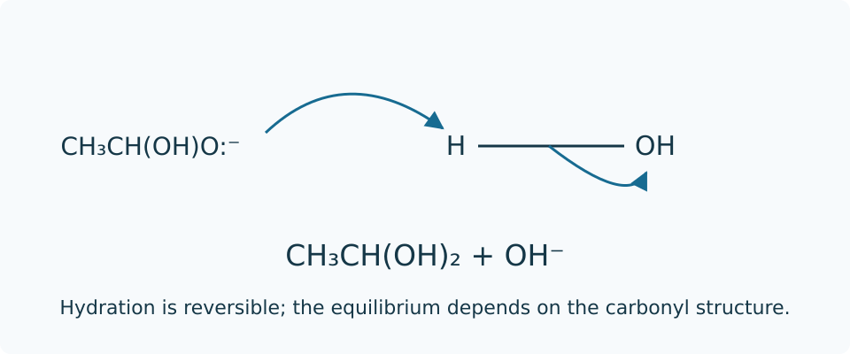{width=85% fig-alt="Water transfers a proton to the alkoxide, giving a geminal diol and regenerating hydroxide."}

The net reaction is carbonyl + water ⇌ hydrate. The base participates in the pathway and is regenerated.

::: notes
Not every carbonyl is mostly hydrated at equilibrium. Substituents and conditions affect the equilibrium; mechanism and product proportion are different questions.
:::

## Count methanol oxygen bonds

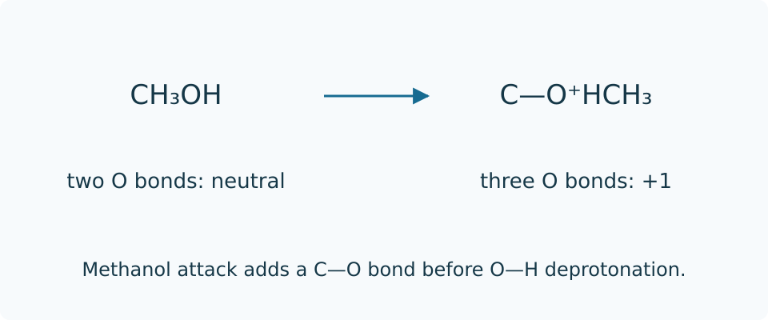{width=85% fig-alt="Count methanol oxygen bonds"}

After methanol bonds to carbon but still retains H, explain its formal charge.

::: notes
Incoming O goes from two to three bonds and becomes +1. Water takes its H⁺ to give neutral hemiacetal and hydronium.
:::

## Neutralise with an explicit acceptor

{width=85% fig-alt="Count methanol oxygen bonds"}

Draw the water deprotonation that restores a two-bond oxygen and state its donor-derived product.

::: notes
Incoming O goes from two to three bonds and becomes +1. Water takes its H⁺ to give neutral hemiacetal and hydronium.
:::

## Predict before the worked drawing

In a proton-rich aqueous medium, which carbonyl atom can accept H⁺? Draw the donor-derived water too.

::: notes
Allow about 25 seconds of individual drawing/thinking, then ask for one reason. Do not display the worked product yet. Use the following illustration to resolve the atom, charge or geometry issue.
:::

## Acid can activate the oxygen first

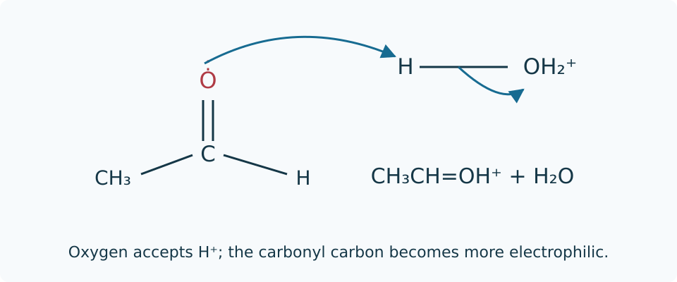{width=85% fig-alt="A carbonyl oxygen lone pair accepts a proton from hydronium, producing protonated carbonyl and water."}

Protonating oxygen increases carbonyl electrophilicity. Neutral water or alcohol can then be the attacking nucleophile.

::: notes
Avoid drawing a strongly basic nucleophile freely coexisting in excess strong acid. For this route use neutral nucleophiles and explicit proton transfers.
:::

## Keep both oxygens in the product

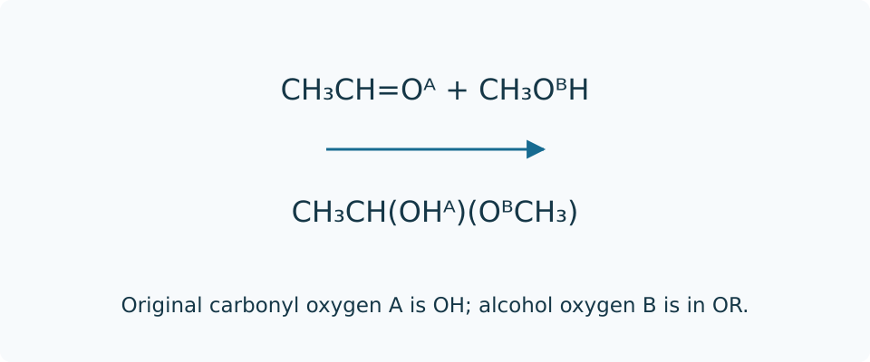{width=85% fig-alt="Keep both oxygens in the product"}

Which labelled oxygen is OH and which belongs to OCH₃ after hemiacetal formation?

::: notes
Original carbonyl A gives OH; methanol B gives OCH₃. Swapping labels would require additional bond-breaking/exchange chemistry beyond the drawn sequence.
:::

## Reject a silent atom exchange

{width=85% fig-alt="Keep both oxygens in the product"}

Why cannot the two oxygen labels simply be swapped in the worked drawing?

::: notes
Original carbonyl A gives OH; methanol B gives OCH₃. Swapping labels would require additional bond-breaking/exchange chemistry beyond the drawn sequence.
:::

## Predict before the worked drawing

Methanol attacks a protonated aldehyde. Before deprotonation, count the incoming oxygen’s bonds and predict its charge.

::: notes
Allow about 25 seconds of individual drawing/thinking, then ask for one reason. Do not display the worked product yet. Use the following illustration to resolve the atom, charge or geometry issue.
:::

## An alcohol oxygen supplies a pair

{width=85% fig-alt="Methanol attacks the protonated carbonyl; the pi pair moves to oxygen, and the incoming methanol oxygen becomes oxonium."}

The new tetrahedral species has OH and O⁺HCH₃ attached to the same carbon.

::: notes
An incoming neutral oxygen changes from two to three bonds and acquires positive charge. The formerly protonated carbonyl oxygen becomes neutral OH after its pi pair returns.
:::

## Classify by groups at one carbon

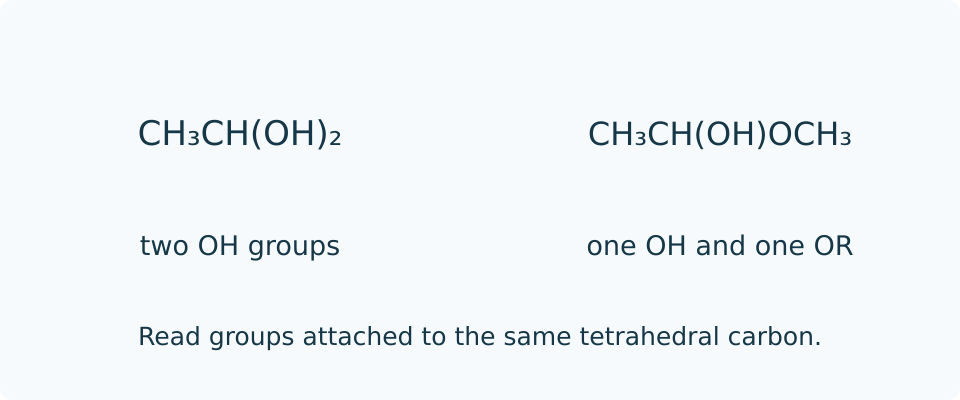{width=85% fig-alt="Classify by groups at one carbon"}

Identify two OH versus OH+OR in the two structures. Which reagent supplies the extra carbon of the methoxy group?

::: notes
Water adds no carbon and gives a hydrate. Methanol provides OCH₃ and gives a hemiacetal; local group identity and overall atoms both distinguish them.
:::

## Use formula accounting as a check

{width=85% fig-alt="Classify by groups at one carbon"}

Compare aldehyde+water with aldehyde+methanol. Why are their products not the same class?

::: notes
Water adds no carbon and gives a hydrate. Methanol provides OCH₃ and gives a hemiacetal; local group identity and overall atoms both distinguish them.
:::

## Predict before the worked drawing

After attack, choose the oxygen that must lose a proton to form a neutral hemiacetal. What base can take it?

::: notes
Allow about 25 seconds of individual drawing/thinking, then ask for one reason. Do not display the worked product yet. Use the following illustration to resolve the atom, charge or geometry issue.
:::

## Deprotonate the incoming oxygen

{width=85% fig-alt="Water accepts a proton from the methoxy oxonium group, forming a neutral hemiacetal and hydronium."}

A hemiacetal has **OH and OR attached to the same carbon**. The acid catalyst is regenerated.

::: notes
Do not remove the proton from the wrong atom without considering the resulting structure. Ask students to label original carbonyl oxygen and incoming alcohol oxygen.
:::

## Ring closure does not imply elimination

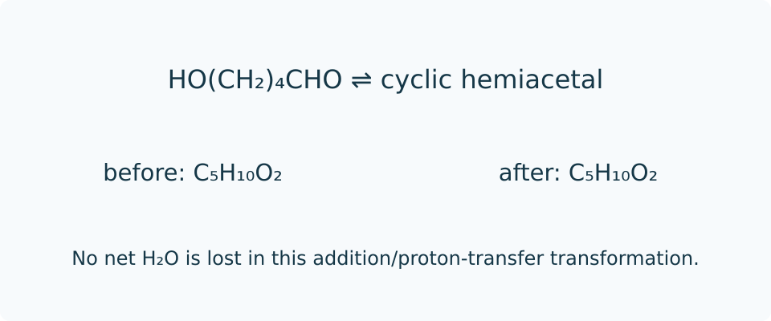{width=85% fig-alt="Ring closure does not imply elimination"}

Compare before/after formulas for the five-hydroxy aldehyde cyclisation.

::: notes
The terminal alcohol oxygen becomes ring O; the original carbonyl O becomes OH. No net water is removed in hemiacetal addition/proton transfer.
:::

## Locate every ring atom

{width=85% fig-alt="Ring closure does not imply elimination"}

Draw the six-membered ring and mark the oxygen that was the terminal OH versus the oxygen now in its OH substituent.

::: notes
The terminal alcohol oxygen becomes ring O; the original carbonyl O becomes OH. No net water is removed in hemiacetal addition/proton transfer.
:::

## Predict before the worked drawing

At the same tetrahedral carbon compare OH+OR with OR+OR. Name the two product classes without changing the drawing.

::: notes
Allow about 25 seconds of individual drawing/thinking, then ask for one reason. Do not display the worked product yet. Use the following illustration to resolve the atom, charge or geometry issue.
:::

## One substitution changes the class

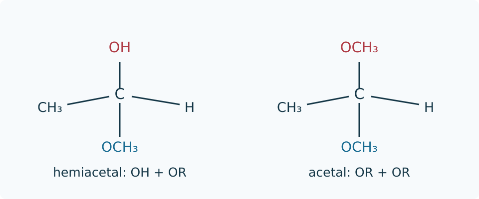{width=85% fig-alt="A hemiacetal carbon has one OH and one OR group; an acetal carbon has two OR groups."}

A second alcohol can ultimately give an acetal under acid catalysis, with water formed. Additional steps are required.

::: notes
The left/right diagrams compare product classes; they do not represent a single elementary OH-to-OR substitution. Students are required to understand the hemiacetal steps first.
:::

## Four groups must be different

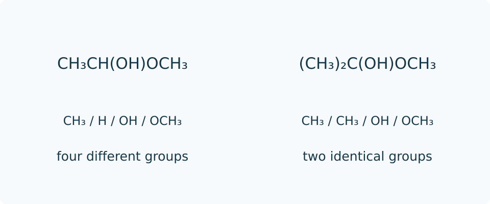{width=85% fig-alt="Four groups must be different"}

Compare the former carbonyl carbon after methanol addition to ethanal versus propanone.

::: notes
Ethanal product hasCH₃, H, OH, OCH₃ and is stereogenic. Propanone product retains two identical methyl groups, so its tetrahedral carbon is not a simple stereocentre.
:::

## Separate tetrahedral from chiral

{width=85% fig-alt="Four groups must be different"}

Why can an addition change geometry without making a stereocentre?

::: notes
Ethanal product hasCH₃, H, OH, OCH₃ and is stereogenic. Propanone product retains two identical methyl groups, so its tetrahedral carbon is not a simple stereocentre.
:::

## Predict before the worked drawing

Balance aldehyde+two alcohols⇌acetal+water. Predict which direction excess water favours and separate that from acid catalysis.

::: notes
Allow about 25 seconds of individual drawing/thinking, then ask for one reason. Do not display the worked product yet. Use the following illustration to resolve the atom, charge or geometry issue.
:::

## Conditions control the equilibrium mixture

{width=85% fig-alt="The acetal equilibrium can be shifted toward acetal by removing water or toward hydrolysis using excess water under acid catalysis."}

Acid speeds both directions. Changing composition can shift the equilibrium mixture; catalysis alone does not change K.

::: notes
This is a composition argument, not an experimental recipe. Do not describe an equilibrium arrow as proof of equal concentrations.
:::

## A pathway does not give the equilibrium amount

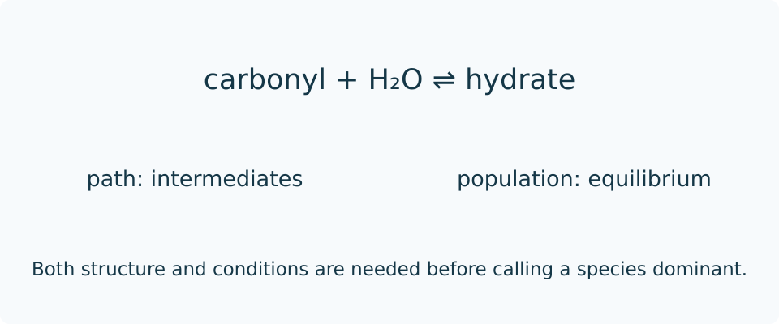{width=85% fig-alt="A pathway does not give the equilibrium amount"}

Identify what a valid hydration mechanism accounts for and what it does not calculate.

::: notes
Need compatible equilibrium/structure/condition evidence. A valid accessible pathway does not establish100% conversion to hydrate.
:::

## State the missing evidence

{width=85% fig-alt="A pathway does not give the equilibrium amount"}

What information would justify calling the hydrate the dominant solution form?

::: notes
Need compatible equilibrium/structure/condition evidence. A valid accessible pathway does not establish100% conversion to hydrate.
:::

## Predict before the worked drawing

Draw HO(CH₂)₄CHO and connect the alcohol O to aldehyde C. How many atoms belong to the new ring?

::: notes
Allow about 25 seconds of individual drawing/thinking, then ask for one reason. Do not display the worked product yet. Use the following illustration to resolve the atom, charge or geometry issue.
:::

## An internal OH can close a ring

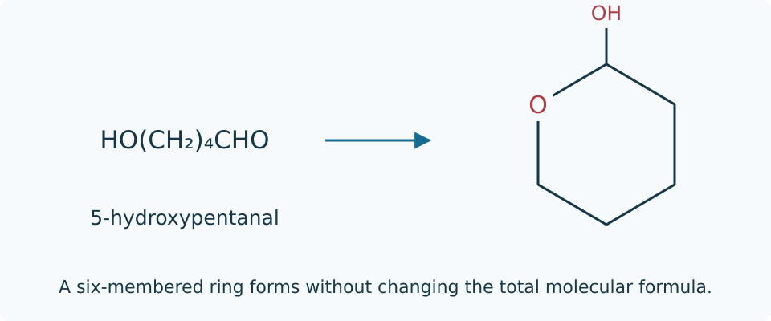{width=85% fig-alt="The terminal alcohol of 5-hydroxypentanal can add to its aldehyde to form a six-membered cyclic hemiacetal."}

Intramolecular addition conserves the molecular formula. The ring includes the attacking oxygen and the original carbonyl carbon.

::: notes
Count the six ring atoms: oxygen plus five carbons. This provides a chemical bridge to sugar rings without assuming carbohydrate biochemistry.
:::

## Predict before the worked drawing

Compare CH₃CHO and CH₃C(=O)OCH₃. Which group attached at carbonyl C introduces a possible leaving-group pathway?

::: notes
Allow about 25 seconds of individual drawing/thinking, then ask for one reason. Do not display the worked product yet. Use the following illustration to resolve the atom, charge or geometry issue.
:::

## Ask what else is bonded to carbonyl carbon

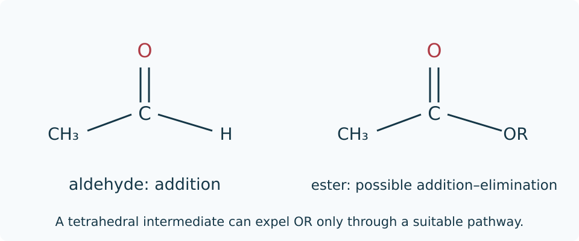{width=85% fig-alt="An aldehyde bears H at its carbonyl carbon, while an ester bears OR that can participate in an addition–elimination pathway."}

Aldehydes and ketones ordinarily retain their H/carbon substituents during addition. Acyl derivatives introduce leaving-group chemistry next.

::: notes
Do not imply that alkoxide departs freely from every tetrahedral intermediate. Protonation state, leaving-group ability and conditions determine the viable pathway.
:::

## Same pattern, different nucleophiles

Water gives a hydrate; an alcohol can give a hemiacetal; a hydride equivalent gives an alcohol after proton donation.

Locate the new bond in each product. Keep reagent scope and conditions explicit.

## A mechanism and an equilibrium answer different questions

The mechanism accounts for the path and intermediates. The equilibrium describes the relative amounts of species under stated conditions.

Drawing an accessible hydrate does not prove it is the major species.

## Account for each oxygen

Start with CH₃CHO and CH₃OH. Label the aldehyde oxygen A and alcohol oxygen B.

In the hemiacetal, which is OH and which is OCH₃? What would be wrong with exchanging their atom labels without an extra process?

## Draw the hemiacetal sequence without the slides

Start from CH₃CHO and CH₃OH under acid catalysis. Draw activation, attack and deprotonation, labelling both oxygen atoms throughout.

::: notes
Reserve 2 minutes for a complete individual drawing, then compare one mechanism at the board. This is application of the previous steps, not a new reaction family.
:::

::: notes
Session budget45 minutes:roughly27–29 minutes of concise explanations/visual inspection, about 11–13 minutes of individual drawing and predictions distributed through the sequence, and4–6 minutes of discussion/closing checks. Adjust to observed errors; the 40 second metadata is a planning guide, not a quota. Required paper practice and optional transfer are available in the exercises.
:::

## Use the same reasoning in practice

Complete the [exercises](exercise.qmd), then the [self-check](quiz.qmd).

Optional textbook support: selected Solomons chapter 16 sections. The [reading guide](../reference/reading.qmd) explains the provisional book mapping.
