## About this lecture

Glucose is drawn in every textbook as a six-carbon chain with an aldehyde at the end. Yet in your blood, **well over 99 %** of it is a **ring**, and only a trace is the open-chain aldehyde. The ring forms because the molecule's own OH adds to its own C=O. That's the reaction we study today.

Today we learn the one pattern behind it:

- **Why C=O reacts:** a polar, flat carbonyl with an electron-poor carbon
- **The addition step:** nucleophile in, π pair out, tetrahedral product
- **Base and acid routes:** hydrates and hemiacetals, with every proton accounted for
- **Product classes:** hydrate, hemiacetal, acetal, and how water controls the acetal equilibrium
- **Rings and stereocentres:** cyclic hemiacetals, glucose, and new stereocentres

On Day 13 you reduced ketones with NaBH₄. That was already a carbonyl addition; today we see the general pattern.

::: notes
Start with the glucose puzzle: the open-chain drawing is the one everyone memorises, but it barely exists in water. Ask the room why a molecule would "prefer" to be a ring. Don't answer yet; tell them the answer is today's reaction, and that by the end they'll be able to draw how the ring forms, arrow by arrow. The link back to Day 13 matters: hydride reduction put H on the carbonyl carbon and O⁻ on oxygen before a proton finished the job. Today the nucleophiles are oxygen nucleophiles (water, alcohols), but the electron movement is exactly the same. Today's tools come back tomorrow (Day 17), when the carbonyl carries a group that can leave.
:::

## The carbonyl is polar and flat

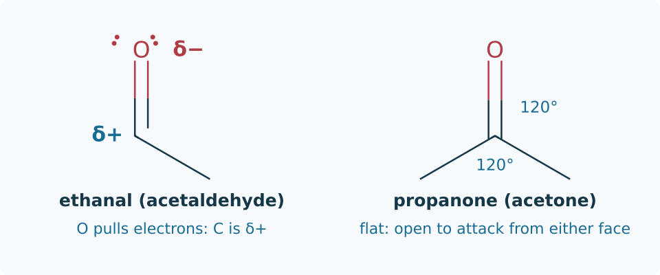{width=84% fig-alt="Skeletal ethanal with delta plus on the carbonyl carbon and delta minus on oxygen with its two lone pairs, and propanone showing trigonal planar 120 degree angles"}

Oxygen pulls the C=O electrons towards itself, so the carbonyl carbon is **δ+** and attracts nucleophiles. The carbon is **trigonal planar**, so a nucleophile can approach from either face.

::: notes
Two separate facts on one slide: polarity explains *where* nucleophiles attack, flatness explains *how* (from above or below the plane), which matters later for stereocentres. Probe the classic confusion: δ+ is not a formal charge. In the ordinary Lewis structure of ethanal every atom has formal charge zero. If someone writes C⁺ on a neutral aldehyde, ask them to count bonds: the carbon has four bonds and no lone pairs, so it's neutral. Partial charge describes uneven electron sharing; formal charge is bookkeeping from the Lewis structure. Day 1's formal charge rules still apply.
:::

## One pattern: nucleophile in, π pair out

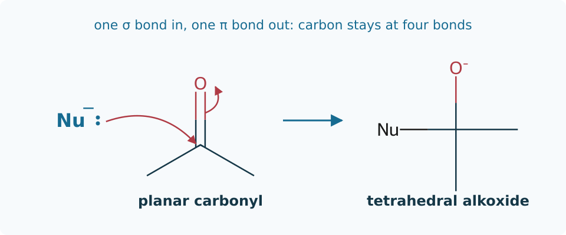{width=72% fig-alt="A nucleophile lone pair attacks the carbonyl carbon of propanone while the C=O pi pair moves onto oxygen, giving a tetrahedral alkoxide with Nu, O minus and two methyl groups"}

Arrow 1: a lone pair on the nucleophile forms the new **C–Nu** bond. Arrow 2: the **π pair** moves onto oxygen, which becomes **O⁻**. Carbon goes from planar to **tetrahedral**.

::: {.try}
**Try it:** why can't you draw only the first arrow and keep the C=O?

::: {.fragment}
**Carbon would have five bonds.** The π bond must open as the new σ bond forms, so carbon stays at four.
:::
:::

::: notes
This is the slide to come back to all day: every mechanism today is this pattern plus proton transfers. Insist on two arrows that start at electrons: the first from a lone pair (not from the atom letter or the minus sign), the second from the middle of the C=O double bond and ending on oxygen. Many students draw the first arrow and forget the second, producing a five-bonded carbon; the try-it targets exactly that. Mention the Day 1 "valence check" habit here.
:::

## Hydroxide adds to ethanal

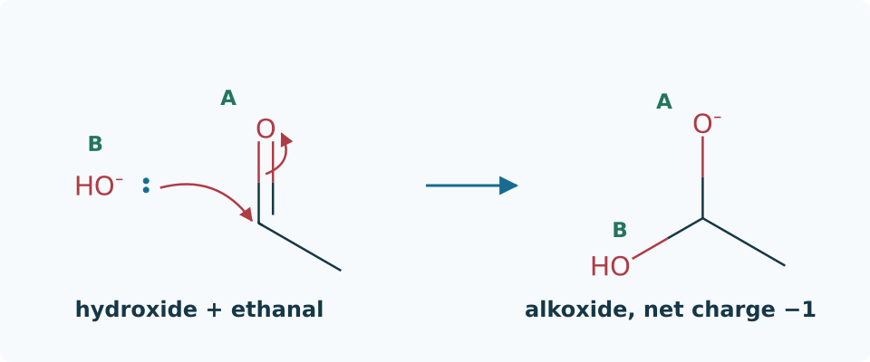{width=74% fig-alt="Hydroxide, with its oxygen labelled B, attacks the carbonyl carbon of ethanal with curved arrows; the carbonyl oxygen labelled A becomes O minus in the tetrahedral intermediate, where B is now an OH group"}

Label the oxygens so you can follow them: **A** was the carbonyl O, **B** came in with hydroxide. Total charge stays **−1** on both sides.

::: {.try}
**Try it:** after this step, which oxygen carries the negative charge, A or B?

::: {.fragment}
**A.** It received the π pair. B arrived with its H and is now a neutral OH on carbon.
:::
:::

::: notes
The oxygen labels are the core skill of today and of the Day 16 demo. Students often put the negative charge on the incoming oxygen because "it was the one with the minus sign". Ask them to count: B started with one bond and three lone pairs (charge −1), and now has two bonds (to H and to C) and two lone pairs, so it's neutral. A started with two bonds (the double bond) and two lone pairs, and now has one bond and three lone pairs, so it's −1. The charge moved because the electrons moved. Also check that both sides show a total charge of −1.
:::

## Water finishes the hydrate

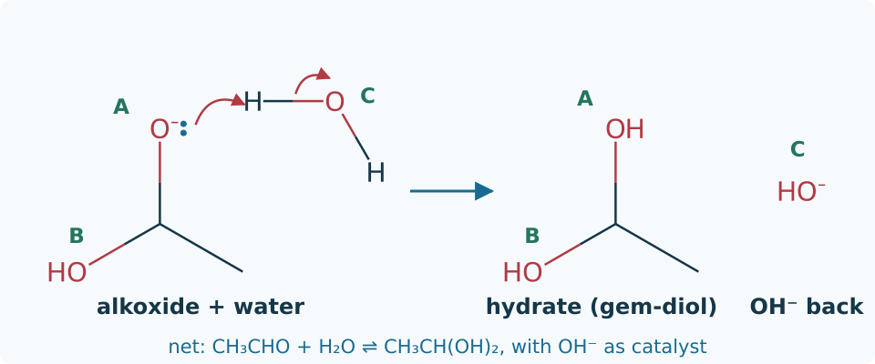{width=82% fig-alt="The alkoxide oxygen A takes a proton from water, whose oxygen is labelled C; products are the hydrate with two OH groups, A and B, on one carbon, plus hydroxide containing oxygen C"}

The alkoxide takes **H⁺ from water**; the O–H bonding pair stays on water's oxygen (C), which leaves as **OH⁻**. Hydroxide is used and then returned, so it's a **catalyst**.

Net: CH₃CHO + H₂O ⇌ CH₃CH(OH)₂, a **hydrate** (*gem*-diol).

::: notes
Work through the arrows: lone pair on A to the H of water, and the H–O bond pair onto water's oxygen. Point out that the hydroxide that comes out (oxygen C) is not the same hydroxide that went in (oxygen B). That's fine: catalysts are regenerated as a species, not as the same atoms. Have students add the two steps and cancel OH⁻ to get the net equation; this is exercise 6. Also stress that a "proton" is never just floating: always name the donor and the acceptor.
:::

## How much hydrate? It depends on the carbonyl

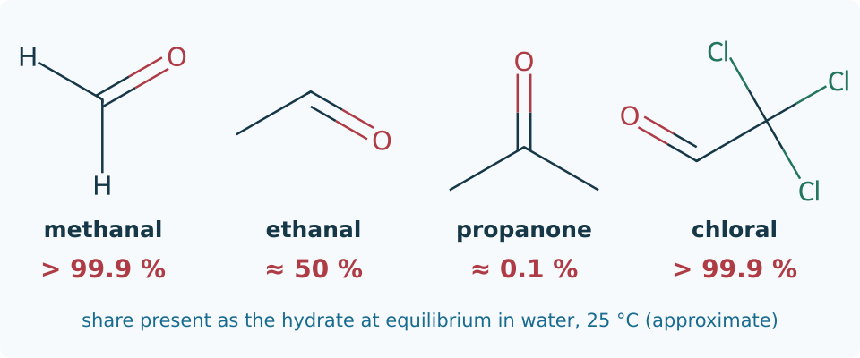{width=78% fig-alt="Methanal more than 99.9 percent hydrate, ethanal about 50 percent, propanone about 0.1 percent, chloral more than 99.9 percent"}

The same mechanism works for all four. **Where the equilibrium lies** depends on structure: alkyl groups stabilise the C=O; electron-withdrawing groups (like CCl₃) favour the hydrate.

::: {.try}
**Try it:** a student draws a correct hydration mechanism for propanone and concludes the flask is all hydrate. What's missing?

::: {.fragment}
**Equilibrium data.** A mechanism shows how species interconvert, not how much of each is present; propanone is about 99.9 % ketone.
:::
:::

::: notes
This slide separates two questions students tend to merge: "can it happen?" (mechanism) and "how much is there at equilibrium?" (thermodynamics). Formaldehyde in water (formalin) is almost entirely the hydrate; acetone barely hydrates at all. Chloral is a nice story: its hydrate is so stable that chloral hydrate is a crystalline solid, and it was one of the first synthetic sedatives in the 19th century. Keep the explanation qualitative: alkyl groups donate electron density and stabilise the carbonyl; electron-withdrawing groups make the carbonyl carbon even more δ+ and favour addition. Exercise 20 is this exact argument.
:::

## In acid, the oxygen is protonated first

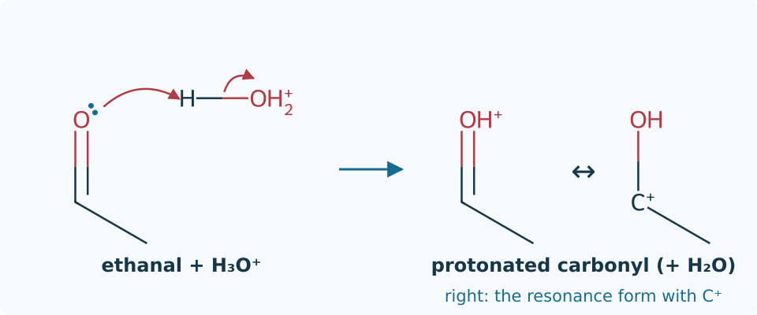{width=86% fig-alt="A lone pair on the ethanal oxygen takes a proton from hydronium, giving the protonated carbonyl with O plus and water; a resonance form shows the positive charge on carbon"}

A lone pair on the carbonyl O takes **H⁺ from H₃O⁺**. The protonated carbonyl is far more electrophilic: its resonance form puts **+ on carbon**. Now even a weak, neutral nucleophile can add.

::: notes
Compare the two routes explicitly. In base, a strong nucleophile (OH⁻) attacks an ordinary carbonyl. In acid, the carbonyl is made more reactive so that a weak nucleophile (water or an alcohol) can attack. Both arrows matter: the lone pair to H, and the H–O bond of hydronium onto its oxygen. Ask what the charge on the product oxygen is: three bonds and one lone pair, so +1. The resonance form is the reason for activation; it's the same resonance thinking from Day 3.
:::

## Base route vs acid route

| | base-catalysed | acid-catalysed |
|---|---|---|
| first step | nucleophile **adds** to C=O | carbonyl O is **protonated** |
| nucleophile | strong, anionic (OH⁻, RO⁻) | weak, neutral (H₂O, ROH) |
| intermediate | alkoxide, charge −1 | oxonium, charge +1 |
| last step | O⁻ takes H⁺ from water | O⁺–H gives H⁺ to water |
| catalyst | OH⁻ regenerated | H₃O⁺ regenerated |

::: {.try}
**Try it:** in methanol with plenty of acid, why don't we draw CH₃O⁻ as the nucleophile?

::: {.fragment}
**It can't survive there.** Methoxide is a strong base and would be protonated at once; the nucleophile in acid is neutral CH₃OH.
:::
:::

::: notes
This table is the map for the rest of the lecture. The key consistency rule: a mechanism has to respect the acid-base chemistry of the conditions. Strong bases and strong acids don't coexist, so don't draw OH⁻ or CH₃O⁻ in a strongly acidic flask, and don't draw H₃O⁺ in a strongly basic one. Ask students which column the Day 13 NaBH₄ reduction belongs to (base-like: anionic nucleophile first, proton last). Exercise 8 is the try-it.
:::

## Methanol adds to the activated carbonyl

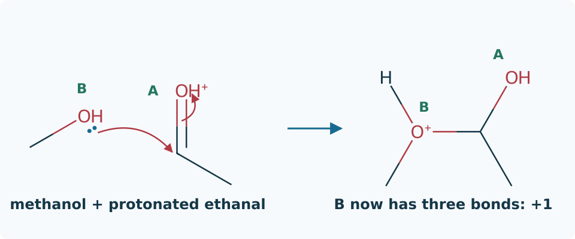{width=76% fig-alt="A lone pair on methanol oxygen B attacks the carbonyl carbon of protonated ethanal while the pi pair moves to oxygen A; the product has OH on oxygen A and an oxonium oxygen B with H, CH3 and a positive charge"}

Same two arrows as before. Now the **incoming** oxygen B ends with three bonds, so it carries the **+1**. Oxygen A becomes a neutral OH.

::: {.try}
**Try it:** count the bonds and lone pairs on oxygen B after attack. What's its formal charge?

::: {.fragment}
**+1.** Three bonds (H, CH₃, C) and one lone pair: 6 − 2 − 3 = +1.
:::
:::

::: notes
This is the mirror image of the base route. In base, the incoming oxygen was neutral after attack and the old carbonyl oxygen took the negative charge. In acid, the old carbonyl oxygen was already protonated (+1) and becomes neutral once the π pair lands on it, while the incoming oxygen becomes +1. The overall charge is +1 throughout. Students often put the + on oxygen A out of habit. The formal charge formula from Day 1 settles it.
:::

## A proton transfer gives the hemiacetal

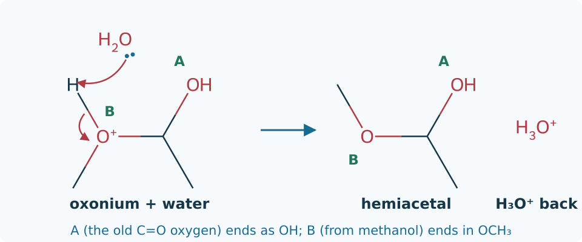{width=76% fig-alt="A water lone pair takes the proton on oxonium oxygen B; the product is the neutral hemiacetal with OH on oxygen A and OCH3 on oxygen B, plus hydronium"}

Water removes H⁺ from the **three-bonded oxygen B**, and H₃O⁺ is regenerated. The product, CH₃CH(OH)OCH₃, is a **hemiacetal**: OH and OR on the same carbon.

::: {.try}
**Try it:** in the hemiacetal, which labelled oxygen is the OH and which is in the OCH₃?

::: {.fragment}
**A is the OH, B is the OCH₃.** Swapping them would need extra bond-breaking steps that we never drew.
:::
:::

::: notes
The proton must come off the oxygen that has three bonds; taking it from oxygen A would leave an O⁻ next to an O⁺, which is the wrong product. Walk through the full acid sequence once more as "protonate, add, deprotonate" and count: H₃O⁺ in at the start, H₃O⁺ out at the end. The atom-tracking question is exercise 4 and quiz question 2 in a different form; the point is that atoms don't silently swap places. A drawing in which the methanol oxygen ends up as the OH means something went wrong.
:::

## Hydrate, hemiacetal, acetal

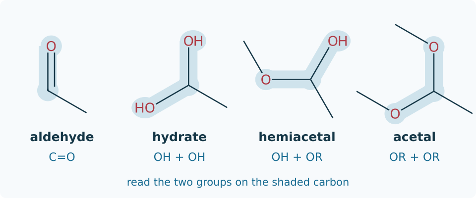{width=80% fig-alt="Ethanal, its hydrate with two OH groups, its hemiacetal with OH and OCH3, and its acetal with two OCH3 groups, each with the former carbonyl carbon and its oxygens shaded"}

Look at the **former carbonyl carbon** and its two oxygen groups: OH + OH is a **hydrate**, OH + OR is a **hemiacetal**, and OR + OR is an **acetal**.

::: {.try}
**Try it:** classify CH₃CH(OCH₃)₂.

::: {.fragment}
**Acetal.** Two OCH₃ groups sit on the same carbon. An OCH₃ somewhere else in a molecule would just be an ether.
:::
:::

::: notes
Classification is all about one carbon. A common error is to call any molecule with an OH and an OR a hemiacetal, even if they're on different carbons; HOCH2CH2OCH3 is an alcohol plus an ether, not a hemiacetal. Run the four names quickly as an oral drill: point at a structure and have the room call out the class. This is exercise 11 and quiz question 4. Note that ketones give the same classes; you'll sometimes see "hemiketal" and "ketal", which are older names for the ketone versions.
:::

## From hemiacetal to acetal

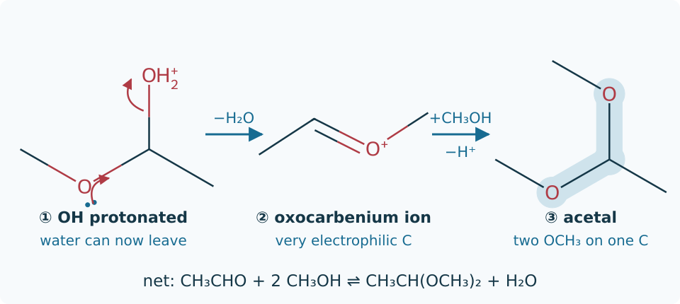{width=86% fig-alt="The hemiacetal OH is protonated, the methoxy lone pair pushes out water to give an oxocarbenium ion, and a second methanol adds and loses a proton to give the acetal"}

The OH is a poor leaving group, so acid **protonates it first**. Water leaves, helped by the neighbouring OCH₃ lone pair, and a second CH₃OH adds to the **oxocarbenium ion**.

Net: CH₃CHO + **2** CH₃OH ⇌ CH₃CH(OCH₃)₂ + H₂O

::: notes
This is more steps than students need to reproduce in full today, but they must know that turning OH into OR is not a single arrow; that's exercise 12. Point out the logic: OH⁻ is a terrible leaving group, but H₂O is a fine one, so protonation converts a bad leaving group into a good one. That idea returns in substitution and in tomorrow's acyl chemistry. The oxocarbenium ion is just another strongly activated carbonyl, so the second methanol adds exactly like the first. Count atoms in the net equation: two methanols in, one water out. That balance is exercise 13.
:::

## Water decides the acetal equilibrium

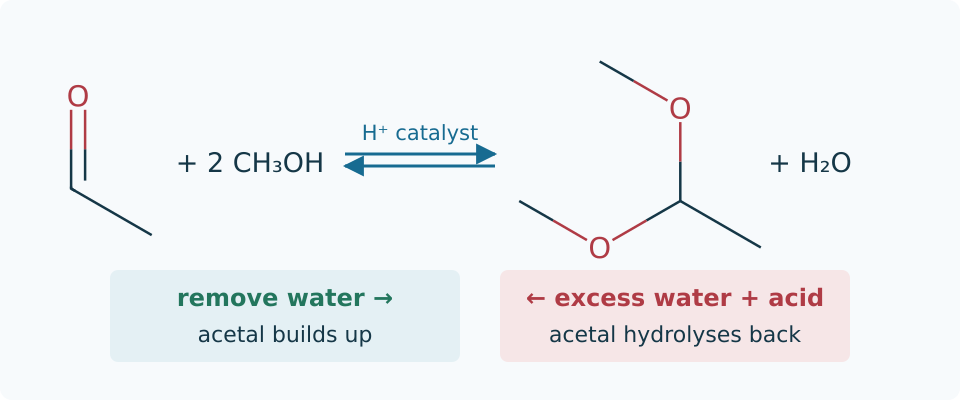{width=74% fig-alt="Ethanal plus two methanol is in equilibrium with the acetal plus water under acid catalysis; removing water favours the acetal, excess water with acid hydrolyses it back"}

Acid speeds up **both directions** but doesn't change K. To make the acetal, **remove water**; to undo it, add **excess water** with a little acid. In base, acetals are stable.

::: {.try}
**Try it:** you dissolve an acetal in dilute aqueous acid. Which way does the equilibrium move?

::: {.fragment}
**Back to aldehyde + alcohol.** Water is a product of acetal formation, so a large excess of water pushes the reaction backwards (Le Chatelier).
:::
:::

::: notes
Keep two operations separate: adding a catalyst changes how fast equilibrium is reached, while changing composition (removing or adding water) changes where it ends up. Students often say "acid makes the acetal". Acid makes it *possible*, but water removal makes it *favourable*. A practical aside: chemists use this on/off switch to protect a carbonyl as an acetal, do chemistry elsewhere under basic conditions, then remove the acetal with aqueous acid. Sugars linked in starch and cellulose are acetals, which is why acid hydrolysis breaks them down. This is quiz question 6 and exercise 14.
:::

## Does addition create a stereocentre?

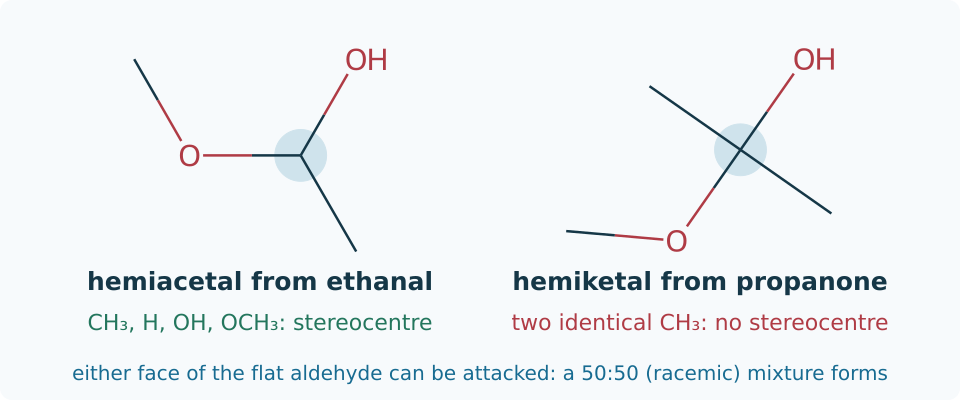{width=74% fig-alt="The hemiacetal from ethanal has four different groups on the shaded carbon and is a stereocentre; the product from propanone has two identical methyl groups and is not"}

A tetrahedral carbon is a stereocentre only if its **four groups differ**. From ethanal: CH₃, H, OH, OCH₃, so yes. Attack on either face of the flat C=O is equally likely, giving a **racemic** mixture.

::: {.try}
**Try it:** methanol adds to propanone to give (CH₃)₂C(OH)OCH₃. Is the former carbonyl carbon a stereocentre?

::: {.fragment}
**No.** Two of its groups are identical CH₃ groups. Becoming tetrahedral isn't enough.
:::
:::

::: notes
Connect to Week 2. The flat carbonyl from the first slide is why both enantiomers form: the nucleophile is equally likely to approach from the top face and the bottom face. Assigning R or S is only meaningful once you draw a specific 3D product with wedges; a flat drawing of the hemiacetal is the racemate. Exercises 18 and 19 are this slide. Plant the seed for the next slides: in glucose, the new stereocentre at C1 is the origin of the α and β forms.
:::

## A ring from inside one molecule

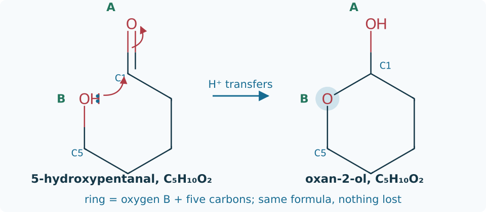{width=74% fig-alt="5-Hydroxypentanal drawn curled up: its terminal OH oxygen B attacks the aldehyde carbon C1 while the pi pair moves to oxygen A; after proton transfers the product is oxan-2-ol, a six-membered ring containing oxygen B, with OH on oxygen A"}

When the OH and the C=O are in the **same molecule**, the addition closes a ring. Five- and six-membered rings form easily.

::: {.try}
**Try it:** how many atoms are in the ring, and is any water lost?

::: {.fragment}
**Six (oxygen B and five carbons), and no water is lost.** Both structures are C₅H₁₀O₂; addition only moves atoms around.
:::
:::

::: notes
Draw the chain curled up so the OH is close to the carbonyl carbon; that's how it actually reacts. Count the ring atoms aloud: O, C5, C4, C3, C2, C1. Students often leave the attacking oxygen outside the ring or remove water as if it were a condensation reaction. A hemiacetal forms by addition, so the formula can't change; only acetal formation releases water. Also note that the old carbonyl oxygen, A, becomes the OH on C1, and the new ring oxygen is B. This is exercise 15, exercise 16 and quiz question 5.
:::

## Glucose is a cyclic hemiacetal

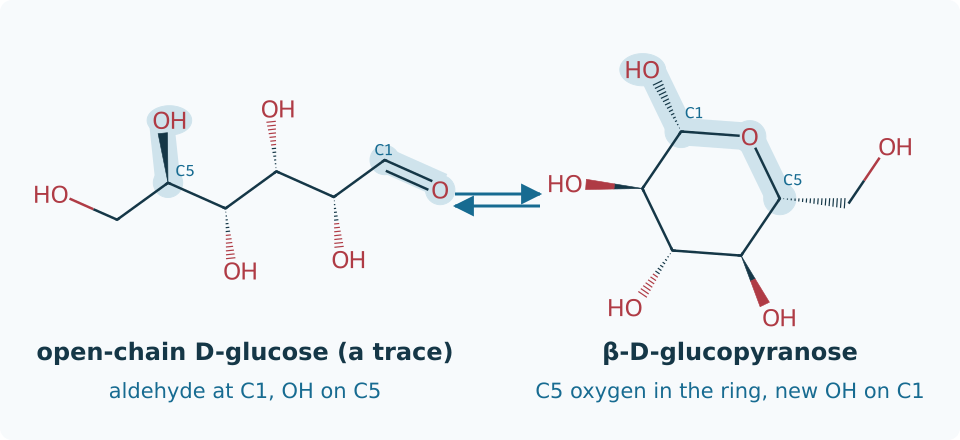{width=88% fig-alt="Open-chain D-glucose with the C1 aldehyde and C5 hydroxyl shaded, in equilibrium with beta-D-glucopyranose, whose ring contains the C5 oxygen and whose new hemiacetal OH sits on C1"}

The **C5 OH** adds to the **C1 aldehyde**, giving a six-membered ring. C1 becomes a new stereocentre, so there are two forms: **β** (about 64 %) and **α** (about 36 %) in water.

::: notes
This answers the opening question. The ring is favoured because a six-membered ring is nearly strain-free (the chair you saw in conformations) and the reaction is intramolecular. Point out that this is exactly the previous slide with extra OH groups along the chain. The new stereocentre at C1 is called the anomeric carbon, and α and β are its two configurations; they interconvert through the open chain, which is why a fresh glucose solution slowly changes its optical rotation (mutarotation). Don't expect students to draw glucose from memory; the goal is to recognise the hemiacetal carbon: the only carbon with two oxygens attached.
:::

## Same pattern, other nucleophiles

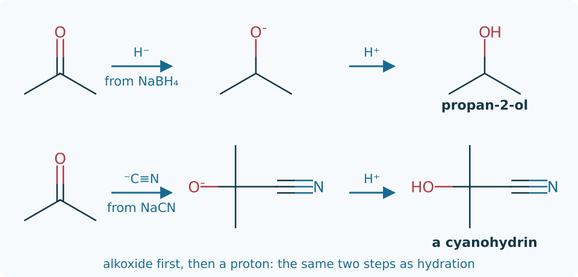{width=84% fig-alt="Propanone plus hydride from NaBH4 gives an alkoxide and then propan-2-ol; propanone plus cyanide gives an alkoxide with a nitrile and then the cyanohydrin"}

Hydride (from NaBH₄, Day 13) and cyanide add the same way: **alkoxide first, then a proton**. Only the new group on carbon changes.

::: notes
Show how far the single pattern reaches. With NaBH₄ the "nucleophile" is a hydride delivered from boron; with cyanide a new C–C bond forms, which is how chemists extend a carbon chain. Keep the claims modest: we're showing the electron pattern, not a full scope of reagents or conditions. Ask the room what product NaBH₄ gives from ethanal (ethanol) to check they can transfer the pattern. Hydride addition is effectively irreversible, whereas cyanohydrin formation is an equilibrium like hydration (cyanohydrins of ketones can fall back to ketone and HCN), which links back to the mechanism-versus-equilibrium slide.
:::

## Aldehydes keep the addition; esters can lose a group

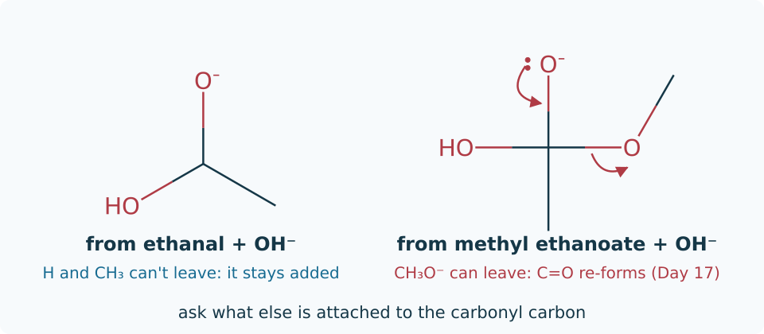{width=86% fig-alt="The tetrahedral alkoxide from ethanal and hydroxide has only H and CH3 besides oxygen; the one from methyl ethanoate has a methoxy group, and curved arrows show the O minus pair re-forming C=O as methoxide leaves"}

Ask what else is on the carbonyl carbon. An aldehyde or ketone has only **H or C**, which can't leave. An ester has **OR**, so the C=O can re-form and push RO⁻ out: **addition, then elimination**.

::: notes
This is the bridge to tomorrow (Day 17). The first step is identical: a nucleophile adds and gives a tetrahedral intermediate. What differs is the next step: in an aldehyde, H⁻ or CH₃⁻ are hopeless leaving groups, so the intermediate just picks up a proton. In an ester, the oxygen lone pair can push back down to re-form C=O and expel CH₃O⁻. Don't over-claim: whether a group actually leaves depends on conditions and leaving-group ability, which is what Day 17 is about. Exercise 17 asks exactly this comparison.
:::

## Mistakes we see every year

| mistake | fix |
|---|---|
| only one arrow, so carbon has five bonds | the **π pair** must move to O |
| the minus charge kept on the incoming OH⁻ | count bonds: the **old C=O oxygen** is O⁻ |
| OH⁻ or CH₃O⁻ drawn in strong acid | in acid, use **neutral** H₂O or CH₃OH |
| H⁺ appearing or vanishing | name the **donor and acceptor** every time |
| oxygen labels swapped between steps | label **A and B** and follow them |
| water removed when a hemiacetal ring forms | addition: **same formula** |
| OH turned into OR in one arrow | acetal needs **protonation, loss of water, second ROH** |
| "a valid mechanism, so it's all hydrate" | the **equilibrium** decides the amount |

::: notes
Read each mistake aloud and ask the room why it's wrong before revealing the fix. Every row maps to an exercise: arrows (3, 9), charges (4, 9), conditions (8), proton accounting (5, 10), labels (4), ring formula (16), acetal steps (12) and pathway versus population (20). Students who still make one of these know exactly which exercise to redo.
:::

## Summary

| concept | key fact |
|---|---|
| carbonyl | δ+ carbon, planar, attacked from either face |
| addition | Nu in, π pair to O, tetrahedral carbon |
| base route | add, then protonate O⁻ (OH⁻ catalyst) |
| acid route | protonate O, add, deprotonate (H₃O⁺ catalyst) |
| hydrate · hemiacetal · acetal | OH+OH · OH+OR · OR+OR on one carbon |
| acetal equilibrium | remove water to form; excess water to hydrolyse |
| rings | internal OH → cyclic hemiacetal (glucose) |
| mechanism vs amount | a pathway doesn't give the equilibrium mixture |

**Next:** acyl chemistry, when a group can leave (Day 17). **Practice:** [exercises](exercise.qmd) · [self-check](quiz.qmd)

::: notes
Recite the core sequence once: nucleophile in, π pair out, then fix the charges with proton transfers using real donors and acceptors. Close the loop on the opening: glucose is a ring because its own C5 OH adds to its own C1 aldehyde, and that ring is a hemiacetal. Point students to the exercises: problems 1–12 are the core, 13–20 are optional transfer. The Day 16 demo lets them step through the hydrate and hemiacetal routes and check each oxygen's charge.
:::
