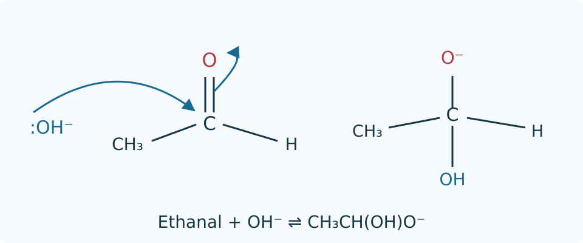
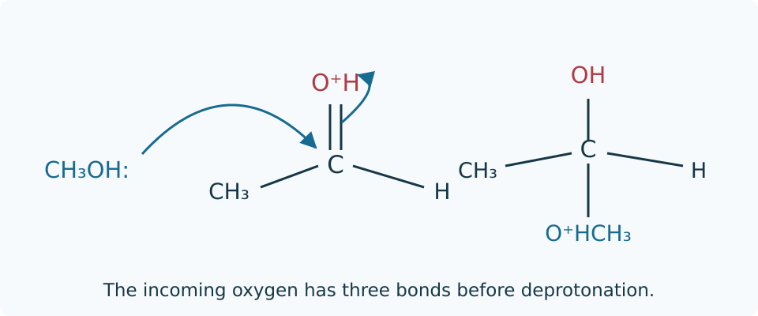
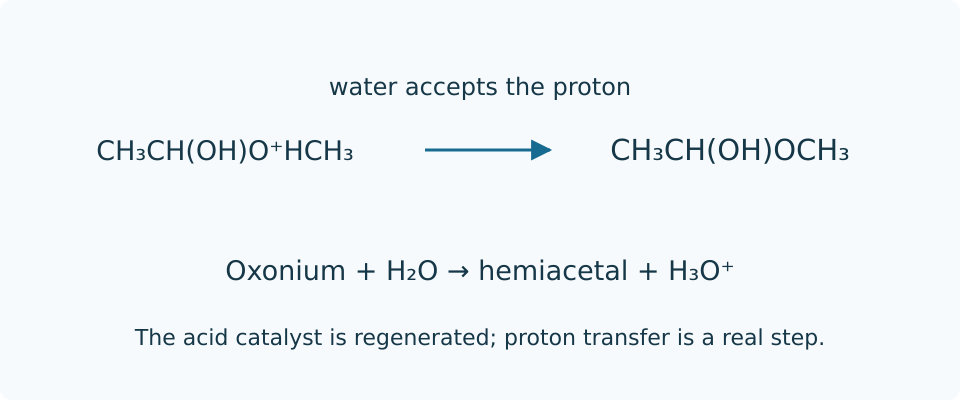
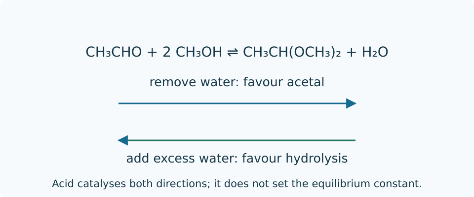

## What will you be able to explain?

- Explain why carbonyl carbon is electrophilic.
- Follow addition and proton-transfer steps.
- Recognise a hydrate, hemiacetal and acetal.

::: notes
Begin with the previous unit’s electron-pair and charge audit. Ask students to predict a product or bond change before displaying the worked drawing. These slides support discussion and paper drawing; the practice page supplies further explanations.
:::

## The carbonyl is polar and planar

{width=85% fig-alt="Ethanal has an oxygen-polarised carbonyl and approximately trigonal planar geometry at its carbonyl carbon."}

C=O polarity makes carbon electron-poor. Its π pair can move to oxygen when a nucleophile adds.

::: notes
Partial charges are not formal charges. The neutral starting carbonyl has no formal positive carbon even though the carbon is electrophilic.
:::

## Addition changes carbon geometry

{width=85% fig-alt="Hydroxide adds to ethanal, giving a tetrahedral intermediate with alkoxide oxygen and a newly attached OH."}

Two coupled arrows form C–O and move the C=O π pair to oxygen. The total charge remains −1.

::: notes
The carbon has four single bonds after addition. The original carbonyl oxygen bears the negative charge. Check atom identity rather than treating both oxygens as interchangeable.
:::

## Proton transfer completes the hydrate

{width=85% fig-alt="Water transfers a proton to the alkoxide, giving a geminal diol and regenerating hydroxide."}

The net reaction is carbonyl + water ⇌ hydrate. The base participates in the pathway and is regenerated.

::: notes
Not every carbonyl is mostly hydrated at equilibrium. Substituents and conditions affect the equilibrium; mechanism and product proportion are different questions.
:::

## Acid can activate the oxygen first

{width=85% fig-alt="A carbonyl oxygen lone pair accepts a proton from hydronium, producing protonated carbonyl and water."}

Protonating oxygen increases carbonyl electrophilicity. Neutral water or alcohol can then be the attacking nucleophile.

::: notes
Avoid drawing a strongly basic nucleophile freely coexisting in excess strong acid. For this route use neutral nucleophiles and explicit proton transfers.
:::

## An alcohol oxygen supplies a pair

{width=85% fig-alt="Methanol attacks the protonated carbonyl; the pi pair moves to oxygen, and the incoming methanol oxygen becomes oxonium."}

The new tetrahedral species has OH and O⁺HCH₃ attached to the same carbon.

::: notes
An incoming neutral oxygen changes from two to three bonds and acquires positive charge. The formerly protonated carbonyl oxygen becomes neutral OH after its pi pair returns.
:::

## Deprotonate the incoming oxygen

{width=85% fig-alt="Water accepts a proton from the methoxy oxonium group, forming a neutral hemiacetal and hydronium."}

A hemiacetal has **OH and OR attached to the same carbon**. The acid catalyst is regenerated.

::: notes
Do not remove the proton from the wrong atom without considering the resulting structure. Ask students to label original carbonyl oxygen and incoming alcohol oxygen.
:::

## One substitution changes the class

{width=85% fig-alt="A hemiacetal carbon has one OH and one OR group; an acetal carbon has two OR groups."}

A second alcohol can ultimately give an acetal under acid catalysis, with water formed. Additional steps are required.

::: notes
The left/right diagrams compare product classes; they do not represent a single elementary OH-to-OR substitution. Students are required to understand the hemiacetal steps first.
:::

## Conditions control the equilibrium mixture

{width=85% fig-alt="The acetal equilibrium can be shifted toward acetal by removing water or toward hydrolysis using excess water under acid catalysis."}

Acid speeds both directions. Changing composition can shift the equilibrium mixture; catalysis alone does not change K.

::: notes
This is a composition argument, not an experimental recipe. Do not describe an equilibrium arrow as proof of equal concentrations.
:::

## An internal OH can close a ring

{width=85% fig-alt="The terminal alcohol of 5-hydroxypentanal can add to its aldehyde to form a six-membered cyclic hemiacetal."}

Intramolecular addition conserves the molecular formula. The ring includes the attacking oxygen and the original carbonyl carbon.

::: notes
Count the six ring atoms: oxygen plus five carbons. This provides a chemical bridge to sugar rings without assuming carbohydrate biochemistry.
:::

## Ask what else is bonded to carbonyl carbon

{width=85% fig-alt="An aldehyde bears H at its carbonyl carbon, while an ester bears OR that can participate in an addition–elimination pathway."}

Aldehydes and ketones ordinarily retain their H/carbon substituents during addition. Acyl derivatives introduce leaving-group chemistry next.

::: notes
Do not imply that alkoxide departs freely from every tetrahedral intermediate. Protonation state, leaving-group ability and conditions determine the viable pathway.
:::

## Same pattern, different nucleophiles

Water gives a hydrate; an alcohol can give a hemiacetal; a hydride equivalent gives an alcohol after proton donation.

Locate the new bond in each product. Keep reagent scope and conditions explicit.

## A mechanism and an equilibrium answer different questions

The mechanism accounts for the path and intermediates. The equilibrium describes the relative amounts of species under stated conditions.

Drawing an accessible hydrate does not prove it is the major species.

## Account for each oxygen

Start with CH₃CHO and CH₃OH. Label the aldehyde oxygen A and alcohol oxygen B.

In the hemiacetal, which is OH and which is OCH₃? What would be wrong with exchanging their atom labels without an extra process?

## Use the same reasoning in practice

Complete the [practice and worked examples](exercise.qmd), then the [self-check](quiz.qmd).

Optional textbook support: selected Solomons chapter 16 sections. The [reading guide](../reference/reading.qmd) explains the provisional book mapping.
