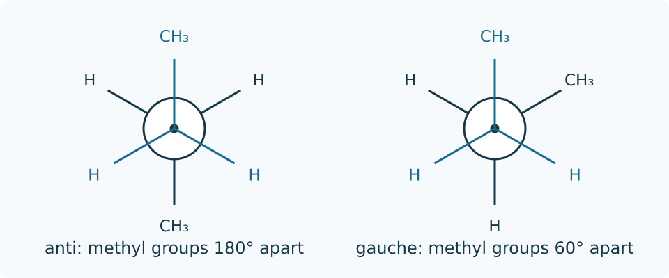

Allow 75–90 minutes for molecular-model and drawing tasks, plus 35 minutes for
the optional guided numerical model. Build a physical model if one is available;
a carefully labelled drawing can also support the comparison.

## 1. Say what your eye sees

Draw CH₃CH₂CH₂CH₃ and number the carbon chain C1 to C4. Look along the C2–C3
bond **from C2 toward C3**. Draw a Newman projection, naming the front and rear
carbons. Each of those carbons bears one CH₃ and two H substituents. Start with
the front CH₃ at twelve o'clock and place the rear CH₃ at six o'clock.
What is the dihedral angle between the two methyl groups?

::: {.callout-tip collapse="true" title="Hint"}
The front carbon is a dot. The rear carbon is the surrounding circle. The
three bonds from each carbon are separated by 120° in its own projected set.
:::

::: {.callout-note collapse="true" title="Worked check"}
C2 is the front carbon and C3 the rear. Front CH₃ is C1; rear CH₃ is C4.
With front CH₃ at twelve and rear CH₃ at six, the methyl-group dihedral is
180°, the anti arrangement. The other rear bonds lie at two and ten o'clock
and the other front bonds at four and eight o'clock, giving a staggered view.
:::

## 2. Produce gauche without making a new connectivity

Keep the front substituents fixed and turn the rear set by 120°. Draw both
possible resulting gauche arrangements and label the methyl–methyl dihedral.
Then draw an eclipsed view. Which operations changed connectivity? Which
staggered butane arrangement is normally lower in energy, anti or gauche?

::: {.callout-note collapse="true" title="Worked check"}
Starting from anti, rear rotations of ±120° place the rear methyl at two or
ten o'clock, giving ±60° methyl–methyl dihedrals relative to the front methyl.
They are gauche arrangements. Eclipsed sets have aligned front/rear bonds.
None of these rotations changes connectivity. Anti is lower in energy than
gauche for butane, although both are populated and interconvert.
:::

{fig-alt="Butane Newman projections show the methyl groups anti and gauche."}

## 3. Read a qualitative energy profile

Use the [lecture's torsional plots](lec.qmd) to identify minima and maxima.
Explain why the ethane minima repeat every 120° and why not all butane minima
are equivalent. Can the qualitative vertical scale tell you a numerical
Boltzmann population? Does the lowest point show the energy of a transition
state?

::: {.callout-note collapse="true" title="Worked check"}
Ethane's three equivalent H substituents give three equivalent staggered
minima in a full turn. In butane, anti and gauche differ in how the larger
methyl groups approach each other. The vertical scale is qualitative and
cannot supply a numerical free-energy difference for population calculations.
A minimum corresponds to a relatively stable conformation, not a transition
state. The barrier between minima concerns how the interconversion proceeds.
:::

## 4. Follow a substituent through a chair flip

Draw or build methylcyclohexane with methyl axial and up. Carry out a complete
chair flip, following all six ring carbons. Label the methyl group in the
second chair using both axial/equatorial and up/down. Repeat for an axial-down
substituent. Why would changing axial-up directly to axial-down be the wrong
rule for a chair flip?

::: {.callout-tip collapse="true" title="Hint"}
Mark each carbon and its up bond before moving the model. The word axial
is not a synonym for up; there are axial bonds on both sides of the ring.
:::

::: {.callout-note collapse="true" title="Worked check"}
Axial-up methyl becomes equatorial-up. Axial-down becomes equatorial-down.
A ring flip exchanges axial and equatorial positions while preserving the
up/down relationship and the configuration. Replacing axial-up by axial-down
would reverse the substituent's side of the ring and is not the same operation.
For methylcyclohexane, the equatorial-methyl chair is favoured because it avoids
unfavourable 1,3-diaxial interactions, though both chairs remain possible.
:::

## 5. R task: turn supplied free energies into a population

**Question:** in a deliberately simplified two-state model, how much of each
conformer would be present at equilibrium? The file `data/conformers.csv`
contains relative free energies, ΔG, in **J/mol**, for A and B: 0 and 3500.
These values are supplied teaching values and already include any degeneracy;
they are not measured energies for the qualitative butane curve above.

At temperature $T=298.15$ K and $R=8.314462618$ J/(mol K), use
$w_i=\exp[-\Delta G_i/(RT)]$ and $p_i=w_i/\sum_jw_j$.
The ratio in the exponent is dimensionless. A is the lower-free-energy state,
so predict A will have more than half the population.

```r
library(readr)
library(dplyr)
library(ggplot2)
conformers <- read_csv("data/conformers.csv", show_col_types = FALSE) |>
  mutate(weight = exp(-delta_G_J_mol / (8.314462618 * 298.15)),
         fraction = weight / sum(weight))
knitr::kable(conformers, digits = 4)
ggplot(conformers, aes(conformer, fraction)) +
  geom_col(fill = "#176b91") +
  labs(x = "Conformer", y = "Predicted equilibrium fraction") +
  theme_minimal()
sum(conformers$fraction)
```

Add the result to your Rmd report. Check the sum and the direction. As a
transfer task, replace 3500 with 0 in a copied data object, predict the answer
and recompute. Then set both input energies 1000 J/mol higher, keeping their
difference unchanged. What happens to the normalised fractions?

::: {.callout-note collapse="true" title="Numerical and model check"}
At 298.15 K, A has fraction about 0.804 and B about 0.196 (rounding depends on
constants). Equal free energies give equal fractions. Adding the same constant
to both energies multiplies every weight by the same factor, which cancels
on normalisation, leaving fractions unchanged. The calculation assumes the
two states adequately describe the system at equilibrium. It does not predict
the speed of rotation; an activation free energy would be needed for rates.
:::

## Leave with

Labelled Newman projections, a chair flip that preserves up/down, and a report
figure that separates a numerical model from a qualitative sketch. Finish the
[self-check](quiz.qmd). Provisional reference: selected Solomons chapter 4
sections; see the [reading guide](../reference/reading.qmd).
