## About this lecture

**Glucose** is the most common sugar on Earth. It's what cellulose, starch and your blood sugar are built from. Of the eight sugars in its family (the D-aldohexoses), it's the only one whose ring can put **every** OH group in a relaxed, uncrowded position. That's no coincidence, and by the end of today you'll be able to see why.

Today we learn how molecules change shape without breaking bonds:

- **Conformers:** shapes reached by turning a single bond
- **Newman projections:** looking straight down a C–C bond
- **Energy profiles:** why staggered beats eclipsed, and anti beats gauche
- **Populations:** turning an energy gap into "how much of each"
- **Cyclohexane chairs:** axial, equatorial and the ring flip

Last time (Day 3) we followed protons. Today we keep every bond and follow the **shape**.

::: notes
Open with glucose. Ask: why would nature settle on this particular sugar? There are many reasons, but one is shape. In its chair, β-glucose has all five big substituents pointing outward around the rim, with nothing crowding anything else. We'll draw that chair at the very end, so the opening question gets answered by the students themselves. Frame the day as "3D thinking": a skeletal drawing tells you connectivity, but molecules are floppy 3D objects. Rotation about single bonds happens billions of times a second at room temperature. Today is about which shapes are preferred and by how much. Tomorrow (stereochemistry) is about 3D differences that can't be undone by rotation.
:::

## Same molecule, many shapes

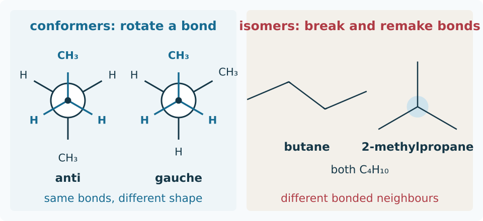{width=80% fig-alt="Left: anti and gauche butane as Newman projections, labelled conformers. Right: butane and 2-methylpropane skeletal structures, labelled constitutional isomers, both C4H10"}

Turning a **C–C single bond** changes the shape but keeps every bonded neighbour. Those shapes are **conformers**: one molecule, not isomers. Butane and 2-methylpropane have different neighbours, so they're **constitutional isomers**.

::: notes
The key test is connectivity. Trace the carbon chain in anti and gauche butane: C1–C2–C3–C4 in both, nothing broken. To get from butane to 2-methylpropane you'd have to break a C–C bond and make a new one, which is a chemical reaction. Conformers interconvert in a fraction of a nanosecond at room temperature, so you can't put anti-butane in one bottle and gauche-butane in another. Probe the misconception "different drawing = different compound". Ask: "If I rotate my model, have I made a new compound?" No.
:::

## Pick a bond, then pick where your eye is

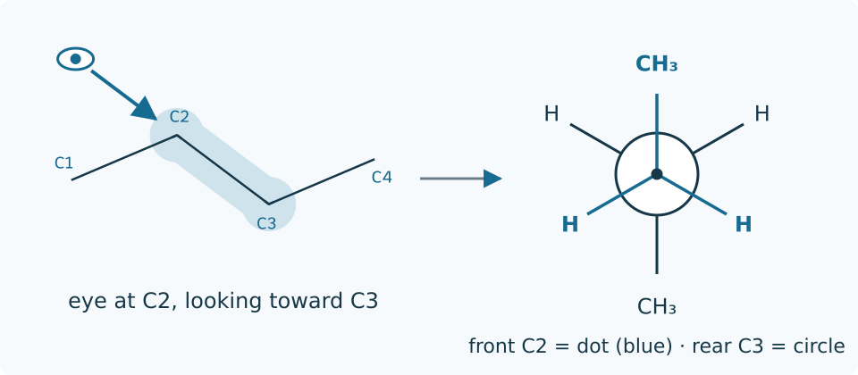{width=78% fig-alt="Butane with carbons numbered C1 to C4 and an eye looking from C2 toward C3, next to the resulting Newman projection with the front carbon as a dot and the rear carbon as a circle, methyl groups at top and bottom"}

In a **Newman projection** you look straight down one bond. The **front carbon** is the dot where its three bonds meet; the **rear carbon** is the circle, with bonds coming out from behind it.

::: {.try}
**Try it:** you now look from C3 toward C2 instead. Which carbon is the dot?

::: {.fragment}
**C3.** Whichever carbon is nearer your eye is the front carbon, so the roles swap and you have to redraw both groups of three.
:::
:::

::: notes
Always say out loud which bond and which direction: "along C2 to C3". Each carbon on that bond has three other groups: C2 has C1 (a methyl) and two H; C3 has C4 (a methyl) and two H. Students often forget the H atoms or draw all six groups on one carbon. Encourage a physical model here if you have them: hold the model so you look down the bond, and the Newman projection is literally what you see. In this drawing the methyls point in opposite directions, which is the anti conformer we'll meet properly in a moment.
:::

## Staggered and eclipsed

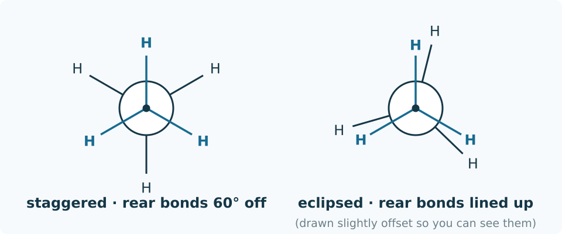{width=72% fig-alt="Newman projections of ethane: staggered with rear bonds 60 degrees from the front bonds, and eclipsed with rear bonds lined up behind the front bonds"}

- **Staggered:** rear bonds sit between front bonds, **60°** apart.
- **Eclipsed:** rear bonds hide behind front bonds, **0°** apart. We draw them slightly offset so you can see them.

The angle between a front bond and a rear bond is the **dihedral angle**.

::: notes
Ethane is the simplest case because all six groups are H. Turning the rear carbon by 60° goes from staggered to eclipsed, another 60° gives staggered again. Point out that eclipsed H atoms only overlap on the page; they're on different carbons, about 2.3 Å apart in space, and they don't bond to each other. The dihedral angle is the angle you'd measure on the Newman face between a chosen front bond and a chosen rear bond. It's the x-axis of every energy plot today.
:::

## Ethane's energy as it turns

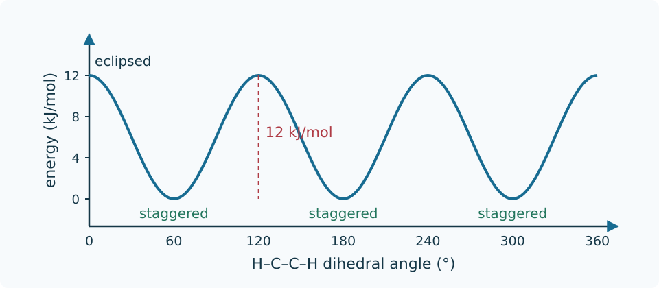{width=72% fig-alt="Energy versus H–C–C–H dihedral angle for ethane: a smooth curve with maxima of 12 kJ/mol at 0, 120, 240 and 360 degrees (eclipsed) and minima at 60, 180 and 300 degrees (staggered)"}

Eclipsed costs about **12 kJ/mol** (**torsional strain**, roughly 4 per H/H pair). A full turn passes **three identical staggered minima**, at 60°, 180° and 300°.

::: {.try}
**Try it:** is every single bond free to rotate?

::: {.fragment}
**No.** There's always some barrier, rings lock bonds in place, and some "single" bonds have partial double-bond character, like the C–N bond of amides (Week 4).
:::
:::

::: notes
12 kJ/mol is small compared with thermal energy at room temperature, so ethane rotates billions of times per second. That's why we call it "free rotation", but free is relative. The staggered minima are equivalent because every substituent is H, so they're identical in energy. Ask students to read the minima off the axis: 60, 180, 300. Students who have a curve with only one minimum have forgotten that the rear carbon has three equivalent bonds. The torsional strain is the extra energy from bonding electron pairs being lined up; the textbook explanation is electron repulsion plus loss of a stabilising orbital overlap, but the number is what matters today.
:::

## Butane: one full turn

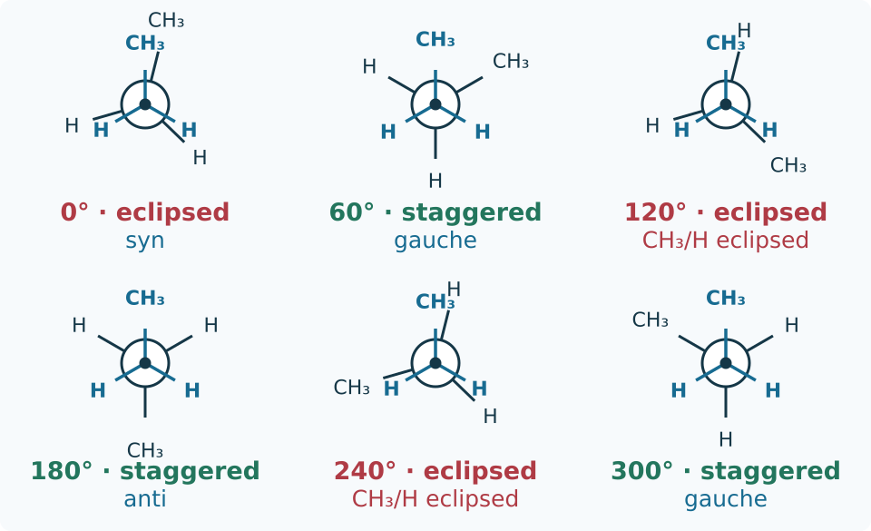{width=60% fig-alt="Six Newman projections of butane along C2–C3 with the front methyl at twelve o'clock and the rear methyl at 0, 60, 120, 180, 240 and 300 degrees: syn eclipsed, gauche, methyl/H eclipsed, anti, methyl/H eclipsed, gauche"}

Hold the front CH₃ at 12 o'clock and turn the rear carbon. Track the **two CH₃ groups**: **anti** puts them at 180°, **gauche** at ±60°. Both are staggered.

::: {.try}
**Try it:** how many gauche minima are there in one full turn?

::: {.fragment}
**Two,** at +60° and −60° (300°). They're mirror images with equal energy, but they're distinct conformations.
:::
:::

::: notes
Hold the front methyl at 12 o'clock and only turn the rear carbon, in 60-degree steps. This is the procedure for exercises 2 to 4. A common mistake is to think "staggered" means "anti". Gauche is staggered too: no bonds eclipse, but the two methyls are only 60° apart. Count the eclipsed views: one has the methyls on top of each other (syn, 0°), and two have a methyl eclipsing an H (120° and 240°). The two gauche forms are mirror images, a little preview of tomorrow.
:::

## Butane: what each crowding costs

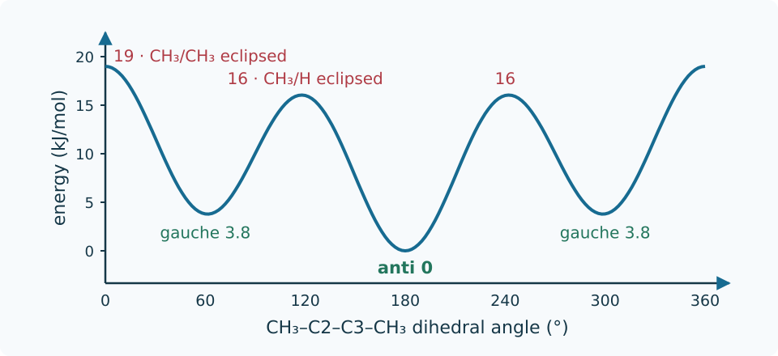{width=62% fig-alt="Energy versus methyl dihedral for butane: anti at 180 degrees is 0, gauche at 60 and 300 degrees is 3.8, methyl/H eclipsed at 120 and 240 is 16 and methyl/methyl eclipsed at 0 is 19 kJ/mol"}

| interaction | cost (kJ/mol) |
|---|---|
| H/H eclipsed | 4 |
| CH₃/H eclipsed | 6 |
| CH₃/CH₃ eclipsed | 11 |
| CH₃/CH₃ gauche | 3.8 |

::: notes
The costs add up. At 0°: two H/H plus one CH3/CH3 eclipsed, 4 + 4 + 11 = 19. At 120°: one H/H plus two CH3/H, 4 + 6 + 6 = 16. Have students verify one of these themselves. Gauche costs 3.8 kJ/mol even though nothing is eclipsed. That's steric strain: the two methyls are close enough to bump. Anti is the global minimum because it puts the two biggest groups as far apart as possible. In Week 3 (elimination) you'll need the anti arrangement again: E2 eliminations need the H and the leaving group anti to each other.
:::

## Lower energy means more, not all

$$w = e^{-\Delta G/RT} \qquad \text{fraction} = \frac{w}{\sum w}$$

| state | ΔG (J/mol) | ΔG/RT | weight w | fraction |
|---|---|---|---|---|
| A | 0 | 0 | 1 | 1/1.244 = **0.804** |
| B | 3500 | 1.412 | 0.244 | 0.244/1.244 = **0.196** |

At 298.15 K, **RT = 8.314 × 298.15 ≈ 2479 J/mol**. ΔG and RT must use the **same units**, so ΔG/RT has none.

::: {.try}
**Try it:** what's the weight of the state with ΔG = 0?

::: {.fragment}
**exactly 1,** because e⁰ = 1. The reference state always has weight 1. The weights don't sum to 1 until you normalise them.
:::
:::

::: notes
This is the calculation in the R task, done by hand once. Walk through the three steps: divide by RT, exponentiate the negative, divide by the sum. The classic unit error is using ΔG in kJ/mol with R in J/(mol K): 3.5/2479 gives a weight of practically 1 and a meaningless 50/50 answer. The other classic error is calling the weights "fractions" before normalising. These ΔG values are a supplied two-state teaching model and already include any degeneracy (both gauche forms are rolled into state B). So don't multiply by two again. That's exercise 20.
:::

## How the energy gap shifts the balance

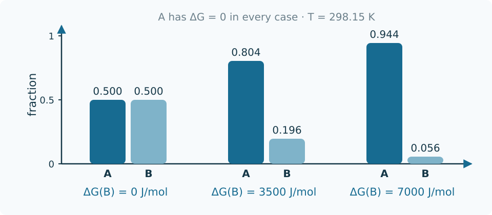{width=70% fig-alt="Bar chart of two-state fractions at 298 K: gap 0 gives 0.5 and 0.5; gap 3500 J/mol gives 0.804 and 0.196; gap 7000 J/mol gives 0.944 and 0.056"}

Equal energies give **50/50**. A bigger gap tilts the balance more, but a finite gap never makes the minor state **zero**.

::: {.try}
**Try it:** add 1000 J/mol to **both** states. Do the fractions change?

::: {.fragment}
**No.** Both weights get the same factor e^(−1000/RT), which cancels on normalising. Only the energy **difference** matters.
:::
:::

::: notes
Read the three pairs left to right. Doubling the gap from 3500 to 7000 doesn't double the minor fraction's drop; it's exponential. Every 5.7 kJ/mol at room temperature is a factor of ten. Stress that "disfavoured" isn't "absent": even at a 7000 J/mol gap there's about 6% of B. The common-offset question tests whether students understand that energies are relative. Picking a different zero can't change any physical prediction.
:::

## Equilibrium and rate are different questions

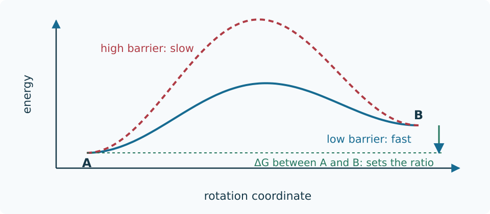{width=70% fig-alt="Two energy curves from A to B with the same energy gap between A and B: a low barrier labelled fast and a high dashed barrier labelled slow"}

The **gap between A and B** sets the equilibrium ratio. The **barrier between them** sets how fast they interconvert.

::: {.try}
**Try it:** two molecules have the same ΔG between conformers but different barriers. Same rotation rate?

::: {.fragment}
**No.** Same ratio at equilibrium, but the one with the higher barrier interconverts more slowly.
:::
:::

::: notes
Point at the two curves: they start and finish at the same heights, so the equilibrium mixture is identical. Only the hill between them differs. A population calculation tells you nothing about speed. This distinction comes back in every kinetics discussion in Weeks 3 and 4, where reaction barriers (activation energies) decide what happens fast. Ask: "If I lower the barrier with a catalyst, does the ratio change?" No, only how fast it's reached.
:::

## Rings: a flat drawing isn't a flat molecule

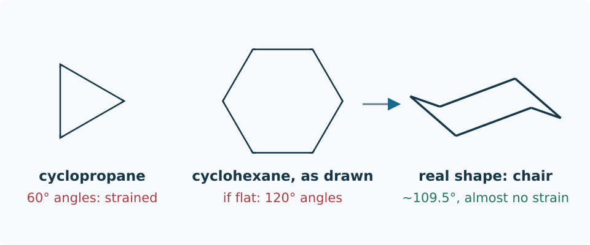{width=92% fig-alt="Cyclopropane with 60 degree angles labelled strained; a flat cyclohexane hexagon labelled if flat 120 degree angles; and the chair shape of cyclohexane labelled about 109.5 degrees, almost no strain"}

Rings stop full rotation. Cyclopropane has to be flat, so its **60°** angles are badly strained. Cyclohexane puckers into a **chair**, where every angle is close to tetrahedral and every C–H is staggered.

::: notes
The hexagon in a skeletal drawing only states connectivity: six carbons in a ring. If cyclohexane were really flat, its angles would be 120°, too wide for sp3 carbon, and every C–H would be eclipsed. By puckering, it gets roughly 111° angles and fully staggered bonds, so it's essentially strain-free. That's why six-membered rings are everywhere in nature: sugars, steroids, many drugs. Cyclopropane can't pucker, so it carries large angle strain and is unusually reactive. No need to memorise strain energies.
:::

## The chair: axial and equatorial

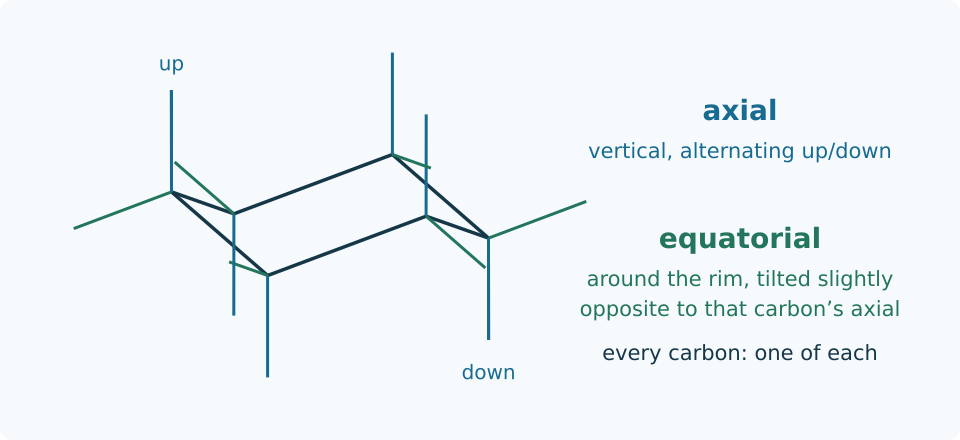{width=72% fig-alt="Chair cyclohexane with six vertical axial bonds in blue alternating up and down, and six equatorial bonds in green pointing out around the rim"}

Each carbon has one **axial** bond (vertical, alternating up and down around the ring) and one **equatorial** bond (out around the rim, tilted slightly the other way).

::: {.try}
**Try it:** does "equatorial" mean "down"?

::: {.fragment}
**No.** Equatorial bonds point up on some carbons and down on others. Axial/equatorial is the bond's direction; up/down is which face of the ring it's on.
:::
:::

::: notes
Two separate labelling systems, and students mix them up every year. Axial/equatorial describes the bond direction in this particular chair. Up/down describes which face of the ring the group is on, and that's fixed by the molecule's configuration. On a carbon whose axial bond points up, the equatorial bond tilts slightly down, and vice versa. Practise drawing the chair: two parallel long bonds, then the tips; axial bonds are all vertical; equatorial bonds are parallel to the ring bond once removed. Have students try drawing one now.
:::

## The ring flip

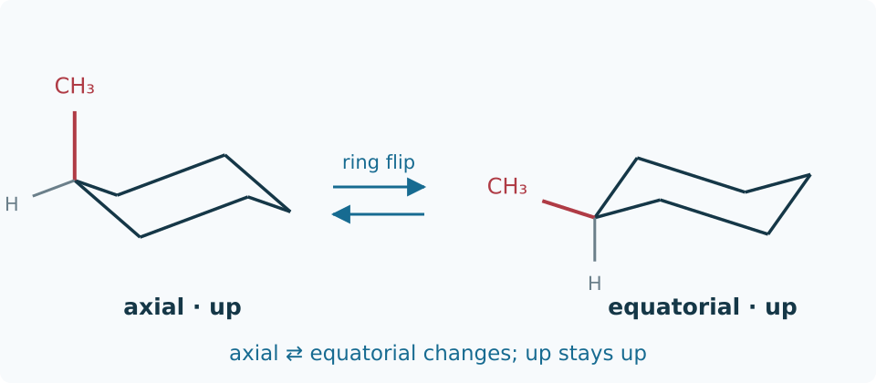{width=72% fig-alt="Methylcyclohexane chair with the methyl axial and up, an equilibrium arrow labelled ring flip, and the flipped chair with the same methyl equatorial and still up"}

A chair can flip into the other chair by turning bonds only. Every **axial** group becomes **equatorial** (and back), but **up stays up**.

::: {.try}
**Try it:** an axial-**down** group goes through a ring flip. Where does it end up?

::: {.fragment}
**Equatorial-down.** The flip swaps axial and equatorial, never up and down.
:::
:::

::: notes
The flip is a conformational change: no bonds break, and at room temperature cyclohexane flips about 100,000 times a second. Follow the same carbon through the flip. The ring tip that pointed up now points down, so its axial bond points down too; the methyl, which can't change faces, moves into the equatorial slot that still points up. Students often "flip" by mirroring one bond on paper, which turns up into down. Insist they track the whole ring. Exercises 10 and 11 practise both directions.
:::

## Why big groups go equatorial

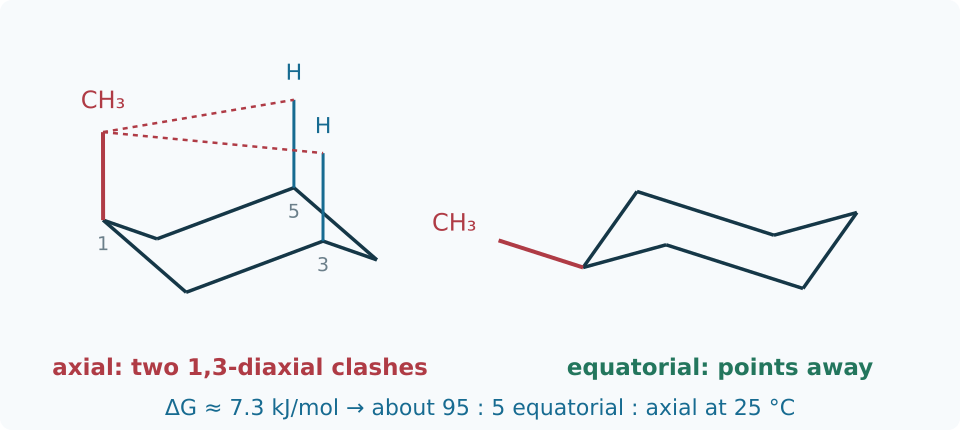{width=84% fig-alt="Axial methylcyclohexane with dashed lines from the methyl to the axial hydrogens on C3 and C5, labelled 1,3-diaxial clashes, beside the equatorial chair with the methyl pointing away"}

An **axial** methyl crowds the axial H atoms on C3 and C5: **1,3-diaxial interactions**. Equatorial is lower by about **7.3 kJ/mol**, so w = e^(−7300/2479) ≈ 0.053, giving **about 95 : 5** at 25 °C.

::: notes
The axial methyl points straight up alongside two other axial H atoms on the same face. Each of those contacts is basically a gauche butane interaction, and 2 × 3.8 is about 7.6, close to the measured 7.3. That's a nice link back to the butane slide. Then use today's population formula: weight 0.053 relative to 1, so roughly 95% equatorial. Emphasise again: preferred, not exclusive. Bigger groups have bigger preferences: a tert-butyl group is so large that it is effectively locked equatorial.
:::

## Cis and trans survive a ring flip

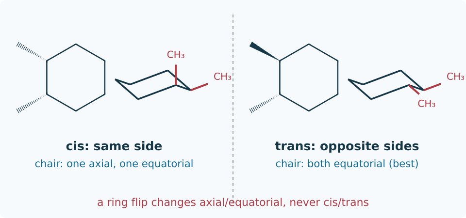{width=80% fig-alt="cis-1,2-dimethylcyclohexane drawn with both methyls hashed and as a chair with one axial and one equatorial methyl, and trans-1,2-dimethylcyclohexane with one wedge and one hash and as a chair with both methyls equatorial"}

**Cis** = both groups on the same face (up/up or down/down); **trans** = opposite faces. A ring flip changes axial and equatorial, but never the faces.

::: {.try}
**Try it:** a pair of groups is cis in one chair. Can the ring flip make it trans?

::: {.fragment}
**No.** Each group keeps its face, so cis stays cis. Turning cis into trans means breaking a bond: that's a different stereoisomer, which is tomorrow's topic.
:::
:::

::: notes
In cis-1,2-dimethylcyclohexane one methyl is always axial and one equatorial; flipping just swaps which one. In the trans isomer the two chairs are diequatorial or diaxial, and the diequatorial one is strongly preferred. Note the wedge drawing on the left shows both methyls hashed (both down) while the chair shows both up. That's the same molecule seen from the other side; cis just means "same side". Use this to bridge to stereochemistry: cis/trans is configuration, which no rotation can change, while axial/equatorial is conformation.
:::

## Back to glucose

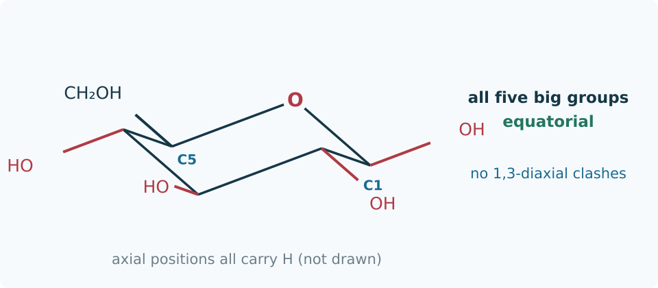{width=92% fig-alt="Chair of beta-D-glucose with the ring oxygen, the four OH groups and the CH2OH group all in equatorial positions; axial positions carry hydrogen"}

In **β-D-glucose** all five big groups, the four OH groups and the CH₂OH, sit **equatorial**. Every axial position holds a small H, so there are **no 1,3-diaxial clashes**.

::: notes
Close the loop with the opening question. Point at each substituent and ask the room: axial or equatorial? All equatorial. The alternating up/down pattern of the OH groups in glucose is exactly what lets them all be equatorial at once. Other six-carbon sugars, such as galactose or mannose, have to put at least one OH axial. Biology builds cellulose, starch and glycogen from this low-strain building block. The detailed sugar chemistry comes later; today the point is that you can now read strain straight off a chair.
:::

## Mistakes we see every year

| mistake | fix |
|---|---|
| calling anti and gauche butane isomers | same neighbours: they're **conformers** |
| "staggered" taken to mean "anti" | gauche is **staggered** too |
| forgetting the H atoms on the rear carbon | each carbon has **three** groups |
| flipping a chair and turning up into down | a flip swaps **axial/equatorial** only |
| ΔG in kJ/mol divided by R in J/(mol K) | use the **same units** |
| calling weights "fractions" | **divide by the sum** first |
| "the axial conformer is absent" | lower population, **not zero** |
| using population to predict speed | rate depends on the **barrier** |

::: notes
Read each mistake and ask the room for the fix before revealing the row. Every row maps onto exercises: conformers versus isomers (exercise 8), the Newman problems (1 to 7), chair flips (10 to 13), and the population model (15 to 20 and the R task).
:::

## Summary

| concept | key fact |
|---|---|
| conformer | same bonds, different shape by **rotation** |
| Newman projection | front = dot, rear = circle |
| ethane | staggered minima, eclipsed **+12 kJ/mol** |
| butane | anti < gauche (3.8) < eclipsed (16, 19) |
| population | w = e^(−ΔG/RT), then divide by the sum |
| equilibrium vs rate | gap sets the ratio, barrier sets the speed |
| chair | one axial + one equatorial per carbon |
| ring flip | axial ⇄ equatorial; up stays up |
| big substituents | prefer **equatorial** (1,3-diaxial) |

**Next:** stereochemistry, the 3D differences no rotation can undo (Day 7). **Practice:** [exercises](exercise.qmd) · [self-check](quiz.qmd)

::: notes
The summary is the revision sheet. Recite the two procedures once: for Newman, name the bond and direction, draw front groups on the dot, rear groups on the circle, then turn the rear carbon in 60° steps. For chairs, draw the chair, place axial and equatorial bonds, and when flipping keep up as up. Tomorrow's lecture starts exactly where the cis/trans slide stopped: some differences in 3D need a bond to break before they can change. Point students to the R task: it's the population calculation from today, done for a whole table.
:::
