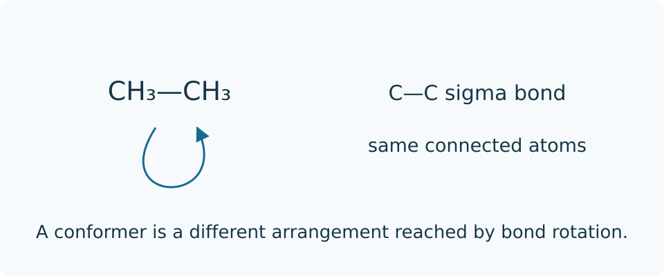
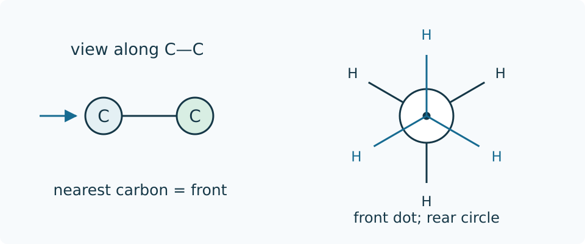
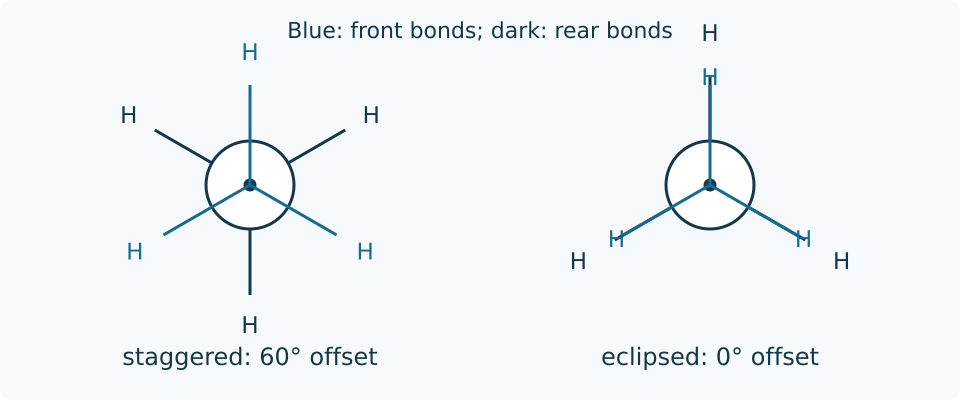
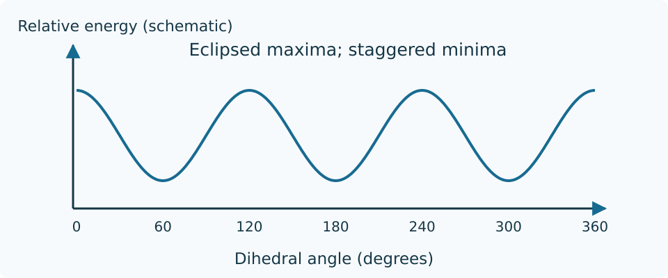
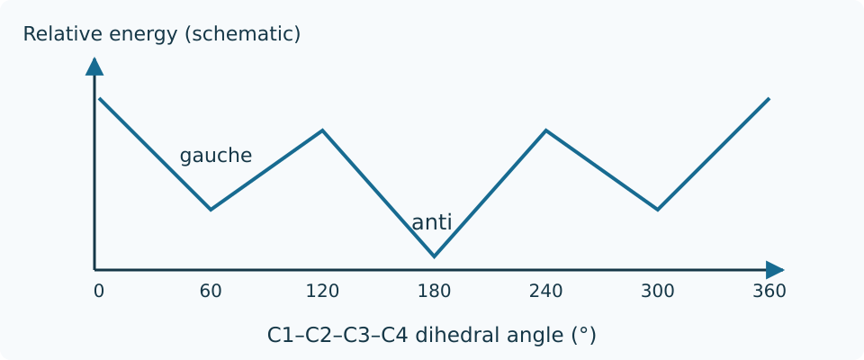
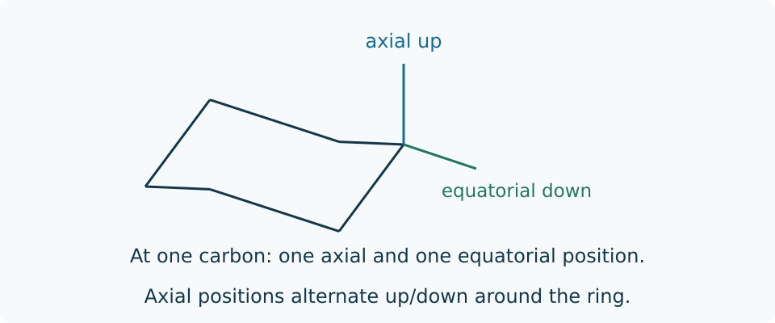
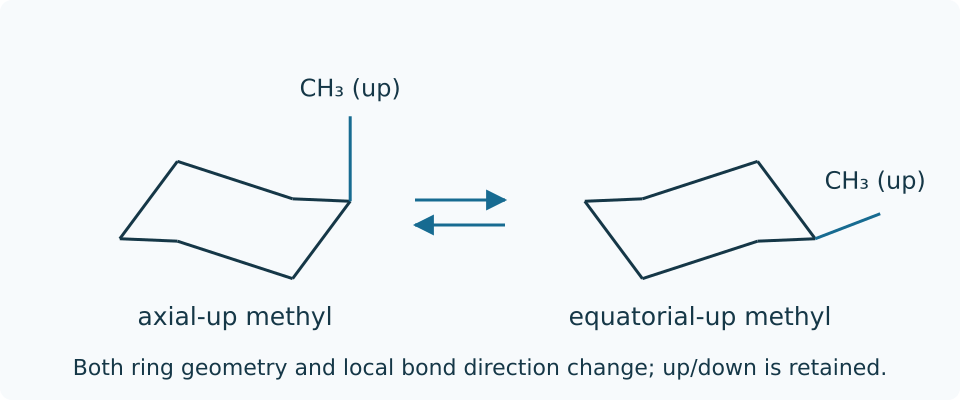

## What will you be able to explain?

- Draw a Newman projection along a stated bond.
- Distinguish staggered/eclipsed and anti/gauche arrangements.
- Explain a chair flip and inspect a supplied two-state population model.

::: notes
Begin with a model or two pen caps connected by a bond. Ask which atoms remain neighbours after turning one end. The R task is a guided numerical comparison, not a thermodynamics derivation.
:::

## Rotate a bond; keep the neighbours

{width=85% fig-alt="Rotation about the ethane carbon-carbon sigma bond preserves connectivity."}

Conformation changes can occur through bond rotation. Configuration changes require a different operation, often bond breaking.

::: notes
Do not claim every single bond rotates freely. Rings, steric interactions and partial double-bond character can restrict rotation.
:::

## State the viewing direction

{width=85% fig-alt="Looking along a CC bond gives a front dot and rear circle in a Newman projection."}

The front carbon is the one nearest your eye. Identify it before placing the substituents.

::: notes
Have students physically point along a model bond. Copying the page silhouette without specifying a view is a common source of error.
:::

## Compare the angular offset

{width=85% fig-alt="Ethane Newman projections compare staggered and eclipsed bond alignments."}

Staggered has a 60° offset between front and rear bonds. Eclipsed bonds align in the projection.

::: notes
Coincident bonds in an eclipsed projection do not represent a shared extra bond. Distinguish overlapping views from connectivity.
:::

## Rotation crosses an energy barrier

{width=85% fig-alt="A qualitative ethane torsional profile has eclipsed maxima and staggered minima."}

The conformers interconvert; lower energy does not mean a structure is permanently trapped.

::: notes
This curve is a qualitative energy model. Do not use its arbitrary vertical scale to infer a numerical population or rate.
:::

## Butane introduces distinct staggered arrangements

{width=85% fig-alt="Newman projections place the butane methyl groups 180 or 60 degrees apart."}

Anti and gauche describe the methyl-group dihedral angle here. Both arrangements are staggered.

::: notes
The terms do not replace front/back or R/S. Count the C1-C2-C3-C4 dihedral, not an arbitrary pair of H atoms.
:::

## Compare minima, not just shapes

{width=85% fig-alt="Qualitative butane profile places anti below gauche and methyl-methyl eclipsing highest."}

For butane, anti is lower than gauche. The profile also contains less favourable eclipsed arrangements.

::: notes
Keep qualitative electronic/steric reasoning at the intended level. A simplified energy profile is not a measured free-energy dataset.
:::

## A ring constrains the available motion

{width=85% fig-alt="Planar skeletal drawings of cyclopropane and cyclohexane show different ring connectivity."}

A flat polygon is a connectivity drawing. Cyclohexane is not normally a planar regular hexagon.

::: notes
Cyclopropane has substantial angle strain. Do not imply cyclohexane has no energetic differences among conformations.
:::

## Read axial and equatorial locally

{width=85% fig-alt="A cyclohexane chair with one axial and one equatorial direction at a selected carbon."}

Each carbon has an axial and an equatorial position. Axial positions alternate up and down around the ring.

::: notes
Students should not identify axial as up: there are axial-down positions too. Equatorial does not mean lying in the page.
:::

## A chair flip preserves up/down

{width=85% fig-alt="A schematic chair flip exchanges an up methyl substituent between axial and equatorial sites."}

Axial becomes equatorial and vice versa; an up substituent stays up. A ring flip does not invert the configuration.

::: notes
This diagram highlights local bond directions. Use a molecular model to complete the whole chair flip and preserve all six connected atoms.
:::

## Inspect a supplied free-energy model

{width=85% fig-alt="A two-conformer free-energy model gives unequal populations at 298.15 kelvin."}

Use relative free energies and a temperature to calculate weights. The lower-free-energy conformer is more populated.

::: notes
The supplied ΔG values already account for degeneracy. Do not import qualitative torsional energies from another figure as these numerical free energies.
:::

## The two-state calculation

For supplied relative free energies,
$w_i=\exp[-\Delta G_i/(RT)]$ and $p_i=w_i/\sum_j w_j$.

Use consistent J/mol and J/(mol K) units; temperature is kelvin.

## R continues a familiar workflow

```r
conformers <- readr::read_csv("data/conformers.csv")
conformers$weight <- exp(-conformers$delta_G_J_mol /
                           (8.314462618 * 298.15))
conformers$fraction <- conformers$weight / sum(conformers$weight)
```

Check that fractions sum to one.

## Explain a model boundary

An equilibrium population alone does not give the rate of interconversion.

Rates depend on activation barriers; populations depend on the free-energy difference between states.

## Practise with a physical or drawn model

Complete the [practice](exercise.qmd) and [self-check](quiz.qmd).

Provisional reference: selected Solomons chapter 4 sections; see the [reading guide](../reference/reading.qmd).
