## What should you be able to explain?

Read Newman projections, compare conformers, preserve up/down through a chair flip and inspect a supplied population model.

::: notes
45-minute budget: view/connectivity/Newman construction10 min including a90-second drawing; ethane and butane comparison9 min with two45-second predictions; chair labels and flips10 min including a2-minute model/drawing check; free-energy units and populations9 min including a90-second manual normalisation; equilibrium-versus-rate discussion4 min; integrated explanation/exit3 min. Total45 min; independent practice follows separately.

Use the slide pace flexibly: concrete worked operations deserve more time than brief resolved checks. The intended outcome is an explainable chemical argument,not a slide count.
:::

## Bring these tools into the room

Connectivity and ordinary valence remain fixed during the single-bond rotations considered here.

::: notes
Use a quick spoken diagnostic; do not spend an additional unscheduled revision block. Revisit a missing convention at its worked example.
:::

## Name the operation before the result

{width=82% fig-alt="Name the operation before the result"}

Rotation about a C–C sigma bond changes relative positions while retaining connected neighbours.

::: notes
Begin this chemical argument with the displayed structure. Ask for a concrete atom, bond, label or observation rather than the topic name. Keep the first prediction brief.
:::

## Choose a bond and viewing direction

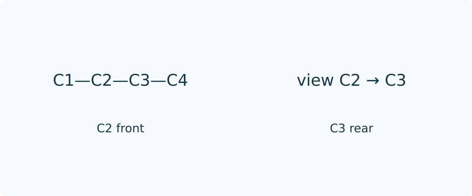{width=82% fig-alt="Choose a bond and viewing direction"}

Number butane C1–C4. Look from C2 toward C3, so C2 is front and C3 rear.

## Compare two drawings of the same connectivity

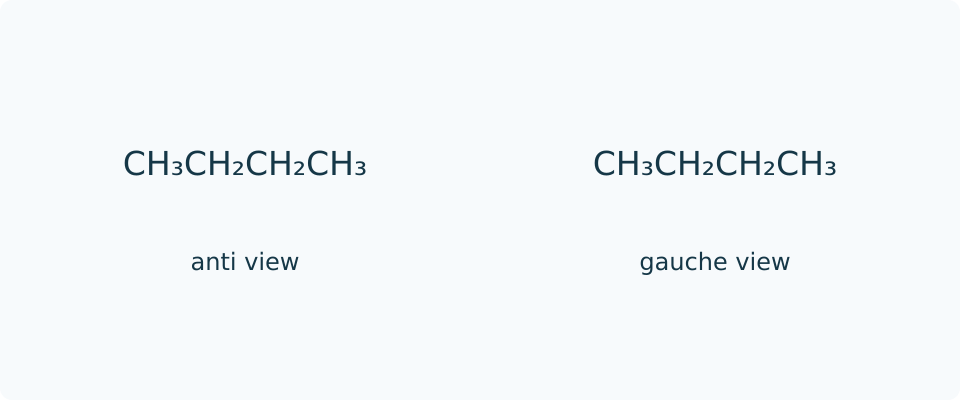{width=82% fig-alt="Compare two drawings of the same connectivity"}

Anti and gauche butane have identical condensed connectivity even though the spatial arrangements differ.

## Predict: must every single bond rotate freely?

Consider rings, steric barriers and partial double-bond character before answering.

::: notes
Give 15–20 seconds for an individual prediction or a small drawing. Ask one student to state the rule they used; resolve on the next slide within this same timed block.
:::

## Resolve: rotation can be restricted

Single bonds can have torsional barriers; rings constrain motion and conjugation can restrict rotation. “Single” is not “barrier-free”.

::: notes
Use the explicit answer to diagnose the named misconception. Move on once students can state the rule; the practice page provides further worked attempts.
:::

## Read a Newman projection from the eye outward

{width=82% fig-alt="Read a Newman projection from the eye outward"}

The central dot is front carbon; the circle denotes the rear carbon.

::: notes
Begin this chemical argument with the displayed structure. Ask for a concrete atom, bond, label or observation rather than the topic name. Keep the first prediction brief.
:::

## Inspect one staggered ethane view

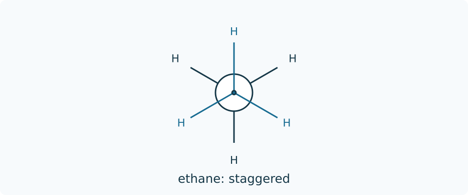{width=82% fig-alt="Inspect one staggered ethane view"}

Three front bonds and three rear bonds are offset by 60°. Count the H groups on both carbons.

## Inspect the eclipsed view

{width=82% fig-alt="Inspect the eclipsed view"}

Aligned projected bonds give a 0° offset. The H labels belong to different carbon atoms.

## Predict: reverse the viewing direction

If you look C3 toward C2 rather than C2 toward C3, which carbon becomes front?

::: notes
Give 15–20 seconds for an individual prediction or a small drawing. Ask one student to state the rule they used; resolve on the next slide within this same timed block.
:::

## Resolve: front and rear swap

C3 is now nearest the viewer. Redraw the complete spatial arrangement rather than copying only the page orientation.

::: notes
Use the explicit answer to diagnose the named misconception. Move on once students can state the rule; the practice page provides further worked attempts.
:::

## Place butane methyl groups opposite

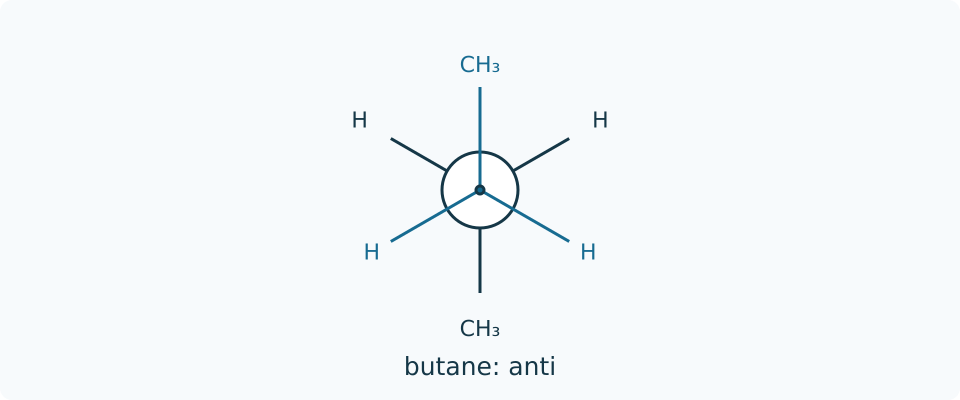{width=82% fig-alt="Place butane methyl groups opposite"}

For anti-butane, front CH₃ at twelve and rear CH₃ at six gives a 180° methyl dihedral.

## Place a methyl group at +60°

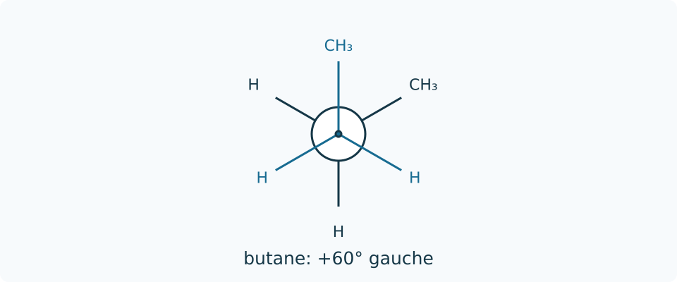{width=82% fig-alt="Place a methyl group at +60°"}

The gauche view remains staggered. The two larger substituents are closer than in anti.

## Predict: is every staggered butane conformer anti?

Use the methyl positions, not only the absence of eclipsed bonds.

::: notes
Give 15–20 seconds for an individual prediction or a small drawing. Ask one student to state the rule they used; resolve on the next slide within this same timed block.
:::

## Resolve: gauche is staggered too

Anti and both gauche arrangements are staggered minima, but their methyl-group dihedrals and relative energies differ.

::: notes
Use the explicit answer to diagnose the named misconception. Move on once students can state the rule; the practice page provides further worked attempts.
:::

## Count equivalent ethane minima

{width=82% fig-alt="Count equivalent ethane minima"}

A complete turn visits three equivalent staggered arrangements because all three substituents on each carbon are H.

::: notes
Begin this chemical argument with the displayed structure. Ask for a concrete atom, bond, label or observation rather than the topic name. Keep the first prediction brief.
:::

## Find the second gauche arrangement

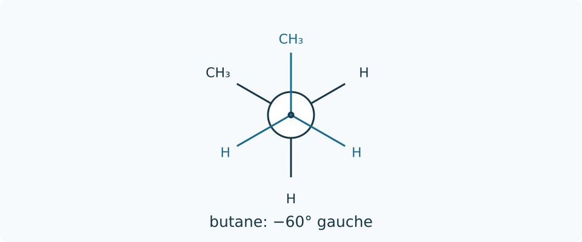{width=82% fig-alt="Find the second gauche arrangement"}

A −60° methyl dihedral gives the other gauche view of butane.

## Read maxima as barriers along the path

{width=82% fig-alt="Read maxima as barriers along the path"}

Eclipsed arrangements lie higher than neighbouring staggered ones in the qualitative profile.

## Eclipse the methyl groups directly

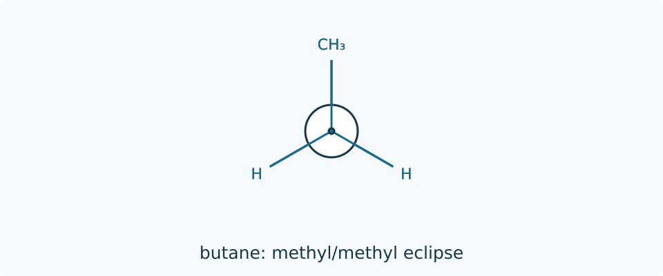{width=82% fig-alt="Eclipse the methyl groups directly"}

Methyl/methyl eclipsing is especially unfavourable in the butane comparison.

## Predict: can the qualitative vertical axis give a population?

No energy values, temperature or free-energy conventions are supplied on this illustrative profile.

::: notes
Give 15–20 seconds for an individual prediction or a small drawing. Ask one student to state the rule they used; resolve on the next slide within this same timed block.
:::

## Resolve: not a numerical equilibrium ratio

The curve supports relative-energy reasoning only. Numerical populations require suitable free-energy differences and temperature.

::: notes
Use the explicit answer to diagnose the named misconception. Move on once students can state the rule; the practice page provides further worked attempts.
:::

## Inspect a methyl/H eclipse

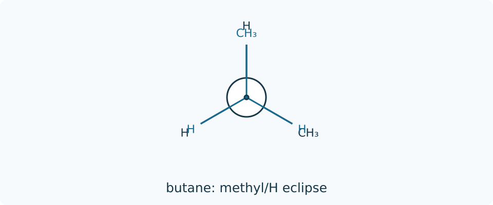{width=82% fig-alt="Inspect a methyl/H eclipse"}

An eclipsed view need not put the two methyl groups directly on top of one another.

## Explain why anti is favoured here

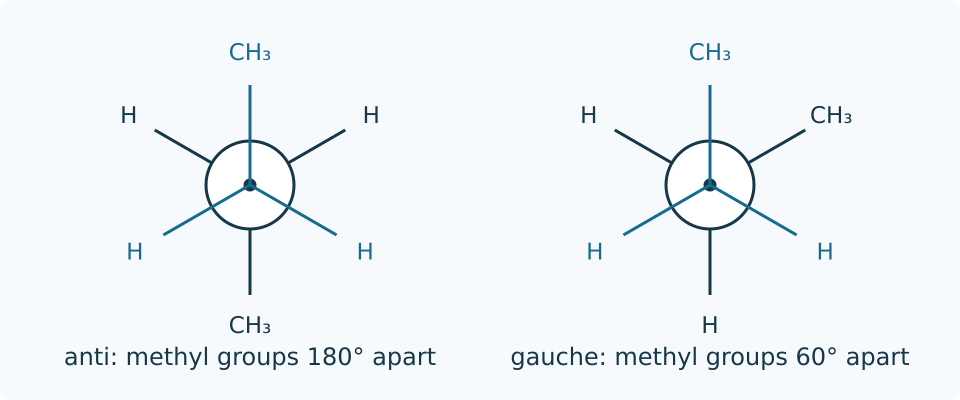{width=82% fig-alt="Explain why anti is favoured here"}

For ordinary butane, separating the methyl groups in the anti arrangement lowers energy relative to gauche.

## Follow the next eclipsed view

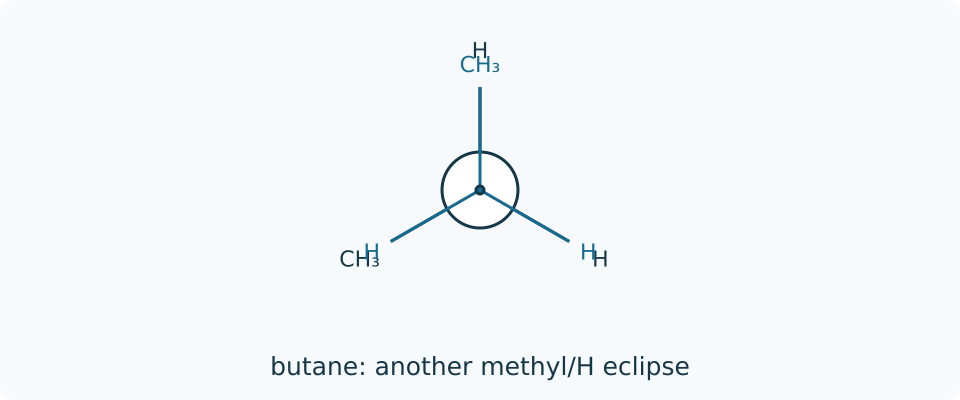{width=82% fig-alt="Follow the next eclipsed view"}

Rotation passes another methyl/H eclipse before reaching a different staggered minimum.

## Predict: how many gauche minima in one full turn?

Count the +60° and −60° arrangements separately, while recognising their equal energy in an achiral environment.

::: notes
Give 15–20 seconds for an individual prediction or a small drawing. Ask one student to state the rule they used; resolve on the next slide within this same timed block.
:::

## Resolve: two equivalent gauche minima

Do not silently treat their multiplicity as one if constructing a physical statistical model. Our supplied two-state ΔG values already account for degeneracy.

::: notes
Use the explicit answer to diagnose the named misconception. Move on once students can state the rule; the practice page provides further worked attempts.
:::

## Check units before exponentiating

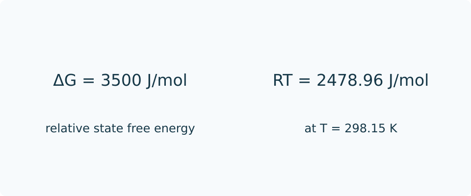{width=82% fig-alt="Check units before exponentiating"}

ΔG and RT must both use J/mol here. At 298.15 K, RT is about 2479 J/mol.

## Separate a conformer energy from a barrier

{width=82% fig-alt="Separate a conformer energy from a barrier"}

A state free-energy difference predicts an equilibrium preference; a barrier concerns how fast interconversion occurs.

## Inspect a supplied two-state prediction

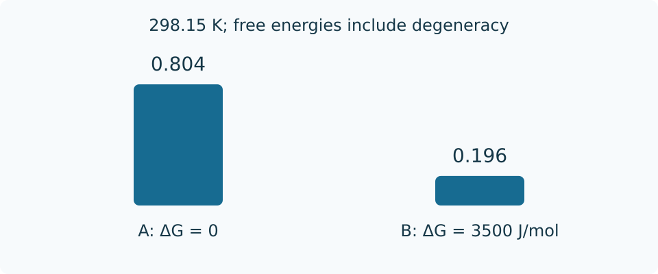{width=82% fig-alt="Inspect a supplied two-state prediction"}

With ΔG(A)=0 and ΔG(B)=3500 J/mol, the fractions are about 0.804 and 0.196.

## Predict: which weight equals one?

Using exp(−ΔG/RT), what is the statistical weight of a state whose relative free energy is zero?

::: notes
Give 15–20 seconds for an individual prediction or a small drawing. Ask one student to state the rule they used; resolve on the next slide within this same timed block.
:::

## Resolve: the reference weight is one

exp(0)=1. The other weight is about 0.244; divide each weight by their sum to obtain fractions.

::: notes
Use the explicit answer to diagnose the named misconception. Move on once students can state the rule; the practice page provides further worked attempts.
:::

## A planar ring sketch does not fix geometry

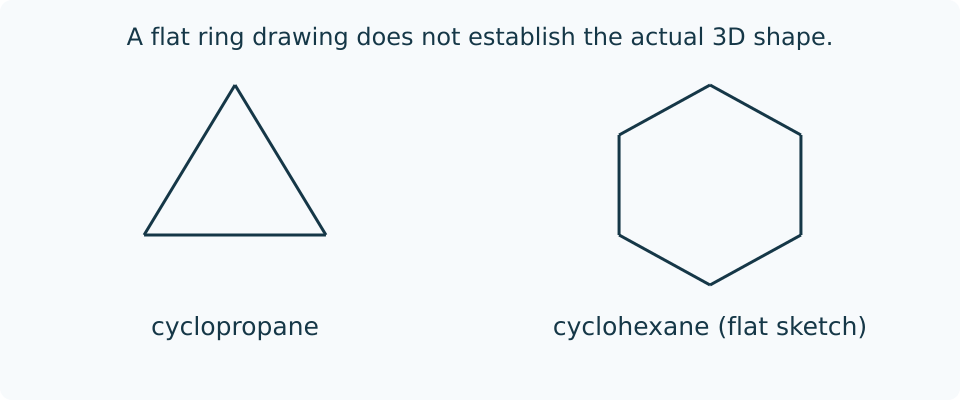{width=82% fig-alt="A planar ring sketch does not fix geometry"}

A hexagon on paper normally shows connectivity, not a claim that cyclohexane is flat.

::: notes
Begin this chemical argument with the displayed structure. Ask for a concrete atom, bond, label or observation rather than the topic name. Keep the first prediction brief.
:::

## Separate two naming systems

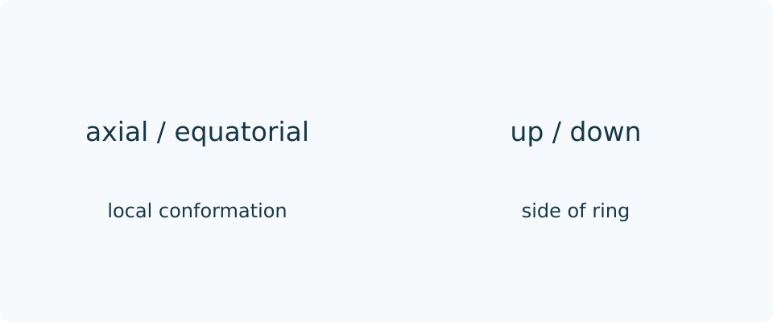{width=82% fig-alt="Separate two naming systems"}

Axial/equatorial identifies local bond direction in a chair; up/down identifies which side of the ring a substituent occupies.

## Recognise a cis relation

{width=82% fig-alt="Recognise a cis relation"}

Up/up and down/down substituent pairs are cis even when one substituent is axial and the other equatorial.

## Predict: does “equatorial” mean “down”?

Locate both up-equatorial and down-equatorial positions on a chair model.

::: notes
Give 15–20 seconds for an individual prediction or a small drawing. Ask one student to state the rule they used; resolve on the next slide within this same timed block.
:::

## Resolve: no fixed up/down equivalence

Each chair contains axial-up, axial-down, equatorial-up and equatorial-down positions around the ring.

::: notes
Use the explicit answer to diagnose the named misconception. Move on once students can state the rule; the practice page provides further worked attempts.
:::

## Find both positions at one ring carbon

{width=82% fig-alt="Find both positions at one ring carbon"}

The diagram displays one axial and one equatorial direction; the full ring alternates their up/down pattern.

::: notes
Begin this chemical argument with the displayed structure. Ask for a concrete atom, bond, label or observation rather than the topic name. Keep the first prediction brief.
:::

## Follow an axial-up substituent

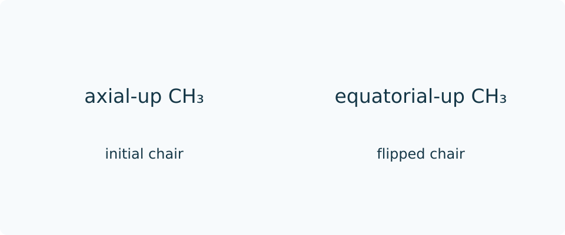{width=82% fig-alt="Follow an axial-up substituent"}

After a ring flip it is equatorial-up. The label “up” is retained.

## Recognise a trans relation

{width=82% fig-alt="Recognise a trans relation"}

Up/down means trans. A chair flip preserves that relation while changing axial/equatorial occupancy.

## Predict: cis before the flip, trans after?

Can an ordinary ring flip change which side of the ring a substituent occupies?

::: notes
Give 15–20 seconds for an individual prediction or a small drawing. Ask one student to state the rule they used; resolve on the next slide within this same timed block.
:::

## Resolve: cis/trans configuration is retained

A ring flip changes conformation, not the up/down relation. A cis pair remains cis.

::: notes
Use the explicit answer to diagnose the named misconception. Move on once students can state the rule; the practice page provides further worked attempts.
:::

## Repeat the rule for a down group

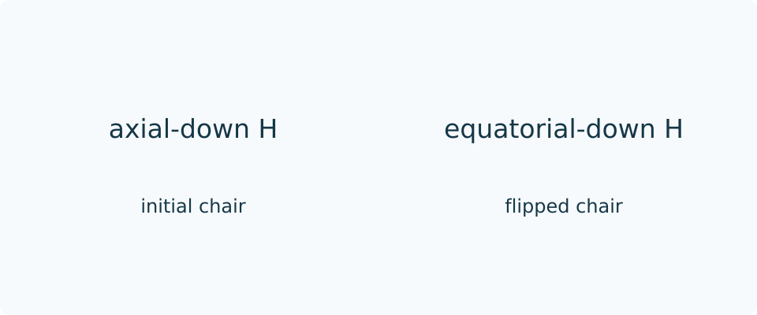{width=82% fig-alt="Repeat the rule for a down group"}

Axial-down becomes equatorial-down. Following one up example is not the whole rule.

## Explain a preference without claiming exclusivity

{width=82% fig-alt="Explain a preference without claiming exclusivity"}

Methylcyclohexane generally favours equatorial methyl because it avoids unfavourable 1,3-diaxial interactions.

## Test a zero free-energy difference

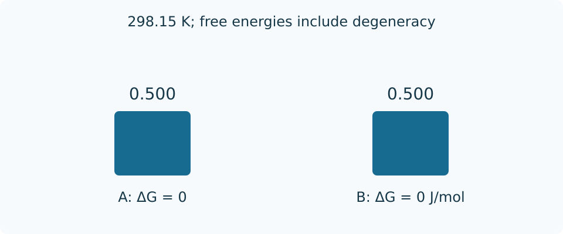{width=82% fig-alt="Test a zero free-energy difference"}

In the supplied two-state model, equal free energies produce equal weights and 0.5/0.5 fractions.

## Predict: is the disfavoured conformer absent?

Would a finite positive free-energy difference make its equilibrium fraction exactly zero?

::: notes
Give 15–20 seconds for an individual prediction or a small drawing. Ask one student to state the rule they used; resolve on the next slide within this same timed block.
:::

## Resolve: lower population is not absence

A finite difference gives a positive Boltzmann weight. Very small populations may be hard to observe but are not mathematically zero.

::: notes
Use the explicit answer to diagnose the named misconception. Move on once students can state the rule; the practice page provides further worked attempts.
:::

## Normalise weights before calling them fractions

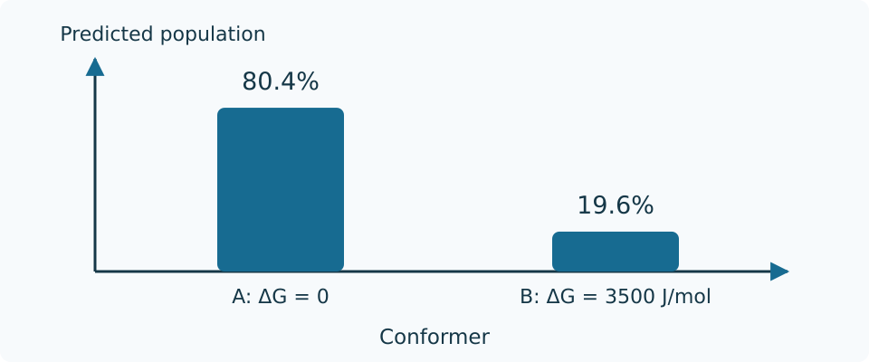{width=82% fig-alt="Normalise weights before calling them fractions"}

The relative weight is not yet a population fraction. Sum the weights and divide.

::: notes
Begin this chemical argument with the displayed structure. Ask for a concrete atom, bond, label or observation rather than the topic name. Keep the first prediction brief.
:::

## Increase the free-energy gap

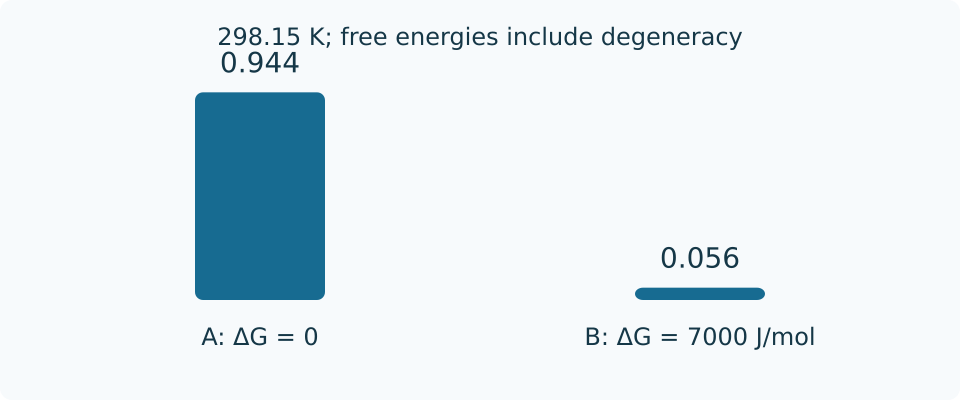{width=82% fig-alt="Increase the free-energy gap"}

With ΔG(B)=7000 J/mol at the same temperature, A becomes more strongly favoured than in the 3500 J/mol example.

## Interpret the plotted fractions chemically

{width=82% fig-alt="Interpret the plotted fractions chemically"}

A is more populated because its supplied free energy is lower. The calculation assumes the chosen states describe the equilibrium.

## Separate the two energy questions

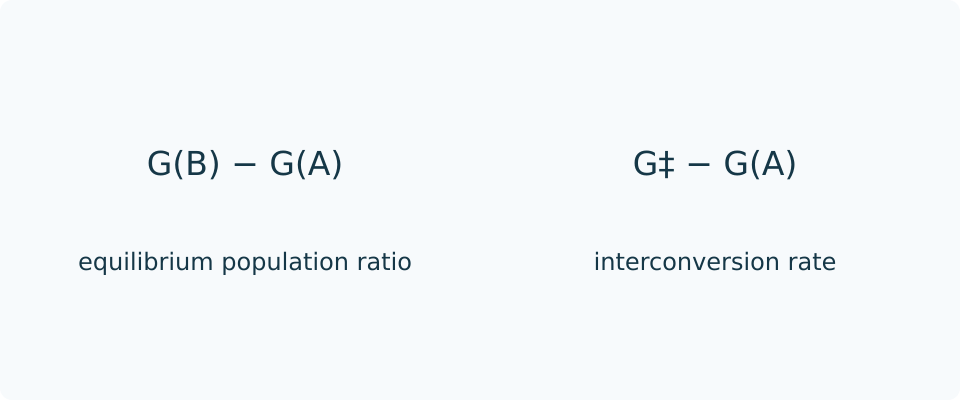{width=82% fig-alt="Separate the two energy questions"}

Changing the state difference changes equilibrium. Changing only a barrier can change rate without changing that equilibrium ratio.

## Predict: add 1000 J/mol to both states

Does a common energy offset change the normalised fractions? Explain before computing.

::: notes
Give 15–20 seconds for an individual prediction or a small drawing. Ask one student to state the rule they used; resolve on the next slide within this same timed block.
:::

## Resolve: the common factor cancels

Both weights acquire the same multiplier. It cancels when dividing by their sum, leaving fractions unchanged.

::: notes
Use the explicit answer to diagnose the named misconception. Move on once students can state the rule; the practice page provides further worked attempts.
:::

## Combine the tools in one explanation

Explain both the butane anti/gauche preference and the limits of predicting rate from an equilibrium population.

::: notes
Take a 30-second sketch or explanation, then ask for one observation and the reason linking it to the conclusion. This is included in the 45-minute session.
:::

## Your next independent work

Use the [exercises](exercise.qmd), then the [self-check](quiz.qmd). Required core problems and optional transfer work are labelled separately.

## One-sentence exit explanation

Write one chemical claim, the feature that supports it and one limit of the inference.

The [reading guide](../reference/reading.qmd) offers supplementary explanations.

::: notes
Collect one sentence or hear one example. Stop at 45 minutes; do not append another tutorial to the lecture.
:::
