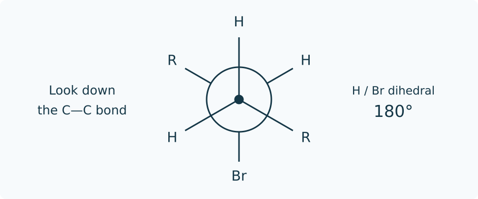

Allow 90 minutes. Use a model kit or make a simple physical model for the Newman
projection questions. The aim is to explain bond changes and geometry before
learning product patterns.

## 1. Define alpha and beta for a particular substrate

Draw 2-bromobutane, CH₃CH(Br)CH₂CH₃. Label the carbon bearing Br as α, then
label every adjacent carbon as β. Circle the β-hydrogens that could be removed
in a formal elimination. Draw the constitutional alkene products.

::: {.callout-note collapse="true" title="Worked check"}
C2 is α; C1 and C3 are β. Removal of H from C1 can produce but-1-ene; removal
from C3 can produce but-2-ene. But-2-ene has E and Z configurations because
each double-bond carbon has two different substituents. But-1-ene does not,
because its terminal carbon has two H atoms. This lists possible products;
it does not establish their proportions under an unspecified condition.
:::

## 2. Draw one E2 step

Choose a conformation of 2-bromobutane with an appropriate β-H opposite Br.
Show a generic base B⁻, its lone pair and **three** curved arrows. Draw all
products, including BH and Br⁻. Which two bonds disappear and which new
bond order appears? Is there a carbocation intermediate?

::: {.callout-tip collapse="true" title="Hint"}
Follow a closed sequence of pairs: base → H; C–H → C–C; C–Br → Br.
Each arrow tail must identify a pair in the starting structure.
:::

::: {.callout-note collapse="true" title="Worked check"}
The base lone pair forms B–H; the C–H pair forms the alkene π bond;
the C–Br pair returns to Br. The products are the selected alkene, BH and
Br⁻. C–H and C–Br are lost, while C–C changes from a single to a double bond.
The concerted E2 model contains no carbocation intermediate. The net charge
is −1 on each side for a B⁻ base and neutral substrate.
:::

## 3. Read a Newman projection rather than memorising a shape

{fig-alt="A Newman projection with a front hydrogen and rear bromine anti at a 180-degree dihedral angle."}

Identify which bonds start at the front dot and which start at the rear circle.
Rebuild the depicted carbon–carbon bond with a model. Rotate one carbon by
60° and then 120° while keeping the other fixed. Does the chosen H/Br pair
stay anti-periplanar? Explain why rotation changes conformation rather than
configuration at an otherwise stable stereocentre.

::: {.callout-note collapse="true" title="Worked check"}
The selected front H and rear Br initially point in opposite directions
with a dihedral angle of 180°. After a relative rotation by 60° or 120°,
that particular pair is no longer anti. Other hydrogen choices may become
appropriately aligned. Rotation changes torsion about the single bond
without exchanging groups at a stereocentre or changing connectivity.
For many flexible molecules conformational access makes several eliminations
possible; constrained rings require additional care.
:::

## 4. Predict and explain ionic HBr addition to propene

Assume an ionic reaction without peroxides. Draw both possible carbocation
connectivities that could follow protonation of CH₃CH=CH₂. Identify the more
stable carbocation and complete the bromide capture step. Draw each relevant
electron-flow arrow, including the H–Br bond cleavage.

::: {.callout-note collapse="true" title="Worked check"}
Donating the alkene π pair to H with H attaching at the terminal carbon
gives the secondary carbocation CH₃CH⁺CH₃; H attaching at the middle carbon
would give a primary terminal carbocation. The secondary route is favoured
in this selected model. The H–Br pair moves to Br, and a bromide lone pair
then attacks the carbocation, giving 2-bromopropane. The explanation is
relative intermediate stability in a stated mechanism, not a rule about
where a written H symbol must appear in every addition reaction.
:::

## 5. Contrast bromination with HBr addition

In a Br₂ addition, a bridged bromonium ion can form. Draw the ring-opening
stage with bromide attacking one carbon from the opposite side and the
corresponding C–Br bridge pair returning to the bridge bromine. What
stereochemical relationship results between the two newly added bromines?
Why should you not carry the free-carbocation HBr drawing over unchanged?

::: {.callout-note collapse="true" title="Worked check"}
Backside opening of the bridge gives anti addition. The bridge blocks direct
same-side attack in this simple mechanism. HBr and Br₂ add different species
through different intermediates, so a free carbocation mechanism is not an
adequate general explanation of bromonium-mediated addition. Anti describes
relative addition geometry; the exact configurations depend on the starting
alkene and require drawing the actual product.
:::

## 6. E1 or SN1 after ionisation?

Start with `(CH₃)₃C⁺` in water. Draw one path to 2-methylpropan-2-ol and
another to 2-methylpropene. Identify whether water attacks carbon or removes
β-H. Explain why observing a carbocation intermediate would not by itself
establish which final product is obtained.

::: {.callout-note collapse="true" title="Worked check"}
Water attack at carbon, then deprotonation, gives the alcohol through SN1.
Water acting as a base removes β-H while the C–H pair forms C=C, giving the
alkene and hydronium through E1. Both can follow ionisation; their competition
depends on the conditions. Ionisation identifies an early mechanistic stage,
not a unique product.
:::

## Leave with

An audited E2 drawing, an anti Newman model, and two distinct addition
mechanisms. Optional reading: selected Solomons chapters 7–8; see the
[reading guide](../reference/reading.qmd).
