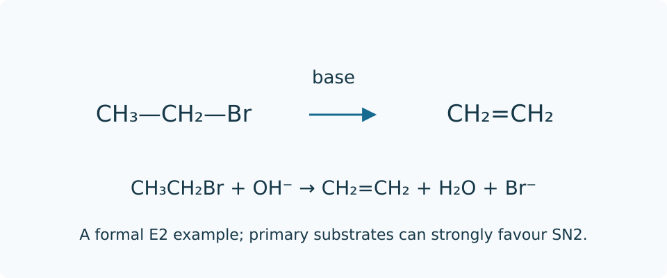
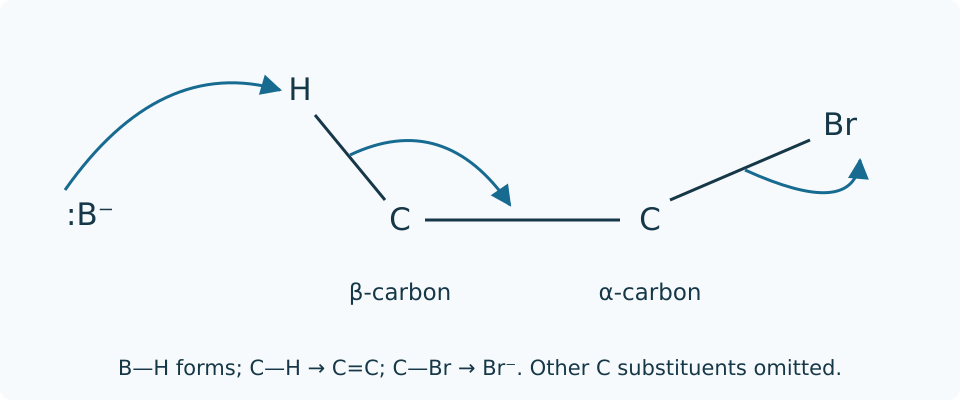
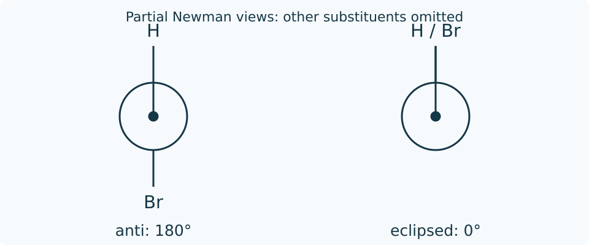
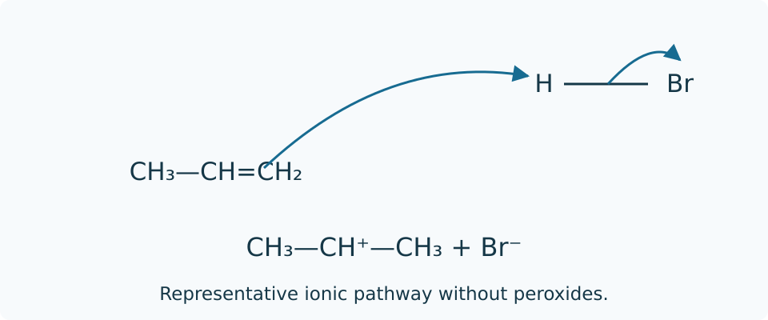
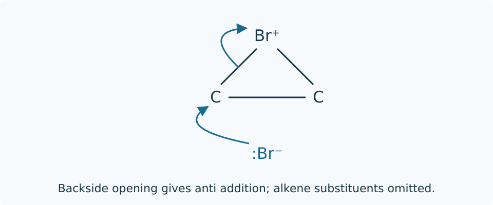
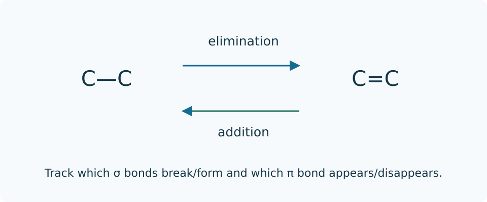

## What will you be able to explain?

- Track bond changes in an E2 step.
- Use anti-periplanar geometry in a simple example.
- Explain representative ionic alkene additions.

::: notes
Begin with the previous unit’s electron-pair and charge audit. Ask students to predict a product or bond change before displaying the worked drawing. These slides support discussion and paper drawing; the practice page supplies further explanations.
:::

## What leaves during elimination?

{width=85% fig-alt="A formal elimination of HBr from bromoethane forms ethene; a base receives H and bromide leaves."}

A β-hydrogen and leaving group are lost from neighbouring carbons as a C=C bond forms.

::: notes
The primary bromoethane equation is a bookkeeping illustration, not a claim of dominant E2 under aqueous hydroxide. Primary substrates often give substitution.
:::

## E2 moves three pairs in one step

{width=85% fig-alt="The base-to-H, C–H-to-C–C and C–Br-to-Br arrows form the E2 electron-flow cycle."}

Draw the base lone pair → β-H; C–H pair → C–C π bond; C–Br pair → Br.

::: notes
The three arrows describe one elementary step. Identify alpha as the carbon carrying the leaving group and beta as its neighbour. Unshown substituents do not mean incomplete valence.
:::

## Reactive geometry is three-dimensional

{width=85% fig-alt="A Newman projection shows a front-carbon hydrogen opposite a back-carbon bromine at 180 degrees."}

An anti-periplanar C–H/C–Br arrangement supports the common E2 pathway. Read the viewing direction before choosing H.

::: notes
The front carbon is the dot and the rear carbon the circle. Check that students can rebuild the Newman view using a physical model before drawing a product.
:::

## Rotation can expose a reactive hydrogen

{width=85% fig-alt="Partial Newman projections compare anti and eclipsed H/Br arrangements."}

Rotation about a single bond changes conformation, not connectivity. In a flexible molecule it can create an anti arrangement.

::: notes
Other groups are omitted intentionally. Constrained rings can restrict the needed geometry; the diagram is not a general statement that every beta-H is equally available.
:::

## More than one beta carbon can react

{width=85% fig-alt="2-bromobutane can lose beta hydrogen in two positions to give but-1-ene or but-2-ene, with E/Z forms for the latter."}

Locate possible β-carbons first. Geometry and conditions determine which of the possible alkenes are favoured.

::: notes
The more substituted alkene is often favoured with a small base, but bulky bases and geometry can change the distribution. Avoid presenting a universal product ratio.
:::

## An alkene supplies a pi pair to H

{width=85% fig-alt="Propene protonation by HBr forms the secondary carbocation and bromide in the representative ionic route."}

The C=C π bond is an electron-pair source. Protonation giving the more stable carbocation explains this regioselectivity.

::: notes
For propene, H attaches to the terminal carbon in the shown pathway. This is the ionic case without peroxides; radical HBr addition is outside the required toolkit.
:::

## The carbocation is then captured

{width=85% fig-alt="A bromide lone pair attacks the secondary propyl carbocation to produce 2-bromopropane."}

The observed connectivity follows two steps: protonation, then nucleophile capture.

::: notes
The intermediate has three carbon bond directions and a positive charge. If a new stereocentre forms in another example, both accessible faces must be considered.
:::

## Some additions avoid a free carbocation

{width=85% fig-alt="A bridged bromonium intermediate is opened by bromide attack from the opposite side."}

Br₂ addition commonly proceeds through a bromonium bridge and anti opening, rather than the free-carbocation HBr model.

::: notes
This diagram shows the ring-opening stage only. The curved arrow returning the C–Br bridge pair to Br relieves the positive charge as the new C–Br bond forms.
:::

## E1 and SN1 can share an intermediate

{width=85% fig-alt="A tertiary carbocation can be captured by water or lose a beta hydrogen to form an alkene."}

Ionisation followed by β-H loss gives E1; ionisation followed by capture gives SN1.

::: notes
In E1, a weak base such as water can remove the beta proton after ionisation. Product proportions depend on conditions; heat can favour elimination in many cases.
:::

## Read the local bond inventory

{width=85% fig-alt="A C–C single bond becomes C=C in elimination; addition consumes a pi bond and makes new sigma bonds."}

Check the specific atoms that gain and lose bonds. These labels do not make every pair of reactions exact reverses under identical conditions.

::: notes
Ask students to supply omitted reagents and products for a real example. A bare C–C/C=C cartoon is only a summary of local changes.
:::

## Choose the attacked atom

Attack at a saturated carbon can give substitution. Removal of β-H can give elimination. Donation of an alkene π pair to H gives addition.

The same electron-flow language applies to all three.

## A product name is not a mechanism

For HBr + propene, draw the two electron-flow steps and identify the intermediate.

Then explain why the simple carbocation model is inappropriate for Br₂ addition via bromonium.

## Check a possible product

Can methyl bromide undergo ordinary β-elimination? Draw its carbon skeleton before answering.

For 2-bromobutane, name each constitutional alkene and state which can have E/Z forms.

## Use the same reasoning in practice

Complete the [practice and worked examples](exercise.qmd), then the [self-check](quiz.qmd).

Optional textbook support: selected Solomons chapter 7–8 sections. The [reading guide](../reference/reading.qmd) explains the provisional book mapping.
