## About this lecture

Every turn of the citric acid cycle, the enzyme **aconitase** pulls a water molecule out of citrate to make a C=C bond, then adds the water straight back on, the other way round. It's an **elimination followed by an addition**, and it moves the OH to a carbon where your cells can oxidise it.

Today we learn the two reactions that make and consume a C=C bond:

- **α and β carbons:** where the leaving group sits, and where the H comes from
- **E2:** one step, three arrows, an anti-periplanar H
- **E1:** carbocation first, then loss of a β-H, competing with SN1
- **Electrophilic addition:** HBr through the more stable carbocation, Br₂ through a bromonium ion
- **Products:** which alkene, E or Z, which face, which stereoisomer

Yesterday's substitution reactions are the starting point: the same substrates, but now the reagent can grab a hydrogen instead of a carbon.

::: notes
Open with aconitase. It's a real enzyme in every mitochondrion: citrate to cis-aconitate is a dehydration (elimination of water), and cis-aconitate to isocitrate is a hydration (addition of water). The net effect is moving the OH from a tertiary carbon to a secondary one, which matters tomorrow: tertiary alcohols can't be oxidised, secondary ones can, and the next enzyme in the cycle does exactly that. Don't show the structures yet; we come back to them at the end once students can read the mechanism. Frame today as the second half of yesterday: an alkyl halide plus a base or nucleophile can substitute, or it can eliminate, and the alkenes we make can then add things back.
:::

## Two directions for one π bond

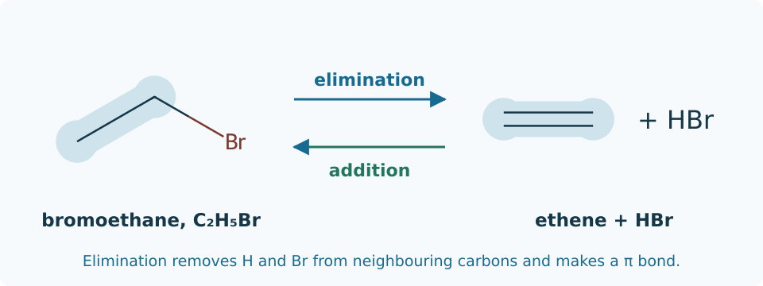{width=82% fig-alt="Bromoethane converted to ethene plus HBr by elimination, and ethene plus HBr converted back to bromoethane by addition"}

- **Elimination:** lose H and a leaving group from **neighbouring** carbons; a new **π bond** forms.
- **Addition:** a π bond is consumed and **two new σ bonds** form.
- Bond audit for propene + HBr → 2-bromopropane (C₃H₆ + HBr → C₃H₇Br): the C=C π bond and H–Br break; C–H and C–Br form; the C–C σ bond stays.

::: notes
This is the bookkeeping slide. Get students to say out loud which bonds change, because every mechanism today is just a way of doing this bookkeeping with electron pairs. Point out that the formula of the product is just the sum of the formulas, so addition is atom-economical. Warn against one thing early: the two arrows look like an equilibrium, but in the lab the reagents and conditions that make each direction work are different. We return to that with cyclohexanol near the end.
:::

## α and β carbons

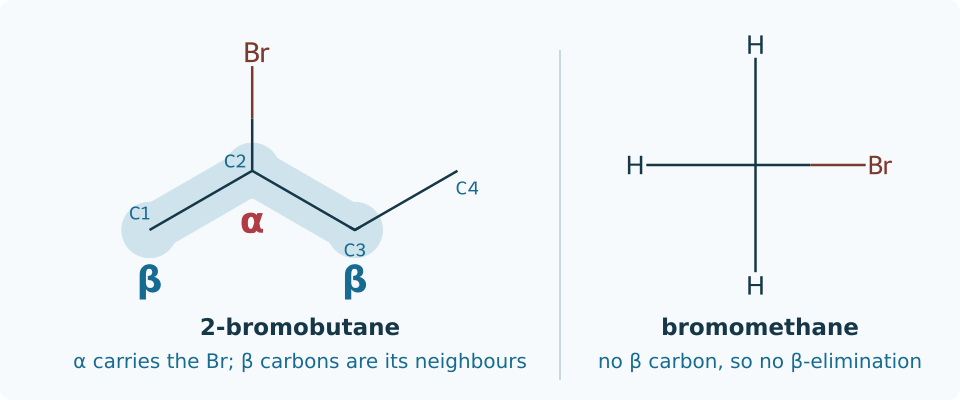{width=74% fig-alt="2-Bromobutane with C2 marked alpha and C1 and C3 marked beta; bromomethane has no beta carbon"}

The **α carbon** carries the leaving group. A **β carbon** is directly bonded to it. β-Elimination removes an H from a β carbon, so CH₃Br, with no β carbon, can't do it.

::: {.try}
**Try it:** how many β hydrogens does 2-bromo-2-methylpropane, (CH₃)₃CBr, have?

::: {.fragment}
**Nine.** All three CH₃ groups are β, and all nine H give the same alkene, 2-methylpropene.
:::
:::

::: notes
α and β are labels relative to the functional group, not permanent names; the same carbon can be α in one reaction and β in another. Ask students to point at the β carbons in 2-bromobutane before you reveal the labels: C1 and C3. C4 is γ and doesn't take part. The methyl bromide case is the classic trick question: it can only substitute. The try-it shows that counting β-H is less important than asking how many different alkenes they lead to: nine H, one product.
:::

## E2: three arrows, one step

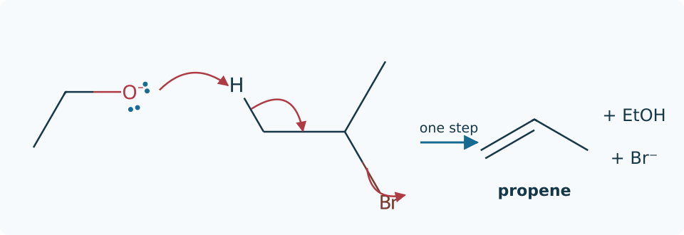{width=80% fig-alt="Ethoxide lone pair to beta hydrogen, C–H bond pair into the new pi bond, C–Br pair onto bromine, giving propene, ethanol and bromide"}

The base takes the β-H, the C–H pair becomes the π bond, and bromide leaves, **all at once**. There's no intermediate, so the rate depends on both partners: rate = k[RBr][base].

::: {.try}
**Try it:** a student draws base → H and C–Br → Br, but no third arrow. What's wrong?

::: {.fragment}
**The C–H pair is lost.** Without the C–H → C=C arrow, nothing forms the π bond and the electron count doesn't balance.
:::
:::

::: notes
Draw this on the board with the students, arrow by arrow, saying where each pair starts and ends. The first arrow starts at a lone pair on oxygen, not at the minus sign. The second arrow is the one people forget: when the base takes H as a proton, the two electrons of the C–H bond stay behind on carbon and swing into the C–C bond. Check charge: −1 on ethoxide on the left, −1 on bromide on the right. E2 means elimination, bimolecular, which is why the rate law has both concentrations. Note that I drew the H and Br pointing in opposite directions on purpose; that's the next slide.
:::

## The H and the leaving group must be anti

{width=62% fig-alt="Newman projection looking down the C–C bond; the front-carbon hydrogen is at the top and the back-carbon bromine at the bottom, a 180 degree dihedral"}

In E2 the reacting **C–H and C–Br bonds lie in one plane on opposite sides**: an H–C–C–Br dihedral of **180°**, called **anti-periplanar**. The breaking C–H orbital then lines up with the back of the breaking C–Br bond.

::: {.try}
**Try it:** rotate only the rear carbon by 60°. Is that H/Br pair still anti? Is it a different compound?

::: {.fragment}
**No, and no.** The dihedral is now 60° or 300°, so that pair can't react, but rotation only changes conformation, not connectivity. Another rotation brings an anti H back.
:::
:::

::: notes
This is Week 2's Newman projection put to work. Ask students to build this with a model kit if they have one: the front carbon is the dot, the back carbon the circle. Explain why anti: the electrons from the C–H bond flow into the C–Br σ* orbital, which points out the back of the C–Br bond. In open-chain molecules rotation is free, so some conformation always offers an anti H. In rings, especially cyclohexanes, the H and Br must both be axial, which can block elimination entirely. That's a good extension question for strong students but not required today.
:::

## One substrate, several alkenes

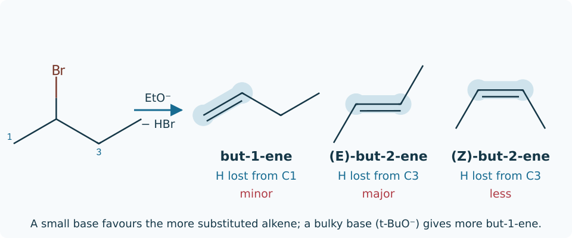{width=82% fig-alt="2-Bromobutane with ethoxide gives minor but-1-ene from loss of H at C1, and major E- and Z-but-2-ene from loss of H at C3"}

List the β carbons first; each gives its own alkene. With a small base the **more substituted alkene** usually dominates (Zaitsev). A bulky base such as t-BuO⁻ reaches the exposed CH₃ more easily and gives more of the terminal alkene.

::: {.try}
**Try it:** which alkenes can 2-bromopentane give with ethoxide, and which is likely major?

::: {.fragment}
**Pent-1-ene, (E)-pent-2-ene and (Z)-pent-2-ene.** The disubstituted pent-2-ene dominates, mostly as the E isomer.
:::
:::

::: notes
The procedure is the point: find α, find every β, remove one H from each in turn, and draw the alkene without moving any carbons. Only then think about proportions. Students often skip straight to "the Zaitsev product" and miss the others. More substituted alkenes are more stable, and in E2 the transition state already has partial double-bond character, so it feels that stability. E over Z because the two methyl groups clash in Z. Don't quote ratios as rules: they depend on base, solvent and temperature. For 2-bromobutane with ethoxide, roughly 80 % of the alkene is but-2-ene.
:::

## Can it be E or Z?

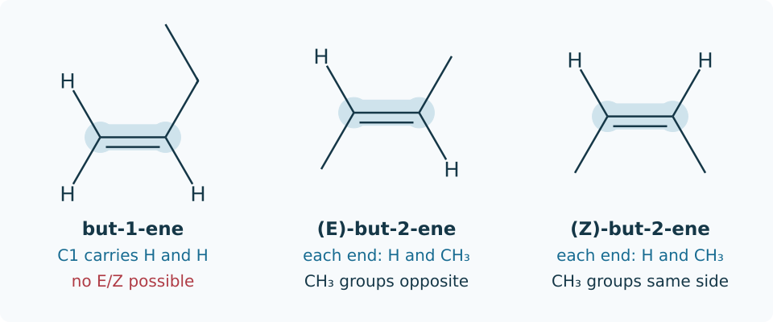{width=80% fig-alt="But-1-ene has two hydrogens on C1 so no E/Z; E- and Z-but-2-ene each have H and CH3 on both alkene carbons"}

Check **both** alkene carbons. Each needs **two different groups**. One end with two identical groups (like =CH₂) means there's no E/Z, however the chain is drawn.

::: notes
This is the stereochemistry habit from Week 2 applied to alkenes. Ask: in but-1-ene, what are the two groups on C1? Two H, so it fails the test immediately. The tempting mistake is calling a terminal alkene E because the zigzag chain looks stretched out. Drawing shape is never evidence; the substituent list is. Quick extra question: 2-methylbut-2-ene? No E/Z, because C2 carries two methyl groups. For E and Z with more complex groups, use the CIP priorities from Week 2.
:::

## Substitution or elimination?

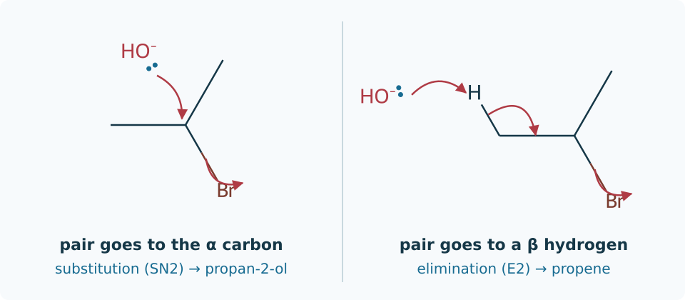{width=78% fig-alt="Left: hydroxide lone pair attacks the alpha carbon from the back side, giving propan-2-ol by SN2. Right: hydroxide removes a beta hydrogen, giving propene by E2"}

| favours elimination | favours substitution |
|---|---|
| strong or bulky base (EtO⁻, t-BuO⁻) | good nucleophile, weak base (I⁻, CN⁻) |
| secondary or tertiary substrate | methyl or primary substrate |
| heat | lower temperature |

::: notes
This is the bridge from yesterday. The same reagent, hydroxide, can donate its pair to the carbon (SN2) or to a β hydrogen (E2). The first question is always which atom receives the pair. Then use the table to argue which wins, but stress that it's a tendency, not a rule: a secondary bromide with hydroxide gives a mixture. Students should be able to state what extra information they'd need (base strength and size, substrate, temperature, solvent) before predicting a major product.
:::

## E1: lose the leaving group first

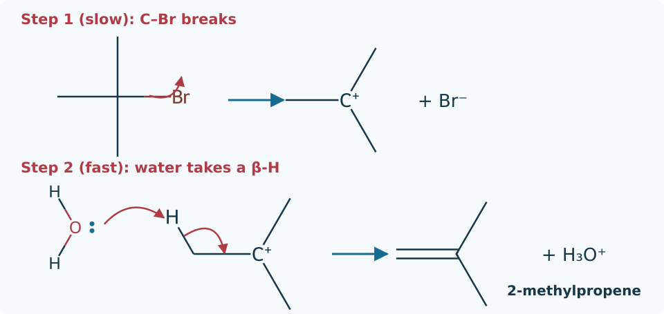{width=78% fig-alt="Step 1: the C–Br bond breaks to give the tert-butyl cation and bromide. Step 2: water takes a beta hydrogen while the C–H pair forms the C=C bond, giving 2-methylpropene and hydronium"}

**Step 1** is the same slow ionisation as SN1. **Step 2:** even a weak base like water can pull off a β-H, because the C–H pair now flows into an empty p orbital. Rate = k[RBr]; the base doesn't appear.

::: notes
Contrast with E2 explicitly: in step 2 there is no C–Br arrow, because bromide left in step 1. Ask students to count the arrows in step 2 (two) and say why. E1 needs a substrate that ionises: tertiary, or secondary in a polar solvent. The rate law is first order because only the substrate is involved in the slow step, exactly as in SN1. The carbocation is the same species as yesterday, which is the point of the next slide.
:::

## One carbocation, two products

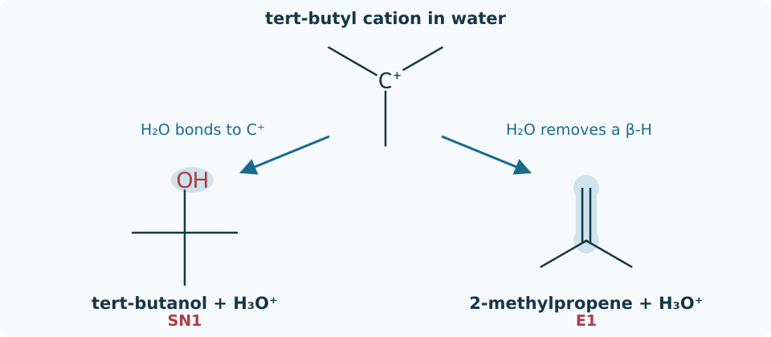{width=72% fig-alt="tert-Butyl cation in water: capture by water gives tert-butanol plus hydronium (SN1); removal of a beta hydrogen gives 2-methylpropene plus hydronium (E1)"}

After ionisation, water can bond to **C⁺** (SN1) or remove a **β-H** (E1). Seeing a carbocation doesn't tell you the product; the conditions do.

::: {.try}
**Try it:** raising the temperature shifts the ratio toward the alkene. Why?

::: {.fragment}
**Entropy.** Elimination turns one cation into two species (alkene + H₃O⁺), so its TΔS term grows with temperature.
:::
:::

::: notes
Both branches release H3O+; the SN1 branch goes through an oxonium ion that loses a proton to water, so make sure students include that proton transfer. In water at room temperature, tert-butyl bromide gives mostly tert-butanol with some alkene. Heat, and a less nucleophilic medium, push toward the alkene. This branch point comes back in Week 4 whenever a carbocation appears, and it's the same logic as acid-catalysed dehydration of alcohols tomorrow.
:::

## E1 or E2?

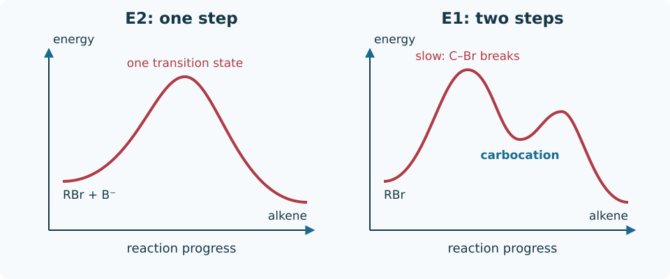{width=62% fig-alt="E2 energy profile with one hump; E1 profile with a high first hump for C–Br cleavage, a carbocation valley and a smaller second hump"}

| | E2 | E1 |
|---|---|---|
| steps | one | two, via a carbocation |
| rate | k[RBr][base] | k[RBr] |
| base | strong (EtO⁻, OH⁻) | weak is enough (H₂O, ROH) |
| geometry | anti-periplanar H needed | any β-H on the cation |

::: notes
Read the energy profiles: E2 has one maximum, the transition state where all three pair movements are half done. E1 has a high first barrier for C–Br cleavage and a carbocation in the valley. Ask: which step is rate-limiting in E1 and why doesn't the base appear in the rate law? Also: E1 can't control stereochemistry tightly because the planar cation can lose any β-H, while E2's anti requirement can force a particular alkene isomer. Strong base usually means E2; weak base, ionising solvent and a tertiary substrate mean E1.
:::

## Alkenes are nucleophiles: adding HBr

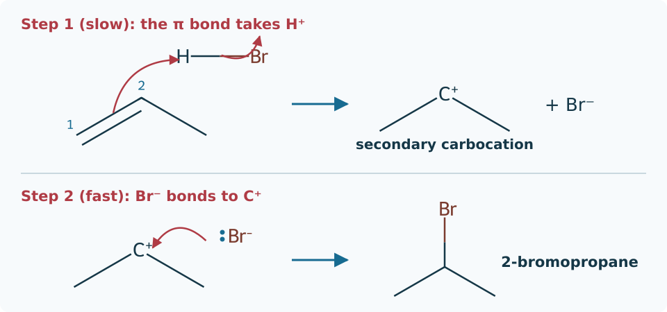{width=72% fig-alt="Step 1: the propene pi bond takes the proton from HBr, the H–Br pair goes to bromine, giving a secondary carbocation and bromide. Step 2: a bromide lone pair bonds to the carbocation, giving 2-bromopropane"}

The **π electrons** are exposed above and below the C=C plane, so the alkene acts as an electron-pair donor. **Step 1:** π pair → H, H–Br pair → Br. **Step 2:** Br⁻ lone pair → C⁺.

::: notes
Turn the elimination around. Now the alkene is the nucleophile and HBr the electrophile. The first arrow starts in the middle of the double bond, not at an atom: that's the π pair. Make sure the H ends up on C1 and the positive charge on C2; that choice is the next slide. Remind students this is the ionic mechanism, with no peroxides. With peroxides, HBr adds by a radical chain the other way round, which is outside this course. Ask what the carbon geometry is at each stage: trigonal planar alkene, planar carbocation, tetrahedral product.
:::

## Markovnikov: the more stable cation wins

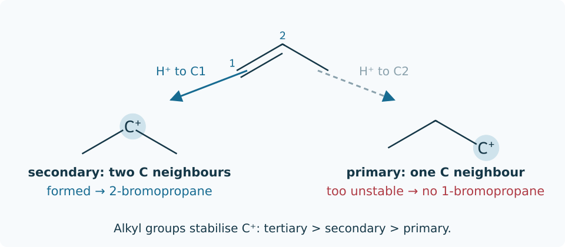{width=72% fig-alt="Propene protonated at C1 gives a secondary carbocation and 2-bromopropane; protonation at C2 would give an unstable primary carbocation and is not observed"}

H⁺ adds to the end that gives the **more substituted carbocation**, so Br ends up on the more substituted carbon. Ethene is symmetric: either way gives bromoethane.

::: {.try}
**Try it:** what does 2-methylpropene give with HBr?

::: {.fragment}
**2-Bromo-2-methylpropane.** H goes to the CH₂ end, giving the tertiary cation, which bromide then captures.
:::
:::

::: notes
Teach the reason, not just the rule. Markovnikov's rule ("H goes to the carbon that already has more H") is a summary of carbocation stability: alkyl groups donate electron density to the empty p orbital, so tertiary beats secondary beats primary. The primary cation is so unstable that 1-bromopropane is essentially not formed by this route. Ethene is a good sanity check: swapping which equivalent carbon gets the H gives the same molecule, so there's no regiochemistry to discuss. Students should name the product, not just say "Markovnikov".
:::

## A planar cation has two faces

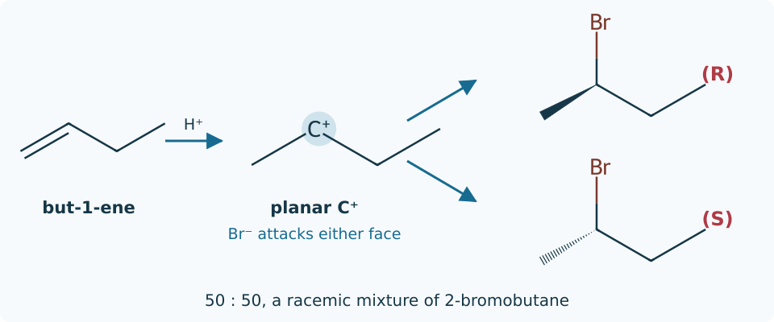{width=78% fig-alt="But-1-ene is protonated to a planar secondary carbocation; bromide attacks from either face giving (R)- and (S)-2-bromobutane in a 50:50 ratio"}

The carbocation is **flat**, and bromide attacks the top and bottom faces equally. A new stereocentre made this way forms as a **racemic mixture**.

::: {.try}
**Try it:** will 2-bromobutane made from but-1-ene and HBr rotate plane-polarised light?

::: {.fragment}
**No.** It's a 50:50 mixture of R and S, so the rotations cancel.
:::
:::

::: notes
This links back to Week 2 and to SN1 yesterday: whenever a planar intermediate is attacked, both faces are available unless something chiral steers the reaction. Draw the empty p orbital with a lobe above and below to make it concrete. Enzymes are the exception, and that's why aconitase makes only one stereoisomer of isocitrate. Check that students label R and S from the drawn wedges rather than guessing.
:::

## Br₂ adds through a bromonium ion

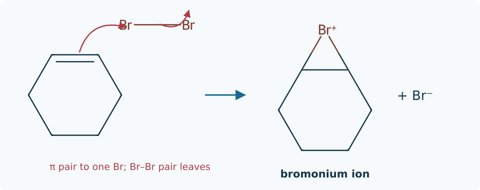{width=72% fig-alt="The cyclohexene pi pair attacks one bromine of Br2 while the Br–Br pair leaves as bromide, giving a three-membered bromonium ion bridging the two former alkene carbons"}

Br₂ has no H to lose, but the alkene still donates its π pair to one Br as the other leaves as Br⁻. Instead of a free carbocation, the Br **bridges both carbons**: a three-membered **bromonium ion**.

::: notes
Br2 is polarised as it approaches the electron-rich alkene, so one end behaves as the electrophile. A full mechanism has the bromine's lone pair forming the second C–Br bond as the π bond attacks; at this level it's enough to draw the result as a bridged cation with the positive charge on bromine. Ask what the formal charge on Br is: two bonds and two lone pairs on bromine gives +1. Also a practical note: the orange colour of bromine water disappearing is the classic test for C=C.
:::

## Back-side opening gives anti addition

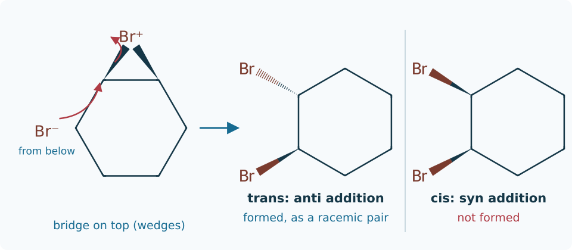{width=80% fig-alt="Bromide attacks one carbon of the bromonium ion from the face opposite the bridge, giving trans-1,2-dibromocyclohexane as a racemic pair; the cis isomer is not formed"}

The bridge blocks one face, so Br⁻ attacks from the **opposite face**, like an SN2. The two Br end up **anti**: cyclohexene gives only **trans**-1,2-dibromocyclohexane.

::: {.try}
**Try it:** why can't we just reuse the HBr carbocation mechanism for Br₂?

::: {.fragment}
**A free planar cation could be attacked from either face**, giving cis and trans. Only trans forms, and only the bridged ion explains that.
:::
:::

::: notes
This is where mechanism earns its keep: the product's stereochemistry is the evidence for the intermediate. The opening step is an SN2 on the bromonium ion with Br+ as the leaving group, which is why it's backside. Trans-1,2-dibromocyclohexane is chiral and forms as a racemic pair, because bromide can open either carbon. The cis isomer is meso and is not formed. Students who have the SN2 picture from yesterday usually get this quickly; ask them to identify the nucleophile, electrophilic carbon and leaving group in the opening step.
:::

## Same bonds, opposite directions

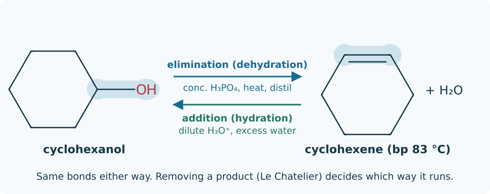{width=80% fig-alt="Cyclohexanol with concentrated phosphoric acid and heat, distilling off the alkene, gives cyclohexene and water; cyclohexene with dilute aqueous acid gives cyclohexanol"}

Acid-catalysed **dehydration** (elimination) and **hydration** (addition) go through the same carbocation. **Conditions** pick the direction: remove the alkene to drive elimination, flood with water to drive addition.

::: {.try}
**Try it:** in the lab prep, cyclohexene (bp 83 °C) distils out while cyclohexanol (bp 161 °C) stays. Why does that help?

::: {.fragment}
**Le Chatelier.** Removing a product as it forms pulls the equilibrium toward the alkene.
:::
:::

::: notes
This is a real undergraduate prep and a good place to correct the claim that "addition is just elimination backwards". The net bonds are the reverse of each other, and for acid catalysis the intermediates are the same, but the useful conditions differ and many additions and eliminations use completely different reagents and mechanisms (E2 with base versus HBr addition, for instance). The protonated OH leaves as water, a much better leaving group than hydroxide; that idea is the start of tomorrow's alcohol chemistry.
:::

## Back to the mitochondria: aconitase

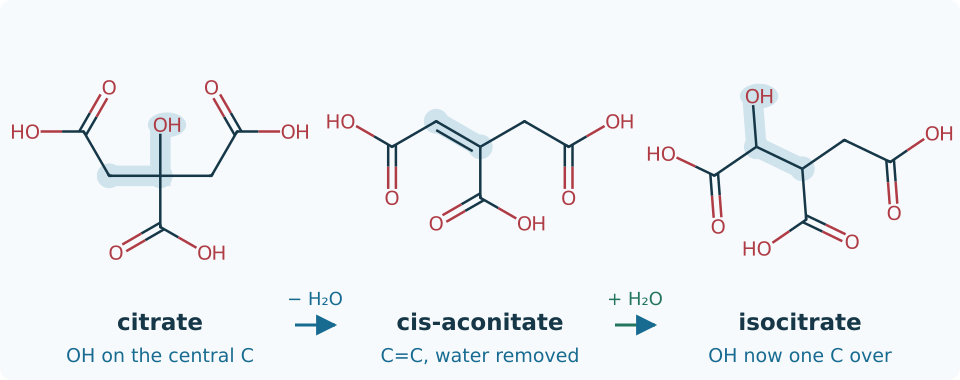{width=82% fig-alt="Citrate loses water from its central carbon and a neighbouring CH2 to give cis-aconitate; water then adds the other way round to give isocitrate with the OH on the neighbouring carbon"}

**Elimination:** the OH leaves the central carbon and an H leaves a β CH₂. **Addition:** water adds back with OH on the **other** carbon. Net result: a tertiary alcohol becomes a secondary one.

::: {.try}
**Try it:** why go to the trouble? (Hint: what happens to isocitrate next?)

::: {.fragment}
**A secondary alcohol can be oxidised to a ketone; a tertiary one can't.** The next enzyme, isocitrate dehydrogenase, does exactly that. That's tomorrow's topic.
:::
:::

::: notes
Close the loop with the opening story. Have students identify the α carbon (the one bearing OH in citrate) and the β carbon that loses H. In the enzyme both steps are anti, and the enzyme's chiral pocket means only one stereoisomer of isocitrate forms, unlike the racemic HBr addition we just saw. Don't go into the iron-sulfur cluster; the chemistry students need is the elimination–addition pair. The oxidation question sets up Day 13: alcohols and redox.
:::

## Mistakes we see every year

| mistake | fix |
|---|---|
| E2 drawn with two arrows | add **C–H pair → C=C** |
| a carbocation drawn in E2 | E2 is **one step**; carbocations are E1 |
| a C–Br arrow in E1 step 2 | Br⁻ already **left in step 1** |
| only the Zaitsev alkene listed | remove H from **every β carbon** first |
| E/Z given to a terminal alkene | **both ends** need two different groups |
| HBr adding Br to the end carbon | go via the **more stable cation** |
| cis product from Br₂ | bromonium opening is **anti** |
| one enantiomer from a planar C⁺ | both faces react: **racemic** |

::: notes
Read each mistake and ask the room to supply the fix before revealing it. Most of these come from skipping a step of the procedure: finding every β carbon, counting arrows, checking both ends of an alkene. Every row maps onto an exercise, so a student who recognises their own mistake knows where to practise.
:::

## Summary

| concept | key fact |
|---|---|
| α / β | leaving group on α; H comes from β |
| E2 | one step, three arrows, anti-periplanar H |
| E1 | ionise first, then lose β-H; competes with SN1 |
| which alkene | all β sites; more substituted usually major |
| E/Z | both alkene carbons need two different groups |
| HBr addition | π → H⁺, then Br⁻; more stable cation (Markovnikov) |
| planar C⁺ | both faces react: racemic product |
| Br₂ addition | bromonium ion, back-side opening: anti |

**Next:** alcohols and redox, and why the cell moves that OH (Day 13). **Practice:** [exercises](exercise.qmd) · [self-check](quiz.qmd)

::: notes
Run through the procedure once more: for an elimination, find α, find every β, decide E1 or E2 from the base and substrate, draw the arrows, then list the alkenes and check E/Z. For an addition, push the π pair to the electrophile, pick the more stable intermediate, then think about faces. Point to the exercises: problems 1 to 12 are the core, 13 to 20 are optional transfer. Tomorrow picks up exactly where aconitase left off.
:::
