## What will you be able to explain?

- Track bond changes in an E2 step.
- Use anti-periplanar geometry in a simple example.
- Explain representative ionic alkene additions.

::: notes
**45-minute block budget (all pauses included):** 0–5 min: alpha/beta sites and product inventory; 5–15 min: three-pair E2 mechanism; 15–24 min: Newman geometry and model/drawing pause; 24–34 min: ionic HBr addition and carbocation comparison; 34–39 min: bromonium opening and anti addition; 39–43 min: E1 competition and mixed check; 43–45 min: recap. The brief predictions, individual drawing and board discussion occur inside these blocks, not in extra time. The 40-second metadata is a rough planning reference; spend longer on the identified drawings and merge explanations already understood.

Begin with the previous unit’s electron-pair and charge audit. Ask students to predict a product or bond change before displaying the worked drawing. These slides support discussion and paper drawing; the practice page supplies further explanations.
:::

## Predict before the worked drawing

Draw bromoethane and formally remove HBr to give an alkene. Which carbon supplies H? Does a possible product inventory establish the dominant reaction?

::: notes
Allow about 25 seconds of individual drawing/thinking, then ask for one reason. Do not display the worked product yet. Use the following illustration to resolve the atom, charge or geometry issue.
:::

## What leaves during elimination?

{width=85% fig-alt="A formal elimination of HBr from bromoethane forms ethene; a base receives H and bromide leaves."}

A β-hydrogen and leaving group are lost from neighbouring carbons as a C=C bond forms.

::: notes
The primary bromoethane equation is a bookkeeping illustration, not a claim of dominant E2 under aqueous hydroxide. Primary substrates often give substitution.
:::

## Balance a selected secondary E2 case

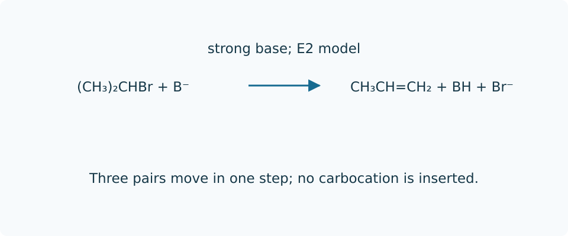{width=85% fig-alt="Balance a selected secondary E2 case"}

Identify the beta-H lost when2-bromopropane forms propene with a strong base.

::: notes
E2 is concerted. The displayed equation summarises that selected pathway, while actual competing substitution still depends on conditions.
:::

## Connect the formal equation to the three arrows

{width=85% fig-alt="Balance a selected secondary E2 case"}

Draw B→H, C–H→C–C and C–Br→Br simultaneously. Why is there no carbocation minimum?

::: notes
E2 is concerted. The displayed equation summarises that selected pathway, while actual competing substitution still depends on conditions.
:::

## Predict before the worked drawing

Place B⁻ near beta-H of an alkyl bromide. Draw every pair movement needed to make alkene, BH and Br⁻ without a carbocation.

::: notes
Allow about 25 seconds of individual drawing/thinking, then ask for one reason. Do not display the worked product yet. Use the following illustration to resolve the atom, charge or geometry issue.
:::

## E2 moves three pairs in one step

{width=85% fig-alt="The base-to-H, C–H-to-C–C and C–Br-to-Br arrows form the E2 electron-flow cycle."}

Draw the base lone pair → β-H; C–H pair → C–C π bond; C–Br pair → Br.

::: notes
The three arrows describe one elementary step. Identify alpha as the carbon carrying the leaving group and beta as its neighbour. Unshown substituents do not mean incomplete valence.
:::

## Keep carbon numbers while changing a bond

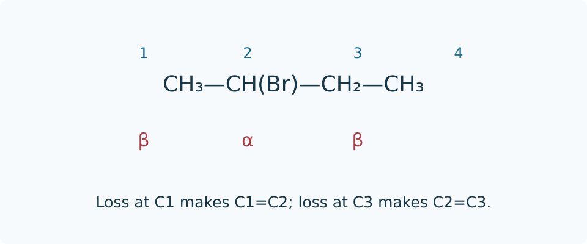{width=85% fig-alt="Keep carbon numbers while changing a bond"}

Choose loss atC1 and draw the resulting C1=C2 alkene without shifting the skeleton.

::: notes
C1 loss yields but-1-ene; C3 loss yields but-2-ene. Only the latter has two different substituents at both alkene carbons.
:::

## Use the other beta site

{width=85% fig-alt="Keep carbon numbers while changing a bond"}

Now choose C3 and draw C2=C3. Which product admits E/Z and why?

::: notes
C1 loss yields but-1-ene; C3 loss yields but-2-ene. Only the latter has two different substituents at both alkene carbons.
:::

## Predict before the worked drawing

View a beta-to-alpha C–C bond with front reacting H at twelve o’clock. Where should rear Br be for anti geometry?

::: notes
Allow about 25 seconds of individual drawing/thinking, then ask for one reason. Do not display the worked product yet. Use the following illustration to resolve the atom, charge or geometry issue.
:::

## Reactive geometry is three-dimensional

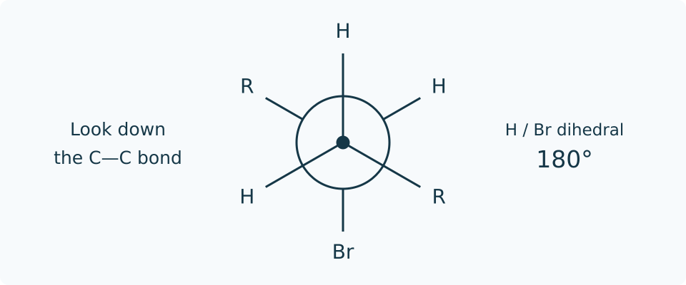{width=85% fig-alt="A Newman projection shows a front-carbon hydrogen opposite a back-carbon bromine at 180 degrees."}

An anti-periplanar C–H/C–Br arrangement supports the common E2 pathway. Read the viewing direction before choosing H.

::: notes
The front carbon is the dot and the rear carbon the circle. Check that students can rebuild the Newman view using a physical model before drawing a product.
:::

## Compare both protonation outcomes

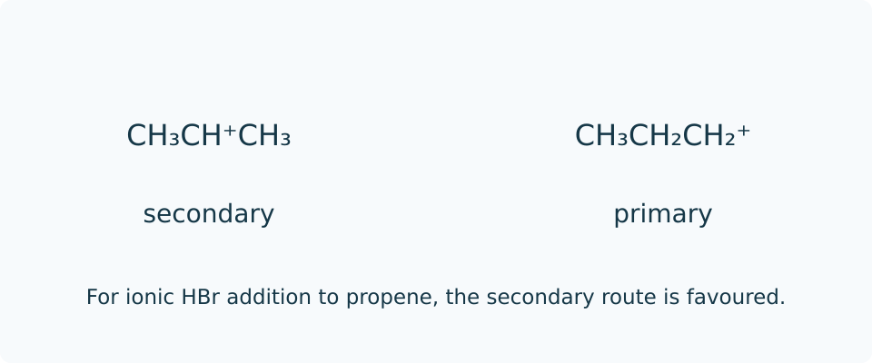{width=85% fig-alt="Compare both protonation outcomes"}

Identify which new C–H placement leads to the secondary cation and which to primary.

::: notes
Terminal H addition gives secondary CH₃CH⁺CH₃; bromide capture gives2-bromopropane in this ionic, no-peroxide model.
:::

## Use the comparison to explain regioselectivity

{width=85% fig-alt="Compare both protonation outcomes"}

Complete bromide capture of the favoured cation, then name the product rather than quoting a rule alone.

::: notes
Terminal H addition gives secondary CH₃CH⁺CH₃; bromide capture gives2-bromopropane in this ionic, no-peroxide model.
:::

## Predict before the worked drawing

Rotate only the rear carbon of that Newman view. Which selected H/Br angle changes, and which connected atoms stay the same?

::: notes
Allow about 25 seconds of individual drawing/thinking, then ask for one reason. Do not display the worked product yet. Use the following illustration to resolve the atom, charge or geometry issue.
:::

## Rotation can expose a reactive hydrogen

{width=85% fig-alt="Partial Newman projections compare anti and eclipsed H/Br arrangements."}

Rotation about a single bond changes conformation, not connectivity. In a flexible molecule it can create an anti arrangement.

::: notes
Other groups are omitted intentionally. Constrained rings can restrict the needed geometry; the diagram is not a general statement that every beta-H is equally available.
:::

## Draw deprotonation after ionisation

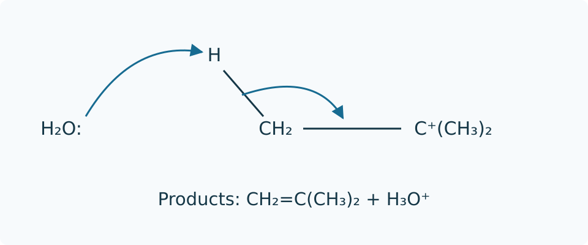{width=85% fig-alt="Draw deprotonation after ionisation"}

Locate the C–H pair that becomes the alkene pi pair. Which atom receives the water lone pair?

::: notes
Water attacks H; the C–H pair forms C=C. Bromide departed in an earlier separate ionisation step, unlike E2.
:::

## Contrast what is absent from this step

{width=85% fig-alt="Draw deprotonation after ionisation"}

Why is there no C–Br-cleavage arrow in the pictured E1 deprotonation?

::: notes
Water attacks H; the C–H pair forms C=C. Bromide departed in an earlier separate ionisation step, unlike E2.
:::

## Predict before the worked drawing

Draw 2-bromobutane. Remove beta-H from each possible neighbouring carbon and list constitutional alkenes before considering proportions.

::: notes
Allow about 25 seconds of individual drawing/thinking, then ask for one reason. Do not display the worked product yet. Use the following illustration to resolve the atom, charge or geometry issue.
:::

## More than one beta carbon can react

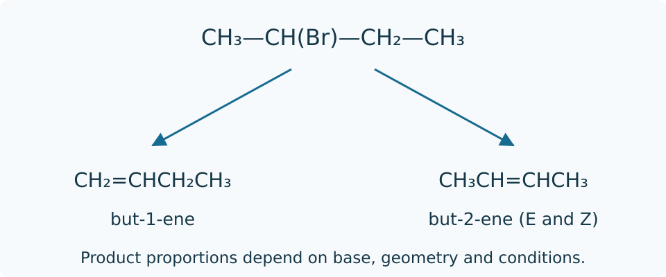{width=85% fig-alt="2-bromobutane can lose beta hydrogen in two positions to give but-1-ene or but-2-ene, with E/Z forms for the latter."}

Locate possible β-carbons first. Geometry and conditions determine which of the possible alkenes are favoured.

::: notes
The more substituted alkene is often favoured with a small base, but bulky bases and geometry can change the distribution. Avoid presenting a universal product ratio.
:::

## Use symmetry before inventing regioisomers

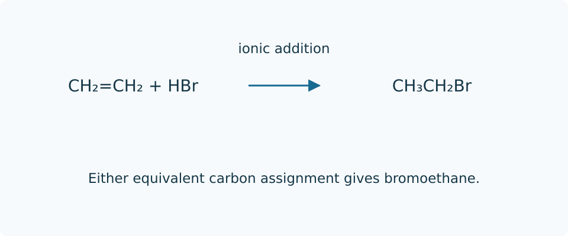{width=85% fig-alt="Use symmetry before inventing regioisomers"}

Exchange the two ethene carbon labels and predict the HBr-addition connectivity again.

::: notes
Either equivalent assignment gives bromoethane. Symmetry removes a distinct constitutional regioisomeric choice.
:::

## Explain the unchanged chemical identity

{width=85% fig-alt="Use symmetry before inventing regioisomers"}

Does relabelling equivalent atoms make a different product? Distinguish atom labels from molecular connectivity.

::: notes
Either equivalent assignment gives bromoethane. Symmetry removes a distinct constitutional regioisomeric choice.
:::

## Predict before the worked drawing

For propene plus ionic HBr without peroxides, draw both possible carbocations after protonation. Which is the more stabilised?

::: notes
Allow about 25 seconds of individual drawing/thinking, then ask for one reason. Do not display the worked product yet. Use the following illustration to resolve the atom, charge or geometry issue.
:::

## An alkene supplies a pi pair to H

{width=85% fig-alt="Propene protonation by HBr forms the secondary carbocation and bromide in the representative ionic route."}

The C=C π bond is an electron-pair source. Protonation giving the more stable carbocation explains this regioselectivity.

::: notes
For propene, H attaches to the terminal carbon in the shown pathway. This is the ionic case without peroxides; radical HBr addition is outside the required toolkit.
:::

## Check two bromine atoms in the product

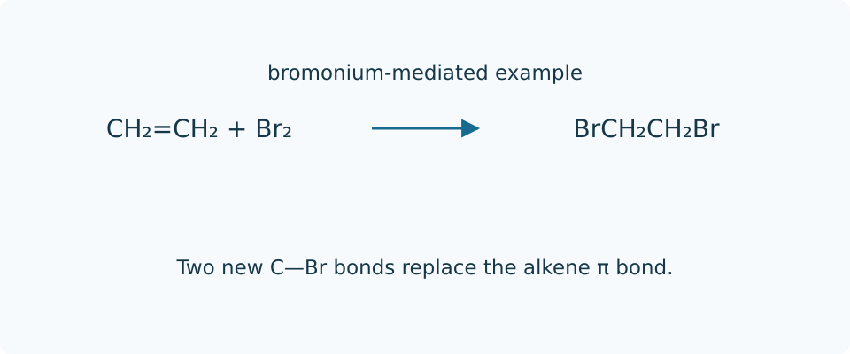{width=85% fig-alt="Check two bromine atoms in the product"}

Compare Br₂ addition to ethene with HBr addition: which two new sigma bonds are formed?

::: notes
Br₂ gives two C–Br bonds in a vicinal dibromide. The condensed ethene product has no stereocentre; relative approach is explained by the bridged mechanism.
:::

## Connect the net map to intermediate geometry

{width=85% fig-alt="Check two bromine atoms in the product"}

Explain why a bromonium-opening drawing is needed to discuss anti addition, rather than relying on the condensed product formula.

::: notes
Br₂ gives two C–Br bonds in a vicinal dibromide. The condensed ethene product has no stereocentre; relative approach is explained by the bridged mechanism.
:::

## Predict before the worked drawing

Start with CH₃CH⁺CH₃ and Br⁻. Where does the bromide lone pair go, and what happens to carbon geometry?

::: notes
Allow about 25 seconds of individual drawing/thinking, then ask for one reason. Do not display the worked product yet. Use the following illustration to resolve the atom, charge or geometry issue.
:::

## The carbocation is then captured

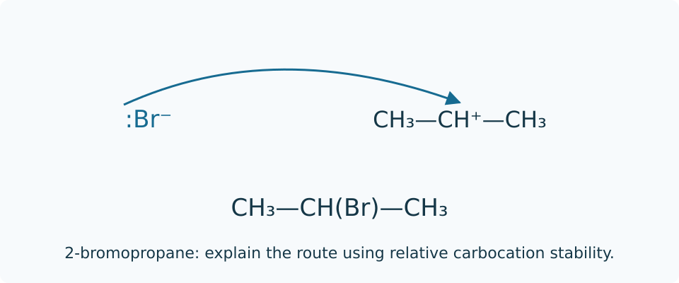{width=85% fig-alt="A bromide lone pair attacks the secondary propyl carbocation to produce 2-bromopropane."}

The observed connectivity follows two steps: protonation, then nucleophile capture.

::: notes
The intermediate has three carbon bond directions and a positive charge. If a new stereocentre forms in another example, both accessible faces must be considered.
:::

## Choose carbon or beta hydrogen

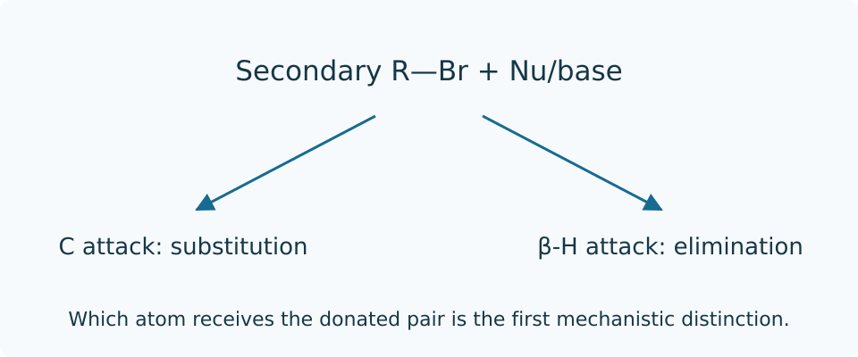{width=85% fig-alt="Choose carbon or beta hydrogen"}

Sketch both pair-donation destinations on one secondary bromide substrate.

::: notes
Attack location distinguishes substitution from elimination. Reagent basicity/nucleophilicity, sterics, medium, temperature and accessible geometry shape competition.
:::

## State the evidence needed to choose a dominant route

{width=85% fig-alt="Choose carbon or beta hydrogen"}

Which additional information about base/nucleophile, solvent and geometry would you need before predicting proportions?

::: notes
Attack location distinguishes substitution from elimination. Reagent basicity/nucleophilicity, sterics, medium, temperature and accessible geometry shape competition.
:::

## Predict before the worked drawing

A C–Br⁺–C bridge has formed. Predict from which side Br⁻ opens it and which bridge pair must return to Br.

::: notes
Allow about 25 seconds of individual drawing/thinking, then ask for one reason. Do not display the worked product yet. Use the following illustration to resolve the atom, charge or geometry issue.
:::

## Some additions avoid a free carbocation

{width=85% fig-alt="A bridged bromonium intermediate is opened by bromide attack from the opposite side."}

Br₂ addition commonly proceeds through a bromonium bridge and anti opening, rather than the free-carbocation HBr model.

::: notes
This diagram shows the ring-opening stage only. The curved arrow returning the C–Br bridge pair to Br relieves the positive charge as the new C–Br bond forms.
:::

## Test both double-bond ends first

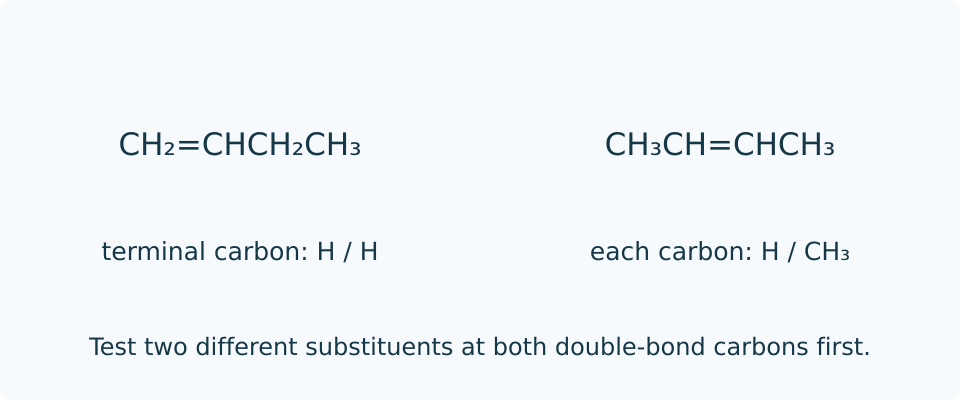{width=85% fig-alt="Test both double-bond ends first"}

List the two substituents on each end of but-1-ene and but-2-ene.

::: notes
But-1-ene has two identical H on one alkene carbon. Extended drawing shape does not supply the missing substituent difference; only but-2-ene has E/Z here.
:::

## Use the list rather than visual resemblance

{width=85% fig-alt="Test both double-bond ends first"}

Why would labelling a terminal alkene “E” be an error even if its chain looks extended?

::: notes
But-1-ene has two identical H on one alkene carbon. Extended drawing shape does not supply the missing substituent difference; only but-2-ene has E/Z here.
:::

## Predict before the worked drawing

A tertiary carbocation is already present in water. Draw the competing carbon-attack and beta-H-removal possibilities.

::: notes
Allow about 25 seconds of individual drawing/thinking, then ask for one reason. Do not display the worked product yet. Use the following illustration to resolve the atom, charge or geometry issue.
:::

## E1 and SN1 can share an intermediate

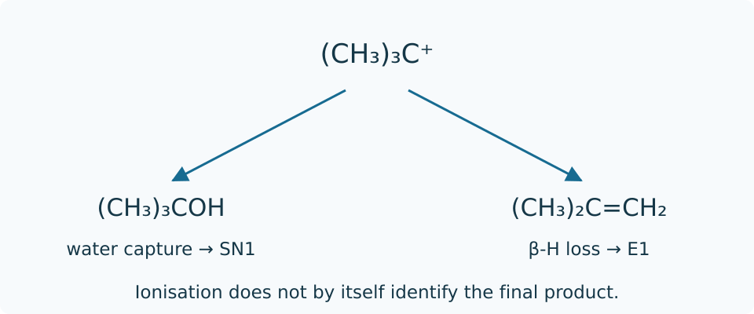{width=85% fig-alt="A tertiary carbocation can be captured by water or lose a beta hydrogen to form an alkene."}

Ionisation followed by β-H loss gives E1; ionisation followed by capture gives SN1.

::: notes
In E1, a weak base such as water can remove the beta proton after ionisation. Product proportions depend on conditions; heat can favour elimination in many cases.
:::

## Predict before the worked drawing

Compare the bond inventory of addition and elimination. Which sigma and pi changes must a real equation specify?

::: notes
Allow about 25 seconds of individual drawing/thinking, then ask for one reason. Do not display the worked product yet. Use the following illustration to resolve the atom, charge or geometry issue.
:::

## Read the local bond inventory

{width=85% fig-alt="A C–C single bond becomes C=C in elimination; addition consumes a pi bond and makes new sigma bonds."}

Check the specific atoms that gain and lose bonds. These labels do not make every pair of reactions exact reverses under identical conditions.

::: notes
Ask students to supply omitted reagents and products for a real example. A bare C–C/C=C cartoon is only a summary of local changes.
:::

## Choose the attacked atom

Attack at a saturated carbon can give substitution. Removal of β-H can give elimination. Donation of an alkene π pair to H gives addition.

The same electron-flow language applies to all three.

## A product name is not a mechanism

For HBr + propene, draw the two electron-flow steps and identify the intermediate.

Then explain why the simple carbocation model is inappropriate for Br₂ addition via bromonium.

## Check a possible product

Can methyl bromide undergo ordinary β-elimination? Draw its carbon skeleton before answering.

For 2-bromobutane, name each constitutional alkene and state which can have E/Z forms.

## Build the whole E2 view

Choose2-bromobutane, draw a beta-to-alpha Newman projection with a reacting H anti to Br, and turn it into an alkene plus BH and Br⁻. State which beta site you used.

::: notes
Reserve 2 minutes for a complete individual drawing, then compare one mechanism at the board. This is application of the previous steps, not a new reaction family.
:::

::: notes
Session budget45 minutes:roughly27–29 minutes of concise explanations/visual inspection, about 11–13 minutes of individual drawing and predictions distributed through the sequence, and4–6 minutes of discussion/closing checks. Adjust to observed errors; the 40 second metadata is a planning guide, not a quota. Required paper practice and optional transfer are available in the exercise bank.
:::

## Use the same reasoning in practice

Complete the [practice and worked examples](exercise.qmd), then the [self-check](quiz.qmd).

Optional textbook support: selected Solomons chapter 7–8 sections. The [reading guide](../reference/reading.qmd) explains the provisional book mapping.
