## A chemical route through this session

Transfer familiar reasoning to lactic acid, an amino acid and an unknown spectrum. No metabolic pathway knowledge is needed; read the local atoms and bonds.

::: notes
45-minute budget: retrieval 3 min; lactic-acid stereochemistry and charge 10 min; redox/ester mechanisms with drawing checks 10 min; amino-acid charge transfer 5 min; integrated spectral assignment 8 min; experimental-claim critique 7 min; exit check 2 min. Total 45 min, including drawing and discussion.

Suggested 30 seconds; adjust to the explanation and class response. Plan 45 minutes including short drawing and discussion intervals. Routine visual frames take roughly 40 seconds; worked checks need longer and some resolutions can be quicker. Treat timings as guidance, with room for questions.
:::

## Retrieve the starting idea

List the checks you can make on any proposed elementary step.

::: notes
Suggested 30 seconds; adjust to the explanation and class response. Give students a short individual attempt. Worked answer: Track electron pairs, count bond orders and hydrogens, conserve atoms and net charge, and inspect the plausible source and acceptor.
:::

## Read an unfamiliar-looking molecule locally

{width=85% fig-alt="Lactic acid combines several familiar chemical features"}

Which functional groups can you recognise without knowing a metabolic pathway?

::: notes
Suggested 40 seconds; adjust to the explanation and class response. Ask students to inspect the indicated molecular feature rather than read the answer caption. Worked answer: Lactic acid has a secondary alcohol and carboxylic acid; its alcohol-bearing carbon has four different substituents.
:::

## Apply: read an unfamiliar-looking molecule locally

Why is the alcohol secondary?

::: notes
Suggested 60 seconds; adjust to the explanation and class response. Allow a brief paper or pair check within this slide. Worked answer: The OH-bearing carbon is attached to two other carbons and one H.
:::

## Rank the carbon branches

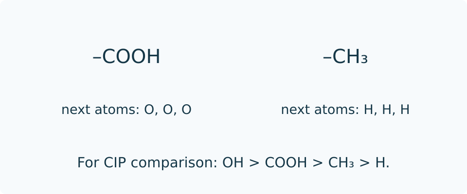{width=85% fig-alt="Rank the two carbon branches at lactic acid stereocentre"}

Why does COOH outrank CH₃ in CIP comparison?

::: notes
Suggested 40 seconds; adjust to the explanation and class response. Ask students to inspect the indicated molecular feature rather than read the answer caption. Worked answer: After the first carbon tie, compare attached atoms: O,O,O outranks H,H,H using multiple-bond bookkeeping.
:::

## Resolve: rank the carbon branches

{width=85% fig-alt="Rank the two carbon branches at lactic acid stereocentre"}

After the first carbon tie, compare attached atoms: O,O,O outranks H,H,H using multiple-bond bookkeeping.

::: notes
Suggested 30 seconds; adjust to the explanation and class response. Use a second inspection focus: justify the result by the atom, charge, ratio or observation involved. Next application answer: OH > COOH > CH₃ > H: O first, then the two ranked carbon branches, then H.
:::

## Apply: rank the carbon branches

Give the complete priority order at lactic acid’s centre.

::: notes
Suggested 60 seconds; adjust to the explanation and class response. Allow a brief paper or pair check within this slide. Worked answer: OH > COOH > CH₃ > H: O first, then the two ranked carbon branches, then H.
:::

## Orient the lowest priority away

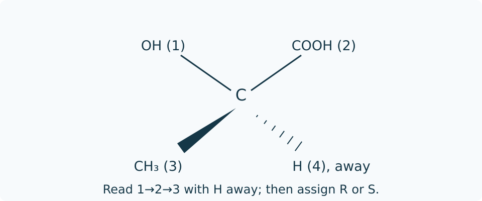{width=85% fig-alt="A low-priority H directed away makes the viewing rule usable"}

With H dashed away, which path gives R or S?

::: notes
Suggested 40 seconds; adjust to the explanation and class response. Ask students to inspect the indicated molecular feature rather than read the answer caption. Worked answer: Read 1→2→3: clockwise is R, anticlockwise is S. In this supplied view it is clockwise, so R.
:::

## Resolve: orient the lowest priority away

{width=85% fig-alt="A low-priority H directed away makes the viewing rule usable"}

Read 1→2→3: clockwise is R, anticlockwise is S. In this supplied view it is clockwise, so R.

::: notes
Suggested 30 seconds; adjust to the explanation and class response. Use a second inspection focus: justify the result by the atom, charge, ratio or observation involved. Next application answer: Reverse the apparent clockwise/anticlockwise assignment, or reorient a model until the lowest priority points away.
:::

## Apply: orient the lowest priority away

If H instead points toward you, how is the apparent result corrected?

::: notes
Suggested 60 seconds; adjust to the explanation and class response. Allow a brief paper or pair check within this slide. Worked answer: Reverse the apparent clockwise/anticlockwise assignment, or reorient a model until the lowest priority points away.
:::

## Compare configurations without changing connectivity

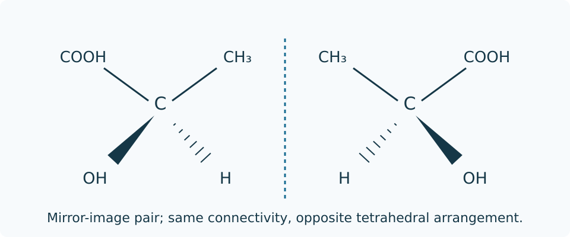{width=85% fig-alt="Keep connectivity fixed when identifying stereoisomers"}

Can the mirror-related pair be superimposed by rigid rotation?

::: notes
Suggested 40 seconds; adjust to the explanation and class response. Ask students to inspect the indicated molecular feature rather than read the answer caption. Worked answer: No. They are enantiomeric configurations with identical connectivity and opposite tetrahedral arrangement.
:::

## Apply: compare configurations without changing connectivity

Does changing the drawing orientation alone create the other enantiomer?

::: notes
Suggested 60 seconds; adjust to the explanation and class response. Allow a brief paper or pair check within this slide. Worked answer: No. Rigid rotation preserves configuration; changing wedge/dash geometry at the centre can alter it.
:::

## Predict the simplest acid–base change

{width=85% fig-alt="Acid–base change preserves the carbon skeleton"}

Which H is removed in the stated hydroxide deprotonation?

::: notes
Suggested 40 seconds; adjust to the explanation and class response. Ask students to inspect the indicated molecular feature rather than read the answer caption. Worked answer: The carboxyl proton moves to hydroxide, giving lactate and water. The alcohol-bearing centre is not inverted by that step.
:::

## Resolve: predict the simplest acid–base change

{width=85% fig-alt="Acid–base change preserves the carbon skeleton"}

The carboxyl proton moves to hydroxide, giving lactate and water. The alcohol-bearing centre is not inverted by that step.

::: notes
Suggested 30 seconds; adjust to the explanation and class response. Use a second inspection focus: justify the result by the atom, charge, ratio or observation involved. Next application answer: CH₃CH(OH)COO⁻, charge −1, plus neutral water.
:::

## Apply: predict the simplest acid–base change

Write the product formula and net charge.

::: notes
Suggested 60 seconds; adjust to the explanation and class response. Allow a brief paper or pair check within this slide. Worked answer: CH₃CH(OH)COO⁻, charge −1, plus neutral water.
:::

## Audit atoms and net charge

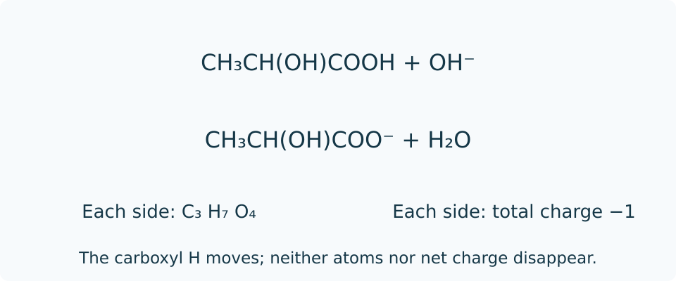{width=85% fig-alt="Audit a proton-transfer reaction atom by atom"}

What inventory should agree before and after the proton transfer?

::: notes
Suggested 40 seconds; adjust to the explanation and class response. Ask students to inspect the indicated molecular feature rather than read the answer caption. Worked answer: Both sides have C₃H₇O₄ and total charge −1. The H changes location; it is not deleted.
:::

## Resolve: audit atoms and net charge

{width=85% fig-alt="Audit a proton-transfer reaction atom by atom"}

Both sides have C₃H₇O₄ and total charge −1. The H changes location; it is not deleted.

::: notes
Suggested 30 seconds; adjust to the explanation and class response. Use a second inspection focus: justify the result by the atom, charge, ratio or observation involved. Next application answer: It stays on the carboxyl oxygen when the H leaves as H⁺ transfer to the base.
:::

## Apply: audit atoms and net charge

Where does the original acid O–H bonding pair go?

::: notes
Suggested 60 seconds; adjust to the explanation and class response. Allow a brief paper or pair check within this slide. Worked answer: It stays on the carboxyl oxygen when the H leaves as H⁺ transfer to the base.
:::

## Transfer the aqueous ionisation model

{width=85% fig-alt="A supplied lactic-acid model predicts its ionised fraction"}

At pH equal to supplied pKa 3.86, what fraction is lactate?

::: notes
Suggested 40 seconds; adjust to the explanation and class response. Ask students to inspect the indicated molecular feature rather than read the answer caption. Worked answer: For a dilute monoprotic model, 1/(1+10^(pKa−pH)) = 0.5 at equal pH and pKa.
:::

## Resolve: transfer the aqueous ionisation model

{width=85% fig-alt="A supplied lactic-acid model predicts its ionised fraction"}

For a dilute monoprotic model, 1/(1+10^(pKa−pH)) = 0.5 at equal pH and pKa.

::: notes
Suggested 30 seconds; adjust to the explanation and class response. Use a second inspection focus: justify the result by the atom, charge, ratio or observation involved. Next application answer: 10/(1+10) ≈ 0.909, or 90.9%, not 100% and not each molecule partly deprotonated.
:::

## Apply: transfer the aqueous ionisation model

At pH 4.86, calculate the approximate fraction.

::: notes
Suggested 60 seconds; adjust to the explanation and class response. Allow a brief paper or pair check within this slide. Worked answer: 10/(1+10) ≈ 0.909, or 90.9%, not 100% and not each molecule partly deprotonated.
:::

## Predict a functional-group transformation

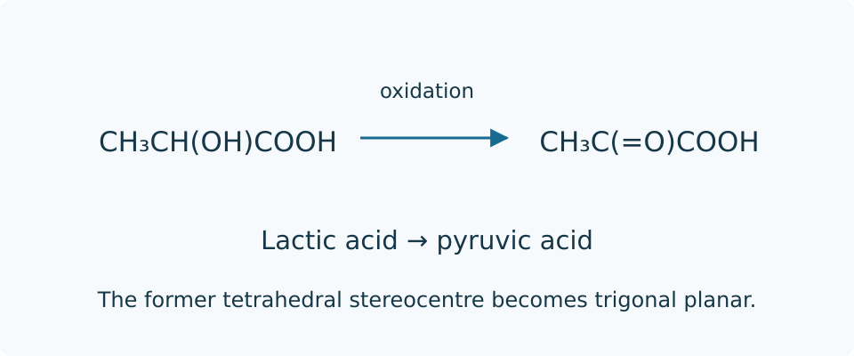{width=85% fig-alt="Oxidation changes the alcohol carbon into a carbonyl carbon"}

What product results from oxidising the secondary alcohol to a ketone?

::: notes
Suggested 40 seconds; adjust to the explanation and class response. Ask students to inspect the indicated molecular feature rather than read the answer caption. Worked answer: CH₃C(=O)COOH, pyruvic acid. The former alcohol carbon is now trigonal planar.
:::

## Resolve: predict a functional-group transformation

{width=85% fig-alt="Oxidation changes the alcohol carbon into a carbonyl carbon"}

CH₃C(=O)COOH, pyruvic acid. The former alcohol carbon is now trigonal planar.

::: notes
Suggested 30 seconds; adjust to the explanation and class response. Use a second inspection focus: justify the result by the atom, charge, ratio or observation involved. Next application answer: No. It is not a tetrahedral carbon with four different substituents, so that centre no longer qualifies for R/S.
:::

## Apply: predict a functional-group transformation

Does the ketone carbon retain the original R/S stereocentre?

::: notes
Suggested 60 seconds; adjust to the explanation and class response. Allow a brief paper or pair check within this slide. Worked answer: No. It is not a tetrahedral carbon with four different substituents, so that centre no longer qualifies for R/S.
:::

## Check oxidation without counting oxygen atoms only

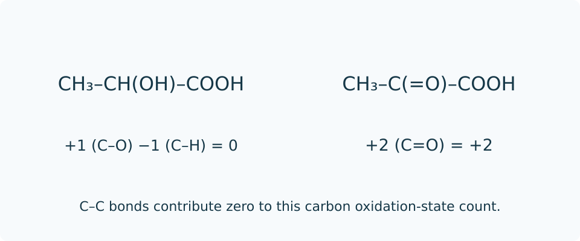{width=85% fig-alt="The alcohol carbon oxidation state changes from zero to plus two"}

How does the changing carbon’s oxidation state change?

::: notes
Suggested 40 seconds; adjust to the explanation and class response. Ask students to inspect the indicated molecular feature rather than read the answer caption. Worked answer: Lactic centre: +1 for C–O and −1 for C–H gives 0. Ketone carbon: C=O gives +2.
:::

## Resolve: check oxidation without counting oxygen atoms only

{width=85% fig-alt="The alcohol carbon oxidation state changes from zero to plus two"}

Lactic centre: +1 for C–O and −1 for C–H gives 0. Ketone carbon: C=O gives +2.

::: notes
Suggested 30 seconds; adjust to the explanation and class response. Use a second inspection focus: justify the result by the atom, charge, ratio or observation involved. Next application answer: The bonded atoms are the same element, so the bonding electrons are divided equally in oxidation-state assignment.
:::

## Apply: check oxidation without counting oxygen atoms only

Why does each C–C bond contribute zero in this count?

::: notes
Suggested 60 seconds; adjust to the explanation and class response. Allow a brief paper or pair check within this slide. Worked answer: The bonded atoms are the same element, so the bonding electrons are divided equally in oxidation-state assignment.
:::

## Choose the target site before a mechanism

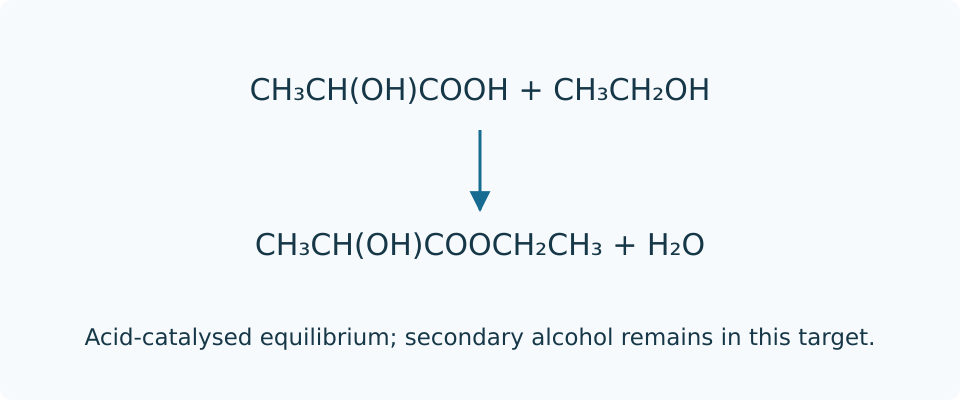{width=85% fig-alt="Esterification replaces the acidic OH as a net transformation"}

Which group changes in the selected ethyl-lactate target?

::: notes
Suggested 40 seconds; adjust to the explanation and class response. Ask students to inspect the indicated molecular feature rather than read the answer caption. Worked answer: The carboxylic acid becomes COOEt; the secondary alcohol remains in the drawn target.
:::

## Apply: choose the target site before a mechanism

Does this target drawing guarantee no competing reactions under all conditions?

::: notes
Suggested 60 seconds; adjust to the explanation and class response. Allow a brief paper or pair check within this slide. Worked answer: No. It specifies the desired transformation; conditions and selectivity must be assessed for the actual experiment.
:::

## Track an atom through a mechanism

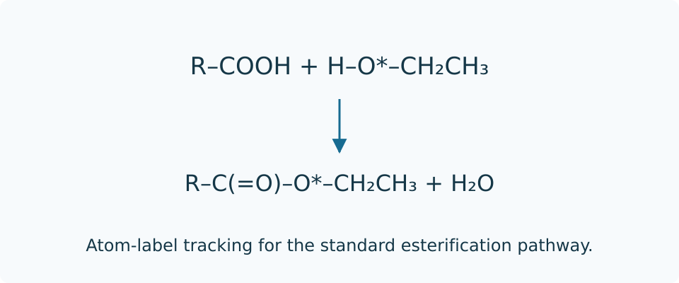{width=85% fig-alt="The alcohol oxygen becomes the ester single-bond oxygen"}

Where does the labelled alcohol oxygen appear in standard esterification?

::: notes
Suggested 40 seconds; adjust to the explanation and class response. Ask students to inspect the indicated molecular feature rather than read the answer caption. Worked answer: It becomes the ester single-bond oxygen linking acyl carbon to ethyl. The mechanism, not a filename, tracks the atom.
:::

## Resolve: track an atom through a mechanism

{width=85% fig-alt="The alcohol oxygen becomes the ester single-bond oxygen"}

It becomes the ester single-bond oxygen linking acyl carbon to ethyl. The mechanism, not a filename, tracks the atom.

::: notes
Suggested 30 seconds; adjust to the explanation and class response. Use a second inspection focus: justify the result by the atom, charge, ratio or observation involved. Next application answer: Not in this selected net transformation; the CH(OH) centre retains its tetrahedral arrangement if no separate racemising process occurs.
:::

## Apply: track an atom through a mechanism

Does esterification at the acid site require breaking a bond at the original stereocentre?

::: notes
Suggested 60 seconds; adjust to the explanation and class response. Allow a brief paper or pair check within this slide. Worked answer: Not in this selected net transformation; the CH(OH) centre retains its tetrahedral arrangement if no separate racemising process occurs.
:::

## Choose addition or acyl substitution

{width=85% fig-alt="Choose a mechanism from the site and the structural change"}

Which substrate feature allows the carbonyl to reform by leaving-group loss?

::: notes
Suggested 40 seconds; adjust to the explanation and class response. Ask students to inspect the indicated molecular feature rather than read the answer caption. Worked answer: An acyl derivative has a potentially viable leaving group. An ordinary aldehyde/ketone lacks that group at the corresponding position.
:::

## Resolve: choose addition or acyl substitution

{width=85% fig-alt="Choose a mechanism from the site and the structural change"}

An acyl derivative has a potentially viable leaving group. An ordinary aldehyde/ketone lacks that group at the corresponding position.

::: notes
Suggested 30 seconds; adjust to the explanation and class response. Use a second inspection focus: justify the result by the atom, charge, ratio or observation involved. Next application answer: A nucleophile donates to carbonyl carbon as the C=O pi pair moves to oxygen, giving a tetrahedral species.
:::

## Apply: choose addition or acyl substitution

Name the first shared elementary event in both pathways.

::: notes
Suggested 60 seconds; adjust to the explanation and class response. Allow a brief paper or pair check within this slide. Worked answer: A nucleophile donates to carbonyl carbon as the C=O pi pair moves to oxygen, giving a tetrahedral species.
:::

## Read a biological-looking charge pattern

{width=85% fig-alt="The same molecule can carry acid and basic sites"}

Which formal charges are present in the supplied alanine form?

::: notes
Suggested 40 seconds; adjust to the explanation and class response. Ask students to inspect the indicated molecular feature rather than read the answer caption. Worked answer: Ammonium N is +1 and carboxylate is −1. The centre and methyl remain part of the same carbon skeleton.
:::

## Apply: read a biological-looking charge pattern

Can net-neutral alanine still strongly interact with water?

::: notes
Suggested 60 seconds; adjust to the explanation and class response. Allow a brief paper or pair check within this slide. Worked answer: Yes. Its zwitterionic charged sites remain; net charge zero does not eliminate local electrostatic interactions.
:::

## Compute net charge explicitly

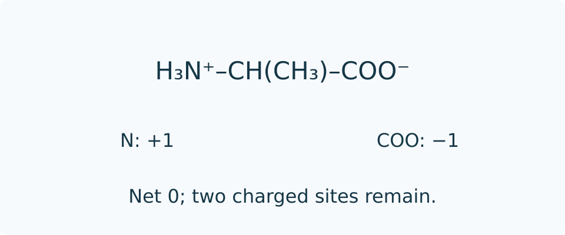{width=85% fig-alt="Alanine net charge is the sum of its formal charges"}

What is the sum of the two formal charges?

::: notes
Suggested 40 seconds; adjust to the explanation and class response. Ask students to inspect the indicated molecular feature rather than read the answer caption. Worked answer: +1 + (−1) = 0. “Zwitterion” describes those opposing charges within one molecule.
:::

## Apply: compute net charge explicitly

Does the amide N of a peptide automatically behave like this free ammonium site?

::: notes
Suggested 60 seconds; adjust to the explanation and class response. Allow a brief paper or pair check within this slide. Worked answer: No. A peptide N is an amide with different lone-pair delocalisation; local structure must be checked.
:::

## Change protonation without changing skeleton

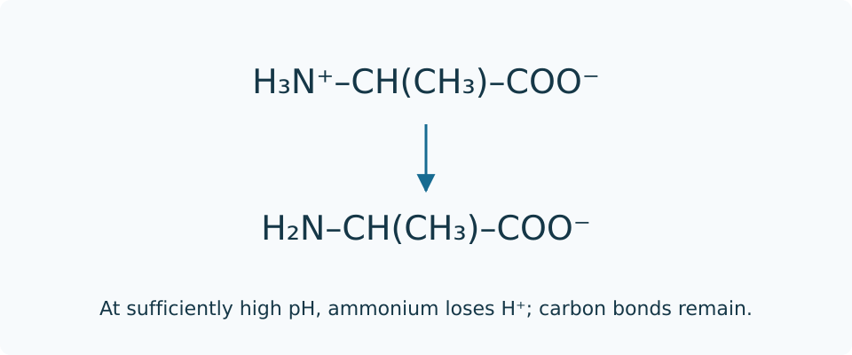{width=85% fig-alt="A pH change can alter charge without changing connectivity"}

At sufficiently high pH, which drawn site loses H⁺?

::: notes
Suggested 40 seconds; adjust to the explanation and class response. Ask students to inspect the indicated molecular feature rather than read the answer caption. Worked answer: Ammonium becomes NH₂ while COO⁻ remains; the dominant form has net −1.
:::

## Apply: change protonation without changing skeleton

Does this protonation-state change alone break a C–C bond?

::: notes
Suggested 60 seconds; adjust to the explanation and class response. Allow a brief paper or pair check within this slide. Worked answer: No. It changes an N–H bond and charge, preserving the displayed carbon connectivity.
:::

## Combine independent observations

{width=85% fig-alt="Require agreement between different measurements"}

Which candidate fits the supplied carbonyl and ethyl/acetyl proton pattern?

::: notes
Suggested 40 seconds; adjust to the explanation and class response. Ask students to inspect the indicated molecular feature rather than read the answer caption. Worked answer: Ethyl ethanoate fits C₄H₈O₂, an ester carbonyl, 3H singlet and 2H quartet/3H triplet.
:::

## Apply: combine independent observations

What is the role of the molecular formula in that argument?

::: notes
Suggested 60 seconds; adjust to the explanation and class response. Allow a brief paper or pair check within this slide. Worked answer: It constrains total atoms and unsaturation so that a candidate matching one spectral fragment must also explain the whole composition.
:::

## Ask an alternative to make a prediction

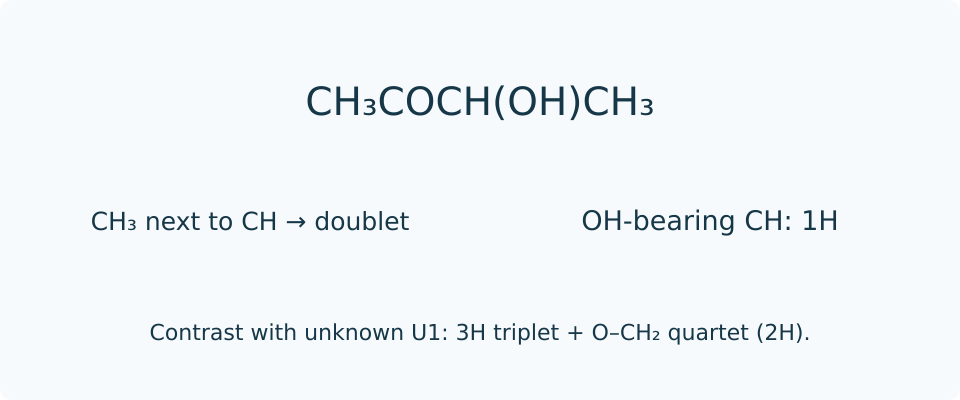{width=85% fig-alt="A second candidate predicts a different methyl splitting"}

What simple coupling feature challenges the hydroxyketone alternative?

::: notes
Suggested 40 seconds; adjust to the explanation and class response. Ask students to inspect the indicated molecular feature rather than read the answer caption. Worked answer: Its CH₃ beside CH predicts a doublet in the simple model, and its OH-bearing CH represents 1H rather than an O–CH₂ 2H quartet.
:::

## Resolve: ask an alternative to make a prediction

{width=85% fig-alt="A second candidate predicts a different methyl splitting"}

Its CH₃ beside CH predicts a doublet in the simple model, and its OH-bearing CH represents 1H rather than an O–CH₂ 2H quartet.

::: notes
Suggested 30 seconds; adjust to the explanation and class response. Use a second inspection focus: justify the result by the atom, charge, ratio or observation involved. Next application answer: No. A candidate must account for the full evidence rather than one familiar region.
:::

## Apply: ask an alternative to make a prediction

Would a single matching carbonyl band rescue all those disagreements?

::: notes
Suggested 60 seconds; adjust to the explanation and class response. Allow a brief paper or pair check within this slide. Worked answer: No. A candidate must account for the full evidence rather than one familiar region.
:::

## Resolve conflicting experimental claims

{width=85% fig-alt="High isolated yield cannot rescue contradictory identity evidence"}

What can 1.70 g against 1.8016 g theoretical establish by itself?

::: notes
Suggested 40 seconds; adjust to the explanation and class response. Ask students to inspect the indicated molecular feature rather than read the answer caption. Worked answer: An apparent mass-based yield of about 94.4%, assuming product mass. Contradictory NMR tests that identity/purity assumption.
:::

## Resolve: resolve conflicting experimental claims

{width=85% fig-alt="High isolated yield cannot rescue contradictory identity evidence"}

An apparent mass-based yield of about 94.4%, assuming product mass. Contradictory NMR tests that identity/purity assumption.

::: notes
Suggested 30 seconds; adjust to the explanation and class response. Use a second inspection focus: justify the result by the atom, charge, ratio or observation involved. Next application answer: Residual solvent or another impurity, including starting material, may add to mass. The observations do not identify a unique cause.
:::

## Apply: resolve conflicting experimental claims

Give two possible contributors to an unexpectedly high mass.

::: notes
Suggested 60 seconds; adjust to the explanation and class response. Allow a brief paper or pair check within this slide. Worked answer: Residual solvent or another impurity, including starting material, may add to mass. The observations do not identify a unique cause.
:::

## Write the causal link

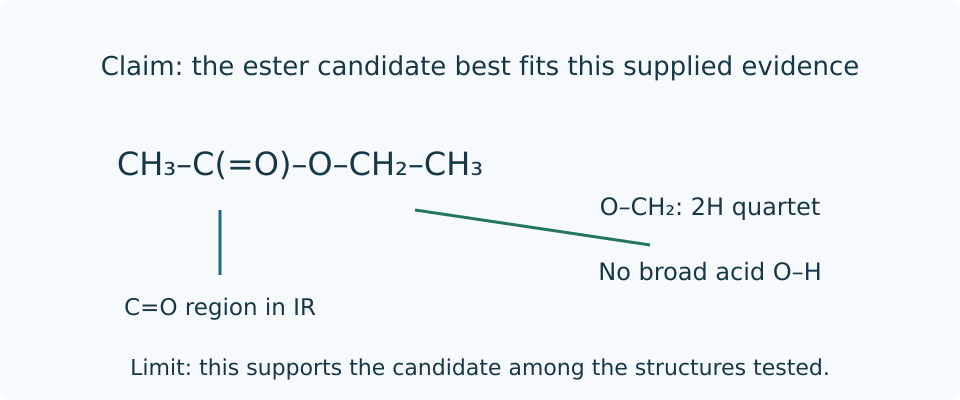{width=85% fig-alt="A scientific explanation links claim, observation and chemical reason"}

How does the ester claim connect to actual measured kinds of observations?

::: notes
Suggested 40 seconds; adjust to the explanation and class response. Ask students to inspect the indicated molecular feature rather than read the answer caption. Worked answer: A carbonyl plus O–CH₂ environment and absent broad acid O–H agree with the ester candidate among those tested.
:::

## Apply: write the causal link

What statement would be circular rather than evidential?

::: notes
Suggested 60 seconds; adjust to the explanation and class response. Allow a brief paper or pair check within this slide. Worked answer: “The sample is ester because the file is called ester” uses a label as proof rather than testing structural predictions.
:::

## Bring quantitative and structural evidence together

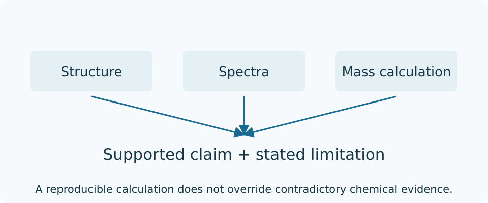{width=85% fig-alt="Build a defensible conclusion from separate evidence streams"}

Which evidence streams must agree before a strong synthesis claim?

::: notes
Suggested 40 seconds; adjust to the explanation and class response. Ask students to inspect the indicated molecular feature rather than read the answer caption. Worked answer: Structure predictions, spectra and properly calculated masses should agree. A reproducible calculation alone cannot override contradictory chemistry.
:::

## Apply: bring quantitative and structural evidence together

Name one useful follow-up when purity is uncertain.

::: notes
Suggested 60 seconds; adjust to the explanation and class response. Allow a brief paper or pair check within this slide. Worked answer: Use a suitable independent spectral or separation check, chosen to test a specific remaining alternative; do not merely repeat the yield calculation.
:::

## Integrate one short case

An isolate has high apparent yield and one TLC spot but unexpected major NMR signals. Write a defensible claim and one targeted next check.

::: notes
Suggested 120 seconds; adjust to the explanation and class response. Give time to formulate the claim and compare a partner explanation. Worked answer: The apparent yield is calculated under a product-mass assumption that the NMR calls into question. Compare full assigned NMR or use a suitable second separation to test a specific impurity alternative.
:::

## Compare the worked reasoning

The apparent yield is calculated under a product-mass assumption that the NMR calls into question. Compare full assigned NMR or use a suitable second separation to test a specific impurity alternative.

::: notes
Suggested 60 seconds; adjust to the explanation and class response. Ask students to identify the exact step or observation their own reasoning omitted. This is a correction interval within the session, not a new topic.
:::

## Exit explanation

What should an unfamiliar molecule prompt you to do first?

::: notes
Suggested 40 seconds; adjust to the explanation and class response. Worked answer: Read its functional groups, charges and geometry; use the same local electron and evidence rules before invoking a remembered reaction name. Ask for a causal explanation, not a single vocabulary label.
:::

## Continue with independent practice

Use the [exercises](exercise.qmd), then the [self-check](quiz.qmd).

All required inputs and explanations are provided locally. The [reading guide](../reference/reading.qmd) offers optional textbook support.

::: notes
Suggested 20 seconds; adjust to the explanation and class response. Preview the local exercise route. No book purchase or external problem set is needed to complete it. Leave time to note one corrected misconception.
:::
