## About this lecture

After a hard sprint your blood lactate can jump from about 1 to over 10 mmol/L. People call it "lactic acid", but at blood pH almost none of it is the acid. The same three-carbon molecule makes yoghurt sour and is polymerised into compostable PLA cups. **One small molecule, and every week of this course has something to say about it.**

Today we read one molecule with every tool:

- **Structure and stereo:** groups, CIP priorities, R/S, enantiomers
- **Acids and charge:** proton transfer, atom audits, pKa and ionised fraction
- **Reactions:** oxidation, esterification, addition versus substitution
- **Evidence:** spectra, alternatives, yield and honest conclusions

Yesterday was about yield and evidence; today we use it alongside everything else.

::: notes
Open with the sprint. Ask who has heard that "lactic acid" makes your legs burn, then promise that by slide eight we'll show with one pKa that the blood is full of lactate, not lactic acid. Mention the yoghurt and the PLA cup to show this isn't just a biochemistry molecule; the PLA link comes back on the esterification slide. Make clear that no metabolic pathways are needed: everything today is read from the atoms and bonds, using tools from Weeks 1 to 5. This is also a good model of how exam questions combine topics: one molecule, several questions in a row.
:::

## Read the molecule locally first

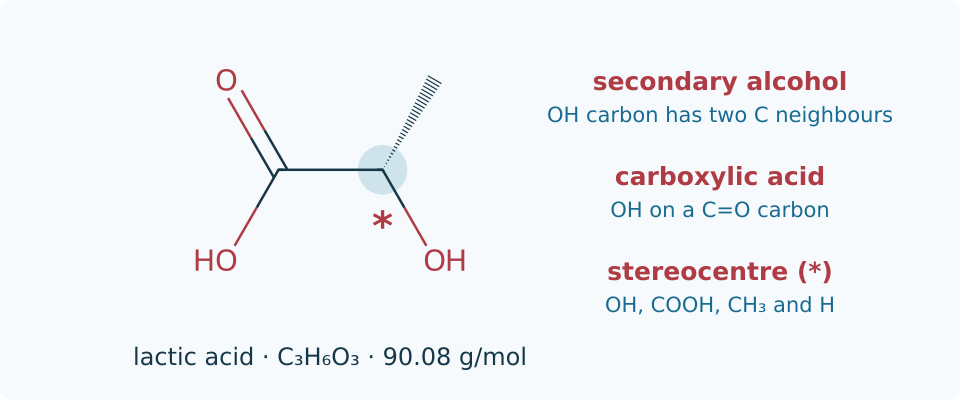{width=80% fig-alt="Skeletal structure of lactic acid with the stereocentre shaded and starred, labelled secondary alcohol, carboxylic acid and stereocentre bearing OH, COOH, CH3 and H"}

Before thinking about reactions, name what's there: a **secondary alcohol**, a **carboxylic acid**, and one **stereocentre** carrying OH, COOH, CH₃ and H.

::: {.try}
**Try it:** why is the alcohol *secondary*?

::: {.fragment}
**Answer.** The OH-bearing carbon has two carbon neighbours (CH₃ and COOH) and one H.
:::
:::

::: notes
This is the first move on any unfamiliar molecule, and it's the habit from Day 1: look at the neighbours of each heteroatom. Point at the two OH groups and ask which one is an acid. Only the OH on the carbonyl carbon is a carboxylic acid; the other is an alcohol. Students sometimes call the C=O carbon the stereocentre; it's trigonal planar with three neighbours, so it can't be. The stereocentre is the CH(OH) carbon with four different groups. Formula C3H6O3, molar mass 90.08 g/mol: worth checking the H count, since the central carbon has only one H.
:::

## Rank the branches at the stereocentre

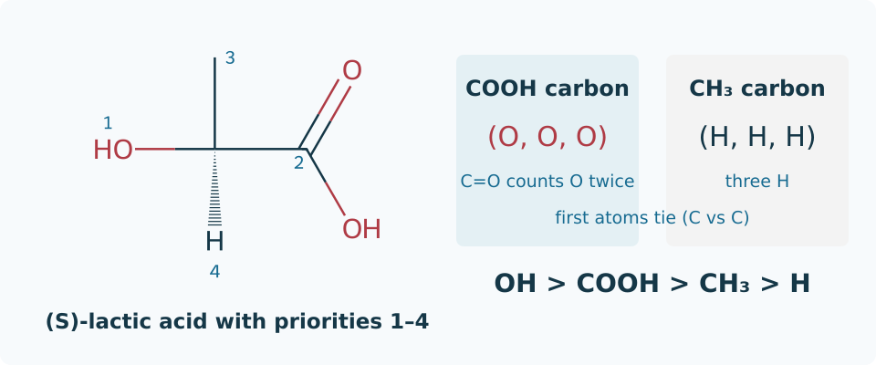{width=82% fig-alt="(S)-lactic acid with priorities 1 OH, 2 COOH, 3 CH3, 4 H; COOH carbon compares as O,O,O and CH3 as H,H,H"}

O beats C beats H. The two carbons tie, so compare the **next atoms**: the C=O counts its O twice, so COOH is **(O, O, O)** against CH₃'s **(H, H, H)**.

::: {.try}
**Try it:** give the full priority order at this centre.

::: {.fragment}
**Answer.** OH > COOH > CH₃ > H: oxygen first, then the two ranked carbons, then H.
:::
:::

::: notes
This is the Week 2 CIP procedure applied to a real case. Stress the duplication rule: a double bond to O counts as two O substituents for comparison, which together with the OH gives O,O,O. The mistake to probe is ranking by group size or by "how big it looks" on the page. COOH wins because of what its first carbon is attached to, not because it's drawn bigger. Ask a student to justify why the comparison stops at the first point of difference.
:::

## Assign R or S with H pointing away

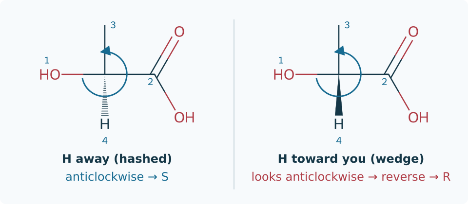{width=74% fig-alt="Left: (S)-lactic acid with H hashed away and an anticlockwise arrow from priority 1 to 3, giving S. Right: (R)-lactic acid in the same orientation with H on a wedge; the path looks anticlockwise, so the answer is reversed to R"}

With H (4) hashed away, trace **1 → 2 → 3**: clockwise is **R**, anticlockwise is **S**. On the left OH → COOH → CH₃ runs anticlockwise: **(S)-lactic acid**, the one your muscles make. With H on a wedge, **reverse** what you see.

::: {.try}
**Try it:** in another drawing, H points *toward* you and 1 → 2 → 3 looks clockwise. What is the configuration?

::: {.fragment}
**Answer.** S. With H toward you, reverse the apparent result (or rotate a model until H points away).
:::
:::

::: notes
Trace the path with your finger on the screen: left (OH), right (COOH), up (CH3). That sweep goes anticlockwise, and since H is on the hashed bond, the answer stands: S. Then do exercise 3's version orally: OH upper left, COOH upper right, CH3 lower left, H away gives clockwise, so R. The most common exam error is forgetting to reverse when H is on a wedge. Remind them that turning the page or rotating the drawing never changes the answer; only swapping two groups does.
:::

## Mirror images, not rotations

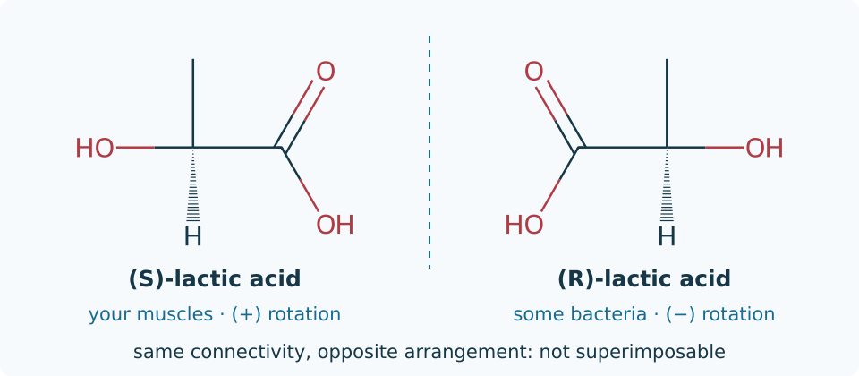{width=78% fig-alt="(S)-lactic acid and (R)-lactic acid as mirror images across a dashed line; S is made by muscle and rotates light plus, R by some bacteria and rotates light minus"}

Same connectivity, opposite arrangement: **enantiomers**. No rotation turns one into the other. R/S is a naming rule; the **sign of optical rotation** has to be measured.

::: {.try}
**Try it:** does rotating the whole drawing 180° on the page give the other enantiomer?

::: {.fragment}
**Answer.** No. A rigid rotation keeps the configuration. Only swapping two groups at the centre (or reflecting) does.
:::
:::

::: notes
(S)-lactic acid happens to be dextrorotatory, (+), but there is no rule linking S to plus. In fact its salts, the lactates, rotate the other way, which is a nice demonstration that the sign is a measured property. Biology cares about the difference: lactate dehydrogenase in muscle handles the S form, and some bacteria make the R form, which is why D-lactate is a clinical marker of certain gut infections. Connect back to Week 2: enantiomers share boiling point, IR and NMR in ordinary solvents, so these tools can't tell them apart.
:::

## The simplest reaction: a proton transfer

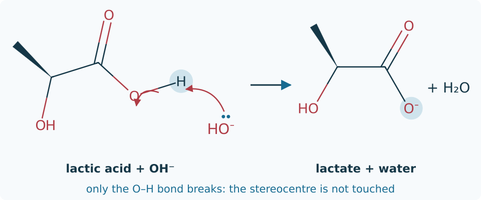{width=82% fig-alt="Curved arrows: hydroxide lone pair to the carboxyl H, O-H bond pair onto oxygen, giving lactate and water"}

One arrow from the **base's lone pair to H**, one from the **O–H bond onto O**. The carboxyl O–H is the acidic one; the alcohol O–H is far less acidic.

::: {.try}
**Try it:** does this step invert the stereocentre?

::: {.fragment}
**Answer.** No. Only the carboxyl O–H bond changes. No bond to the stereocentre is made or broken.
:::
:::

::: notes
Two arrows, both starting from electrons: this is the Day 8 rule. Ask students where each arrow starts and refuse an arrow that starts at the H. The carboxylic acid is the acidic site because its conjugate base is resonance-stabilised over two oxygens, which is the Day 3 argument; the alcohol has a pKa around 16, so hydroxide in water doesn't remove it meaningfully. The stereocentre question is there because students sometimes assume any reaction "scrambles" stereo. A step can only change a configuration if it changes bonds at that carbon.
:::

## Audit every atom and the charge

| | lactic acid + OH⁻ | | lactate + H₂O |
|---|---|---|---|
| species | C₃H₆O₃ + HO⁻ | → | C₃H₅O₃⁻ + H₂O |
| C, H, O total | **C₃H₇O₄** | | **C₃H₇O₄** |
| net charge | **−1** | | **−1** |

The H isn't lost; it moves to hydroxide. The bonding pair of the old O–H stays on oxygen, which is why that O now carries the −1.

::: {.try}
**Try it:** what goes wrong if you write the products as just lactate?

::: {.fragment}
**Answer.** You lose H₂O from the inventory: two H, one O. The equation no longer balances, and the proton's new home is hidden.
:::
:::

::: notes
This is the valence audit from Day 1 applied to a whole equation. Have students count with you: left side 3 C, 6 + 1 = 7 H, 3 + 1 = 4 O; right side 3 C, 5 + 2 = 7 H, 3 + 1 = 4 O. Charge −1 on both sides. The point is that arrows track electrons, but they don't give permission to delete atoms. The audit is the fastest way to catch a dropped product in an exam answer.
:::

## At blood pH it's lactate, not lactic acid

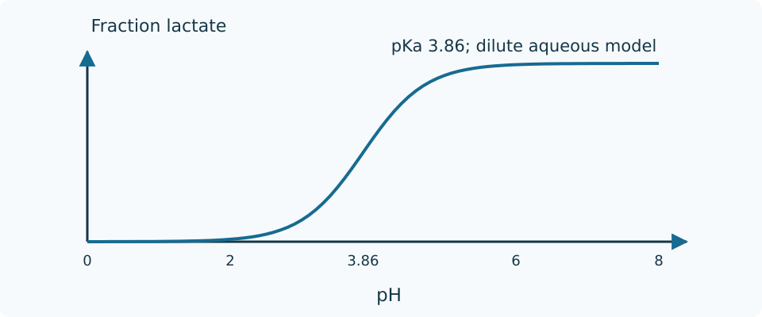{width=62% fig-alt="Sigmoid curve of fraction lactate against pH from 0 to 8, crossing one half at pH 3.86"}

$$f_{\text{A}^-} = \frac{1}{1 + 10^{\,\text{p}K_a - \text{pH}}} \qquad \text{p}K_a = 3.86$$

::: {.try}
**Try it:** what fraction is lactate at pH 4.86? And at blood pH 7.4?

::: {.fragment}
**Answer.** At 4.86 the ratio A⁻/HA is 10, so 10/11 ≈ 0.91. At 7.4 it's about 3500 : 1, so over 99.9 % lactate.
:::
:::

::: notes
This answers the opening hook. At pH equal to pKa the fraction is exactly one half; every pH unit above multiplies the A-minus to HA ratio by ten. At 7.4 that's 10 to the 3.54, about 3500. So "lactic acid in the blood" is really lactate, and the acidification during exercise is a more complicated story than the name suggests. Probe the population meaning: 0.91 means 91 % of molecules are ionised at any moment, not that each molecule has lost 91 % of a proton. Week 1 Day 3 introduced this curve; the dilute monoprotic model is what we assume.
:::

## Oxidation turns the stereocentre into a ketone

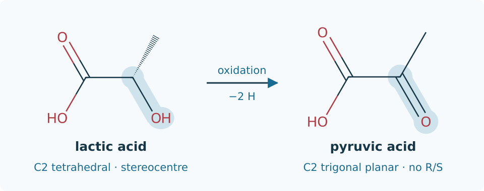{width=80% fig-alt="Lactic acid oxidised to pyruvic acid, losing two H; C2 goes from tetrahedral stereocentre to trigonal planar ketone"}

The secondary alcohol becomes a **ketone**: **pyruvic acid**, CH₃C(=O)COOH. In your cells lactate dehydrogenase does this with NAD⁺.

::: {.try}
**Try it:** does pyruvic acid still have an R/S centre?

::: {.fragment}
**Answer.** No. C2 is now trigonal planar with three groups, so there's no stereocentre left to label.
:::
:::

::: notes
Week 3 redox: a secondary alcohol oxidises to a ketone and stops there, because there's no H left on the carbonyl carbon to remove. The formula changes from C3H6O3 to C3H4O3, a loss of two H, which is the classic signature of oxidation. Muscles run this reaction in both directions: pyruvate is reduced to lactate when oxygen is short, and lactate is oxidised back in the heart and liver. Emphasise geometry: the stereochemical information is destroyed, and reducing pyruvate back could in principle give either enantiomer. The enzyme is what makes it give only S.
:::

## Count the oxidation state at the changing carbon

| bond at C2 | contributes | lactic acid C2 | pyruvic acid C2 |
|---|---|---|---|
| C–O (per bond order) | +1 | C–OH: **+1** | C=O: **+2** |
| C–H | −1 | **−1** | none: **0** |
| C–C | 0 | 0 | 0 |
| **total** | | **0** | **+2** |

The carbon goes from 0 to +2: an **oxidation**, even though no O atom was added.

::: {.try}
**Try it:** why does a C–C bond count zero?

::: {.fragment}
**Answer.** The two atoms have the same electronegativity, so neither one is assigned the bonding electrons.
:::
:::

::: notes
This is the bookkeeping from Day 13. The bond to O counts per bond order, so a C=O counts plus two. The take-home message is that oxidation is about electrons at the carbon, not about counting oxygen atoms in the formula; lactic and pyruvic acid have the same three oxygens. Ask the room what happens to the carboxyl carbon (nothing: plus three in both). The counting rule only works for the carbon that changes, which is why we focus on C2.
:::

## Esterification: track the alcohol oxygen

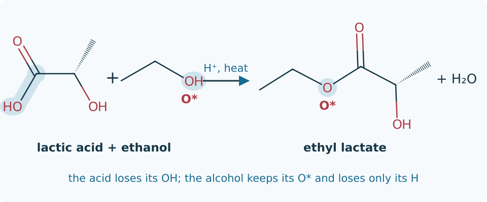{width=84% fig-alt="Lactic acid plus ethanol with H+ and heat gives ethyl lactate plus water; the labelled ethanol oxygen O* ends up between the acyl carbon and the ethyl group"}

Fischer esterification is an **acyl substitution**: ethanol's O* attacks the carbonyl carbon, and the acid's OH leaves as water. Ethyl lactate is a biodegradable solvent.

::: {.try}
**Try it:** which two atoms is O* bonded to in the product?

::: {.fragment}
**Answer.** The acid-derived carbonyl carbon and the ethyl CH₂. The water's O comes from the acid.
:::
:::

::: notes
Isotope labelling with oxygen-18 is the classic experiment that proved this: the label from the alcohol ends up in the ester, not in the water. That only makes sense if the alcohol is the nucleophile attacking the acyl carbon (Week 4). The bonds at the stereocentre aren't touched, so (S)-lactic acid gives (S)-ethyl lactate. Now the limitation: lactic acid has its own OH, so one molecule's OH can esterify another's COOH. That's exactly how lactide and PLA plastic are made. A target drawing doesn't guarantee selectivity; the conditions do.
:::

## Addition or substitution? Look for a leaving group

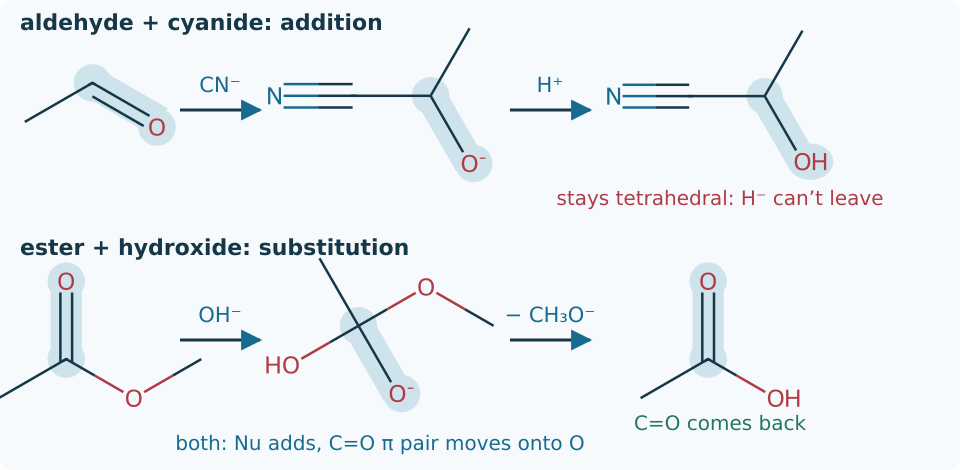{width=80% fig-alt="Top row: ethanal adds cyanide to give an alkoxide then a cyanohydrin. Bottom row: methyl acetate adds hydroxide to give a tetrahedral intermediate that loses methoxide to reform C=O"}

Both start the same way: **Nu adds, the C=O π pair moves onto O**. An ester carries an OR that can leave, so C=O comes back. An aldehyde has only H or C there.

::: {.try}
**Try it:** what's the first elementary step both pathways share?

::: {.fragment}
**Answer.** Nucleophilic attack at the carbonyl carbon, giving a tetrahedral alkoxide.
:::
:::

::: notes
This is the Day 16 versus Day 17 decision in one picture. The question students should ask is: after the tetrahedral intermediate forms, is there a group that can leave and take a bonding pair with it? Methoxide can; hydride and methyl can't, so aldehydes and ketones stop at addition. In base, the acetic acid at the end is immediately deprotonated to acetate, which is why ester hydrolysis in base (saponification) goes to completion. Probe the valence: keeping C=O and adding Nu at the same time would give a five-bonded carbon.
:::

## Amino acids carry two charges at pH 7

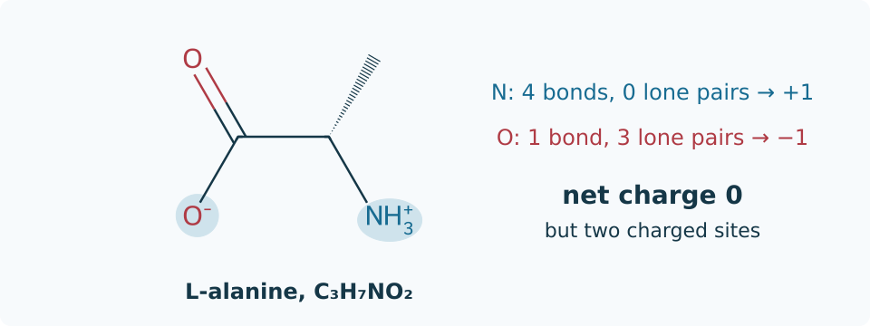{width=78% fig-alt="L-alanine zwitterion: N with four bonds is +1, O with one bond and three lone pairs is -1, net charge 0"}

Read the charges from the **normal-state table** (Day 1). The net charge is zero, but the molecule still has a + and a − end.

::: {.try}
**Try it:** net zero, so does alanine behave like a hydrocarbon in water?

::: {.fragment}
**Answer.** No. Both charged sites interact strongly with water, which is why amino acids are high-melting and water-soluble.
:::
:::

::: notes
Alanine is lactic acid's nitrogen cousin: swap the OH for NH3+. Ask the room to point at the exact charged atoms, not just "the molecule is charged". At pH 7 the carboxylic acid (pKa about 2) has lost its proton and the amine (conjugate acid pKa about 10) has gained one, so both ends are charged. L-alanine is S, just like L-lactic acid, which is a nice coincidence of the CIP rules here (it isn't true for every L amino acid; cysteine is R).
:::

## Change the pH, keep the skeleton

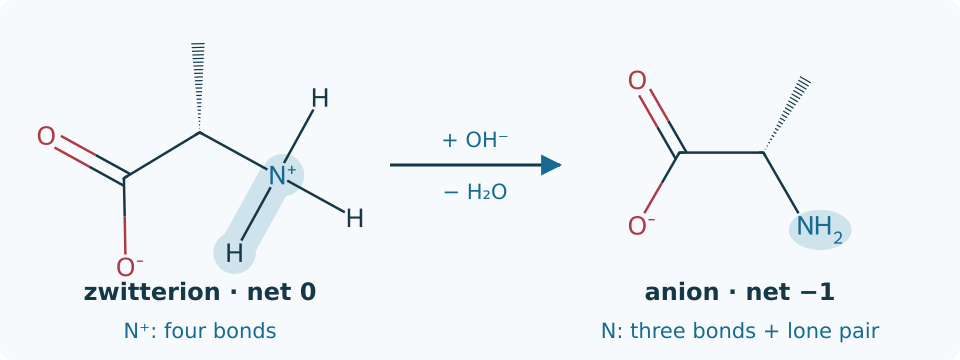{width=80% fig-alt="Alanine zwitterion with explicit N-H bonds reacts with hydroxide to give the anion with a neutral NH2 group; net charge goes from 0 to -1"}

Hydroxide removes an **N–H proton**. The bonding pair goes back to N, which ends with three bonds and a lone pair. No C–C bond is touched.

::: {.try}
**Try it:** is the N in a peptide bond (an amide) basic like this ammonium N?

::: {.fragment}
**Answer.** No. The amide N's lone pair is delocalised into the C=O, so it's barely basic (Week 4).
:::
:::

::: notes
Same move as the lactic acid deprotonation, at a different site. Check the charge audit: zwitterion plus hydroxide has net −1, anion plus water has net −1. Product formula H2NCH(CH3)COO−, C3H6NO2−. The peptide question links to Day 18: an amide N is planar and its lone pair is part of the amide resonance, which is why proteins don't pick up a proton on every backbone nitrogen.
:::

## Identify an unknown: make the evidence agree

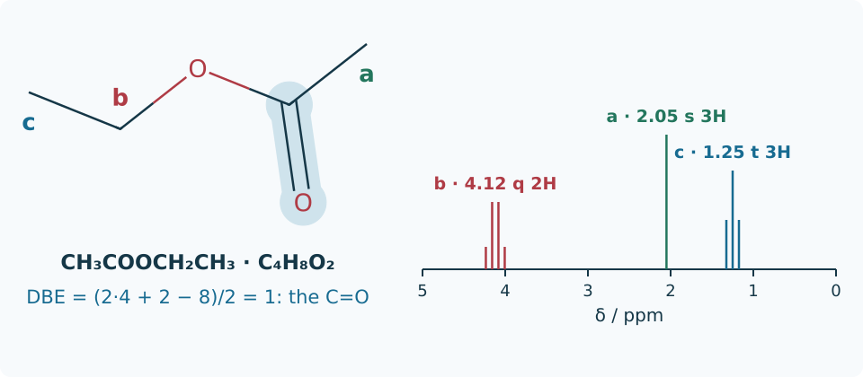{width=84% fig-alt="Ethyl acetate with acetyl CH3 a, OCH2 b and ethyl CH3 c, and a stick spectrum: 4.12 quartet 2H, 2.05 singlet 3H, 1.25 triplet 3H"}

**U1:** C₄H₈O₂, IR C=O but no broad O–H, ¹H NMR 4.12 q 2H, 2.05 s 3H, 1.25 t 3H. The quartet and triplet are an **ethyl on O**; the singlet is a **CH₃ next to C=O**.

::: {.try}
**Try it:** what does the molecular formula add to this argument?

::: {.fragment}
**Answer.** DBE = 1, so one C=O and no ring. It also sets the atom budget: every C, H and O must be placed.
:::
:::

::: notes
This is the Week 5 spectroscopy workflow from Day 21. Build the structure piece by piece: the quartet (2H) and triplet (3H) couple to each other, so they're an ethyl group, and the 4.12 shift puts the CH2 on oxygen. The singlet at 2.05 has no neighbouring H, consistent with sitting next to the carbonyl. The IR rules out acids and alcohols. The formula is the referee: C4H8O2 with one degree of unsaturation is accounted for by the ester C=O. Ethyl acetate is also nail-polish remover, which helps it stick.
:::

## Test the alternative before you claim

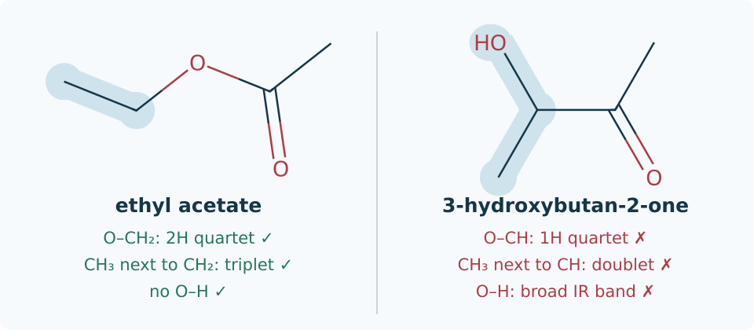{width=80% fig-alt="Ethyl acetate predicts an OCH2 2H quartet, a CH3 triplet and no OH, all matching; 3-hydroxybutan-2-one predicts an OCH 1H quartet, a CH3 doublet and a broad OH, all disagreeing"}

**3-hydroxybutan-2-one** is also C₄H₈O₂ with a C=O. A good claim says why it *doesn't* fit: wrong integrals, wrong splitting and an O–H that isn't there.

::: {.try}
**Try it:** would a matching C=O band rescue the hydroxyketone?

::: {.fragment}
**Answer.** No. One shared feature can't outweigh three predictions that disagree with the data.
:::
:::

::: notes
Real problem-solving means generating an alternative and testing it, not just confirming the first idea. The hydroxyketone's CH3 next to CH would be a doublet; its O-bearing carbon is a CH, so 1H, not 2H; and it has an OH that the IR would show. Say it plainly: we don't use the name of the bottle or the expected product as evidence. Ask students to name one more C4H8O2 candidate (methyl propanoate, for instance) and say which signal would rule it out.
:::

## A high yield doesn't prove identity

{width=66% fig-alt="Bar chart: theoretical 1.8016 g and isolated 1.70 g, 94.4 percent; NMR stick spectrum with one unexpected extra signal"}

0.0100 mol × 180.16 g/mol = **1.8016 g** theoretical; 1.70 g isolated is **94.4 %**, *if* the solid is pure product. Unexpected NMR peaks challenge that "if".

::: {.try}
**Try it:** give two reasons the isolated mass could be too high.

::: {.fragment}
**Answer.** Residual solvent or water, and unreacted starting material or a side product. One TLC (thin-layer chromatography) spot can hide a co-running impurity.
:::
:::

::: notes
180.16 g/mol is aspirin, made from the 0.0100 mol of salicylic acid we weighed on Day 1, so this closes a loop. The yield calculation is only as good as its assumption that the mass is all product. Neither observation should be ignored: the plausible mass and the strange NMR together say "investigate". Also mention exercise 19: dividing isolated mass by the starting-material mass (1.70 / 1.3812) gives 123 %, a reproducible number that is still chemically wrong because molar masses differ. Running the same wrong formula in R every time doesn't make it right.
:::

## Writing a conclusion someone can check

| part | for the U1 ester |
|---|---|
| **claim** | U1 is ethyl acetate |
| **evidence** | C₄H₈O₂; C=O, no O–H; q 2H, s 3H, t 3H |
| **reason** | O–CH₂CH₃ explains q/t; CH₃–C=O explains the singlet |
| **alternative ruled out** | hydroxyketone predicts a doublet and an O–H |
| **limitation** | simulated data, not a measured real sample |
| **next test** | measured spectra and a purity check on the isolate |

::: {.try}
**Try it:** why is "it's the ester because we made the ester" not evidence?

::: {.fragment}
**Answer.** It's circular: it assumes the reaction worked, which is exactly what the evidence must test.
:::
:::

::: notes
This is the Day 22 structure, now with all the chemistry filled in. Each row should be checkable by someone else. The reason row is the one students skip; insist that each observation is linked to a specific atom group. For R-based reports, the reproducibility part is that raw data and code are saved so a fresh session recreates the tables, but reproducible doesn't mean chemically correct; both checks are needed.
:::

## A first-move routine for any new problem

| step | ask yourself | came from |
|---|---|---|
| 1 | which groups, charges and stereocentres are there? | Weeks 1–2 |
| 2 | where are the acidic H, the lone pairs, the δ+ carbons? | Days 3, 8 |
| 3 | which bonds change? draw the arrows from electrons | Weeks 3–4 |
| 4 | do atoms, charge and valence balance? | Day 1 |
| 5 | what would the alternative predict, and does the data agree? | Days 21–22 |

::: {.try}
**Try it:** you're handed a molecule you've never seen. What do you do first?

::: {.fragment}
**Answer.** Read it locally: name the functional groups and look at the atoms around each one, before thinking about any reaction.
:::
:::

::: notes
This is the exit question from the old session, turned into a routine. The exam is built exactly like today: a molecule you may not have met, and a sequence of questions that each use one tool. Students who panic at an unfamiliar name should fall back to step 1; the name never matters, the atoms do. Encourage them to write this routine at the top of their exam paper.
:::

## Mistakes we see every year

| mistake | fix |
|---|---|
| ranking COOH over CH₃ "because it's bigger" | compare the **next atoms**: (O,O,O) vs (H,H,H) |
| forgetting to reverse when H is on a wedge | H toward you: **flip** the answer |
| thinking R means (+) | the sign of rotation is **measured** |
| dropping water from a proton transfer | audit **atoms and charge** on both sides |
| keeping an R/S label on a ketone carbon | trigonal planar: **no stereocentre** |
| "net zero, so no charges" for alanine | net zero, **two charged sites** |
| a high yield taken as proof of purity | yield **assumes** identity; test it |

::: notes
Read each mistake aloud and ask the room why it's wrong before revealing the fix. Every row matches an exercise from today's set, so a student who recognises their own mistake knows which problem to redo. These are also the errors that cost the most marks on past exams.
:::

## Summary

| concept | key fact |
|---|---|
| read locally | groups, charges and stereocentres first |
| CIP | OH > COOH > CH₃ > H; H away, clockwise = R |
| enantiomers | mirror images; sign of rotation is measured |
| proton transfer | two arrows; stereocentre untouched; audit atoms |
| ionised fraction | 1/(1 + 10^(pKa − pH)); lactate at pH 7.4 |
| oxidation | lactic → pyruvic acid; C2 goes 0 → +2 |
| addition vs substitution | a leaving group lets C=O come back |
| evidence | claim, evidence, reason, alternative, limitation |

**Next:** revision on Days 24–25 ([spectra and calculations](../practice/day24.qmd), [final synthesis](../practice/day25.qmd)), then the exam. **Practice:** [exercises](exercise.qmd) · [self-check](quiz.qmd)

::: notes
Close the loop: lactic acid in the blood is lactate, its configuration is S, oxidising it gives pyruvate, esterifying it gives a solvent or a plastic, and we know what a sample is only when the evidence agrees. That's five weeks in one molecule. There's no new lecture after this one. Days 24 and 25 are mixed revision sets in exactly this style, and the exam will ask the same kinds of linked questions. Point to the exercises: 1 to 10 are core, 11 to 16 transfer and 17 to 20 are about evidence.
:::
