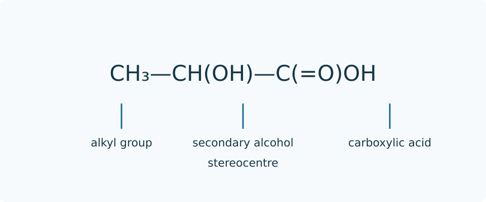
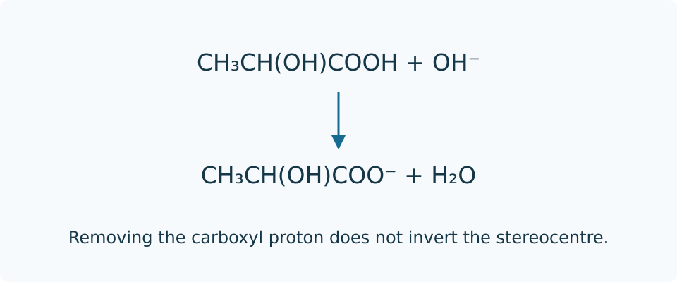
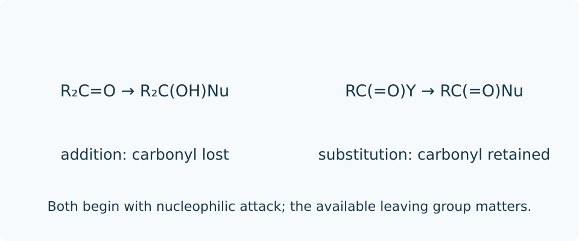
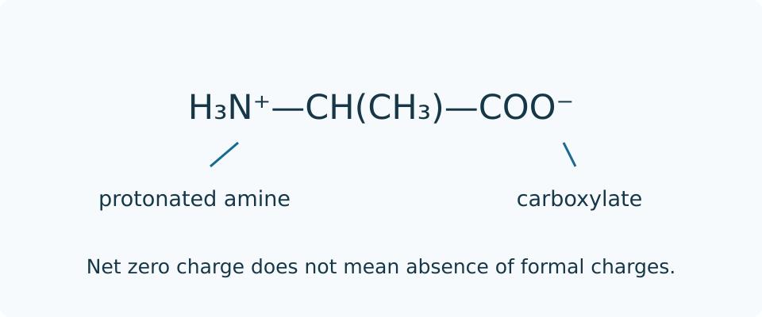
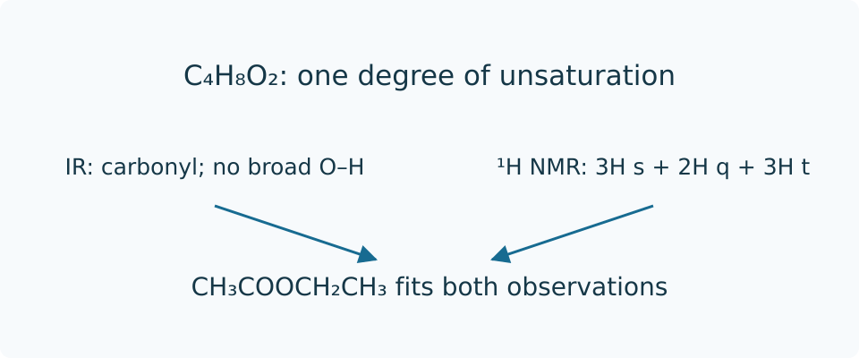
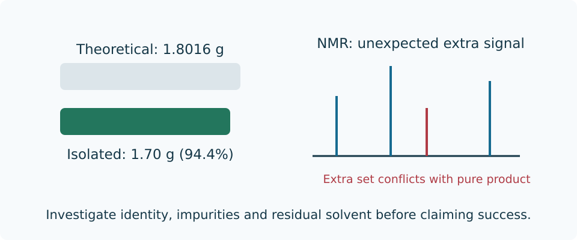

## What will you be able to explain?

- Transfer structure and electron-flow reasoning to an unfamiliar molecule.
- Build an explanation from several independent observations.
- Communicate a defensible chemical claim with explicit limits.

::: notes
Start with a drawn molecule and an explanation from the preceding unit. Ask students to predict before revealing an answer. Use the practice page for complete worked checks rather than putting dense paragraphs on slides.
:::

## Read the molecule before predicting reactions

{width=85% fig-alt="Lactic acid has a secondary alcohol, a carboxylic acid and one tetrahedral stereocentre."}

Predict which site is relevant before naming a reaction.

::: notes
Supply the biological context: lactate is encountered in metabolism, but no pathway knowledge is required. Each prediction here follows from its functional groups.
:::

## Preserve connectivity in a stereochemical comparison

{width=85% fig-alt="The two drawings have the same connectivity and opposite tetrahedral arrangements."}

A rotation of a drawing must preserve its configuration; a mirror-related configuration does not.

::: notes
Ask students to use a model or tracing paper. If assigning R/S, priorities at the centre are OH > COOH > CH3 > H. Optical rotation sign is not inferred from R/S.
:::

## Separate acid–base change from configurational change

{width=85% fig-alt="Hydroxide removes the carboxyl proton to form lactate and water."}

This drawn proton transfer neither breaks a bond at the stereocentre nor inverts it.

::: notes
This is a specific chemical transformation under the stated simple conditions, not a promise that no other conditions could racemise a chiral acid.
:::

## Oxidation can remove a stereocentre

{width=85% fig-alt="Oxidising the secondary alcohol gives pyruvic acid with a planar ketone carbon."}

Track which carbon changes bonding and geometry.

::: notes
Do not label the ketone carbon R or S. The transformation is a functional-group example; enzyme identity or metabolic details are not prerequisites.
:::

## Acyl substitution acts at a different site

{width=85% fig-alt="The target ester forms at the carboxylic acid group; the secondary OH remains in the chosen product."}

Recognise the target bond before proposing a mechanism.

::: notes
Lactic acid has two oxygen-containing functions and can have competing chemistry. The displayed transformation specifies a target and is not a complete selectivity guarantee or executable procedure.
:::

## Choose addition or substitution from structure

{width=85% fig-alt="Aldehyde/ketone addition and acyl substitution both begin at carbonyl carbon."}

A viable leaving group allows the carbonyl to reform during substitution.

::: notes
Require a drawn intermediate, not only the words addition/elimination. Watch for students drawing five bonds at carbon or eliminating an ordinary carbon substituent.
:::

## Revisit formal charge in a biological-looking molecule

{width=85% fig-alt="Alanine can have protonated amine and carboxylate at the same time."}

Count each formal charge before stating the net charge.

::: notes
Net zero does not imply nonpolar. A zwitterion contains separated charges and can interact strongly with water; physical behaviour still depends on environment and structure.
:::

## Require the observations to agree

{width=85% fig-alt="Formula, carbonyl evidence and an ethyl/acetyl proton pattern support an ester candidate."}

Explain how each observation tests a different feature of the proposal.

::: notes
Avoid circular reasoning: the filename or expected lab target cannot serve as spectral proof. Students should explicitly compare at least one alternative.
:::

## A plausible yield does not prove identity

{width=85% fig-alt="A high apparent mass-based yield can coexist with contradictory IR or NMR evidence."}

Investigate the discrepancy before concluding that synthesis succeeded.

::: notes
The 94.4% value is calculated from 1.70/1.8016×100. It is not an assessed purity, and unreacted material or residual solvent may contribute to mass.
:::

## Write an explanation another chemist can inspect

{width=85% fig-alt="A claim is linked to observations, a chemical reason and remaining uncertainty."}

State what further observation would most directly test the remaining alternative.

::: notes
A strong report can reject its original hypothesis when the evidence contradicts it. Reproducibility includes saved data and code, but scientific reasoning must also be explicit.
:::

## Work one example on paper

A student calls an isolate pure product because the apparent yield is 94% and TLC has one spot. Their IR contains an unexpected broad O–H band and NMR contains an extra major set of signals. Write a supported interpretation and propose the next observation.

::: notes
Allow independent thinking, then compare in pairs. Ask students to defend each atom, charge or assignment. Show the worked check only after a first attempt.
:::

## A common mistake to repair

Do not replace an explanation with a list of topic names. Draw the relevant atoms, identify the observation and state the causal chemical connection.

Explain the correction using a drawing or a specific observation.

## Test your explanation

1. Which atoms, bonds or observations support the claim?
2. What alternative would make a different prediction?
3. What assumption limits the conclusion?

Give a partner your explanation without the answer label. Can they follow it?

## Take the reasoning forward

Complete the [practice and worked examples](exercise.qmd) and [self-check](quiz.qmd).

Selected Solomons core examples; optional biological applications in chapters 22–24; see the [reading guide](../reference/reading.qmd) for the provisional textbook map and open references.
