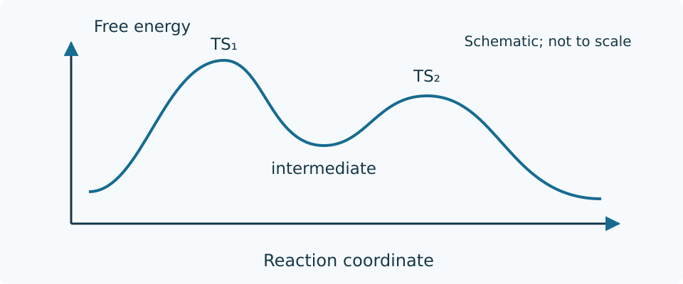

Allow 75–90 minutes. Draw on paper or use a structure editor; chemical drawing
is the main work in this unit. Bring the [acid–base reasoning](../acids-bases/exercise.qmd)
and [reference toolkit](../reference/toolkit.qmd) into each explanation.

## First: read the proposed step

A mechanism is a sequence of chemically plausible elementary steps. A complete
step specifies the reacting species, electron-pair movements and products.
Full-headed curved arrows represent two electrons. Their tails start on a
bond or lone pair; their heads identify a new bond or the atom receiving a pair.
The arrows do not show a proton's flight or the direction in which a whole
molecule moves. Lone pairs need not all be drawn in every shorthand structure,
but draw the reacting pairs while learning.

## 1. Proton transfer with an explicit donor

Draw CH₃OH + OH⁻ ⇌ CH₃O⁻ + H₂O. Add the lone pairs needed for the forward
proton-transfer step. Label the donor of the proton, the acceptor of the proton
and the electron pair forming the new bond. Audit atoms and net charge.
This question asks for the electron-flow bookkeeping, not for a claim that
the equilibrium lies overwhelmingly to the right.

::: {.callout-tip collapse="true" title="Hint"}
The oxygen of hydroxide needs a new O–H bond. Where will that bonding pair
come from? What happens to the methanol O–H pair when the proton leaves?
:::

::: {.callout-note collapse="true" title="Worked check"}
One arrow begins at a hydroxide oxygen lone pair and ends at the methanol
hydroxyl H. The second begins at the methanol O–H bond and ends on the methanol
oxygen. Methanol donates H⁺ and hydroxide accepts it. The products have one
carbon, five hydrogen atoms and two oxygen atoms in total, just as the
reactants do. Net charge is −1 on each side. The relative acid pKa values,
solvent and concentrations are needed to discuss the equilibrium mixture.
:::

## 2. Repair a five-bonded carbon

A student adds OH⁻ to CH₃CHO by drawing a new C–O bond but retaining C=O,
C–CH₃ and C–H. Draw the proposed central carbon and count its bond orders.
Repair the elementary step with a second arrow. Give the charge and lone-pair
count on the original carbonyl oxygen after addition. Then protonate that
oxygen using water and draw the conjugate base produced from water.

::: {.callout-note collapse="true" title="Worked check"}
The incorrect carbon has total bond order five: C=O plus three single bonds.
Move the C=O π pair to its oxygen while the new C–O bond forms. The product
is CH₃CH(OH)O⁻, with the original carbonyl oxygen singly bonded, bearing three
lone pairs and charge −1. Its lone pair can take H from water while the
water O–H pair returns to water oxygen. Products of that transfer are
CH₃CH(OH)₂ and OH⁻. Carbon remains tetravalent, and net charge remains −1.
:::

## 3. A concerted substitution is not two successive reactions

For OH⁻ + CH₃Br → CH₃OH + Br⁻, draw the two arrows in the same step. Explain
why drawing CH₃⁺ as an intermediate would propose a different mechanism.
Classify OH⁻ as a nucleophile in this particular event. Is that label evidence
that OH⁻ could never act as a base in another event?

::: {.callout-note collapse="true" title="Worked check"}
The hydroxide lone pair points to methyl carbon; the C–Br pair points to Br.
Both occur in the concerted SN2 step. Drawing CH₃⁺ would replace that model
with prior ionisation and a distinct intermediate, an unsuitable proposal for
this methyl substitution. OH⁻ is a nucleophile because it forms a bond to
carbon here. It can accept H⁺ elsewhere and then acts as a base. Identify
the attacked atom instead of labelling an entire reagent permanently.
:::

## 4. Read the free-energy profile

{fig-alt="A two-step schematic free-energy profile with an intermediate between two maxima."}

Redraw the profile and mark the reactants, both transition states, intermediate
and products. Starting at the intermediate, show the forward and reverse
activation barriers. Why is the height of the second maximum measured from
the intermediate when discussing the second elementary step? Why is the
horizontal axis not time?

::: {.callout-note collapse="true" title="Worked check"}
Maxima are transition states; the intervening minimum is an intermediate.
Each elementary step's barrier is measured from its starting minimum, not
automatically from the original reactants. The reaction coordinate describes
progress through changing geometry and bonding. It is not a clock; a distance
along it cannot be converted into a lifetime without additional information.
:::

## 5. What can a catalyst change?

Sketch reactants at one free energy and products at a lower free energy. Draw
two paths joining the same endpoints with different barriers. Explain what
is different about the catalysed path and what remains the same about the
overall equilibrium. State where the catalyst must appear in an overall
balanced description.

::: {.callout-note collapse="true" title="Worked check"}
A catalyst provides another pathway with lower kinetically relevant barriers.
It can accelerate approach to equilibrium in both directions. It does not
change the free energies of the same initial and final states or their
equilibrium constant. The catalyst participates in steps but is regenerated
overall; it is not consumed stoichiometrically in the net transformation.
:::

## Leave with

Three audited mechanisms, one annotated energy diagram and a two-sentence
explanation distinguishing an intermediate from a transition state. Optional
reading: selected Solomons chapter 3 and early chapter 6 sections; see the
[reading guide](../reference/reading.qmd).
