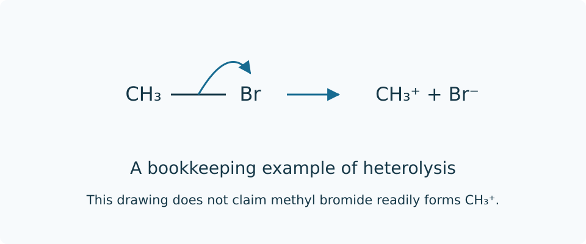
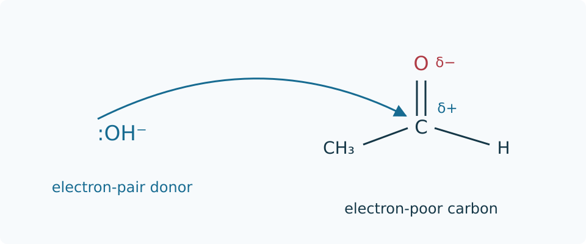
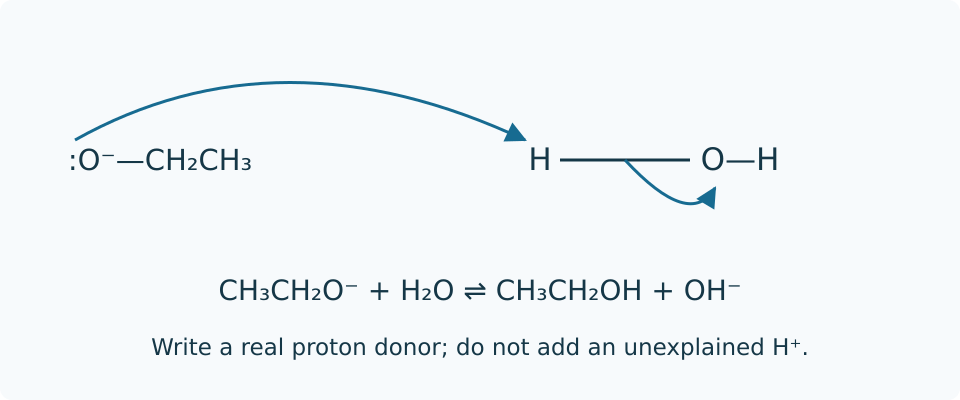

## What will you be able to explain?

- Identify an electron-pair source and acceptor.
- Draw valid arrows for an elementary step.
- Distinguish intermediates, transition states and catalysts.

::: notes
Begin with the previous unit’s electron-pair and charge audit. Ask students to predict a product or bond change before displaying the worked drawing. These slides support discussion and paper drawing; the practice page supplies further explanations.
:::

## Arrows follow electron pairs

{width=85% fig-alt="A lone pair forms the new O–H bond while the original O–H bonding pair returns to oxygen."}

Every full-headed curved arrow starts at a lone pair or bond. Two arrows are needed for this proton transfer.

::: notes
Point to each arrow tail and ask what pair was there before the step. Do not accept an arrow starting at a positive charge or at a bare hydrogen.
:::

## Both bonding electrons can stay together

{width=85% fig-alt="The C–Br bonding pair moves to bromine, giving formally separated positive and negative ions."}

Heterolysis gives the two bonding electrons to one atom. Charge separation must appear in the products.

::: notes
This is bookkeeping, not a prediction that a methyl carbocation forms readily. Methyl substrates instead favour concerted substitution in the examples used here.
:::

## Name the donor and acceptor

{width=85% fig-alt="A hydroxide lone pair is the source and the polar carbonyl carbon is an electron-pair acceptor."}

A **nucleophile** donates a pair to form a bond; an **electrophile** accepts it. A neutral molecule may be either.

::: notes
This picture locates the source and acceptor. It is not a complete mechanism: the carbonyl pi pair must move too when the new bond forms.
:::

## Do not give carbon five bonds

{width=85% fig-alt="Hydroxide addition moves the carbonyl pi pair to oxygen and makes a tetrahedral alkoxide."}

New C–O bond formation and C=O π-bond cleavage occur in the same elementary addition step.

::: notes
Count the central carbon bond orders before and after. The product oxygen with one bond has three lone pairs and formal charge minus one.
:::

## One elementary step can use several arrows

{width=85% fig-alt="Two electron pairs move together in methyl bromide substitution by hydroxide."}

**Concerted** means one step with no intermediate between bond breaking and bond making.

::: notes
The total charge remains minus one. There is no methyl carbocation minimum hidden in this concerted example.
:::

## A proton must come from a species

{width=85% fig-alt="Ethoxide receives a proton from water, and hydroxide is produced."}

Write the proton donor and its conjugate base. A work-up is a chemical step, not a source of unexplained H atoms.

::: notes
Use this to prepare for carbonyl reduction. Students often draw the alkoxide directly as an alcohol and lose both the proton donor and charge.
:::

## Transition states are energy maxima

{width=85% fig-alt="A one-step free-energy profile has one maximum between reactants and products."}

The transition state is not an isolable intermediate. Its barrier helps determine the reaction rate.

::: notes
The curve is schematic. The vertical axis is free energy, not concentration, and the horizontal axis is reaction progress, not elapsed time.
:::

## An intermediate occupies a minimum

{width=85% fig-alt="A two-step schematic path has two transition states and an intermediate free-energy minimum."}

Count steps by maxima, not by the number of curved arrows. An intermediate has a finite lifetime.

::: notes
A minimum may be short-lived and difficult to observe. The diagram does not by itself specify whether it can be bottled.
:::

## Catalysis changes the pathway

{width=85% fig-alt="Catalysed and uncatalysed paths have the same reactant and product energies but different barriers."}

A catalyst can increase the rate while leaving the overall equilibrium constant unchanged.

::: notes
The drawn catalysed profile is simplified. Real catalysis often adds multiple elementary steps; the catalyst is regenerated overall.
:::

## Use an atom and charge audit

{width=85% fig-alt="Substitution conserves C, H, O and Br and has total charge minus one on both sides."}

After every step, check valence, atoms and net charge. Add implied hydrogens when the audit is unclear.

::: notes
An electron-flow arrow does not add atoms. A missing counterion may be a spectator, but the reacting species must still have correct individual charges.
:::

## Nucleophilicity and basicity ask different questions

A base accepts a proton; a nucleophile attacks an electrophilic centre. The same species can do both, but the preferred outcome depends on the substrate and conditions.

Identify the atom attacked before naming the process.

## Repair an impossible step

A student draws OH⁻ adding to a carbonyl but leaves the C=O double bond intact.

Draw all bonds to that carbon. Which electron pair must move, and where does the negative charge end up?

## Explain an energy diagram

Sketch a two-step path. Mark both transition states and the intermediate.

Which feature would change if a catalyst offers a faster path? Which endpoint energy difference stays the same?

## Use the same reasoning in practice

Complete the [practice and worked examples](exercise.qmd), then the [self-check](quiz.qmd).

Optional textbook support: selected Solomons chapter 3 and 6 sections. The [reading guide](../reference/reading.qmd) explains the provisional book mapping.
