## About this lecture

Every breath out carries CO₂ that your red blood cells first turned into bicarbonate. The enzyme that does it, **carbonic anhydrase**, holds a hydroxide on a zinc ion. That hydroxide pushes a lone pair onto the carbon of CO₂, and a C=O π pair moves onto oxygen. The enzyme makes this happen about **ten million times faster**, without changing where the equilibrium lies.

Today we learn the language that describes that event:

- **Curved arrows:** each one moves a pair of electrons from a source to a sink
- **Bookkeeping:** atoms, charges and four bonds to carbon after every step
- **Three core steps:** proton transfer, one-step substitution, addition to C=O
- **Energy profiles:** transition states, intermediates and barriers
- **Catalysts:** a faster path between the same start and end

Yesterday's stereochemistry comes back today: the SN2 step flips a carbon inside out.

::: notes
Open with the carbonic anhydrase story because it contains the whole lecture in one reaction: a lone pair attacks an electron-poor carbon, a pi pair moves to oxygen, a proton gets shuffled around, and a catalyst speeds things up without moving the equilibrium. Don't draw the mechanism yet; promise that by the end of the hour everyone can. Frame curved arrows as bookkeeping, not magic: they are the way chemists keep track of which electrons ended up where. Mention that mechanisms are the backbone of Weeks 3 and 4, so time spent getting the arrows right today pays back every single day after.
:::

## Curved arrows move pairs of electrons

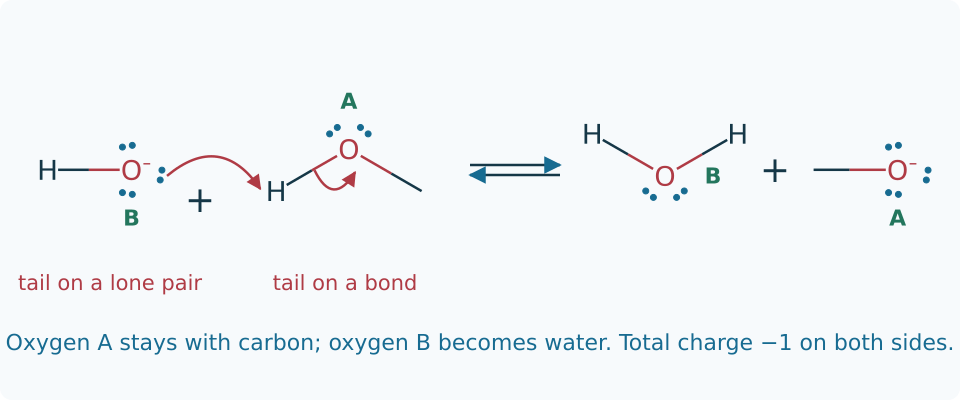{width=88% fig-alt="Hydroxide oxygen B uses a lone pair to take the H of methanol while the O–H bond pair stays on methanol oxygen A, giving water and methoxide"}

The **tail** sits on a lone pair or a bond. The **head** points to where that pair ends up: a new bond or a new lone pair.

::: {.try}
**Try it:** in the products, which oxygen is in water and which is in methoxide?

::: {.fragment}
**B is in water, A stays in methoxide.** Only the proton moves; oxygen atoms never hop between molecules in a proton transfer.
:::
:::

::: notes
Walk through the two arrows slowly. Arrow one: a lone pair on hydroxide oxygen B becomes the new O–H bond. Arrow two: the old O–H bond pair in methanol collapses onto oxygen A, which now has three lone pairs and a negative charge. Stress that an arrow never shows an atom moving; it shows a pair of electrons moving, and the atoms follow. The labels A and B are the point of the try-it. Many students instinctively put oxygen A in the water because "the H went over there". Count charges together: −1 on the left, −1 on the right. Mention that the double arrow just says this is an equilibrium; which side wins is an acid-strength question from Day 3, and arrows alone don't answer it.
:::

## A neutral base becomes a cation

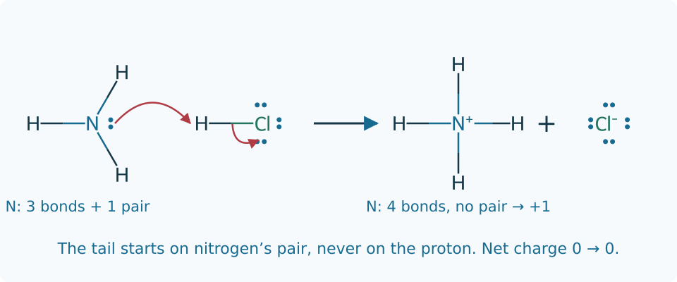{width=88% fig-alt="The nitrogen lone pair of ammonia forms a bond to the H of HCl while the H–Cl bond pair moves onto chlorine, giving ammonium and chloride"}

Nitrogen's lone pair becomes the new N–H bond. Nitrogen now has four bonds and no lone pair, so it carries **+1**. Chloride keeps the old bonding pair, so it carries **−1**.

::: {.try}
**Try it:** a student draws an arrow from the H of H₃O⁺ to ammonia. What's wrong?

::: {.fragment}
**The arrow runs backwards.** A proton has no electrons to give, so the tail must start on nitrogen's lone pair and point at H, with a second arrow from the O–H bond to O.
:::
:::

::: notes
This is the same pattern as the last slide with a neutral base. Make the point that a neutral molecule can be the electron source. The most common arrow error of the whole course is drawing the arrow in the direction the proton travels. Say it plainly: arrows follow electrons, protons go the other way. Check the charge balance: 0 on the left, +1 and −1 on the right, so still 0 overall. Ammonium and chloride are the ions in ammonium chloride, the white smoke you see when bottles of ammonia and concentrated HCl are opened near each other.
:::

## Charges follow the electron count

| atom | before the step | after the step | formal charge |
|---|---|---|---|
| N of NH₃ → NH₄⁺ | 3 bonds, 1 lone pair | 4 bonds, 0 lone pairs | 0 → **+1** |
| O of HO⁻ → H₂O | 1 bond, 3 lone pairs | 2 bonds, 2 lone pairs | −1 → **0** |
| O of CH₃OH → CH₃O⁻ | 2 bonds, 2 lone pairs | 1 bond, 3 lone pairs | 0 → **−1** |
| Cl of HCl → Cl⁻ | 1 bond, 3 lone pairs | 0 bonds, 4 lone pairs | 0 → **−1** |

An atom whose **lone pair becomes a bond** goes up by one. An atom that **receives a bond pair** goes down by one. The total charge never changes.

::: notes
This is Day 1's formal-charge rule applied to a moving picture. Ask students to read across each row and predict the charge before you reveal it. The rule of thumb in the last line makes most mechanisms self-checking: the atom at the tail of a lone-pair arrow becomes more positive, the atom at the head of a bond-breaking arrow becomes more negative. Warn against "fixing" a charge by moving it somewhere else at the end. If the totals don't match, an arrow is wrong or missing.
:::

## Sources and sinks

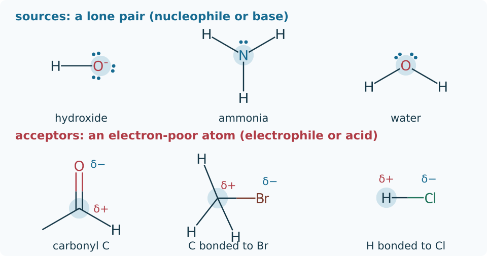{width=66% fig-alt="Top row: hydroxide, ammonia and water with lone pairs shaded as electron sources. Bottom row: the carbonyl carbon of acetaldehyde, the carbon of bromomethane and the H of HCl shaded as electron-poor acceptors with partial charges"}

A **nucleophile** gives a pair to an atom; an **electrophile** accepts it. Polar bonds tell you where the sink is.

::: {.try}
**Try it:** the carbonyl C is δ+. Is acetaldehyde a carbocation?

::: {.fragment}
**No.** δ+ is a partial charge from unequal sharing; every atom in CH₃CHO has formal charge 0.
:::
:::

::: notes
Teach students to look for these two things before drawing anything: where is a lone pair (or later in the course, a pi bond) that could be given away, and where is an atom attached to something more electronegative. The electronegative partner, O or Br or Cl, pulls the shared pair and leaves its neighbour electron-poor. Point out water in the top row: neutral molecules are perfectly good sources. The try-it targets a very common confusion between δ+ and a formal +1; a carbocation has only three bonds, while the carbonyl carbon has four.
:::

## Same reagent, different role

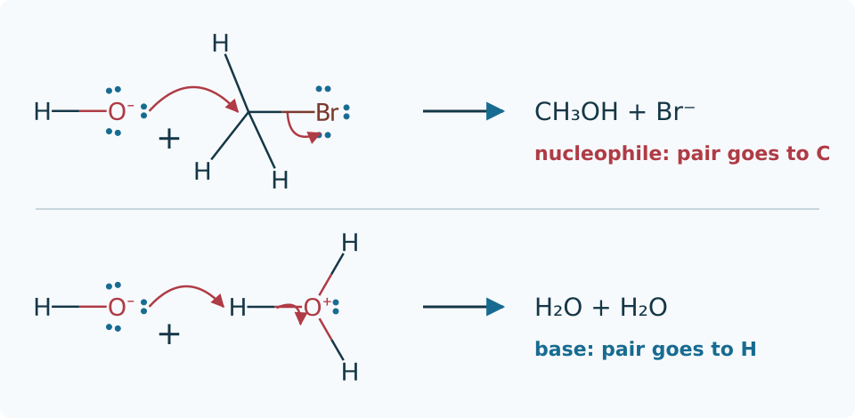{width=74% fig-alt="Top: hydroxide gives its lone pair to the carbon of bromomethane, acting as a nucleophile. Bottom: hydroxide takes an H from hydronium, acting as a base"}

**Base** and **nucleophile** aren't fixed labels. They name what this pair is doing in this step: attacking **H** makes it a base, attacking another atom (usually C) makes it a nucleophile.

::: notes
Students like to sort reagents into boxes: "hydroxide is a base". Break that habit now. Both rows use the same lone pair; the difference is the atom it lands on. In Week 3 you'll see the competition between these two roles directly: hydroxide meeting an alkyl halide can either substitute at carbon (SN2) or pull off a proton next door (E2). Which one wins depends on the substrate and conditions, and that's exactly the question of Day 12. For today, just make students name the attacked atom before naming the role.
:::

## SN2: two arrows, one step

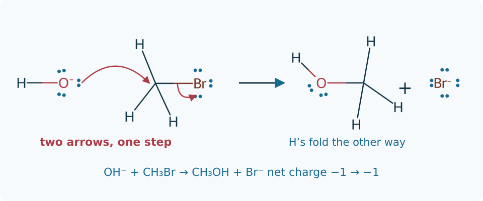{width=88% fig-alt="The hydroxide lone pair attacks the carbon of bromomethane from the side opposite bromine while the C–Br bond pair leaves with bromide; in methanol the three H have folded the other way"}

The new C–O bond forms **as** the C–Br bond breaks. Carbon never has five bonds and there's no intermediate. Hydroxide attacks from the back, so the CH₃ umbrella flips.

::: {.try}
**Try it:** the drawing has two arrows. Is it two steps?

::: {.fragment}
**No.** The number of steps is the number of barriers, not arrows. Both pairs move in one concerted event.
:::
:::

::: notes
Name it: substitution, nucleophilic, bimolecular, SN2. Point out where the nucleophile comes from: directly opposite bromine, where the C–Br antibonding orbital sticks out, which is why the three hydrogens fold over like an umbrella in a gust of wind. On a methyl group the flip is invisible, but yesterday's stereochemistry tells you what it means on a stereocentre: R becomes S (if priorities stay in the same order). That's the headline of Day 11. Check the bookkeeping out loud: oxygen goes from −1 to 0, bromine from 0 to −1, total −1 both sides. If someone asks "why doesn't the reverse happen?", that's the next slide but one.
:::

## A neutral nucleophile needs a second step

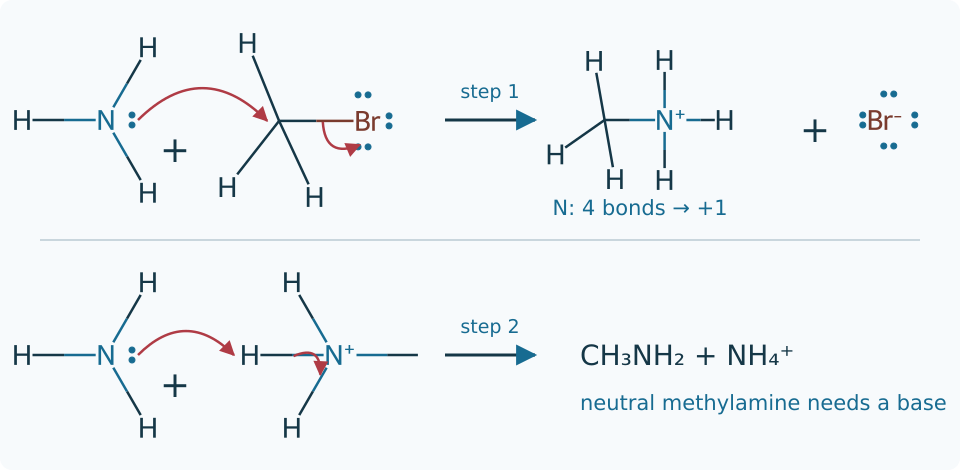{width=78% fig-alt="Step 1: ammonia attacks bromomethane giving methylammonium with N+ and bromide. Step 2: a second ammonia removes an N–H proton giving methylamine and ammonium"}

The first product is **CH₃NH₃⁺**: nitrogen has four bonds. Neutral methylamine only appears when **another base** takes a proton.

::: {.try}
**Try it:** why is CH₃NH₃⁺ not drawn as neutral CH₃NH₂ straight away?

::: {.fragment}
**Nitrogen used its lone pair for the C–N bond** and kept all three H. Losing an H⁺ needs a real proton acceptor, here a second NH₃.
:::
:::

::: notes
This mirrors ammonia protonation from earlier, but now the lone pair lands on carbon instead of hydrogen. Students often draw methylamine as the direct product and then can't balance the H count. Make them count: three N–H bonds before, three after step 1, two after step 2. The second ammonia is why chemists use a large excess of ammonia when making amines this way. Also note that each step is a pattern we already know: an SN2, then a proton transfer. Most mechanisms in this course are just a few of these patterns in a row.
:::

## Balanced on paper isn't the same as real

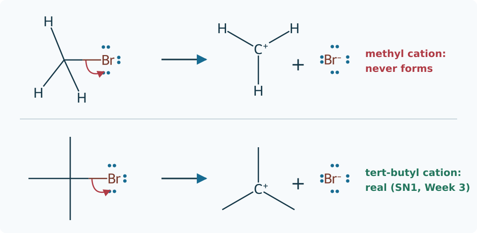{width=78% fig-alt="Top: the C–Br bond pair of bromomethane moves onto bromine to give a methyl cation, which never forms. Bottom: the same arrow for tert-butyl bromide gives a tert-butyl cation, which does form in polar solvents"}

Giving both bond electrons to Br is valid **bookkeeping** for both. Only the tert-butyl cation is stable enough to exist. Arrows check electrons; energies decide what happens.

::: {.try}
**Try it:** Br⁻ attacking CH₃OH to kick out OH⁻ balances perfectly. Why doesn't it happen?

::: {.fragment}
**OH⁻ is a poor leaving group.** It's a much stronger base than Br⁻, so the reverse SN2 is uphill; you'd need acid to turn OH into water first (Week 3).
:::
:::

::: notes
This slide is about the limits of arrow-pushing. A charge-balanced drawing is necessary but not sufficient. The methyl cation is so unstable that bromomethane never ionises; it reacts by SN2 instead. Three methyl groups donate electron density to the cationic carbon, which is why tert-butyl bromide does ionise in water or alcohols. That's the SN1 pathway of Day 11. The try-it comes from the exercises: same arrow logic, wrong direction energetically. Leaving-group ability tracks the weakness of the leaving base, which links straight back to pKa values from Day 3 (HBr is a far stronger acid than water).
:::

## Addition to C=O: carbon keeps four bonds

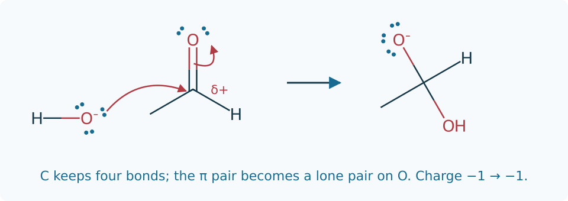{width=82% fig-alt="The hydroxide lone pair forms a bond to the carbonyl carbon of acetaldehyde while the C=O pi pair moves onto oxygen, giving a tetrahedral alkoxide with charge −1"}

When a nucleophile bonds to the carbonyl carbon, the **π pair must move to O**. The product is a tetrahedral **alkoxide**, CH₃CH(OH)O⁻.

::: {.try}
**Try it:** a student keeps C=O and adds the OH. What's wrong, and what's the product's charge?

::: {.fragment}
**Carbon would have five bonds.** Moving the π pair gives O⁻ with three lone pairs, so the product is CH₃CH(OH)O⁻, charge −1, with C at formal charge 0.
:::
:::

::: notes
This is the single most important step of Week 4, so it's worth getting right now. Use Day 1's valence check: the carbonyl carbon already has four bonds (C=O counts two), so a new bond has to come at the cost of an old one. The weakest one is the pi bond, and its pair goes to the more electronegative atom. Watch for two errors: the five-bonded carbon, and the right atoms but no charge drawn on the oxygen. Some students then "fix" the charge by putting +1 on carbon, which neither the arrows nor the total charge support. The carbon also changes shape, from trigonal planar to tetrahedral.
:::

## Two steps: add, then protonate

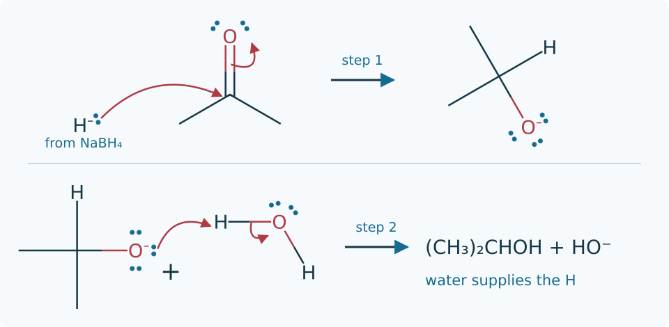{width=74% fig-alt="Step 1: a hydride from NaBH4 adds to the carbonyl carbon of acetone and the pi pair moves to oxygen, giving an alkoxide. Step 2: the alkoxide takes a proton from water, giving propan-2-ol and hydroxide"}

NaBH₄ delivers **H⁻** to carbon. The alkoxide then takes **H⁺ from water**. Every new H must come from a named species.

::: {.try}
**Try it:** a student converts (CH₃)₂CHO⁻ into (CH₃)₂CHOH with no other reagent. Complete the step.

::: {.fragment}
**Add water as the donor.** The O⁻ lone pair takes a water H, the O–H pair goes to water's O, and the products are propan-2-ol and HO⁻. The total charge stays −1.
:::
:::

::: notes
Two caveats to say aloud. First, free hydride ions don't float around in solution; H⁻ is shorthand for a hydride delivered from the B–H bond of borohydride. Second, the first product is the alkoxide, not the alcohol; the workup supplies the proton. This is exactly how a ketone is reduced to an alcohol, which is a Day 13 reaction. The habit we're building is that protons don't appear from nowhere: if an H shows up, point to where it came from and draw what is left behind.
:::

## Resonance is not a reaction

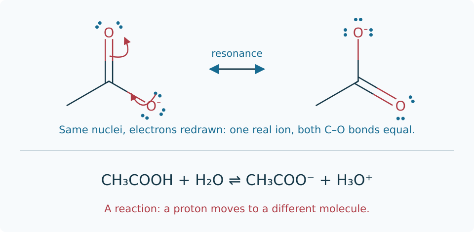{width=72% fig-alt="Top: the two acetate contributors joined by a double-headed resonance arrow, with arrows moving only electrons. Bottom: acetic acid plus water giving acetate and hydronium as a real equilibrium"}

| | resonance ↔ | equilibrium ⇌ |
|---|---|---|
| what moves | only electrons, on paper | nuclei: an H goes to another molecule |
| how many species | **one** real ion | two different species |

::: notes
Students meet curved arrows in resonance too, so they need to know the difference. In acetate, the two drawings are not two molecules flipping back and forth. The real ion is one hybrid with two identical C–O bonds of about 1.5 bond order, and the negative charge shared over both oxygens. That's why acetic acid is more acidic than ethanol (Day 3). The bottom equation is a real chemical change: a proton leaves acetic acid and ends up on water. Use the right arrow for each: double-headed for resonance, equilibrium half-arrows for a reaction.
:::

## Energy profile of one step

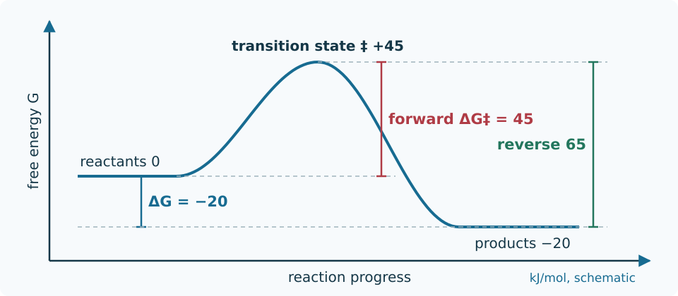{width=72% fig-alt="Reactants at 0, transition state at +45 and products at −20 kJ/mol; forward barrier 45, reverse barrier 65 and overall ΔG −20 kJ/mol"}

The top of the hill is the **transition state** (‡): it lasts for one bond vibration and can't be isolated. **ΔG‡** sets the rate; **ΔG** sets the equilibrium.

::: {.try}
**Try it:** what's the reverse barrier here?

::: {.fragment}
**65 kJ/mol.** Measure from the products up to the same transition state: 45 − (−20) = 65.
:::
:::

::: notes
Every elementary step has one transition state at a maximum. Emphasise that each barrier is measured from its own starting valley. Reverse barrier errors usually come from measuring from the reactants. For the SN2 we drew earlier, the transition state is the moment where C–O is half formed and C–Br half broken, with the three hydrogens flat. You can draw it in brackets with a double dagger. A useful rule of thumb: around 80 to 90 kJ/mol is the barrier that lets a reaction proceed at a convenient rate at room temperature.
:::

## Intermediates sit in valleys

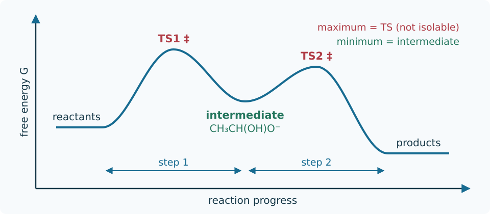{width=80% fig-alt="Two maxima TS1 and TS2 separated by one minimum, the alkoxide intermediate CH3CH(OH)O−, showing two elementary steps"}

An **intermediate** is a real species with a lifetime. It sits in a minimum between two transition states. Count steps by counting maxima: two maxima and one valley means **two elementary steps**.

::: notes
Contrast the two words carefully: an intermediate is a minimum and could in principle be observed or trapped; a transition state is a maximum and can't. In the hydration reaction coming up, the alkoxide is the intermediate between the hydroxide-addition step and the protonation step. Point out that the SN2 profile from the previous slide has no valley, because it has no intermediate. The highest transition state in a multi-step path usually controls the overall rate.
:::

## Favourable is not the same as fast

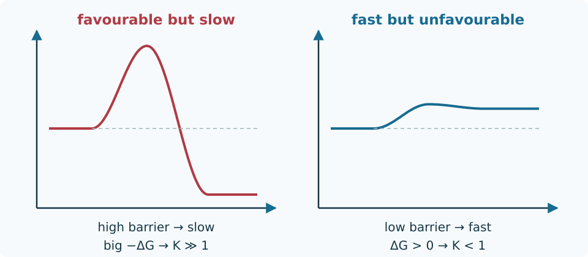{width=74% fig-alt="Left: products far below reactants but with a high barrier, so the reaction is favourable but slow. Right: a low barrier but products above reactants, so the reaction is fast but gives little product"}

Sugar plus O₂ is hugely downhill, yet a sugar bowl doesn't burst into flames: the barrier is high. **Endpoints set K; barriers set the rate.** Given paths with 15 and 25 kJ/mol barriers, the 15 one is faster.

::: notes
This is a place where everyday intuition misleads. Knowing ΔG tells you where a reaction ends up if you wait long enough; it says nothing about how long that takes. Knowing a barrier tells you about speed, but nothing about the final ratio of products. The 15 versus 25 kJ/mol example is from the exercises: the lower barrier wins on rate, all else equal, but neither number tells you the equilibrium composition. Your body burns sugar, of course, but only through enzymes that offer lower-barrier paths, which is the bridge to the next slide.
:::

## Catalysts are regenerated

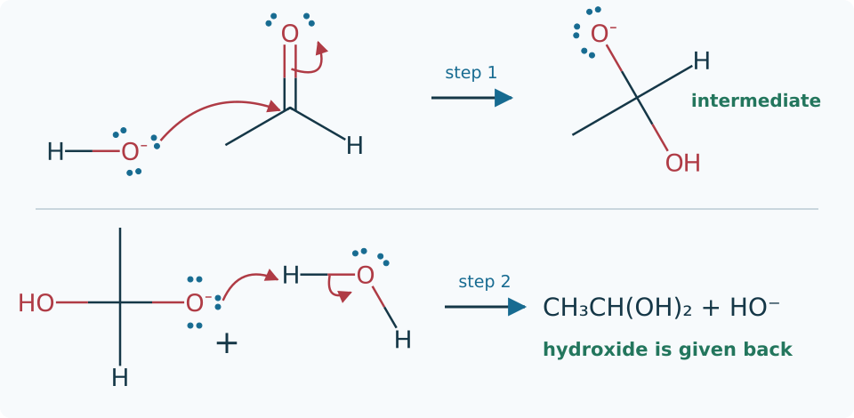{width=74% fig-alt="Step 1: hydroxide adds to acetaldehyde giving an alkoxide intermediate. Step 2: the alkoxide takes a proton from water giving the hydrate CH3CH(OH)2 and giving back hydroxide"}

Add the steps and cross out what appears on both sides: **CH₃CHO + H₂O ⇌ CH₃CH(OH)₂**. Hydroxide is used in step 1 and returned in step 2, so it's a **catalyst**; the alkoxide is an **intermediate**.

::: notes
The two steps are things we already drew today: carbonyl addition, then a proton transfer from water. Sum them on the board and cancel species: OH− appears on the left of step 1 and the right of step 2; the alkoxide appears on the right of step 1 and the left of step 2. What's left is the net hydration. The distinction to make crisp: a catalyst goes in first and comes out last; an intermediate is made first and consumed later. Carbonic anhydrase from the opening works the same way, with zinc-bound hydroxide doing step 1. Carbonyl hydration and its cousins return in Week 4.
:::

## A catalyst lowers the barrier, not ΔG

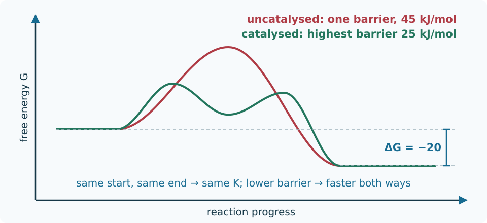{width=82% fig-alt="An uncatalysed path with one barrier of 45 kJ/mol and a catalysed two-step path whose highest barrier is 25 kJ/mol, both starting at 0 and ending at −20 kJ/mol"}

The catalysed path is **different**, often with more steps, but it starts and ends at the same place. Both directions get faster, so equilibrium is reached sooner but **K doesn't change**.

::: notes
Return to carbonic anhydrase: the enzyme doesn't make more bicarbonate at equilibrium; it gets there millions of times faster, in both directions. That matters because in your lungs the same enzyme runs the reaction backwards to release CO2. A catalyst that speeded only the forward reaction would be a perpetual-motion machine. Point out that the green path has two humps, so it also has an intermediate. A lower highest barrier doesn't require fewer steps.
:::

## Mistakes we see every year

| mistake | fix |
|---|---|
| arrow from H⁺ to the base | start at the **lone pair**, point at H |
| carbon with five bonds after an addition | move the **π pair** to O |
| product drawn without its charge | recount: **total charge is conserved** |
| H appears from nowhere | name the **proton donor** and its conjugate base |
| two arrows read as two steps | steps = **barriers**, not arrows |
| balanced drawing taken as proof | check the **energies** (cation stability, leaving group) |
| catalyst "shifts equilibrium to products" | it lowers barriers both ways; **K is unchanged** |

::: notes
Read out each mistake and ask the room to give the fix before you show it. Every row corresponds to at least one exercise: 2 for the reversed arrow, 6 and 17 for the five-bonded carbon and missing charge, 8 for the missing proton donor, 3 and 12 for counting steps, 4 and 11 for the balanced-but-wrong drawings, and 15 for catalysis.
:::

## Summary

| concept | key fact |
|---|---|
| curved arrow | moves **one pair**: lone pair or bond → new bond or lone pair |
| charges | lone pair → bond: +1; bond pair received: −1 |
| roles | pair to **H** = base; pair to **C** = nucleophile |
| SN2 | one step, two arrows, attack from the back |
| addition to C=O | π pair to O → tetrahedral alkoxide |
| transition state | maximum ‡, not isolable |
| intermediate | minimum between two steps |
| barriers vs ΔG | ΔG‡ → rate; ΔG → K |
| catalyst | regenerated; lower barrier, same K |

**Next:** substitution, SN2 versus SN1 (Day 11). **Practice:** [exercises](exercise.qmd) · [self-check](quiz.qmd)

::: notes
Run the checklist once more as the take-home habit: for each step, every arrow starts on a pair, carbon never exceeds four bonds, atoms and total charge balance, every new H has a donor. Then ask whether the step makes sense energetically. Close the loop with carbonic anhydrase: students can now draw its key step (zinc hydroxide adds to CO2, pi pair to oxygen) and explain why the enzyme speeds the reaction without changing its equilibrium. Days 9 and 10 are consolidation days; Day 11 builds directly on the SN2 and heterolysis slides.
:::
