## What will you be able to explain?

- Identify an electron-pair source and acceptor.
- Draw valid arrows for an elementary step.
- Distinguish intermediates, transition states and catalysts.

::: notes
**45-minute block budget (all pauses included):** 0–4 min: recall lone pairs/valence; 4–12 min: proton transfer and concerted substitution; 12–21 min: carbonyl addition and charge repair; 21–29 min: neutral-nitrogen donors and proton accounting; 29–37 min: energy profiles, catalysis and reverse barriers; 37–42 min: labelled-atom drawing/application; 42–45 min: retrieval and recap. The brief predictions, individual drawing and board discussion occur inside these blocks, not in extra time. The 40-second metadata is a rough planning reference; spend longer on the identified drawings and merge explanations already understood.

Begin with the previous unit’s electron-pair and charge audit. Ask students to predict a product or bond change before displaying the worked drawing. These slides support discussion and paper drawing; the practice page supplies further explanations.
:::

## Predict before the worked drawing

Given CH₃OH and OH⁻, draw the pair that forms a new O–H bond. What second pair must move? Do not decide equilibrium position from arrows alone.

::: notes
Allow about 25 seconds of individual drawing/thinking, then ask for one reason. Do not display the worked product yet. Use the following illustration to resolve the atom, charge or geometry issue.
:::

## Arrows follow electron pairs

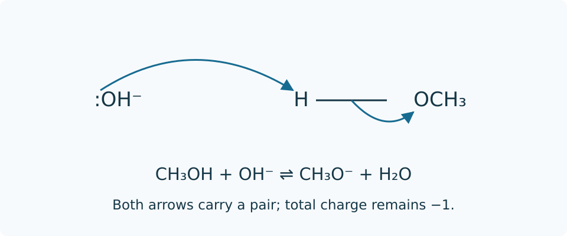{width=85% fig-alt="A lone pair forms the new O–H bond while the original O–H bonding pair returns to oxygen."}

Every full-headed curved arrow starts at a lone pair or bond. Two arrows are needed for this proton transfer.

::: notes
Point to each arrow tail and ask what pair was there before the step. Do not accept an arrow starting at a positive charge or at a bare hydrogen.
:::

## A neutral base can become a cation

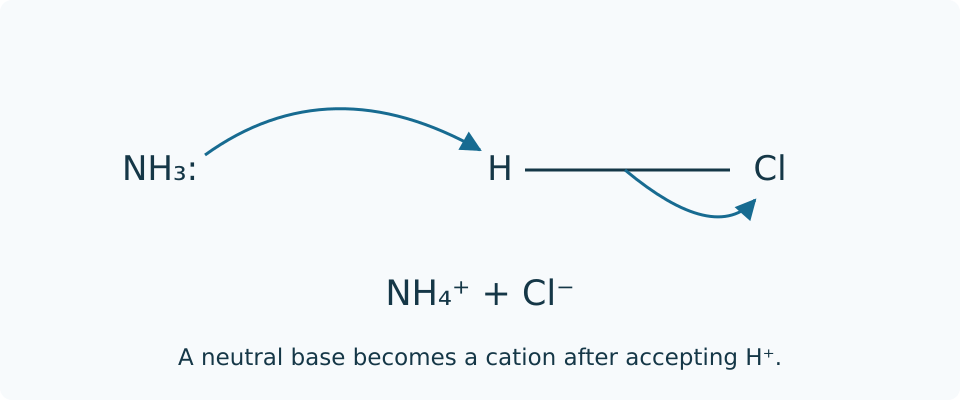{width=85% fig-alt="A neutral base can become a cation"}

Read the new N–H bond in ammonia protonation. Identify both original electron pairs before writing products.

::: notes
NH₃ donates its lone pair; H–Cl gives its pair to Cl. NH₄⁺ and Cl⁻ conserve net zero charge.
:::

## Audit the nitrogen after proton transfer

{width=85% fig-alt="A neutral base can become a cation"}

Draw NH₄⁺ with four N–H bonds. Explain why four bonds and no lone pair require +1, then locate the opposite charge.

::: notes
NH₃ donates its lone pair; H–Cl gives its pair to Cl. NH₄⁺ and Cl⁻ conserve net zero charge.
:::

## Predict before the worked drawing

Break the C–Br bond in CH₃Br formally by giving both electrons to Br. Which two charges must appear? Is a balanced drawing sufficient evidence of a fast reaction?

::: notes
Allow about 25 seconds of individual drawing/thinking, then ask for one reason. Do not display the worked product yet. Use the following illustration to resolve the atom, charge or geometry issue.
:::

## Both bonding electrons can stay together

{width=85% fig-alt="The C–Br bonding pair moves to bromine, giving formally separated positive and negative ions."}

Heterolysis gives the two bonding electrons to one atom. Charge separation must appear in the products.

::: notes
This is bookkeeping, not a prediction that a methyl carbocation forms readily. Methyl substrates instead favour concerted substitution in the examples used here.
:::

## Count before using a charge label

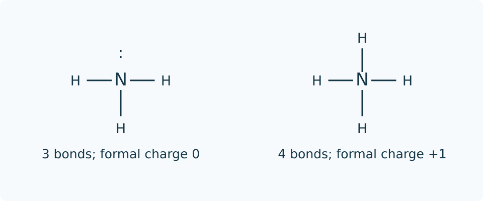{width=85% fig-alt="Count before using a charge label"}

Compare three-bond NH₃ with four-bond NH₄⁺. Which available lone pair has become a bond?

::: notes
Nitrogen has five valence electrons. Three bonds plus one pair is neutral; four bonds and no pair gives formal +1.
:::

## Transfer the counting rule to an attacking amine

{width=85% fig-alt="Count before using a charge label"}

If NH₃ adds a bond to CH₃ instead of H, predict CH₃NH₃⁺ before any later proton transfer.

::: notes
Nitrogen has five valence electrons. Three bonds plus one pair is neutral; four bonds and no pair gives formal +1.
:::

## Name the donor and acceptor

{width=85% fig-alt="A hydroxide lone pair is the source and the polar carbonyl carbon is an electron-pair acceptor."}

A **nucleophile** donates a pair to form a bond; an **electrophile** accepts it. A neutral molecule may be either.

::: notes
This picture locates the source and acceptor. It is not a complete mechanism: the carbonyl pi pair must move too when the new bond forms.
:::

## A new bond need not give a neutral product

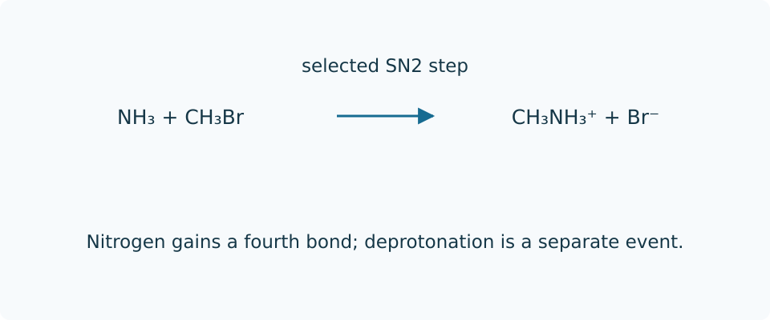{width=85% fig-alt="A new bond need not give a neutral product"}

Read the methyl–nitrogen bond formation. Explain why the immediate product retains three N–H bonds.

::: notes
The next products are CH₃NH₂ and NH₄⁺. A separate proton acceptor is necessary to form neutral methylamine.
:::

## Choose the next chemical operation

{width=85% fig-alt="A new bond need not give a neutral product"}

Draw another NH₃ accepting a proton from CH₃NH₃⁺. Track the pair returning to methylamine N.

::: notes
The next products are CH₃NH₂ and NH₄⁺. A separate proton acceptor is necessary to form neutral methylamine.
:::

## Predict before the worked drawing

Draw the immediate product when OH⁻ adds to CH₃CHO. Count every carbon bond order and place the charge before protonating anything.

::: notes
Allow about 25 seconds of individual drawing/thinking, then ask for one reason. Do not display the worked product yet. Use the following illustration to resolve the atom, charge or geometry issue.
:::

## Do not give carbon five bonds

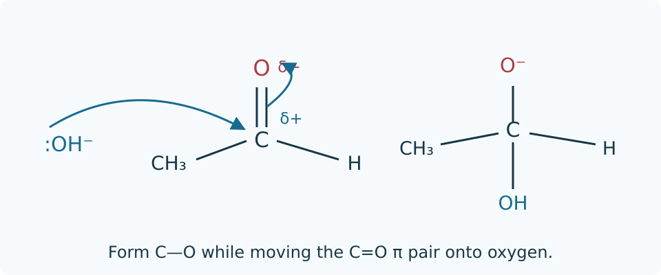{width=85% fig-alt="Hydroxide addition moves the carbonyl pi pair to oxygen and makes a tetrahedral alkoxide."}

New C–O bond formation and C=O π-bond cleavage occur in the same elementary addition step.

::: notes
Count the central carbon bond orders before and after. The product oxygen with one bond has three lone pairs and formal charge minus one.
:::

## Use each minimum as its own baseline

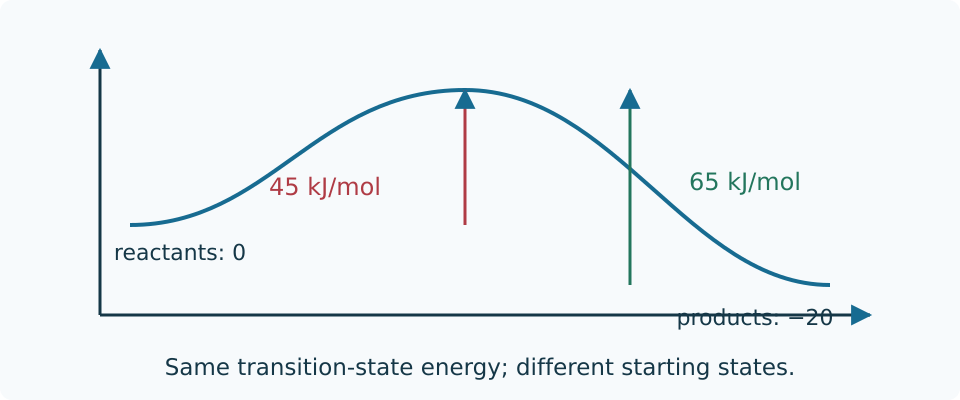{width=85% fig-alt="Use each minimum as its own baseline"}

Read the forward and reverse barriers from reactants0, transition state +45 and products−20 kJ/mol.

::: notes
Forward barrier 45, reverse 65. Endpoint free energy describes equilibrium; the barrier is needed for rate reasoning.
:::

## Distinguish favourable from fast

{width=85% fig-alt="Use each minimum as its own baseline"}

The endpoint ΔG is −20 kJ/mol. Explain why a45 kJ/mol forward barrier still matters even though the products are lower.

::: notes
Forward barrier 45, reverse 65. Endpoint free energy describes equilibrium; the barrier is needed for rate reasoning.
:::

## Predict before the worked drawing

For OH⁻ + CH₃Br, draw the new bond and the departing bond pair in one elementary step. What species must not be inserted between them?

::: notes
Allow about 25 seconds of individual drawing/thinking, then ask for one reason. Do not display the worked product yet. Use the following illustration to resolve the atom, charge or geometry issue.
:::

## One elementary step can use several arrows

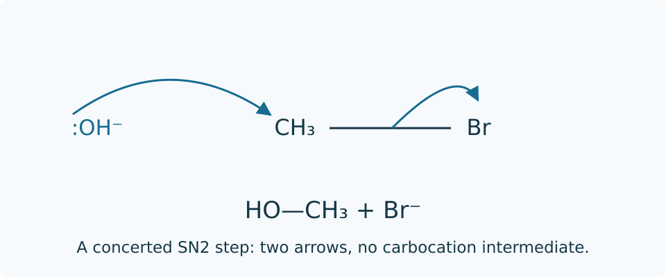{width=85% fig-alt="Two electron pairs move together in methyl bromide substitution by hydroxide."}

**Concerted** means one step with no intermediate between bond breaking and bond making.

::: notes
The total charge remains minus one. There is no methyl carbocation minimum hidden in this concerted example.
:::

## Protons transfer; oxygen labels stay

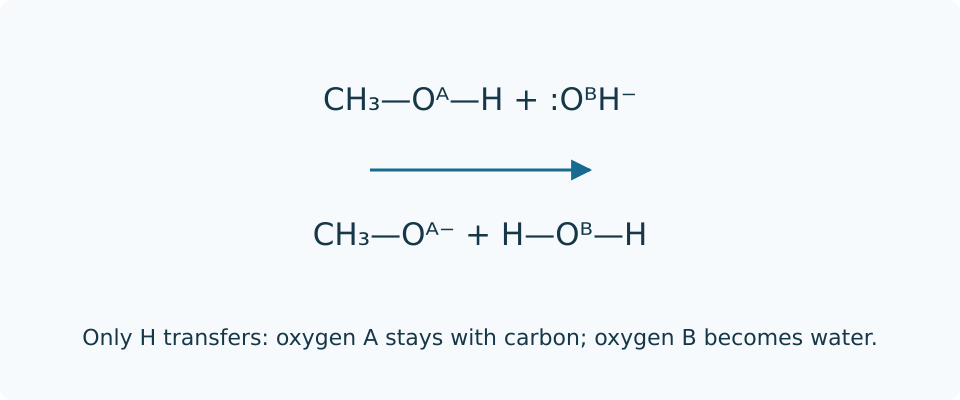{width=85% fig-alt="Protons transfer; oxygen labels stay"}

Identify which oxygen remains bonded to CH₃ after methanol deprotonation.

::: notes
A remains methoxide oxygen; B is water oxygen. Exchanging labels would imply C–O cleavage/new bonding not present here.
:::

## Use labels to reject an extra mechanism

{width=85% fig-alt="Protons transfer; oxygen labels stay"}

A proposed answer puts oxygen A into water. What additional bond changes would that require beyond proton transfer?

::: notes
A remains methoxide oxygen; B is water oxygen. Exchanging labels would imply C–O cleavage/new bonding not present here.
:::

## Predict before the worked drawing

An alkoxide becomes alcohol after water is added. What happens to the proton-donor water? Write it rather than supplying an unexplained H⁺.

::: notes
Allow about 25 seconds of individual drawing/thinking, then ask for one reason. Do not display the worked product yet. Use the following illustration to resolve the atom, charge or geometry issue.
:::

## A proton must come from a species

{width=85% fig-alt="Ethoxide receives a proton from water, and hydroxide is produced."}

Write the proton donor and its conjugate base. A work-up is a chemical step, not a source of unexplained H atoms.

::: notes
Use this to prepare for carbonyl reduction. Students often draw the alkoxide directly as an alcohol and lose both the proton donor and charge.
:::

## Two contributors describe one ion

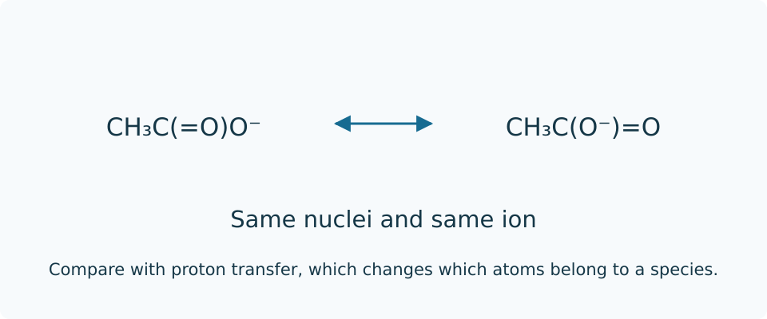{width=85% fig-alt="Two contributors describe one ion"}

Compare the positions of C, O and H nuclei across ethanoate resonance contributors. What changes?

::: notes
Resonance moves electron placement at fixed nuclei. Deprotonation changes atom membership and describes interconverting species.
:::

## Contrast a chemical equilibrium

{width=85% fig-alt="Two contributors describe one ion"}

Now write CH₃COOH⇌CH₃COO⁻+H⁺. Why does that relation require an equilibrium arrow instead?

::: notes
Resonance moves electron placement at fixed nuclei. Deprotonation changes atom membership and describes interconverting species.
:::

## Predict before the worked drawing

Sketch one reaction step as a free-energy profile. Where is its transition state? Why is the horizontal axis not a clock?

::: notes
Allow about 25 seconds of individual drawing/thinking, then ask for one reason. Do not display the worked product yet. Use the following illustration to resolve the atom, charge or geometry issue.
:::

## Transition states are energy maxima

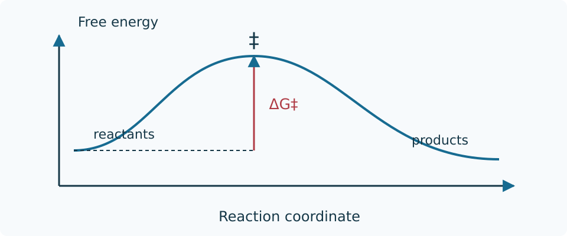{width=85% fig-alt="A one-step free-energy profile has one maximum between reactants and products."}

The transition state is not an isolable intermediate. Its barrier helps determine the reaction rate.

::: notes
The curve is schematic. The vertical axis is free energy, not concentration, and the horizontal axis is reaction progress, not elapsed time.
:::

## A complete product includes its charge

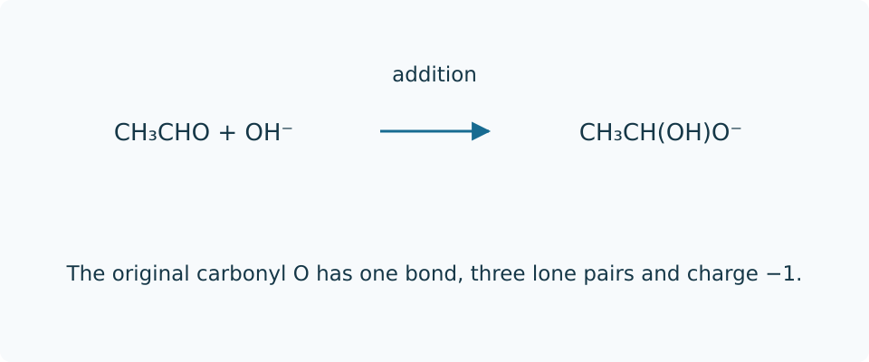{width=85% fig-alt="A complete product includes its charge"}

Find the original carbonyl oxygen in the tetrahedral addition product and count its single bond and three pairs.

::: notes
No. Carbon has four single bonds and formal 0. Original oxygen is −1, preserving the starting net −1 charge.
:::

## Repair a wrong carbon charge

{width=85% fig-alt="A complete product includes its charge"}

Would putting+1 at the tetrahedral carbon repair a missing oxygen-minus sign? Check the actual electrons and net charge.

::: notes
No. Carbon has four single bonds and formal 0. Original oxygen is −1, preserving the starting net −1 charge.
:::

## Predict before the worked drawing

Sketch a two-step profile. Place the intermediate and both transition states. How would you measure the second step’s barrier?

::: notes
Allow about 25 seconds of individual drawing/thinking, then ask for one reason. Do not display the worked product yet. Use the following illustration to resolve the atom, charge or geometry issue.
:::

## An intermediate occupies a minimum

{width=85% fig-alt="A two-step schematic path has two transition states and an intermediate free-energy minimum."}

Count steps by maxima, not by the number of curved arrows. An intermediate has a finite lifetime.

::: notes
A minimum may be short-lived and difficult to observe. The diagram does not by itself specify whether it can be bottled.
:::

## Cancel species only after summing real steps

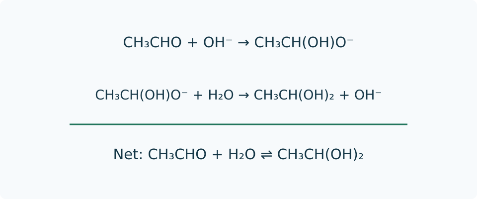{width=85% fig-alt="Cancel species only after summing real steps"}

Add the two hydrate-forming equations and mark the alkoxide as intermediate.

::: notes
The species OH⁻ is used and regenerated overall. Formal cancellation of species is net stoichiometry, not an assertion that individually labelled atoms cannot exchange through steps.
:::

## Identify the regenerated participant

{width=85% fig-alt="Cancel species only after summing real steps"}

Explain why hydroxide is a catalyst here, while water is a net reactant. Is every oxygen atom necessarily the same after cancellation?

::: notes
The species OH⁻ is used and regenerated overall. Formal cancellation of species is net stoichiometry, not an assertion that individually labelled atoms cannot exchange through steps.
:::

## Predict before the worked drawing

Can two different barriers join the same reactant/product free energies? Predict what this means for catalysis and equilibrium.

::: notes
Allow about 25 seconds of individual drawing/thinking, then ask for one reason. Do not display the worked product yet. Use the following illustration to resolve the atom, charge or geometry issue.
:::

## Catalysis changes the pathway

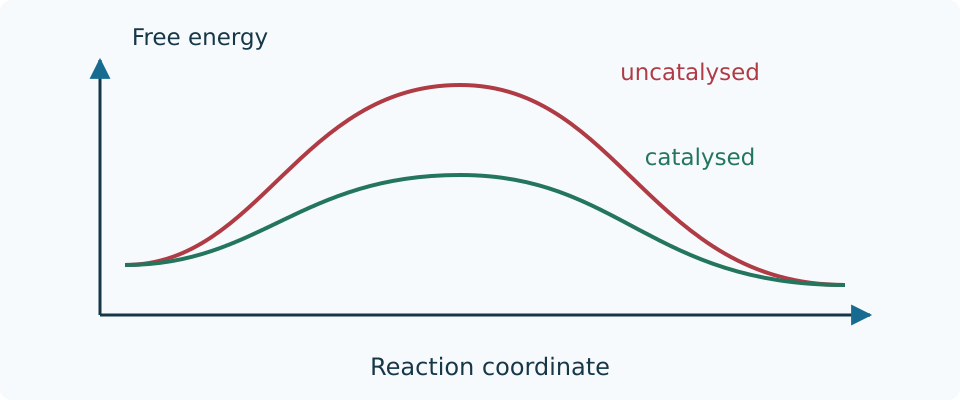{width=85% fig-alt="Catalysed and uncatalysed paths have the same reactant and product energies but different barriers."}

A catalyst can increase the rate while leaving the overall equilibrium constant unchanged.

::: notes
The drawn catalysed profile is simplified. Real catalysis often adds multiple elementary steps; the catalyst is regenerated overall.
:::

## Predict before the worked drawing

For OH⁻ + CH₃Br → CH₃OH + Br⁻, inventory C, H, O and Br and the total charge. Which omission is easiest to miss?

::: notes
Allow about 25 seconds of individual drawing/thinking, then ask for one reason. Do not display the worked product yet. Use the following illustration to resolve the atom, charge or geometry issue.
:::

## Use an atom and charge audit

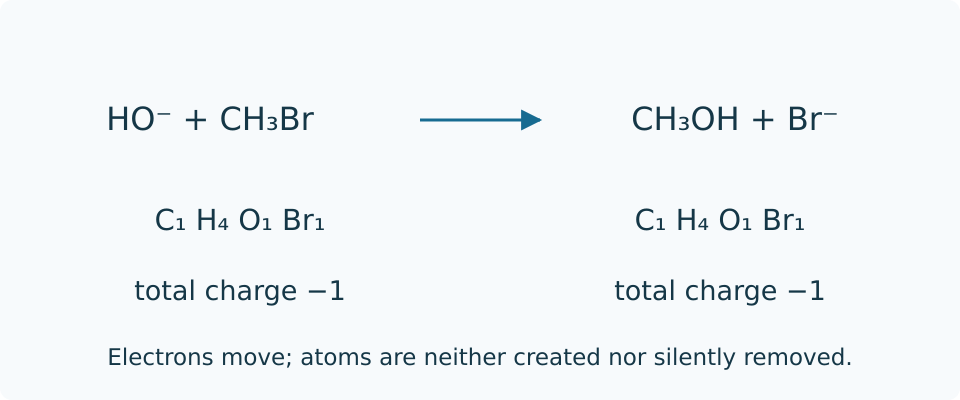{width=85% fig-alt="Substitution conserves C, H, O and Br and has total charge minus one on both sides."}

After every step, check valence, atoms and net charge. Add implied hydrogens when the audit is unclear.

::: notes
An electron-flow arrow does not add atoms. A missing counterion may be a spectator, but the reacting species must still have correct individual charges.
:::

## Nucleophilicity and basicity ask different questions

A base accepts a proton; a nucleophile attacks an electrophilic centre. The same species can do both, but the preferred outcome depends on the substrate and conditions.

Identify the atom attacked before naming the process.

## Repair an impossible step

A student draws OH⁻ adding to a carbonyl but leaves the C=O double bond intact.

Draw all bonds to that carbon. Which electron pair must move, and where does the negative charge end up?

## Explain an energy diagram

Sketch a two-step path. Mark both transition states and the intermediate.

Which feature would change if a catalyst offers a faster path? Which endpoint energy difference stays the same?

## Use the same reasoning in practice

Complete the [exercises](exercise.qmd), then the [self-check](quiz.qmd).

Optional textbook support: selected Solomons chapter 3 and 6 sections. The [reading guide](../reference/reading.qmd) explains the provisional book mapping.

::: notes
Session budget45 minutes:roughly27–29 minutes of concise explanations/visual inspection, about 11–13 minutes of individual drawing and predictions distributed through the sequence, and4–6 minutes of discussion/closing checks. Adjust to observed errors; the 40 second metadata is a planning guide, not a quota. Required paper practice and optional transfer are available in the exercise bank.
:::
