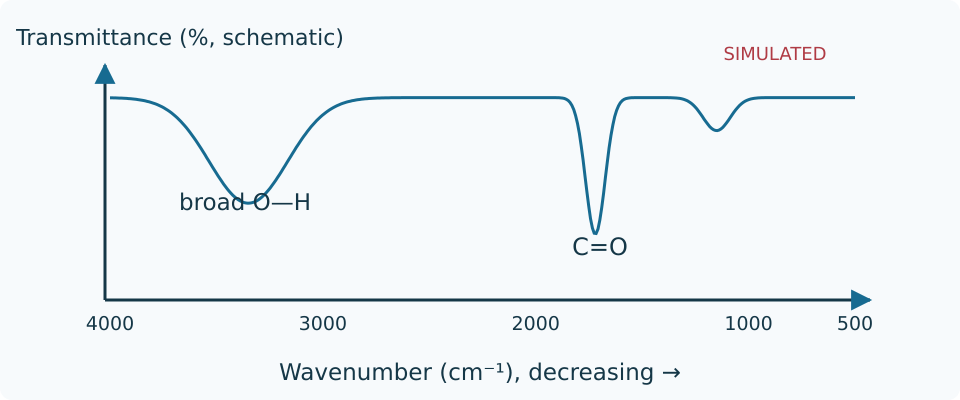

Allow 75–90 minutes. This is chemistry practice rather than a new R lesson.
Draw each molecule before comparing it. You need the functional groups from
[structures](../structures/exercise.qmd).

## 1. Separate formal charge from partial charge

Draw ethanol with its oxygen lone pairs. Label the C–O bond's direction of
polarisation and the partial charges at its ends. Does a partial negative
oxygen have to carry a formal −1 charge? Compare neutral ethanol with ethoxide,
CH₃CH₂O⁻, and explain what the superscript minus tells you in the latter case.

::: {.callout-tip collapse="true" title="Hint"}
Bond polarity describes unequal electron sharing. Formal charge is calculated
from a Lewis electron count and is written as an integer for each contributor.
:::

::: {.callout-note collapse="true" title="Worked check"}
The C–O bond is polarised toward O, giving δ− at oxygen and δ+ at the attached
carbon. Neutral ethanol has two bonds and two lone pairs at O, so its oxygen
formal charge is zero. Ethoxide has one bond and three lone pairs at O and
formal charge −1. Partial charge and formal charge describe different aspects
of the electron distribution; they are not interchangeable labels.
:::

## 2. Find hydrogen-bond partners

For ethanol, dimethyl ether, propanone and ethanoic acid, mark suitable donor
and acceptor sites. Draw one hydrogen-bond contact between ethanol and water,
and another between dimethyl ether and water. Which molecule must supply the
hydrogen in the second drawing? Avoid adding a covalent bond when drawing
the interaction.

::: {.callout-note collapse="true" title="Worked check"}
Ethanol has an O–H donor and an oxygen acceptor. Dimethyl ether and propanone
have oxygen acceptors but no O–H/N–H donor. Ethanoic acid has an O–H donor
and a carbonyl-oxygen acceptor; the protonated acid hydroxyl oxygen is not
normally treated as a useful hydrogen-bond acceptor in this simple inventory.
Water can donate H to an ether lone pair. Draw the intermolecular contact
as a dashed line O–H···O, keeping covalent connectivity unchanged.
:::

## 3. Compare boiling points without changing too many variables

Ethanol and dimethyl ether have the same formula, C₂H₆O, and the same molar
mass. Their approximate normal boiling temperatures are 78 °C and −24 °C,
respectively. Explain why this comparison is useful for discussing hydrogen
bonding. What would make comparison of ethanol with a much larger hydrocarbon
less controlled? Does the higher boiling point imply a stronger covalent C–O
bond?

::: {.callout-note collapse="true" title="Worked check"}
Similar size and formula reduce the size/polarisability difference. Ethanol
can donate and accept hydrogen bonds between its molecules; pure dimethyl
ether lacks an OH donor. A much larger hydrocarbon may have substantial
dispersion interactions, so molecular size becomes an important extra variable.
Boiling normally separates intact molecules; the comparison concerns
intermolecular attractions, not direct evidence about a covalent C–O bond energy.
:::

## 4. Explain a solubility trend carefully

Compare ethanol with hexan-1-ol, CH₃(CH₂)₅OH. Identify what stays similar and
what changes. Predict which is more compatible with water and justify the
prediction using both polar and nonpolar regions. Would your explanation
establish the exact solubility in g/L at an unspecified temperature?

::: {.callout-tip collapse="true" title="Hint"}
Both contain one OH group. Count how much hydrocarbon is attached to it; do
not treat the group as a switch that makes every possible molecule soluble.
:::

::: {.callout-note collapse="true" title="Worked check"}
Ethanol is more water compatible. Both have one OH group, but hexan-1-ol has
a larger nonpolar region relative to its hydrogen-bonding head. The comparison
supports a qualitative trend, not an exact g/L value. Temperature, detailed
molecular structure and interactions in the separated phases also matter.
:::

## 5. Read a simulated IR spectrum

{fig-alt="A labelled simulated transmission trace showing broad OH and strong carbonyl features."}

The illustration is a schematic teaching spectrum, not a measured sample.
First name the axes and explain why absorption goes downward. A supplied
unknown has a strong absorption near 1715 cm⁻¹ and no broad alcohol OH feature
between about 3200 and 3600 cm⁻¹. Candidates are ethanol, propanone and dimethyl
ether. Which candidate best fits this restricted set? What additional evidence
would you want before declaring the sample pure propanone?

::: {.callout-note collapse="true" title="Worked check"}
The horizontal axis is wavenumber in cm⁻¹, decreasing to the right; the vertical
axis is transmittance. Absorption removes transmitted light, producing a dip.
Propanone fits the strong carbonyl and lack of OH; the other candidates lack
a carbonyl. The conclusion is relative to the candidate list. It does not
establish purity or rule out all other ketones. NMR, further spectral features
and suitable purity evidence would strengthen the interpretation.
:::

## 6. Check a misleading explanation

A student writes: “The IR spectrum has a peak, so the compound is polar and
must dissolve in water.” Rewrite the statement as two defensible claims, one
about what IR probes and one about what solubility depends on.

::: {.callout-note collapse="true" title="Worked check"}
A suitable IR absorption indicates a vibrational transition involving a change
in dipole moment and may support a functional-group assignment. Solubility
depends on the balance of solute/solvent and solute/solute interactions, the
molecular structure, charge and conditions. A peak alone does not establish
water solubility or a nonzero permanent molecular dipole.
:::

## Leave with

Annotated donor/acceptor drawings, a controlled boiling-point explanation and
a spectral conclusion that names both supporting evidence and its limits.
Complete the [self-check](quiz.qmd) before the acid–base unit. Optional
reference: selected Solomons chapter 2 topics, as described in the
[reading guide](../reference/reading.qmd).
