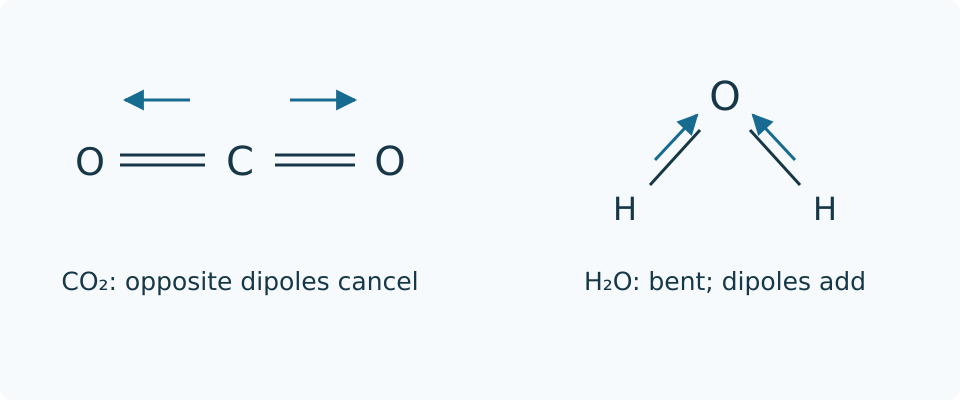
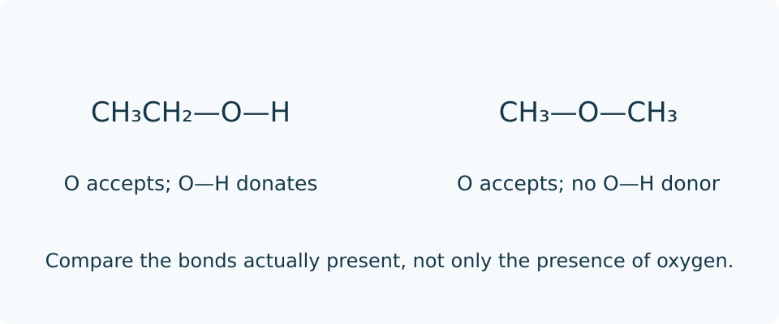
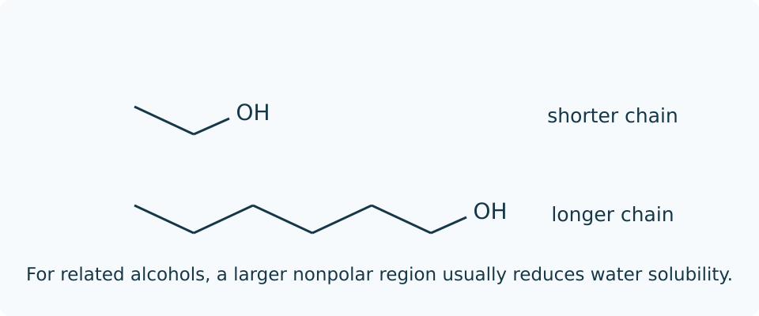
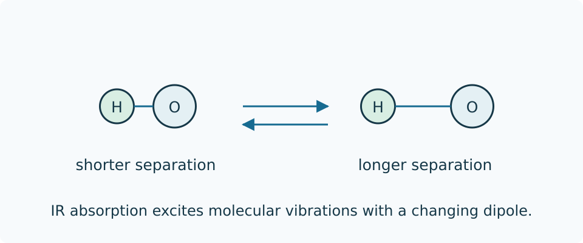
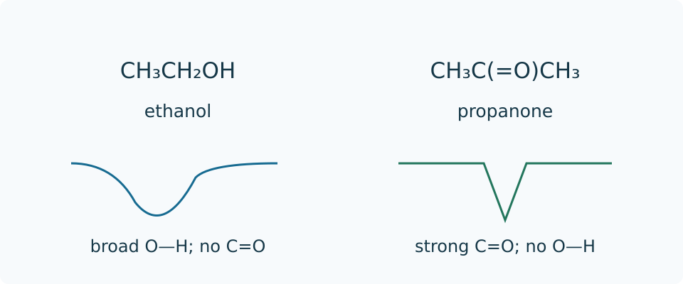
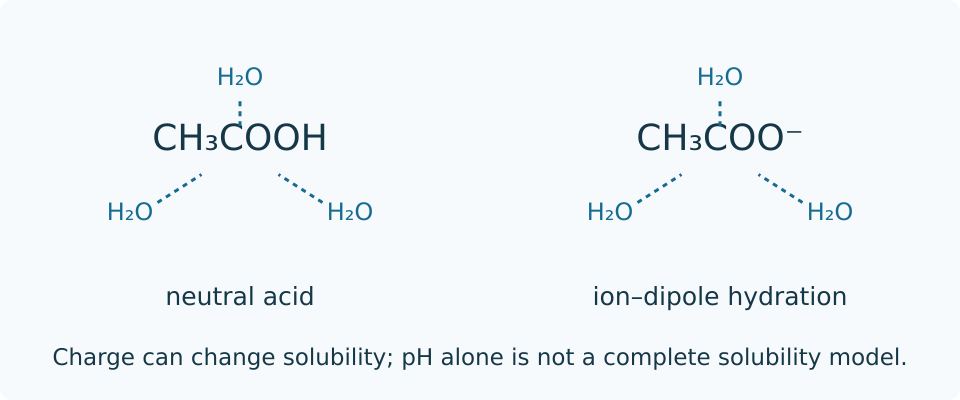

## What will you be able to explain?

- Distinguish a polar bond from a polar molecule.
- Identify hydrogen-bond donors and acceptors.
- Use simple IR evidence alongside structural reasoning.

::: notes
Revisit functional-group identification before property prediction. Students often say stronger bonds mean a higher boiling point; ask whether the bonds in question are within a molecule or attractions between molecules.
:::

## A bond can share electrons unequally

{width=85% fig-alt="A carbon-oxygen bond with partial positive carbon and partial negative oxygen."}

δ+ and δ− mark partial charges. They are not the integer formal charges assigned in a Lewis structure.

::: notes
Ask which atom more strongly attracts the bonding electrons. Keep bond dipoles distinct from electron-flow arrows used for reactions.
:::

## The molecular shape determines the sum

{width=85% fig-alt="Opposing CO2 dipoles cancel whereas bent-water dipoles combine."}

Dipoles are vectors. A molecule with polar bonds can have no net permanent dipole when symmetry makes them cancel.

::: notes
CO2 is an illustrative comparison, not an organic compound; its simple geometry isolates the vector idea.
:::

## Hydrogen bonding has a direction

{width=85% fig-alt="An alcohol O-H donor contacts a second oxygen lone-pair acceptor."}

A donor needs a suitable X–H bond, usually O–H or N–H here; an acceptor needs a suitable available lone pair.

::: notes
The dashed line is an intermolecular contact, not an added covalent bond or proof that a proton has transferred.
:::

## An ether accepts but cannot donate O–H

{width=85% fig-alt="Ethanol donates and accepts hydrogen bonds; dimethyl ether accepts but lacks an OH donor."}

A functional-group name is a shortcut to a bonding pattern. Always check the actual bonds present.

::: notes
Do not generalise all nitrogen lone pairs as equally available: amides will supply an important later exception.
:::

## Boiling separates molecules from each other

{width=85% fig-alt="Approximate normal boiling points of dimethyl ether and ethanol contrast similar-sized isomers."}

Ethanol can form an intermolecular O–H hydrogen-bond network. Its normal boiling point is much higher than that of its ether isomer.

::: notes
Normal means at about one atmosphere. Boiling overcomes intermolecular attractions; it does not normally break the molecules into atoms.
:::

## Water compatibility balances several features

{width=85% fig-alt="Short and longer hydrocarbon chains attached to an alcohol OH."}

Within a related alcohol series, increasing the nonpolar region usually lowers water solubility. The OH group alone is not a complete prediction.

::: notes
Acknowledge temperature and structure effects. Avoid calling all oxygen-containing compounds water soluble.
:::

## IR excites a vibration

{width=85% fig-alt="An OH bond represented at two separations during stretching."}

A vibration can absorb IR when it changes the molecular dipole. The spectrum reports vibrational transitions.

::: notes
Students need the interpretation, not a quantum derivation. An absorbed photon does not imply the bond is broken.
:::

## Read axes before assigning a peak

{width=85% fig-alt="Simulated transmission spectrum with broad OH and sharp carbonyl absorption."}

This is a **simulated** trace. In transmission, absorptions point down; wavenumber commonly decreases from left to right.

::: notes
Different plotting conventions reverse peak direction. Require students to name the y-axis before using down-peak language.
:::

## Combine presence and absence of features

{width=85% fig-alt="Alcohol and ketone structures compared with schematic characteristic IR features."}

Broad alcohol O–H is often around 3200–3600 cm⁻¹; a strong carbonyl is often around 1650–1800 cm⁻¹. Context shifts these ranges.

::: notes
Absence is evidence only when the spectrum is suitable. Water contamination can introduce OH absorption.
:::

## Charge changes hydration

{width=85% fig-alt="Neutral ethanoic acid and negatively charged ethanoate interacting with water."}

Ion–dipole interactions can make ionic forms more compatible with water, but actual solubility also depends on other equilibria and the solid or liquid phase.

::: notes
Prepare the acid–base unit without pretending pH alone determines measured solubility.
:::

## Explain a prediction with a controlled comparison

Compare similar-sized compounds before attributing a boiling-point difference to hydrogen bonding.

A larger molecule may also have stronger dispersion interactions.

## Classify the evidence

A spectrum may support a functional group. It rarely gives a unique complete structure by itself.

Ask which competing structures still fit.

## Transfer task

Given an alcohol and a ketone with the same carbon count, sketch an expected IR distinction and explain one difference in their intermolecular interactions.

## Build the next explanation

Complete the [practice](exercise.qmd) and [self-check](quiz.qmd).

Provisional reference: selected Solomons chapter 2 sections. The [reading guide](../reference/reading.qmd) distinguishes reference choices from confirmed course literature.
