## What should you be able to explain?

Explain polarity, donor/acceptor sites and qualitative property trends; interpret a simple IR feature.

::: notes
45-minute budget: bond/molecular polarity6 min; donor/acceptor drawings9 min including two60-second attempts; boiling and solubility comparisons8 min with a90-second paired explanation; IR axes and vibration5 min; worked candidate comparisons10 min including two45-second predictions; charge/hydration/model limits4 min; integrated explanation/exit3 min. All checks are included in these45 min.

Use the slide pace flexibly: concrete worked operations deserve more time than brief resolved checks. The intended outcome is an explainable chemical argument,not a slide count.
:::

## Bring these tools into the room

You can identify alcohol, ether, amine, ketone, aldehyde, acid and ester from their local bond patterns.

::: notes
Use a quick spoken diagnostic; do not spend an additional unscheduled revision block. Revisit a missing convention at its worked example.
:::

## Separate partial and formal charge

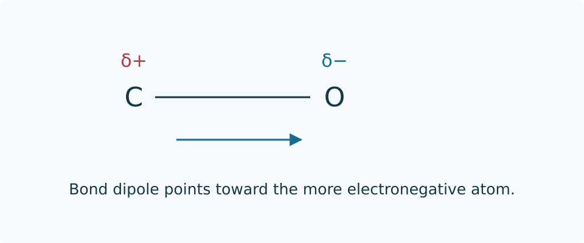{width=82% fig-alt="Separate partial and formal charge"}

Which label describes unequal sharing and which comes from integer Lewis electron bookkeeping?

::: notes
Begin this chemical argument with the displayed structure. Ask for a concrete atom, bond, label or observation rather than the topic name. Keep the first prediction brief.
:::

## Follow the electronegative atom

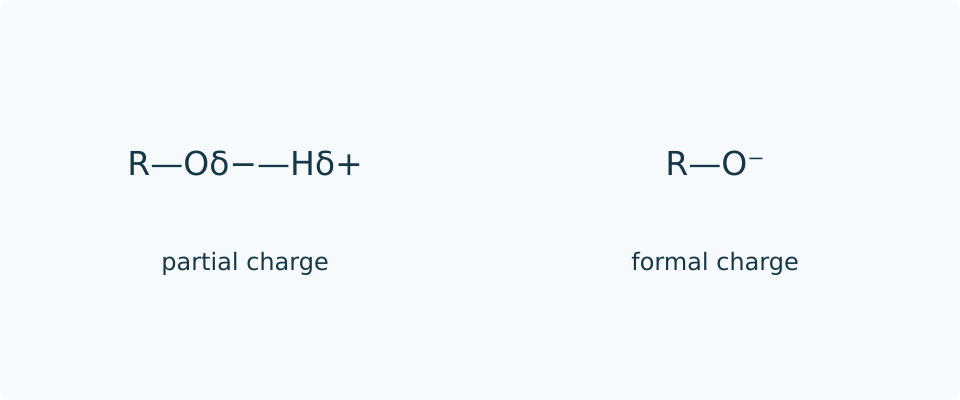{width=82% fig-alt="Follow the electronegative atom"}

An O–H bond is polar toward O even when the molecule is formally neutral.

## Explain the C–O polarisation

{width=82% fig-alt="Explain the C–O polarisation"}

O attracts the bonding electrons more strongly than C. δ− is not a claim that oxygen has a whole extra electron.

## Compare neutral alcohol with alkoxide

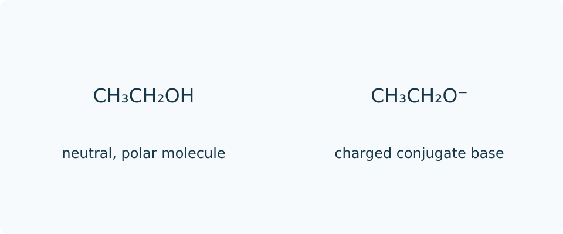{width=82% fig-alt="Compare neutral alcohol with alkoxide"}

The neutral alcohol is polar; the alkoxide has a formal charge as well as polar bonds.

## Predict: must a δ− atom carry formal −1?

Apply the ordinary Lewis count to the O atom in ethanol.

::: notes
Give 15–20 seconds for an individual prediction or a small drawing. Ask one student to state the rule they used; resolve on the next slide within this same timed block.
:::

## Resolve: ethanol oxygen is formally neutral

Its two bonds and two lone pairs give formal charge zero. Partial charge describes electron distribution differently.

::: notes
Use the explicit answer to diagnose the named misconception. Move on once students can state the rule; the practice page provides further worked attempts.
:::

## Add bond dipoles as directions

{width=82% fig-alt="Add bond dipoles as directions"}

Why do the two C=O bond dipoles in CO₂ cancel while the two O–H dipoles in water do not?

::: notes
Begin this chemical argument with the displayed structure. Ask for a concrete atom, bond, label or observation rather than the topic name. Keep the first prediction brief.
:::

## Geometry changes the molecular sum

{width=82% fig-alt="Geometry changes the molecular sum"}

Linear CO₂ has opposing equal bond dipoles; bent water has a nonzero vector sum.

## A functional-group test is narrower than identity

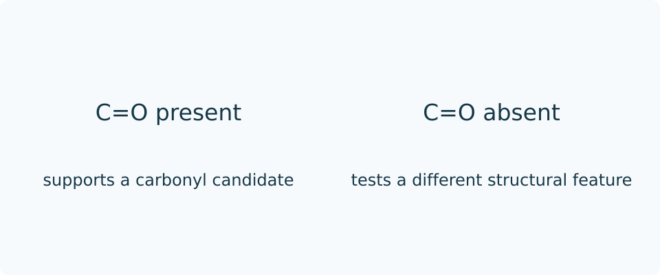{width=82% fig-alt="A functional-group test is narrower than identity"}

Observing or failing to observe C=O tests a structural feature, not the entire identity of the molecule.

## Predict: what information is missing?

Someone says a molecule is polar because it has two polar bonds. What else must you know?

::: notes
Give 15–20 seconds for an individual prediction or a small drawing. Ask one student to state the rule they used; resolve on the next slide within this same timed block.
:::

## Resolve: their spatial arrangement

Bond dipoles may add or cancel. Molecular geometry and symmetry are necessary for the conclusion.

::: notes
Use the explicit answer to diagnose the named misconception. Move on once students can state the rule; the practice page provides further worked attempts.
:::

## Place the hydrogen-bond contact

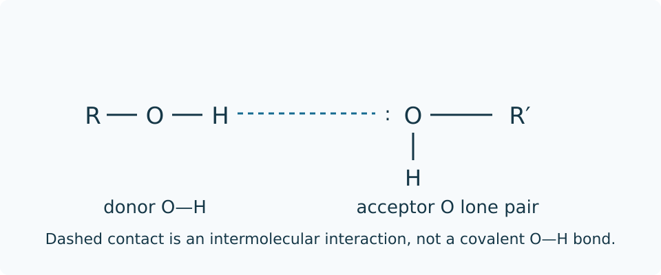{width=82% fig-alt="Place the hydrogen-bond contact"}

Identify donor O–H and acceptor lone pair in the drawn intermolecular interaction.

::: notes
Begin this chemical argument with the displayed structure. Ask for a concrete atom, bond, label or observation rather than the topic name. Keep the first prediction brief.
:::

## Let water donate to a carbonyl

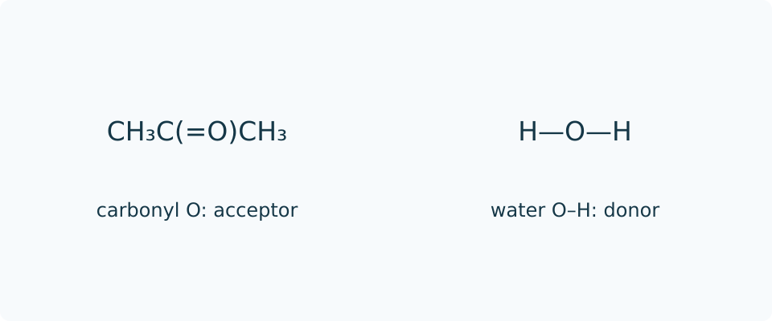{width=82% fig-alt="Let water donate to a carbonyl"}

Propanone oxygen can accept a contact from water O–H. No new covalent C–O or O–H bond is implied.

## Keep the two molecules intact

{width=82% fig-alt="Keep the two molecules intact"}

A dashed O–H···O contact connects a donor H with a suitable acceptor site on another molecule.

## Recognise an amine donor

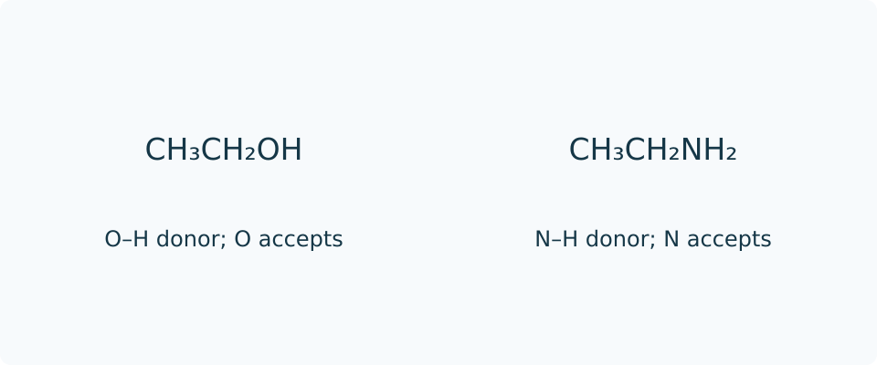{width=82% fig-alt="Recognise an amine donor"}

Ethylamine has N–H donor bonds and a nitrogen lone-pair acceptor. Both count as local features, not a solubility guarantee.

## Predict: which part of water points toward ether O?

Choose the partial positive H or partial negative O, and explain your choice.

::: notes
Give 15–20 seconds for an individual prediction or a small drawing. Ask one student to state the rule they used; resolve on the next slide within this same timed block.
:::

## Resolve: a donor H faces the acceptor

Water supplies an O–H donor; ether supplies the oxygen acceptor. Draw O–H···O, not O···O without context.

::: notes
Use the explicit answer to diagnose the named misconception. Move on once students can state the rule; the practice page provides further worked attempts.
:::

## Find the tertiary-amine difference

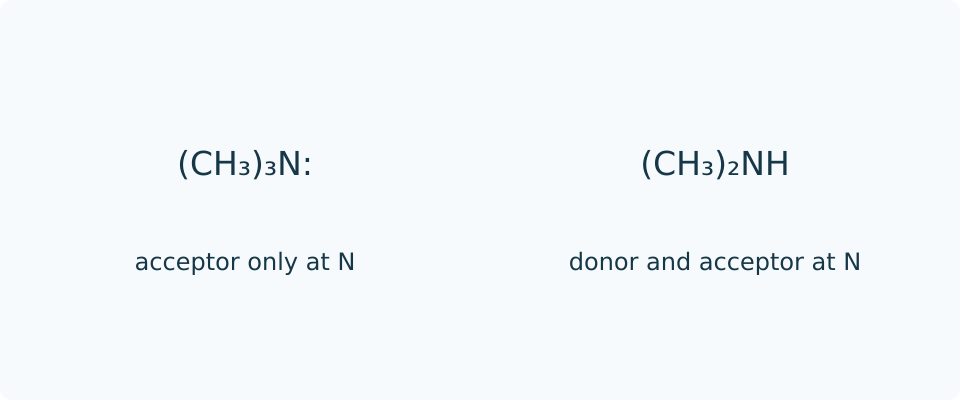{width=82% fig-alt="Find the tertiary-amine difference"}

Trimethylamine can accept at N but has no N–H donor. Dimethylamine has an N–H bond.

## Count ester oxygen environments

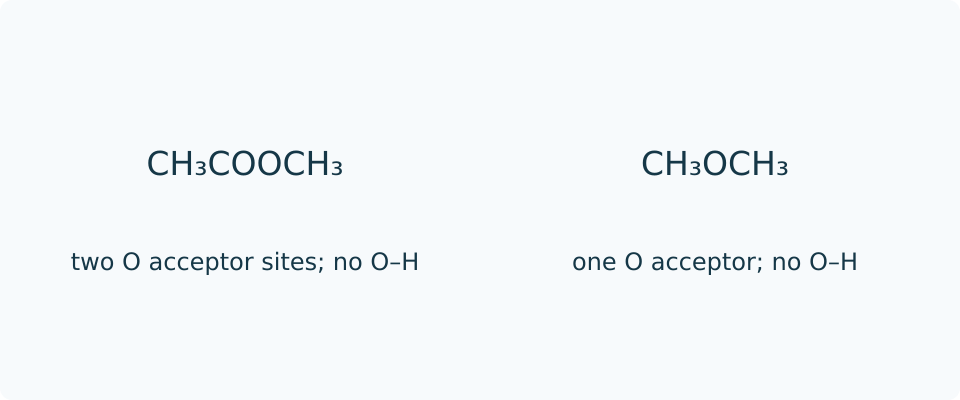{width=82% fig-alt="Count ester oxygen environments"}

An ester has two oxygen environments and no OH donor. A simple ether has one oxygen environment.

## Predict: does protonating an amine retain its lone pair?

The original pair forms a new N–H bond. Can that same pair still act as an acceptor?

::: notes
Give 15–20 seconds for an individual prediction or a small drawing. Ask one student to state the rule they used; resolve on the next slide within this same timed block.
:::

## Resolve: not the original pair

Ordinary ammonium N has four bonds and no available nitrogen lone pair. Protonation changes the donor/acceptor inventory.

::: notes
Use the explicit answer to diagnose the named misconception. Move on once students can state the rule; the practice page provides further worked attempts.
:::

## Compare molecules of similar size

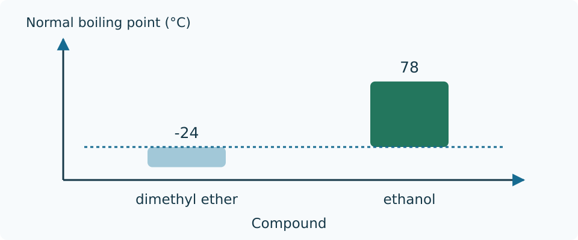{width=82% fig-alt="Compare molecules of similar size"}

Why are ethanol and dimethyl ether a useful pair for discussing intermolecular attractions?

::: notes
Begin this chemical argument with the displayed structure. Ask for a concrete atom, bond, label or observation rather than the topic name. Keep the first prediction brief.
:::

## Read a property value with its conditions

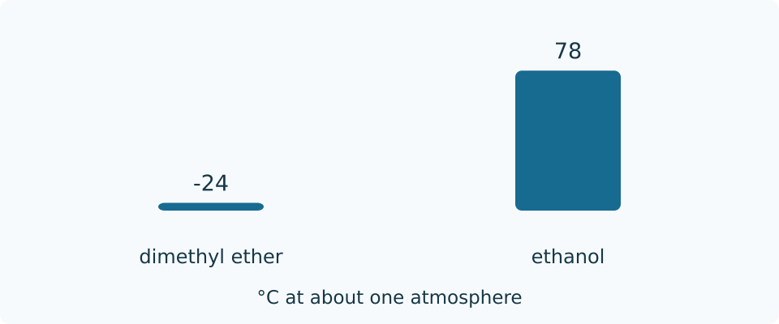{width=82% fig-alt="Read a property value with its conditions"}

Approximate normal boiling temperatures are 78 ° C and −24 ° C. Pressure must be comparable.

## Predict: what breaks during boiling?

Do ethanol molecules normally lose their covalent C–O bonds when they pass into the vapour?

::: notes
Give 15–20 seconds for an individual prediction or a small drawing. Ask one student to state the rule they used; resolve on the next slide within this same timed block.
:::

## Resolve: intact molecules separate

Boiling primarily overcomes attractions between molecules. It is not ordinary decomposition into atoms or bond fragments.

::: notes
Use the explicit answer to diagnose the named misconception. Move on once students can state the rule; the practice page provides further worked attempts.
:::

## Balance the polar head against the chain

{width=82% fig-alt="Balance the polar head against the chain"}

For related alcohols, what changes as the hydrocarbon region becomes larger?

::: notes
Begin this chemical argument with the displayed structure. Ask for a concrete atom, bond, label or observation rather than the topic name. Keep the first prediction brief.
:::

## Make the comparison quantitative enough to inspect

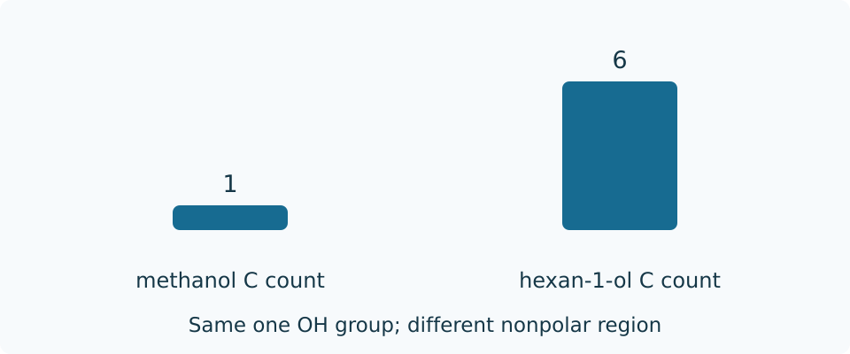{width=82% fig-alt="Make the comparison quantitative enough to inspect"}

Methanol has one carbon per OH; hexan-1-ol has six carbons per OH. Their nonpolar regions differ substantially.

## Explain a qualitative water trend

{width=82% fig-alt="Explain a qualitative water trend"}

A larger nonpolar region generally lowers compatibility with water within this related series.

## Ionisation changes the hydration interaction

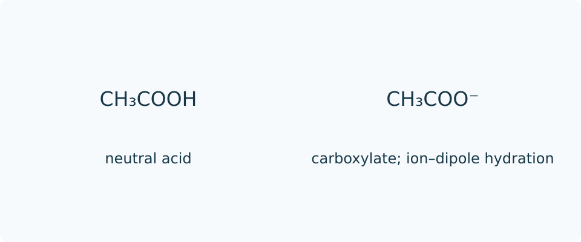{width=82% fig-alt="Ionisation changes the hydration interaction"}

Carboxylate can engage in ion–dipole interactions. Neutral acid and its anion need not share a solubility.

## Describe what is vibrating

{width=82% fig-alt="Describe what is vibrating"}

An O–H stretching vibration changes separation without ordinarily breaking the bond.

::: notes
Begin this chemical argument with the displayed structure. Ask for a concrete atom, bond, label or observation rather than the topic name. Keep the first prediction brief.
:::

## Read transmittance first

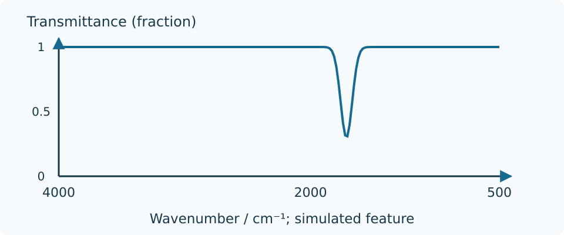{width=82% fig-alt="Read transmittance first"}

Lower transmittance means more radiation has been absorbed at that wavenumber.

## Connect IR to a changing dipole

{width=82% fig-alt="Connect IR to a changing dipole"}

The relevant vibration must change the molecular dipole to absorb in this simple interpretation.

## Change the ordinate, not the molecule

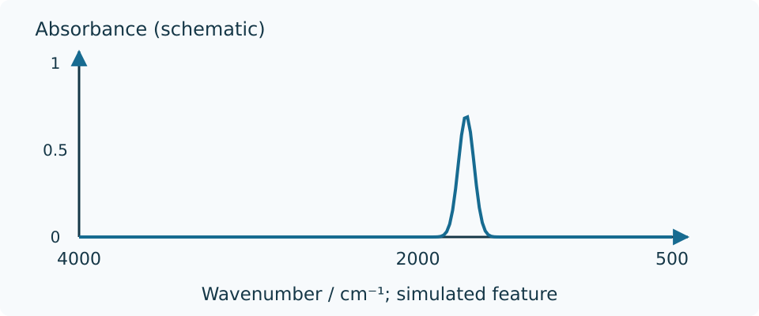{width=82% fig-alt="Change the ordinate, not the molecule"}

An absorbance feature points upward for the same underlying absorption that produces a transmission dip.

## Predict: is a tall upward IR feature impossible?

Your classmate expects only downward peaks. Which axis label would explain the different plot?

::: notes
Give 15–20 seconds for an individual prediction or a small drawing. Ask one student to state the rule they used; resolve on the next slide within this same timed block.
:::

## Resolve: absorbance uses the other direction

Check whether the ordinate is absorbance or transmittance before interpreting feature direction.

::: notes
Use the explicit answer to diagnose the named misconception. Move on once students can state the rule; the practice page provides further worked attempts.
:::

## Inspect axes before features

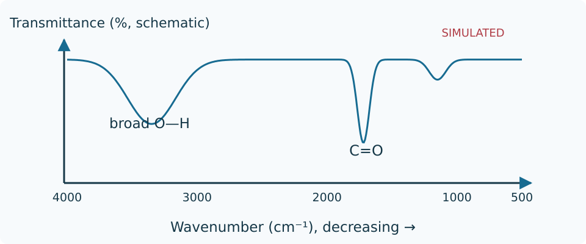{width=82% fig-alt="Inspect axes before features"}

Locate high and low wavenumber. On this conventional display, values decrease to the right.

::: notes
Begin this chemical argument with the displayed structure. Ask for a concrete atom, bond, label or observation rather than the topic name. Keep the first prediction brief.
:::

## Recognise a broad alcohol region

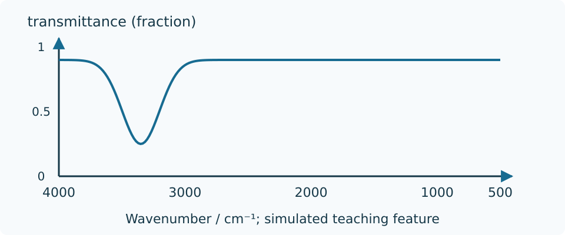{width=82% fig-alt="Recognise a broad alcohol region"}

The simulated alcohol O–H feature is broad around 3200–3600 cm⁻¹, rather than a unique sharp line.

## Recognise carbonyl evidence

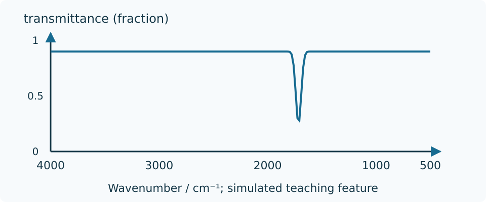{width=82% fig-alt="Recognise carbonyl evidence"}

A strong carbonyl absorption often occurs within roughly 1650–1800 cm⁻¹; environment shifts its position.

## Predict: does 1715 cm⁻¹ uniquely identify propanone?

Consider whether other ketones, aldehydes or related carbonyl compounds can absorb in the same region.

::: notes
Give 15–20 seconds for an individual prediction or a small drawing. Ask one student to state the rule they used; resolve on the next slide within this same timed block.
:::

## Resolve: many candidates share C=O

The band supports a carbonyl feature. Further observations are needed to identify one complete structure.

::: notes
Use the explicit answer to diagnose the named misconception. Move on once students can state the rule; the practice page provides further worked attempts.
:::

## Compare the candidate predictions

{width=82% fig-alt="Compare the candidate predictions"}

Which candidate predicts both a carbonyl feature and no alcohol OH region?

::: notes
Begin this chemical argument with the displayed structure. Ask for a concrete atom, bond, label or observation rather than the topic name. Keep the first prediction brief.
:::

## Test a named bond in each drawing

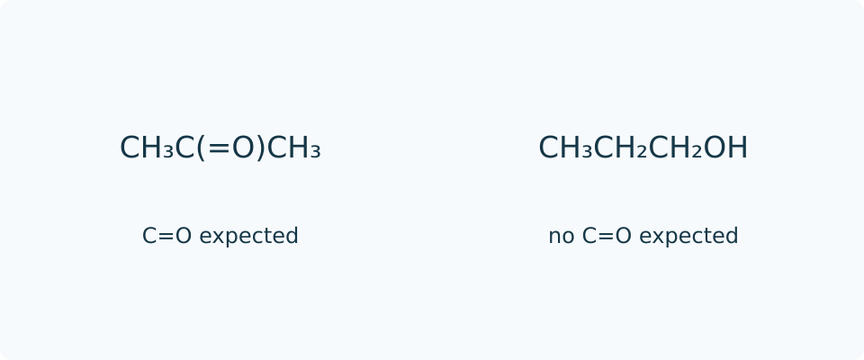{width=82% fig-alt="Test a named bond in each drawing"}

Propanone contains C=O; propan-1-ol lacks it. Predict the contrast before looking at data.

## Try a second carbonyl candidate

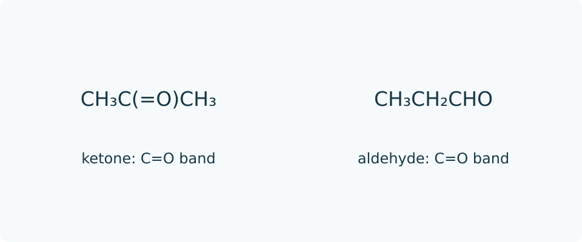{width=82% fig-alt="Try a second carbonyl candidate"}

Propanone and propanal both have a carbonyl. One common band does not distinguish every pair.

## Predict: could a wet sample confuse OH interpretation?

What extra broad feature might water introduce even when the organic target lacks OH?

::: notes
Give 15–20 seconds for an individual prediction or a small drawing. Ask one student to state the rule they used; resolve on the next slide within this same timed block.
:::

## Resolve: water can add an OH absorption

Sample context matters. Check a suitable reference and other evidence rather than assigning the broad feature automatically.

::: notes
Use the explicit answer to diagnose the named misconception. Move on once students can state the rule; the practice page provides further worked attempts.
:::

## Name the interaction altered by charge

{width=82% fig-alt="Name the interaction altered by charge"}

How does hydration of carboxylate differ from that of its neutral acid?

::: notes
Begin this chemical argument with the displayed structure. Ask for a concrete atom, bond, label or observation rather than the topic name. Keep the first prediction brief.
:::

## Keep acid and alcohol OH environments distinct

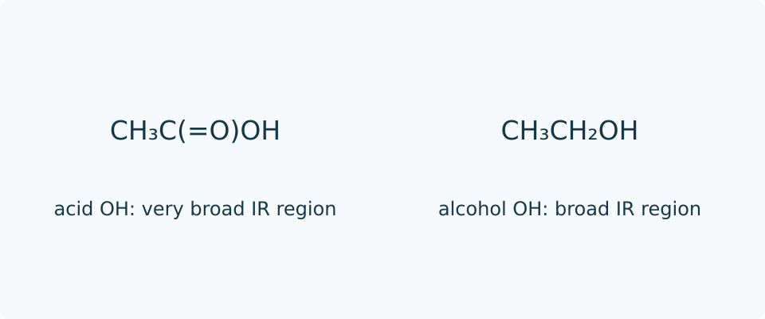{width=82% fig-alt="Keep acid and alcohol OH environments distinct"}

Both contain O–H, but a carboxylic-acid OH often has a particularly broad IR region.

## Inspect the acid OH region

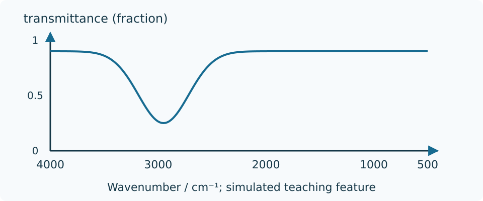{width=82% fig-alt="Inspect the acid OH region"}

This simulated broad acid feature extends across a substantial range, unlike a narrow carbonyl dip.

## Predict: what extra data would extraction need?

Name two quantities beyond aqueous pH and pKa that affect recovered amount.

::: notes
Give 15–20 seconds for an individual prediction or a small drawing. Ask one student to state the rule they used; resolve on the next slide within this same timed block.
:::

## Resolve: partition and volume matter

Partition coefficients, phase volumes, initial amount and losses are relevant. A speciation curve alone cannot predict isolated mass.

::: notes
Use the explicit answer to diagnose the named misconception. Move on once students can state the rule; the practice page provides further worked attempts.
:::

## Combine the tools in one explanation

Compare a carbonyl candidate with a noncarbonyl candidate using both interactions and IR predictions.

::: notes
Take a 30-second sketch or explanation, then ask for one observation and the reason linking it to the conclusion. This is included in the 45-minute session.
:::

## Your next independent work

Use the [exercises](exercise.qmd), then the [self-check](quiz.qmd). Required core problems and optional transfer work are labelled separately.

## One-sentence exit explanation

Write one chemical claim, the feature that supports it and one limit of the inference.

The [reading guide](../reference/reading.qmd) provides optional textbook support; no textbook is needed to attempt the local practice.

::: notes
Collect one sentence or hear one example. Stop at 45 minutes; do not append another tutorial to the lecture.
:::
