## About this lecture

Yesterday we left two bottles of **C₂H₆O** on the bench: ethanol boils at **78 °C**, dimethyl ether at **−24 °C**. Same atoms, a 100-degree gap. Today we explain it. And the police breath test? It shines **infrared light** through your breath and measures how much ethanol absorbs.

Today we learn:

- **Polarity:** why bonds and molecules carry partial charges
- **Hydrogen bonds:** donors, acceptors and how to count them
- **Properties:** boiling points and water solubility from structure
- **IR spectroscopy:** reading the axes and a few key bands
- **Limits:** what one observation can and can't prove

Yesterday you learned to read a structure; today you use it to predict what a molecule does.

::: notes
Open by reminding them of the cliffhanger from Day 1: ethanol and dimethyl ether are constitutional isomers, yet one is a drink and the other a spray-can gas. Ask the room for guesses before revealing anything; someone usually says "the OH", which is exactly right, and today we make that guess precise. The breathalyzer is a nice second hook: evidential breath-alcohol instruments use IR absorption by ethanol's C–H or C–O bonds, so the second half of the lecture is the physics inside that machine. Stress the theme of the day: structure in, observable property out.
:::

## Electronegativity makes bonds polar

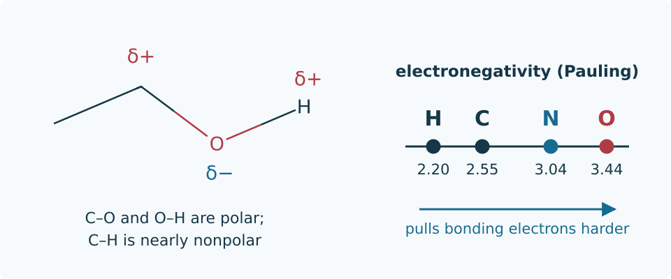{width=82% fig-alt="Ethanol drawn with its O–H hydrogen; the carbon next to oxygen and the hydroxyl hydrogen are marked delta plus and oxygen delta minus. A scale shows Pauling electronegativities H 2.20, C 2.55, N 3.04, O 3.44"}

The more electronegative atom pulls the shared electrons towards itself and gets a **partial negative charge, δ−**. O and N are the electron-greedy atoms in organic molecules; C–H bonds are close to nonpolar.

::: notes
Electronegativity is the tug-of-war strength for bonding electrons. The numbers on the scale are Pauling values; students don't need to memorise them, only the order H ≈ C < N < O. In ethanol the oxygen pulls electron density from both the carbon and the hydrogen, so both neighbours become δ+. Point out that the C–H bonds, which make up most of an organic molecule, are almost nonpolar: that's why the hydrocarbon part of a molecule behaves like oil. That sentence comes back when we discuss solubility.
:::

## Partial charge is not formal charge

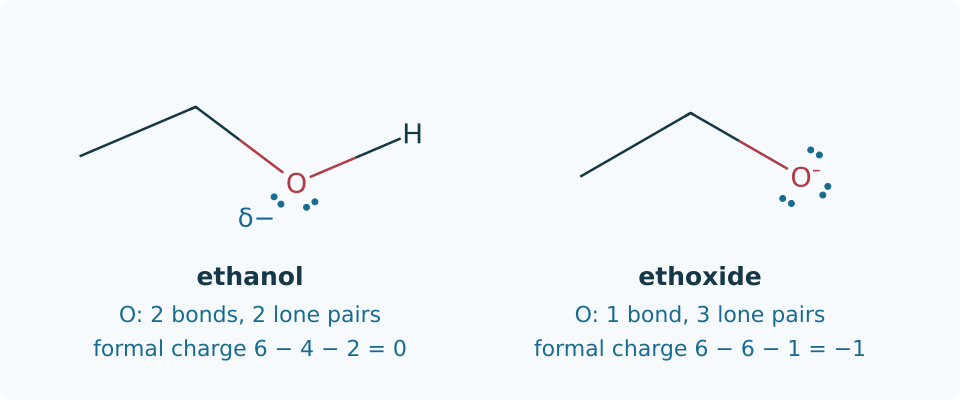{width=80% fig-alt="Ethanol oxygen with two bonds and two lone pairs: delta minus, formal charge 0. Ethoxide oxygen with one bond and three lone pairs: formal charge minus 1"}

**δ−** describes uneven sharing in a neutral molecule. **Formal charge** is Day 1's integer electron count.

::: {.try}
**Try it:** the O in ethanol is δ−. Does it carry a formal charge of −1?

::: {.fragment}
**No.** Two bonds and two lone pairs give 6 − 4 − 2 = 0. The δ− is a fraction of an electron, not a whole extra one.
:::
:::

::: notes
This is the most common confusion of the day. A partial charge is a shift of electron density; the molecule as a whole stays neutral. A formal charge is the bookkeeping from yesterday and only appears when an atom deviates from its normal bonding pattern, as in ethoxide, which is ethanol after losing its O–H proton. Ethoxide is a preview of Day 3: removing H+ from an O–H leaves the bonding pair on oxygen. Ask them to say out loud which numbers go into each formal-charge calculation.
:::

## Polar bonds, polar molecule? Add the vectors

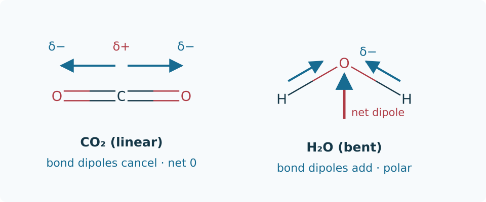{width=78% fig-alt="Linear O=C=O with two equal bond-dipole arrows pointing in opposite directions, net zero. Bent water with two bond-dipole arrows towards O and a net dipole arrow pointing to oxygen"}

Each polar bond is an arrow pointing at its δ− end. The **molecular dipole** is their vector sum, so **shape decides**.

::: {.try}
**Try it:** a friend says "CO₂ has two polar bonds, so it's a polar molecule." What did they forget?

::: {.fragment}
**Geometry.** CO₂ is linear, so its two equal bond dipoles point in opposite directions and cancel. Bent water keeps a net dipole.
:::
:::

::: notes
Draw the arrows on the board as tug-of-war ropes: two equal teams pulling in opposite directions go nowhere. Water is bent (about 104.5°), so its two arrows add to a net dipole pointing at oxygen. Link back to Day 1's geometry slide: you needed the shapes to do this. CO2 will return in the IR section, where its lack of a permanent dipole turns out to be less important than you'd think. Another example if there's time: CCl4 is nonpolar for the same reason.
:::

## Same size, very different boiling points

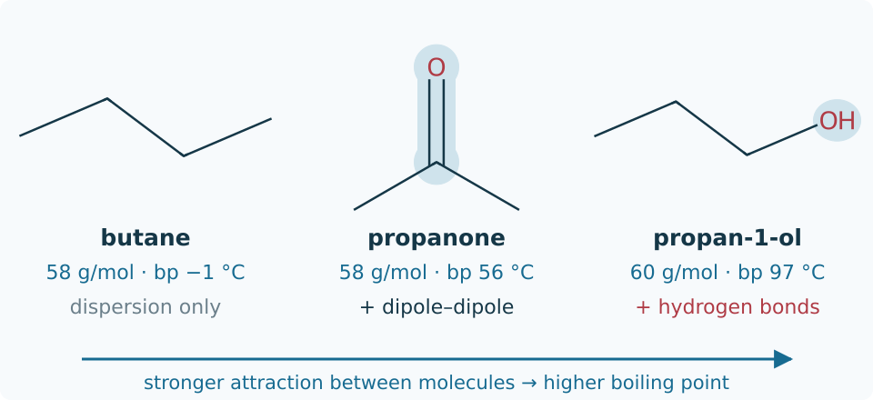{width=80% fig-alt="Butane 58 g/mol boils at −1 °C with dispersion only; propanone 58 g/mol boils at 56 °C with added dipole–dipole attraction; propan-1-ol 60 g/mol boils at 97 °C with hydrogen bonds"}

- **Dispersion:** every molecule has it; grows with size and contact area.
- **Dipole–dipole:** polar molecules line up δ+ to δ−.
- **Hydrogen bonds:** an O–H or N–H meets a lone pair. The strongest of the three.

::: notes
The trick of this slide is the controlled comparison: all three molecules weigh about the same, so dispersion forces are similar and the differences come from the polar groups. Butane only has dispersion and is a gas at room temperature; the C=O of propanone adds dipole–dipole attraction; propan-1-ol's O–H can hydrogen-bond and boils almost 100 degrees above butane. Emphasise that these are forces between molecules. Nothing inside the molecule changes when it boils. Ask: which of the three would you expect to mix with water? That sets up the solubility slides.
:::

## The hydrogen bond: a donor meets an acceptor

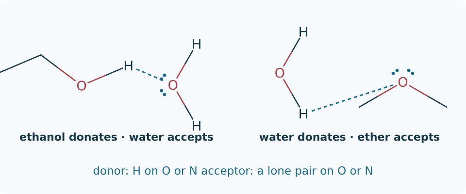{width=82% fig-alt="Left: the O–H hydrogen of ethanol makes a dashed contact to a lone pair on water oxygen. Right: an O–H of water makes a dashed contact to a lone pair on the oxygen of dimethyl ether"}

The **donor** brings an H on O or N. The **acceptor** brings a lone pair on O or N. The dashed contact is **between** molecules: no covalent bond forms or breaks.

::: notes
Insist on the dashed line and on keeping both molecules intact. Students often draw a hydrogen bond as a solid line or move the H halfway across, which turns it into a proton transfer, a reaction for tomorrow. The H on a donor must be on O or N because only then is it δ+ enough; a C–H is not a donor. Show that water can play both roles: it accepts from ethanol on the left and donates to the ether on the right. That dual role is why water dissolves so many small polar molecules.
:::

## Count donors and acceptors

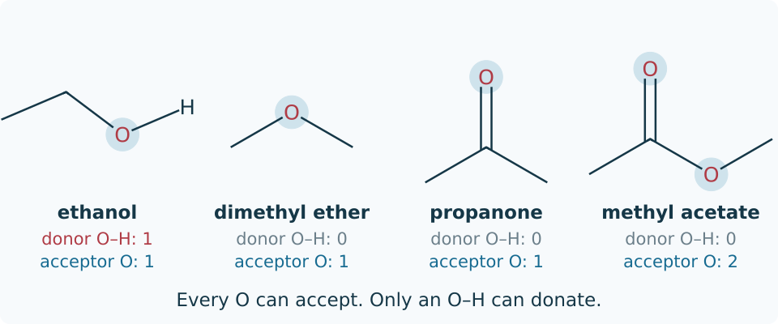{width=82% fig-alt="Ethanol has one O–H donor and one acceptor oxygen; dimethyl ether, propanone and methyl acetate have no donors, with one, one and two acceptor oxygens shaded"}

Ask two separate questions of every molecule: **is there an O–H or N–H?** and **is there a lone pair on O or N?**

::: {.try}
**Try it:** can pure dimethyl ether form hydrogen bonds with itself?

::: {.fragment}
**No.** Its O can accept, but it has no O–H to donate. Mixed with water, it can accept from water's O–H.
:::
:::

::: notes
This inventory habit is the tool for the rest of the day. "Contains oxygen" is not enough: every oxygen here can accept, but only the alcohol has a donor. The ester is a nice case: two oxygens, two acceptor sites, zero donors, so it's not "an alcohol plus an ether". Have students write the two numbers for each molecule before you reveal the labels. Pure ether molecules can't hydrogen-bond to each other because a hydrogen bond needs a donor and an acceptor at the same time.
:::

## Amines: count the N–H, then the lone pair

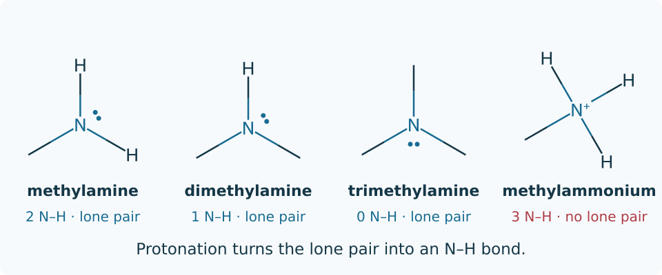{width=82% fig-alt="Methylamine with two N–H bonds and a lone pair, dimethylamine with one N–H and a lone pair, trimethylamine with no N–H and a lone pair, and methylammonium with three N–H bonds and no lone pair"}

Neutral amines all **accept** at N. Only those with N–H can **donate**. Adding H⁺ uses up the lone pair.

::: {.try}
**Try it:** CH₃NH₂ picks up a proton to become CH₃NH₃⁺. Can that N still accept a hydrogen bond?

::: {.fragment}
**No.** The lone pair became the new N–H bond, so N has four bonds and no lone pair. It gained a donor and lost its acceptor.
:::
:::

::: notes
Same inventory, now with nitrogen. Trimethylamine is the trap: it has three methyls on N and no N–H, so it can only accept. Its boiling point (about 3 °C) is actually lower than dimethylamine's (about 7 °C) despite being bigger. The ammonium ion is the bridge to tomorrow: amines are bases precisely because that lone pair can grab a proton, and once it has, the inventory changes. Check that students count the formal charge on N in methylammonium: four bonds, no lone pairs, +1.
:::

## Back to the two bottles

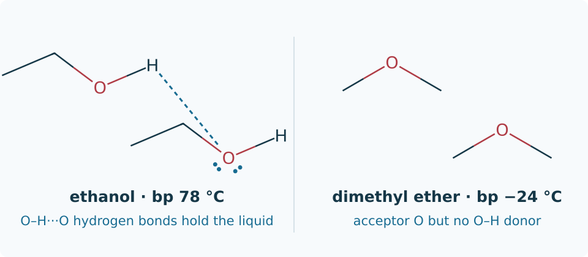{width=82% fig-alt="Left: two ethanol molecules joined by a dashed O–H to O hydrogen bond, bp 78 °C. Right: two dimethyl ether molecules with no donor, bp −24 °C"}

Ethanol molecules **hold on to each other** through O–H···O hydrogen bonds. To boil, they must be pulled apart. Dimethyl ether has no O–H, so its molecules let go easily.

::: {.try}
**Try it:** which bonds break when ethanol boils?

::: {.fragment}
**None of the covalent ones.** Boiling separates whole ethanol molecules by overcoming the attractions between them. Breaking C–O would be a chemical reaction.
:::
:::

::: notes
This is the payoff for Day 1's cliffhanger, so slow down. Same formula, same mass, same number of polar bonds; the only difference is whether a donor exists. Ethanol's liquid is a constantly rearranging network of hydrogen bonds, and boiling means tearing every molecule out of that network. The try-it targets the misconception that boiling breaks the molecule: ethanol vapour condensed again is still ethanol, which is exactly why distillation works as a purification. Ask a student to restate the explanation in one sentence using the words donor and acceptor.
:::

## Size and shape: dispersion adds up

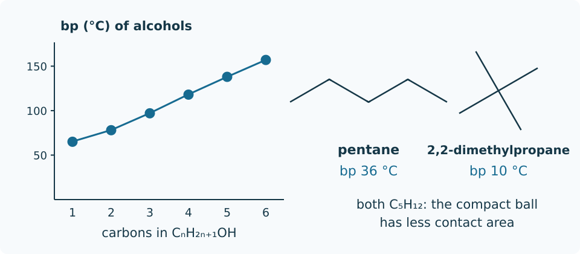{width=82% fig-alt="Plot of boiling points rising from methanol 65 °C to hexan-1-ol 157 °C with chain length; pentane boils at 36 °C and its compact isomer 2,2-dimethylpropane at 10 °C"}

Every extra CH₂ adds contact area and roughly **20 °C** of boiling point. Branching makes a molecule more compact, so it **touches its neighbours less** and boils lower.

::: notes
Hydrogen bonding isn't the whole story. In the alcohol series every member has exactly one O–H, yet the boiling point keeps climbing: that's dispersion growing with chain length. On the right, pentane and 2,2-dimethylpropane are constitutional isomers with no polar groups at all, and the compact one boils 26 degrees lower. A good image: long chains are like spaghetti that tangles; a ball is like a marble that rolls away. Yesterday's butane versus 2-methylpropane comparison is the same effect.
:::

## Will it dissolve in water?

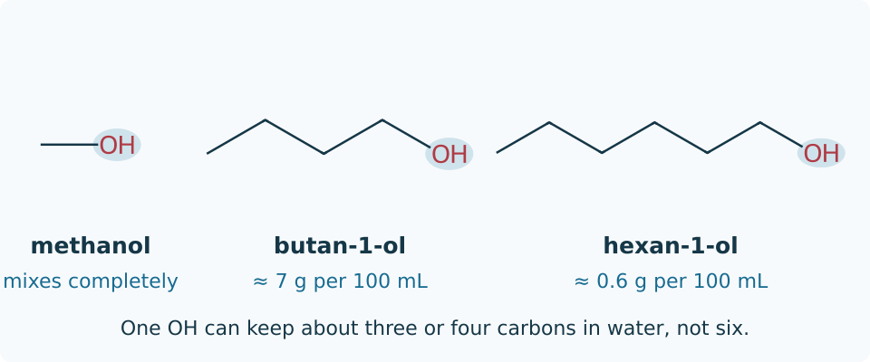{width=84% fig-alt="Methanol mixes completely with water, butan-1-ol dissolves to about 7 g per 100 mL and hexan-1-ol to about 0.6 g per 100 mL"}

Water welcomes the **polar head** that can hydrogen-bond, but the **hydrocarbon tail** gets in the way. The longer the tail per OH, the lower the solubility.

::: {.try}
**Try it:** which mixes better with water, methanol or hexan-1-ol? And what does "it has an OH, so it dissolves" miss?

::: {.fragment}
**Methanol.** Hexan-1-ol has six carbons per OH; the big nonpolar tail outweighs one polar head. A single OH doesn't settle the question.
:::
:::

::: notes
"Like dissolves like" in a more useful form: count polar heads against carbons. A rough rule is that one O–H can carry three or four carbons into water. The numbers are approximate room-temperature solubilities and the exact values depend on temperature, so keep the claims qualitative. Biology link: soaps, membrane lipids and many drugs are exactly this kind of molecule, with a polar head and a long tail, and that balance decides whether a drug dissolves in blood or crosses a membrane.
:::

## A charge changes everything

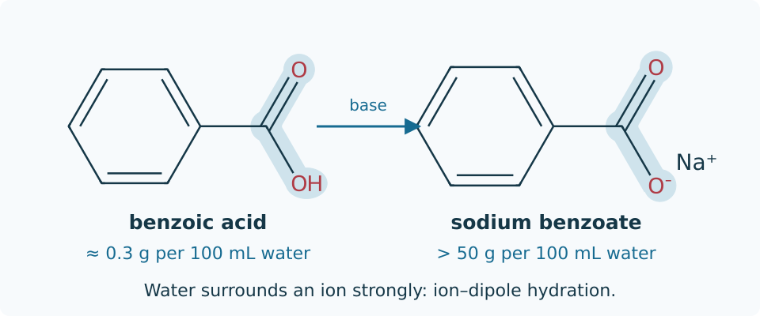{width=80% fig-alt="Benzoic acid dissolves to about 0.3 g per 100 mL water; after adding base, sodium benzoate dissolves to more than 50 g per 100 mL"}

An ion is surrounded by water dipoles (**ion–dipole** hydration), far more strongly than a neutral molecule. Add base, and an acid that barely dissolves becomes very soluble.

::: {.try}
**Try it:** your benzoic acid is mostly ionised in a basic water layer. Is that enough to predict how many grams you recover in an extraction?

::: {.fragment}
**No.** You also need how the neutral form partitions between the two solvents, the phase volumes, the starting amount and losses. Speciation alone gives ratios, not grams.
:::
:::

::: notes
Sodium benzoate is the preservative E211 in soft drinks, so its high water solubility is something students have drunk. This slide is the bridge to tomorrow: whether the acid is ionised depends on pH and pKa, which is Day 3's whole topic. The try-it heads off a shortcut we see in lab reports: knowing the species ratio in water doesn't give you a recovered mass. Extraction needs a partition model too. Keep it qualitative today.
:::

## IR: bonds vibrate like springs

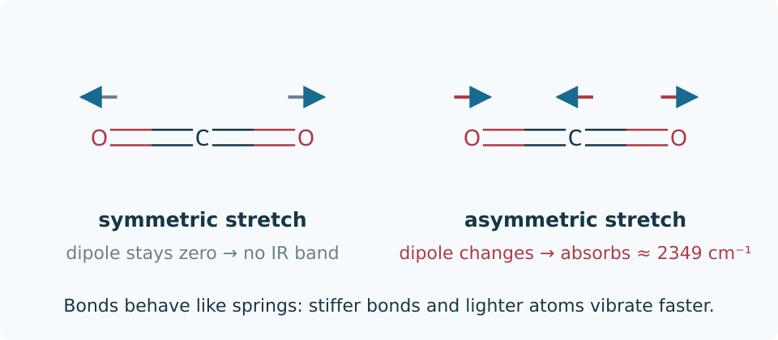{width=82% fig-alt="CO2 symmetric stretch with both oxygens moving outwards keeps the dipole zero and gives no IR band; asymmetric stretch with the carbon moving against the oxygens changes the dipole and absorbs near 2349 per centimetre"}

Infrared light makes bonds **stretch and bend**. A vibration absorbs only if it **changes the dipole**. Positions are given as **wavenumbers** (cm⁻¹): higher means stiffer bonds or lighter atoms.

::: notes
The spring picture is good enough for this course: a stiff spring with light masses vibrates fast, so O–H, N–H and C–H (light hydrogen) and C=O (a stiff double bond) sit at high wavenumbers. CO2 is the lovely example: it has no permanent dipole, but its asymmetric stretch and its bend change the dipole while vibrating, so it absorbs IR. That's precisely why CO2 is a greenhouse gas, while N2 and O2 are not. Nothing breaks: the bond just oscillates more. Wavenumber is 1 divided by the wavelength in cm; students only need "bigger number, more energy".
:::

## Read the axes before the peaks

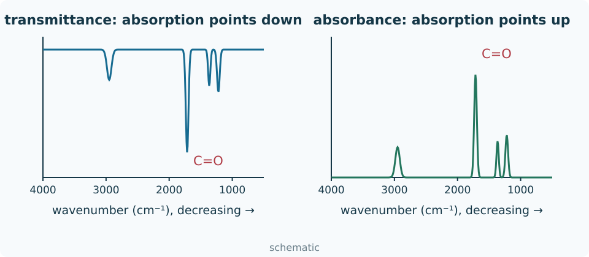{width=84% fig-alt="Left: transmittance plot where the C=O absorption near 1715 per centimetre is a downward dip. Right: absorbance plot where the same absorption is an upward peak. Both x-axes run from 4000 down to 500"}

The x-axis runs **backwards**, from 4000 down to about 500 cm⁻¹. On a **transmittance** plot absorption is a **dip**; on an **absorbance** plot it's a **peak**.

::: {.try}
**Try it:** a classmate's spectrum has tall upward bands and they think it's wrong. What do you check?

::: {.fragment}
**The y-axis label.** If it says absorbance, upward bands are correct: it's the same absorption drawn the other way up.
:::
:::

::: notes
Make reading axes a ritual: x first (units, direction), then y (transmittance or absorbance), then the bands. Most textbook and lab spectra are transmittance, so students learn "peaks point down" and are then confused by absorbance data from other instruments. These two traces are schematic, not measured, which is why they're labelled as such. Also mention that "less light got through" and "more light was absorbed" are the same statement.
:::

## The regions worth knowing

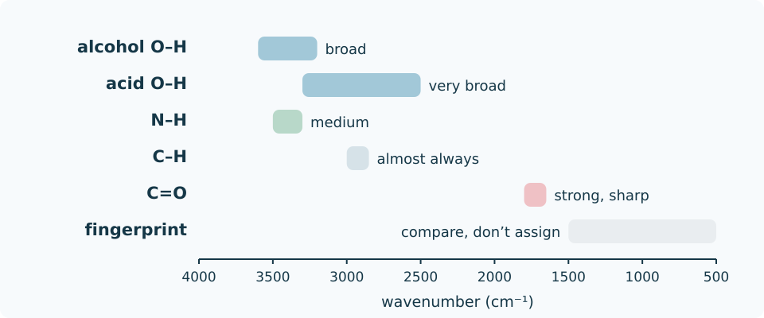{width=80% fig-alt="Approximate ranges: alcohol O–H 3200–3600 broad, acid O–H 2500–3300 very broad, N–H 3300–3500, C–H 2850–3000, C=O 1650–1800 strong, fingerprint region below 1500"}

- **Above 2500:** bonds to H. Hydrogen bonding makes O–H bands **broad**.
- **1650–1800:** C=O, strong and sharp. Its exact position depends on the neighbours.
- **Below 1500:** the fingerprint region. Compare whole patterns; don't assign single bands.

::: notes
These are teaching ranges, not exact values, and the same numbers appear on the exercise sheet. Connect the broadness of O–H to today's first half: in a liquid, every O–H sits in a slightly different hydrogen-bonded environment, so the band smears out. The carboxylic-acid O–H is even broader because acids form strongly hydrogen-bonded pairs. C–H appears in nearly every organic molecule, so it's rarely informative. Don't ask students to memorise the fingerprint region; it matters again in Week 4's spectroscopy unit.
:::

## Three spectra side by side

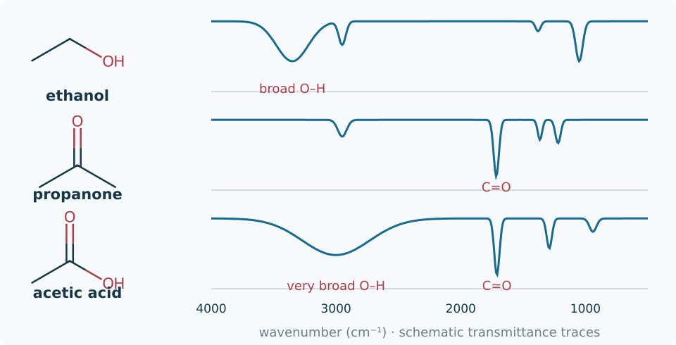{width=90% fig-alt="Ethanol shows a broad O–H band near 3350 and no C=O; propanone shows a strong C=O near 1715 and no O–H; acetic acid shows a very broad O–H from about 2500 to 3300 plus a C=O"}

Read each one with two questions: **is there a broad O–H?** and **is there a strong C=O?** The two answers already separate an alcohol, a ketone and an acid.

::: notes
These are schematic traces drawn to show the key bands, not real measured spectra. Walk through them as a detective. Ethanol: broad O–H, no C=O. Propanone: C=O, nothing above 3000 except C–H. Acetic acid: both, and the O–H is so broad it swallows the C–H region. Ask which band tells the alcohol from the acid when both have O–H: the C=O and the shape of the O–H. Remind them that this is presence-and-absence reasoning, which is exactly what the exercise asks.
:::

## Using IR to choose between candidates

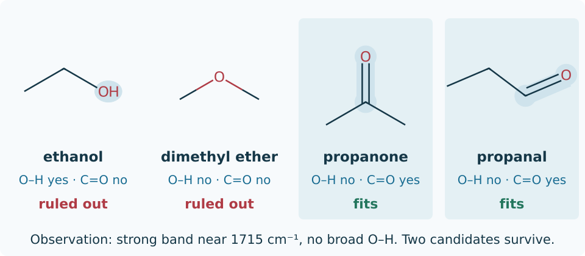{width=82% fig-alt="Ethanol (O–H yes, C=O no) and dimethyl ether (neither) are ruled out; propanone and propanal (C=O yes, O–H no) both fit a strong 1715 band with no O–H"}

Predict the bands for **each candidate first**, then compare with the data. Both presence and **absence** count as evidence.

::: {.try}
**Try it:** a strong band at 1715 cm⁻¹ and no O–H. Does that prove the sample is propanone?

::: {.fragment}
**No.** It supports a C=O and no O–H, but propanal and many other carbonyl compounds fit too. You need more evidence to name one structure.
:::
:::

::: notes
This is the reasoning pattern of the whole spectroscopy week, in miniature. Write the candidate list first; then for each one predict "O–H? C=O?"; then cross out what contradicts the data. Two candidates survive here, and that's an honest result. An aldehyde also has a characteristic C–H stretch around 2720 and 2820 cm⁻¹, which could separate propanal from propanone; mention it only as a teaser for Week 4. The worst habit to avoid is reasoning backwards from one band to one favourite molecule.
:::

## What one spectrum can and can't tell you

| observation | supports | doesn't prove |
|---|---|---|
| strong band near 1715 cm⁻¹ | a C=O is present | which carbonyl compound |
| broad band near 3300 cm⁻¹ | an O–H somewhere in the sample | that the target has O–H (water?) |
| no band at 1650–1800 | no C=O in the sample | anything about the rest of the molecule |
| it absorbs IR at all | some vibrations change the dipole | that it dissolves in water |

A **wet** sample shows water's broad O–H even if your compound has none. Check the sample before you blame the structure.

::: notes
Keep the claims sized to the evidence. The wet-sample row is the one students meet in the lab: a broad O–H in a supposed ether or ketone often means water or an alcohol impurity, or the target assignment is wrong, and one spectrum can't tell those apart. The last row targets an odd shortcut that turns up in exam answers, linking IR absorption to solubility. They answer different questions: IR probes vibrations, solubility depends on intermolecular interactions with water. Ask students to suggest one extra observation that would separate the wet-sample explanations (a dried sample, a reference spectrum, a boiling point).
:::

## Mistakes we see every year

| mistake | fix |
|---|---|
| "O is δ−, so it's O⁻" | δ is partial; formal charge comes from **bonds and lone pairs** |
| "two polar bonds, so a polar molecule" | add the vectors: **geometry decides** |
| "it has oxygen, so it hydrogen-bonds with itself" | a donor needs **O–H or N–H** |
| "boiling breaks the C–O bond" | boiling separates **intact molecules** |
| "it has an OH, so it dissolves in water" | weigh the **polar head against the tail** |
| "the IR peaks point the wrong way" | check **transmittance vs absorbance** |
| "1715 cm⁻¹, so it's propanone" | one band supports a **group**, not an identity |

::: notes
Read each mistake aloud and let the room explain why it's wrong before revealing the fix. Every row corresponds to an exercise: partial versus formal charge is exercise 1, geometry is 2, donors are 4 and 5, boiling is 8, solubility is 9, axes are 11 and the carbonyl claim is 13. Students who still make one of these should redo that exercise.
:::

## Summary

| concept | key fact |
|---|---|
| bond polarity | O and N pull electrons: δ− |
| partial vs formal charge | uneven sharing vs integer bookkeeping |
| molecular dipole | vector sum of bond dipoles; **shape decides** |
| hydrogen bond | donor O–H/N–H + acceptor lone pair |
| boiling point | H-bonds, then size and shape; molecules stay intact |
| water solubility | polar head vs hydrocarbon tail; ions dissolve best |
| IR absorption | a vibration that **changes the dipole**; check the y-axis |
| key bands | O–H 3200–3600 broad · C=O 1650–1800 strong |

**Next:** what happens when that O–H gives away its proton: acids and bases (Day 3). **Practice:** [exercises](exercise.qmd) · [self-check](quiz.qmd)

::: notes
Close the loop with the opening question: ethanol boils 100 degrees higher because its O–H can donate a hydrogen bond and the ether's oxygen can only accept, and the breathalyzer works because ethanol's bonds absorb infrared light. Tomorrow we stop treating the O–H proton as fixed: acids give it away, bases take it, and the charges we met today (ethoxide, ammonium, benzoate) are the products. Point students to the exercises: problems 1 to 12 are core, 13 to 20 optional transfer.
:::
