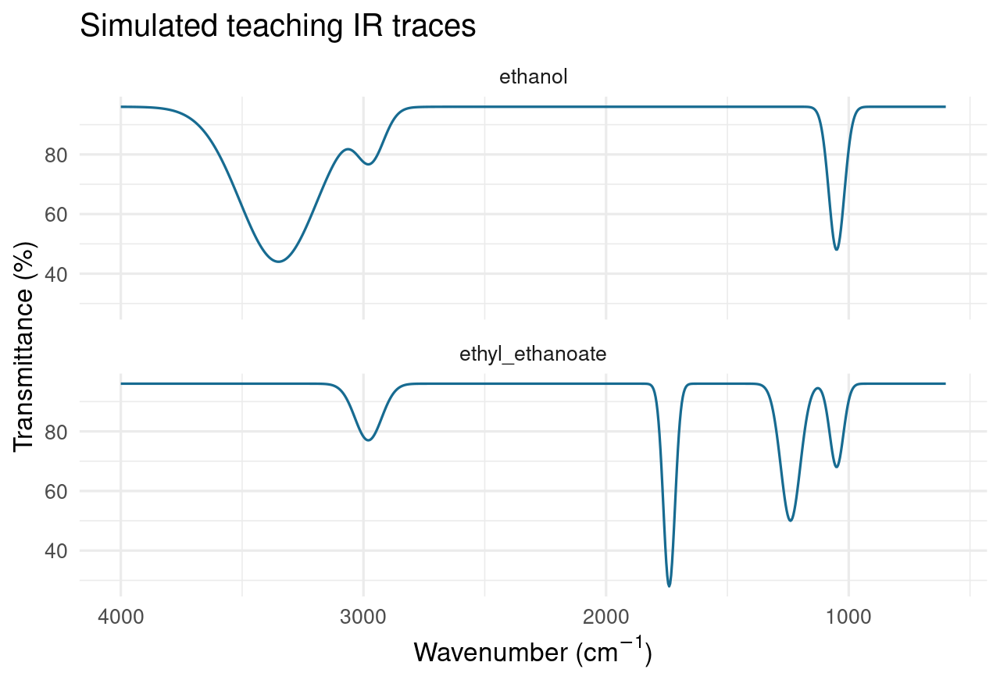

[Download the complete student project](../downloads/organic-chemistry-student.zip).
Extract it, open `organic-chemistry.Rproj`, and Knit `report.Rmd`.
The archive includes all CSVs, their dictionary, and the starter report.

## Individual files

| Data | Used for |
| --- | --- |
| [Reactant amounts](../data/amounts.csv) and [isolation](../data/isolation.csv) | Amounts, limiting reagent, theoretical mass and isolated yield |
| [Conformer free energies](../data/conformers.csv) | A guided two-state population model |
| [Enantiomer mixtures](../data/enantiomers.csv) | Composition and enantiomeric excess |
| [TLC (thin-layer chromatography) distances](../data/tlc.csv) | Rf and preservation of sample/spot identities |
| [Approximate pKa values](../data/pka.csv) | Aqueous teaching models |
| [Simulated IR traces](../data/ir.csv) | Functional-group comparison and plotting |
| [Simulated proton NMR peak list](../data/nmr_peaks.csv) | Structure puzzles; the assignment column contains checks, so hide it before solving |
| [Data dictionary](../data/README.md) | Every column's meaning, units and provenance |
| [Starter report](../templates/report.Rmd) | Individual copy; keep it beside `data/` in your project |

**All supplied data are constructed teaching examples.** The IR traces are
schematic Gaussian bands, and the NMR table contains illustrative first-order
patterns. They are not measured reference spectra or data from a performed
student experiment. Preserve that description in your captions and reports.

{fig-alt="R plot of two synthetic IR traces showing the functional-group contrast between ethanol and ethyl ethanoate."}

## Keep the raw inputs

Do not edit the original CSVs to make your result look better. Import them,
record transformations in the Rmd, and save derived outputs separately.
Keep labels and units. Missing or unexpected values are a reason to inspect
the input, not to delete rows without explanation.
