## A chemical route through this session

Treat a structure as a hypothesis. Use a formula, functional-group evidence and simple one-dimensional NMR to test candidates; all supplied spectra today are simulated.

::: notes
45-minute budget: retrieval 3 min; formula constraints 5 min; IR comparisons 8 min; worked proton-NMR assignment with paired checks 13 min; carbon-NMR check 6 min; candidate elimination and explanation 8 min; exit check 2 min. Total 45 min, including interpretation and discussion.

Suggested 30 seconds; adjust to the explanation and class response. Plan 45 minutes including short drawing and discussion intervals. Routine visual frames take roughly 40 seconds; worked checks need longer and some resolutions can be quicker. Treat timings as guidance, with room for questions.
:::

## Retrieve the starting idea

For C₄H₈O₂, can two different connectivities share the same molecular formula?

::: notes
Suggested 30 seconds; adjust to the explanation and class response. Give students a short individual attempt. Worked answer: Yes. The formula constrains atoms and unsaturation, but spectra test arrangement and environments.
:::

## Start with a constraint, not a guess

{width=85% fig-alt="A formula constrains but does not specify connectivity"}

What does C₄H₈O₂ leave undecided?

::: notes
Suggested 40 seconds; adjust to the explanation and class response. Ask students to inspect the indicated molecular feature rather than read the answer caption. Worked answer: Several connectivities fit the formula. Ethyl ethanoate and butanoic acid both account for one degree of unsaturation.
:::

## Resolve: start with a constraint, not a guess

{width=85% fig-alt="A formula constrains but does not specify connectivity"}

Several connectivities fit the formula. Ethyl ethanoate and butanoic acid both account for one degree of unsaturation.

::: notes
Suggested 30 seconds; adjust to the explanation and class response. Use a second inspection focus: justify the result by the atom, charge, ratio or observation involved. Next application answer: One degree of unsaturation. Oxygen does not enter this simple C/H/O expression.
:::

## Apply: start with a constraint, not a guess

Calculate (2×4 + 2 − 8)/2.

::: notes
Suggested 60 seconds; adjust to the explanation and class response. Allow a brief paper or pair check within this slide. Worked answer: One degree of unsaturation. Oxygen does not enter this simple C/H/O expression.
:::

## Interpret one degree of unsaturation

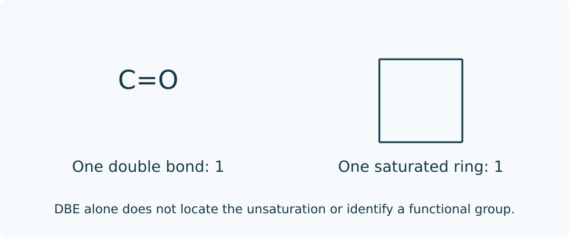{width=85% fig-alt="One degree of unsaturation can be a ring or a double bond"}

Could one degree correspond to a saturated ring instead of C=O?

::: notes
Suggested 40 seconds; adjust to the explanation and class response. Ask students to inspect the indicated molecular feature rather than read the answer caption. Worked answer: Yes. A ring or one double bond can account for one degree. Spectra must locate the structural feature.
:::

## Apply: interpret one degree of unsaturation

Can the formula alone establish that the compound is an ester?

::: notes
Suggested 60 seconds; adjust to the explanation and class response. Allow a brief paper or pair check within this slide. Worked answer: No. It constrains possibilities but does not specify functional-group connectivity.
:::

## Read the infrared axes

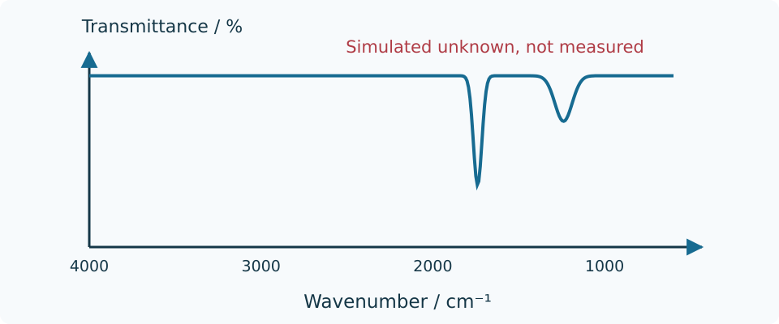{width=85% fig-alt="Unknown U1: simulated infrared evidence"}

On this simulated transmittance trace, what does a downward band represent?

::: notes
Suggested 40 seconds; adjust to the explanation and class response. Ask students to inspect the indicated molecular feature rather than read the answer caption. Worked answer: A decrease in transmitted light at that wavenumber indicates absorption. The axis decreases left to right by convention.
:::

## Resolve: read the infrared axes

{width=85% fig-alt="Unknown U1: simulated infrared evidence"}

A decrease in transmitted light at that wavenumber indicates absorption. The axis decreases left to right by convention.

::: notes
Suggested 30 seconds; adjust to the explanation and class response. Use a second inspection focus: justify the result by the atom, charge, ratio or observation involved. Next application answer: No. Larger absorbance is generally plotted upward; always inspect the ordinate label.
:::

## Apply: read the infrared axes

Would an absorbance spectrum use the same direction for stronger absorption?

::: notes
Suggested 60 seconds; adjust to the explanation and class response. Allow a brief paper or pair check within this slide. Worked answer: No. Larger absorbance is generally plotted upward; always inspect the ordinate label.
:::

## Identify a diagnostic region

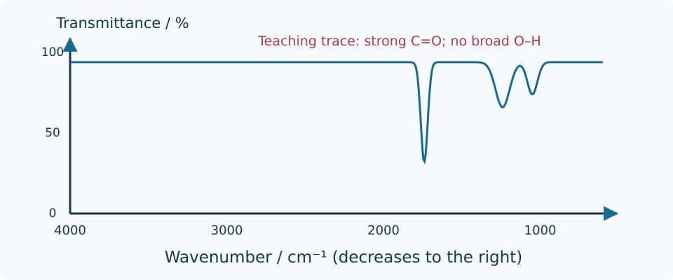{width=85% fig-alt="Simulated ester IR spectrum"}

What feature is consistent with a carbonyl, and what feature is absent?

::: notes
Suggested 40 seconds; adjust to the explanation and class response. Ask students to inspect the indicated molecular feature rather than read the answer caption. Worked answer: A strong carbonyl-region band is present; no broad O–H feature is shown in this teaching trace.
:::

## Apply: identify a diagnostic region

Does an exact band near 1740 cm⁻¹ uniquely identify ethyl ethanoate?

::: notes
Suggested 60 seconds; adjust to the explanation and class response. Allow a brief paper or pair check within this slide. Worked answer: No. Many related carbonyl compounds absorb in nearby regions; use other observations.
:::

## Make the acid candidate predict something

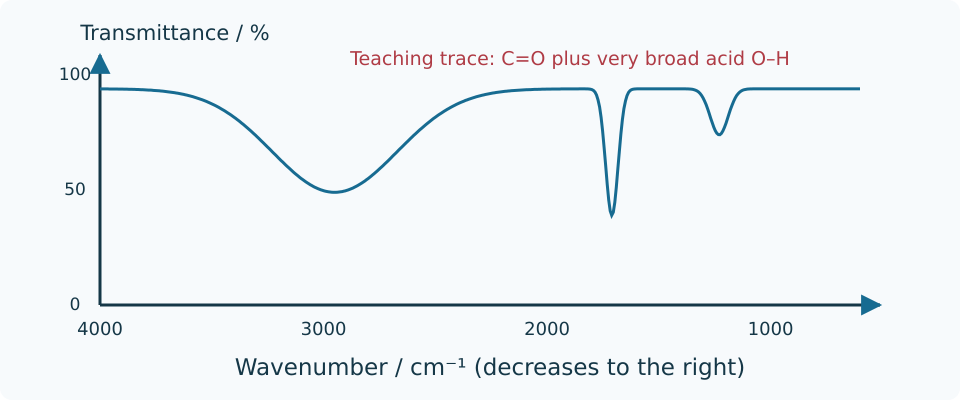{width=85% fig-alt="Simulated carboxylic acid IR spectrum"}

Which broad region would a carboxylic acid often add?

::: notes
Suggested 40 seconds; adjust to the explanation and class response. Ask students to inspect the indicated molecular feature rather than read the answer caption. Worked answer: A broad acid O–H envelope can extend across roughly 2500–3300 cm⁻¹ along with carbonyl absorption.
:::

## Resolve: make the acid candidate predict something

{width=85% fig-alt="Simulated carboxylic acid IR spectrum"}

A broad acid O–H envelope can extend across roughly 2500–3300 cm⁻¹ along with carbonyl absorption.

::: notes
Suggested 30 seconds; adjust to the explanation and class response. Use a second inspection focus: justify the result by the atom, charge, ratio or observation involved. Next application answer: If the region was unmeasured, the signal too weak or obscured, or experimental conditions differ from the assumed comparison.
:::

## Apply: make the acid candidate predict something

When would absence of a band be weak evidence?

::: notes
Suggested 60 seconds; adjust to the explanation and class response. Allow a brief paper or pair check within this slide. Worked answer: If the region was unmeasured, the signal too weak or obscured, or experimental conditions differ from the assumed comparison.
:::

## Compare an alcohol candidate

{width=85% fig-alt="Simulated alcohol IR spectrum"}

What differentiates this alcohol trace from a simple ester trace?

::: notes
Suggested 40 seconds; adjust to the explanation and class response. Ask students to inspect the indicated molecular feature rather than read the answer caption. Worked answer: The simulated alcohol has broad O–H but lacks a carbonyl band. A candidate should account for both presence and absence.
:::

## Apply: compare an alcohol candidate

Could one O–H dip alone locate the whole carbon skeleton?

::: notes
Suggested 60 seconds; adjust to the explanation and class response. Allow a brief paper or pair check within this slide. Worked answer: No. It suggests a functional group, while connectivity still requires further evidence.
:::

## Read a complete proton dataset

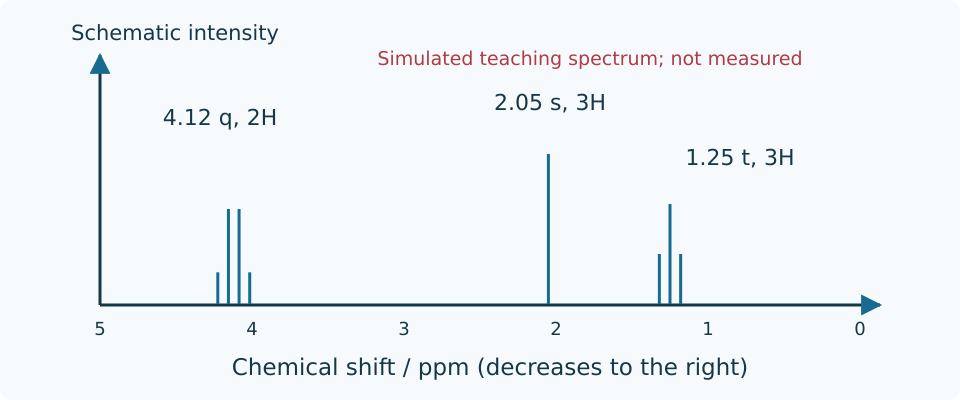{width=85% fig-alt="Simulated proton NMR: unknown U1"}

How many hydrogens do the supplied integrals sum to?

::: notes
Suggested 40 seconds; adjust to the explanation and class response. Ask students to inspect the indicated molecular feature rather than read the answer caption. Worked answer: 3 + 3 + 2 = 8 H, agreeing with the supplied molecular formula. Heights are not the integrals.
:::

## Resolve: read a complete proton dataset

{width=85% fig-alt="Simulated proton NMR: unknown U1"}

3 + 3 + 2 = 8 H, agreeing with the supplied molecular formula. Heights are not the integrals.

::: notes
Suggested 30 seconds; adjust to the explanation and class response. Use a second inspection focus: justify the result by the atom, charge, ratio or observation involved. Next application answer: Integral counts relative H area; multiplicity describes the line pattern caused by coupling in the stated simple model.
:::

## Apply: read a complete proton dataset

Which two values distinguish integral from multiplicity?

::: notes
Suggested 60 seconds; adjust to the explanation and class response. Allow a brief paper or pair check within this slide. Worked answer: Integral counts relative H area; multiplicity describes the line pattern caused by coupling in the stated simple model.
:::

## Inspect the 2H quartet alone

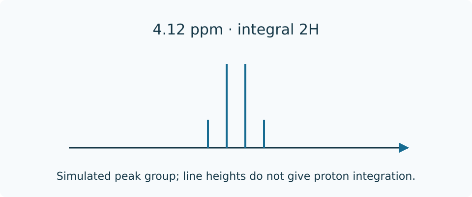{width=85% fig-alt="Inspect one proton environment in simulated U1"}

Under the simple n + 1 model, how many equivalent adjacent H give four lines?

::: notes
Suggested 40 seconds; adjust to the explanation and class response. Ask students to inspect the indicated molecular feature rather than read the answer caption. Worked answer: Three adjacent equivalent H give a quartet. The supplied integral says this environment contains two H.
:::

## Resolve: inspect the 2H quartet alone

{width=85% fig-alt="Inspect one proton environment in simulated U1"}

Three adjacent equivalent H give a quartet. The supplied integral says this environment contains two H.

::: notes
Suggested 30 seconds; adjust to the explanation and class response. Use a second inspection focus: justify the result by the atom, charge, ratio or observation involved. Next application answer: CH₂ next to CH₃, such as O–CH₂–CH₃; the shift supports the oxygen-bound placement.
:::

## Apply: inspect the 2H quartet alone

Propose a two-carbon fragment consistent with 2H quartet.

::: notes
Suggested 60 seconds; adjust to the explanation and class response. Allow a brief paper or pair check within this slide. Worked answer: CH₂ next to CH₃, such as O–CH₂–CH₃; the shift supports the oxygen-bound placement.
:::

## Inspect the 3H triplet alone

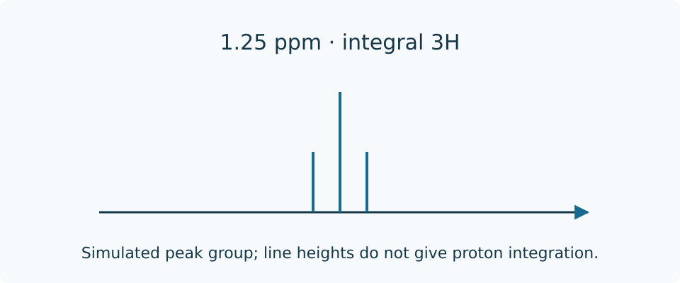{width=85% fig-alt="Inspect one proton environment in simulated U1"}

How many neighbouring H explain the three-line pattern?

::: notes
Suggested 40 seconds; adjust to the explanation and class response. Ask students to inspect the indicated molecular feature rather than read the answer caption. Worked answer: Two adjacent equivalent H give a triplet; integral 3H suggests a methyl beside CH₂.
:::

## Resolve: inspect the 3H triplet alone

{width=85% fig-alt="Inspect one proton environment in simulated U1"}

Two adjacent equivalent H give a triplet; integral 3H suggests a methyl beside CH₂.

::: notes
Suggested 30 seconds; adjust to the explanation and class response. Use a second inspection focus: justify the result by the atom, charge, ratio or observation involved. Next application answer: No. The partner shift and other observations place the oxygen; multiplicity alone does not.
:::

## Apply: inspect the 3H triplet alone

Does a triplet by itself prove that the adjacent CH₂ is attached to O?

::: notes
Suggested 60 seconds; adjust to the explanation and class response. Allow a brief paper or pair check within this slide. Worked answer: No. The partner shift and other observations place the oxygen; multiplicity alone does not.
:::

## Join the two observations

{width=85% fig-alt="An ethyl group gives a linked quartet and triplet"}

Why is the quartet/triplet pair more useful than either alone?

::: notes
Suggested 40 seconds; adjust to the explanation and class response. Ask students to inspect the indicated molecular feature rather than read the answer caption. Worked answer: A 2H quartet and 3H triplet jointly fit a CH₂–CH₃ fragment. O attachment is supported by the downfield CH₂ shift.
:::

## Resolve: join the two observations

{width=85% fig-alt="An ethyl group gives a linked quartet and triplet"}

A 2H quartet and 3H triplet jointly fit a CH₂–CH₃ fragment. O attachment is supported by the downfield CH₂ shift.

::: notes
Suggested 30 seconds; adjust to the explanation and class response. Use a second inspection focus: justify the result by the atom, charge, ratio or observation involved. Next application answer: No. Chemically equivalent H do not split each other in this simple treatment.
:::

## Apply: join the two observations

Would equivalent H within the same CH₃ split one another?

::: notes
Suggested 60 seconds; adjust to the explanation and class response. Allow a brief paper or pair check within this slide. Worked answer: No. Chemically equivalent H do not split each other in this simple treatment.
:::

## Account for the remaining singlet

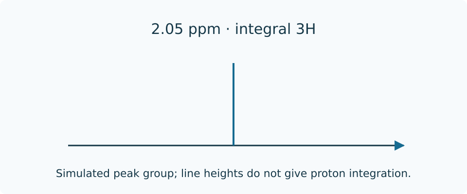{width=85% fig-alt="Inspect one proton environment in simulated U1"}

Where could three H have no adjacent carbon-bound H in an ester?

::: notes
Suggested 40 seconds; adjust to the explanation and class response. Ask students to inspect the indicated molecular feature rather than read the answer caption. Worked answer: An acetyl methyl, CH₃–C(=O)–, has no H on the adjacent carbonyl carbon and can give a 3H singlet near 2 ppm.
:::

## Resolve: account for the remaining singlet

{width=85% fig-alt="Inspect one proton environment in simulated U1"}

An acetyl methyl, CH₃–C(=O)–, has no H on the adjacent carbonyl carbon and can give a 3H singlet near 2 ppm.

::: notes
Suggested 30 seconds; adjust to the explanation and class response. Use a second inspection focus: justify the result by the atom, charge, ratio or observation involved. Next application answer: They are not vicinal neighbours of that methyl; small long-range couplings are omitted from this introductory model.
:::

## Apply: account for the remaining singlet

Why not split this methyl by the distant O–CH₂ hydrogens?

::: notes
Suggested 60 seconds; adjust to the explanation and class response. Allow a brief paper or pair check within this slide. Worked answer: They are not vicinal neighbours of that methyl; small long-range couplings are omitted from this introductory model.
:::

## Map the singlet onto the structure

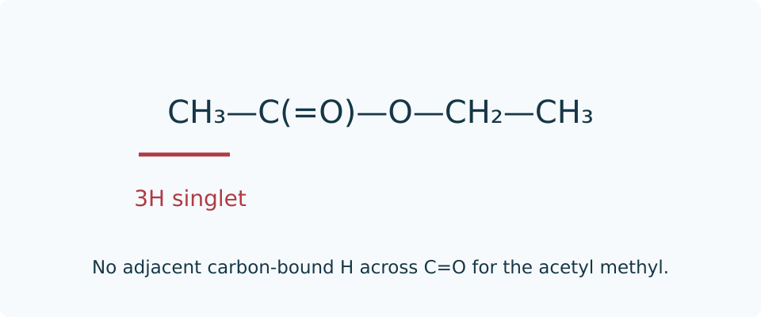{width=85% fig-alt="A carbonyl interrupts simple vicinal proton coupling"}

Which carbon separates acetyl CH₃ from the ester oxygen?

::: notes
Suggested 40 seconds; adjust to the explanation and class response. Ask students to inspect the indicated molecular feature rather than read the answer caption. Worked answer: The carbonyl carbon has zero attached H. That local bond arrangement explains the simple singlet expectation.
:::

## Apply: map the singlet onto the structure

What would an acetyl methyl adjacent to CH instead predict?

::: notes
Suggested 60 seconds; adjust to the explanation and class response. Allow a brief paper or pair check within this slide. Worked answer: An ordinary CH₃–CH fragment would have vicinal coupling to one H and commonly a doublet in the simple model; that is a different connectivity.
:::

## Check all hydrogens quantitatively

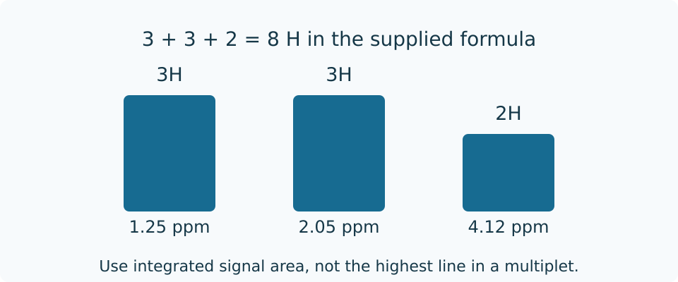{width=85% fig-alt="Integrals count relative numbers of hydrogens"}

Why can the quartet have four lines while representing only 2H?

::: notes
Suggested 40 seconds; adjust to the explanation and class response. Ask students to inspect the indicated molecular feature rather than read the answer caption. Worked answer: Coupling divides one environment into lines. Integration adds their total area; line count and H count answer different questions.
:::

## Resolve: check all hydrogens quantitatively

{width=85% fig-alt="Integrals count relative numbers of hydrogens"}

Coupling divides one environment into lines. Integration adds their total area; line count and H count answer different questions.

::: notes
Suggested 30 seconds; adjust to the explanation and class response. Use a second inspection focus: justify the result by the atom, charge, ratio or observation involved. Next application answer: Divide by two to obtain 3:3:2, then match the eight total H in the supplied formula.
:::

## Apply: check all hydrogens quantitatively

If all integrals were reported as 6:6:4, what ratio would you use?

::: notes
Suggested 60 seconds; adjust to the explanation and class response. Allow a brief paper or pair check within this slide. Worked answer: Divide by two to obtain 3:3:2, then match the eight total H in the supplied formula.
:::

## Add an independent carbon check

{width=85% fig-alt="Simulated carbon NMR: unknown U1"}

How many distinct carbon environments appear in this simulated decoupled spectrum?

::: notes
Suggested 40 seconds; adjust to the explanation and class response. Ask students to inspect the indicated molecular feature rather than read the answer caption. Worked answer: Four signals appear near 14, 21, 60 and 171 ppm, consistent with four distinct carbon environments.
:::

## Resolve: add an independent carbon check

{width=85% fig-alt="Simulated carbon NMR: unknown U1"}

Four signals appear near 14, 21, 60 and 171 ppm, consistent with four distinct carbon environments.

::: notes
Suggested 30 seconds; adjust to the explanation and class response. Use a second inspection focus: justify the result by the atom, charge, ratio or observation involved. Next application answer: No. Symmetry can make different carbons equivalent; signal counts constrain environments rather than directly counting every atom.
:::

## Apply: add an independent carbon check

Do four peaks always imply exactly four total carbons?

::: notes
Suggested 60 seconds; adjust to the explanation and class response. Allow a brief paper or pair check within this slide. Worked answer: No. Symmetry can make different carbons equivalent; signal counts constrain environments rather than directly counting every atom.
:::

## Assign the four carbon values

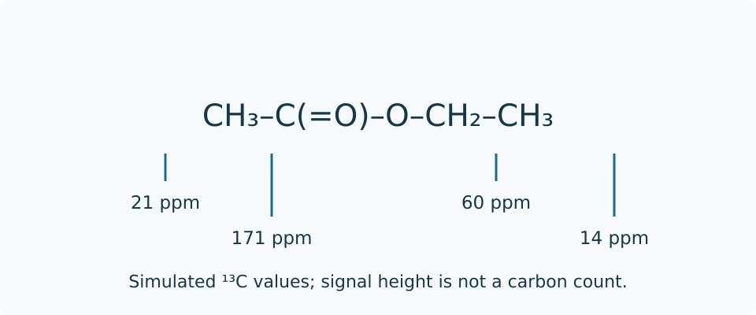{width=85% fig-alt="Four carbon environments test the proposed connectivity"}

Which environment fits the far-downfield signal near 171 ppm?

::: notes
Suggested 40 seconds; adjust to the explanation and class response. Ask students to inspect the indicated molecular feature rather than read the answer caption. Worked answer: The ester carbonyl. O–CH₂ fits near 60; the two methyl environments fit near 14 and 21 in this example.
:::

## Resolve: assign the four carbon values

{width=85% fig-alt="Four carbon environments test the proposed connectivity"}

The ester carbonyl. O–CH₂ fits near 60; the two methyl environments fit near 14 and 21 in this example.

::: notes
Suggested 30 seconds; adjust to the explanation and class response. Use a second inspection focus: justify the result by the atom, charge, ratio or observation involved. Next application answer: Routine decoupled-carbon intensities depend on relaxation and measurement effects; they are not normally quantitative atom integrals.
:::

## Apply: assign the four carbon values

Why should ¹³C line height not be used as a precise carbon count?

::: notes
Suggested 60 seconds; adjust to the explanation and class response. Allow a brief paper or pair check within this slide. Worked answer: Routine decoupled-carbon intensities depend on relaxation and measurement effects; they are not normally quantitative atom integrals.
:::

## Require a complete assignment

{width=85% fig-alt="Attach each spectral clue to the proposed structure"}

Can the ester candidate explain every supplied proton and carbon group?

::: notes
Suggested 40 seconds; adjust to the explanation and class response. Ask students to inspect the indicated molecular feature rather than read the answer caption. Worked answer: CH₃COOCH₂CH₃ accounts for acetyl singlet, ethyl quartet/triplet, ester carbonyl and all four carbon environments.
:::

## Apply: require a complete assignment

What evidence would remain unexplained if you only recognised an ethyl group?

::: notes
Suggested 60 seconds; adjust to the explanation and class response. Allow a brief paper or pair check within this slide. Worked answer: The remaining acetyl methyl, carbonyl connectivity and full formula must still be accounted for.
:::

## Test butanoic acid against U1

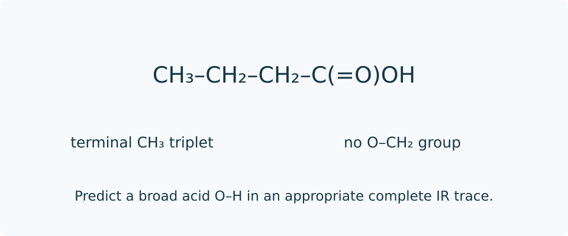{width=85% fig-alt="Butanoic acid predicts a different proton map"}

Name two conflicts with the acid candidate rather than only favouring the ester.

::: notes
Suggested 40 seconds; adjust to the explanation and class response. Ask students to inspect the indicated molecular feature rather than read the answer caption. Worked answer: The acid predicts O–H and lacks O–CH₂. It also lacks an isolated acetyl methyl singlet.
:::

## Resolve: test butanoic acid against U1

{width=85% fig-alt="Butanoic acid predicts a different proton map"}

The acid predicts O–H and lacks O–CH₂. It also lacks an isolated acetyl methyl singlet.

::: notes
Suggested 30 seconds; adjust to the explanation and class response. Use a second inspection focus: justify the result by the atom, charge, ratio or observation involved. Next application answer: No. Butanoic acid can have a terminal methyl triplet too; independent distinguishing observations are needed.
:::

## Apply: test butanoic acid against U1

Could the terminal CH₃ triplet alone reject butanoic acid?

::: notes
Suggested 60 seconds; adjust to the explanation and class response. Allow a brief paper or pair check within this slide. Worked answer: No. Butanoic acid can have a terminal methyl triplet too; independent distinguishing observations are needed.
:::

## Test another formula-compatible alternative

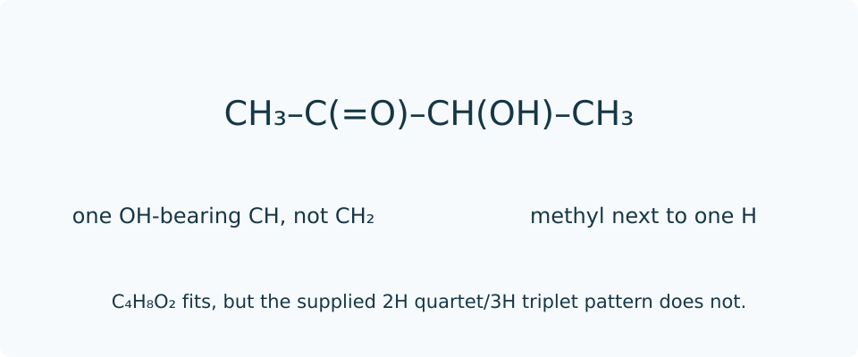{width=85% fig-alt="A hydroxyketone is another formula-compatible candidate"}

Does a hydroxyketone automatically fit because it has carbonyl and two O atoms?

::: notes
Suggested 40 seconds; adjust to the explanation and class response. Ask students to inspect the indicated molecular feature rather than read the answer caption. Worked answer: No. This candidate has an OH-bearing CH, not the supplied 2H O–CH₂ quartet, and predicts different methyl coupling.
:::

## Apply: test another formula-compatible alternative

What would the CH₃ beside its CH commonly show?

::: notes
Suggested 60 seconds; adjust to the explanation and class response. Allow a brief paper or pair check within this slide. Worked answer: A doublet from one vicinal H in the simple first-order model, not U1’s ethyl triplet.
:::

## Use contradictions carefully

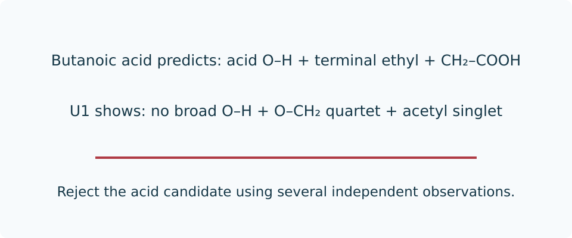{width=85% fig-alt="Predictions can reject a plausible-looking candidate"}

Why do several independent disagreements strengthen candidate rejection?

::: notes
Suggested 40 seconds; adjust to the explanation and class response. Ask students to inspect the indicated molecular feature rather than read the answer caption. Worked answer: A candidate may explain one familiar feature by coincidence. Conflicts across IR and NMR jointly test different structural predictions.
:::

## Apply: use contradictions carefully

Can a sample filename replace the assignment?

::: notes
Suggested 60 seconds; adjust to the explanation and class response. Allow a brief paper or pair check within this slide. Worked answer: No. It is a human label that can be mistaken; use the observations and supplied formula.
:::

## Write a restrained identity claim

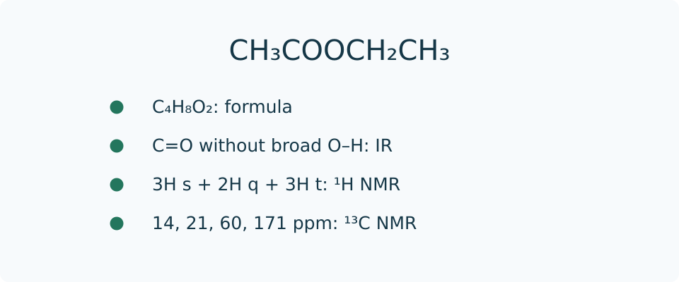{width=85% fig-alt="One candidate must account for every supplied observation"}

How strongly should the conclusion be worded for this candidate set?

::: notes
Suggested 40 seconds; adjust to the explanation and class response. Ask students to inspect the indicated molecular feature rather than read the answer caption. Worked answer: Ethyl ethanoate best fits the supplied simulated observations among the tested candidates. The assignment should list the supporting observations.
:::

## Apply: write a restrained identity claim

State a limitation without discarding the useful conclusion.

::: notes
Suggested 60 seconds; adjust to the explanation and class response. Allow a brief paper or pair check within this slide. Worked answer: The dataset is simulated and a finite candidate comparison does not exclude every imaginable alternative; real identification also depends on data quality and context.
:::

## Integrate one short case

U1 has C₄H₈O₂, carbonyl IR without broad O–H, 3H singlet, 2H quartet and 3H triplet. Assign ethyl ethanoate and reject butanoic acid with two observations.

::: notes
Suggested 120 seconds; adjust to the explanation and class response. Give time to formulate the claim and compare a partner explanation. Worked answer: Ethyl ethanoate accounts for acetyl CH₃ and O–CH₂–CH₃. Butanoic acid predicts acid O–H and lacks the O–CH₂ quartet/acetyl singlet arrangement.
:::

## Compare the worked reasoning

Ethyl ethanoate accounts for acetyl CH₃ and O–CH₂–CH₃. Butanoic acid predicts acid O–H and lacks the O–CH₂ quartet/acetyl singlet arrangement.

::: notes
Suggested 60 seconds; adjust to the explanation and class response. Ask students to identify the exact step or observation their own reasoning omitted. This is a correction interval within the session, not a new topic.
:::

## Exit explanation

What distinguishes a convincing assignment from a familiar-looking pattern?

::: notes
Suggested 40 seconds; adjust to the explanation and class response. Worked answer: Every supplied observation is linked to a structural prediction and a plausible alternative is explicitly tested. Ask for a causal explanation, not a single vocabulary label.
:::

## Continue with independent practice

Use the [exercises](exercise.qmd), then the [self-check](quiz.qmd).

All required inputs and explanations are provided locally. The [reading guide](../reference/reading.qmd) offers optional textbook support.

::: notes
Suggested 20 seconds; adjust to the explanation and class response. Preview the local exercise route. No book purchase or external problem set is needed to complete it. Leave time to note one corrected misconception.
:::
