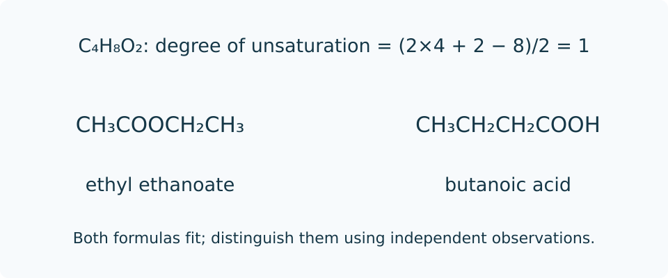
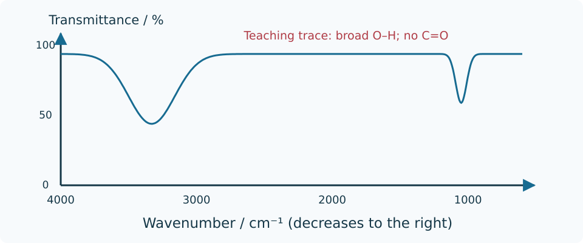
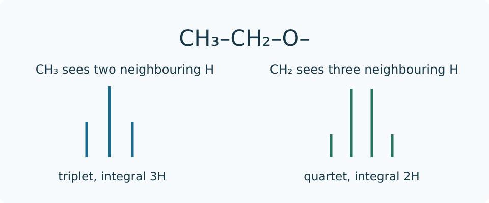
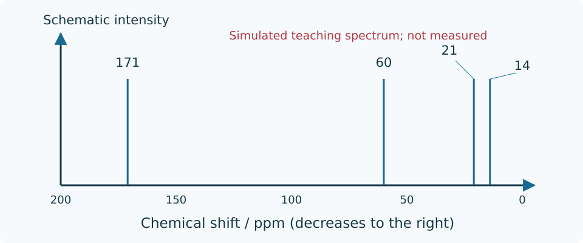
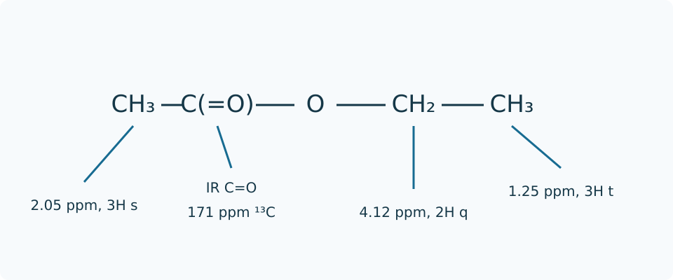

## What will you be able to explain?

- Use formula, IR and simple one-dimensional NMR together.
- Assign simple integrations and first-order splitting patterns.
- Reject a candidate with an explicit contradiction rather than visual resemblance.

::: notes
Start with a drawn molecule and an explanation from the preceding unit. Ask students to predict before revealing an answer. Use the practice page for complete worked checks rather than putting dense paragraphs on slides.
:::

## Start with the formula

{width=85% fig-alt="Ethyl ethanoate and butanoic acid both fit C₄H₈O₂ and one degree of unsaturation."}

One formula can describe several connectivities.

::: notes
The formula calculation assumes an ordinary closed-shell C/H/O molecule. A degree of unsaturation can be a ring or a double bond; oxygen does not affect the simple count.
:::

## IR reports bond environments

{width=85% fig-alt="A simulated ester spectrum shows strong C=O absorption and no broad O–H band."}

Band position and pattern constrain functional groups; IR alone does not uniquely establish connectivity.

::: notes
All traces in this unit are deliberately simulated teaching data. Real peak positions and shapes vary with solvent, phase, concentration and structure. Present carbonyl bands as regions, not exact identity barcodes.
:::

## Ask what a competing candidate predicts

{width=85% fig-alt="A simulated acid spectrum includes a very broad acid O–H region along with C=O."}

A missing predicted feature can challenge the acid candidate when data quality is adequate.

::: notes
Do not make absence stronger than the experiment supports. A poor or incomplete spectrum can hide a feature; ask whether the region was measured and whether the signal is detectable.
:::

## An alcohol gives a different pattern

{width=85% fig-alt="A simulated alcohol trace has broad O–H absorption but lacks C=O."}

Combine presence and absence rather than matching one isolated dip.

::: notes
The teaching comparison separates three clear motifs. Hydrogen bonding affects O–H width; a free OH in a different environment need not have this broad shape.
:::

## Read the proton NMR evidence

{width=85% fig-alt="U1 has 4.12 ppm quartet integrating to 2H, 2.05 ppm singlet to 3H and 1.25 ppm triplet to 3H."}

The integrals total eight hydrogens, consistent with the supplied formula.

::: notes
These are illustrative values and a schematic spectrum. Peak height is not integration; the printed integrals are independent supplied information. State a first-order, rapidly averaging solution assumption.
:::

## Connect a quartet and triplet

{width=85% fig-alt="A simple O–CH₂–CH₃ group gives a CH₂ quartet and CH₃ triplet with 2:3 integration."}

Use the n + 1 rule only for the simple neighbouring equivalent-H cases in this course.

::: notes
Equivalent hydrogens do not split each other. OH splitting and exchange can differ; do not extend this shortcut to all spectra or strongly coupled systems.
:::

## Account for the singlet too

{width=85% fig-alt="The acetyl methyl has no adjacent carbon-bound hydrogen across the carbonyl carbon."}

Its three hydrogens can appear as a singlet near 2 ppm.

::: notes
Do not count the two hydrogens on the distant O–CH₂ as adjacent neighbours of this methyl. We ignore small long-range couplings in this introductory model.
:::

## Use carbon NMR as another check

{width=85% fig-alt="Four illustrative carbon resonances occur at 14, 21, 60 and 171 ppm."}

Assign alkyl carbon, acetyl methyl, O–CH₂ and ester carbonyl environments.

::: notes
The common proton-decoupled carbon spectrum gives approximate environment information. Signal heights are not reliable carbon counts, and chemically equivalent carbons can share one signal.
:::

## Make a complete assignment

{width=85% fig-alt="Ethyl ethanoate accounts for the IR carbonyl and all three proton environments."}

An assignment should explain the whole supplied dataset.

::: notes
Have students annotate a structure with the actual numbers and integrals. This prevents a plausible guess from replacing an evidence-based assignment.
:::

## Try to falsify the candidate

{width=85% fig-alt="Butanoic acid predicts acid O–H and different proton environments."}

Its expected pattern conflicts with several features of U1.

::: notes
One inconsistency may be explained by experimental conditions; multiple independent inconsistencies make rejection stronger. Spectra narrow candidates, but need not exclude every imaginable structure with absolute certainty.
:::

## Work one example on paper

For U1 (C₄H₈O₂), assign each supplied proton and carbon NMR signal to ethyl ethanoate. Then state two observations that reject butanoic acid, without using the sample filename as evidence.

::: notes
Allow independent thinking, then compare in pairs. Ask students to defend each atom, charge or assignment. Show the worked check only after a first attempt.
:::

## A common mistake to repair

A tall NMR line is not a large integral. Integration concerns area; the schematic drawings provide the integral values separately.

Explain the correction using a drawing or a specific observation.

## Test your explanation

1. Which atoms, bonds or observations support the claim?
2. What alternative would make a different prediction?
3. What assumption limits the conclusion?

Give a partner your explanation without the answer label. Can they follow it?

## Take the reasoning forward

Complete the [practice and worked examples](exercise.qmd) and [self-check](quiz.qmd).

Selected Solomons chapters 2 and 9 sections; see the [reading guide](../reference/reading.qmd) for the provisional textbook map and open references.
