## About this lecture

Two unlabelled bottles both contain **C₄H₈O₂**. One smells of pear drops and nail-polish remover. The other smells of rancid butter. You could sniff them, but a chemist would rather **ask the molecules directly**, with light and with magnets. The same physics, used on the water in your body, is an MRI scan.

Today we work one unknown, U1, from formula to structure:

- **Formula:** count rings and π bonds before guessing anything
- **IR:** which functional groups are there, and which aren't
- **¹H NMR:** shift, integral and splitting, one clue each
- **¹³C NMR:** how many kinds of carbon
- **Testing candidates:** a structure is a hypothesis that must explain every signal

Last time (Day 18) we read amines and aromatic rings by structure; today the structure is what we're looking for.

::: notes
Open with the two bottles: ethyl ethanoate (ethyl acetate) is the solvent in nail-polish remover and gives pear-drop and fruity notes in wine; butanoic acid is the smell of rancid butter and, unfortunately, of vomit. Same molecular formula. Ask the room: "How would you tell them apart without smelling?" Collect answers, then say that this is exactly today's problem. Mention MRI: the scanner detects the hydrogen nuclei in water and fat, the same nuclei we'll read in a 1H NMR spectrum. Make clear that all spectra today are simulated teaching spectra with literature-typical values; the reasoning is the real thing. Tomorrow (Day 22) uses this evidence habit for synthesis.
:::

## Start with the formula

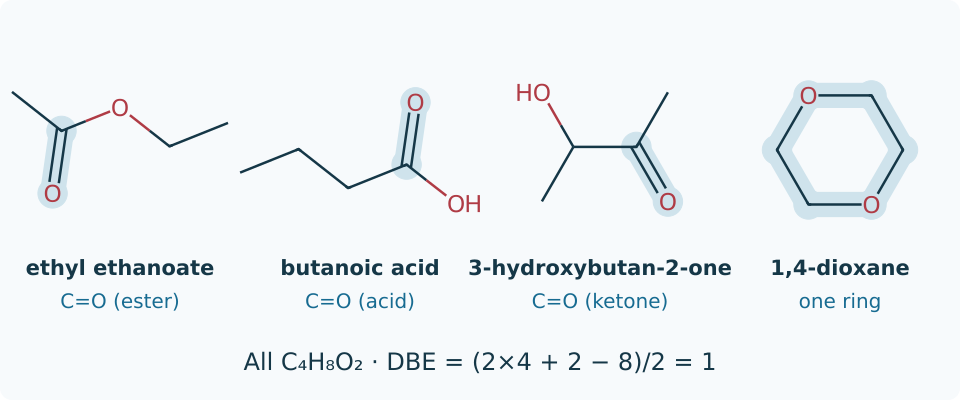{width=88% fig-alt="Ethyl ethanoate, butanoic acid, 3-hydroxybutan-2-one and 1,4-dioxane, all C4H8O2, each with its one degree of unsaturation shaded"}

**DBE = (2C + 2 − H)/2** counts **rings + π bonds**. O doesn't enter it. One DBE can be a C=O, a C=C or a ring.

::: {.try}
**Try it:** what is the DBE of C₄H₈O₂, and does that prove there's a C=O?

::: {.fragment}
**(8 + 2 − 8)/2 = 1.** No: 1,4-dioxane uses its one DBE as a ring. The formula narrows the field but doesn't pick the structure.
:::
:::

::: notes
This is the degree-of-unsaturation idea from Day 1, where every double bond or ring cost two hydrogens. A saturated acyclic C4 compound would have 2×4+2 = 10 H; we have 8, so one pair is missing. Walk across the four candidates: three spend the DBE on C=O, dioxane on a ring. Stress that oxygen is invisible to this formula because a divalent atom slots into a chain without changing the H count. A common slip is including O in the count. Another is assuming C4H8O2 "must be" an ester because that's what the textbook example was. These four candidates will follow us through the lecture.
:::

## Three instruments, three questions

| method | what it detects | what it tells you |
|---|---|---|
| **formula** | composition | DBE: rings + π bonds |
| **IR** | bond vibrations | which **functional groups** are present (C=O, O–H) |
| **¹H NMR** | each kind of H | **shift**: neighbourhood · **integral**: how many H · **splitting**: H next door |
| **¹³C NMR** | each kind of C | how many **carbon types**; C=O vs C–O vs alkyl |

Each method tests a **different prediction**, which is why they're stronger together than any one alone.

::: notes
This is the map for the rest of the lecture. IR was introduced on Day 2 with boiling points and hydrogen bonding; here we use it as evidence. The key word is "independent": the formula comes from mass and composition, IR from bond vibrations, NMR from nuclear spins in a magnetic field. If three independent methods agree on one structure, that's far more convincing than any single peak. Don't spend long here; the point is to give students a mental table they'll fill in during the next slides.
:::

## Reading an IR trace

{width=78% fig-alt="Simulated transmittance IR trace with a strong sharp dip near 1740 per cm and no broad O-H band"}

- The y-axis is **transmittance**: a **dip** means light was absorbed.
- Wavenumber runs **high to low**, left to right, by convention.
- Strong, sharp dip near **1740 cm⁻¹**: C=O. Nothing broad at 2500–3600: **no O–H**.
- On an **absorbance** plot the same band would point **up**, so read the y-axis label first.

::: notes
Many students have only seen absorbance spectra from UV-vis in general chemistry, where peaks go up. IR is traditionally plotted as transmittance, so everything is upside down. Read the axes aloud: "per cent of light getting through" on the y-axis, wavenumber decreasing to the right. The two zones to look at first are 1650 to 1800 for C=O and 2500 to 3600 for O–H and N–H. The region below 1500 is the fingerprint region; we won't assign it, but the 1240 band here is typical of the ester C–O.
:::

## Each functional group has its own band

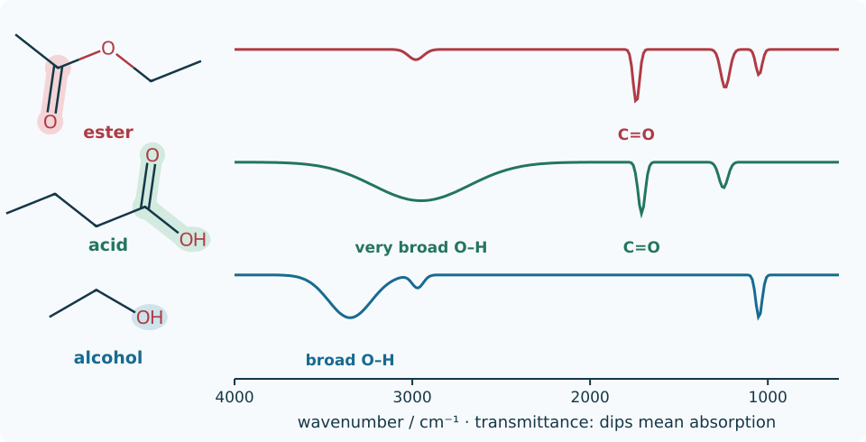{width=86% fig-alt="Three simulated IR traces next to their structures: ethyl ethanoate with C=O and no O-H; butanoic acid with a very broad O-H from 2500 to 3300 plus C=O; ethanol with a broad O-H near 3350 and no C=O"}

- **C=O:** 1650–1800 cm⁻¹, strong and sharp
- **Alcohol O–H:** 3200–3600 cm⁻¹, broad. **Acid O–H:** 2500–3300 cm⁻¹, **very** broad, running into the C–H bands

::: notes
Hydrogen bonding is why O–H bands are broad: each molecule has a slightly different H-bonding partner, so the vibration is smeared over a range. In carboxylic acids the dimers hold very tight hydrogen bonds, so the band is enormous and overlaps the C–H stretches near 3000. Point at the acid trace and let students see how much of the spectrum it eats. Then the alcohol: broad O–H, no C=O. If you had to choose between ethanol and ethanal from IR alone, the alcohol trace picks ethanol, but it says nothing about how many carbons there are.
:::

## Absence counts, if you looked

{width=72% fig-alt="Simulated IR of unknown U1: a strong band near 1740 per cm, a band near 1240 and no broad O-H band"}

U1 has a strong **C=O** and **no broad O–H** anywhere from 2500 to 3600 cm⁻¹.

::: {.try}
**Try it:** which C₄H₈O₂ candidates does this challenge, and what would weaken that argument?

::: {.fragment}
**Butanoic acid** (needs a huge acid O–H) and **3-hydroxybutan-2-one** (needs an O–H). **Dioxane** has no C=O. The argument only holds if that region was measured and the signal wasn't too weak.
:::
:::

::: notes
This is the first real elimination. Students are comfortable with "a peak is there, so the group is there"; using absence is less natural. Absence is good evidence only when the method could have seen the feature: the region must be on the plot, the sample concentrated enough, and nothing else covering it. A C=O band near 1740 fits an ester, but plenty of other carbonyl compounds absorb nearby, so IR alone never names a molecule. Ask: "Is U1 definitely ethyl ethanoate now?" No: methyl propanoate, CH3CH2COOCH3, is another C4H8O2 ester with the same IR story. That's why we need NMR.
:::

## ¹H NMR: one signal per kind of hydrogen

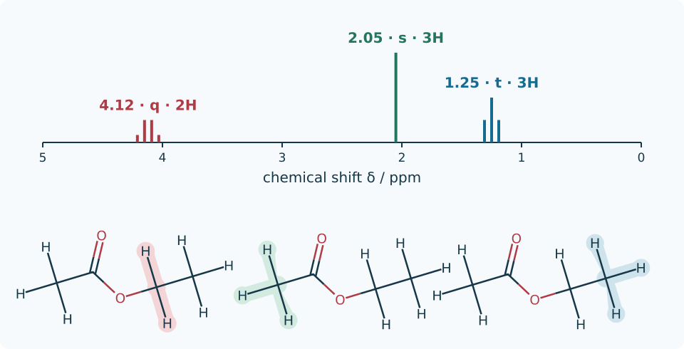{width=82% fig-alt="Schematic proton NMR of U1 with a quartet at 4.12 ppm for 2H, a singlet at 2.05 ppm for 3H and a triplet at 1.25 ppm for 3H; under each, ethyl ethanoate with that set of hydrogens shaded in the same colour"}

Each signal carries three clues: **where** it is (shift), **how big** it is (integral), and **how many lines** (splitting).

::: notes
This is the whole of U1's proton spectrum, and the rest of the lecture unpacks it. Point at each coloured set of hydrogens: red O–CH2, green acetyl CH3, blue ethyl CH3. Don't explain the shifts or splittings yet; just establish that each colour is one environment and gives one signal. Emphasise the vocabulary: chemical shift δ in ppm, integral, multiplicity (s, d, t, q). Students will see the same three-signal pattern on the next six slides, each time from a different angle.
:::

## Equivalent H share a signal

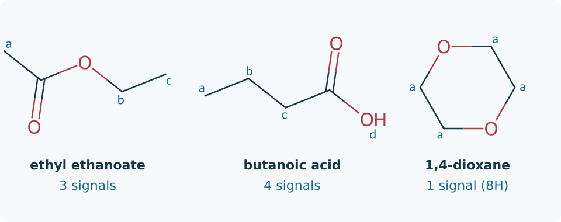{width=80% fig-alt="Ethyl ethanoate with three proton environments a, b and c; butanoic acid with four, a to d; 1,4-dioxane with one environment for all eight H"}

H atoms are **equivalent** when symmetry or free rotation makes them indistinguishable. The three H of a CH₃ are always equivalent.

::: {.try}
**Try it:** how many ¹H signals does butanoic acid give, and what are their integrals?

::: {.fragment}
**Four:** CH₃ (3H), CH₂ (2H), CH₂ next to C=O (2H) and O–H (1H). That's 3 + 2 + 2 + 1 = 8 H.
:::
:::

::: notes
Fast rotation about C–C single bonds (Week 2, conformations) is why the three methyl hydrogens look identical on the NMR timescale. Dioxane is a nice extreme: eight hydrogens, one signal, because every CH2 is related to every other by symmetry. Have students label the butanoic acid environments themselves before revealing. The usual mistake is to treat the two CH2 groups as one environment; they're different because one sits next to C=O and the other next to CH3.
:::

## Chemical shift: what's next door

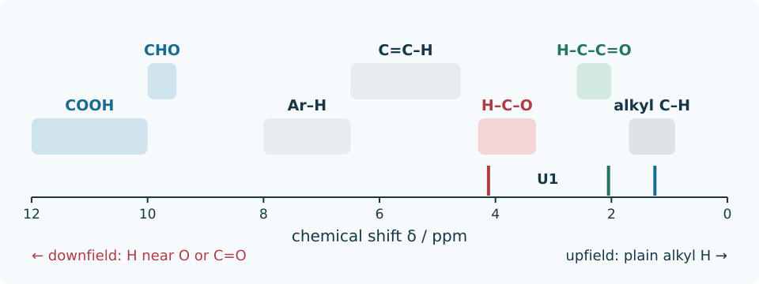{width=86% fig-alt="Shift scale from 12 to 0 ppm with bands for alkyl C-H 0.9 to 1.7, H-C-C=O 2.0 to 2.6, H-C-O 3.3 to 4.3, alkene, aromatic, aldehyde and carboxylic acid; U1's three signals marked at 4.12, 2.05 and 1.25"}

Electronegative neighbours pull electron density away from H, which moves its signal **downfield** (to the left). U1's three signals land in three zones: **H–C–O** at 4.12, **H–C–C=O** at 2.05 and plain **alkyl** at 1.25.

::: notes
The physical picture: electrons around a proton shield it from the magnet. Pull electron density away, with oxygen or a carbonyl, and the proton feels a stronger field and resonates further left. That's all the theory students need. Have them memorise four anchors rather than the whole chart: about 1 ppm for alkyl, about 2 for next to C=O, about 3.5 to 4 for on a carbon bearing O, and above 10 for COOH. Ask the room which ethyl ethanoate CH2 or CH3 should be furthest left, before pointing at the red line: the O–CH2, because it sits on the carbon bonded to oxygen.
:::

## Integrals count hydrogens

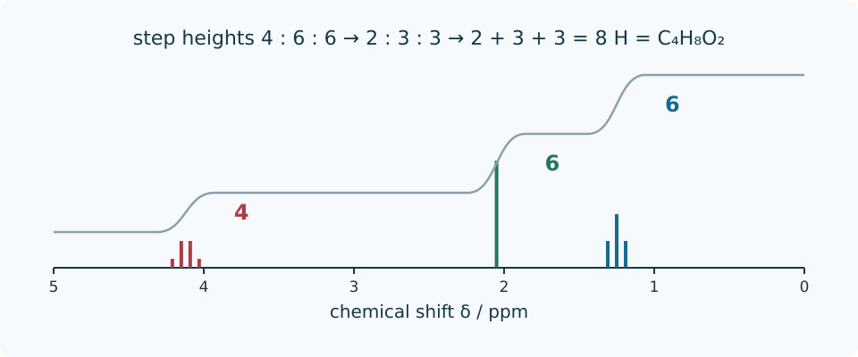{width=80% fig-alt="Schematic U1 spectrum with an integral curve whose steps are 4, 6 and 6 units, reducing to 2 to 3 to 3 and totalling 8 H"}

The **area** under a signal, not its tallest line, is proportional to the number of H. The integrals give a **ratio**; the formula fixes the total.

::: {.try}
**Try it:** the integrator reports 6, 6 and 4. Turn that into H counts for C₄H₈O₂. Is the singlet taller than the triplet because it has more H?

::: {.fragment}
**Divide by 2: 3 : 3 : 2 = 8 H.** No: both have 3H. The singlet's area sits in one line, while the triplet's is spread over three.
:::
:::

::: notes
The integration trace is the staircase drawn over the spectrum; each step's height is the signal's area. Instruments report arbitrary units, so students must reduce to the smallest whole-number ratio and check against the formula. Point out the trap in the figure: the green singlet towers over the blue triplet even though both are 3H. Line heights are never H counts. If the ratio doesn't add up to the formula's H, either an integral is wrong or the candidate is.
:::

## Splitting: count the neighbours' H

{width=72% fig-alt="An ethyl group: the CH3 sees two neighbouring H and gives a triplet integrating to 3H; the CH2 sees three neighbouring H and gives a quartet integrating to 2H"}

**n equivalent H on the neighbouring carbon(s) → n + 1 lines.** A **2H quartet** and a **3H triplet** together are the signature of **CH₃–CH₂–**.

::: {.try}
**Try it:** a CH₃ sits next to a CH carrying one H. What pattern does the CH₃ give?

::: {.fragment}
**A 3H doublet.** One neighbouring H gives 1 + 1 = 2 lines; the integral is still 3H.
:::
:::

::: notes
This is the simple first-order model: equivalent neighbours on adjacent carbons, equal coupling, no long-range coupling. Real spectra can be messier, but this rule explains every signal today. Stress the cross-over: the CH2 is a quartet because of the CH3's three H, and the CH3 is a triplet because of the CH2's two H. Each signal reports the neighbours, not itself. That's why the integral and the line count answer different questions. The quartet's four lines don't mean four H. Spotting the quartet-triplet pair is the single most useful pattern in introductory NMR.
:::

## A singlet means nobody's next door

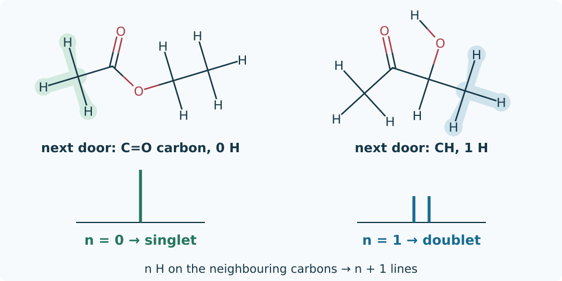{width=78% fig-alt="Left: the acetyl CH3 of ethyl ethanoate next to a carbonyl carbon with no H gives a 3H singlet. Right: the CH3 of 3-hydroxybutan-2-one next to a CH with one H gives a 3H doublet"}

The acetyl CH₃ of an ester sits on the **C=O carbon, which has no H**. So it's a **3H singlet near 2 ppm**. A CH₃ on a CH would be a doublet.

::: notes
This is where the carbonyl earns its keep in NMR: it acts as a barrier with no hydrogens, so groups on either side of it don't split each other. The O–CH2 hydrogens are four bonds away from the acetyl CH3, too far to couple in our model. The doublet panel is a deliberate setup for later: 3-hydroxybutan-2-one has a CH3 on a CH, so it must show a 3H doublet. Keep that prediction in mind when we test that candidate.
:::

## ¹³C NMR: one line per kind of carbon

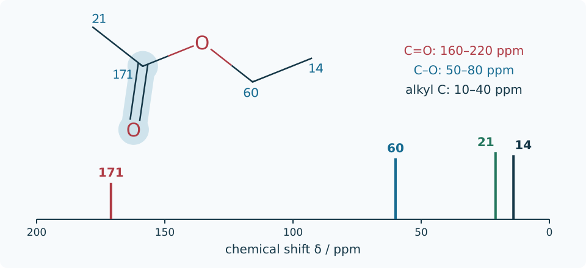{width=80% fig-alt="Schematic carbon-13 spectrum with lines at 171, 60, 21 and 14 ppm; ethyl ethanoate drawn with each carbon labelled by its shift"}

U1 shows **four** carbon signals: C=O at 171, O–CH₂ at 60, and two CH₃ at 21 and 14. Routine ¹³C spectra show **no splitting**, and line heights are **not** carbon counts.

::: notes
The carbon scale is about 20 times wider than the proton one: 0 to 220 ppm. The same logic applies: carbons on oxygen land around 50 to 80, carbonyl carbons above 160, plain alkyl carbons below 40. Routine carbon spectra are decoupled from hydrogen, so every signal is a single line, and intensities depend on relaxation, so you can't integrate them. The carbonyl line is short here, which is typical for a carbon with no attached H. What 13C does give cleanly is the number of carbon environments: four for U1, matching four distinct carbons in ethyl ethanoate.
:::

## Symmetry hides carbons

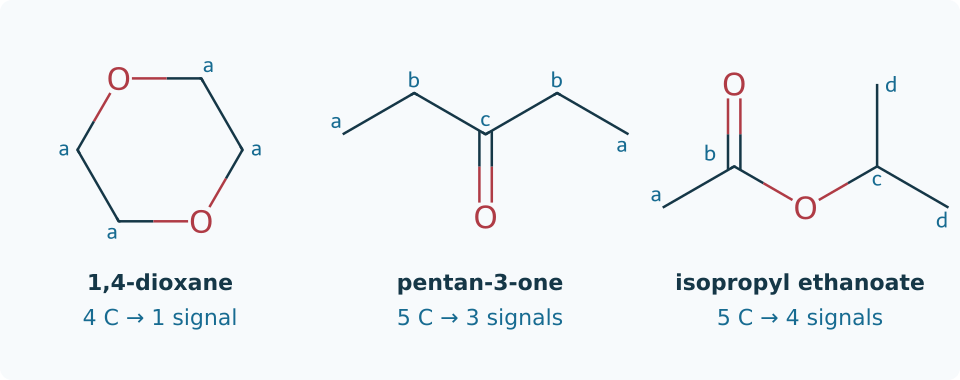{width=80% fig-alt="1,4-dioxane has 4 carbons and 1 signal; pentan-3-one has 5 carbons and 3 signals; isopropyl ethanoate has 5 carbons and 4 signals; equivalent carbons share a letter"}

Equivalent carbons share one signal, so **signals ≤ carbons**. Fewer signals than carbons points to symmetry.

::: {.try}
**Try it:** 3-methylpentane, CH₃CH₂CH(CH₃)CH₂CH₃, has six carbons. How many ¹³C signals?

::: {.fragment}
**Four:** the two end CH₃, the two CH₂, the CH, and the branch CH₃. A mirror plane through the CH makes the two ethyl arms identical.
:::
:::

::: notes
This guards against a common wrong rejection: "the formula has six carbons but the spectrum shows four, so it's impossible." It's possible whenever there's symmetry. Run through the three examples by finding the mirror plane in each. For U1, four signals and four carbons means no symmetry to worry about, which also argues against dioxane (one signal) once more. Symmetry and equivalence come back in Week 2 language: equivalent atoms are related by a symmetry operation of the molecule.
:::

## Putting U1 together

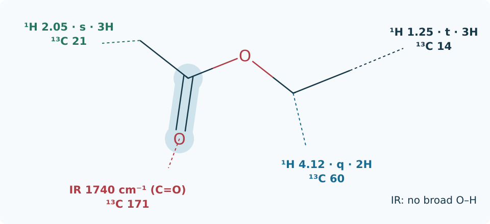{width=86% fig-alt="Ethyl ethanoate with callouts: acetyl CH3 at 2.05 s 3H and 21 ppm; C=O at IR 1740 and 171 ppm; O-CH2 at 4.12 q 2H and 60 ppm; ethyl CH3 at 1.25 t 3H and 14 ppm; no broad O-H in IR"}

Formula and IR give **one C=O, no O–H**. The q/t pair gives **CH₃CH₂–**, and its 4.12 shift puts it **on O**. The 2.05 singlet is **CH₃ on C=O**. Join them: **CH₃C(=O)OCH₂CH₃**, with nothing left over.

::: notes
This is the deliverable students should be able to produce: every observation assigned to an atom or group, with nothing left over. Build it in order: formula and IR say "one C=O, no OH"; the quartet-triplet pair says "ethyl"; its shift at 4.12 says "on oxygen"; the singlet at 2.05 says "methyl on C=O". Join the fragments: CH3–C(=O)–O–CH2–CH3. Then check it the other way round: does the structure predict anything we didn't see? It doesn't. That two-way check is what separates an assignment from a guess. Methyl propanoate would put a CH3 singlet near 3.7 (on O) and a CH2 quartet near 2.3 (on C=O), the opposite placement, so the shifts reject it.
:::

## Test the rival: butanoic acid

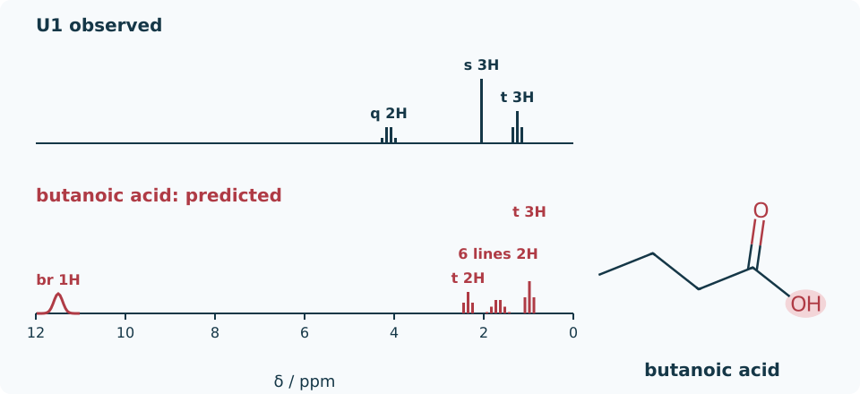{width=82% fig-alt="Observed U1 spectrum above the predicted spectrum of butanoic acid: a broad 1H at 11.5, a triplet 2H at 2.35, a six-line 2H at 1.68 and a triplet 3H at 0.98"}

A candidate earns its place by **predicting** a spectrum. Butanoic acid predicts four signals; U1 has three.

::: {.try}
**Try it:** give two observations that reject butanoic acid. Why doesn't U1's CH₃ triplet help?

::: {.fragment}
No **broad O–H** (IR or ~11.5 ppm), and **no O–CH₂ quartet** or 3H singlet. Both structures end in **CH₃–CH₂–**, so a CH₃ triplet fits both.
:::
:::

::: notes
Turn the candidate into a prediction first, then compare, rather than staring at U1 and hoping. Butanoic acid: CH3 triplet near 1, the middle CH2 as a six-line multiplet because it has five neighbouring H, the CH2 next to C=O as a triplet near 2.3, and the acid H as a broad singlet above 10. The good rejection uses observations the two candidates disagree about. The triplet is a nice trap: it's real evidence for an ethyl end, but both candidates have one. Note that the name on a sample bottle is never evidence; the spectra are.
:::

## Test the rival: 3-hydroxybutan-2-one

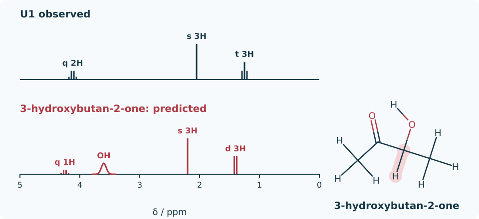{width=82% fig-alt="Observed U1 spectrum above the predicted spectrum of 3-hydroxybutan-2-one: a quartet 1H at 4.25, a broad OH near 3.6, a singlet 3H at 2.20 and a doublet 3H at 1.40"}

This candidate also has a quartet near 4.2 and a singlet near 2. Read the **integrals** and the **methyl pattern**.

::: {.try}
**Try it:** which two features of this prediction contradict U1?

::: {.fragment}
Its quartet is **1H** (a CH on oxygen), not 2H, and its CH₃ is a **doublet**, not a triplet. It also has an O–H that IR didn't see.
:::
:::

::: notes
This is the best example of why one clue isn't enough. Looking only at shifts and "is there a quartet?", this hydroxyketone looks tempting. The integral says the quartet is 1H, so the carbon on oxygen is a CH, not a CH2. The methyl doublet follows from the previous slide: one neighbouring H gives two lines. Its OH adds an IR band U1 doesn't have. 3-Hydroxybutan-2-one, also called acetoin, is a real molecule: it's part of the buttery aroma of butter and some wines, made by yeast and bacteria, which is a nice link back to the smells we started with.
:::

## Making a claim you can defend

| evidence | ethyl ethanoate | butanoic acid | 3-hydroxybutan-2-one | 1,4-dioxane |
|---|---|---|---|---|
| C₄H₈O₂ | ✓ | ✓ | ✓ | ✓ |
| IR: C=O, no O–H | ✓ | ✗ | ✗ | ✗ |
| ¹H: q 2H · s 3H · t 3H | ✓ | ✗ | ✗ | ✗ |
| ¹³C: four signals | ✓ | ✓ | ✓ | ✗ |

"**U1 is best explained by ethyl ethanoate among the candidates tested**: it accounts for every observation and each rival fails at least one independent test."

::: {.try}
**Try it:** why not just write "U1 is ethyl ethanoate, proven"?

::: {.fragment}
**We tested a finite list**, and these spectra are simulated. A real identification also depends on data quality, sample purity and a reference spectrum.
:::
:::

::: notes
The table is the honest summary: every candidate fits the formula, so the formula alone was never going to decide. Point out that 13C alone doesn't separate the first three either; it's the combination that does. The wording of the conclusion matters and is what we ask for in exercises: say what was compared, what fits, and what remains open. In the R part of today's exercise, students plot the simulated ester and acid IR traces from data/ir.csv; the caption must say they're simulated, which is the same honesty applied to a figure. Tomorrow we use exactly this kind of evidence to decide whether a synthesis worked.
:::

## Mistakes we see every year

| mistake | fix |
|---|---|
| including O in the DBE formula | DBE = (2C + 2 − H)/2; O drops out |
| "dip = less absorption" on an IR trace | in **transmittance**, a dip **is** absorption |
| "a quartet means 4 H" | lines count the **neighbours' H**; the integral counts the H |
| comparing tallest lines as H counts | compare **areas** (integrals) |
| "6 carbons but 4 signals, so impossible" | symmetry makes carbons **equivalent** |
| naming a molecule from one IR band | C=O fits many molecules; add NMR and the formula |
| rejecting with a feature both candidates share | use an observation the candidates **disagree** about |

::: notes
Read each mistake aloud and ask for the fix before revealing the column. The quartet one is the most persistent, and the last one is the subtlest: using the ethyl triplet to reject butanoic acid feels right but isn't, because the acid has an ethyl end too. Each row maps to a specific exercise, so students who still make a mistake know where to practise.
:::

## Summary

| concept | key fact |
|---|---|
| DBE | (2C + 2 − H)/2 = rings + π bonds |
| IR | C=O 1650–1800 sharp; O–H broad; acid O–H very broad |
| ¹H shift | further left near O or C=O |
| ¹H integral | area ∝ number of H; formula fixes the total |
| ¹H splitting | n neighbouring H → n + 1 lines |
| ¹³C | one line per carbon environment; heights don't count |
| symmetry | equivalent atoms share a signal |
| a structure | is a hypothesis: predict, compare, reject rivals |

**Next:** using spectra as evidence in synthesis (Day 22). **Practice:** [exercises](exercise.qmd) · [self-check](quiz.qmd)

::: notes
Recite the workflow once: formula and DBE, IR for groups, 1H for fragments (shift, integral, splitting), 13C for the carbon count, then build a candidate and test it against its rivals. Close the loop with the opening: the pear-drop bottle is ethyl ethanoate and the rancid-butter bottle is butanoic acid, and the spectra tell them apart on at least three independent counts. The exercises walk through U1 again step by step; the core problems 1 to 10 are required.
:::
