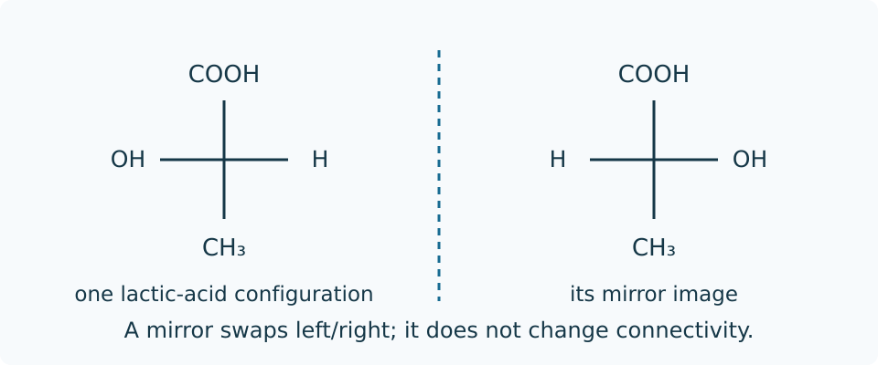

Allow 90 minutes for drawing/model problems and 25 minutes for the R task.
Use models or redraw structures in a standard orientation before assigning a
relationship. Identify connectivity before deciding about chirality.

## 1. Is the difference connectivity or spatial arrangement?

Classify each pair, giving a structural reason:

1. Ethanol and dimethyl ether.
2. Anti and gauche conformations of butane.
3. The two mirror-related lactic-acid drawings below.
4. E-but-2-ene and Z-but-2-ene.

{fig-alt="Mirror-related Fischer drawings of lactic acid."}

::: {.callout-note collapse="true" title="Worked check"}
Pair 1 contains constitutional isomers because oxygen has different neighbours.
Pair 2 contains conformers related by single-bond rotation. Pair 3 contains
enantiomers: same connectivity, mirror-related and nonsuperimposable, with
opposite configuration at the single stereocentre. Pair 4 contains
configurational stereoisomers that are not mirror images, so they are
diastereomers. Ordinary rotation around the intact double bond does not
interconvert them freely.
:::

## 2. Find stereocentres without relying on wedges

Compare CH₃CH(OH)COOH with CH₃CH(OH)CH₃. Draw every substituent at the carbon
bearing OH. Which molecule has a tetrahedral stereocentre there? Does adding
a wedge to the second drawing change your answer?

::: {.callout-tip collapse="true" title="Hint"}
List the complete substituent groups, not just the directly attached atom.
For this first test, ask whether any two groups are identical.
:::

::: {.callout-note collapse="true" title="Worked check"}
Lactic acid has H, OH, CH₃ and COOH at its tetrahedral carbon: four different
groups, so it is a stereocentre. Propan-2-ol has H, OH, CH₃ and CH₃: two groups
are identical, so it is not a stereocentre. A wedge changes how a bond is
represented, not the connectivity or identity of the substituents.
:::

## 3. Assign R/S with an explicit viewing convention

Use the lactic-acid Fischer projection with COOH top, CH₃ bottom, OH left and
H right. State the projection's depth convention. Rank the substituents,
showing how you resolve the tie between the two carbon groups. Trace 1→2→3
and explain any reversal needed before giving the descriptor. Assign the
mirror image as a separate check.

::: {.callout-note collapse="true" title="Worked check"}
Horizontal bonds point toward the viewer; vertical bonds point away. OH is
priority 1 because O outranks C and H. COOH outranks CH₃: for the carbon tie,
the duplicate-atom convention compares O,O,O with H,H,H. H is priority 4.
The apparent 1(left)→2(top)→3(bottom) path is clockwise. Because 4 points toward
the viewer, reverse the simple clockwise assignment: this drawing is **S**.
Its mirror has **R** configuration. Neither descriptor specifies the sign of
measured optical rotation.
:::

## 4. Assign E/Z, or explain why it does not apply

Draw but-2-ene twice, with methyl groups first on the same side and then on
opposite sides of the double bond. Rank substituents separately at each alkene
carbon and assign E/Z. Then test CH₂=CHCH₃ and (CH₃)₂C=CHCH₃. Which can have
an E/Z descriptor at the indicated double bond?

::: {.callout-note collapse="true" title="Worked check"}
For but-2-ene, CH₃ outranks H at both carbons. Methyls on the same side give
Z and on opposite sides E. Propene has two H atoms at the terminal carbon,
so E/Z does not apply. In (CH₃)₂C=CHCH₃, one alkene carbon bears two identical
methyl groups, so E/Z also does not apply. Looking for two different groups
at each end is a prerequisite, not an optional naming detail.
:::

## 5. Test an overall symmetry claim

Draw tartaric acid as a Fischer projection with COOH top and bottom and OH
on the right at both central carbons (H on the left). Identify its two
stereocentres and the relationship between its upper and lower halves.
Explain why “it has two stereocentres, therefore it must be chiral” fails.
What would you need to check before calling another R,S compound meso?

::: {.callout-note collapse="true" title="Worked check"}
This is meso-tartaric acid, with opposite configurations at the two centres
and an internal symmetry relationship between equivalent halves. It is
achiral despite stereocentres. The descriptors alone do not establish meso:
the whole molecule and the equivalence of its substituents must permit the
appropriate symmetry/superimposability. A generic molecule labelled R,S
need not have the same molecular symmetry as tartaric acid.
:::

## 6. R task: distinguish percentage from enantiomeric excess

**Question:** how unbalanced is each supplied two-enantiomer mixture?
The simulated table `data/enantiomers.csv` contains sample identifiers and
percentages of R and S. This model assumes R and S are the only components
being counted and have no missing composition. First check that R% + S% = 100.

For this model, `ee_percent = abs(R_percent - S_percent)`. Report the major
enantiomer too. Predict the ee for E1 (70% R, 30% S) before running the code.

```r
library(readr)
library(dplyr)
library(ggplot2)
mixtures <- read_csv("data/enantiomers.csv", show_col_types = FALSE) |>
  mutate(total_percent = R_percent + S_percent,
         ee_percent = abs(R_percent - S_percent),
         excess = case_when(R_percent > S_percent ~ "R",
                            S_percent > R_percent ~ "S",
                            TRUE ~ "racemic"))
knitr::kable(mixtures, digits = 1)
ggplot(mixtures, aes(sample_id, ee_percent)) +
  geom_col(fill = "#176b91") +
  labs(x = "Sample", y = "Enantiomeric excess (%)") +
  theme_minimal()
```

Write one sentence about each sample, specifying both composition and ee.
If a sample has 80% ee in favour of R, calculate R% and S% by solving
R + S = 100 and R − S = 80. Explain why the graph alone does not establish
sample purity or optical-rotation sign.

::: {.callout-note collapse="true" title="Numerical and chemical check"}
E1 has 40% ee in favour of R; E2 (50:50) is racemic, 0% ee; E3 (95:5) has
90% ee in favour of R. An 80% R ee corresponds to 90% R and 10% S. Enantiomeric
composition does not establish the absence of other chemical contaminants.
Without a validated composition measurement and suitable assumptions this is
only a calculation on supplied data. R/S alone does not give optical-rotation
sign or a biological effect.
:::

## Leave with

A classification of spatial relationships, one fully justified R/S assignment,
valid E/Z tests and a reproducible ee table. Complete the [self-check](quiz.qmd).
Optional reference: selected Solomons chapter 5 sections, using the
[reading guide](../reference/reading.qmd).
