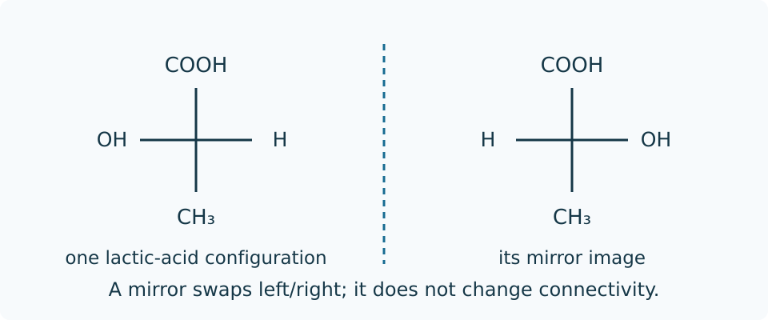
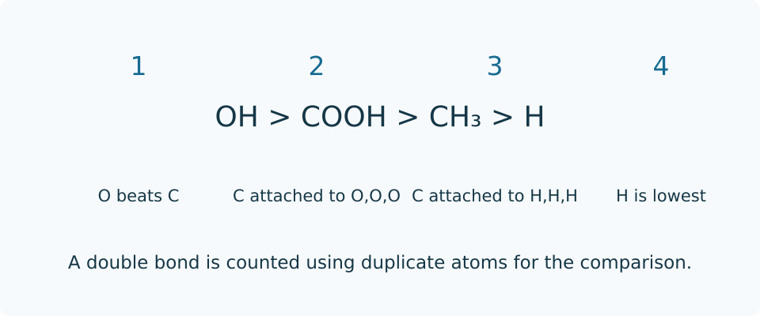
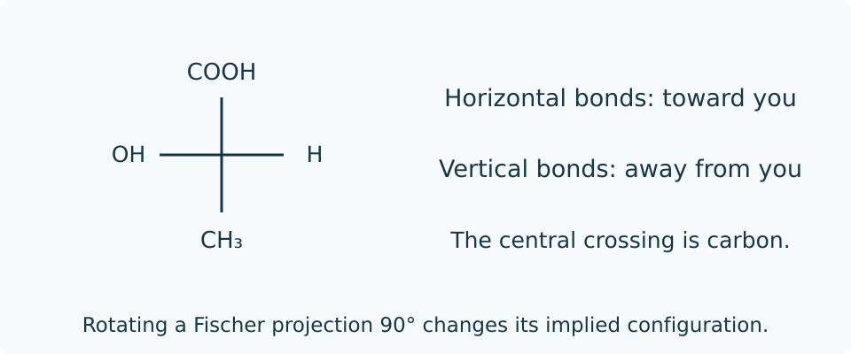
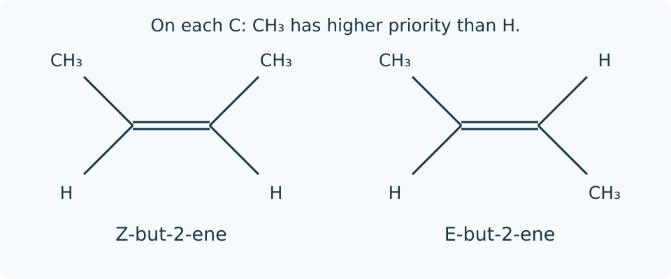
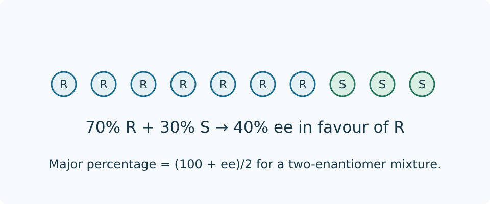
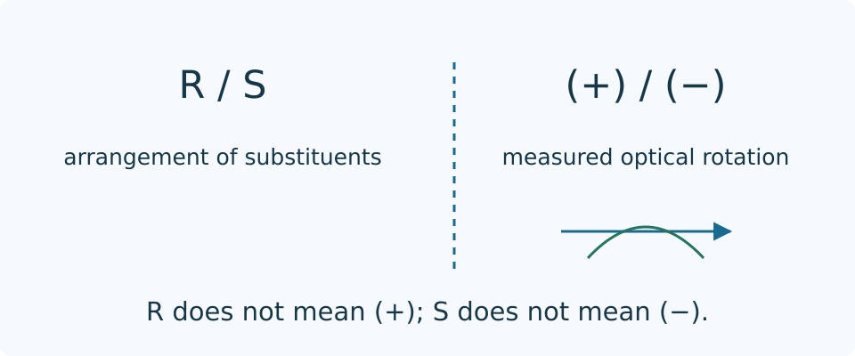

## What will you be able to explain?

- Classify constitutional isomers, conformers and configurational stereoisomers.
- Assign simple R/S and E/Z descriptors with justified priorities.
- Explain chirality, meso compounds and enantiomeric excess.

::: notes
Return to connectivity whenever a 3D problem feels confusing. Introduce Fischer projections explicitly as a convention, not an ordinary flat bond drawing. Use a model to check the worked S assignment.
:::

## First ask what has changed

{width=85% fig-alt="Constitutional-isomer comparison contrasted with butane conformations."}

Different connectivity gives constitutional isomers. Same connectivity requires further spatial comparison.

::: notes
Do not make students assign R/S before they have checked whether both drawings describe the same bonded framework.
:::

## Find four different substituents

{width=85% fig-alt="A tetrahedral lactic-acid carbon attached to COOH, CH3, OH and H."}

This carbon is a stereocentre because its four substituents differ. Wedge bonds point toward you and hashed bonds away.

::: notes
A carbon with two identical methyl groups is not a stereocentre even if drawn with a wedge.
:::

## Compare mirror images

{width=85% fig-alt="Mirror-related Fischer projections of lactic acid."}

Enantiomers are nonsuperimposable mirror images. They have the same connectivity and opposite configuration at this single stereocentre.

::: notes
Physical model manipulation helps distinguish a rotated identical molecule from a nonsuperimposable mirror image.
:::

## Rank by atomic number, then the first difference

{width=85% fig-alt="OH outranks COOH, which outranks CH3, while H is lowest for lactic acid."}

For the carbon tie: the carboxyl carbon compares as O,O,O while the methyl carbon compares as H,H,H under the duplicate-atom convention.

::: notes
Do not rank groups by total mass or total atom count. Compare successive shells until the first difference.
:::

## A Fischer projection encodes depth

{width=85% fig-alt="Horizontal Fischer bonds point toward the viewer and vertical bonds away."}

You must use the projection convention when assigning configuration. A 90° page rotation is not a safe identity operation for a Fischer drawing.

::: notes
A 180° in-plane rotation preserves a Fischer configuration. Changing representation requires preserving the actual 3D positions.
:::

## Use the direction of group four

{width=85% fig-alt="Lactic-acid Fischer projection with OH left and H right is assigned S."}

The apparent 1→2→3 trace is clockwise here, but group 4 points toward you: reverse the assignment to **S**.

::: notes
Have students articulate the final inversion. Blindly mapping clockwise to R fails when group four points forward.
:::

## A pi bond restricts the relevant rotation

{width=85% fig-alt="Z-but-2-ene has methyl groups on the same side; E has them on opposite sides."}

Assign priority separately at each alkene carbon. Higher-priority groups together give Z, opposite give E.

::: notes
E/Z requires two different substituents at each alkene carbon. Propene does not qualify.
:::

## Two stereocentres need not make a chiral molecule

{width=85% fig-alt="Meso-tartaric-acid Fischer projection has an internal symmetry relationship."}

A meso compound is achiral despite stereocentres. Examine the complete molecule, not only each carbon in isolation.

::: notes
The symmetry operation relates identical halves. Do not infer meso simply because a molecule has one R and one S descriptor.
:::

## Distinguish composition from excess

{width=85% fig-alt="Seven R and three S symbols illustrate 70 percent R but 40 percent R enantiomeric excess."}

For a two-enantiomer mixture, $ee=|\%R-\%S|$. Also state which enantiomer is in excess.

::: notes
A 40 percent ee is not 40 percent major enantiomer. The remaining racemic portion contains both forms.
:::

## R/S does not predict the sign of rotation

{width=85% fig-alt="R/S configuration and measured plus/minus optical rotation are distinct descriptors."}

Optical rotation is measured under specified conditions. No general rule maps R to (+) or S to (−).

::: notes
Use this to prevent unsupported claims about biological or sensory effects. Different stereoisomers can behave differently in chiral environments, but the effect must be established.
:::

## What relationships can three structures have?

For a compound with multiple stereocentres, stereoisomers may be enantiomers or diastereomers. Diastereomers are stereoisomers that are not mirror images.

E/Z pairs are also diastereomeric.

## Calculate and explain enantiomeric excess

```r
mixtures <- readr::read_csv("data/enantiomers.csv")
mixtures$ee_percent <- abs(mixtures$R_percent - mixtures$S_percent)
```

Check that R% + S% = 100 before treating the sample as a two-enantiomer mixture.

## A configuration is not a biological outcome

A chiral receptor can distinguish enantiomers. That observation does not tell us, without measurements, which enantiomer binds more strongly or what its effect will be.

## Practise a spatial explanation

Complete the [practice](exercise.qmd) and [self-check](quiz.qmd).

Provisional reference: selected Solomons chapter 5 sections; see the [reading guide](../reference/reading.qmd).
