## About this lecture

Spearmint and caraway (the seeds in rye bread) owe their smell to the same molecule, **carvone**. Same formula, same bonds, same boiling point. The only difference is that one is the **mirror image** of the other, and the smell receptors in your nose can tell.

Today we learn to describe molecules in 3D:

- **Isomer types:** constitutional, conformers, enantiomers, diastereomers
- **Stereocentres** and how to name them **R** or **S**
- **Fischer projections** and the moves you may make with them
- **Two centres, meso compounds** and **E/Z** alkenes
- **Mixtures:** enantiomeric excess, and what R/S does *not* tell you

Yesterday, anti and gauche butane turned into each other by rotation. Today's isomers don't.

::: notes
Open with something students can smell: if you can, bring a pack of spearmint gum and a slice of rye bread. (R)-carvone smells of spearmint and (S)-carvone of caraway. Same atoms, same connectivity, same melting and boiling points; the only difference is handedness, and our olfactory receptors are themselves chiral proteins. That's the theme of the day: a molecule's 3D arrangement is part of its identity. Link to yesterday: conformers (anti/gauche, chair flips) interconvert by rotating single bonds, so they are one compound. Today's stereoisomers can only be interconverted by breaking bonds. Ask the room: "Is your left hand a rotated version of your right?" Let them try to superimpose their hands.
:::

## Four ways two molecules can be related

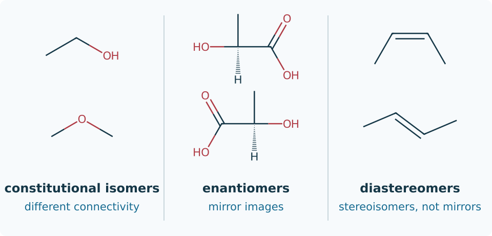{width=72% fig-alt="Three columns: ethanol and dimethyl ether as constitutional isomers; (S)- and (R)-lactic acid as enantiomers; (Z)- and (E)-but-2-ene as diastereomers"}

Ask in order: **same connectivity?** If no, constitutional isomers. If yes, **same by bond rotation?** Then conformers (Day 6). If not, they're stereoisomers: **mirror images** are enantiomers; the rest are **diastereomers**.

::: notes
This is the decision tree for the whole lecture; come back to it at the end. Walk through the three questions in order. Constitutional isomers we met on Day 1 (ethanol and dimethyl ether). Conformers were yesterday's topic and are not drawn here: anti and gauche butane are the same compound. Stereoisomers have the same connectivity but a different 3D arrangement that you can't undo by rotating single bonds. Among stereoisomers, the mirror-image pairs are enantiomers and everything else is a diastereomer. Students often think "diastereomer" means something exotic. It just means "stereoisomer, not mirror image", and E/Z alkenes are the simplest example.
:::

## A stereocentre has four different groups

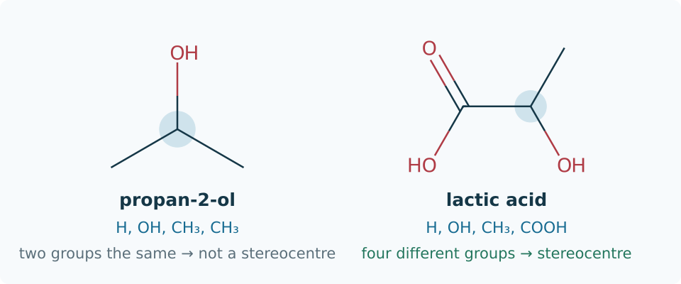{width=66% fig-alt="Propan-2-ol with its central carbon shaded, bearing H, OH and two CH3 groups; lactic acid with its central carbon shaded, bearing H, OH, CH3 and COOH"}

A tetrahedral carbon with **four different groups** is a stereocentre: its mirror image can't be laid on top of it. Two identical groups, and the mirror image is the same molecule.

::: {.try}
**Try it:** someone draws a wedge on one of the H atoms of a CH₂ group. Is that carbon now a stereocentre?

::: {.fragment}
**No.** A wedge shows direction; it can't make two H atoms different.
:::
:::

::: notes
Build a model if you have a kit: a carbon with four different coloured balls, and its mirror image. Try to superimpose them; you can't. Then replace one ball so two are the same colour, and the mirror image now matches. Compare full groups, not only the first atom: in lactic acid both CH3 and COOH start with carbon but are clearly different groups. The try-it targets a very common belief that drawing a wedge "creates" a stereocentre. The drawing describes geometry; whether the carbon is a stereocentre depends only on what's attached.
:::

## Spotting stereocentres in real molecules

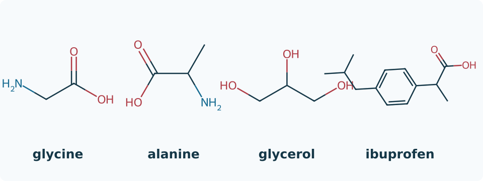{width=70% fig-alt="Plain skeletal structures of glycine, alanine, glycerol and ibuprofen without stereo bonds"}

Check each sp³ carbon: does it carry **four different** groups? CH₂ and CH₃ carbons never do.

::: {.try}
**Try it:** which of these four molecules have a stereocentre?

::: {.fragment}
**Alanine and ibuprofen**, one each. Glycine's carbon has two H; glycerol's middle carbon carries two identical CH₂OH groups.
:::
:::

::: notes
Give students 30 seconds. Teach the shortcut: skip every CH2, CH3, carbonyl carbon and alkene carbon, then look hard at what's left. Glycerol is the trap: the middle carbon has H, OH and two CH2OH arms, and those arms are identical. Ibuprofen is sold as a racemic mixture of two enantiomers; only (S)-ibuprofen blocks the COX enzymes, and the body converts some of the (R) form into (S). Alanine is chiral like every amino acid except glycine; proteins use only the L forms, which is a good bridge to the Week 2 biology examples.
:::

## Enantiomers are mirror images

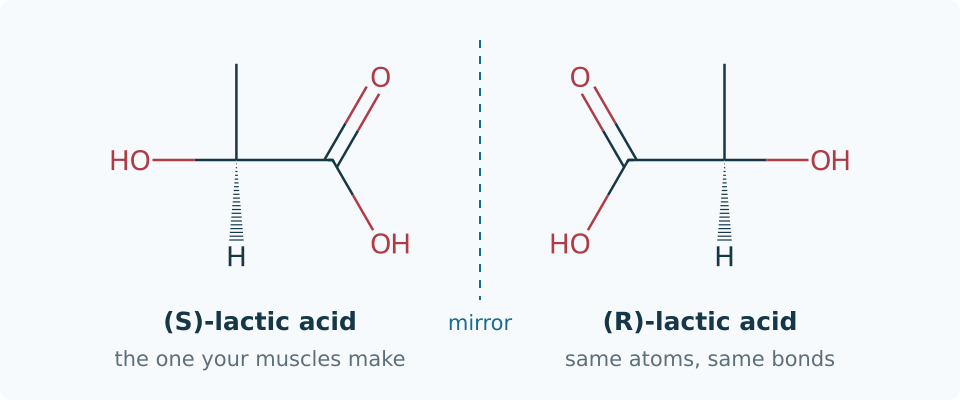{width=80% fig-alt="(S)-lactic acid and its mirror image (R)-lactic acid either side of a dashed mirror line, each with H on a hashed bond"}

**Wedge** = toward you, **hash** = away. Enantiomers have identical boiling points, solubilities and spectra. They differ only in a **chiral** setting: polarised light, an enzyme, a receptor.

::: notes
Read the drawing out loud: OH and COOH in the plane, CH3 in the plane, H pointing back. The mirror flips left and right but keeps the H at the back. Your muscles make (S)-lactic acid (L-lactate) during hard exercise. Stress that the two enantiomers are not "two versions" chemically in a flask of achiral solvent: they boil, melt and dissolve identically, and you can't separate them by distillation. That's why the enzyme and receptor examples are so striking: biology is a chiral environment. Mention that swapping any two groups on a stereocentre gives the enantiomer; we'll use that trick on Fischer projections.
:::

## Naming a stereocentre: rank by atomic number

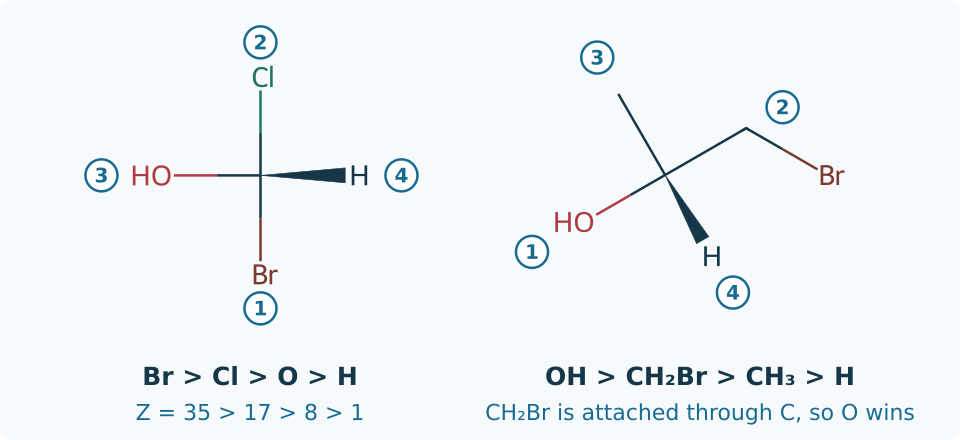{width=74% fig-alt="Bromochloromethanol with priorities Br 1, Cl 2, OH 3, H 4; 1-bromopropan-2-ol with priorities OH 1, CH2Br 2, CH3 3, H 4"}

**Cahn–Ingold–Prelog (CIP) rule 1:** rank the four groups by the **atomic number of the atom attached** to the stereocentre. Higher Z, higher priority. Size of the whole group doesn't matter.

::: notes
The names R and S come from a ranking system named after Cahn, Ingold and Prelog. Rule 1 looks only at the first atom of each group. Left: four different atoms, so it's just a lookup of atomic numbers. Right: the deliberate trap. CH2Br contains bromine, but it's attached through carbon, so it loses to OH, which is attached through oxygen. Ask: "What's attached to the stereocentre?" and make students point at the atom. Many will want to rank CH2Br first because it "has Br in it".
:::

## Breaking a tie: go out one atom

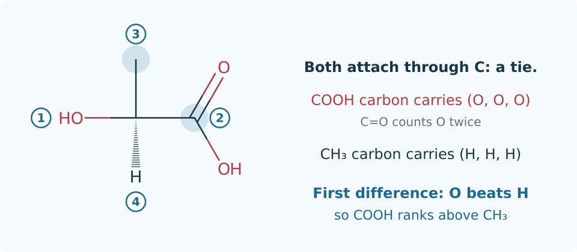{width=64% fig-alt="Lactic acid with priorities OH 1, COOH 2, CH3 3, H 4; the COOH carbon carries O, O, O and the CH3 carbon H, H, H"}

When two groups attach through the same atom, list **what that atom carries** and compare at the first difference. A **double bond counts twice**: C=O gives (O, O).

::: {.try}
**Try it:** which ranks higher, –CH₂OH or –CH(CH₃)₂?

::: {.fragment}
**–CH₂OH.** Its carbon carries (O, H, H); the other carries (C, C, H). Compare the highest first: O beats C.
:::
:::

::: notes
In lactic acid, COOH and CH3 both attach through carbon, so we tie at rule 1. Go one atom further out: list the three atoms on each carbon, sorted from highest to lowest, and compare position by position. COOH carbon: O, O (counted twice for the double bond), O. Methyl: H, H, H. O beats H immediately. The duplicate O is bookkeeping, not an extra real atom. The try-it catches students who count atoms: isopropyl has more carbons, but you compare the highest atom in each set first, and O beats C.
:::

## R or S: look with priority 4 away from you

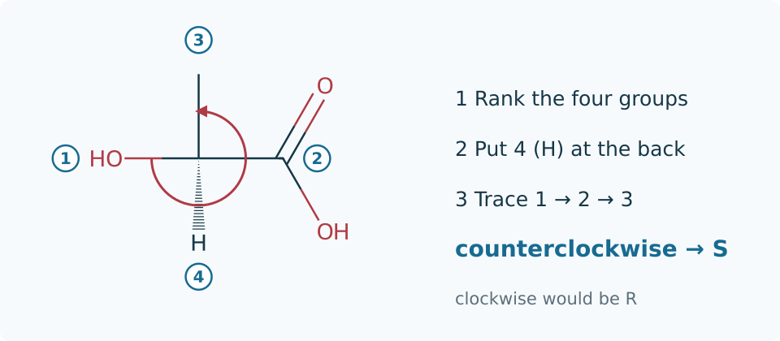{width=78% fig-alt="(S)-lactic acid with H hashed away and a red arrow running counterclockwise from OH (1) to COOH (2) to CH3 (3)"}

With the lowest group pointing away, trace **1 → 2 → 3**. **Clockwise = R** (rectus), **counterclockwise = S** (sinister). This lactic acid is **S**.

::: notes
Use the steering-wheel picture: hold the molecule so priority 4 points away from you like a steering column, then turn the wheel 1 to 2 to 3. Right turn is R, left turn is S. Do the trace live on the slide with your finger. Remind them that the arrow can skip past group 4; only 1, 2 and 3 matter. Then point back at the mirror image two slides ago: same procedure gives clockwise, so R. Every stereocentre in its enantiomer flips.
:::

## When H points toward you, reverse it

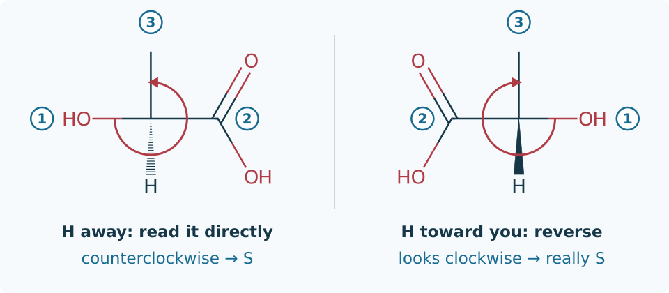{width=80% fig-alt="(S)-lactic acid drawn with H hashed, read counterclockwise as S; the same molecule drawn with H wedged appears clockwise and is reversed to S"}

If priority 4 is on a **wedge**, trace 1 → 2 → 3 anyway and **reverse** the answer. Both drawings show the same (S)-lactic acid.

::: notes
These two drawings are the same molecule viewed from opposite sides. Viewed from the front, the trace looks clockwise; but we're looking at it from the wrong side, with H toward us, so the true answer is the opposite. Students who forget this get exactly the wrong answer, which is the worst kind of mistake because it looks confident. If priority 4 is in the plane, rotate the molecule in your head or swap two groups (which inverts), assign, and invert back. Encourage a quick model check whenever they're unsure.
:::

## Fischer projections: a cross with depth

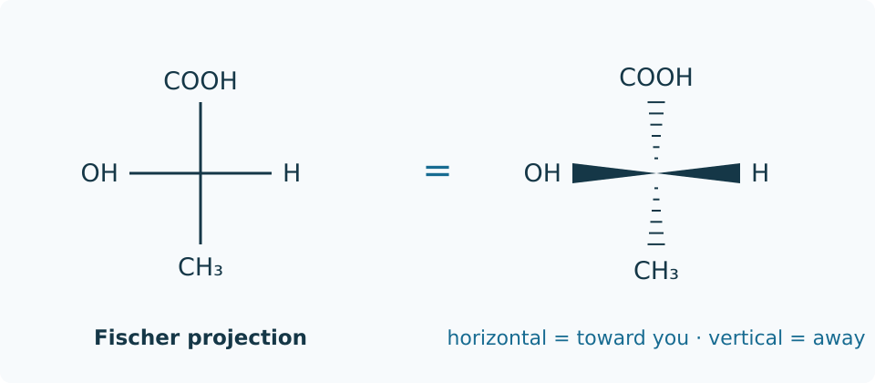{width=78% fig-alt="Fischer projection of lactic acid with COOH top, OH left, H right and CH3 bottom, next to the same molecule with horizontal wedges and vertical hashes"}

A Fischer projection is shorthand for one specific 3D shape: **horizontal bonds come toward you, vertical bonds go away**. The centre of the cross is the stereocentre carbon.

::: notes
Fischer projections come from sugar and amino-acid chemistry, and you'll see them again in biochemistry for D-glucose and L-amino acids. The cross is not a flat molecule. Make a "bow tie" with your arms: horizontal groups hug toward you, vertical groups lean back. Students who treat the cross as a flat drawing will rotate it freely and get the wrong answer, which is the next-but-one slide.
:::

## Reading R/S straight off a Fischer projection

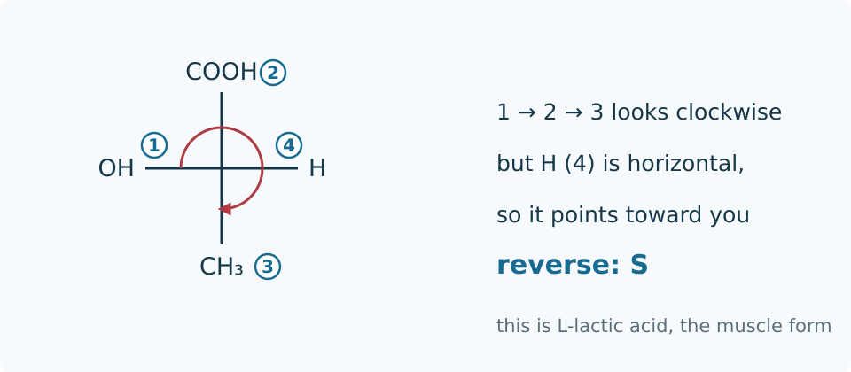{width=64% fig-alt="Fischer projection with OH 1 left, COOH 2 top, CH3 3 bottom and H 4 right; the trace looks clockwise but H is horizontal, so the centre is S"}

If H is on a **horizontal** bond, it points toward you: trace and **reverse**. If H is **vertical**, read the trace directly.

::: {.try}
**Try it:** swap OH and H in this projection. Which configuration do you get?

::: {.fragment}
**R.** One swap of two groups inverts a stereocentre. That's D-lactic acid, the enantiomer.
:::
:::

::: notes
This is the same reversal rule as the wedge drawing, applied to the convention. With H on the right, 1 (left) to 2 (top) to 3 (bottom) runs clockwise, H is toward us, so reverse: S. This is L-lactic acid, the muscle form. The try-it introduces the swap rule: exchanging any two groups gives the enantiomer. It's also a handy trick to move H to a vertical position: swap, read, then reverse once more.
:::

## What you may do to a Fischer projection

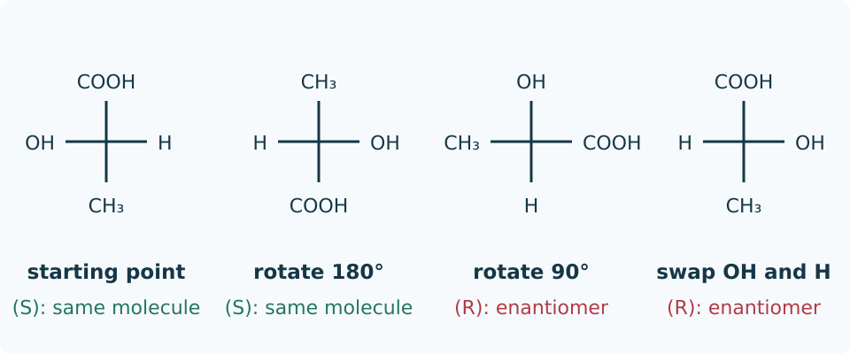{width=74% fig-alt="Four Fischer projections: the starting (S) form; rotated 180 degrees, still S; rotated 90 degrees, now R; OH and H swapped, now R"}

| move | result |
|---|---|
| rotate **180°** in the page | same molecule |
| rotate **90°** | enantiomer (toward/away swap) |
| swap **two** groups | enantiomer |

::: notes
Why does 180 degrees work and 90 not? A 180-degree turn keeps horizontal groups horizontal, so they still point toward you. A 90-degree turn moves the toward-you groups into vertical positions, which the convention reads as away from you, and that inverts the centre. Two swaps cancel, so swapping twice gives back the same molecule. Practise one example together: ask a student to rotate the starting projection 180 degrees aloud, naming each new position, then confirm S. The figure labels were checked by building each projection as a 3D model.
:::

## Two stereocentres: up to four stereoisomers

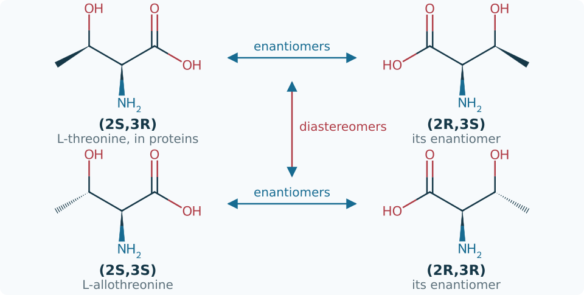{width=64% fig-alt="The four stereoisomers of threonine: (2S,3R) and (2R,3S) as one enantiomer pair, (2S,3S) and (2R,3R) as another, with the pairs related as diastereomers"}

With *n* stereocentres there are at most **2ⁿ** stereoisomers. An enantiomer inverts **every** centre; change only **some** and you get a diastereomer.

::: {.try}
**Try it:** how are (2R,3R)- and (2R,3S)-2-bromo-3-chlorobutane related?

::: {.fragment}
**Diastereomers.** Only one centre changed, so they aren't mirror images. (2S,3S) would be the enantiomer of (2R,3R).
:::
:::

::: notes
Threonine is an essential amino acid, and your proteins use exactly one of these four: (2S,3R), L-threonine. Its enantiomer and the two allothreonines are not used. Unlike enantiomers, diastereomers have different physical properties: different melting points, solubilities and NMR spectra, so they can be separated by ordinary methods. The quick test for the relationship: compare descriptors centre by centre. All flipped means enantiomer; some flipped means diastereomer; none flipped means the same compound.
:::

## Meso: stereocentres but no chirality

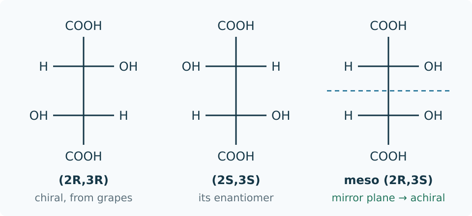{width=66% fig-alt="Fischer projections of (2R,3R)-, (2S,3S)- and meso-tartaric acid; the meso form has a dashed mirror plane between its two identical halves"}

If the two halves are built the same, (R,S) can be its **own** mirror image. That's a **meso** compound: achiral, so tartaric acid has only **three** stereoisomers, not four.

::: {.try}
**Try it:** is (2R,3S)-2-bromo-3-chlorobutane meso?

::: {.fragment}
**No.** The ends differ (Br vs Cl), so no internal mirror plane exists. It's chiral.
:::
:::

::: notes
Tartaric acid from grapes is the (2R,3R) form; Pasteur's famous crystal-sorting experiment in 1848 was on tartrate salts. In the meso Fischer projection, both OH groups are on the same side, and a horizontal mirror plane maps the top half onto the bottom half. The descriptors are R at one centre and S at the other, because a mirror inverts. The key point: opposite descriptors are necessary but not sufficient for meso. You also need two identically substituted halves, as the try-it shows. Ask a student to rotate the meso drawing 180 degrees in the page and confirm it gives the same drawing.
:::

## E and Z: stereoisomers at a double bond

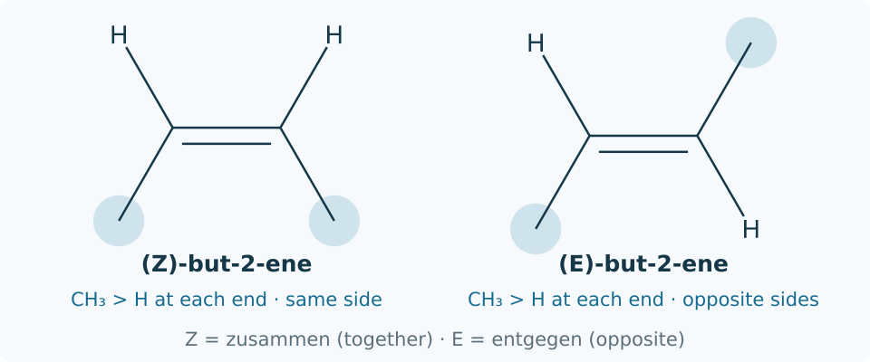{width=76% fig-alt="(Z)-but-2-ene with both methyl groups shaded on the same side; (E)-but-2-ene with the methyl groups on opposite sides"}

A C=C can't rotate, so the groups are fixed. Rank the two groups **at each end separately** with CIP rules. Higher priorities on the **same side = Z**, **opposite = E**.

::: notes
Contrast with yesterday: a single bond rotates freely, so anti and gauche are conformers. Rotating around a double bond would break the pi bond, so (Z)- and (E)-but-2-ene are separate compounds with different boiling points, and they're diastereomers (stereoisomers, not mirror images). For but-2-ene, E/Z matches the older cis/trans names, but E/Z works for any substitution pattern. Biology tie-in: natural fatty acids such as oleic acid have Z double bonds; "trans fats" have E double bonds, which pack differently and behave differently in the body.
:::

## Does this alkene have E and Z forms?

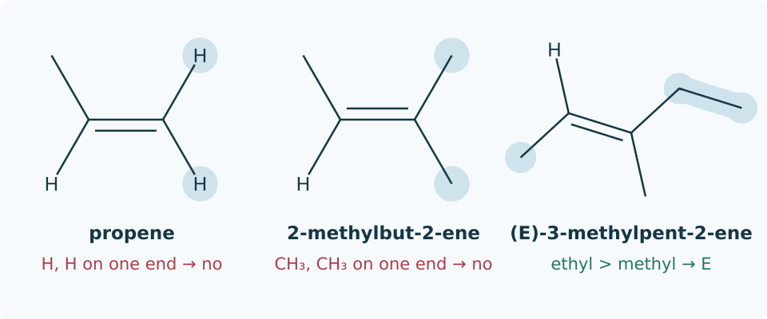{width=70% fig-alt="Propene and 2-methylbut-2-ene each have two identical groups on one alkene carbon, so no E/Z; (E)-3-methylpent-2-ene has ethyl above methyl at one end"}

Each alkene carbon needs **two different groups**. One identical pair at either end, and E/Z doesn't apply.

::: {.try}
**Try it:** can pent-2-ene, CH₃CH=CHCH₂CH₃, exist as E and Z forms?

::: {.fragment}
**Yes.** Each alkene carbon carries one H and one carbon group, so both ends pass the test.
:::
:::

::: notes
Do the test before any ranking. Propene fails because its terminal carbon has two H; 2-methylbut-2-ene fails because one carbon has two methyls. On the right, both ends pass, and the ranking matters: at C3, ethyl beats methyl at the second atom out (C,H,H versus H,H,H), and ethyl is opposite to the methyl on C2, so it's E. This is the same tie-breaking we used for lactic acid, applied to an alkene.
:::

## R/S is not the sign of rotation

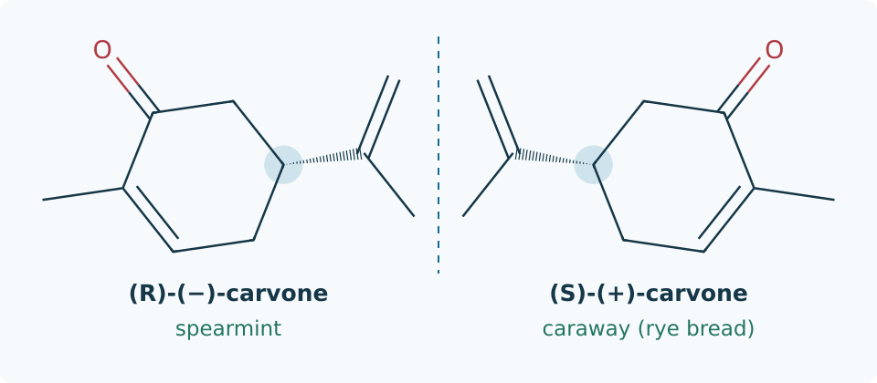{width=62% fig-alt="(R)-(−)-carvone, which smells of spearmint, and its mirror image (S)-(+)-carvone, which smells of caraway"}

Enantiomers rotate plane-polarised light by **equal and opposite** angles: (+) or (−). That sign is **measured**, while R/S is **assigned** from a drawing. No rule connects them: (R)-carvone is (−).

::: {.try}
**Try it:** (R)-carvone rotates light to the left, (−). What does (S)-carvone do?

::: {.fragment}
**Rotates it to the right, (+), by the same angle.** That's an experimental fact about this pair, not something R or S predicts.
:::
:::

::: notes
Back to the opening hook. The two carvones have identical boiling points and IR spectra; a polarimeter shows the only physical difference you can measure in an achiral setting: equal and opposite rotation. Stress the independence of the two labels: you can find R compounds that are (+) and R compounds that are (−). Also, the size and even the sign of rotation depend on solvent, concentration, temperature and wavelength, so a rotation value always needs its conditions. The smell difference comes from chiral receptors, which leads to the next slide.
:::

## Chiral environments tell enantiomers apart

| property | enantiomers | diastereomers |
|---|---|---|
| boiling point, solubility, IR | **identical** | different |
| optical rotation | **equal and opposite** | unrelated |
| reaction with an enzyme or receptor | often **different** | different |
| separated by distillation? | **no** | yes |

A receptor is a chiral "glove": only one hand fits well. Which enantiomer works better must be **measured**; R/S can't predict it.

::: notes
Use the hand-in-glove analogy: your two hands are identical in mass and shape, but only one fits a right glove. Enzymes and receptors are made of L-amino acids, so they're chiral gloves. Examples: (S)-ibuprofen is the active painkiller; the carvones smell different; thalidomide is often quoted, but warn that its enantiomers interconvert in the body, so giving a single enantiomer would not have prevented the harm. The point for the exam: never claim that "R is the active form" or "S is toxic" as a rule. That requires biological data for each compound.
:::

## Enantiomeric excess: how lopsided is a mixture?

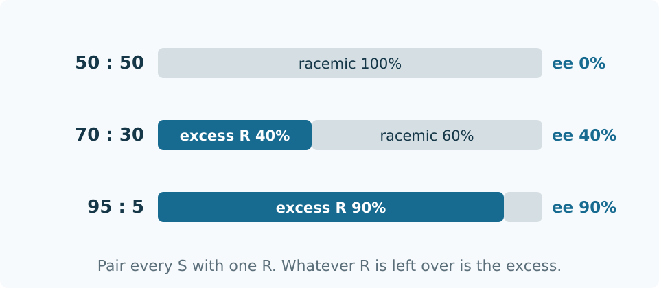{width=60% fig-alt="Bars for 50:50, 70:30 and 95:5 R:S mixtures: 0, 40 and 90 percent enantiomeric excess, with the matched R/S part shown as racemic"}

$$\text{ee} = |\,\%R - \%S\,| \qquad 70{:}30 \rightarrow 40\%\ \text{ee, not } 70\%$$

::: {.try}
**Try it:** a sample has 80% ee in favour of R. What are %R and %S?

::: {.fragment}
**90% R, 10% S.** Solve R + S = 100 and R − S = 80, so 2R = 180.
:::
:::

::: notes
A 50:50 mixture is racemic: its rotations cancel and ee is zero. Pair each S molecule with one R molecule; those pairs behave like a racemate, and the leftover R is the excess. So 70:30 is 40% ee, and the major enantiomer is 70%, not 40%. Drug companies report ee for every single-enantiomer drug. Today's R exercise computes ee from a small data table. Caution: ee says nothing about other impurities such as solvent or water; a 95:5 sample (90% ee) can still be chemically impure.
:::

## Mistakes we see every year

| mistake | fix |
|---|---|
| a wedge on a CH₂ "makes" a stereocentre | check for **four different groups** |
| ranking by size of the whole group | compare the **attached atom** first |
| forgetting to reverse when H is on a wedge | H toward you: **reverse** |
| rotating a Fischer projection by 90° | only **180°** keeps the molecule |
| calling every (R,S) compound meso | the two halves must be **identical** |
| assigning E/Z to propene | each end needs **two different** groups |
| "R means (+)" | rotation is **measured**, not predicted |
| 70% R reported as 70% ee | ee = **70 − 30 = 40%** |

::: notes
Read each mistake aloud and ask the room why it's wrong before revealing the fix. The reversal error and the 90-degree Fischer rotation are the two most common exam errors on this topic, and both give a confident wrong answer. Each row maps onto at least one exercise, so students can find the matching problem to redo.
:::

## Summary

| concept | key fact |
|---|---|
| stereoisomers | same connectivity, different 3D arrangement |
| stereocentre | four **different** groups |
| CIP priority | atomic number, then first difference outward |
| R / S | priority 4 away: clockwise R, counterclockwise S |
| Fischer | horizontal toward, vertical away; 180° only |
| enantiomer / diastereomer | all centres flipped / some flipped |
| meso | stereocentres + mirror plane = achiral |
| E / Z | high priorities same side Z, opposite E |
| ee | \|%R − %S\|; not linked to (+)/(−) |

**Next:** curved arrows and how electrons move in reactions (Day 8). **Practice:** [exercises](exercise.qmd) · [self-check](quiz.qmd)

::: notes
Recite the workflow once: is it a stereocentre? Rank the groups. Put 4 at the back. Trace and, if needed, reverse. Then go back to the decision tree on slide two and classify the opening pair: the two carvones are enantiomers, identical except in a chiral environment like your nose. Tomorrow we start mechanisms with curved arrows; stereochemistry returns in Week 3, when we ask whether a reaction keeps, inverts or scrambles a stereocentre. The exercises' core problems are required; the transfer problems are optional.
:::
