## What should you be able to explain?

Classify isomer relationships; justify simple R/S and E/Z; explain meso symmetry and ee.

::: notes
45-minute budget: connectivity and candidate centres5 min; mirror relationships/CIP ranking8 min with a60-second ranking attempt; Fischer depth and staged R/S10 min including a90-second drawing; E/Z6 min including a60-second test; meso/whole-molecule symmetry5 min; composition/ee6 min with a60-second calculation; rotation/biological-evidence limits3 min; exit2 min. Total45 min with all checks inside the session.

Use the slide pace flexibly: concrete worked operations deserve more time than brief resolved checks. The intended outcome is an explainable chemical argument,not a slide count.
:::

## Bring these tools into the room

Name the bonded neighbours first. Use an explicit wedge/dash or projection convention before assigning a spatial descriptor.

::: notes
Use a quick spoken diagnostic; do not spend an additional unscheduled revision block. Revisit a missing convention at its worked example.
:::

## Classify connectivity before spatial relationships

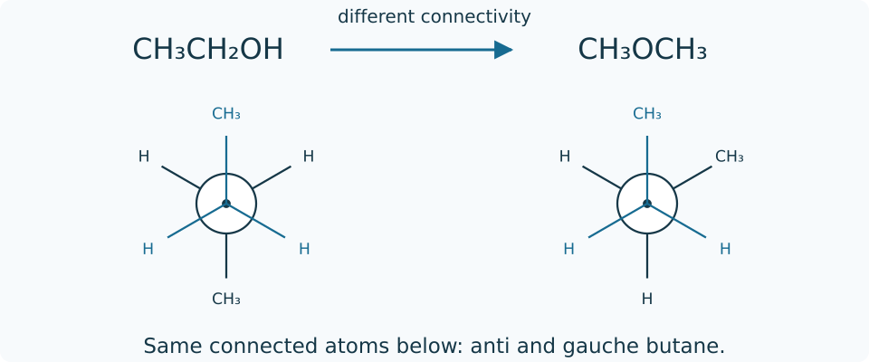{width=82% fig-alt="Classify connectivity before spatial relationships"}

Which pair differs in bonded neighbours, and which pair differs only by rotation?

::: notes
Begin this chemical argument with the displayed structure. Ask for a concrete atom, bond, label or observation rather than the topic name. Keep the first prediction brief.
:::

## Test four substituents rather than a wedge

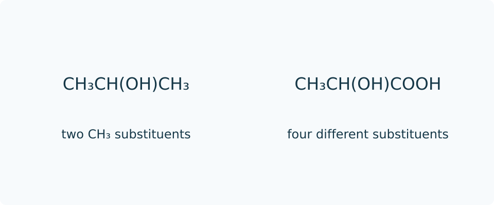{width=82% fig-alt="Test four substituents rather than a wedge"}

Propan-2-ol has two identical methyl groups; lactic acid has four different groups at its alcohol carbon.

## State what a complete assignment needs

{width=82% fig-alt="State what a complete assignment needs"}

Identify four substituents, their priorities and a valid 3D representation before giving an R/S label.

## Predict: wedge drawn on a CH₂ carbon

Does adding a wedge make a carbon bearing two H atoms a simple stereocentre?

::: notes
Give 15–20 seconds for an individual prediction or a small drawing. Ask one student to state the rule they used; resolve on the next slide within this same timed block.
:::

## Resolve: identical groups still match

A drawing convention cannot make two H substituents different. Four different substituents are required for this simple centre.

::: notes
Use the explicit answer to diagnose the named misconception. Move on once students can state the rule; the practice page provides further worked attempts.
:::

## Find the candidate stereocentre

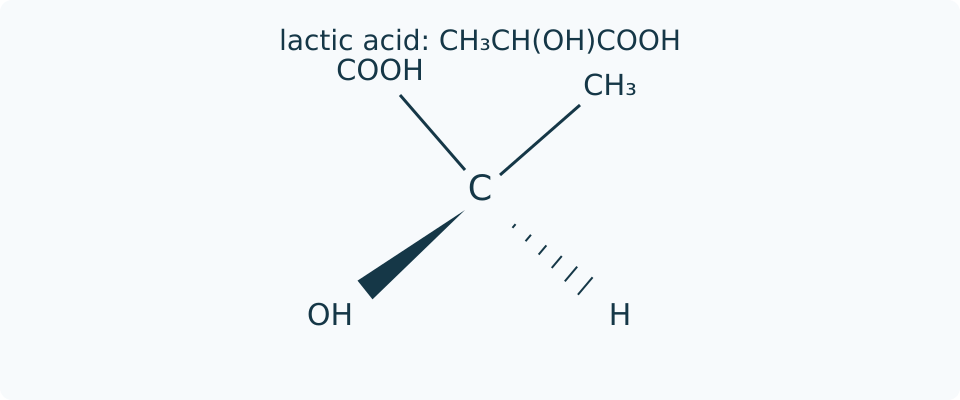{width=82% fig-alt="Find the candidate stereocentre"}

At lactic acid carbon, list OH, H, CH₃ and COOH without assigning priorities yet.

::: notes
Begin this chemical argument with the displayed structure. Ask for a concrete atom, bond, label or observation rather than the topic name. Keep the first prediction brief.
:::

## Apply atomic number at the first shell

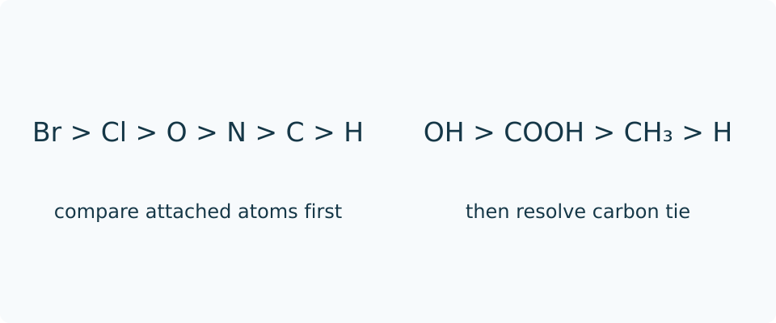{width=82% fig-alt="Apply atomic number at the first shell"}

Br outranks Cl, O outranks N, and O outranks C. Total substituent size is not the first rule.

## Resolve the two-carbon tie

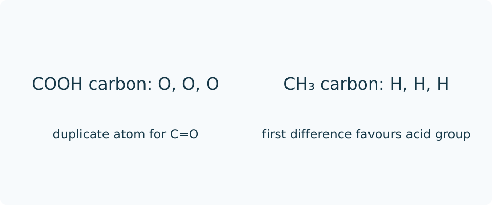{width=82% fig-alt="Resolve the two-carbon tie"}

The COOH carbon compares as O,O,O; the CH₃ carbon as H,H,H. The first difference gives COOH higher priority.

## Predict: which ranks higher, OH or COOH?

Compare the directly attached atoms, not the total number of O atoms in each group.

::: notes
Give 15–20 seconds for an individual prediction or a small drawing. Ask one student to state the rule they used; resolve on the next slide within this same timed block.
:::

## Resolve: OH outranks COOH

OH attaches through O; COOH attaches through C. Atomic number settles this comparison immediately.

::: notes
Use the explicit answer to diagnose the named misconception. Move on once students can state the rule; the practice page provides further worked attempts.
:::

## Compare the mirror-related molecules

{width=82% fig-alt="Compare the mirror-related molecules"}

Their connectivity matches. Can their spatial arrangements be superimposed without changing the molecule?

::: notes
Begin this chemical argument with the displayed structure. Ask for a concrete atom, bond, label or observation rather than the topic name. Keep the first prediction brief.
:::

## Inspect the left-OH Fischer drawing

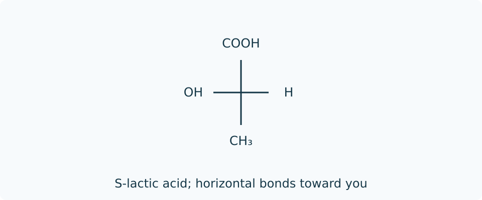{width=82% fig-alt="Inspect the left-OH Fischer drawing"}

COOH top, CH₃ bottom, OH left and H right is one defined configuration.

## Enantiomers are nonsuperimposable mirrors

{width=82% fig-alt="Enantiomers are nonsuperimposable mirrors"}

For this one-centre molecule, the two mirror configurations are an enantiomeric pair.

## Inspect the right-OH Fischer drawing

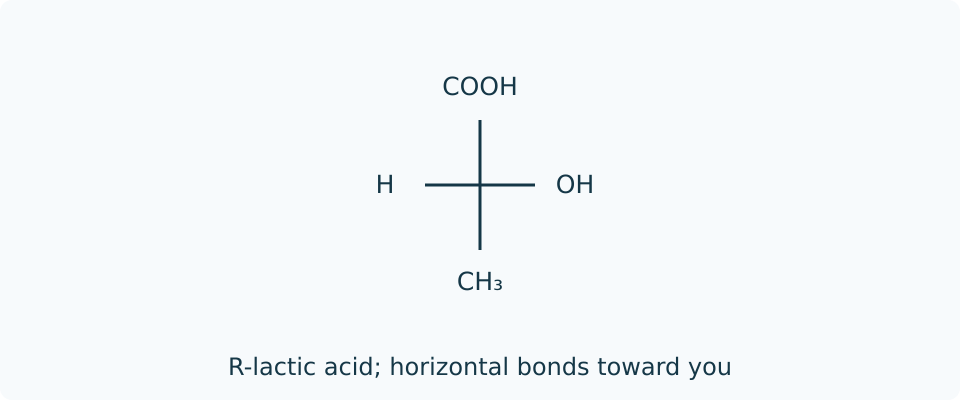{width=82% fig-alt="Inspect the right-OH Fischer drawing"}

Swapping OH and H gives the opposite configuration while retaining connectivity.

## Predict: do all mirror drawings represent different molecules?

Consider a molecule with two identical substituents at the supposed centre.

::: notes
Give 15–20 seconds for an individual prediction or a small drawing. Ask one student to state the rule they used; resolve on the next slide within this same timed block.
:::

## Resolve: a mirror can be superimposable

Achiral molecules can coincide with their mirror images. Test the full arrangement rather than declaring every mirror drawing an enantiomer.

::: notes
Use the explicit answer to diagnose the named misconception. Move on once students can state the rule; the practice page provides further worked attempts.
:::

## Use duplicate atoms as comparison bookkeeping

{width=82% fig-alt="Use duplicate atoms as comparison bookkeeping"}

The C=O bond contributes duplicate O entries in the CIP comparison; it does not create extra real oxygen atoms.

## Try a different attached-atom set

{width=82% fig-alt="Try a different attached-atom set"}

For directly attached Br, Cl, C and H, priority follows decreasing atomic number.

## Predict: does the largest-looking group always win?

Compare a directly attached O with a carbon attached to several heavier neighbours.

::: notes
Give 15–20 seconds for an individual prediction or a small drawing. Ask one student to state the rule they used; resolve on the next slide within this same timed block.
:::

## Resolve: start at the attachment atom

An attached O outranks an attached C in this ordinary comparison, regardless of the drawn group size farther away.

::: notes
Use the explicit answer to diagnose the named misconception. Move on once students can state the rule; the practice page provides further worked attempts.
:::

## Use the Fischer depth convention

{width=82% fig-alt="Use the Fischer depth convention"}

Horizontal bonds point toward you; vertical bonds point away. Do not read this as an ordinary flat cross.

::: notes
Begin this chemical argument with the displayed structure. Ask for a concrete atom, bond, label or observation rather than the topic name. Keep the first prediction brief.
:::

## Rotate the Fischer drawing by 180°

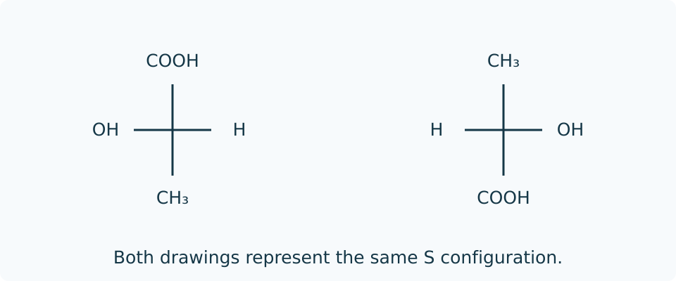{width=82% fig-alt="Rotate the Fischer drawing by 180°"}

Both the positions and group labels move. The example preserves the same S configuration.

## Exchange exactly one pair

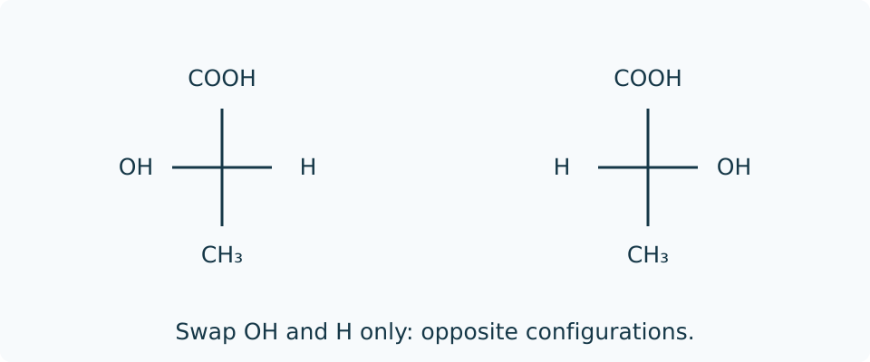{width=82% fig-alt="Exchange exactly one pair"}

Swapping H and OH alone inverts this centre. Keep the other two groups fixed while checking.

## Predict: safe to rotate a Fischer by 90°?

A quarter-turn on the page would exchange which bonds the convention treats as toward and away.

::: notes
Give 15–20 seconds for an individual prediction or a small drawing. Ask one student to state the rule they used; resolve on the next slide within this same timed block.
:::

## Resolve: not an identity operation

A 90° Fischer rotation changes its implied configuration. Use a valid 3D transformation rather than page rotation alone.

::: notes
Use the explicit answer to diagnose the named misconception. Move on once students can state the rule; the practice page provides further worked attempts.
:::

## Trace the S example in stages

{width=82% fig-alt="Trace the S example in stages"}

With OH left, COOH top and CH₃ bottom, 1→2→3 appears clockwise.

## Reverse when group four points forward

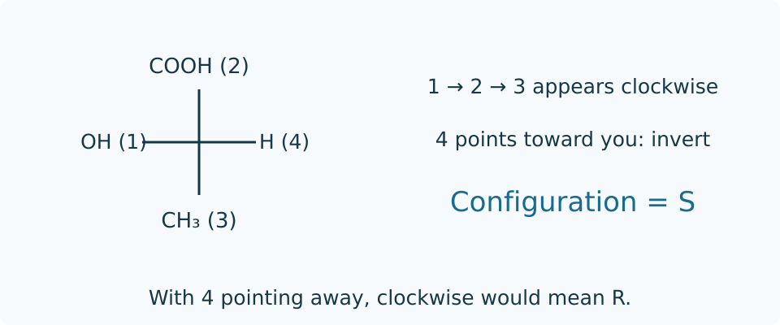{width=82% fig-alt="Reverse when group four points forward"}

In this Fischer H is horizontal, so toward the viewer. Invert the apparent clockwise result to S.

## Predict: clockwise with group four away

If a valid representation puts priority four behind the page, what does clockwise 1→2→3 mean?

::: notes
Give 15–20 seconds for an individual prediction or a small drawing. Ask one student to state the rule they used; resolve on the next slide within this same timed block.
:::

## Resolve: that orientation gives R

Clockwise gives R only with group four away; counterclockwise then gives S. State the viewing condition.

::: notes
Use the explicit answer to diagnose the named misconception. Move on once students can state the rule; the practice page provides further worked attempts.
:::

## Check both ends of the double bond

{width=82% fig-alt="Check both ends of the double bond"}

E/Z requires two different substituents at each alkene carbon before priorities are compared.

::: notes
Begin this chemical argument with the displayed structure. Ask for a concrete atom, bond, label or observation rather than the topic name. Keep the first prediction brief.
:::

## Assign higher-priority groups together

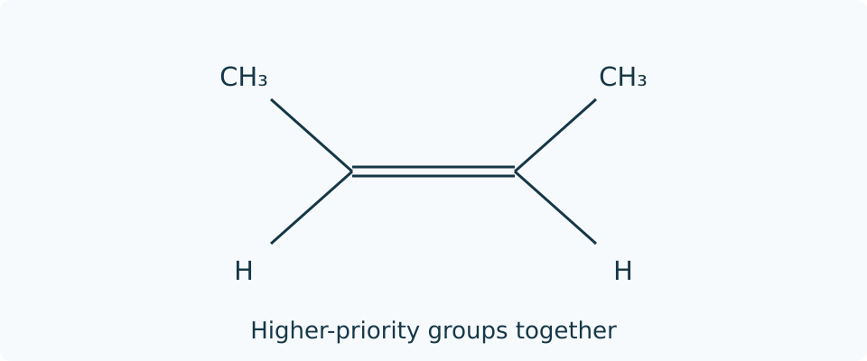{width=82% fig-alt="Assign higher-priority groups together"}

In but-2-ene, methyl outranks H at both ends. Same-side methyl groups give Z.

## The relevant arrangement is configurational

{width=82% fig-alt="The relevant arrangement is configurational"}

Ordinary rotation around an intact C=C is restricted; E/Z is not an anti/gauche conformer label.

## Assign higher-priority groups opposite

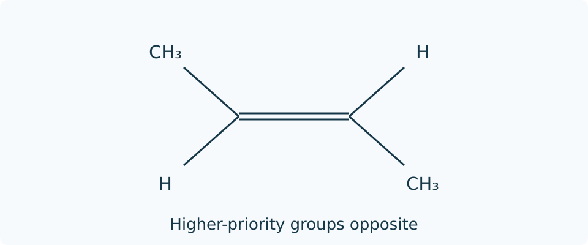{width=82% fig-alt="Assign higher-priority groups opposite"}

Opposite methyl groups give E-but-2-ene. Each end is ranked independently.

## Predict: can CH₂=CHCH₃ be E or Z?

Inspect the two substituents attached to the terminal double-bond carbon.

::: notes
Give 15–20 seconds for an individual prediction or a small drawing. Ask one student to state the rule they used; resolve on the next slide within this same timed block.
:::

## Resolve: propene fails the two-different-groups test

The terminal carbon has H and H. No E/Z descriptor applies to that double bond.

::: notes
Use the explicit answer to diagnose the named misconception. Move on once students can state the rule; the practice page provides further worked attempts.
:::

## Look beyond individual centres

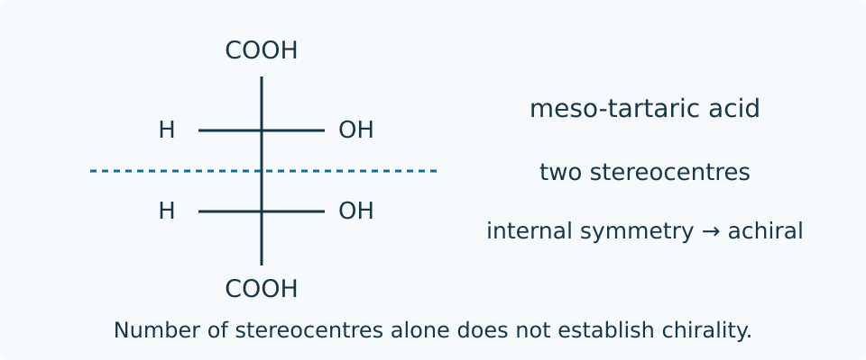{width=82% fig-alt="Look beyond individual centres"}

The meso example has stereocentres yet its overall molecule is achiral.

::: notes
Begin this chemical argument with the displayed structure. Ask for a concrete atom, bond, label or observation rather than the topic name. Keep the first prediction brief.
:::

## Mirror every centre in an unsymmetrical framework

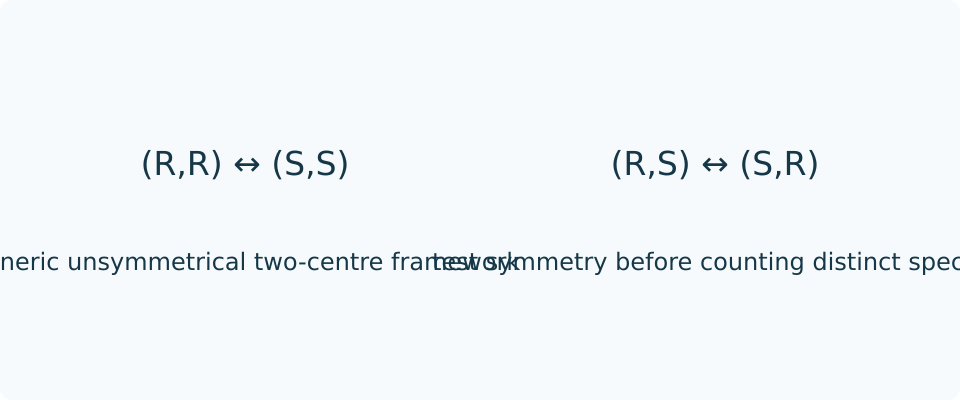{width=82% fig-alt="Mirror every centre in an unsymmetrical framework"}

A generic (R,R) mirror is (S,S). Symmetry must be checked before counting distinct species.

## A meso relationship needs complete symmetry

{width=82% fig-alt="A meso relationship needs complete symmetry"}

Opposite descriptors alone do not establish a meso compound. The connected groups must permit the relevant superimposition.

## Inspect equivalent tartaric-acid halves

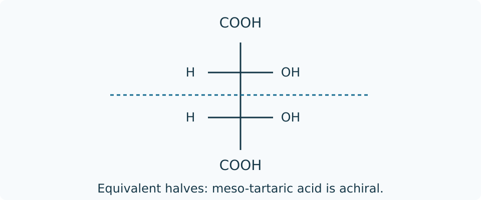{width=82% fig-alt="Inspect equivalent tartaric-acid halves"}

The displayed COOH-terminated Fischer has an internal symmetry relationship and is meso.

## Predict: is every R,S molecule meso?

What if its two ends or substituents differ, so the halves cannot be exchanged by symmetry?

::: notes
Give 15–20 seconds for an individual prediction or a small drawing. Ask one student to state the rule they used; resolve on the next slide within this same timed block.
:::

## Resolve: descriptors alone are insufficient

An unsymmetrical R,S molecule can be chiral. Evaluate the full structure and its relationship to its mirror.

::: notes
Use the explicit answer to diagnose the named misconception. Move on once students can state the rule; the practice page provides further worked attempts.
:::

## Read composition before excess

{width=82% fig-alt="Read composition before excess"}

Seven R and three S species represent 70% R, not 70% ee.

::: notes
Begin this chemical argument with the displayed structure. Ask for a concrete atom, bond, label or observation rather than the topic name. Keep the first prediction brief.
:::

## Use a racemic baseline

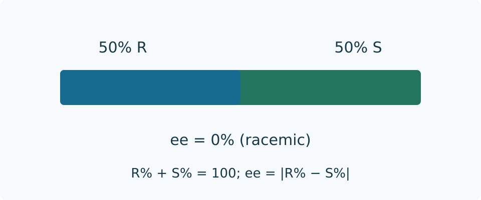{width=82% fig-alt="Use a racemic baseline"}

Equal 50/50 populations have zero ee. There is no major enantiomer.

## Subtract the two percentages

{width=82% fig-alt="Subtract the two percentages"}

For 70/30, the excess is 40 percentage points in favour of R; the rest can be viewed as a racemic portion.

## Translate 70/30 into a bar

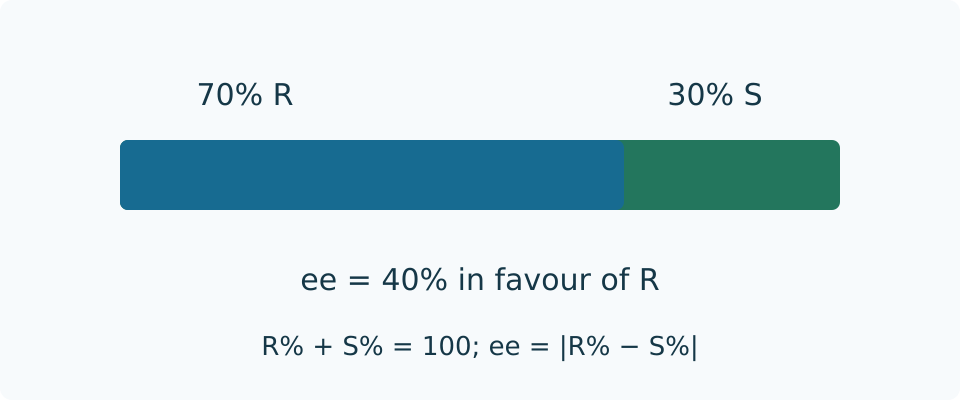{width=82% fig-alt="Translate 70/30 into a bar"}

The full bar is 100% composition; the difference between the R and S portions gives ee.

## Predict: 80% ee in favour of R

Solve R+S=100 and R−S=80 before consulting the answer.

::: notes
Give 15–20 seconds for an individual prediction or a small drawing. Ask one student to state the rule they used; resolve on the next slide within this same timed block.
:::

## Resolve: 90% R and 10% S

Add the equations to obtain 2R=180. An ee value is not the same as the major-enantiomer percentage.

::: notes
Use the explicit answer to diagnose the named misconception. Move on once students can state the rule; the practice page provides further worked attempts.
:::

## Separate configuration from a measurement

{width=82% fig-alt="Separate configuration from a measurement"}

R/S describes geometry under a priority convention; (+)/(−) describes measured optical rotation.

::: notes
Begin this chemical argument with the displayed structure. Ask for a concrete atom, bond, label or observation rather than the topic name. Keep the first prediction brief.
:::

## Read the two labels independently

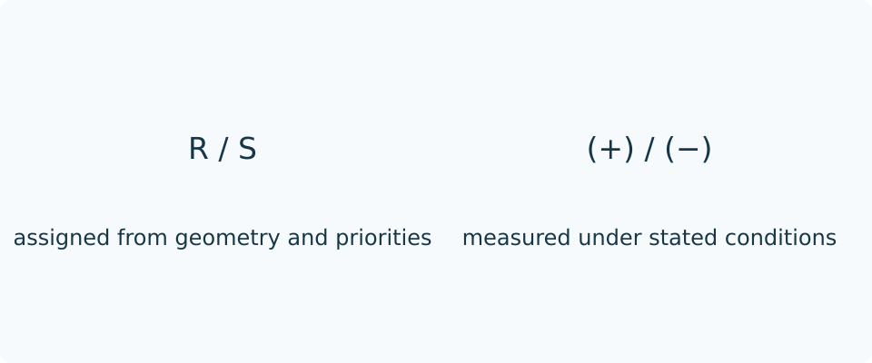{width=82% fig-alt="Read the two labels independently"}

There is no general rule that R means (+), or S means (−). The rotation also depends on specified conditions.

## Chiral recognition needs evidence

{width=82% fig-alt="Chiral recognition needs evidence"}

Enantiomers can interact differently with a chiral receptor. The R/S label does not predict which has the larger effect.

## Keep the comparison conditions stated

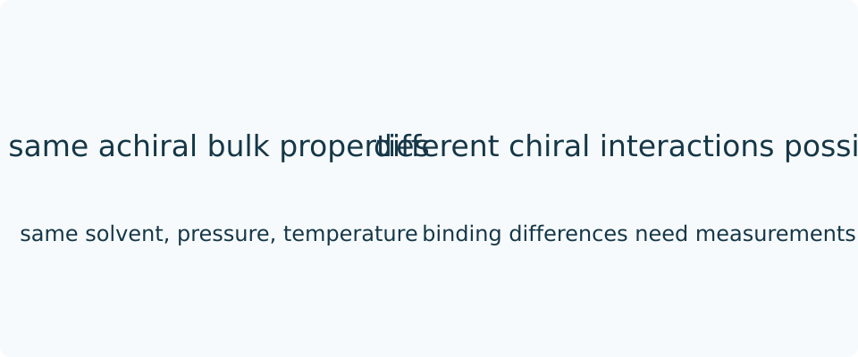{width=82% fig-alt="Keep the comparison conditions stated"}

Enantiomers share ordinary properties in an achiral environment but can differ in a chiral one; an actual effect requires data.

## Predict: can ee prove chemical purity?

A sample is 95:5 R:S among its measured enantiomeric components. Could other contaminants still be present?

::: notes
Give 15–20 seconds for an individual prediction or a small drawing. Ask one student to state the rule they used; resolve on the next slide within this same timed block.
:::

## Resolve: composition is not total purity

Enantiomeric composition answers a restricted question. Other molecules, water or solvent are not excluded by the 95:5 ratio.

::: notes
Use the explicit answer to diagnose the named misconception. Move on once students can state the rule; the practice page provides further worked attempts.
:::

## Combine the tools in one explanation

Compare lactic-acid configurations and a two-enantiomer mixture without inferring optical-rotation sign or biological effect.

::: notes
Take a 30-second sketch or explanation, then ask for one observation and the reason linking it to the conclusion. This is included in the 45-minute session.
:::

## Your next independent work

Use the [exercises](exercise.qmd), then the [self-check](quiz.qmd). Required core problems and optional transfer work are labelled separately.

## One-sentence exit explanation

Write one chemical claim, the feature that supports it and one limit of the inference.

The [reading guide](../reference/reading.qmd) offers supplementary explanations.

::: notes
Collect one sentence or hear one example. Stop at 45 minutes; do not append another tutorial to the lecture.
:::
