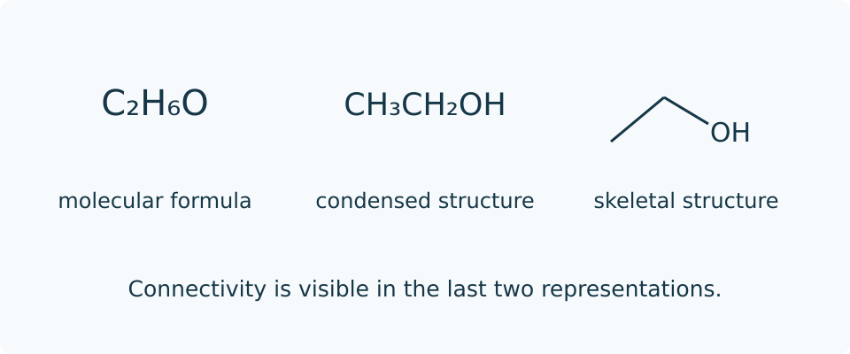

Allow 60–75 minutes for the drawing problems and 30 minutes for the report
calculation. Work with paper or a structure editor; R is used only when it helps
with an ordinary amount calculation.

## Before you start

A skeletal drawing normally omits carbon symbols and hydrogens bonded to
carbon. Unlabelled line endpoints and corners stand for carbon. Heteroatoms
such as O and N are labelled. Unless indicated otherwise, use ordinary neutral
valences: four bond orders for C, three for N and two for O. Show charges when
those patterns change. An explicit charge always needs an electron-count check.

{fig-alt="Ethanol in molecular, condensed and skeletal representations."}

## 1. Recover the hidden atoms

Draw an unbranched four-segment zigzag with only single bonds. Number every
carbon, write CH₃ or CH₂ at each carbon, and obtain the molecular formula.
Now change the central C2–C3 bond to a double bond without changing connectivity.
Which hydrogen counts change? What is the new formula? This new structure
is pent-2-ene; leave E/Z unspecified for now.

::: {.callout-tip collapse="true" title="Hint"}
Four segments connect five carbons. A carbon attached to two other carbons by
single bonds needs two H atoms. Changing a single bond to a double uses one
additional valence at each end of that bond.
:::

::: {.callout-note collapse="true" title="Worked check"}
The saturated chain is CH₃CH₂CH₂CH₂CH₃, C₅H₁₂. Introducing C2=C3 gives
CH₃CH=CHCH₂CH₃, C₅H₁₀. C2 and C3 each lose one attached H in the formula
comparison; no carbon atom is removed. This is a comparison of structures,
not a claim that editing a drawing is an experimental synthetic method.
:::

## 2. Tell identity from isomerism

Write Lewis or expanded structural drawings for CH₃CH₂OH and CH₃OCH₃. Count
all atoms and list oxygen's neighbours in each. Explain why turning the first
drawing around cannot make it identical to the second. Then redraw ethanol
with the OH at the left; is that a third compound?

::: {.callout-note collapse="true" title="Worked check"}
Both molecules have C₂H₆O, but the ethanol oxygen is connected to C and H,
while ether oxygen is connected to two C atoms. Changing the view does not
change those neighbours, so they are constitutional isomers. Drawing ethanol
as HOCH₂CH₃ leaves its connectivity unchanged and does not create a third
compound. Both neutral oxygens have two bonds and two lone pairs.
:::

## 3. Read branches and functional groups

For each condensed structure, draw the connected atoms, identify the functional
group and label every carbon with its attached H count:

1. CH₃CH₂CH₂OH
2. CH₃C(=O)CH₃
3. CH₃C(=O)OH
4. CH₃C(=O)OCH₃
5. CH₃CH₂NH₂

Name the simple structures where you can. Which examples contain a carbonyl?
Which have an O–H bond? Which contain an ester rather than an ether alone?

::: {.callout-tip collapse="true" title="Hint"}
`C(=O)` puts a double-bonded oxygen on that carbon. In `C(=O)OCH₃`, the
single-bonded O is connected to the carbonyl carbon and the methyl carbon.
:::

::: {.callout-note collapse="true" title="Worked check"}
The groups are alcohol (propan-1-ol), ketone (propanone), carboxylic acid
(ethanoic acid), ester (methyl ethanoate) and amine (ethanamine/ethylamine).
Examples 2–4 have a carbonyl; examples 1 and 3 have O–H. Example 4 is the
ester: the oxygen lies next to a carbonyl. A carbonyl carbon in these examples
has no H except where the drawing explicitly allows one, as in an aldehyde.
The carbon totals are 3, 3, 2, 3 and 2 respectively.
:::

## 4. Audit an oxygen and a carbon

Draw water, hydroxide and hydronium with all oxygen lone pairs. Calculate formal
charge using six valence electrons for O. Next, inspect a student's neutral
carbon drawn with one C=O double bond, three C–H single bonds and one C–C
single bond. Explain the error and give one valid carbonyl-carbon bonding
pattern instead.

::: {.callout-note collapse="true" title="Worked check"}
Water has two O bonds/two lone pairs/charge 0. Hydroxide has one bond/three
lone pairs/charge −1. Hydronium has three bonds/one lone pair/charge +1.
The proposed carbon has a bond-order sum of six and violates ordinary
second-row-carbon valence. In ethanal, CH₃C(=O)H, the carbonyl carbon has
one C–C bond, one C–H bond and the C=O double bond, totalling four.
:::

## 5. R task: what amount did the balance give us?

**Chemical question:** how many moles are represented by a measured mass?
Use the supplied relationship `amount_mol = mass_g / molar_mass_g_mol`.
The molar mass has units g/mol; the division leaves mol. Multiply mol by
1000 to obtain mmol. Molar masses are supplied, not memorised.

Download and extract the [student project](../reference/data.qmd). Open its
RStudio project, then open `report.Rmd`. Keep input CSV files in `data/`.
The table `data/amounts.csv` is a simulated teaching amount table; it is not
a reaction protocol. First work the salicylic-acid row by hand: 1.3812 g at
138.12 g/mol should give 0.01000 mol.

```r
library(readr)
library(dplyr)
amounts <- read_csv("data/amounts.csv", show_col_types = FALSE) |>
  mutate(amount_mol = mass_g / molar_mass_g_mol,
         amount_mmol = amount_mol * 1000)
knitr::kable(amounts, digits = 4)
```

Predict whether doubling a mass at fixed molar mass doubles the amount. Change
an input in a copied R object, not in the raw CSV, and check. Add a sentence
explaining what mmol measures. Knit the report from a fresh R session; an
unrun object in the console should not be required.

::: {.callout-note collapse="true" title="Numerical and chemical check"}
Salicylic acid gives 10.00 mmol. With the supplied second row, 1.53135 g of
acetic anhydride at 102.09 g/mol gives 15.00 mmol. Doubling either mass doubles
its amount. These amounts alone do not select the limiting reagent: that
requires the balanced reaction's stoichiometric coefficients, introduced later.
The unit mmol counts chemical amount, not volume, concentration or number of
independent experiments.
:::

## Leave with

Five checked structural drawings, an oxygen-charge audit and a report table
whose amounts agree with a manual calculation. Complete the
[self-check](quiz.qmd), then use these representation skills in the
[properties unit](../properties/exercise.qmd).
