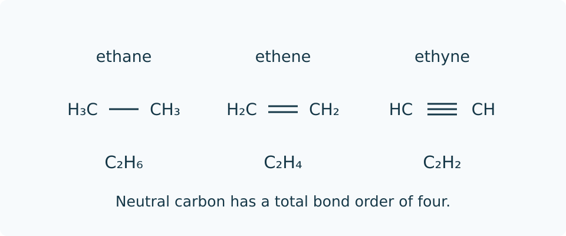
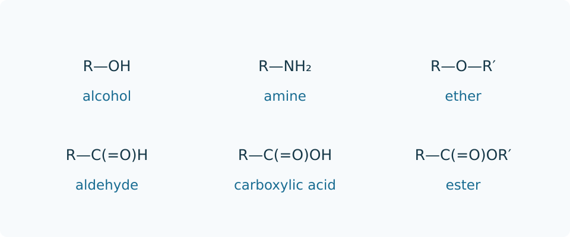
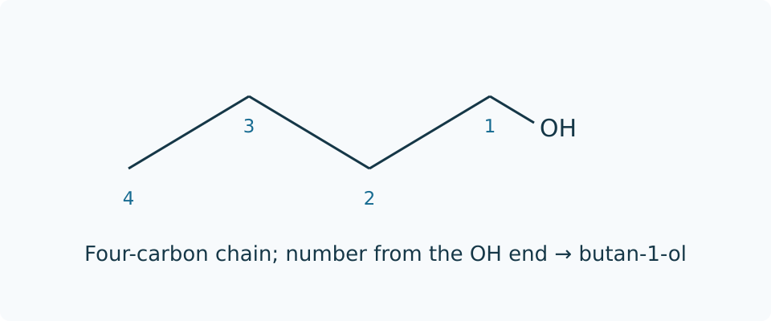
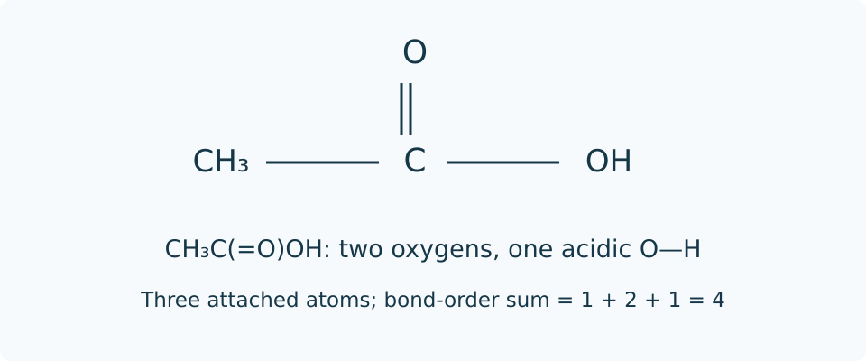
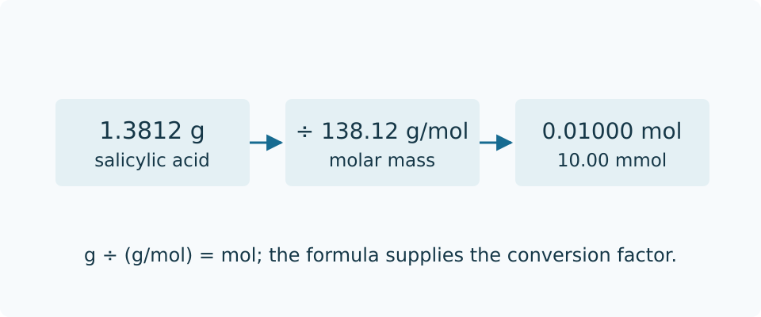

## What will you be able to explain?

- Translate among molecular, condensed and skeletal formulas.
- Recover implicit H atoms and audit valence and charge.
- Recognise functional groups and calculate a chemical amount from mass.

::: notes
Start with a drawing students can explain without chemistry vocabulary. Build vocabulary onto concrete bonds and atoms. Expected prior knowledge: atoms, covalent bonds and the mole; supply a brief recap if needed.
:::

## One molecule, several useful views

{width=85% fig-alt="Molecular, condensed and skeletal representations of ethanol."}

A formula counts atoms; a structural representation also tells you which atoms are connected.

::: notes
Ask students which views distinguish ethanol from dimethyl ether. A formula alone cannot.
:::

## Read every vertex and endpoint

{width=85% fig-alt="Pentane chain with five numbered carbon positions and its hydrogen count."}

An unlabelled vertex or endpoint is carbon. Add enough H atoms to give neutral carbon a bond-order sum of four.

::: notes
Have students trace the chain with a finger; bends are atoms, not decorative changes of direction.
:::

## Count bond orders before adding H

{width=85% fig-alt="Ethane, ethene and ethyne have progressively fewer hydrogen atoms."}

A double bond contributes two to each connected carbon's bond-order sum; a triple contributes three.

::: notes
The drawing is about local valence. Students should not infer that all multiple bonds react in identical ways.
:::

## Same formula, different neighbours

{width=85% fig-alt="Ethanol and dimethyl ether both have formula C2H6O but different oxygen connectivity."}

Constitutional isomers differ in connectivity. Redrawing the same connectivity in another orientation does not create one.

::: notes
Avoid letting students use left/right position on the page as an identity test.
:::

## Recognise a functional group as a pattern

{width=85% fig-alt="Alcohol, amine, ether, aldehyde, carboxylic-acid and ester patterns."}

R and R′ stand for attached organic groups; they are not the element symbols for unknown atoms.

::: notes
Compare ether and ester carefully: an ester has a carbonyl adjacent to the single-bonded oxygen.
:::

## Oxygen can be neutral or charged

{width=85% fig-alt="Water, hydroxide and hydronium compared by bonds, lone pairs and formal charge."}

Formal charge = valence electrons − nonbonding electrons − half the bonding electrons. For O, start from six valence electrons.

::: notes
Insist on both lone pairs and charge in student Lewis drawings. Hydroxide oxygen has three lone pairs, not two.
:::

## A flat drawing can describe a 3D molecule

{width=85% fig-alt="Tetrahedral, trigonal-planar and linear local carbon geometries."}

A saturated carbon is approximately tetrahedral; carbonyl/alkene carbon approximately trigonal planar; an alkyne carbon linear.

::: notes
Wedges indicate direction relative to the page. Their meaning is not that one type of ordinary bond is chemically stronger.
:::

## Name a small structure systematically

{width=85% fig-alt="A four-carbon alcohol numbered from the hydroxyl end."}

Choose the appropriate parent chain and give the principal group the appropriate low locant: butan-1-ol here.

::: notes
Show that reversing the drawing does not reverse the chemical numbering rule.
:::

## A carbonyl contains two bonds to one neighbour

{width=85% fig-alt="Ethanoic-acid carbonyl carbon bonded to an oxygen, hydroxyl and methyl group."}

CH₃C(=O)OH has two O atoms. The carbonyl carbon has three atom neighbours but a bond-order sum of four.

::: notes
Parentheses describe branches at the preceding atom. The acidic H is bonded to oxygen, not the carbonyl carbon.
:::

## Mass and molar mass connect drawing to experiment

{width=85% fig-alt="1.3812 grams divided by 138.12 grams per mole gives 0.01000 mole."}

Use $n=m/M$. State units at every step; 0.01000 mol is 10.00 mmol.

::: notes
This is a measured-mass conversion using a supplied molar mass, not a calculation of molecular weight from memory.
:::

## Use a drawing audit

For each structure, check: connected atoms → bond orders → H count → lone pairs → formal charges.

Do this before predicting properties or reactions.

## First R report calculation

```r
mass_g <- 1.3812
molar_mass_g_mol <- 138.12
amount_mol <- mass_g / molar_mass_g_mol
amount_mol * 1000
```

Predict the order of magnitude before running the code.

## Repair a plausible-looking mistake

A student reads CH₃C(=O)OH as CH₃CH₂OH. Explain the difference using bond order, atom counts and functional-group identity.

## Practise and carry the skill forward

Complete the [practice](exercise.qmd) and [self-check](quiz.qmd).

Provisional reference: selected Solomons chapters 1–2 and naming examples in chapter 4; see the [reading guide](../reference/reading.qmd).
