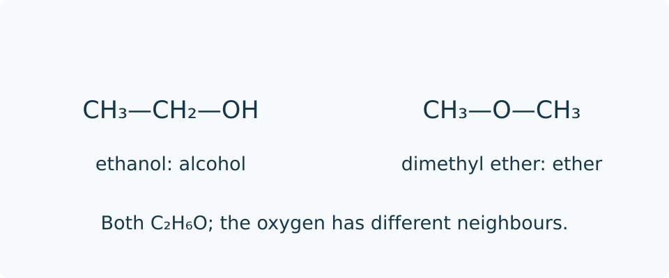
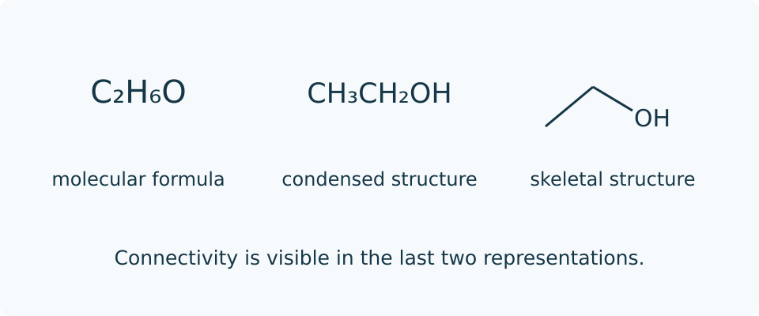
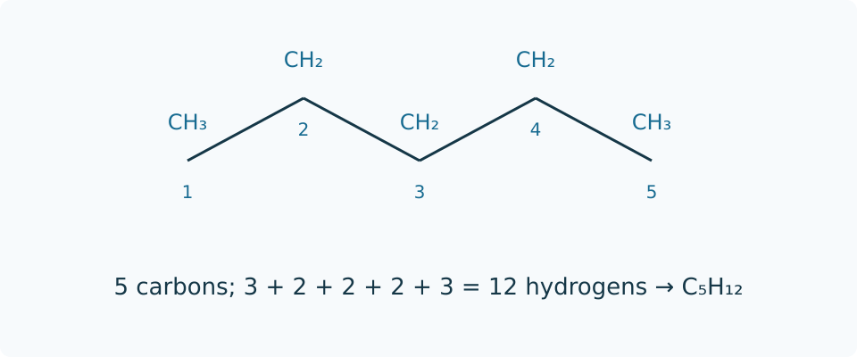
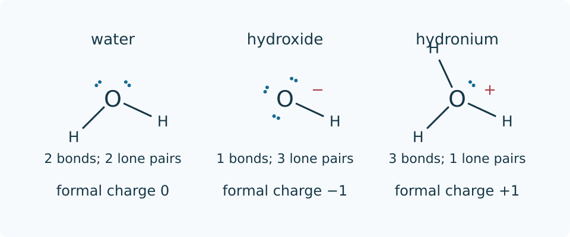

## About this lecture

Two bottles are both labelled **C₂H₆O**. One is the alcohol in beer and boils at 78 °C. The other is a spray-can propellant that boils at −24 °C. **Same atoms, different molecules.** Only the **structure** tells them apart.

Today we learn to read structures fluently:

- **Drawings:** formula, condensed and skeletal, and what each one hides
- **Hidden atoms:** every corner is a carbon; valence implies the H
- **Functional groups:** the local patterns that decide behaviour
- **Formal charge:** an electron count that keeps a drawing honest
- **Names and amounts:** basic naming, and grams to moles

The rest of the course assumes you can read a structure at a glance.

::: notes
Open with the two bottles. Ethanol and dimethyl ether really do share the formula C2H6O, yet one is a liquid you can drink (in moderation) and the other is a gas used in spray cans and as a diesel substitute. The 100-degree gap in boiling point is something we'll explain tomorrow with hydrogen bonding; today the point is simply that the arrangement of atoms, not the list of atoms, is the molecule. Frame the lecture as learning a language: by the end, a skeletal drawing should read as fast as a sentence. Mention that most of this is review-plus-sharpening of general chemistry, but organic chemists use a shorthand that hides most atoms, and that shorthand is what trips people up.
:::

## One formula, two molecules

{width=78% fig-alt="Ethanol, CH3CH2OH, and dimethyl ether, CH3OCH3, both C2H6O"}

| | ethanol | dimethyl ether |
|---|---|---|
| oxygen is bonded to | C and **H** | C and C |
| boiling point | 78 °C | −24 °C |

::: notes
Point at the oxygen in each. In ethanol, oxygen carries a hydrogen; in dimethyl ether, it sits between two carbons. That single difference in who is bonded to whom gives a liquid versus a gas at room temperature. Molecules with the same formula but different connectivity are constitutional isomers. The word "connectivity" is the key word of the whole lecture: a structure is a statement about which atoms are bonded to which. Everything else (left/right on the page, the angle you draw it at) is presentation.
:::

## Three ways to write the same molecule

{width=78% fig-alt="Ethanol as C2H6O, CH3CH2OH and a skeletal drawing"}

- **Molecular formula** C₂H₆O tells you *what* is there. It's good for mass and amount, but useless for identity.
- **Condensed** CH₃CH₂OH tells you the connectivity in a single line of text.
- **Skeletal** is the drawing chemists actually use. It's fast, and it puts the functional groups up front.

::: notes
Each representation answers a different question. The molecular formula is what a mass spectrometer or an elemental analysis gives you; the condensed formula is convenient in text and in R code (you'll type these into data frames); the skeletal structure is the working language of every paper and textbook. Stress that the condensed and skeletal forms contain identical information. Also stress that HOCH2CH3 and CH3CH2OH are the same molecule written in opposite directions. Writing a formula backwards does not create an isomer.
:::

## Skeletal structures hide most of the atoms

{width=72% fig-alt="Pentane zigzag with each vertex labelled CH3 or CH2, giving C5H12"}

**Rules:** every **end and corner is a carbon**. Hydrogens on carbon are **not drawn**: add enough to give each carbon four bonds. Heteroatoms (O, N, …) and the H on them *are* drawn.

::: {.try}
**Try it:** how many carbons are in an unbranched zigzag with **four** line segments?

::: {.fragment}
**Five.** Segments are bonds, not atoms. The molecule is pentane, C₅H₁₂.
:::
:::

::: notes
This is the single most important reading skill of the course. Walk along the pentane line: end, corner, corner, corner, end, five carbons. Then fill hydrogens: the ends have one carbon neighbour, so three H each; the inner carbons have two, so two H each. 3+2+2+2+3 = 12. Give students 20 seconds for the try-it before revealing. The classic error is counting the line segments (four) instead of the vertices (five). Heteroatoms are always written out, and so is any H attached to them. That's why the skeletal ethanol on the previous slide shows "OH".
:::

## Branches and rings: same counting rule

:::: {.columns}
::: {.column width="50%"}
| drawing | carbons | formula |
|---|---|---|
| butane (straight) | 4 | C₄H₁₀ |
| 2-methylpropane (branched) | 4 | C₄H₁₀ |
| cyclobutane (ring) | 4 | C₄H₈ |
:::
::: {.column width="50%"}
- A **branch point** is a carbon with three or four carbon neighbours, so it carries fewer H.
- Butane and 2-methylpropane are **isomers again**: same formula, different connectivity.
- Closing a **ring** uses one more C–C bond, so it costs **two H**.
:::
::::

::: {.try}
**Try it:** in 2-methylpropane, how many H are on the central carbon?

::: {.fragment}
**One.** It has three carbon neighbours, so 4 − 3 = 1 H. The three CH₃ ends supply the other nine.
:::
:::

::: notes
Extend the counting rule from chains to branches and rings. Draw butane and 2-methylpropane on the board side by side: both C4H10, but the branched one boils lower (about −12 °C versus about 0 °C). Shape matters even among hydrocarbons, which we'll revisit tomorrow. The ring point is a preview: each ring, like each double bond, removes two hydrogens from the saturated formula. Students who internalise "H = 4 minus bonds to carbon" never need to memorise formulas.
:::

## Double and triple bonds change the hydrogen count

{width=80% fig-alt="Ethane C2H6, ethene C2H4 and ethyne C2H2"}

A neutral carbon has a **bond-order sum of four**, not four neighbours. Each extra bond between two carbons removes one H from each.

::: {.try}
**Try it:** start from butane, C₄H₁₀, and put in one C=C. What's the formula?

::: {.fragment}
**C₄H₈.** Each end of the new double bond loses one H.
:::
:::

::: notes
Count bonds, not neighbours. An ethene carbon has three neighbours (one C and two H) but its bond-order sum is 2 + 1 + 1 = 4. Point out the pattern C2H6 → C2H4 → C2H2: every extra bond costs two hydrogens. This is the "degree of unsaturation" idea that will become a tool in spectroscopy week: from a formula alone you can count rings plus pi bonds. Notice that C4H8 is also the formula of cyclobutane from the previous slide, another case where a formula leaves a choice.
:::

## Bonding sets the shape

{width=78% fig-alt="Tetrahedral 109.5 degrees, trigonal planar 120 degrees and linear 180 degrees"}

| carbon type | example | shape | angle |
|---|---|---|---|
| four single bonds | ethane, CH₃ groups | tetrahedral | 109.5° |
| one double bond | ethene, C=O carbon | trigonal planar | 120° |
| one triple bond | ethyne | linear | 180° |

::: notes
This is why skeletal drawings use zigzags: they approximate the real 109.5° and 120° angles, and a triple bond is drawn as a straight line through the carbons. Shape matters for everything that follows: polarity and boiling point (Day 2), and stereochemistry and enzyme binding (Week 2). Keep it practical: students should be able to look at any carbon and say "tetrahedral", "planar" or "linear" from its bonds. Hybridisation labels (sp3, sp2, sp) can be mentioned as names for these three cases without going into orbital theory today.
:::

## Functional groups: the parts that react

| family | pattern | you have met it as |
|---|---|---|
| alcohol | R–OH | ethanol, cholesterol |
| amine | R–NH₂ | the fishy smell of trimethylamine |
| ether | R–O–R′ | the anaesthetic diethyl ether |
| aldehyde | R–C(=O)H | vanillin, the smell of vanilla |
| carboxylic acid | R–C(=O)OH | acetic acid in vinegar |
| ester | R–C(=O)OR′ | isoamyl acetate, the smell of bananas |

A functional group is identified by its **local connectivity**, not just by which elements are present.

::: notes
Most of a molecule is an inert carbon-hydrogen scaffold. The functional groups are where the chemistry happens, and each family has characteristic reactivity that the rest of the course is organised around. Ground each family in something students have smelled or used. The take-home message is in the last line: an ether, an acid and an ester all contain oxygen, but they're recognised by what the oxygen is attached to. Teach students to look at the neighbours of each heteroatom.
:::

## Reading around a carbonyl

{width=68% fig-alt="Acetic acid CH3C(=O)OH: the carbonyl carbon has three neighbours and bond-order sum four"}

Look at the **neighbour of C=O**: if it's **H** you have an aldehyde, **C** a ketone, **OH** an acid, **OR** an ester, and **N** an amide. An OH or OR with no C=O next to it is an alcohol or ether.

::: {.try}
**Try it:** is CH₃C(=O)NH₂ an amine or an amide?

::: {.fragment}
**Amide.** The N sits directly on the carbonyl carbon, which makes it much less basic than an amine. That difference comes back in Week 4.
:::
:::

::: notes
The carbonyl, C=O, is the most important functional group in biochemistry and the course. Read the condensed notation carefully: in CH3C(=O)OH the parentheses mean the oxygen hangs off the carbon with a double bond, so there are two different oxygens. A frequent mistake is calling HOCH2CH2OH (ethylene glycol, two OH groups) an acid because it has two oxygens. It's a diol, because neither OH is on a carbonyl. Peptide bonds in proteins are amides, which is a good reason to care about the amine/amide distinction.
:::

## Formal charge: count the electrons each atom owns

{width=78% fig-alt="Water neutral, hydroxide minus one, hydronium plus one"}

$$\text{formal charge} = \text{valence electrons} - \text{lone-pair electrons} - \text{bonds}$$

Hydroxide O: 6 − 6 − 1 = **−1**. Hydronium O: 6 − 2 − 3 = **+1**.

::: notes
The formula is the usual V minus N minus B/2, written in a form students can apply by eye: count lone-pair electrons, count bonds. Emphasise that charges are part of the structure. Omitting a charge is a drawing error, not a simplification. Tomorrow's acid-base unit lives entirely on this: when O–H loses a proton, the bonding pair stays on oxygen, so oxygen gains a lone pair and a negative charge.
:::

## The normal states, so charges jump out

| atom | neutral, "normal" | positive | negative |
|---|---|---|---|
| **C** | 4 bonds, 0 lone pairs | 3 bonds, 0 LP (carbocation) | 3 bonds, 1 LP (carbanion) |
| **N** | 3 bonds, 1 LP (amine) | 4 bonds, 0 LP (ammonium) | 2 bonds, 2 LP |
| **O** | 2 bonds, 2 LP (alcohol) | 3 bonds, 1 LP (oxonium) | 1 bond, 3 LP (alkoxide) |

Learn the neutral column. Any atom that doesn't match it carries a charge.

::: {.try}
**Try it:** amino acids in your cells exist as H₃N⁺–CH₂–COO⁻ (glycine). Which atoms carry the charges, and why?

::: {.fragment}
**N** has four bonds, so it's +1. **One O** has one bond and three lone pairs, so it's −1. The molecule is neutral overall: a *zwitterion*.
:::
:::

::: notes
Experienced chemists don't calculate formal charges. They recognise deviations from the neutral pattern instantly, and this table is the shortcut. Carbocations and carbanions are previews of the mechanism unit. The glycine zwitterion connects to biochemistry and to acids and bases on Day 3: at physiological pH, amino acids are charged at both ends. Ask students to point at the exact atom, not just say "the molecule is charged".
:::

## A valence audit catches impossible structures

Before you trust any drawing, including your own, check every atom:

1. **Carbon:** bond-order sum exactly 4 (unless a charge is shown).
2. **N, O:** compare with the neutral pattern, and write the charge if they differ.
3. **Hydrogen:** exactly one bond.

::: {.try}
**Try it:** a proposed reaction intermediate keeps C=O *and* adds three single bonds at the same carbon. Is that possible?

::: {.fragment}
**No.** 2 + 3 = 5 bonds to carbon. For a new group to attach, the C=O π bond must open first. That's the key step of every carbonyl addition in Week 3.
:::
:::

::: notes
This is the habit that saves the most marks on the exam. Students under time pressure draw five-bonded carbons, especially when adding a nucleophile to a carbonyl. Make the audit a reflex: after drawing anything, run a finger over each atom and count. The try-it deliberately previews mechanism: the reason a carbonyl's pi bond breaks when a nucleophile adds is exactly this valence limit.
:::

## Naming: just enough to communicate

:::: {.columns}
::: {.column width="45%"}
{width=100% fig-alt="Four-carbon chain numbered from the OH end, butan-1-ol"}
:::
::: {.column width="55%"}
1. Find the **longest chain** containing the group: meth-, eth-, prop-, but-, pent-, …
2. **Number from the end** nearest the group.
3. Add the ending: **-ol**, **-al**, **-one**, **-oic acid**, …
:::
::::

::: {.try}
**Try it:** name CH₃CH₂CH(OH)CH₃.

::: {.fragment}
**Butan-2-ol.** Numbering from the right puts OH on C2. "Butan-3-ol" is the same molecule, numbered the wrong way.
:::
:::

::: notes
We teach naming only as far as needed to talk about molecules unambiguously; nobody will be asked to name a complex natural product. Propan-1-ol versus propan-2-ol is the essential contrast: the number says where the group sits, and moving it creates an isomer with a different name. Common names (acetic acid, acetone) will appear alongside systematic ones; the reading guide lists the ones we use.
:::

## Putting it together: two molecules from biology

:::: {.columns}
::: {.column width="50%"}
**Glycine** H₂N–CH₂–COOH

- amine + carboxylic acid
- the simplest amino acid
:::
::: {.column width="50%"}
**Lactic acid** CH₃–CH(OH)–COOH

- alcohol + carboxylic acid
- made by muscle and by yoghurt bacteria
:::
::::

Read every atom, group by group: count each **C–H, N–H and O–H** separately, and don't add an H to the carbonyl carbon.

::: {.try}
**Try it:** write the molecular formulas of glycine and lactic acid.

::: {.fragment}
Glycine **C₂H₅NO₂** (2 N–H + 2 C–H + 1 O–H). Lactic acid **C₃H₆O₃** (3 + 1 C–H on carbon, 1 + 1 O–H). Note the central carbon of lactic acid has only **one** H.
:::
:::

::: notes
This slide combines everything: identify groups, count hidden hydrogens, respect the carbonyl carbon's valence. The common error in lactic acid is giving the central carbon two hydrogens, forgetting that OH takes one of its four bonds. Lactic acid also has a carbon with four different groups, which is a teaser for stereochemistry in Week 2: there are two mirror-image lactic acids, and your muscles make only one of them.
:::

## From a structure to an amount

{width=72% fig-alt="Mass divided by molar mass gives amount in moles"}

$$n = \frac{m}{M} \qquad \text{grams} \div \frac{\text{g}}{\text{mol}} = \text{mol}$$

The **structure gives the formula**, the formula gives **M**, and the balance gives **m**. In R: `1.3812 / 138.12` → `0.01`.

::: notes
The lab connection: every synthesis and titration in the practical starts from a weighed mass, and reactions happen in moles, not grams. The chain is structure → formula → molar mass → amount. Keep units visible so the grams cancel. Salicylic acid is the starting material for aspirin, which students will meet again. The R line is a deliberate nudge: today's exercise has a short R task doing exactly this with a small data table, and the habit of keeping units in comments starts here.
:::

## Mistakes we see every year

| mistake | fix |
|---|---|
| counting line segments as carbons | count **ends and corners** |
| "C₂H₆O, so it's ethanol" | a formula allows **several** isomers |
| an H added to a carbonyl carbon that already has 4 bonds | **bond-order sum = 4** |
| calling a diol an acid because it has two O | look for **C=O next to the OH** |
| an amide called an amine | is the N **on the carbonyl carbon**? |
| an O with three bonds drawn without "+" | charges are **part of the structure** |
| a reversed condensed formula called an isomer | the same neighbours mean the **same molecule** |

::: notes
Use this as a quick oral check: read out each mistake and ask the room why it's wrong before showing the fix. Every row maps onto one or more exercises, so a student who still makes one of these knows exactly which exercise to redo.
:::

## Summary

| concept | key fact |
|---|---|
| structure vs formula | the structure adds **connectivity** |
| isomers | same formula, different connectivity |
| skeletal drawing | corners are C; H fills each C to **four bonds** |
| double bond or ring | removes **two H** |
| geometry | tetrahedral · planar · linear |
| functional groups | read the **neighbours** of O, N and C=O |
| formal charge | valence − lone-pair electrons − bonds |
| amount | n = m / M |

**Next:** why ethanol boils 100 °C above dimethyl ether (Day 2). **Practice:** [exercises](exercise.qmd) · [self-check](quiz.qmd)

::: notes
The summary is the revision sheet; recite the reading procedure once: find the vertices, fill hydrogens to four bonds, name the functional groups by their neighbours, check charges against the neutral patterns. Close the loop with the opening hook. Tomorrow answers the boiling-point question from the first slide, and the answer is hydrogen bonding, which only ethanol can do because only ethanol has O–H. Point students to the exercises: the core problems are required, and the transfer ones are optional.
:::
