## What should you be able to explain?

Recover implicit atoms; distinguish connectivity; audit charges; convert a supplied mass to amount.

::: notes
45-minute budget: representations and a short identity check4 min; skeletal/branch/multiple-bond counting8 min including a90-second drawing; functional groups6 min; formal charge and valence7 min including a60-second repair; naming6 min; multi-functional structures5 min; amount calculation6 min including a60-second manual check; integrated explanation/exit3 min. These blocks sum to45 min; pauses are inside them,not additional time.

Use the slide pace flexibly: concrete worked operations deserve more time than brief resolved checks. The intended outcome is an explainable chemical argument,not a slide count.
:::

## Bring these tools into the room

Four bond orders at ordinary neutral C; two O bonds/two lone pairs at neutral O; count all labelled heteroatoms.

::: notes
Use a quick spoken diagnostic; do not spend an additional unscheduled revision block. Revisit a missing convention at its worked example.
:::

## Which view tells you who is bonded?

{width=82% fig-alt="Which view tells you who is bonded?"}

Compare the three representations. Which distinguishes ethanol from its ether isomer?

::: notes
Begin this chemical argument with the displayed structure. Ask for a concrete atom, bond, label or observation rather than the topic name. Keep the first prediction brief.
:::

## Expand the O–H connection

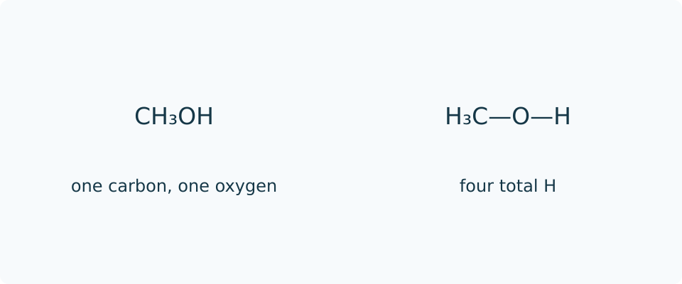{width=82% fig-alt="Expand the O–H connection"}

Methanol has one carbon and one oxygen. Four H atoms appear in its complete formula.

## Test identity after redrawing

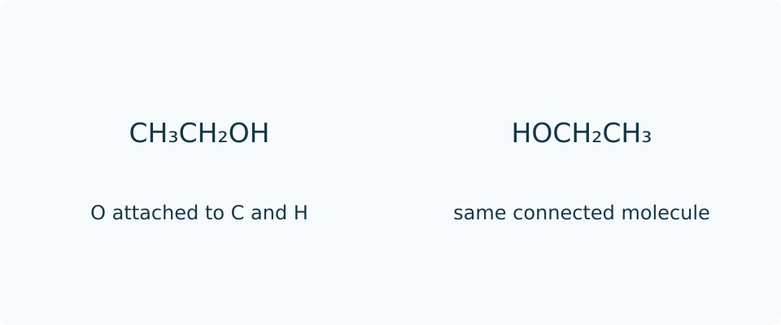{width=82% fig-alt="Test identity after redrawing"}

HOCH₂CH₃ and CH₃CH₂OH have the same oxygen neighbours. Left/right page position is irrelevant.

## Predict: formula or structure?

A label says C₂H₆O. Must the sample be an alcohol? Give one alternative before the next slide.

::: notes
Give 15–20 seconds for an individual prediction or a small drawing. Ask one student to state the rule they used; resolve on the next slide within this same timed block.
:::

## Resolve: the formula leaves a choice

Dimethyl ether, CH₃OCH₃, also has C₂H₆O. Connectivity information is required to distinguish it.

::: notes
Use the explicit answer to diagnose the named misconception. Move on once students can state the rule; the practice page provides further worked attempts.
:::

## Locate all five carbons

{width=82% fig-alt="Locate all five carbons"}

Trace the pentane line from one end to the other. Count corners as well as endpoints.

::: notes
Begin this chemical argument with the displayed structure. Ask for a concrete atom, bond, label or observation rather than the topic name. Keep the first prediction brief.
:::

## Audit a three-carbon chain

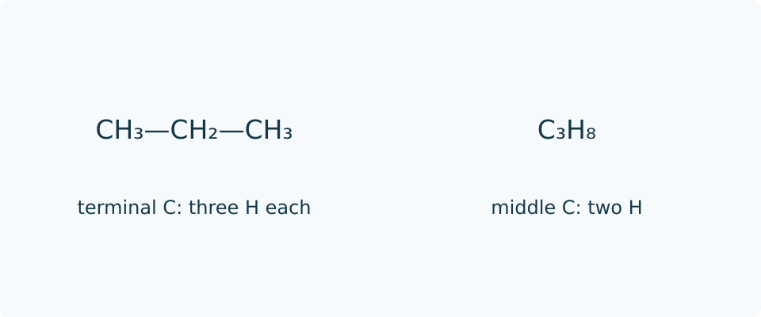{width=82% fig-alt="Audit a three-carbon chain"}

The terminal carbons each carry three H; the middle carbon carries two. Propane is C₃H₈.

## A branch is another carbon position

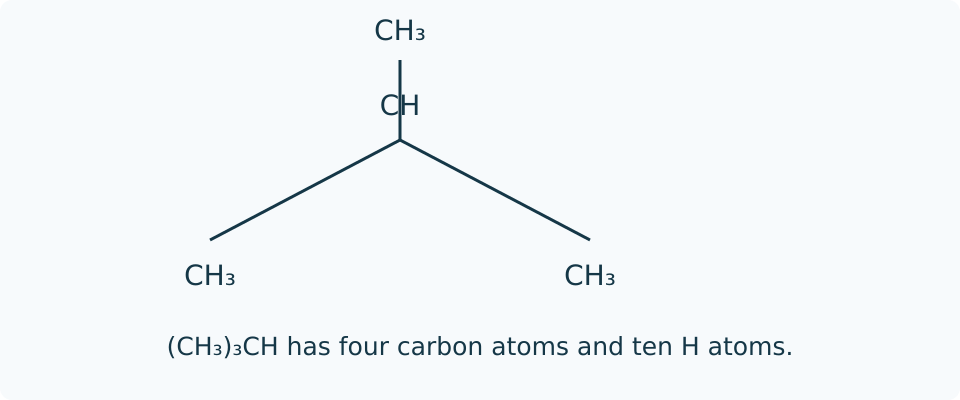{width=82% fig-alt="A branch is another carbon position"}

Count the three terminal methyl groups and the central CH in 2-methylpropane. The formula is C₄H₁₀.

## Predict: a four-segment unbranched line

How many carbons and hydrogens does a saturated, unbranched four-segment zigzag represent?

::: notes
Give 15–20 seconds for an individual prediction or a small drawing. Ask one student to state the rule they used; resolve on the next slide within this same timed block.
:::

## Resolve: segments are bonds

Four segments connect five carbons. The saturated acyclic molecule is pentane, C₅H₁₂, not a four-carbon molecule.

::: notes
Use the explicit answer to diagnose the named misconception. Move on once students can state the rule; the practice page provides further worked attempts.
:::

## Compare the same two carbons

{width=82% fig-alt="Compare the same two carbons"}

Why does changing C–C to C=C or C≡C change the permitted hydrogen count?

::: notes
Begin this chemical argument with the displayed structure. Ask for a concrete atom, bond, label or observation rather than the topic name. Keep the first prediction brief.
:::

## Audit each alkene carbon

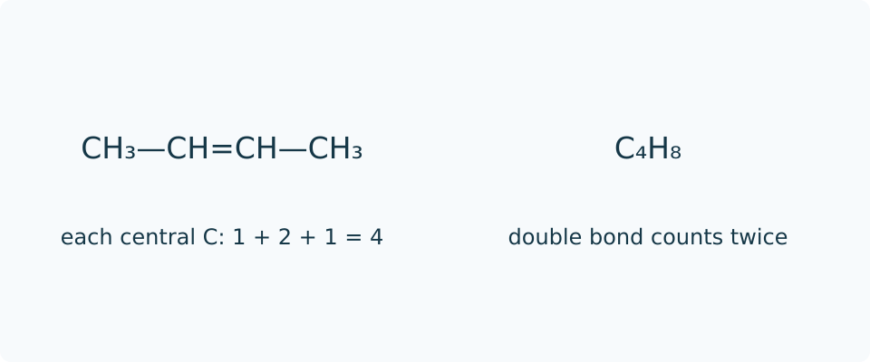{width=82% fig-alt="Audit each alkene carbon"}

In CH₃CH=CHCH₃, each central carbon has one double bond, one single bond and one H.

## Use bond-order sum, not neighbour count

{width=82% fig-alt="Use bond-order sum, not neighbour count"}

Ethene carbon has three atom neighbours but a bond-order sum of four. A double bond is not one valence.

## Read a terminal alkyne

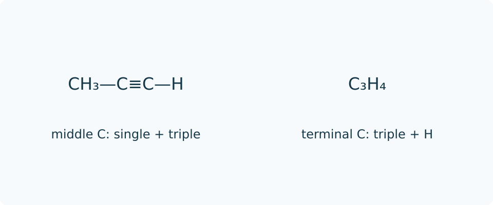{width=82% fig-alt="Read a terminal alkyne"}

CH₃C≡CH has three carbons. Its middle carbon has no H; its terminal alkyne carbon has one.

## Predict: one added double bond

Start from C₄H₁₀. Keep the four-carbon acyclic framework and introduce one C=C. What hydrogen formula results?

::: notes
Give 15–20 seconds for an individual prediction or a small drawing. Ask one student to state the rule they used; resolve on the next slide within this same timed block.
:::

## Resolve: remove two H in the formula comparison

The alkene formula is C₄H₈. Each end of the new double bond uses one more valence than before.

::: notes
Use the explicit answer to diagnose the named misconception. Move on once students can state the rule; the practice page provides further worked attempts.
:::

## Name the neighbours that differ

{width=82% fig-alt="Name the neighbours that differ"}

For ethanol and dimethyl ether, list the atoms directly connected to oxygen.

::: notes
Begin this chemical argument with the displayed structure. Ask for a concrete atom, bond, label or observation rather than the topic name. Keep the first prediction brief.
:::

## Rotate a drawing without changing chemistry

{width=82% fig-alt="Rotate a drawing without changing chemistry"}

Redrawing ethanol with OH on the left preserves every bonded neighbour.

## A missing vertex is a missing carbon

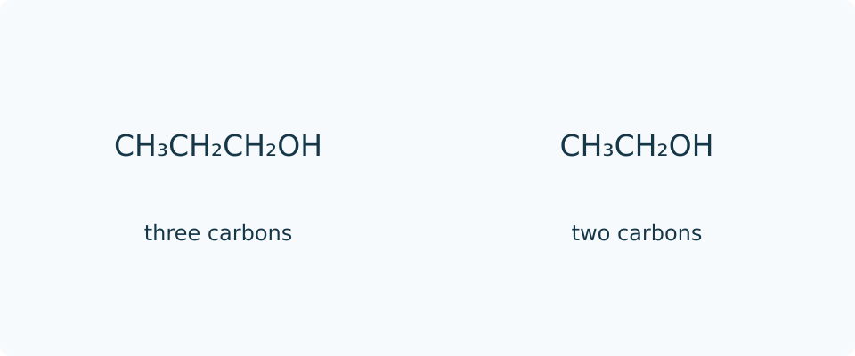{width=82% fig-alt="A missing vertex is a missing carbon"}

Propan-1-ol and ethanol differ by CH₂. A shortened drawing cannot be rescued by calling it another viewing angle.

## Find patterns rather than counting oxygen

{width=82% fig-alt="Find patterns rather than counting oxygen"}

An ether, acid and ester can all contain oxygen. Which local connectivity identifies each family?

::: notes
Begin this chemical argument with the displayed structure. Ask for a concrete atom, bond, label or observation rather than the topic name. Keep the first prediction brief.
:::

## Distinguish ether from ester

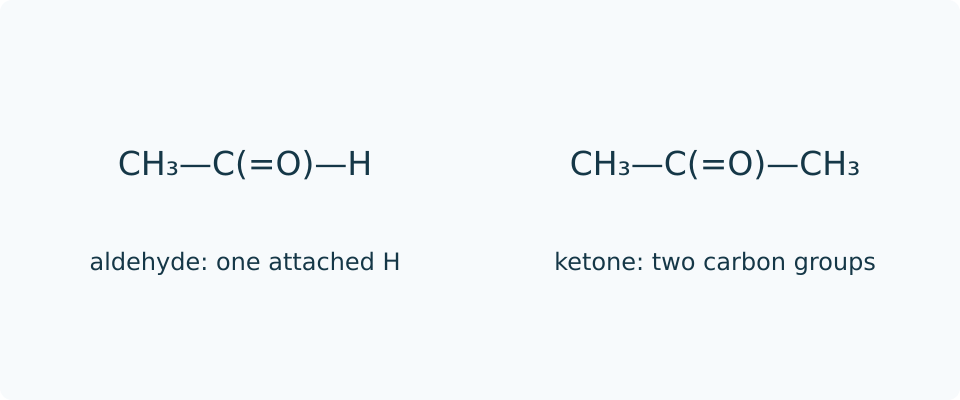{width=82% fig-alt="Distinguish ether from ester"}

An ester has O attached to a carbonyl carbon. A simple ether has no adjacent carbonyl.

## Two OH groups are not a carboxylic acid

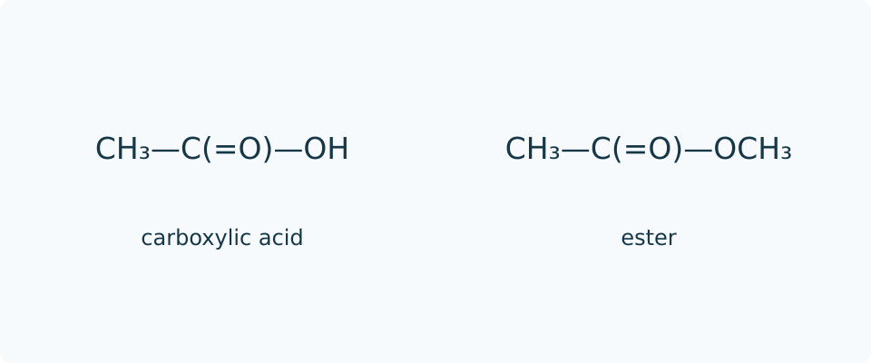{width=82% fig-alt="Two OH groups are not a carboxylic acid"}

HOCH₂CH₂OH is a diol. CH₃C(=O)OH is an acid. Both have two O atoms but different bonding.

## Predict: classify CH₃C(=O)NH₂

Identify the carbonyl and its directly attached nitrogen. Is this an amine or an amide?

::: notes
Give 15–20 seconds for an individual prediction or a small drawing. Ask one student to state the rule they used; resolve on the next slide within this same timed block.
:::

## Resolve: an amide has carbonyl next to N

CH₃CONH₂ is ethanamide. A simple amine such as CH₃CH₂NH₂ lacks that adjacent carbonyl.

::: notes
Use the explicit answer to diagnose the named misconception. Move on once students can state the rule; the practice page provides further worked attempts.
:::

## Count oxygen electrons, not only bonds

{width=82% fig-alt="Count oxygen electrons, not only bonds"}

Compare water, hydroxide and hydronium. Which lone-pair count accompanies each bond count?

::: notes
Begin this chemical argument with the displayed structure. Ask for a concrete atom, bond, label or observation rather than the topic name. Keep the first prediction brief.
:::

## Check nitrogen after proton gain

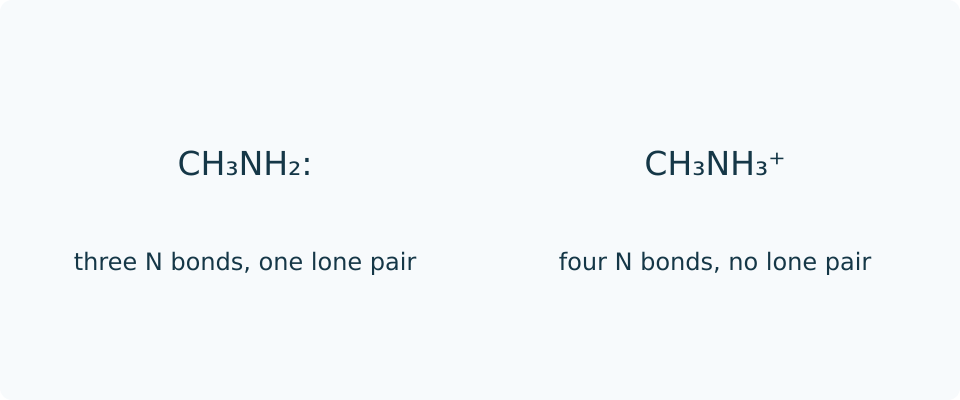{width=82% fig-alt="Check nitrogen after proton gain"}

Three N bonds plus one lone pair gives a neutral ordinary amine. Four bonds gives ammonium, with +1 charge.

## Calculate one oxygen charge explicitly

{width=82% fig-alt="Calculate one oxygen charge explicitly"}

Hydroxide O: 6 valence electrons − 6 nonbonding electrons − 1 assigned bonding electron = −1.

## Track what proton loss changes

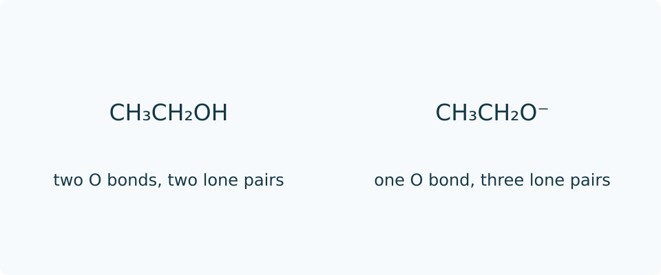{width=82% fig-alt="Track what proton loss changes"}

Ethoxide has one O bond and three lone pairs. Removing H⁺ leaves the original O–H bonding pair on oxygen.

## Predict: three bonds and one lone pair on O

Use 6 − nonbonding electrons − half the bonding electrons. What formal charge results?

::: notes
Give 15–20 seconds for an individual prediction or a small drawing. Ask one student to state the rule they used; resolve on the next slide within this same timed block.
:::

## Resolve: oxygen is positively charged

Three bonds and one lone pair gives 6 − 2 − 3 = +1. Draw the superscript charge; do not silently omit it.

::: notes
Use the explicit answer to diagnose the named misconception. Move on once students can state the rule; the practice page provides further worked attempts.
:::

## Distinguish geometry from page layout

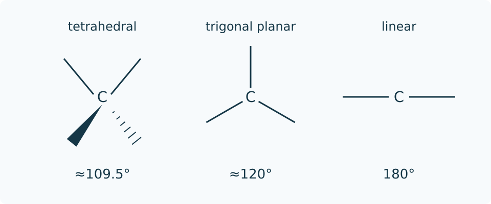{width=82% fig-alt="Distinguish geometry from page layout"}

Which local geometry corresponds to saturated, alkene/carbonyl and alkyne carbon?

::: notes
Begin this chemical argument with the displayed structure. Ask for a concrete atom, bond, label or observation rather than the topic name. Keep the first prediction brief.
:::

## Read a carbonyl H count

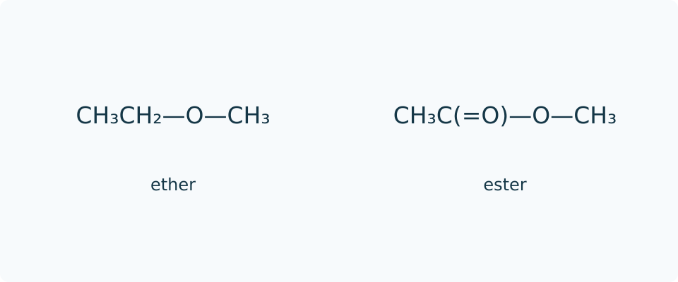{width=82% fig-alt="Read a carbonyl H count"}

Ethanal carbonyl carbon bonds to CH₃, O twice and H once. Propanone instead has two carbon substituents.

## Compare acid and ester carbonyl neighbours

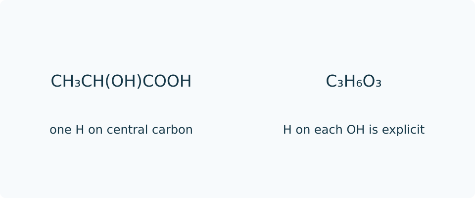{width=82% fig-alt="Compare acid and ester carbonyl neighbours"}

Both carbonyl carbons have approximately planar local geometry; OH versus OR changes the functional group.

## Predict: can neutral carbon keep five bond orders?

A proposed intermediate keeps C=O and adds three single bonds at that carbon. Is the representation valid?

::: notes
Give 15–20 seconds for an individual prediction or a small drawing. Ask one student to state the rule they used; resolve on the next slide within this same timed block.
:::

## Resolve: second-row carbon fails the audit

Two plus three is five bond orders. A valid ordinary tetrahedral intermediate needs the pi bond to open first.

::: notes
Use the explicit answer to diagnose the named misconception. Move on once students can state the rule; the practice page provides further worked attempts.
:::

## Find the principal group before numbering

{width=82% fig-alt="Find the principal group before numbering"}

Trace the longest suitable chain containing the OH-bearing carbon. Then choose numbering consistent with the group.

::: notes
Begin this chemical argument with the displayed structure. Ask for a concrete atom, bond, label or observation rather than the topic name. Keep the first prediction brief.
:::

## Redraw propan-1-ol from the opposite end

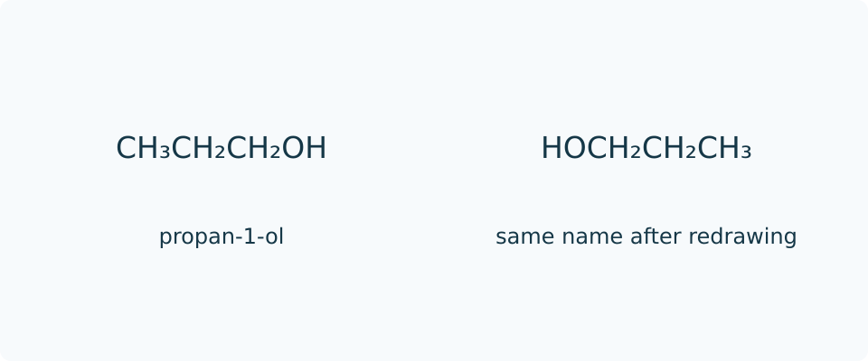{width=82% fig-alt="Redraw propan-1-ol from the opposite end"}

CH₃CH₂CH₂OH and HOCH₂CH₂CH₃ retain the same name and connectivity.

## Move the group; change the locant

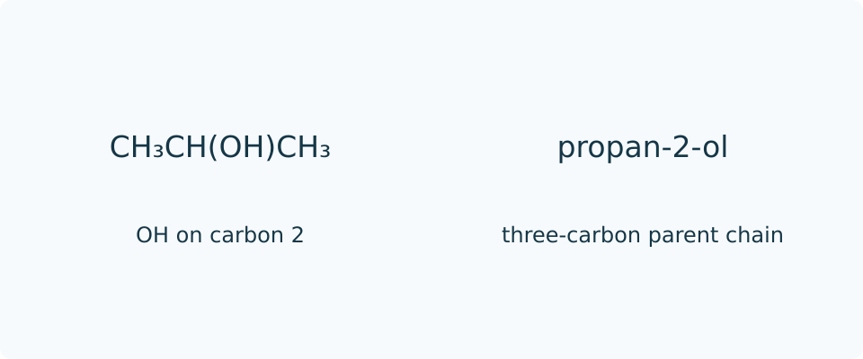{width=82% fig-alt="Move the group; change the locant"}

CH₃CH(OH)CH₃ is propan-2-ol. The OH is attached to the middle carbon.

## Predict: name CH₃CH₂CH(OH)CH₃

Number the four-carbon parent chain to give the alcohol its appropriate low locant.

::: notes
Give 15–20 seconds for an individual prediction or a small drawing. Ask one student to state the rule they used; resolve on the next slide within this same timed block.
:::

## Resolve: butan-2-ol

Counting from the closer end puts OH at C2. Butan-3-ol describes the same connectivity with unsuitable numbering.

::: notes
Use the explicit answer to diagnose the named misconception. Move on once students can state the rule; the practice page provides further worked attempts.
:::

## Count the acid oxygens separately

{width=82% fig-alt="Count the acid oxygens separately"}

The carbonyl oxygen and hydroxyl oxygen occupy different bonds in CH₃C(=O)OH.

::: notes
Begin this chemical argument with the displayed structure. Ask for a concrete atom, bond, label or observation rather than the topic name. Keep the first prediction brief.
:::

## Expand lactic acid carefully

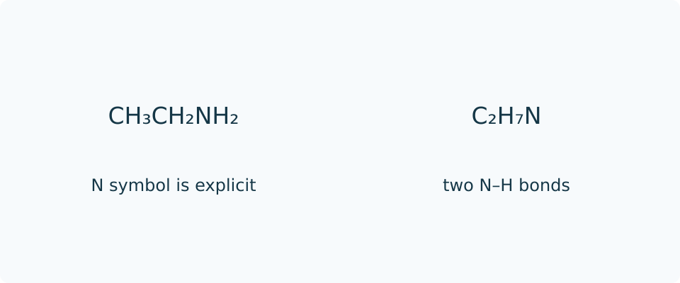{width=82% fig-alt="Expand lactic acid carefully"}

CH₃CH(OH)COOH contains three C, six H and three O. The central carbon has one H, not two.

## A biological-looking molecule uses familiar groups

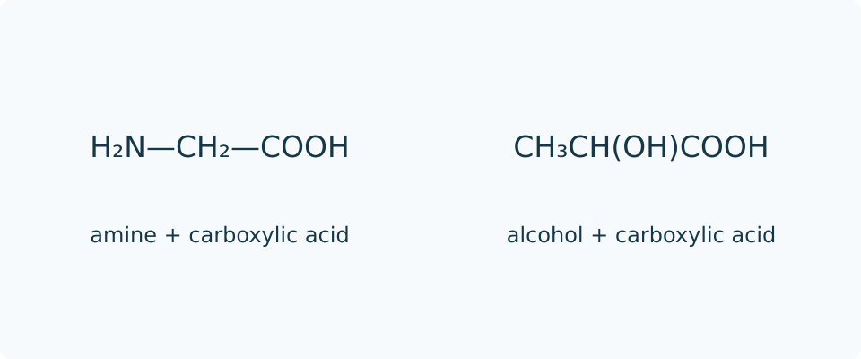{width=82% fig-alt="A biological-looking molecule uses familiar groups"}

Glycine contains an amine and carboxylic acid; lactic acid contains an alcohol and carboxylic acid.

## Predict: count H in H₂NCH₂COOH

Count N–H, C–H and O–H separately. Do not add an H to the acid carbonyl carbon.

::: notes
Give 15–20 seconds for an individual prediction or a small drawing. Ask one student to state the rule they used; resolve on the next slide within this same timed block.
:::

## Resolve: five hydrogens

Two N–H + two C–H + one O–H gives C₂H₅NO₂ for the neutral drawn glycine form.

::: notes
Use the explicit answer to diagnose the named misconception. Move on once students can state the rule; the practice page provides further worked attempts.
:::

## Connect a measured mass to the mole

{width=82% fig-alt="Connect a measured mass to the mole"}

Which quantity belongs in the denominator when converting grams into moles?

::: notes
Begin this chemical argument with the displayed structure. Ask for a concrete atom, bond, label or observation rather than the topic name. Keep the first prediction brief.
:::

## Cancel the units explicitly

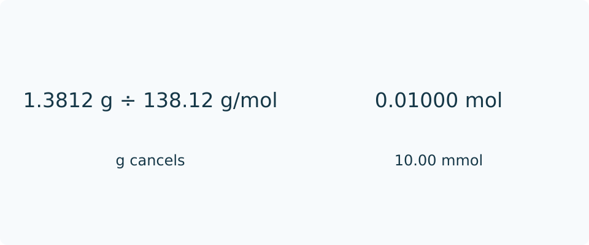{width=82% fig-alt="Cancel the units explicitly"}

1.3812 g ÷ 138.12 g/mol = 0.01000 mol. The grams cancel, leaving mol.

## Reverse the calculation

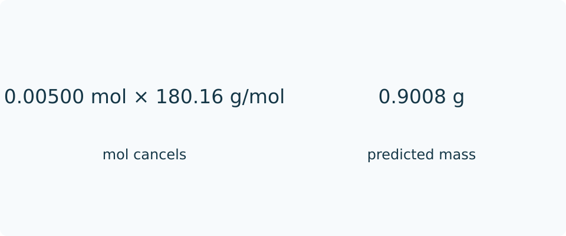{width=82% fig-alt="Reverse the calculation"}

0.00500 mol × 180.16 g/mol = 0.9008 g. The mole units now cancel.

## Predict: double the measured mass

At the same molar mass, does doubling mass double or halve chemical amount? State the formula first.

::: notes
Give 15–20 seconds for an individual prediction or a small drawing. Ask one student to state the rule they used; resolve on the next slide within this same timed block.
:::

## Resolve: amount scales directly with mass

n = m/M. With M fixed, doubling m doubles n. No new chemical assumption is needed.

::: notes
Use the explicit answer to diagnose the named misconception. Move on once students can state the rule; the practice page provides further worked attempts.
:::

## Combine the tools in one explanation

Use the same connected molecule in two views, then compare a genuine constitutional isomer.

::: notes
Take a 30-second sketch or explanation, then ask for one observation and the reason linking it to the conclusion. This is included in the 45-minute session.
:::

## Your next independent work

Use the [standalone practice and worked checks](exercise.qmd), then the [self-check](quiz.qmd). Required core problems and optional transfer work are labelled separately.

## One-sentence exit explanation

Write one chemical claim, the feature that supports it and one limit of the inference.

The [reading guide](../reference/reading.qmd) provides optional textbook support; no textbook is needed to attempt the local practice.

::: notes
Collect one sentence or hear one example. Stop at 45 minutes; do not append another tutorial to the lecture.
:::
