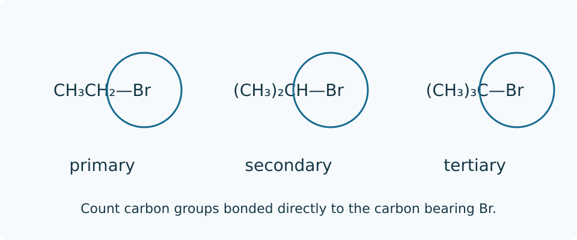
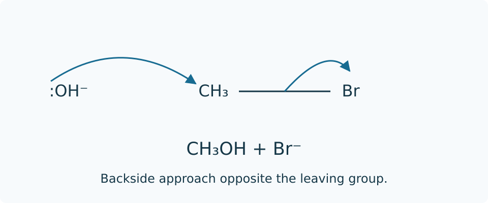
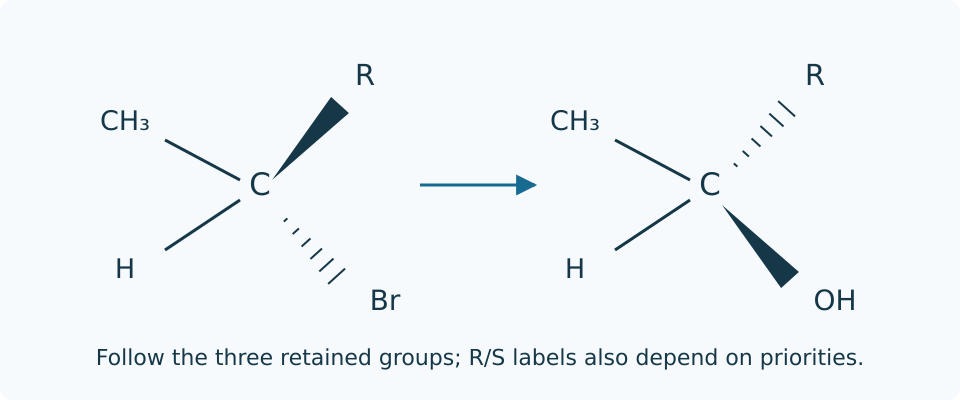
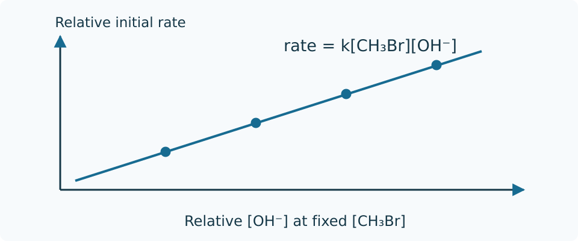
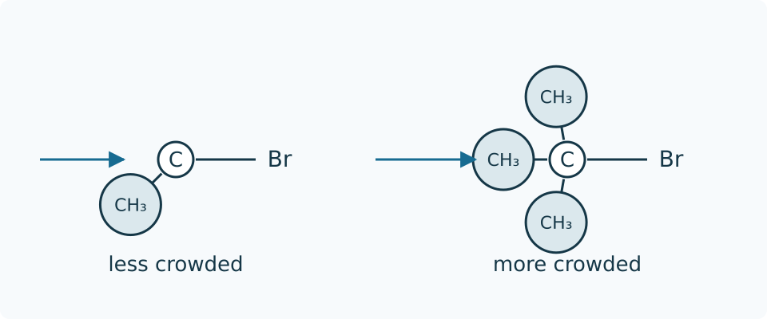
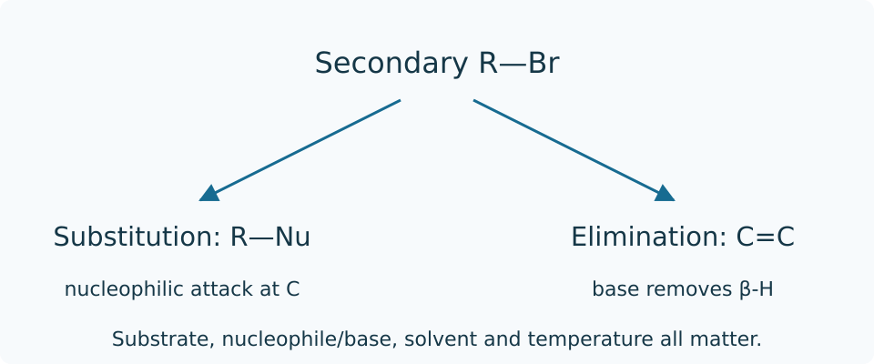

## What will you be able to explain?

- Explain a concerted SN2 and a stepwise SN1 example.
- Predict inversion at a reacting stereocentre.
- Justify a pathway using substrate and conditions.

::: notes
Begin with the previous unit’s electron-pair and charge audit. Ask students to predict a product or bond change before displaying the worked drawing. These slides support discussion and paper drawing; the practice page supplies further explanations.
:::

## Classify the reacting carbon

{width=85% fig-alt="Primary, secondary and tertiary alkyl bromides differ in carbon neighbours at the carbon attached to Br."}

Count the carbon neighbours of **the carbon carrying the leaving group**. Do not classify the whole molecule by total carbon count.

::: notes
The highlighted region locates the reaction centre. Ask students to draw the tertiary example fully and count four bonds at its central carbon.
:::

## SN2 couples bond formation and cleavage

{width=85% fig-alt="Hydroxide attacks methyl bromide from the side opposite bromine as bromide departs."}

One step: donor pair → carbon; C–Br bond pair → Br.

CH₃Br + OH⁻ → CH₃OH + Br⁻.

::: notes
This methyl example is deliberately simple. Hydroxide can also act as a base on suitable substrates, but methyl bromide has no beta carbon for elimination.
:::

## Backside attack inverts local geometry

{width=85% fig-alt="A schematic chiral carbon shows its retained group arrangement inverted when Br is replaced by OH."}

SN2 gives inversion at the reacting tetrahedral carbon. Reassign priorities before stating a product R/S label.

::: notes
The diagram uses R as a generic carbon substituent, not the R configuration descriptor. Replacing Br can change CIP priorities, so inversion does not universally mean the letter changes.
:::

## Both collision partners affect the rate

{width=85% fig-alt="A schematic straight line shows initial SN2 rate proportional to nucleophile concentration at fixed substrate."}

For this simple model: rate = k[substrate][nucleophile]. Doubling one concentration doubles initial rate when the other is fixed.

::: notes
This is a mechanistic model diagram, not measured data. Rate laws are evidence for mechanisms, but a single dependence does not prove every microscopic detail.
:::

## Crowding obstructs backside approach

{width=85% fig-alt="Substituent spheres illustrate less accessible attack at a more substituted saturated carbon."}

Methyl and many primary substrates are accessible to SN2. Tertiary alkyl centres strongly obstruct the required approach.

::: notes
This drawing illustrates access rather than molecular dimensions. Solvent and nucleophile still matter; do not teach substrate class as the only variable.
:::

## SN1 begins by forming ions

{width=85% fig-alt="A tertiary C–Br bond cleaves to a tertiary carbocation and bromide."}

Ionisation precedes nucleophile capture. A suitable polar medium can stabilise charged species.

::: notes
Show a real bond pair moving to Br. Forming a carbocation has an energy cost; students should not transfer this step to methyl or ordinary primary substrates.
:::

## Water can be a nucleophile

{width=85% fig-alt="A water oxygen lone pair attacks a carbocation to give a protonated alcohol."}

A neutral nucleophile can form a new bond. Here the attacking oxygen becomes positively charged.

::: notes
Count three oxygen bonds in the oxonium product. Do not let students write a neutral alcohol at this stage; that would lose an H and change the charge.
:::

## Finish the proton transfer

{width=85% fig-alt="A second water molecule accepts H from the oxonium ion, giving alcohol and hydronium."}

The neutral alcohol is produced by deprotonation, not by silently deleting H⁺.

::: notes
Track a spectator bromide separately if writing the whole solution reaction. All individual steps must conserve charge.
:::

## A planar carbocation has two faces

{width=85% fig-alt="A planar carbocation permits nucleophilic approach from either face."}

An achiral medium can give both configurations. Ion-pair effects may prevent an exactly racemic product.

::: notes
This is a face-access cartoon; arrows represent approaches, not a full electron-flow mechanism. Do not promise exactly 50:50 for every SN1 reaction.
:::

## Substitution is one possible outcome

{width=85% fig-alt="A secondary alkyl bromide can follow nucleophilic substitution or beta-proton elimination."}

Compare substrate, leaving group, nucleophile/base, solvent and temperature. Conditions are part of the question.

::: notes
We will handle elimination next. A decision should cite evidence; a colour-coded flowchart is not a substitute for explaining the elementary steps.
:::

## Which conditions support each example?

**Methyl bromide + hydroxide:** accessible carbon and a strong pair donor support the SN2 model.

**Tertiary bromide in water:** ionisation can precede water capture, with elimination competing.

Neither is a universal rule for every solvent and temperature.

## Leaving-group quality matters

A departing group must accommodate its electron pair. Bromide is a plausible leaving group; OH⁻ is poor under ordinary substitution conditions.

Protonating an alcohol can allow loss as water. Draw that activation step before using it.

## Predict before checking

For CH₃Br + OH⁻, give the product, both curved arrows and net charge.

For (CH₃)₃CBr in water, draw ionisation, water capture and deprotonation. Name a competing outcome.

## Use the same reasoning in practice

Complete the [practice and worked examples](exercise.qmd), then the [self-check](quiz.qmd).

Optional textbook support: selected Solomons chapter 6 sections. The [reading guide](../reference/reading.qmd) explains the provisional book mapping.
