## About this lecture

In 1942, two Yale pharmacologists gave a **nitrogen mustard**, a chemical cousin of the mustard gas from the First World War, to a man dying of lymphoma. His tumours shrank. It was the start of cancer chemotherapy. The drug works by **substitution**: a nitrogen in DNA attacks a carbon, chloride leaves, and the drug staples the two DNA strands together.

Today we learn how one group pushes another off carbon:

- **SN2:** one step, attack from the back, inversion of configuration
- **SN1:** the leaving group goes first, a flat carbocation, two faces
- **What decides:** the carbon, the leaving group, the nucleophile and the solvent
- **Bookkeeping:** charges, extra proton transfers and net equations

Every step uses the curved arrows from Day 8, so have them ready.

::: notes
Open with the nitrogen-mustard story; it's true and it sticks. Goodman and Gilman treated their first patient in 1942, though the work was classified and only published in 1946. The real mechanism has a twist (the mustard first does an internal substitution to make a strained three-membered aziridinium ion, which the guanine N7 then opens), but every step is a substitution of the kind we'll draw today. Mention that our own cells do the same chemistry on purpose: S-adenosylmethionine hands a methyl group to DNA and to hormones like adrenaline by an SN2 step. The link back to Day 8: students already know that an arrow starts at a lone pair or a bond and ends where the new bond forms. Today we just apply that to a carbon carrying a leaving group.
:::

## One reaction, three parts

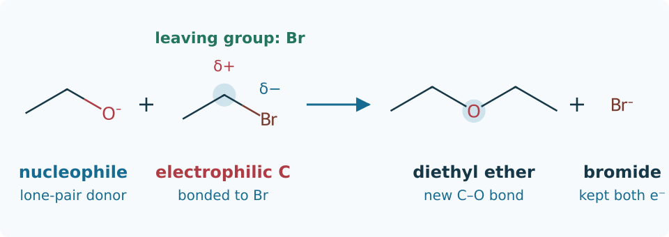{width=86% fig-alt="Ethoxide labelled nucleophile, the CH2 of bromoethane labelled electrophilic carbon with delta plus, bromine labelled leaving group, giving diethyl ether and bromide"}

- The **nucleophile** brings a lone pair to carbon.
- The **electrophilic carbon** is δ+ because Br pulls electron density away.
- The **leaving group** takes the old C–Br bonding pair with it, as Br⁻.

::: notes
This is the Williamson ether synthesis, and it's a good first example because every part is easy to spot. Ask the room: which atom donates electrons? (the O⁻). Which bond breaks? (C–Br). Where does that pair go? (onto Br, which becomes bromide). Point out the charge bookkeeping: ethoxide's oxygen has one bond and three lone pairs, so −1; in the ether it has two bonds and two lone pairs, so it's neutral. The negative charge didn't disappear, it moved to bromide. Total charge is −1 on both sides. That habit of checking total charge will catch half the errors today.
:::

## Classify the carbon that carries the leaving group

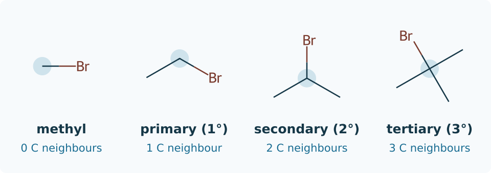{width=84% fig-alt="Bromomethane, bromoethane, 2-bromopropane and 2-bromo-2-methylpropane with the carbon bearing Br shaded and labelled methyl, primary, secondary and tertiary"}

Count the **carbon neighbours of the carbon bonded to Br**, not the carbons in the whole molecule.

::: {.try}
**Try it:** classify the carbon bearing Br in CH₃CH(Br)CH₂CH₃.

::: {.fragment}
**Secondary.** It's bonded to two carbons. The molecule has four carbons, but that doesn't make the centre tertiary.
:::
:::

::: notes
This classification decides almost everything that follows, so get it automatic. The trap is in the try-it: students see four carbons and say "tertiary", or see a branch and say "tertiary". Make them put a finger on the carbon that holds Br and count only the carbons touching it. The same counting comes back for carbocations later today (a tertiary cation has three carbons on C+) and for alcohols on Day 13 (primary, secondary and tertiary alcohols oxidise differently).
:::

## SN2: one step, two arrows

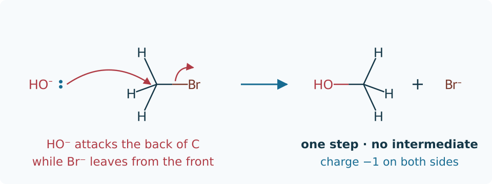{width=86% fig-alt="Curved arrow from a hydroxide lone pair to the carbon of bromomethane on the side opposite Br, and a second arrow from the C–Br bond to Br, giving methanol and bromide"}

- The new C–O bond forms **while** the C–Br bond breaks.
- **S**ubstitution, **N**ucleophilic, **2** molecules in the slow step.
- Swap in I⁻ and the same two arrows give CH₃I + Br⁻.

::: notes
Draw this on the board as well, slowly, and ask someone to redo it with iodide (exercise 4). Arrow one starts at a lone pair on oxygen and ends at carbon. Arrow two starts in the middle of the C–Br bond and ends on Br. Two arrows, one step. Point at the three H atoms: in the reactant they point left, away from Br; in the product they point right. The molecule has flipped inside out, like an umbrella in the wind. That flip is invisible here because methyl isn't a stereocentre, but it's the whole story two slides from now. Methyl bromide has no H on a neighbouring carbon, so elimination (tomorrow) can't compete.
:::

## The transition state sits at the top of one hill

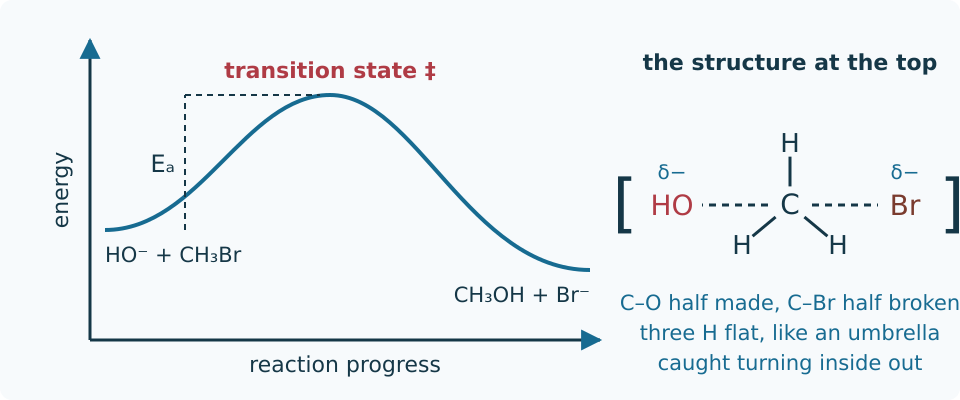{width=84% fig-alt="Energy profile with one maximum labelled transition state, and the transition state drawn as HO dashed to a flat CH3 dashed to Br, in brackets with a double dagger"}

At the top, C–O is half made and C–Br half broken. It's a **transition state**, not an intermediate: it lasts one molecular vibration and can't be isolated.

::: notes
Students often draw the transition state as a real molecule with five bonds to carbon. Stress the dashed bonds and the double-dagger: this is the highest-energy arrangement on the path, not a stop along it. There's no dip in the curve, so there's no intermediate. Compare with the SN1 profile later, which has two dips. The three H atoms are flat in the transition state, which is the halfway point of the umbrella flip. The barrier height, Ea, is what the rate constant k depends on; anything that raises the transition-state energy (crowding, a poor nucleophile) slows the reaction.
:::

## The SN2 rate depends on both partners

| change at fixed temperature and solvent | [RX] | [Nu] | initial rate |
|---|---|---|---|
| double the substrate | 2× | 1× | **2×** |
| double the substrate, triple the nucleophile | 2× | 3× | **6×** |
| halve the substrate, double the nucleophile | ½× | 2× | **1×** |

$$\text{rate} = k\,[\text{RX}]\,[\text{Nu}]$$

Both molecules are in the one step, so both concentrations appear. The factors **multiply**.

::: {.try}
**Try it:** both concentrations double. What happens to the initial rate?

::: {.fragment}
**4×.** 2 × 2 = 4, as long as k stays the same (same temperature and solvent).
:::
:::

::: notes
This is the "2" in SN2: the rate law is second order overall. Keep it concrete with the factor table rather than algebra. Two warnings. First, this is about initial rate, not yield: a reaction that's six times faster doesn't give six times more product. Second, k is only constant if temperature and solvent stay the same; change the solvent and you change k. The Day 11 demo lets students compare this rate law with the SN1 one by changing concentrations and watching the predicted rates.
:::

## Backside attack inverts a stereocentre

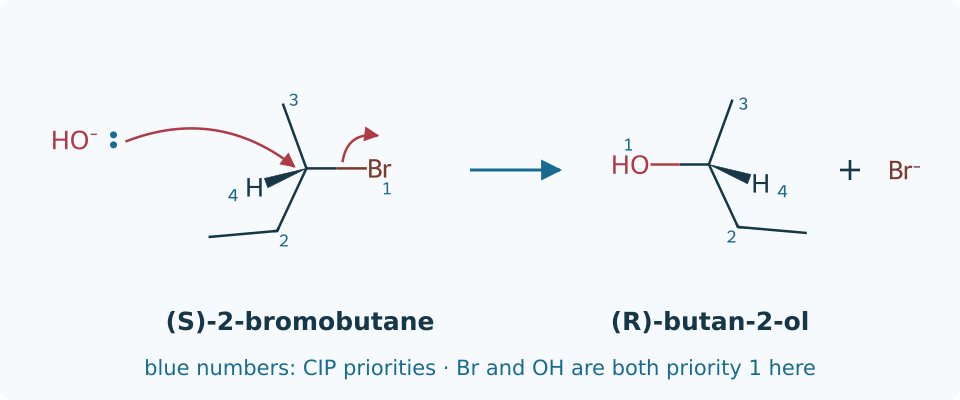{width=86% fig-alt="Hydroxide attacks (S)-2-bromobutane opposite Br; the methyl, ethyl and wedged H flip to the other side, giving (R)-butan-2-ol. Priority numbers 1 to 4 are shown on both"}

The nucleophile comes in **opposite** the leaving group, so the other three groups flip over. This is **inversion of configuration**, and it happens in every SN2 step.

::: notes
Use a molecular model if you have one: hold the H, methyl and ethyl like the ribs of an umbrella and push the OH in from the back. The ribs flip. In the drawing, the H stays wedged but has moved from the left side of the carbon to the right, and the other two groups have swung across too. Walk through the priorities on both structures using the blue numbers: Br is 1, ethyl 2, methyl 3, H 4 in the reactant; OH is 1, ethyl 2, methyl 3, H 4 in the product. Because the new group takes the old group's rank, the geometric flip shows up as S becoming R. The next slide shows why that's not automatic.
:::

## Inversion is geometry; R and S are labels

| | (S)-2-bromobutane + OH⁻ | (R)-2-bromopropan-1-ol + CN⁻ |
|---|---|---|
| priorities before | **Br** > ethyl > methyl > H | **Br** > CH₂OH > CH₃ > H |
| priorities after | **OH** > ethyl > methyl > H | CH₂OH > **CN** > CH₃ > H |
| geometry | inverted | inverted |
| label | S → **R** | R → **R** |

::: {.try}
**Try it:** in the second example, why does the letter stay R even though SN2 inverted the centre?

::: {.fragment}
**Priorities 1 and 2 swapped.** CH₂OH (O first) now outranks CN (N, N, N), so the relabelling cancels the geometric flip.
:::
:::

::: notes
This is the slide that separates students who understand CIP from those who memorised "SN2 flips the letter". The geometry always inverts. Whether the letter changes depends on whether the incoming group takes the same priority rank as the outgoing one. In the first example it does: Br and OH are both top priority. In the second, Br was 1 but cyanide is only 2, because at the first point of difference CH2OH has an O and the nitrile carbon only has N. Both labels here were checked with RDKit's CIP labeller. Send students back to Day 7 if they're shaky on how CIP counts the atoms of a triple bond.
:::

## Crowding at the back stops SN2

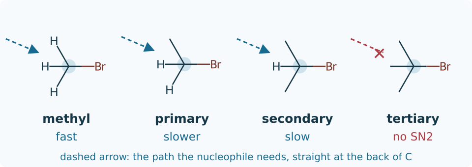{width=86% fig-alt="Four bromides drawn with Br to the right and three groups on the attack side: methyl fast, primary slower, secondary slow, tertiary blocked with a red cross"}

Each carbon group on the reacting carbon sits in the nucleophile's path. **Methyl > primary > secondary**, and tertiary carbons don't do SN2 at all.

::: notes
The drawing shows the three groups on the attack side. For methyl they're all small H atoms; for tertiary they're three methyl groups, each with its own H atoms waving around, and there's simply no room. A strong nucleophile can't fix a geometric problem. That's the point of exercise 10: students sometimes argue "strong nucleophile, so SN2" for tertiary bromides. What actually happens with a tertiary bromide and a strong base is elimination, which is tomorrow. Secondary is the grey zone: SN2 works, but slowly, and other paths compete.
:::

## A good leaving group is a weak base

| leaving group | its conjugate acid | pKa of that acid | leaving group? |
|---|---|---|---|
| I⁻ | HI | about −10 | excellent |
| Br⁻ | HBr | about −9 | excellent |
| Cl⁻ | HCl | about −7 | good |
| H₂O | H₃O⁺ | −1.7 | good |
| HO⁻ | H₂O | 15.7 | very poor |

The leaving group has to hold the pair it takes. **Strong acid, weak conjugate base, good leaving group.**

::: notes
This connects straight back to Day 3. A leaving group leaves with the bonding pair, so it ends up as an anion (or as a neutral molecule if it started positive). Anions that are happy holding a negative charge are the conjugate bases of strong acids. Bromide and iodide are great; hydroxide is terrible, because HO− is a strong base. So you can't just push OH− off an alcohol. The table uses the classic value of 15.7 for water; some books quote 14, and the conclusion is the same either way. The next slide shows how to rescue alcohols.
:::

## Activating an alcohol: protonate first

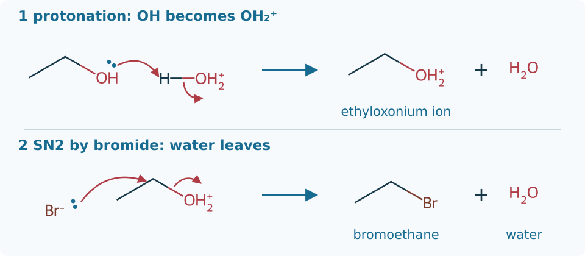{width=74% fig-alt="Step 1: ethanol's oxygen takes a proton from hydronium, giving the ethyloxonium ion. Step 2: bromide attacks carbon and water leaves, giving bromoethane"}

Protonating OH turns a terrible leaving group (HO⁻) into a good one (H₂O).

::: {.try}
**Try it:** does protonating ethanol mean the reaction now goes SN1?

::: {.fragment}
**No.** A primary carbocation is far too unstable. Bromide does an SN2 on the oxonium ion instead.
:::
:::

::: notes
This is how HBr converts primary alcohols into alkyl bromides. Step one is the proton transfer from Day 3, drawn with two arrows. Step two is an ordinary SN2 with water as the leaving group. The common mistake is to write CH3CH2+ after water leaves. Activation fixes the leaving group; it doesn't make a primary carbocation stable. With tertiary alcohols the same acid does give a carbocation, and that's SN1, coming up. Alcohols get their own day on Day 13.
:::

## Neutral nucleophiles leave a charge behind

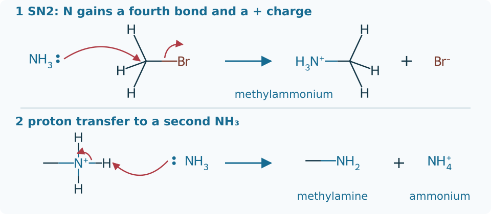{width=74% fig-alt="Step 1: ammonia attacks bromomethane giving methylammonium and bromide. Step 2: a second ammonia removes a proton from methylammonium, giving methylamine and ammonium"}

N goes from three bonds to **four bonds and +1**. The neutral amine needs a **separate** proton transfer to a base.

::: {.try}
**Try it:** a student writes NH₃ + CH₃Br → CH₃NH₂ + Br⁻. What's missing?

::: {.fragment}
**A step and a species.** CH₃NH₃⁺ forms first; another NH₃ must take H⁺ and becomes NH₄⁺.
:::
:::

::: notes
Count bonds at nitrogen after step 1: three to H, one to C, no lone pair, so +1. The tempting shortcut is to make the H "fall off". Protons never just leave; something has to take them, and here that's a second ammonia. Check the charge: step 2 starts at +1 and ends at +1. In practice you use excess ammonia, and the product mixture depends on amounts; the arrow-pushing is what we care about today. This neutral-nucleophile pattern repeats with water in SN1 in a few slides, and amines come back as nucleophiles in Week 4.
:::

## SN1 step 1: the leaving group goes first

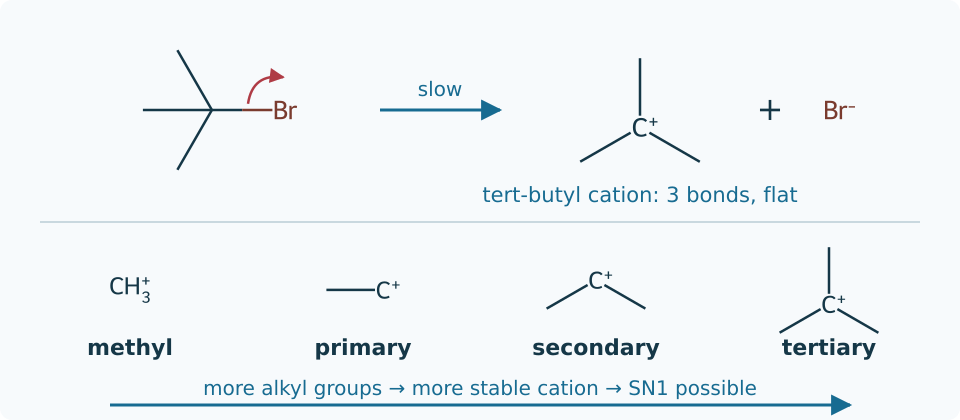{width=76% fig-alt="2-bromo-2-methylpropane loses bromide to give the flat tert-butyl cation; below, methyl, primary, secondary and tertiary cations with stability increasing to the right"}

With no room at the back, a tertiary bromide can **ionise** instead. The cation is flat, with three bonds and an empty orbital.

::: notes
One arrow: the C–Br bonding pair moves onto Br. Nothing attacks yet. This is the slow step, because pulling charges apart costs a lot of energy, and it only happens when the cation is stabilised. Alkyl groups donate electron density into the empty orbital (hyperconjugation is the name if anyone asks), so tertiary is the most stable and methyl is hopeless. That's the mirror image of SN2: SN2 needs an uncrowded carbon, SN1 needs a well-substituted one. A polar solvent like water helps by surrounding both ions.
:::

## SN1 steps 2 and 3: capture, then lose H⁺

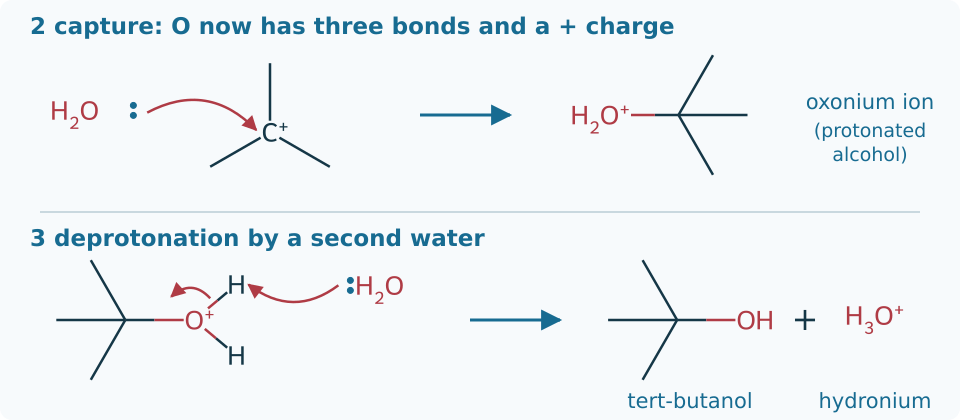{width=74% fig-alt="Step 2: a water lone pair attacks the tert-butyl cation, giving a protonated alcohol. Step 3: another water takes a proton from it, giving tert-butanol and hydronium"}

::: {.try}
**Try it:** add up all three steps, starting from (CH₃)₃CBr in water.

::: {.fragment}
**(CH₃)₃CBr + 2 H₂O → (CH₃)₃COH + H₃O⁺ + Br⁻.** The cation and oxonium ion cancel out. Atoms and charge both balance.
:::
:::

::: notes
After capture, oxygen has three bonds and one lone pair, so it's +1. Students love to write the neutral alcohol straight away, which silently deletes a proton. Insist on step 3 with a named base. It's the same move as the ammonia case. For the net equation, two waters are consumed: one as nucleophile, one as base. A net equation is accounting, not mechanism: it hides the intermediates, and it doesn't tell you how much alkene forms by the competing route on the last content slide.
:::

## The SN1 energy profile

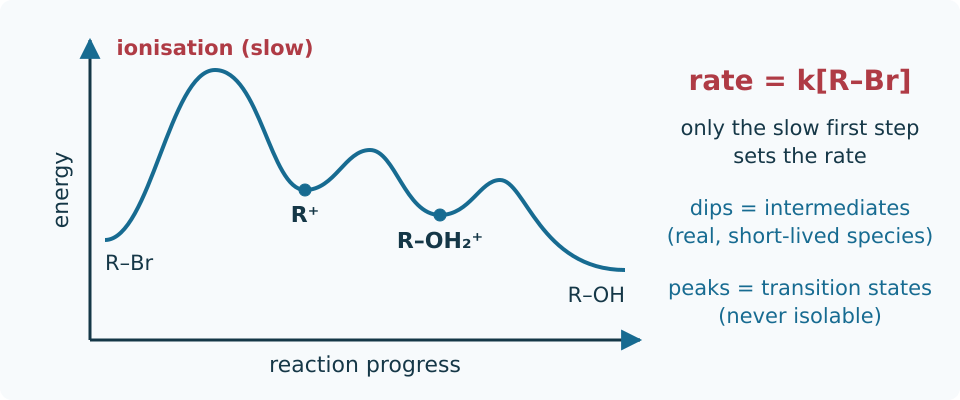{width=84% fig-alt="Energy profile with a tall first barrier labelled ionisation (slow), a dip for R+, a smaller barrier, a dip for R–OH2+, a small barrier and the product. Text: rate = k[R–Br]"}

Only the substrate is in the slow step, so **rate = k[R–Br]**. The **1** in SN1 means one molecule in the slow step.

::: {.try}
**Try it:** in an SN1 reaction you double the nucleophile concentration. What happens to the rate?

::: {.fragment}
**Nothing.** The nucleophile only joins after the slow step, so it doesn't appear in the rate law.
:::
:::

::: notes
Compare with the SN2 profile: one hill there, three here, and two real dips. The dips are intermediates; you could in principle detect them. The peaks are transition states. Since the first hill is by far the highest, everything after it is fast and doesn't affect the rate. This is the experimental test: change [Nu] and see if the rate changes. The demo for today does exactly that comparison with simulated data. Rate laws support a mechanism but don't prove every detail of it.
:::

## A flat cation has two faces

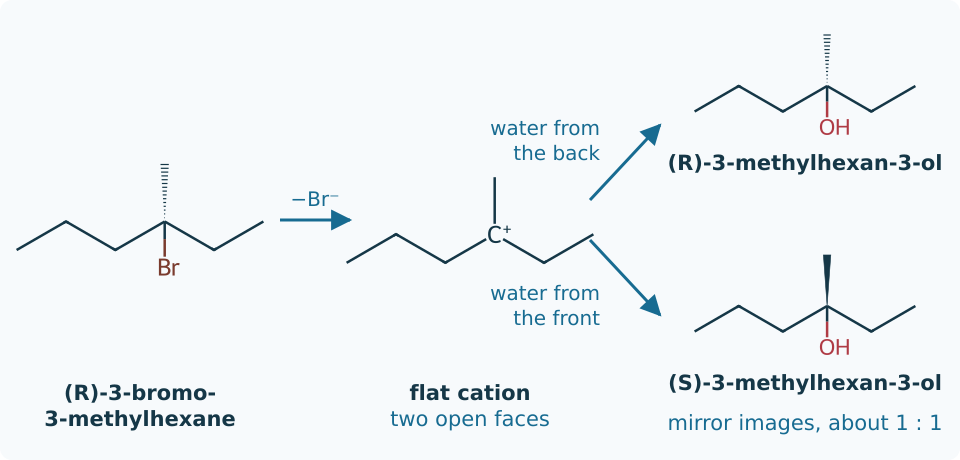{width=84% fig-alt="(R)-3-bromo-3-methylhexane loses bromide to give a flat carbocation; water attacks from the back to give (R)-3-methylhexan-3-ol or from the front to give (S)-3-methylhexan-3-ol"}

Water can reach either face, so an optically pure starting material gives **both enantiomers**.

::: {.try}
**Try it:** is an SN1 product always exactly 50 : 50?

::: {.fragment}
**Not exactly.** The departing Br⁻ briefly shields one face, so there's often a small excess of the inverted product.
:::
:::

::: notes
Contrast with SN2, which is stereospecific: one enantiomer in, one out. Here the stereocentre is destroyed when the cation forms, because a flat carbon with three groups isn't a stereocentre. Both products' labels were checked with RDKit. Note the drawings show OH in the plane and the methyl wedged or hashed: same information, just a different way of placing the molecule on the page. The ion-pair point matters for honesty, not for exams: the textbook "racemic" is an idealisation. Day 7's racemic mixtures and optical rotation are the link.
:::

## Solvent changes the rate constant

| solvent type | examples | what it does | favours |
|---|---|---|---|
| polar protic | water, methanol, ethanol | H-bonds stabilise both ions; also cage anions | **SN1** |
| polar aprotic | acetone, DMSO, DMF | dissolves salts but leaves anions free | **SN2** |

Same reactants in a different solvent means a different k.

::: notes
This is the content behind exercise 18. Protic solvents have O–H or N–H, so they can hydrogen bond. That's great for SN1, where the slow step makes ions. But for SN2 with an anionic nucleophile, the H-bonds wrap the anion and make it less eager to attack. Aprotic polar solvents dissolve sodium or potassium salts by surrounding the cation, while the anion stays relatively free and reactive. Don't oversell this: solvent is one factor among several, and the effect is on k, not on which atoms end up bonded.
:::

## SN1 or SN2? Weigh the evidence

| | SN2 | SN1 |
|---|---|---|
| steps | one | ionise, capture, (lose H⁺) |
| rate law | k[RX][Nu] | k[RX] |
| carbon | methyl > 1° > 2°, never 3° | 3°, sometimes 2°, never methyl or 1° |
| nucleophile | strong, often an anion | weak is fine: H₂O, ROH |
| solvent | polar aprotic helps | polar protic helps |
| stereochemistry | inversion | both faces, close to racemic |

::: {.try}
**Try it:** CH₃CH₂Br + NaCN in DMSO, and (CH₃)₃CBr in water. Which mechanism for each?

::: {.fragment}
**SN2** for the primary bromide with a strong anion in an aprotic solvent. **SN1** for the tertiary bromide in water.
:::
:::

::: notes
Encourage students to argue from the table rather than from a flowchart. The carbon class is usually the strongest clue. Methyl and primary: SN2. Tertiary: SN1 (or elimination). Secondary is genuinely ambiguous and the conditions decide. In the try-it, the primary nitrile synthesis gives propanenitrile, and it makes a new C–C bond, which is why cyanide is so useful in synthesis. Practise saying "because" for each choice.
:::

## Substitution has a competitor

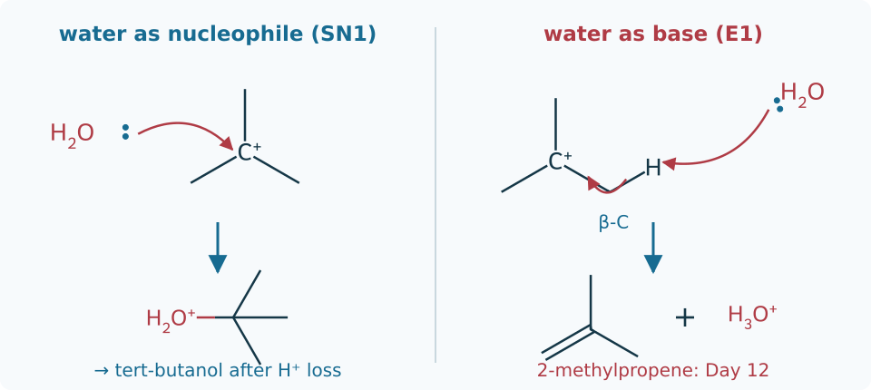{width=84% fig-alt="Left: water attacks the tert-butyl cation at carbon, giving the protonated alcohol (SN1). Right: water removes an H from a neighbouring carbon, the C–H pair forms a C=C bond, giving 2-methylpropene and hydronium (E1)"}

The same cation can **gain a nucleophile** (SN1) or **lose a β-H** (E1). Heat and strong bases push towards elimination.

::: notes
This is the bridge to tomorrow. The carbocation is a shared intermediate, and water can play two roles: nucleophile at the positive carbon, or base at an H on the next carbon (the beta carbon). In the E1 arrows, the C–H bonding pair becomes the new pi bond. So a tertiary bromide in water gives a mixture of alcohol and alkene, and the net equation from three slides ago only described one branch. Tomorrow we'll treat elimination properly, including the one-step E2 version that competes with SN2.
:::

## Mistakes we see every year

| mistake | fix |
|---|---|
| "four carbons, so tertiary" | count C neighbours of the **carbon bearing the leaving group** |
| SN2 on a tertiary bromide "because the nucleophile is strong" | the back face is **blocked** |
| a primary carbocation after protonating ethanol | activation fixes the leaving group; it's still **SN2** |
| writing R–OH as soon as water attacks R⁺ | **oxonium first**, then a base takes H⁺ |
| CH₃NH₂ straight from NH₃ + CH₃Br | **CH₃NH₃⁺** first, then proton transfer to NH₃ |
| "inversion, so R becomes S" | **re-rank** the priorities in the product |
| "SN1 always gives exactly 50 : 50" | both faces react, but ion pairs can bias it |

::: notes
Read each mistake aloud and ask for the fix before revealing it. Every row is tied to an exercise: 1 and the quiz question on classification; 10; 17; 12 and 19; 6 and 7; 15; and 16. Students who still make one of these know which exercise to redo tonight.
:::

## Summary

| concept | key fact |
|---|---|
| substitution | nucleophile in, leaving group out, at a δ+ carbon |
| SN2 | one step, backside attack, **rate = k[RX][Nu]** |
| SN2 stereochemistry | **inversion**; re-rank before naming R or S |
| SN2 carbon | methyl > 1° > 2°; not 3° |
| leaving group | weak base; protonate OH to make H₂O leave |
| neutral nucleophile | gives a cation; a separate base removes H⁺ |
| SN1 | ionise (slow), capture, lose H⁺; **rate = k[RX]** |
| SN1 stereochemistry | flat cation, both faces, close to racemic |
| competition | the same cation can lose β-H (E1) |

**Next:** elimination and addition: making and breaking C=C (Day 12). **Practice:** [exercises](exercise.qmd) · [self-check](quiz.qmd)

::: notes
Go back to the nitrogen mustard: a nitrogen nucleophile, a carbon with a chloride leaving group, an SN2 step. Students can now draw it. Tomorrow's lecture picks up from the competition slide: the same reagents that act as nucleophiles can act as bases, and then we get alkenes. Core exercises 1 to 12 are the minimum; 13 to 20 are transfer problems, and 15, 16 and 20 are good preparation for tomorrow.
:::
