## What will you be able to explain?

- Explain a concerted SN2 and a stepwise SN1 example.
- Predict inversion at a reacting stereocentre.
- Justify a pathway using substrate and conditions.

::: notes
**45-minute block budget (all pauses included):** 0–4 min: reacting-centre classification; 4–14 min: SN2 arrows, inversion and rate model; 14–21 min: steric access and leaving-group activation; 21–32 min: SN1 ionisation, capture and deprotonation; 32–39 min: face access, net accounting and competing routes; 39–43 min: independent mechanism drawing; 43–45 min: recap. The brief predictions, individual drawing and board discussion occur inside these blocks, not in extra time. The 40-second metadata is a rough planning reference; spend longer on the identified drawings and merge explanations already understood.

Begin with the previous unit’s electron-pair and charge audit. Ask students to predict a product or bond change before displaying the worked drawing. These slides support discussion and paper drawing; the practice page supplies further explanations.
:::

## Predict before the worked drawing

Draw CH₃CH₂Br and CH₃CH(Br)CH₃. Circle the carbon attached to Br, count carbon neighbours and predict which centre is less crowded.

::: notes
Allow about 25 seconds of individual drawing/thinking, then ask for one reason. Do not display the worked product yet. Use the following illustration to resolve the atom, charge or geometry issue.
:::

## Classify the reacting carbon

{width=85% fig-alt="Primary, secondary and tertiary alkyl bromides differ in carbon neighbours at the carbon attached to Br."}

Count the carbon neighbours of **the carbon carrying the leaving group**. Do not classify the whole molecule by total carbon count.

::: notes
The highlighted region locates the reaction centre. Ask students to draw the tertiary example fully and count four bonds at its central carbon.
:::

## Partial bonds belong to a transition state

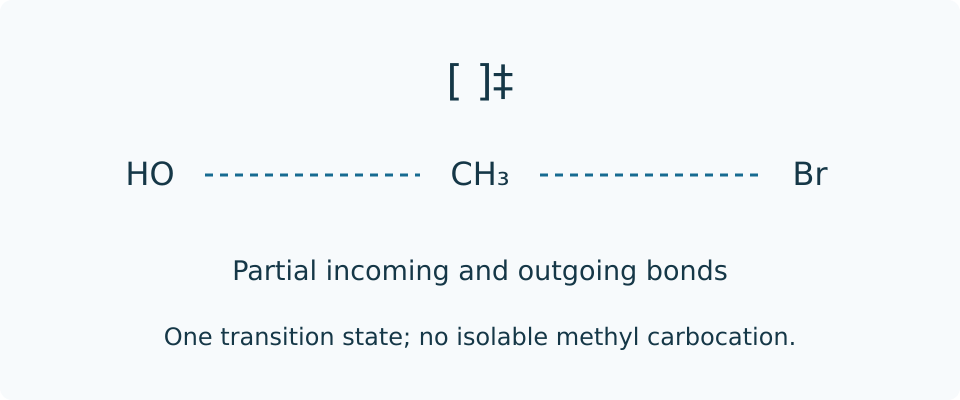{width=85% fig-alt="Partial bonds belong to a transition state"}

Read the dashed incoming/outgoing bonds. Explain why this is neither a stable five-bonded carbon nor a carbocation minimum.

::: notes
The transition state has partial bond formation/cleavage and is marked‡. One elementary SN2 step has no intervening stable intermediate.
:::

## Place this structure on the profile

{width=85% fig-alt="Partial bonds belong to a transition state"}

Sketch a one-step energy curve and put the depicted structure at its maximum, not between two maxima.

::: notes
The transition state has partial bond formation/cleavage and is marked‡. One elementary SN2 step has no intervening stable intermediate.
:::

## Predict before the worked drawing

For methyl bromide plus hydroxide, draw a backside approach and two electron-pair arrows. Does a carbocation appear?

::: notes
Allow about 25 seconds of individual drawing/thinking, then ask for one reason. Do not display the worked product yet. Use the following illustration to resolve the atom, charge or geometry issue.
:::

## SN2 couples bond formation and cleavage

{width=85% fig-alt="Hydroxide attacks methyl bromide from the side opposite bromine as bromide departs."}

One step: donor pair → carbon; C–Br bond pair → Br.

CH₃Br + OH⁻ → CH₃OH + Br⁻.

::: notes
This methyl example is deliberately simple. Hydroxide can also act as a base on suitable substrates, but methyl bromide has no beta carbon for elimination.
:::

## Change a concentration while keeping the model fixed

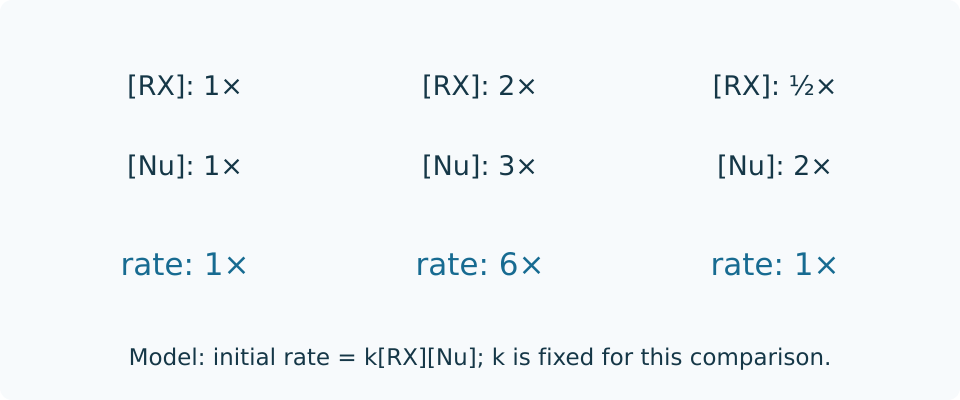{width=85% fig-alt="Change a concentration while keeping the model fixed"}

Calculate the factor for doubling[RX] and tripling[Nu]. Identify what “k fixed” assumes.

::: notes
The factors multiply:6 and1 respectively. The statement is initial kinetics at unchanged temperature, solvent and applicable mechanism.
:::

## Find an offsetting concentration change

{width=85% fig-alt="Change a concentration while keeping the model fixed"}

Explain why halving[RX] while doubling[Nu] gives the same initial rate in this model, without claiming equal yield.

::: notes
The factors multiply:6 and1 respectively. The statement is initial kinetics at unchanged temperature, solvent and applicable mechanism.
:::

## Predict before the worked drawing

Use a tetrahedral model with Br, H, methyl and ethyl. Replace Br through backside attack. Predict what happens to the retained group arrangement.

::: notes
Allow about 25 seconds of individual drawing/thinking, then ask for one reason. Do not display the worked product yet. Use the following illustration to resolve the atom, charge or geometry issue.
:::

## Backside attack inverts local geometry

{width=85% fig-alt="A schematic chiral carbon shows its retained group arrangement inverted when Br is replaced by OH."}

SN2 gives inversion at the reacting tetrahedral carbon. Reassign priorities before stating a product R/S label.

::: notes
The diagram uses R as a generic carbon substituent, not the R configuration descriptor. Replacing Br can change CIP priorities, so inversion does not universally mean the letter changes.
:::

## Locate the ions on the energy path

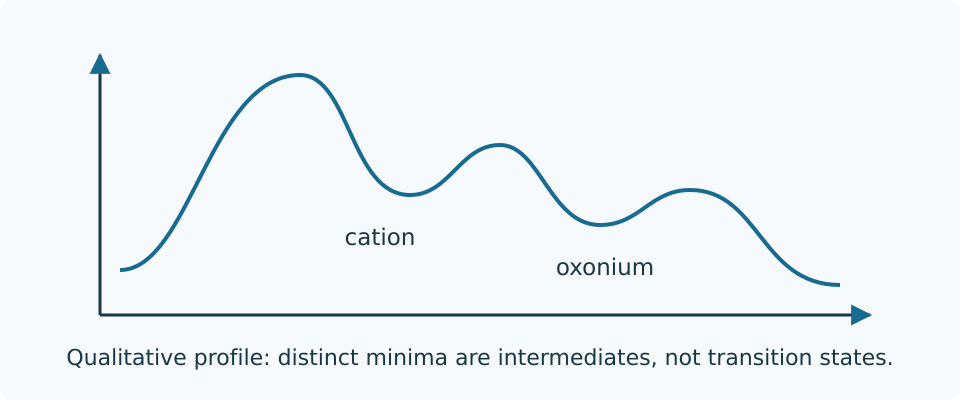{width=85% fig-alt="Locate the ions on the energy path"}

Name the two depicted minima after initial reactants. Which one exists before water has bonded to carbon?

::: notes
The first minimum is carbocation, the second oxonium. Positive charge shifts from carbon to attacking oxygen before proton transfer produces neutral alcohol.
:::

## Match steps to changes in charge location

{width=85% fig-alt="Locate the ions on the energy path"}

Identify ionisation, capture and deprotonation. Where is the positive charge in each intermediate?

::: notes
The first minimum is carbocation, the second oxonium. Positive charge shifts from carbon to attacking oxygen before proton transfer produces neutral alcohol.
:::

## Predict before the worked drawing

Using rate=k[RX][Nu], predict the effect of doubling each concentration separately. What if both change?

::: notes
Allow about 25 seconds of individual drawing/thinking, then ask for one reason. Do not display the worked product yet. Use the following illustration to resolve the atom, charge or geometry issue.
:::

## Both collision partners affect the rate

{width=85% fig-alt="A schematic straight line shows initial SN2 rate proportional to nucleophile concentration at fixed substrate."}

For this simple model: rate = k[substrate][nucleophile]. Doubling one concentration doubles initial rate when the other is fixed.

::: notes
This is a mechanistic model diagram, not measured data. Rate laws are evidence for mechanisms, but a single dependence does not prove every microscopic detail.
:::

## A neutral donor produces an ionic pair

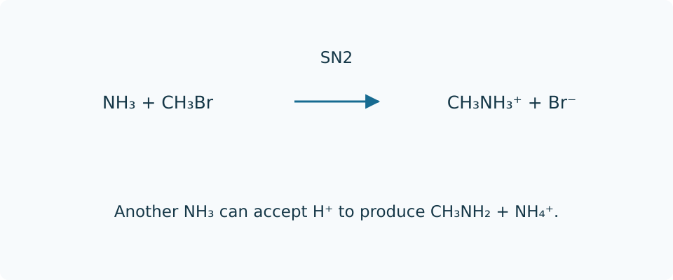{width=85% fig-alt="A neutral donor produces an ionic pair"}

Give nitrogen’s bond count immediately after methyl capture. Why is CH₃NH₂ premature?

::: notes
NH₃ first forms CH₃NH₃⁺. Another NH₃ can take H⁺; proton loss cannot be implied without its recipient.
:::

## Make the neutral amine by a real step

{width=85% fig-alt="A neutral donor produces an ionic pair"}

Use NH₃ as base and draw methylammonium deprotonation, including NH₄⁺.

::: notes
NH₃ first forms CH₃NH₃⁺. Another NH₃ can take H⁺; proton loss cannot be implied without its recipient.
:::

## Predict before the worked drawing

Compare methyl, primary and tertiary centres. What geometric access does a strong nucleophile still need?

::: notes
Allow about 25 seconds of individual drawing/thinking, then ask for one reason. Do not display the worked product yet. Use the following illustration to resolve the atom, charge or geometry issue.
:::

## Crowding obstructs backside approach

{width=85% fig-alt="Substituent spheres illustrate less accessible attack at a more substituted saturated carbon."}

Methyl and many primary substrates are accessible to SN2. Tertiary alkyl centres strongly obstruct the required approach.

::: notes
This drawing illustrates access rather than molecular dimensions. Solvent and nucleophile still matter; do not teach substrate class as the only variable.
:::

## Activation changes the departing species

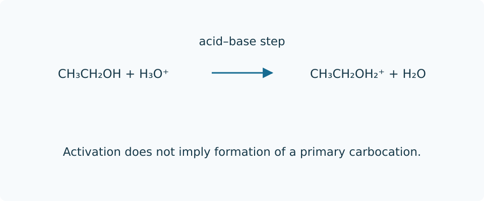{width=85% fig-alt="Activation changes the departing species"}

Compare loss of OH⁻ from a neutral alcohol with departure of water from oxonium.

::: notes
Water is the improved leaving group after protonation. Activation is not evidence that an ordinary primary carbocation becomes a suitable intermediate.
:::

## Reject an unsupported primary carbocation

{width=85% fig-alt="Activation changes the departing species"}

Does protonating ethanol prove an SN1 route? Explain why substrate stability still matters.

::: notes
Water is the improved leaving group after protonation. Activation is not evidence that an ordinary primary carbocation becomes a suitable intermediate.
:::

## Predict before the worked drawing

Draw tertiary C–Br cleavage in water. Which species receives the pair? Which newly formed charged species needs stabilisation?

::: notes
Allow about 25 seconds of individual drawing/thinking, then ask for one reason. Do not display the worked product yet. Use the following illustration to resolve the atom, charge or geometry issue.
:::

## SN1 begins by forming ions

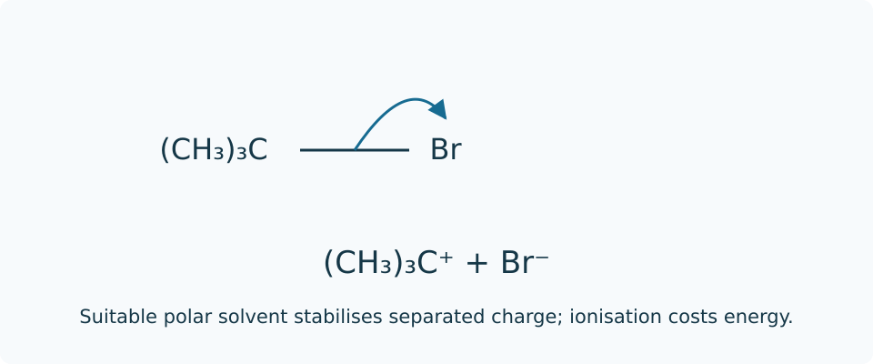{width=85% fig-alt="A tertiary C–Br bond cleaves to a tertiary carbocation and bromide."}

Ionisation precedes nucleophile capture. A suitable polar medium can stabilise charged species.

::: notes
Show a real bond pair moving to Br. Forming a carbocation has an energy cost; students should not transfer this step to methyl or ordinary primary substrates.
:::

## Use the SN2 pattern for a new bond

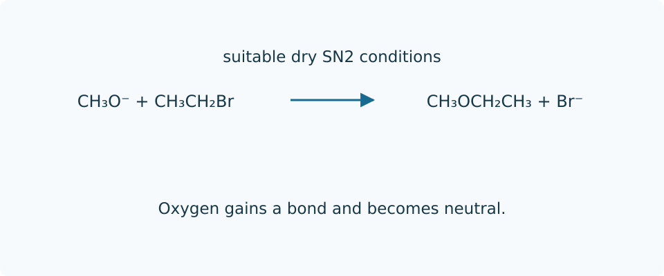{width=85% fig-alt="Use the SN2 pattern for a new bond"}

Mark the incoming oxygen and the substrate carbon that become bonded in ether formation.

::: notes
Methoxide changes from one to two bonds at O and becomes neutral in the ether. Br receives the leaving pair and carries−1.
:::

## Conserve valence and the negative charge

{width=85% fig-alt="Use the SN2 pattern for a new bond"}

Count oxygen bonds before and after, then locate the remaining anionic species.

::: notes
Methoxide changes from one to two bonds at O and becomes neutral in the ether. Br receives the leaving pair and carries−1.
:::

## Predict before the worked drawing

Water attacks a carbocation through oxygen. Before removing any H, count the bonds at that oxygen and assign its charge.

::: notes
Allow about 25 seconds of individual drawing/thinking, then ask for one reason. Do not display the worked product yet. Use the following illustration to resolve the atom, charge or geometry issue.
:::

## Water can be a nucleophile

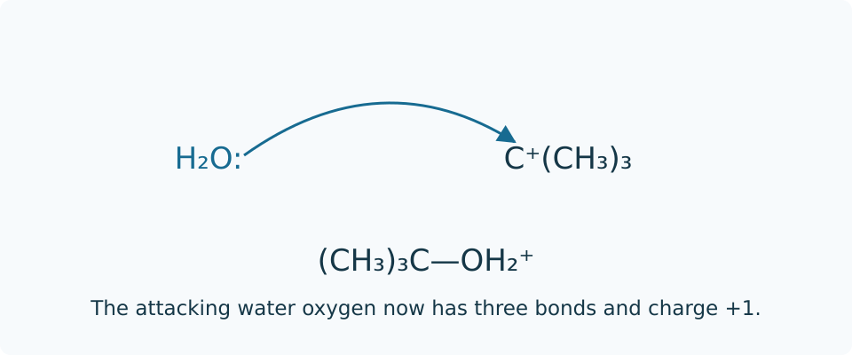{width=85% fig-alt="A water oxygen lone pair attacks a carbocation to give a protonated alcohol."}

A neutral nucleophile can form a new bond. Here the attacking oxygen becomes positively charged.

::: notes
Count three oxygen bonds in the oxonium product. Do not let students write a neutral alcohol at this stage; that would lose an H and change the charge.
:::

## Check the whole chosen branch

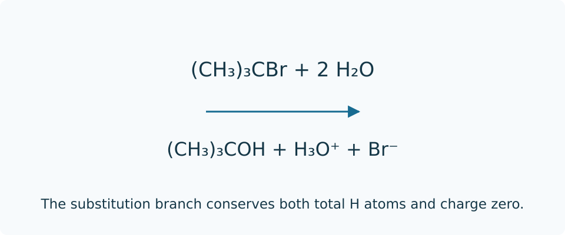{width=85% fig-alt="Check the whole chosen branch"}

Count both waters and every product H in the net tertiary aqueous substitution.

::: notes
Carbocation and oxonium cancel as intermediates. The net substitution branch does not exclude competing E1 or specify its proportion.
:::

## Keep a net equation separate from its mechanism

{width=85% fig-alt="Check the whole chosen branch"}

Which intermediates are absent from the net equation, and why does it not establish the SN1/E1 product ratio?

::: notes
Carbocation and oxonium cancel as intermediates. The net substitution branch does not exclude competing E1 or specify its proportion.
:::

## Predict before the worked drawing

Draw the step that converts a three-bond oxonium oxygen to a two-bond neutral alcohol. Where does its proton go?

::: notes
Allow about 25 seconds of individual drawing/thinking, then ask for one reason. Do not display the worked product yet. Use the following illustration to resolve the atom, charge or geometry issue.
:::

## Finish the proton transfer

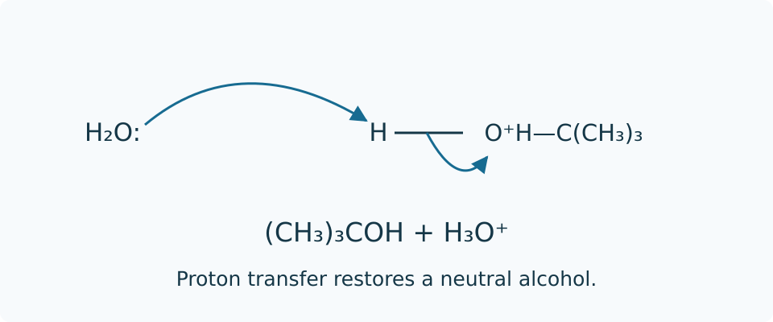{width=85% fig-alt="A second water molecule accepts H from the oxonium ion, giving alcohol and hydronium."}

The neutral alcohol is produced by deprotonation, not by silently deleting H⁺.

::: notes
Track a spectator bromide separately if writing the whole solution reaction. All individual steps must conserve charge.
:::

## Translate geometry into a descriptor carefully

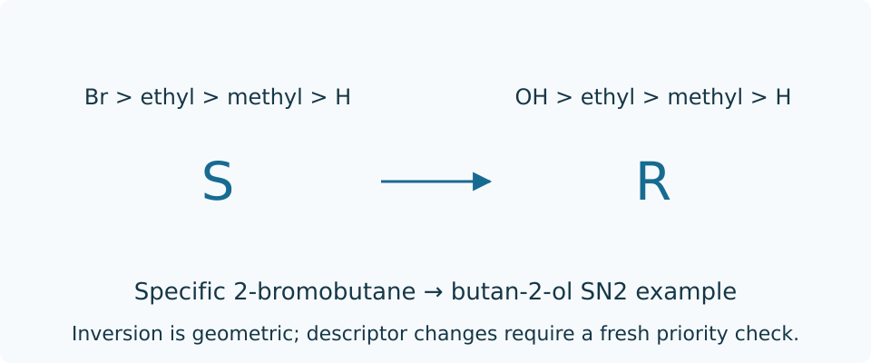{width=85% fig-alt="Translate geometry into a descriptor carefully"}

For(S)-2-bromobutane→butan-2-ol SN2, compare priority rankings before assigning the product.

::: notes
Geometric inversion is the general rule. Here Br/OH each rank first, ethyl second, methyl third, H last; inversion therefore gives R product.
:::

## Distinguish the general rule from this example

{width=85% fig-alt="Translate geometry into a descriptor carefully"}

State what always follows from the SN2 geometry and what required this particular priority comparison.

::: notes
Geometric inversion is the general rule. Here Br/OH each rank first, ethyl second, methyl third, H last; inversion therefore gives R product.
:::

## Predict before the worked drawing

A planar carbocation is formed in an achiral medium. Where can a nucleophile approach relative to its three-bond plane?

::: notes
Allow about 25 seconds of individual drawing/thinking, then ask for one reason. Do not display the worked product yet. Use the following illustration to resolve the atom, charge or geometry issue.
:::

## A planar carbocation has two faces

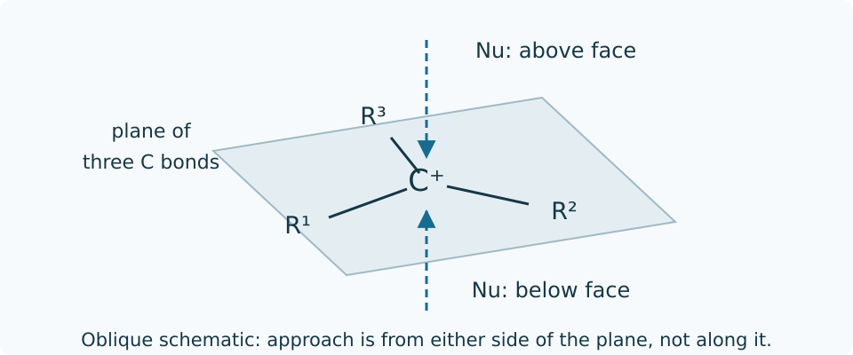{width=85% fig-alt="A planar carbocation permits nucleophilic approach from either face."}

An achiral medium can give both configurations. Ion-pair effects may prevent an exactly racemic product.

::: notes
This is a face-access cartoon; arrows represent approaches, not a full electron-flow mechanism. Do not promise exactly 50:50 for every SN1 reaction.
:::

## Predict before the worked drawing

On a secondary bromide, mark the atom attacked in substitution and the atom attacked in beta elimination. Why is “strong reagent” insufficient?

::: notes
Allow about 25 seconds of individual drawing/thinking, then ask for one reason. Do not display the worked product yet. Use the following illustration to resolve the atom, charge or geometry issue.
:::

## Substitution is one possible outcome

{width=85% fig-alt="A secondary alkyl bromide can follow nucleophilic substitution or beta-proton elimination."}

Compare substrate, leaving group, nucleophile/base, solvent and temperature. Conditions are part of the question.

::: notes
We will handle elimination next. A decision should cite evidence; a colour-coded flowchart is not a substitute for explaining the elementary steps.
:::

## Which conditions support each example?

**Methyl bromide + hydroxide:** accessible carbon and a strong pair donor support the SN2 model.

**Tertiary bromide in water:** ionisation can precede water capture, with elimination competing.

Neither is a universal rule for every solvent and temperature.

## Leaving-group quality matters

A departing group must accommodate its electron pair. Bromide is a plausible leaving group; OH⁻ is poor under ordinary substitution conditions.

Protonating an alcohol can allow loss as water. Draw that activation step before using it.

## Predict before checking

For CH₃Br + OH⁻, give the product, both curved arrows and net charge.

For (CH₃)₃CBr in water, draw ionisation, water capture and deprotonation. Name a competing outcome.

## Use the same reasoning in practice

Complete the [practice and worked examples](exercise.qmd), then the [self-check](quiz.qmd).

Optional textbook support: selected Solomons chapter 6 sections. The [reading guide](../reference/reading.qmd) explains the provisional book mapping.

::: notes
Session budget45 minutes:roughly27–29 minutes of concise explanations/visual inspection, about 11–13 minutes of individual drawing and predictions distributed through the sequence, and4–6 minutes of discussion/closing checks. Adjust to observed errors; the 40 second metadata is a planning guide, not a quota. Required paper practice and optional transfer are available in the exercise bank.
:::
