## About this lecture

Acetylsalicylic acid was first made in 1853, as a crude product that nobody could sell. In 1897 chemists at Bayer made it **clean and reproducibly**, and two years later it went on sale as **aspirin**. Same reaction; the difference was evidence of identity and purity.

In the practical you'll make aspirin yourself. Today we learn to answer three separate questions about the white solid on your filter paper:

- **Planning:** a route is a sequence of functional-group changes
- **Amounts:** moles, the limiting reagent, and coefficients
- **Yield:** the theoretical maximum versus what you weighed
- **TLC:** what Rf measures, and what one spot can't prove
- **Spectra:** IR and NMR as checks on identity and purity

Yesterday you read structures from spectra; today those spectra become evidence about a reaction you ran.

::: notes
Open with the aspirin story. Charles Gerhardt made acetylsalicylic acid in 1853 but his material was impure and he didn't pursue it; Felix Hoffmann's 1897 preparation at Bayer was clean enough to become a medicine, sold as Aspirin from 1899. The chemistry hadn't really changed; what changed was being able to make a pure product reliably and show that it was pure. That's exactly the gap students meet in the lab: a mass on a balance isn't the same as a pure compound. Name the three questions explicitly and keep coming back to them: how much (yield), is it the right molecule (identity), and is anything else in there (purity). Most marks lost on practical reports come from letting one of those answers stand in for another.
:::

## Plan a route by functional-group changes

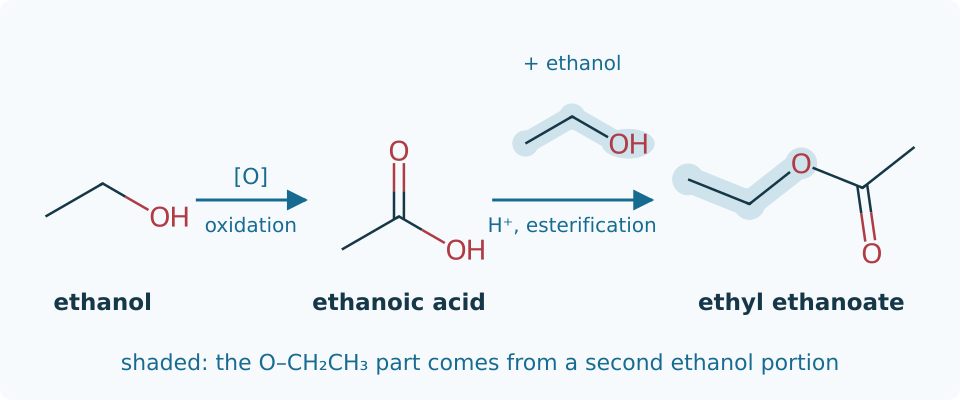{width=88% fig-alt="Ethanol is oxidised to ethanoic acid, which is esterified with a second ethanol portion to give ethyl ethanoate; the ethoxy part of the ester is shaded"}

Work backwards from the target: an **ester** comes from an acid plus an alcohol, and the **acid** comes from oxidising an alcohol (Day 13). Each arrow changes one functional group.

::: {.try}
**Try it:** where does the O–CH₂CH₃ part of ethyl ethanoate come from?

::: {.fragment}
**From a second portion of ethanol.** The first portion is oxidised to the acid; a fresh portion supplies the alkoxy group in the acid-catalysed esterification.
:::
:::

::: notes
Planning is just functional-group bookkeeping. Ask: what bond did the last step make? In an ester it's the C(=O)–O bond, so the last step joins an acid and an alcohol. That's the Fischer esterification from Week 4 (acyl chemistry, Day 17). The common confusion is thinking the same ethanol molecule somehow becomes both halves. Draw two separate flasks if needed. Stress that a route on paper says nothing about conditions, work-up or yield; it's a plan, not a protocol.
:::

## Choose where the oxidation stops

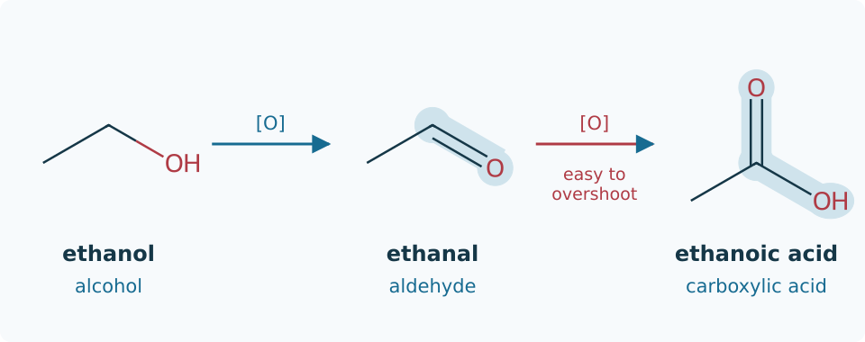{width=84% fig-alt="Ethanol oxidised to ethanal, then a red arrow to ethanoic acid, labelled easy to overshoot"}

A primary alcohol oxidises to an **aldehyde** and then on to an **acid**. If ethanal is the target, a bare "[O]" isn't enough: the conditions must stop at the aldehyde and let you isolate it.

Stopping early doesn't *prove* you have pure ethanal either. You still need evidence that it's there and that the acid isn't.

::: notes
Link back to alcohols and redox on Day 13. In practice, aldehyde-selective conditions or distilling the aldehyde out as it forms (ethanal boils at about 20 °C) are ways to avoid over-oxidation; we don't need the reagent details today. The key reasoning point is the second sentence: a target label on a reaction scheme is a hope. Ask the room what evidence would distinguish ethanal from ethanoic acid. Good answers: IR (broad acid O–H, aldehyde C–H near 2700–2800), NMR (aldehyde H near 9.8 ppm versus acid H near 11–12). That's yesterday's content applied.
:::

## The aspirin reaction: one oxygen changes

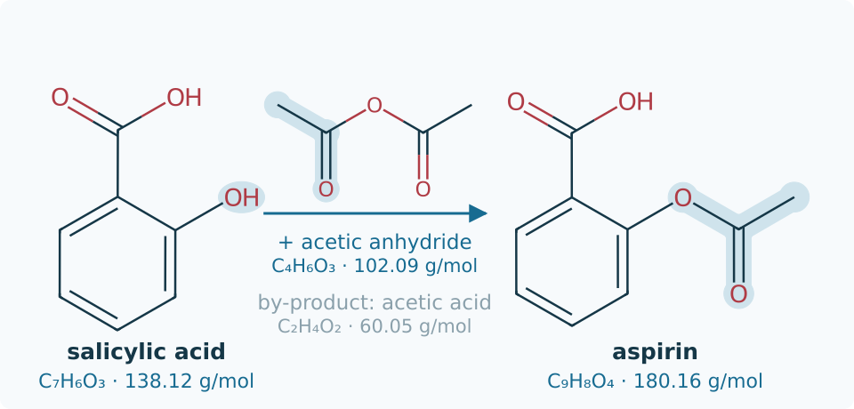{width=80% fig-alt="Salicylic acid reacts with acetic anhydride, drawn above the arrow, to give aspirin and acetic acid; the phenolic oxygen and the transferred acetyl group are shaded"}

The **phenol O–H** becomes an ester; the **carboxylic acid** is untouched, so aspirin is an acid *and* an ester. All coefficients are 1: 138.12 + 102.09 = 180.16 + 60.05.

It's an **acyl substitution** (Day 17): the phenol oxygen attacks one C=O of the anhydride, and acetate leaves as acetic acid.

::: notes
This is an acyl substitution from Day 17: the phenol oxygen attacks one carbonyl of the anhydride, and acetate leaves, ending up as acetic acid. Make students point at the shaded atoms: the acetyl group comes from the anhydride, the oxygen comes from salicylic acid. Ask why we bother writing acetic acid in the equation if we only want aspirin: it balances the atoms, and it's a real by-product that can contaminate the crude solid. Have them check the molar masses add up; it's a quick way to catch a wrong formula.
:::

## Grams don't react; moles do

| reagent | m / g | M / g mol⁻¹ | n = m / M |
|---|---|---|---|
| salicylic acid | 1.3812 | 138.12 | 0.01000 mol = **10.00 mmol** |
| acetic anhydride | 1.53135 | 102.09 | 0.01500 mol = **15.00 mmol** |

$$n = \frac{m}{M} \qquad \frac{\text{g}}{\text{g mol}^{-1}} = \text{mol} \qquad 1\ \text{mol} = 1000\ \text{mmol}$$

Write the units every time and let them cancel.

::: {.try}
**Try it:** you weigh out **1.00 g of each** reagent. Is either in excess?

::: {.fragment}
**Yes, the anhydride.** 1.00 / 138.12 = 7.24 mmol acid, but 1.00 / 102.09 = 9.80 mmol anhydride. Equal masses aren't equal amounts.
:::
:::

::: notes
This is Day 1 arithmetic, but now it's load-bearing. Give students 60 seconds to do the anhydride row on paper before revealing it. Watch for two slips: dividing the wrong way round (M/m), and mixing mmol and mol later when multiplying by a molar mass in g/mol. Here the anhydride really is in excess, but you can only say that after converting both to moles. The next slide makes the comparison properly.
:::

## The limiting reagent sets the ceiling

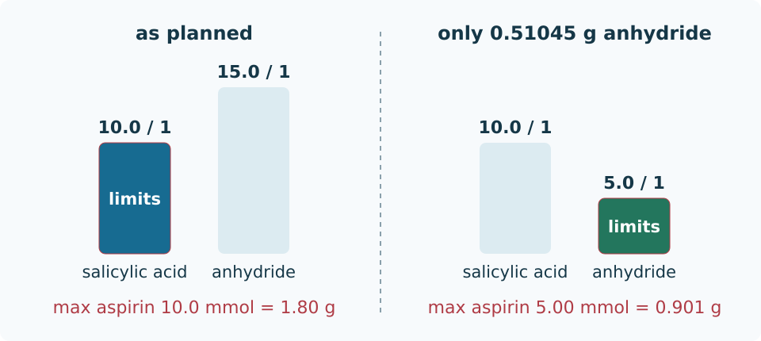{width=82% fig-alt="Bar charts: as planned, salicylic acid 10.0 mmol limits against 15.0 mmol anhydride; with only 0.51045 g anhydride, 5.00 mmol anhydride limits against 10.0 mmol acid"}

Divide each amount by its coefficient. The **smallest n / coefficient** is the limiting reagent; the rest is left over and can't make extra product.

::: {.try}
**Try it:** keep 10.00 mmol salicylic acid but use only 0.51045 g anhydride. What limits, and what's the maximum aspirin mass?

::: {.fragment}
0.51045 / 102.09 = **5.00 mmol anhydride**, which now limits. 0.00500 mol × 180.16 g/mol = **0.9008 g** aspirin.
:::
:::

::: notes
The point of the second panel is that "salicylic acid is the limiting reagent" is not a fact about aspirin chemistry; it's a fact about the amounts you weighed. Recompute every time an input changes. In the planned case, the 5 mmol of excess anhydride is deliberate: it's cheap, it pushes the reaction along, and it's easy to remove (it hydrolyses to acetic acid during work-up). Ask: does using 30 mmol of anhydride raise the theoretical yield? No, the acid still caps it at 10 mmol.
:::

## Coefficients change the comparison

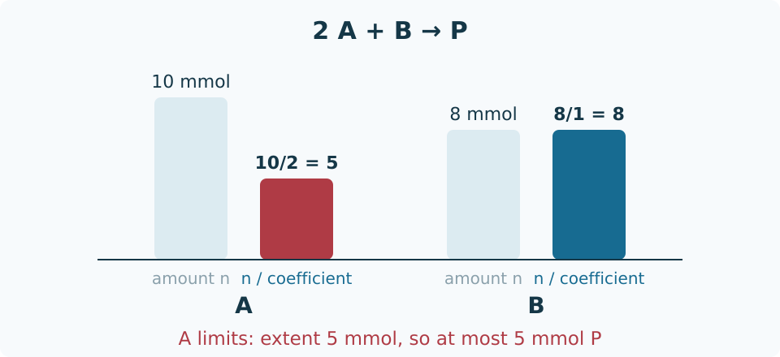{width=74% fig-alt="Bars for A: 10 mmol raw, 5 after dividing by 2, shown red; for B: 8 mmol raw and 8 after dividing by 1"}

For 2 A + B → P with 10 mmol A and 8 mmol B, **A** looks plentiful but limits: 10/2 = 5 versus 8/1 = 8. At most **5 mmol P**.

::: {.try}
**Try it:** same amounts, but the equation is 2 A + B → **2** P. How much P can form?

::: {.fragment}
**10 mmol.** The limiting extent is still 5 mmol; multiply it by the product coefficient, 2.
:::
:::

::: notes
The aspirin reaction is 1:1:1:1, which hides this step. Taking min(10, 8) and declaring B limiting is the classic error. Separate two numbers: the reaction extent (how many times the balanced equation can run, 5 mmol here) and the product amount (extent times product coefficient). They're only equal when the product coefficient is 1. This exact pair of problems appears in the exercises and the self-check.
:::

## Theoretical mass is an upper bound

| step | calculation | result |
|---|---|---|
| limiting extent | 10.0 mmol salicylic acid ÷ 1 | 10.0 mmol |
| aspirin amount | 10.0 mmol × 1, in mol | 0.0100 mol |
| theoretical mass | 0.0100 mol × 180.16 g mol⁻¹ | **1.8016 g** |

It's a **prediction from the starting masses**, never a measurement of what you made. It assumes:

- only the desired reaction happens, with no side products;
- every bit of the limiting reagent reacts;
- nothing is lost in filtering, washing or recrystallising.

Real isolated masses are lower, and the gap tells you about losses, not about purity.

::: notes
Keep full precision (1.8016 g) until the end and round only when reporting. Emphasise where this number comes from: the starting-material masses and the balanced equation, nothing else. That will matter on the report slide, where students who change the isolated mass sometimes also change the theoretical mass. Ask: does calculating 1.8016 g tell you the reaction went to completion? No; it tells you the most you could possibly get.
:::

## Isolated yield compares the balance with the ceiling

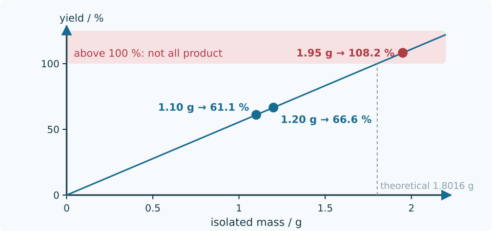{width=72% fig-alt="Straight line of apparent yield against isolated mass through the origin; points at 1.10 g, 61.1 percent, 1.20 g, 66.6 percent, and 1.95 g, 108.2 percent in a red region above 100 percent"}

$$\text{apparent isolated yield} = 100 \times \frac{\text{isolated mass}}{\text{theoretical mass}} = 100 \times \frac{1.20}{1.8016} = 66.6\ \%$$

::: {.try}
**Try it:** you recover 1.10 g instead. What's the yield, and what else changes?

::: {.fragment}
**61.1 %.** Only the numerator changed; the theoretical mass stays 1.8016 g.
:::
:::

::: notes
Call it "apparent" deliberately: the formula treats every milligram on the balance as product. The line is straight because theoretical mass is a constant; that's a property of the arithmetic, not evidence about the chemistry. Point at the red region: you can't make more aspirin than the limiting reagent allows, so a value above 100 % tells you the assumption failed, which is the next slide.
:::

## Yield is not purity

| isolate | mass | apparent yield | spectra |
|---|---|---|---|
| A | 1.10 g | 61.1 % | consistent with aspirin, no extra signals |
| B | 1.95 g | 108.2 % | major extra NMR signals |

Yield measures **how much** you weighed. It says nothing about **what** you weighed. Sample A is probably the better product.

::: {.try}
**Try it:** give two kinds of explanation for B's yield above 100 %.

::: {.fragment}
**Extra mass that isn't product** (residual solvent or water, leftover reagents, by-product) or **an error** (weighing, molar mass, stoichiometry). Not extra aspirin.
:::
:::

::: notes
This is the central idea of the lecture. Students instinctively rank isolates by yield. Turn it around: a high yield with dirty spectra is worse than a modest yield of clean material. Don't let students diagnose a single cause for sample B without evidence; "residual solvent" is a hypothesis to test, for example by drying to constant mass or checking the NMR for solvent peaks. In the aspirin prep, wet crystals that weren't dried properly are the most common culprit.
:::

## TLC separates before you judge

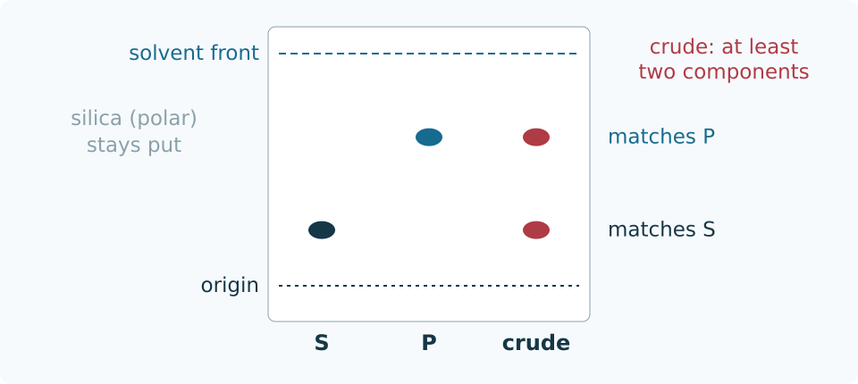{width=72% fig-alt="TLC plate with lanes S, P and crude; the crude lane has spots matching both S and P"}

Compounds that stick more strongly to the polar silica travel less. The crude lane shows **at least two detected components**, matching the references. Spot darkness isn't a measure of amount.

::: notes
Run lanes side by side on the same plate: starting material, product reference, crude. Matching heights on the same plate are much more meaningful than comparing to a number from a book. Two spots in the crude means the reaction is incomplete or starting material survived work-up, at least under this detection method. Resist "the product spot is darker, so 80 % conversion": the eye isn't a calibrated detector. These are teaching data; with a real eluent the order of the spots depends on the conditions.
:::

## Rf: two distances from the same origin

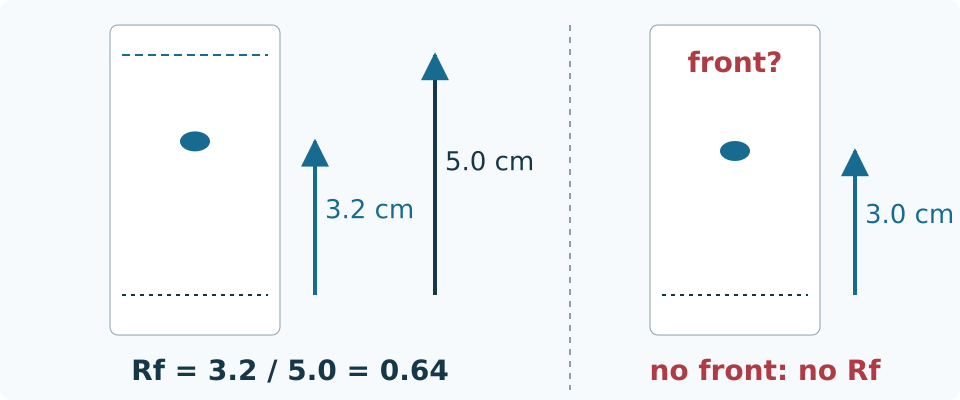{width=78% fig-alt="Left: spot 3.2 cm and front 5.0 cm from the origin give Rf 0.64. Right: a spot at 3.0 cm on a plate with no front marked, so no Rf"}

**Rf = distance to spot centre ÷ distance to solvent front**, both from the origin. Mark the front as soon as the plate comes out: without it there's no denominator, and you can't invent one.

::: {.try}
**Try it:** the starting-material spot is 1.2 cm up, front 5.0 cm. What's its Rf, with units?

::: {.fragment}
**0.24, no units.** Centimetres cancel. The value only holds for that plate, eluent and conditions.
:::
:::

::: notes
Both distances start at the origin line, not the bottom of the plate. Measure to the centre of the spot. The right panel is a real lab-report problem: someone records a spot at 3.0 cm but forgot to mark the front, which evaporates within seconds. The honest answer is "Rf cannot be determined", not "assume the front went to 5 cm". Ask why an Rf from another eluent can't confirm identity: retention depends on the conditions, and even identical values aren't unique to one molecule.
:::

## One spot can hide a mixture

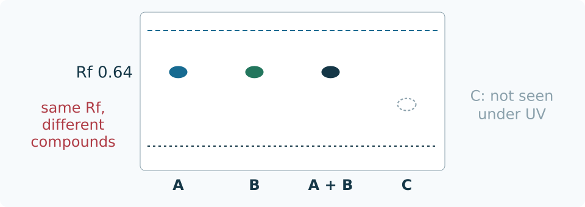{width=74% fig-alt="Lanes A, B and A plus B all show one spot at Rf 0.64; lane C shows a dashed outline for a component not seen under UV"}

Different compounds can **co-migrate** at the same Rf, and some components are **invisible** under UV or the chosen stain. One spot means one *detected* component under these conditions, not proof of purity.

::: {.try}
**Try it:** your product shows a single spot. What evidence would test whether it's pure?

::: {.fragment}
**A different eluent or stain, or an independent method** such as NMR, where a second compound would add its own signals.
:::
:::

::: notes
Students love "one spot, therefore pure". Ask them to explain how the A + B lane could happen: the two compounds simply interact with silica and solvent in the same way. Two follow-ups that genuinely test the claim: rerun in a different solvent system (co-migration rarely survives a change of eluent) and look with a technique that sees the whole sample, like NMR. A melting point is another classic purity check in the aspirin practical: impurities lower and broaden it.
:::

## IR: what should change, what should stay

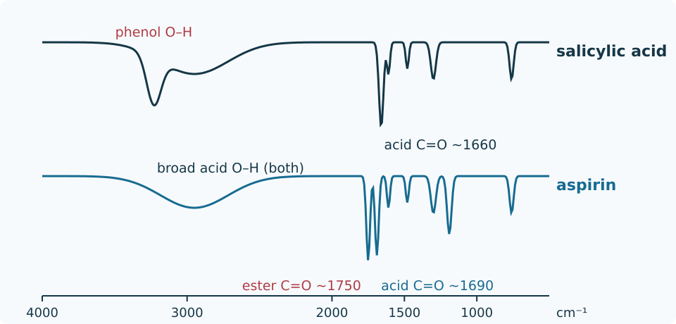{width=80% fig-alt="Two schematic IR traces: both have a broad acid O-H band; salicylic acid has a phenol O-H band and one C=O near 1660; aspirin has an ester C=O near 1750 and an acid C=O near 1690"}

Predict from the structures before you look: the **phenol O–H** should go and an **ester C=O near 1750 cm⁻¹** should appear. The broad **acid O–H** stays, because aspirin is still a carboxylic acid.

So an acid O–H band is not evidence of unreacted salicylic acid. These traces are schematic, not measured.

::: notes
This is Day 2 and Day 21 IR reading applied to a reaction. The logic is "what's lost, what's gained, what's retained". The new ester carbonyl is the most useful positive evidence, appearing next to the acid carbonyl as two bands. The trap is over-interpreting the broad O–H: students see it and write "starting material still present", but the target has an acid O–H too. Be explicit that IR here supports "functional groups consistent with aspirin"; it doesn't measure purity, and a schematic trace documents nothing about a real sample.
:::

## NMR: count every signal

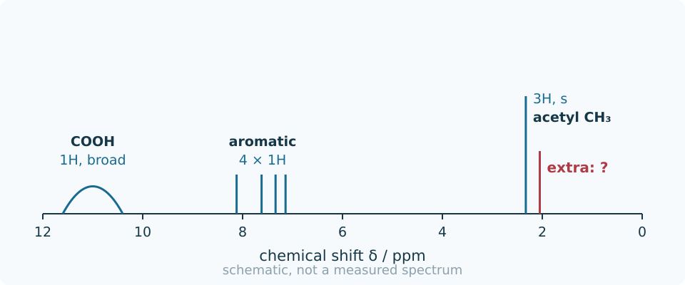{width=82% fig-alt="Stick spectrum: broad 1H COOH near 11 ppm, four 1H aromatic signals between 7.1 and 8.1, a 3H acetyl singlet at 2.3 ppm and an extra red singlet near 2.1 ppm"}

Aspirin predicts **1 + 4 + 3 = 8 H**: acid H, four aromatic H, one CH₃ singlet. Anything else needs explaining.

::: {.try}
**Try it:** this sample gave a good yield and one TLC spot. Should the extra signal be ignored?

::: {.fragment}
**No.** The yield assumed the solid was product; the NMR tests that. Residual solvent, starting material or a by-product are all possible; check integrations and references before naming one.
:::
:::

::: notes
NMR sees everything with hydrogens in it, so it's the strongest purity check students will meet. Walk through the prediction from the structure first, as on Day 21, then compare. The extra singlet is deliberately left unassigned. Acetic acid, a by-product of this very reaction, would give a CH3 singlet near 2.1 ppm, but it's a hypothesis until you check it against a reference. The principle: contradictory evidence beats a convenient number. Never discard a spectrum because the yield looks nice.
:::

## Three claims, three kinds of evidence

| claim | supported by | can't show |
|---|---|---|
| **how much** | mass, theoretical mass, yield | what the solid is |
| **reaction happened** | new TLC spot, starting spot shrinks | exact conversion |
| **identity** | IR and NMR match the predicted structure | purity, on IR alone |
| **purity** | clean NMR, one spot in several eluents | – (never absolute) |

A good conclusion keeps these apart: "Apparent yield 66.6 %; crude TLC shows two components; IR consistent with an aryl ester and an acid."

::: notes
Use this as the template for the practical report. Read out the example sentence and point out what it doesn't claim: it doesn't say "pure aspirin". Ask students to add the limitation that belongs in the next sentence, for example "the crude still contains starting material, so the isolated mass may overstate the product" or "the IR trace was simulated". This is the reasoning the integration day (tomorrow) builds on.
:::

## A report that recomputes itself

```r
amounts <- read_csv("data/amounts.csv", show_col_types = FALSE) |>
  mutate(amount_mol = mass_g / molar_mass_g_mol,
         extent_mol = amount_mol / stoich)
theoretical_mass_g <- min(amounts$extent_mol) * 180.16
isolated_mass_g <- 1.20
isolated_yield_percent <- 100 * isolated_mass_g / theoretical_mass_g
```

| change `isolated_mass_g` to 1.10 | should change | should not change |
|---|---|---|
| after Knit | yield → 61.1 % | amounts, extent, 1.8016 g |

Compute every number from saved raw inputs and put results in the text with **inline R**, never retyped. Then one edited input updates exactly what depends on it.

::: notes
Every number in the report should come from saved raw inputs, and every value in the text should be inline R, not retyped. Then a single change propagates. The dependency rule mirrors the chemistry: theoretical mass depends on the starting masses only; isolated mass only enters the yield. A student who edits the isolated mass and sees the theoretical mass move has a bug. Also warn about min(): it's only right if the table contains just the starting reagents. Automatic updating guarantees consistency, not correctness; wrong stoichiometry recomputes beautifully.
:::

## Mistakes we see every year

| mistake | fix |
|---|---|
| comparing grams to find the limiting reagent | convert to **mol**, divide by the **coefficient** |
| min(10, 8) for 2 A + B → P | 10/2 = 5 versus 8/1 = 8 |
| reporting a yield above 100 % as "excellent" | the solid **isn't all product**, or there's an error |
| ranking samples by yield | yield is **amount**, not purity |
| "one spot, so it's pure" | co-migration and invisible components |
| Rf with no front marked | mark it immediately; otherwise no Rf |
| acid O–H in IR means salicylic acid is left | aspirin **is also an acid** |

::: notes
Read each mistake aloud and ask the room for the fix before you point at the right-hand column. Each row maps to an exercise: limiting reagent (3–7), yield above 100 % (11), yield versus purity (12), Rf and missing fronts (13–15), one spot (16), aspirin IR (17).
:::

## Summary

| concept | key fact |
|---|---|
| route | plan backwards, one functional-group change per step |
| amount | n = m / M, with units |
| limiting reagent | smallest **n / coefficient** |
| theoretical mass | extent × product coefficient × M |
| isolated yield | 100 × isolated / theoretical; **not purity** |
| Rf | spot ÷ front, both from the origin; no units |
| one TLC spot | not proof of identity or purity |
| spectra | predict what's lost, gained and kept |

**Next:** putting the whole course together (Day 23). **Practice:** [exercises](exercise.qmd) · [self-check](quiz.qmd)

::: notes
Close the loop with the opening story: the difference between 1853 and 1897 was not the reaction but the evidence. Recite the three questions once more: how much, is it the right molecule, is it clean. Tomorrow's integration day combines mechanism, spectra and these calculations in single problems. Point students to the exercises: 1–10 are the core calculations and planning, 11–20 the evidence reasoning, and the R task builds the report that the practical needs.
:::
